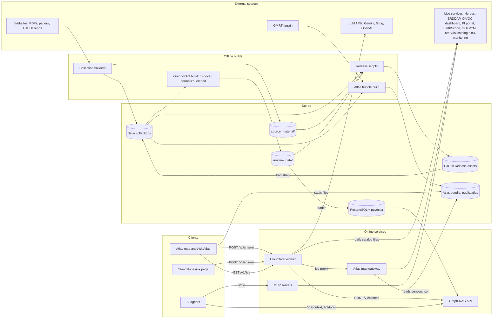

# RCA Atlas knowledge base

A guide to the RCA Atlas repository for an engineer who is new to both the code and its domain. It has 17 chapters,
one per part of the system, and 7 flows that follow a request or a dataset end to end. This page is the entry point:
what the system is, how the parts fit, where things live, and how to run it.

As of commit `1047fc8` (branch `lsetiawan/explore`, 2026-10-09). Every chapter cites the code behind its claims as
`path:line` and ends with a Verification section. See [How this knowledge base was made](#how-this-knowledge-base-was-made).

## What RCA Atlas is

RCA Atlas collects what is known about two ocean observatories off Oregon and makes it answerable:

- The **RCA** (Regional Cabled Array) is the cabled seafloor part of the Ocean Observatories Initiative (OOI). Power and
  fibre-optic cable run from Pacific City to Southern Hydrate Ridge and Axial Seamount, an active undersea volcano.
- **COSZO** (Cascadia Offshore Subduction Zone Observatory) is a second project whose instruments sit at RCA's Oregon
  sites. Its computational outputs live in the public `coszo-hub` GitHub organization.

The repository holds four things (`README.md:3-4`):

1. **Collection builders** that turn documents, websites, papers, instrument inventories, operations data and earthquake
   catalogs into a versioned corpus of JSON Lines collections. JSON Lines is one JSON object per line.
2. **A Graph-RAG runtime.** Graph-RAG is retrieval-augmented generation over a graph: a language model answers from
   retrieved text chunks plus the entities and typed edges linked to them, so each claim can cite its source. The
   runtime loads the corpus into PostgreSQL with the pgvector extension and serves bounded search behind an API key.
3. **Live agent tools.** These are MCP (Model Context Protocol) servers that let an AI agent query current sources:
   quality-control plots, earthquake counts, instrument status, data portals and seismic waveforms.
4. **The Atlas website.** It is a 3D map of the seafloor with every located sensor, live readings, and **Ask Atlas**, a
   question box whose cited answers rise on the map as numbered spikes.

**Who it serves.** The map's design names "scientists and program staff deciding where to look, what exists, and how
to get it" (`docs/superpowers/specs/2026-09-23-atlas-map-design.md:13`). Ask Atlas takes questions from the public site
at `https://coszo.org` (`src/atlas_worker/README.md:3-5`). The MCP servers serve AI agents, and the maintainers build and
release the corpus.

## Architecture



How to read it:

- **Offline.** The builders write `data/`. The Graph-RAG build writes `runtime_data/GraphRAG/`, and its loader fills
  PostgreSQL. The release scripts ship all three folders as private GitHub Release assets, and `bootstrap_machine.sh`
  restores them on another machine.
- **Online.** The browser never holds a key. The Cloudflare Worker is the public boundary. It asks the Graph-RAG API for
  evidence, asks an LLM to write a cited answer, and proxies live-data requests to the gateway. The gateway answers only
  for identifiers listed in the bundle's `sensors.json`, and calls the live services through the same toolkits that the
  MCP servers use.
- **In development** the site's Vite server proxies `/api` straight to the gateway on `127.0.0.1:8787`. It sends
  `/api/ask` to the deployed Worker, unless `VITE_ATLAS_ASK` points at a local one (`src/atlas_map/vite.config.js:4-12`).
- **Two routes share a name.** The Worker's `POST /v1/answer` (Ask Atlas) and the Graph-RAG API's `POST /v1/answer`
  are different services. Only the gateway's `POST /chat` calls the API's route, and nothing in the repository calls
  `/chat` any more.

## Chapters

| Chapter | What it covers |
|---|---|
| [repo-ops-data](chapters/repo-ops-data.md) | How the repo, its data releases and machine restores work, plus the agent tooling. |
| [corpus-docs-web](chapters/corpus-docs-web.md) | Collection builders: COSZO PDFs, figures and datasheets, websites, ARCADA. |
| [corpus-instruments-ops](chapters/corpus-instruments-ops.md) | Instrument, operations and DAS collections, and the live tools beside them. |
| [literature-corpus](chapters/literature-corpus.md) | Builds the literature collection's graph artifacts and audits the Zotero expansion that grew it. |
| [literature-batches](chapters/literature-batches.md) | Numbered retrieval batches that gathered COSZO abstracts and data products for the literature collection. |
| [literature-fulltext](chapters/literature-fulltext.md) | MCP tools that fetch bounded open full-text passages when an abstract is not enough. |
| [graphrag-runtime](chapters/graphrag-runtime.md) | The core: corpus discovery, normalization, embeddings, the PostgreSQL + pgvector load, and the API with its evidence UI. |
| [eval-experiments](chapters/eval-experiments.md) | Compares answer and embedding models on fixed evidence, plus an optional Microsoft GraphRAG candidate layer. |
| [coszo-hub-core](chapters/coszo-hub-core.md) | The COSZO Hub snapshot graph, and the MCP server and tools that query COSZO Hub outputs live. |
| [coszo-hub-sources](chapters/coszo-hub-sources.md) | Tools and graph builders for the PI portal, OOI M2M and EarthScope FDSN sources that the COSZO Hub MCP server also serves. |
| [agentic-qaqc](chapters/agentic-qaqc.md) | MCP tools that join Graph-RAG context with live RCA QA/QC plots and notes and a pinned rca-data-tools backend. |
| [axial](chapters/axial.md) | Axial Seamount earthquake-catalog and monitoring-website collections and their live MCP tools. |
| [atlas-map-scene](chapters/atlas-map-scene.md) | The React + three.js map website: its shell and 3D scene. |
| [atlas-map-panels](chapters/atlas-map-panels.md) | Side panels with live data, the HUD controls, map overlays. |
| [ask-atlas](chapters/ask-atlas.md) | One vertical slice: map sidebar → Cloudflare Worker → Graph-RAG API → LLM, and the evidence it raises on the map. |
| [atlas-map-data](chapters/atlas-map-data.md) | Builds the map's data bundle. |
| [atlas-map-gateway](chapters/atlas-map-gateway.md) | Local live-lookup service behind the map. |

## Flows

| Flow | Path it follows |
|---|---|
| [restore-and-run](flows/restore-and-run.md) | A fresh clone, `scripts/bootstrap_machine.sh`, then `docker compose` `db`, `loader` and `api`, up to an authenticated `POST /v1/context`. |
| [corpus-to-index](flows/corpus-to-index.md) | One collection in `data/` through discovery, normalization, embeddings and the PostgreSQL load to the API functions that read the active build. |
| [ask-atlas](flows/ask-atlas.md) | A question in the map's sidebar, the Worker, Graph-RAG `/v1/context`, the LLM and its fallbacks, numbered citations, and spikes on the map. Also the Worker's direct Axial earthquake count and the standalone page. |
| [live-panel](flows/live-panel.md) | Selecting a sensor, the panel's live views, the Vite or Worker proxy, the gateway's allowlist and cache, and the upstream sources. |
| [agent-tool-call](flows/agent-tool-call.md) | An agent calling the QA/QC and Axial MCP servers, and how each collection's tool manifest reaches the database and the API's tool hints. |
| [atlas-bundle](flows/atlas-bundle.md) | The `atlas_map_data` build, its validation gate, `src/atlas_map/public/atlas/`, and what the map and the gateway load from it. |
| [transfer-release](flows/transfer-release.md) | `build_transfer_release.sh` and the overlay script, GitHub Release assets, and a verified restore on another machine. |

Cross-cutting references: [glossary](glossary.md) (449 terms), [configuration and secrets](configuration.md), and
[open questions](open-questions.md), grouped and with the people who could answer them.

## Reading order for a newcomer

1. This page, then skim the [glossary](glossary.md). Most acronyms (RCA, OOI, refdes, DAS, MCP, HITL) recur everywhere.
2. [repo-ops-data](chapters/repo-ops-data.md): why most of the system's data is not in Git, and how it reaches a machine.
3. [graphrag-runtime](chapters/graphrag-runtime.md), then the [corpus-to-index](flows/corpus-to-index.md) and
   [restore-and-run](flows/restore-and-run.md) flows: the core that everything else feeds or queries.
4. [corpus-instruments-ops](chapters/corpus-instruments-ops.md): the instrument inventory, which nearly every other
   part joins on.
5. The product surface: [ask-atlas](chapters/ask-atlas.md) with its [flow](flows/ask-atlas.md), then
   [atlas-map-scene](chapters/atlas-map-scene.md), [atlas-map-panels](chapters/atlas-map-panels.md),
   [atlas-map-data](chapters/atlas-map-data.md), [atlas-map-gateway](chapters/atlas-map-gateway.md), and the
   [live-panel](flows/live-panel.md) and [atlas-bundle](flows/atlas-bundle.md) flows.
6. The agent tools: [agentic-qaqc](chapters/agentic-qaqc.md), [axial](chapters/axial.md),
   [coszo-hub-core](chapters/coszo-hub-core.md), [coszo-hub-sources](chapters/coszo-hub-sources.md),
   [literature-fulltext](chapters/literature-fulltext.md), and the [agent-tool-call](flows/agent-tool-call.md) flow.
7. The remaining collection builders as needed: [corpus-docs-web](chapters/corpus-docs-web.md),
   [literature-corpus](chapters/literature-corpus.md), [literature-batches](chapters/literature-batches.md); then
   [eval-experiments](chapters/eval-experiments.md) and the [transfer-release](flows/transfer-release.md) flow.
8. Before changing anything: [configuration](configuration.md), [open questions](open-questions.md), and the project
   memory in `knowledge/` (`pixi run okf search "<keywords>"`).

## Where things live

### Code

| Path | Contents |
|---|---|
| `src/<component>/` | One folder per component; the chapters map them in [_meta/plan.md](_meta/plan.md). Python components keep tests beside the code (`test_*.py` or `tests/`); JavaScript keeps `*.test.js(x)` beside the code and Playwright tests in `src/atlas_map/e2e/`. |
| `scripts/` | Release and restore scripts ([repo-ops-data](chapters/repo-ops-data.md)). |
| `docs/superpowers/specs/` | The design specs for the map, the HUD dock and Ask Atlas. |
| `src/DATA_CORPUS_METHOD.md` | The collection method for the whole corpus. `data/CORPUS_METHOD.md` is an older copy that has drifted ([repo-ops-data](chapters/repo-ops-data.md)). |
| `knowledge/`, `.agents/skills/okf-memory/` | Project memory for AI agents, read and written only with the `okf` command. |

### Data

Most data is gitignored and arrives from private GitHub Release assets (`README.md:6-9`; `.gitignore:21-35`).

| Path | Contents | Arrives from |
|---|---|---|
| `data/` | One folder per collection, each with a `manifest.json` and JSONL files. | Release archive `rca-corpus-data-<fingerprint>` |
| `source_material/` | Originals: PDFs, archived web pages, repository checkouts. | Release archive `rca-source-material-<fingerprint>` |
| `runtime_data/` | The Graph-RAG catalog, normalized build and embeddings; SQLite stores; tool caches. | Release archive `rca-runtime-data-<fingerprint>`, plus the full-text overlay `rca-literature-fulltext-<date>` |
| PostgreSQL volume `pgdata` | The loaded, active Graph-RAG build. | `docker compose --profile load run --rm loader` |
| `src/atlas_map/public/atlas/` | The map's data bundle. Only the 1 m Axial summit tiles in `auv/` are committed (`.gitignore:48-52`). | `python -m atlas_map_data.build_atlas_bundle` |

The collections and the chapters that build them. The ids are from `src/graphrag_runtime/discover_corpora.py:22-41`:

| `data/` folder | Collection id | Shown as | Built in |
|---|---|---|---|
| `Arcada` | `arcada` | RCA Information | [corpus-docs-web](chapters/corpus-docs-web.md) |
| `coszo/graphrag` | `coszo_documents` | COSZO documents | [corpus-docs-web](chapters/corpus-docs-web.md) |
| `Datasheets/graphrag` | `datasheets` | Instrument datasheets | [corpus-docs-web](chapters/corpus-docs-web.md) |
| `Figures/graphrag` | `figures` | Curated figures | [corpus-docs-web](chapters/corpus-docs-web.md) |
| `Websites` | `websites` | RCA and COSZO websites | [corpus-docs-web](chapters/corpus-docs-web.md) (the copy into `data/` is not in the repo) |
| `Instruments` | `instruments` | RCA and COSZO instruments | [corpus-instruments-ops](chapters/corpus-instruments-ops.md) |
| `FETCH` | `fetch` | FETCH acoustic ranging stations | [corpus-instruments-ops](chapters/corpus-instruments-ops.md) |
| `Nereus/graphrag` | `nereus` | Nereus operational data | [corpus-instruments-ops](chapters/corpus-instruments-ops.md) |
| `OOIDASGeometry` | `ooi_das_geometry` | OOI RCA OptaSense DAS channel geometry | [corpus-instruments-ops](chapters/corpus-instruments-ops.md) |
| `Literature` | `literature` | Scientific literature | [literature-corpus](chapters/literature-corpus.md), from [literature-batches](chapters/literature-batches.md) |
| `AxialEarthquakes/graphrag` | `axial_earthquakes` | Axial Seamount earthquakes | [axial](chapters/axial.md) |
| `AxialMonitoring` | `axial_monitoring` | OSU Axial monitoring | [axial](chapters/axial.md) |
| `COSZOHub` | `coszo_hub` | COSZO Hub computational outputs | [coszo-hub-core](chapters/coszo-hub-core.md) |
| `PIPortal` | `pi_portal` | RCA PI data portal | [coszo-hub-sources](chapters/coszo-hub-sources.md) |
| `QAQC/graphrag` | `qaqc` | RCA QA/QC capabilities | [agentic-qaqc](chapters/agentic-qaqc.md) |
| `StationMetadata` | `station_metadata` | OOI StationXML metadata | [repo-ops-data](chapters/repo-ops-data.md) |

The code names these 16 collections. The discovery test expects 15, and both the validation SQL and the recorded
deployment status say 13 (`src/graphrag_runtime/test_discover_corpora.py:22`;
`src/graphrag_runtime/validate_loaded_build.sql:10`; `runtime_data/GraphRAG/deployment_status.json:7`). Which set is
current is an [open question](open-questions.md).

### Secrets

No secret is committed. They are set in four places; [configuration.md](configuration.md) lists every name.

- `.env`, from `.env.example`: database passwords, the API key and its digest, model-provider keys, and OOI credentials.
  The gateway reads the root `.env`. Compose reads `src/graphrag_runtime/.env` (see below).
- Cloudflare Worker secrets, set with `wrangler secret put`. Locally they go in `src/atlas_worker/.dev.vars`, which is
  **not gitignored** even though the map README says it is not committed.
- The environment of whatever MCP client launches a `run_mcp.sh`. No client configuration is tracked.
- The GitHub CLI login, for the private release assets.

## How to run it

These commands come from the READMEs. Each chapter's **Run and test** section has the rest.

**Restore the corpus and start the Graph-RAG API** (`README.md:11-23`; `src/graphrag_runtime/README.md:25-34`). This
needs Git, the GitHub CLI logged in, Docker with the Compose plugin, `zstd`, `python3` and `sha256sum`. The README lists
only the first four.

```sh
git clone https://github.com/coszo-hub/RCA-Atlas.git && cd RCA-Atlas
./scripts/bootstrap_machine.sh --release latest      # run from the repo root: it extracts into the current directory
cd src/graphrag_runtime
cp ../../.env.example .env                           # Compose reads .env from this folder (see the note below)
# set POSTGRES_PASSWORD, GRAPHRAG_API_DATABASE_PASSWORD, and GRAPHRAG_API_KEY_SHA256 (the SHA-256 of your client key)
docker compose up -d db
docker compose --profile load run --rm loader
docker compose up -d api                             # http://127.0.0.1:8000, POST /v1/context with X-API-Key
```

Note on `.env`: the graphrag README copies `.env` to the repository root (`src/graphrag_runtime/README.md:32`). Docker
Compose reads `.env` from its project directory, which here is `src/graphrag_runtime/`. Use that folder, or pass
`--env-file ../../.env`. This was not run, because the host has no Compose plugin. The
[restore-and-run](flows/restore-and-run.md) flow has the details, and its open questions list what to check on a real
host.

**Run the map locally** (`src/atlas_map/README.md:3-11`; `src/atlas_map_data/README.md:5-7`; `src/atlas_map_gateway/README.md:5-6`):

```sh
uv venv --python 3.11 .venv
PYTHONPATH=src .venv/bin/python -m atlas_map_data.build_atlas_bundle --refresh-terrain --refresh-external   # first build
uv pip install --python .venv/bin/python -r src/atlas_map_gateway/requirements.txt
PYTHONPATH=src .venv/bin/uvicorn atlas_map_gateway.main:app --app-dir src --host 127.0.0.1 --port 8787
cd src/atlas_map && npm install && npm run dev        # http://127.0.0.1:5175
```

The bundle build needs the restored `data/`. Without the gateway the map still works from the bundle. In development,
Ask Atlas questions go to the deployed Worker. For a local Worker, run `npx wrangler dev --port 8788` in
`src/atlas_worker` and start the site with `VITE_ATLAS_ASK=http://127.0.0.1:8788 npm run dev` (`src/atlas_map/README.md:23-30`).

**Start an MCP server.** Each launcher sets its defaults, then runs `mcp_server.py` over stdio. The launchers are
`src/agentic_qaqc/run_mcp.sh`, `src/axial_earthquakes/run_mcp.sh`, `src/nereus_pipeline/run_mcp.sh`,
`src/coszo_hub_tools/run_mcp.sh` and `src/literature_fulltext/run_mcp.sh`. The OSU monitoring server has no launcher:
start `src/axial_monitoring_website/mcp_server.py` directly. Point an MCP client at the launcher; no client
configuration is tracked here.

**Tests.** The map has `npm test` and `npm run e2e` in `src/atlas_map`, and `npm test` in `src/atlas_worker`. The Python
components keep unit tests beside their code. The exact commands, with their `PYTHONPATH` needs, are in each chapter's
Run and test section.

**Project memory** (`README.md:45-55`): `pixi install`, then `pixi run okf search "<keywords>"`.

## Sharp edges worth knowing first

Found while building this knowledge base. Each is cited in the linked chapter or flow; [open questions](open-questions.md)
has the full list.

- The restore-and-run path has documentation gaps: the `.env` location, an undocumented `sha256sum` and `python3`, and a
  manual host load that cannot reach the database, which publishes no port ([restore-and-run](flows/restore-and-run.md)).
- A missing input does not fail the release build, and an overlay build overwrites the base `release-manifest.json`
  ([transfer-release](flows/transfer-release.md)).
- The loader can activate a build without embeddings, never checks that the embeddings match the build, and nothing
  runs `validate_loaded_build.sql` ([corpus-to-index](flows/corpus-to-index.md)).
- The QA/QC plot index is loaded once per process and never refreshes, in the MCP server and in the map gateway
  ([agentic-qaqc](chapters/agentic-qaqc.md), [agent-tool-call](flows/agent-tool-call.md)).
- "Yesterday" means the asker's local day in Ask Atlas but the UTC day in the Axial MCP tool ([axial](chapters/axial.md)).
- Secrets hygiene: `src/atlas_worker/.dev.vars` is not gitignored, and both Gemini callers put the key in the URL.
  Commits `833c343` through `c9267e0` hold a literal API-role password and an API-key digest in `compose.yaml`
  ([configuration](configuration.md)).

## How this knowledge base was made

[_meta/plan.md](_meta/plan.md) splits the 1,168 tracked files into 17 chapters of about 3,000 lines of code each.
`python3 docs/codebase/_meta/check_plan.py` confirms that every tracked file belongs to exactly one chapter. For each
chapter, one agent wrote it to the [documenter brief](_meta/brief.md), and a second agent checked every citation and
identifier against the code and corrected the chapter in place. The coordinator then spot-checked the two
most-corrected chapters, traced the seven flows, and resolved disagreements between documents against the code. No
code or data was changed.

| Chapter | Claims checked | Corrected | Moved to open questions |
|---|---|---|---|
| [repo-ops-data](chapters/repo-ops-data.md) | 614 | 14 | 2 |
| [corpus-docs-web](chapters/corpus-docs-web.md) | 337 | 26 | 0 |
| [corpus-instruments-ops](chapters/corpus-instruments-ops.md) | 407 | 17 | 1 |
| [literature-corpus](chapters/literature-corpus.md) | about 370 | 24 | 3 |
| [literature-batches](chapters/literature-batches.md) | 828 (346 locators, 482 identifiers) | 28, plus 1 at spot-check | 1 |
| [literature-fulltext](chapters/literature-fulltext.md) | 565 | 20 | 0 |
| [graphrag-runtime](chapters/graphrag-runtime.md) | 396 | 15 | 1 |
| [eval-experiments](chapters/eval-experiments.md) | 194 | 18 | 1 |
| [coszo-hub-core](chapters/coszo-hub-core.md) | 376 | 25 | 1 |
| [coszo-hub-sources](chapters/coszo-hub-sources.md) | 251 | 12 | 0 |
| [agentic-qaqc](chapters/agentic-qaqc.md) | 443 (198 citations, 245 identifiers) | 33 | 2 |
| [axial](chapters/axial.md) | 541 (332 citations, 209 identifiers) | 26 | 1 |
| [atlas-map-scene](chapters/atlas-map-scene.md) | 401 | 14 | 0 |
| [atlas-map-panels](chapters/atlas-map-panels.md) | 253 claim lines (570 citations) | 13 | 1 |
| [ask-atlas](chapters/ask-atlas.md) | 226 | 16 | 1 |
| [atlas-map-data](chapters/atlas-map-data.md) | 211 statements (332 citations) | 18 | 1 |
| [atlas-map-gateway](chapters/atlas-map-gateway.md) | 316 | 16 | 3 |

Verifiers counted differently: some counted citations, some identifiers, some statements. Each chapter's Verification
section says how it counted.
