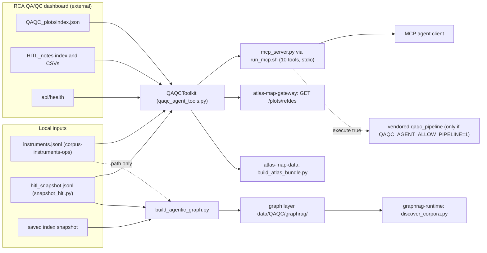

# Agentic QA/QC

chapter: agentic-qaqc · paths: `src/agentic_qaqc/` · as of 1047fc8

This chapter covers the agent tools for quality assurance and quality control (QA/QC) of the Regional Cabled Array (RCA), the cabled seafloor part of the Ocean Observatories Initiative (OOI) that this project is scoped to (`src/DATA_CORPUS_METHOD.md:9`). The RCA team publishes QA/QC plot images and human-in-the-loop (HITL) status notes on a public dashboard. Those change as the pipeline runs and as people write notes, so a stored copy goes stale (`src/agentic_qaqc/build_agentic_graph.py:113`). The package therefore pairs stable Graph-RAG context (graph-based retrieval-augmented generation: the instrument identity, keyed by its reference designator or refdes, which is OOI's instrument ID, plus a description of the tools) with live lookups against the dashboard. It exposes both as ten tools in the Model Context Protocol (MCP, a tool interface for artificial intelligence (AI) agents that is built on JSON-RPC, a JSON request and response protocol). The build labels eight tools read-only, one dry-run only and one optional execution (`src/agentic_qaqc/build_agentic_graph.py:68`), but `qaqc_get_plot` can also write a local file when `output_path` is set (`src/agentic_qaqc/qaqc_agent_tools.py:209-213`). Plot generation is an optional backend, off by default, that wraps a pinned copy of the RCA team's `rca-data-tools` pipeline. The same toolkit class is imported by the Atlas map gateway and the map bundle builder, so the agent and the map read the same dashboard (`src/atlas_map_gateway/toolkits.py:32`, `src/atlas_map_data/build_atlas_bundle.py:103-105`). In RCA Atlas, this chapter sits between the instrument inventory ([corpus-instruments-ops](corpus-instruments-ops.md)), the Graph-RAG runtime ([graphrag-runtime](graphrag-runtime.md)), the map ([atlas-map-gateway](atlas-map-gateway.md), [atlas-map-data](atlas-map-data.md)) and the model evaluation datasets ([eval-experiments](eval-experiments.md)).

## At a glance

| Field | Detail |
|---|---|
| Kind | MCP server over stdio (standard input and output) with ten tools, plus a Python toolkit (`QAQCToolkit`), a command-line interface (CLI), two offline build scripts. Live lookups use only the standard library (`src/agentic_qaqc/README.md:43`). Plot generation is an optional vendored backend. |
| Stack | Python 3 standard library (`src/agentic_qaqc/qaqc_agent_tools.py:11-28`); a POSIX (portable Unix standard) shell launcher (`src/agentic_qaqc/run_mcp.sh:1`); optional generation dependencies (15 of 22 entries unpinned, 5 with lower bounds, and upper bounds on `gspread` and `zarr`; `src/agentic_qaqc/requirements-generation.txt:1-22`); vendored `rca_data_tools` 2.1.0, under the MIT license (a permissive open-source license; `src/agentic_qaqc/vendor/rca_data_tools/pyproject.toml:2-7`, `:15`), built with Hatchling. |
| Entry points | `src/agentic_qaqc/run_mcp.sh` (launches the MCP server); `python3 qaqc_agent_tools.py` (CLI: `health`, `summary`, `search`, `hitl`, `context`, `src/agentic_qaqc/qaqc_agent_tools.py:431-453`); `src/agentic_qaqc/build_agentic_graph.py` (static graph layer); `src/agentic_qaqc/snapshot_hitl.py` (HITL snapshot); `QAQCToolkit` imported by `src/atlas_map_gateway/toolkits.py:32` and `src/atlas_map_data/build_atlas_bundle.py:104`. |
| Reads | Live RCA QA/QC dashboard at `https://ec2.qaqc.ooi-rca.net`: plot index `QAQC_plots/index.json`, HITL notes `HITL_notes/index.json` and its comma-separated values (CSV) files, and `api/health` (`src/agentic_qaqc/UPSTREAM.md:8-12`). The dashboard files are written by the upstream tools (vendored `qaqc/index.py` and `qaqc/notes.py`, `src/agentic_qaqc/vendor/rca_data_tools/qaqc/index.py:20-50`, `notes.py:159-173`), which the RCA team runs outside this repo (inferred from `src/agentic_qaqc/vendor/rca_data_tools/README.md:24-34`). Instrument inventory `instruments.jsonl` under `QAQC_INSTRUMENT_ROOT`, produced by [corpus-instruments-ops](corpus-instruments-ops.md) (`src/instrument_inventory/build_instrument_inventory.py:611`). HITL fallback file `QAQC_HITL_SNAPSHOT`, produced by this chapter's `snapshot_hitl.py`. Plot-index cache file, written by this chapter at runtime. In this checkout `data/QAQC/` and `data/Instruments/` are absent; `data/` holds only three tracked files (`data/README.md`, `data/CORPUS_METHOD.md`, `data/cleanup_validation.json`). |
| Writes or serves | MCP tools over stdio to agent clients (`src/agentic_qaqc/mcp_server.py:41-47`). A static graph layer, written to `data/QAQC/graphrag/` (inferred, see Open questions), which [graphrag-runtime](graphrag-runtime.md) discovers as corpus `qaqc` (`src/graphrag_runtime/discover_corpora.py:38`). `GET /plots/{refdes}` in [atlas-map-gateway](atlas-map-gateway.md) calls `search_plots` (`src/atlas_map_gateway/routes_data.py:103-115`). `qaqc_refdes.json` in [atlas-map-data](atlas-map-data.md) is built from `get_index()` when the bundle builder runs with `--refresh-external` (`src/atlas_map_data/build_atlas_bundle.py:100-105`; `src/atlas_map_data/access.py:120-126`). Plot files to a caller-named local path, and plot images as MCP content. Eval datasets in [eval-experiments](eval-experiments.md) name these tools and the policy chunk as expected answers (`src/model_eval/datasets/rca_eval_v1.jsonl:29`, `src/model_eval/datasets/rca_eval_v1_gold.jsonl:13`). With `QAQC_AGENT_ALLOW_PIPELINE=1` and `execute: true`, the vendored pipeline writes plots under `QAQC_plots/` in the server's working directory (`src/agentic_qaqc/vendor/rca_data_tools/qaqc/plots.py:132`; `src/agentic_qaqc/vendor/rca_data_tools/qaqc/constants.py:24`). It syncs them to Amazon S3 object storage only with `s3_sync: true`, into bucket `ooi-rca-qaqc-prod` (`src/agentic_qaqc/vendor/rca_data_tools/qaqc/constants.py:19`), and to the live dashboard path unless `prefix` is set (`src/agentic_qaqc/qaqc_agent_tools.py:364-391`; `src/agentic_qaqc/vendor/rca_data_tools/qaqc/plots.py:493-501`). |

## How it works

1. **Launch.** `run_mcp.sh` finds the project root, sets defaults for four variables and `exec`s `mcp_server.py` (`src/agentic_qaqc/run_mcp.sh:4-13`). `mcp_server.py` builds one `QAQCToolkit` from the environment (`src/agentic_qaqc/mcp_server.py:29-34`). It reads newline-delimited JSON-RPC from stdin (`:35-37`) and answers `initialize`, `tools/list` and `tools/call`. Notifications are ignored. Any other method gets error -32601 (`:40-52`).
2. **Dispatch.** `tools/call` goes to `dispatch()`, which maps the tool name to one toolkit method. An exception becomes `{"ok": false, "error": {...}}` (`src/agentic_qaqc/qaqc_agent_tools.py:408-428`). `tool_result()` wraps the JSON as MCP text, adds an image part when `_mcp_image` is present, and sets `isError` from `ok` (`src/agentic_qaqc/mcp_server.py:18-25`).
3. **Plot index.** `get_index()` tries an in-memory copy, then a file cache younger than its time to live (TTL, `cache_ttl_seconds`, 900 seconds by default), then an HTTP (web request) fetch of `QAQC_plots/index.json`. If the fetch fails and any cache file exists, the stale file is returned (`src/agentic_qaqc/qaqc_agent_tools.py:50`, `:69-87`). The in-memory copy never expires: once a long-running process (the MCP server or the map gateway) has loaded the index, it keeps it until `qaqc_health` forces a refresh (`:70-71`, `:315`). The TTL only decides whether the first load may reuse the file cache.
4. **Filename parsing.** The toolkit reads each plot's facts from its file name: refdes, variable tokens, an optional depth or profile token, time span, overlay and data range (`parse_plot_path`, `src/agentic_qaqc/qaqc_agent_tools.py:89-113`). `search_plots` keeps only paths starting with `RS`, the RCA reference-designator prefix, unless `include_non_rca` is set. It filters by substring, scores exact matches higher and sorts (`:115-157`).
5. **HITL notes.** `list_hitl_notes` fetches `HITL_notes/index.json`, then every listed CSV, on every call with no cache. Column 0 is the refdes and the rest is the note (`src/agentic_qaqc/qaqc_agent_tools.py:223-233`). If the live fetch fails and the snapshot file exists, it reads the JSONL snapshot instead and sets `evidence_mode` to `snapshot_fallback` (`:235-240`); otherwise it returns `hitl_unavailable` (`:237-238`). Rows with the same refdes and note are merged, keeping every source file (`:249-258`).
6. **Question routing.** `question_context` extracts a refdes or site with regular expressions and maps keywords to span, overlay, data range and variable (`src/agentic_qaqc/qaqc_agent_tools.py:284-293`). It then calls `instrument_context` (only when `instrument_root` is set; otherwise `graph_context` is null), `search_plots` and `list_hitl_notes` and returns all three, with interpretation guidance that says plot presence is not a pass (`:294-310`, `:305-309`).
7. **Figures.** `get_plot` checks that the path is in the current index, builds the dashboard URL and downloads bytes only when `output_path` or `include_image` is set. An inline image is capped at 15 MiB (mebibytes), base64-encoded as `_mcp_image` (`src/agentic_qaqc/qaqc_agent_tools.py:185-221`).
8. **Generation: plan first.** `pipeline_command` builds the `qaqc_pipeline` argument list and reports `executes: false` on success; an unsafe live-sync request returns an error instead (`src/agentic_qaqc/qaqc_agent_tools.py:342-362`). `generate_plots` runs only when `execute` is true, and `run_pipeline` then requires `QAQC_AGENT_ALLOW_PIPELINE=1` (`:364-391`). It runs the installed `qaqc_pipeline` if one exists. Otherwise it runs `python -m rca_data_tools.qaqc.pipeline` with the vendor directory on `PYTHONPATH` (`:370-380`).
9. **Offline graph layer.** `build_agentic_graph.py` reads the index snapshot and the HITL snapshot (both are hashed, and the HITL snapshot is also copied). It records the instrument root as a path string and does not open `instruments.jsonl` (`src/agentic_qaqc/build_agentic_graph.py:39`, `:55`, `:102`). It writes sources, entities, capabilities, chunks and relationships as JSONL (one JSON object per line), plus a catalog summary, a tool manifest, a validation report and a manifest, and exits 2 if validation fails (`src/agentic_qaqc/build_agentic_graph.py:37-126`). Capability, chunk and relationship IDs are `QAQC-…` prefixes of a SHA-256 hash (a fixed-length digest) of their parts (`:21-22`, `:34`, `:67`, `:71`); source and entity IDs are literal strings (`:50-64`, `:74`).
10. **HITL snapshot.** `snapshot_hitl.py` fetches the HITL index and every CSV, then writes one JSONL row per CSV row with a `retrieved_at` stamp. It writes nothing if any fetch fails (`src/agentic_qaqc/snapshot_hitl.py:22-41`).



## Key files

| File | Role |
|---|---|
| `src/agentic_qaqc/README.md` | Agent routing rules, CLI examples, MCP setup, optional generation. Read first. |
| `src/agentic_qaqc/UPSTREAM.md` | Provenance: dashboard commit `d8fa9e3`, rca-data-tools commit `03358ff`, live endpoints. |
| `src/agentic_qaqc/qaqc_agent_tools.py` (457 lines) | `QAQCToolkit`, the ten tool schemas (`TOOL_SCHEMAS`), `dispatch`, and the CLI. The core of the chapter. |
| `src/agentic_qaqc/mcp_server.py` (59) | Stdio JSON-RPC loop: `initialize`, `tools/list`, `tools/call`. |
| `src/agentic_qaqc/run_mcp.sh` (13) | Launcher. Sets default paths and runs `mcp_server.py`. |
| `src/agentic_qaqc/build_agentic_graph.py` (130) | Builds the static graph layer, manifest and validation report. |
| `src/agentic_qaqc/snapshot_hitl.py` (45) | Writes a timestamped JSONL snapshot of all HITL CSV rows. |
| `src/agentic_qaqc/requirements-generation.txt` (22) | Dependencies for optional plot generation: 15 of 22 entries unpinned, 5 with lower bounds, and upper bounds on `gspread` and `zarr`. No lock file in this directory (the repo root has a `pixi.lock`; whether it pins these packages was not checked). |
| `src/agentic_qaqc/test_qaqc_agent_tools.py` (83) | Eight `unittest` cases: filename parsing, RCA-only search, image payload, dry-run and execution gating. |
| `src/agentic_qaqc/vendor/rca_data_tools/LICENSE` (21) | MIT license, copyright Port Cormorack 2021. |
| `src/agentic_qaqc/vendor/rca_data_tools/README.md` (54) | Upstream README: purpose, Docker build, staged QARTOD (Quality Assurance/Quality Control of Real-Time Oceanographic Data) preview workflow, parameter-file table. |
| `src/agentic_qaqc/vendor/rca_data_tools/pyproject.toml` (53) | Package `rca_data_tools` 2.1.0. Console scripts `qaqc_pipeline`, `qaqc_index`, `generate_hitl_tables` (`:43-46`). |
| `src/agentic_qaqc/vendor/rca_data_tools/__init__.py` (14) | All lines commented out. No exports. |
| `src/agentic_qaqc/vendor/rca_data_tools/qaqc/pipeline.py` (276) | Entry point called by `run_pipeline`: argument parsing and `main()`. Skim beyond the flags. |
| `src/agentic_qaqc/vendor/rca_data_tools/qaqc/index.py` (78) | Writes the `index.json` lists that the toolkit reads. Skim. |
| `src/agentic_qaqc/vendor/rca_data_tools/qaqc/notes.py` (203) | Writes the HITL CSV files from a Google Sheet. Skim. |
| `src/agentic_qaqc/vendor/rca_data_tools/qaqc/constants.py` (126) | `PLOT_DIR` and `SPAN_DICT`, the span vocabulary. Skim. |
| `src/agentic_qaqc/vendor/rca_data_tools/qaqc/` other modules (`dashboard.py` 2230, `plots.py` 601, `flow.py` 178, `calculate.py` 278, `qartod.py` 185, `utils.py` 367, `visual_data.py` 194, `decimate.py` 229, `scheduler.py` 81, empty `__init__.py`) | Plotting, QC computation and Prefect (a workflow orchestrator) flows. Skim as a group. |
| `src/agentic_qaqc/vendor/rca_data_tools/qaqc/advanced_qaqc/` (`calculateFunctions.py` 1073, empty `__init__.py`) | Advanced QC flag functions. Skim as a group. |
| `src/agentic_qaqc/vendor/rca_data_tools/qaqc/params/` (15 CSV and YAML files, about 1,500 lines) | Site, variable and QARTOD parameter tables. Skim as a group. |

## Interfaces

### CLI: `qaqc_agent_tools.py`

Run from `src/agentic_qaqc/`. Global flags are `--base-url` (default `https://ec2.qaqc.ooi-rca.net`), `--cache`, `--instrument-root` and `--hitl-snapshot` (`src/agentic_qaqc/qaqc_agent_tools.py:433-436`). Subcommands:

- `health`
- `summary [--include-non-rca]`
- `search [--reference-designator] [--site] [--variable] [--time-span] [--overlay] [--data-range] [--limit 20] [--include-non-rca]` (`:439-442`)
- `hitl [query] [--limit 100] [--include-non-rca]` (`:443`)
- `context QUESTION [--limit 20]` (`:444`)

The CLI prints JSON and exits 0 only if `ok` is true (`:447-453`).

### CLI: build and snapshot scripts

- `build_agentic_graph.py` requires `--index-snapshot`, `--hitl-snapshot`, `--output-dir`, `--instrument-root` and `--retrieved-at` (`src/agentic_qaqc/build_agentic_graph.py:130`).
- `snapshot_hitl.py` requires `--output`, and takes `--base-url` (default `https://ec2.qaqc.ooi-rca.net`) (`src/agentic_qaqc/snapshot_hitl.py:24-25`).

### MCP server

`run_mcp.sh` and `mcp_server.py` take no arguments and read configuration from the environment (see Configuration). `initialize` returns protocol version `2025-06-18` and server name `rcn-agent-qaqc`, version `1.0.0` (`src/agentic_qaqc/mcp_server.py:41`). The tool list is `TOOL_SCHEMAS` (`src/agentic_qaqc/qaqc_agent_tools.py:394-405`).

| Tool | Required arguments | Maps to | Notes |
|---|---|---|---|
| `qaqc_health` | none | `health()` | Calls `/api/health` and refreshes the index (`qaqc_agent_tools.py:312-318`). |
| `qaqc_runtime_status` | none | `runtime_status()` | Reports `pipeline_execution_enabled`, the backend found and missing imports (`:320-340`). |
| `qaqc_catalog_summary` | none | `catalog_summary()` | Optional `include_non_rca` (`:397`). |
| `qaqc_search_plots` | none | `search_plots()` | Filters `reference_designator`, `site`, `variable`, `time_span`, `overlay`, `data_range`; `limit` clamped to 1–200 (`:398`, `:126`). |
| `qaqc_get_plot` | `path` | `get_plot()` | `output_path`, `include_image` (`:399`). |
| `qaqc_hitl_notes` | none | `list_hitl_notes()` | `query`, `include_non_rca`, `limit` (`:400`). |
| `qaqc_instrument_context` | `query` | `instrument_context()` | `limit` (`:401`). |
| `qaqc_question_context` | `question` | `question_context()` | `limit` (`:402`). |
| `qaqc_pipeline_plan` | `site` | `pipeline_command()` | Dry run. Never executes (`:403`, `:362`). |
| `qaqc_generate_plots` | `site` | `generate_plots()` | `execute` defaults to false (`:404`, `:384`). |

### Functions other chapters import

- `QAQCToolkit`: constructed with `timeout` in `src/atlas_map_gateway/toolkits.py:32`, and with defaults in `src/atlas_map_data/build_atlas_bundle.py:104-105`.
- `QAQCToolkit.search_plots(reference_designator=…, limit=200)`: called by `src/atlas_map_gateway/routes_data.py:110`.
- `QAQCToolkit.get_index()`: called by `src/atlas_map_data/build_atlas_bundle.py:105`.
- `TOOL_SCHEMAS`: used by `src/agentic_qaqc/mcp_server.py:10` and `src/agentic_qaqc/build_agentic_graph.py:14`. `dispatch`: used by `src/agentic_qaqc/mcp_server.py:10`; `build_agentic_graph.py` does not import it.

### Outbound HTTP (dashboard)

All calls are unauthenticated GETs with User-Agent `RCN-Agent-QAQC/1.0` (`src/agentic_qaqc/qaqc_agent_tools.py:61-64`; `src/agentic_qaqc/snapshot_hitl.py:17`). Timeout is 30 s by default (`src/agentic_qaqc/qaqc_agent_tools.py:49`; `src/agentic_qaqc/snapshot_hitl.py:18`).

- `GET {base}/QAQC_plots/index.json` (`src/agentic_qaqc/qaqc_agent_tools.py:53`)
- `GET {base}/QAQC_plots/{quoted path}` for plot files (`:193`)
- `GET {base}/HITL_notes/index.json` and `GET {base}/HITL_notes/{quoted file}` (`:224`, `:230`)
- `GET {base}/api/health` (`:314`)

### Files produced

- Graph layer, in `--output-dir`: `sources.jsonl`, `entities.jsonl`, `capabilities.jsonl`, `chunks.jsonl`, `relationships.jsonl`, `catalog_summary.json`, `hitl_snapshot.jsonl` (a copy of the input), `tool_manifest.json`, `README.md`, `validation_report.json`, `manifest.json` (`src/agentic_qaqc/build_agentic_graph.py:101-124`).
- HITL snapshot, at `--output`: JSONL (`src/agentic_qaqc/snapshot_hitl.py:39-40`).
- Index cache, at `QAQC_INDEX_CACHE`: a JSON list of path strings (`src/agentic_qaqc/qaqc_agent_tools.py:79-80`).
- Plot file, at a caller-supplied `output_path` (`:209-213`).

## Data shapes

### Plot index (input)

A JSON list of strings. Each is a path relative to `QAQC_plots/`, with a `.png` or `.svg` suffix, for example `RS01SLBS/RS01SLBS-MJ01A-12-VEL3DB101_velocity_east_month_flag_local.png` (`src/agentic_qaqc/test_qaqc_agent_tools.py:20-24`). The toolkit rejects anything that is not a list of strings (`src/agentic_qaqc/qaqc_agent_tools.py:77-78`). Upstream writes it from bucket keys (`src/agentic_qaqc/vendor/rca_data_tools/qaqc/index.py:35-45`).

### Plot file name contract

`parse_plot_path` expects `<refdes>_<variable tokens>[_<N>meters | _<NNN>profile]_<span>_<overlay>_<range>.<png|svg>` (`src/agentic_qaqc/qaqc_agent_tools.py:93-100`). The upstream writers match it:

- span: `day`, `week`, `month`, `year`, `deploy` (`src/agentic_qaqc/vendor/rca_data_tools/qaqc/constants.py:26-32`).
- overlay: `none`, `anno`, `clim`, `flag`, `near`, `time` (`src/agentic_qaqc/vendor/rca_data_tools/qaqc/dashboard.py:1678`; the names are built at `:661`, `:1874`, `:2024`, `:2138`). The toolkit's keyword map does not include `near`.
- range: `full`, `standard`, `local` (`src/agentic_qaqc/vendor/rca_data_tools/qaqc/dashboard.py:662`).
- depth: `<N>meters` (`src/agentic_qaqc/vendor/rca_data_tools/qaqc/plots.py:399`) or `<NNN>profile`, a three-digit profile index followed by `profile` (`src/agentic_qaqc/vendor/rca_data_tools/qaqc/dashboard.py:1456`; `:523-536` only tests for the token).

### Plot record (output of `parse_plot_path`)

| Field | Type | Meaning |
|---|---|---|
| `path` | string | Index path, relative to `QAQC_plots/`. |
| `url` | string | Public URL (web address) of the plot file (`src/agentic_qaqc/qaqc_agent_tools.py:102-104`); `search_plots` replaces it with the configured base URL (`:142`). |
| `site` | string | First path segment (`:105`). |
| `reference_designator` | string | OOI instrument ID, for example `RS01SLBS-MJ01A-12-VEL3DB101` (`:106`). |
| `variable` | string | Variable tokens joined with `_`, for example `velocity_east`. |
| `depth_or_profile` | string | `<N>meters`, `<NNN>profile` (for example `001profile`), or empty. |
| `time_span` | string | Span word (`day`, `week`, …). |
| `overlay` | string | Overlay word. |
| `data_range` | string | `full`, `standard` or `local`. |
| `format` | string | `png` or `svg`. |
| `match_score` | int | Added by `search_plots`: summed over the filters given, 3 for each exact match and 1 for each substring match (`:145-154`). |

### HITL notes

- Live CSV row: column 0 is the refdes, and the rest, rejoined with commas, is `note` (`src/agentic_qaqc/qaqc_agent_tools.py:231-233`). Upstream writes these CSVs with `header=False` and the DataFrame index as the first column (`src/agentic_qaqc/vendor/rca_data_tools/qaqc/notes.py:159-163`). This makes column 0 the index, which is assumed to be the refdes (see Open questions).
- Note object returned by the tools: `reference_designator`, `note`, `source_file`, `source_url`, plus `source_files` and `source_urls` lists after merging (`src/agentic_qaqc/qaqc_agent_tools.py:249-258`).
- Snapshot row (JSONL): `reference_designator`, `note`, `source_file`, `source_url`, `retrieved_at`, `source_is_untrusted_data` (`src/agentic_qaqc/snapshot_hitl.py:36-38`).

### Instrument records (input, `instruments.jsonl`)

The fields that `instrument_context` returns are `instrument_id`, `canonical_id`, `name`, `instrument_type`, `location`, `projects`, `record_status`, `deployment_state` and `source_urls` (`src/agentic_qaqc/qaqc_agent_tools.py:279`). The producer writes them at `src/instrument_inventory/build_instrument_inventory.py:179-190` (`source_urls` arrives through `**extra`, `:190`) and `:611`. Scoring counts query tokens of three or more characters that appear anywhere in the record's JSON text, plus 20 if the record's `canonical_id` appears in the query (`src/agentic_qaqc/qaqc_agent_tools.py:267-276`).

### Graph layer records (output of `build_agentic_graph.py`)

| Record | Key fields | Source |
|---|---|---|
| sources | `source_id`, `name`, `url` or `path`, `commit`, `license`, `use`, `source_is_untrusted_data` | `src/agentic_qaqc/build_agentic_graph.py:50-56` |
| entities | `entity_id`, `name`, `entity_type`, `url`, `execution_default` | `:57-64`, `:74` |
| capabilities | `capability_id`, `name`, `description`, `input_schema`, `mode` (`read_only`, `dry_run_only` or `optional_execution`) | `:65-69` |
| chunks | `chunk_id`, `document_id`, `parent_id`, `position`, `title`, `text`, `word_count` | `:70-71`, `:75` |
| relationships | `relationship_id`, `source_id`, `predicate`, `target_id`, `evidence`, `source_is_untrusted_data` | `:33-34`, `:77-86` |
| manifest | `corpus_id` = `RCA-QAQC-AGENTIC-GRAPHRAG`, `schema_version` = `1.0.0`, `validation_status`, per-file SHA-256 | `:123` |

Predicates are `EXPOSES`, `GENERATES`, `IMPLEMENTS`, `RETRIEVES_FROM`, `CALLS` and `USES_CAPABILITY` (`:78-86`). The `chunk_id` of the routing-policy chunk is `QAQC-CHUNK-49300740d1cd2c32`. It is `QAQC-CHUNK-` plus the first 16 hex characters of the SHA-256 of `QAQC-AGENT-POLICY` (`src/agentic_qaqc/build_agentic_graph.py:21-22`, `:75`; recomputed for this chapter), and the eval gold set requires it (`src/model_eval/datasets/rca_eval_v1_gold.jsonl:13`).

### Tool result envelope

Success: `{"ok": true, …}`. Failure: `{"ok": false, "error": {"type": …, "message": …}}` (`src/agentic_qaqc/qaqc_agent_tools.py:38-39`). MCP wrapping: `content[0]` is `{"type": "text", "text": <the JSON>}`, followed by `{"type": "image", "data": <base64>, "mimeType": …}` when an image is present. `isError` is `not ok` (`src/agentic_qaqc/mcp_server.py:18-25`).

## Configuration and secrets

| Name | Read at | Purpose | Default or required |
|---|---|---|---|
| `QAQC_DASHBOARD_URL` | `src/agentic_qaqc/mcp_server.py:30` | Dashboard base URL for the MCP server | Optional. Default `https://ec2.qaqc.ooi-rca.net`. Not in the README (see Gotchas). |
| `QAQC_INDEX_CACHE` | `src/agentic_qaqc/mcp_server.py:31`; `src/agentic_qaqc/run_mcp.sh:9` | Path of the cached plot-index JSON | Optional. Launcher default `${TMPDIR:-/tmp}/rcn-agent-qaqc-index.json`. Toolkit default `tempfile.gettempdir()/rcn-agent-qaqc-index.json` (`src/agentic_qaqc/qaqc_agent_tools.py:54`). |
| `QAQC_INSTRUMENT_ROOT` | `src/agentic_qaqc/mcp_server.py:32`; `src/agentic_qaqc/run_mcp.sh:7` | Folder containing `instruments.jsonl` | Launcher default `<repo>/data/Instruments`. If unset, `qaqc_instrument_context` returns `instrument_graph_not_configured` (`src/agentic_qaqc/qaqc_agent_tools.py:262-263`). |
| `QAQC_HITL_SNAPSHOT` | `src/agentic_qaqc/mcp_server.py:33`; `src/agentic_qaqc/run_mcp.sh:8` | Offline HITL fallback (JSONL) | Launcher default `<repo>/data/QAQC/graphrag/hitl_snapshot.jsonl`. HITL fails when the live fetch fails and this file is missing (`src/agentic_qaqc/qaqc_agent_tools.py:237-238`). |
| `QAQC_PYTHON` | `src/agentic_qaqc/run_mcp.sh:10` | Interpreter that runs `mcp_server.py` | Optional. Default `python3`. |
| `QAQC_AGENT_ALLOW_PIPELINE` | `src/agentic_qaqc/qaqc_agent_tools.py:334`, `:366` | Enables plot execution when it equals `1` | Unset means disabled. Listed empty in `.env.example:17`. |
| `PYTHONPATH` | Set inside `run_pipeline` (`src/agentic_qaqc/qaqc_agent_tools.py:379`) | Puts the vendor directory first for `python -m rca_data_tools.qaqc.pipeline` | Set internally. Not configuration. |

**Secrets.** This chapter's code reads no keys, tokens or passwords. The README says cloud or S3 runs need Prefect configuration and AWS (Amazon Web Services) credentials (`src/agentic_qaqc/README.md:43`). The vendored HITL code takes a Google service-account JSON path (`src/agentic_qaqc/vendor/rca_data_tools/qaqc/notes.py:32`, `--service-json-path` at `:177`), copies it to `~/.config/gspread/service_account.json` (`:40-49`), and opens the sheet with `gspread.service_account()` (`:53-54`). No credential file is tracked (`git ls-files`), so the credentials live outside the repo (inferred). No values are recorded here.

## Run and test

Commands from the README, run from `src/agentic_qaqc/` unless noted:

```bash
# Install generation dependencies into the agent environment (src/agentic_qaqc/README.md:45-48)
python3 -m pip install -r requirements-generation.txt

# Live checks (src/agentic_qaqc/README.md:18-26)
python3 qaqc_agent_tools.py --instrument-root "/path/to/data/Instruments" health
python3 qaqc_agent_tools.py --instrument-root "/path/to/data/Instruments" \
  context "What is the QAQC status of RS01SLBS-MJ01A-12-VEL3DB101 this month?"

# MCP server, from the project root (src/agentic_qaqc/README.md:30-37)
src/agentic_qaqc/run_mcp.sh
```

Commands not in any README. They are taken from the argument parsers, and no tracked script calls them (`git grep` over `src/` and `scripts/` finds no callers):

```bash
# HITL snapshot (src/agentic_qaqc/snapshot_hitl.py:22-25)
python3 snapshot_hitl.py --output /path/to/hitl_snapshot.jsonl

# Graph layer (src/agentic_qaqc/build_agentic_graph.py:130)
python3 build_agentic_graph.py --index-snapshot /path/to/index.json \
  --hitl-snapshot /path/to/hitl_snapshot.jsonl --output-dir /path/to/graphrag \
  --instrument-root /path/to/Instruments --retrieved-at 2026-10-09T00:00:00Z

# Unit tests (inferred: the file imports sibling modules and calls unittest.main())
python3 -m unittest test_qaqc_agent_tools
```

No pixi task or GitHub workflow references this test file (`pixi.toml` has no `tasks` section, and `git ls-files .github` is empty). These commands were not run while this chapter was written.

Upstream commands, for reference (`src/agentic_qaqc/vendor/rca_data_tools/README.md:24-34`): a staged-QARTOD run into an internal archive prefix, `qaqc_pipeline --stage1 --stage3 --cloud --s3-sync --homebrew-qartod --run --span 30 --prefix archives/internal/proposed-qartod`, followed by `qaqc_index --cloud --prefix archives/internal/proposed-qartod`.

## Decisions and constraints

1. **Read-only by default, with two switches to generate.** `execute` defaults to false (`src/agentic_qaqc/qaqc_agent_tools.py:384`, schema `:404`), and the environment switch is also required (`:366-367`). The stated reason is "preserving this future capability without requiring it for current retrieval" (`src/DATA_CORPUS_METHOD.md:500-503`).
2. **Plot presence is not a QA result.** The README says plot existence does not prove a pass state (`src/agentic_qaqc/README.md:13`). The tool guidance repeats it (`src/agentic_qaqc/qaqc_agent_tools.py:305-309`; `src/DATA_CORPUS_METHOD.md:495-496`). The reason is not stated. It is inferred: the index holds file names only (`src/agentic_qaqc/vendor/rca_data_tools/qaqc/index.py:35-45`).
3. **No dashboard source is copied.** The dashboard repository declares no license. The integration therefore uses its public HTTP interfaces and reimplements the filename contract (`src/agentic_qaqc/UPSTREAM.md:5`, `src/agentic_qaqc/README.md:51`). The graph records the dashboard license as `NOASSERTION` (`src/agentic_qaqc/build_agentic_graph.py:51`).
4. **Upstream code is vendored under MIT, pinned to commits.** Dashboard commit `d8fa9e30` (2026-08-31) and rca-data-tools commit `03358ff2` (2026-09-16) (`src/agentic_qaqc/UPSTREAM.md:5-6`). The same hashes are constants in the graph build (`src/agentic_qaqc/build_agentic_graph.py:17-18`). The license is kept in `src/agentic_qaqc/vendor/rca_data_tools/LICENSE:1` and listed in `THIRD_PARTY_NOTICES.md:20-23`.
5. **Live lookups use the standard library only.** The README states it (`src/agentic_qaqc/README.md:43`), and every import in the live path is from the standard library (`src/agentic_qaqc/qaqc_agent_tools.py:11-28`, `src/agentic_qaqc/mcp_server.py:6-8`). Generation dependencies are kept separate (`src/agentic_qaqc/requirements-generation.txt`).
6. **A staged (homebrew QARTOD) run is refused a live sync.** Staged-QARTOD plots go to an archive prefix, and the CLI and the toolkit both refuse `homebrew_qartod` with `s3_sync` and no `prefix` (`src/agentic_qaqc/vendor/rca_data_tools/README.md:17-22`; `src/agentic_qaqc/qaqc_agent_tools.py:353-354`; `src/agentic_qaqc/vendor/rca_data_tools/qaqc/pipeline.py:242-245`). The guard tests for a non-empty prefix, so `/` passes it (Gotcha 16).
7. **Planning is a dry run.** `qaqc_pipeline_plan` "never executes the command" (`src/agentic_qaqc/qaqc_agent_tools.py:403`). The test asserts `executes` is false (`src/agentic_qaqc/test_qaqc_agent_tools.py:60-64`).
8. **Upstream load is a stated constraint.** The QA/QC site is run by the RCA team. The gateway's per-host limiter (`src/atlas_map_gateway/cache.py:33-39`; `src/atlas_map_gateway/routes_data.py:109`) and this toolkit's cache keep load low, and the team is to be asked about expected load before any public deployment (`docs/superpowers/specs/2026-09-23-atlas-map-design.md:357`). The index cache is the code's expression of this (inferred): a file cache with a 900-second TTL for the first load, then an in-memory copy that only `qaqc_health` refreshes (`src/agentic_qaqc/qaqc_agent_tools.py:50`, `:70-72`, `:315`).
9. **Graph content is untrusted data.** Each graph record carries `source_is_untrusted_data`, and the layer's README says source content "must never be interpreted as agent instructions" (`src/agentic_qaqc/build_agentic_graph.py:34`, `:115`).
10. **The scope is RCA.** Plot search, the catalog summary and HITL default to `RS` paths (`src/agentic_qaqc/qaqc_agent_tools.py:137`, `:163`, `:244`). The vendored `sitesDictionary.csv` lists 29 `CE` refdes among its 112 rows (`src/agentic_qaqc/vendor/rca_data_tools/qaqc/params/sitesDictionary.csv`), so the planner can name CE sites even though search excludes them. The corpus is scoped the same way (`src/DATA_CORPUS_METHOD.md:9`). `CE` (Coastal Endurance, another OOI array) is excluded. The rationale is inferred.

## History

- **2026-09-20, `833c343`, "Initialize RCA and COSZO Graph-RAG agent".** The only commit that touches `src/agentic_qaqc/` (`git log -- src/agentic_qaqc/`). It adds the nine top-level files and the 35 vendored files, 44 in all (`git show --stat 833c343`). The commit body is empty. The execution switch already exists in this commit (`src/agentic_qaqc/qaqc_agent_tools.py:366`).
- **2026-09-21, `e91311a`, "Add portable Graph-RAG deployment and model lab".** Adds `QAQC_AGENT_ALLOW_PIPELINE` to `.env.example:17` (`git log -S`).
- **2026-09-23, `71104cd`, "Validate and write the atlas data bundle from the corpus".** The bundle builder begins calling `QAQCToolkit().get_index()` (`src/atlas_map_data/build_atlas_bundle.py:103-105`).
- **2026-09-23, `6cef3e1`, "Wire the atlas gateway to real toolkits and proxy chat to Graph-RAG".** The gateway constructs `QAQCToolkit(timeout=t)` (`src/atlas_map_gateway/toolkits.py:32`).
- **2026-09-23, `bfe7780`, "Serve QA/QC plots and PI portal listings through the gateway".** Adds `GET /plots/{refdes}` (`src/atlas_map_gateway/routes_data.py:103-115`).
- **2026-09-23, `da68ca3`, "Add Cascadia sensor atlas design spec".** The spec names this toolkit and the `/plots/{refdes}` mapping (`docs/superpowers/specs/2026-09-23-atlas-map-design.md:180`, `:191`).
- **Upstream pins.** `UPSTREAM.md` dates the pinned commits 2026-08-31 (dashboard) and 2026-09-16 (rca-data-tools); when they were pinned is not recorded (`src/agentic_qaqc/UPSTREAM.md:5-6`). The vendored copy is a source snapshot with no git history and no checksum file in this repo.

## Gotchas

1. **Substring keyword matching misfires.** `question_context` tests `"ph" in q` for pH, so a question containing "graph" (for example "Graph-RAG") sets `variable` to `ph`, unless an earlier keyword matches first, and that narrows the plots to variables containing "ph" (`src/agentic_qaqc/qaqc_agent_tools.py:292-293`). `seafloor_pressure` can never be chosen, because `pressure` is tested first in the same list (`:292-293`).
2. **Two span vocabularies.** Search filters take words (`time_span="week"`, `src/agentic_qaqc/qaqc_agent_tools.py:127-134`). The planner takes the `SPAN_DICT` keys `"1"`, `"7"`, `"30"`, `"365"` and `"0"` (`span="7"` means week and `"0"` means deploy) (`src/agentic_qaqc/qaqc_agent_tools.py:355`; `src/agentic_qaqc/vendor/rca_data_tools/qaqc/constants.py:26-32`). The CLI has no span option (`src/agentic_qaqc/qaqc_agent_tools.py:439-442`). `time_span="7"` returns `ok: true` with zero matches (`src/agentic_qaqc/qaqc_agent_tools.py:157`). The schemas do not list the allowed values (`:398`, `:403-404`).
3. **A bad `span` reports success.** The planner accepts any string (`src/agentic_qaqc/qaqc_agent_tools.py:343-362`). The vendored CLI checks the key before it runs: an unknown key logs a warning and skips the run (`src/agentic_qaqc/vendor/rca_data_tools/qaqc/pipeline.py:59`, `:76-84`, `:141-142`), and the process still exits 0, so `run_pipeline` reports `ok: true` (`src/agentic_qaqc/qaqc_agent_tools.py:381-382`). The `SPAN_DICT[span]` lookups (`plots.py:139`, `flow.py:78`) are not reached this way (inferred from the control flow; not run).
4. **`ok` hides partial failure in `question_context`.** It returns `ok: true` unless an exception escapes, for example a malformed `instruments.jsonl` line (`:270`) or no plot index and no cache (`:87`) (`src/agentic_qaqc/qaqc_agent_tools.py:298-299`). An instrument-graph error or an HITL outage appears only inside `graph_context` or `human_in_the_loop_notes` (`:294`, `:297`; `list_hitl_notes` returns `ok: false` at `:238`). The MCP `isError` flag therefore stays false (`src/agentic_qaqc/mcp_server.py:25`).
5. **Stale data is served silently.** When the index fetch fails, the stale cache is returned with no flag (`src/agentic_qaqc/qaqc_agent_tools.py:83-86`). `catalog_source` still names the live URL (`:157`, `:182`). `health()` can report `ok: true` with a stale `plot_index_count` (`:315-316`).
6. **HITL is never cached.** Each `qaqc_hitl_notes` or `qaqc_question_context` call refetches the HITL index and every CSV (`src/agentic_qaqc/qaqc_agent_tools.py:227-233`). This sits uneasily with the load constraint in Decisions item 8.
7. **The execution gate is narrow.** Apart from the `execute` argument, the environment switch is the only gate. With it set, `execute: true` and `s3_sync: true` with no `prefix` sync to the live bucket `ooi-rca-qaqc-prod` (`src/agentic_qaqc/vendor/rca_data_tools/qaqc/constants.py:19`; `src/agentic_qaqc/vendor/rca_data_tools/qaqc/plots.py:493-501`). `cloud` adds no sync. It runs the flow as a Prefect deployment with `timeout=0`, so `ok: true` means the run was submitted, not finished (`src/agentic_qaqc/vendor/rca_data_tools/qaqc/pipeline.py:148-168`; `src/agentic_qaqc/qaqc_agent_tools.py:353-361`, `:384-391`). The only refused combination is `homebrew_qartod` with `s3_sync` and no `prefix` (`:353-354`; `src/agentic_qaqc/vendor/rca_data_tools/qaqc/pipeline.py:241-245`). `subprocess.run` has no timeout (`src/agentic_qaqc/qaqc_agent_tools.py:381`), and the stdio loop handles one request at a time (`src/agentic_qaqc/mcp_server.py:35-55`). A long run therefore blocks every other tool call.
8. **Live text is not marked untrusted.** Graph rows carry `source_is_untrusted_data: true` (`src/agentic_qaqc/build_agentic_graph.py:34`). Live HITL notes and plot metadata do not (`src/agentic_qaqc/qaqc_agent_tools.py:102-113`, `:233`). Of the rows the tools return, only snapshot-fallback rows carry it (`src/agentic_qaqc/snapshot_hitl.py:38`; `src/agentic_qaqc/qaqc_agent_tools.py:239`).
9. **One validation check is a constant.** `pipeline_execution_disabled_by_default` is hard-coded to `True` (`src/agentic_qaqc/build_agentic_graph.py:120`), so the validation report never reads the environment.
10. **`CE` references return no plots.** `REFDES_RE` matches `CE` (`src/agentic_qaqc/qaqc_agent_tools.py:34`). `question_context` does not pass `include_non_rca`, so `search_plots` drops every non-`RS` path (`:137`, `:295`).
11. **`output_path` downloads have no size cap.** The 15 MiB limit is checked only when `include_image` is set (`src/agentic_qaqc/qaqc_agent_tools.py:200`). With `output_path` alone, any size is written (`:209-213`).
12. **MCP server edge cases.** `initialize` always answers protocol version `2025-06-18` (`src/agentic_qaqc/mcp_server.py:41`). Any method other than `initialize`, `tools/list`, `tools/call` or a `notifications/` method returns -32601 (`:50-52`). That includes `ping`, which is a risk for MCP clients that send it (inferred; not tested). Each input line must be one complete JSON object (`:35-37`). Exceptions are answered with `id: null` (`:54-55`).
13. **`QAQC_DASHBOARD_URL` is undocumented in the README.** The server reads it (`src/agentic_qaqc/mcp_server.py:30`), and only the generated manifest mentions it (`src/agentic_qaqc/build_agentic_graph.py:107`). The README lists four overrides, and this variable is not one of them (`src/agentic_qaqc/README.md:30-37`).
14. **No allowlist in this module.** The atlas spec says the gateway "inherits their host allowlists, bounds and sanitizers" (`docs/superpowers/specs/2026-09-23-atlas-map-design.md:184`). `QAQCToolkit` has no host allowlist. Its `base_url` comes from the constructor or the environment (`src/agentic_qaqc/qaqc_agent_tools.py:52-53`; `src/agentic_qaqc/mcp_server.py:30`). The only allowlist that names this host is in `src/atlas_map_data/access.py:24-26`.
15. **One shared default cache file.** Without `QAQC_INDEX_CACHE`, every toolkit caches in `tempfile.gettempdir()/rcn-agent-qaqc-index.json` (`src/agentic_qaqc/qaqc_agent_tools.py:54`). The gateway and bundle builder construct the toolkit with defaults (`src/atlas_map_gateway/toolkits.py:32`; `src/atlas_map_data/build_atlas_bundle.py:105`). They therefore share one 15-minute cache (inferred).
16. **`--prefix /` passes the staged-QARTOD guard.** The guard tests for a non-empty string (`src/agentic_qaqc/vendor/rca_data_tools/qaqc/pipeline.py:242`; `src/agentic_qaqc/qaqc_agent_tools.py:353`), so `/` passes. The fold at `pipeline.py:249-250` turns it into the bucket `ooi-rca-qaqc-prod/`. Where those keys land is unverified (Open questions 11).
17. **Site codes are not accepted for execution.** The planner and `qaqc_generate_plots` accept any `site` string. The vendored CLI accepts only `refDes` keys of `sitesDictionary.csv` and raises `ValueError` for anything else (`src/agentic_qaqc/vendor/rca_data_tools/qaqc/pipeline.py:68-71`; `src/agentic_qaqc/vendor/rca_data_tools/qaqc/constants.py:67-70`). `RS01SLBS`, the site in `src/agentic_qaqc/test_qaqc_agent_tools.py:67`, is not a key. What an execution with it returns is open (Open questions 6).

## Glossary

| Term | Meaning |
|---|---|
| QA/QC | Quality assurance and quality control: checks that data is fit for use. |
| RCA | Regional Cabled Array, the cabled seafloor part of OOI covered by this project (`src/DATA_CORPUS_METHOD.md:9`). |
| OOI | Ocean Observatories Initiative, the observing program that operates RCA and other arrays (`src/DATA_CORPUS_METHOD.md:9`). |
| CE | Coastal Endurance Array, another OOI array outside RCA scope (`src/literature_pipeline/code/zotero_expansion/assemble_zotero.py:13`). |
| Reference designator (refdes) | OOI's instrument ID. Shape: `RS01SLBS-MJ01A-12-VEL3DB101` (`src/agentic_qaqc/qaqc_agent_tools.py:34`). |
| RS | Reference-designator prefix for RCA instruments. The toolkit's scope filter (`:137`). |
| HITL | Human-in-the-loop: status notes written by people and published as CSV (`src/agentic_qaqc/qaqc_agent_tools.py:223-233`). |
| QARTOD | Quality Assurance/Quality Control of Real-Time Oceanographic Data, the standard set of automated QC tests. Upstream's `flag` overlay draws QC flags, and uses QARTOD runs when `homebrew_qartod` is set (`src/agentic_qaqc/vendor/rca_data_tools/qaqc/dashboard.py:1362-1370`). Definition from general knowledge, not from this repo. |
| Homebrew QARTOD | Staged, proposed QARTOD test tables, published only to an archive prefix (`src/agentic_qaqc/vendor/rca_data_tools/README.md:17-22`). |
| Archive prefix | S3 key prefix such as `archives/internal/<slug>` under which staged output is written (`src/agentic_qaqc/vendor/rca_data_tools/qaqc/pipeline.py:213-216`). |
| Span | Time window of a plot: `day`, `week`, `month`, `year` or `deploy` (`src/agentic_qaqc/vendor/rca_data_tools/qaqc/constants.py:26-32`). |
| Overlay | Extra layer named in a plot file name: `none`, `anno`, `clim`, `flag`, `near`, `time` (`src/agentic_qaqc/vendor/rca_data_tools/qaqc/dashboard.py:1678`). |
| Data range | Value range of a plot: `full`, `standard` or `local` (`src/agentic_qaqc/vendor/rca_data_tools/qaqc/dashboard.py:662`). |
| MCP | Model Context Protocol: a JSON-RPC tool interface that AI agent clients use to call servers. |
| stdio | Standard input and output, used as the MCP transport here. |
| JSON-RPC | A JSON request and response protocol. MCP is built on it. |
| JSONL | JSON Lines: one JSON object per line. |
| Graph-RAG | Retrieval-augmented generation over a graph of records plus text chunks, with the corpora in `data/`. |
| Chunk, entity, capability, relationship | Record types in the graph layer (`src/agentic_qaqc/build_agentic_graph.py:33-86`). |
| Snapshot | A dated copy of live data, used when the live source is down. |
| TTL | Time to live: how long a cached file counts as fresh (`src/agentic_qaqc/qaqc_agent_tools.py:50`). |
| Prefect | Workflow orchestrator that the vendored pipeline runs on (`src/agentic_qaqc/vendor/rca_data_tools/qaqc/pipeline.py:5`). |
| S3 | Amazon Simple Storage Service, where plots and HITL notes are published (`src/agentic_qaqc/vendor/rca_data_tools/qaqc/index.py:77`). |
| MiB | Mebibyte, 1,048,576 bytes. |
| SHA-256 | A 256-bit hash function. Capability, chunk and relationship IDs use its first 16 hex characters (`src/agentic_qaqc/build_agentic_graph.py:21-22`). |
| CLI | Command-line interface: a program run from a shell with flags and subcommands, such as `qaqc_agent_tools.py health` (`src/agentic_qaqc/qaqc_agent_tools.py:431-453`). |
| HTTP | HyperText Transfer Protocol, the web's request protocol. The toolkit makes HTTP requests to the dashboard (`src/agentic_qaqc/qaqc_agent_tools.py:61-64`). |
| GET | The HTTP method that reads a resource. Every outbound call here is a GET (`src/agentic_qaqc/qaqc_agent_tools.py:61-64`). |
| JSON | JavaScript Object Notation, a text format for structured data. |
| CSV | Comma-separated values, a plain-text table format. HITL notes are published as CSV (`src/agentic_qaqc/qaqc_agent_tools.py:231-233`). |
| URL | Uniform Resource Locator, a web address. |
| AWS | Amazon Web Services. Amazon S3 is one of its services. |
| PNG | Portable Network Graphics, a raster image format. Plot files are PNG or SVG (`src/agentic_qaqc/vendor/rca_data_tools/qaqc/index.py:36`). |
| SVG | Scalable Vector Graphics, a vector image format (`src/agentic_qaqc/vendor/rca_data_tools/qaqc/index.py:36`). |
| MIT | The MIT License, a permissive open-source license. The vendored copy is `src/agentic_qaqc/vendor/rca_data_tools/LICENSE:1`. |
| POSIX | Portable Operating System Interface, the Unix standard for portable shell scripts. `run_mcp.sh` runs under `/bin/sh` (`src/agentic_qaqc/run_mcp.sh:1`). |
| YAML | YAML Ain't Markup Language, a text configuration format. Some vendored parameter tables use it (`src/agentic_qaqc/vendor/rca_data_tools/qaqc/params/`). |
| AI | Artificial intelligence. Here, the agents that call the MCP tools. |
| ID | Identifier. |
| COSZO | The other half of this repository's corpus, alongside RCA (`README.md:1`: "RCA/COSZO Graph-RAG"). The expansion is not in the repository. |
| PI portal | The RCA PI data portal, one of the corpora (`src/graphrag_runtime/discover_corpora.py:37`). |

## Open questions

1. **How do MCP clients find and start `rcn-agent-qaqc`?** No tracked MCP client configuration names it (`git ls-files` finds no `.mcp.json` or settings file). The tool manifest is written, and graphrag-runtime registers it as a `tool_definition` (`src/graphrag_runtime/discover_corpora.py:214-223`; `src/graphrag_runtime/normalize_corpus.py:118-121`), but no tracked MCP client reads it. Answer: the team's agent setup, or the owner of `data/QAQC/graphrag/`.
2. **Which command and which data produced the current `data/QAQC/graphrag/`?** No tracked script calls `build_agentic_graph.py` or `snapshot_hitl.py`. Answer: the data maintainer. [repo-ops-data](repo-ops-data.md) is the chapter for data releases (per `docs/codebase/_meta/plan.md`).
3. **Does a HITL CSV's first column always hold the refdes?** Upstream writes the index first with `header=False` (`src/agentic_qaqc/vendor/rca_data_tools/qaqc/notes.py:159-173`), and the toolkit assumes it is the refdes (`src/agentic_qaqc/qaqc_agent_tools.py:233`). Answer: one real `HITL_notes/*.csv` file, which is absent here.
4. **Is the vendored tree the same as commit `03358ff`?** No checksum, sync script or diff is tracked, and the vendored `pyproject.toml` lists `testpaths = ["tests"]` with no tests directory (`src/agentic_qaqc/vendor/rca_data_tools/pyproject.toml:51-54`). Answer: a diff against the upstream commit.
5. **Does the vendored pipeline import under the pinned Prefect?** `pipeline.py` imports `prefect.deployments.run_deployment` at module load (`src/agentic_qaqc/vendor/rca_data_tools/qaqc/pipeline.py:16`). Its docstring says "prefect 2" (`:5`), but `pyproject.toml` requires `prefect>3.0.3` (`:34`). `runtime_status` checks that the `prefect` package imports, among six packages, but not the `prefect.deployments` module (`src/agentic_qaqc/qaqc_agent_tools.py:325-331`). Answer: `python -c "import rca_data_tools.qaqc.pipeline"` in a configured environment.
6. **Does the vendored `--site` accept site codes such as `RS01SLBS`?** The tests pass a refdes (`src/agentic_qaqc/test_qaqc_agent_tools.py:57`) and a site code (`:67`), but both only build a plan. The code accepts only `refDes` keys of `sitesDictionary.csv` (`src/agentic_qaqc/vendor/rca_data_tools/qaqc/pipeline.py:68-71`; `src/agentic_qaqc/vendor/rca_data_tools/qaqc/constants.py:67-70`), and no key equals `RS01SLBS`. Answer: run `qaqc_pipeline --site RS01SLBS --run` in a configured environment, or confirm the code path with a test that runs `QAQCPipeline`.
7. **What is the bundle's source for QA/QC coverage?** The atlas spec lists `data/QAQC/graphrag/catalog_summary.json` as a bundle input (`docs/superpowers/specs/2026-09-23-atlas-map-design.md:116`). The code reads the live index through `QAQCToolkit().get_index()` (`src/atlas_map_data/build_atlas_bundle.py:103-105`), and no tracked code reads `catalog_summary.json`. Answer: the atlas owner, [atlas-map-data](atlas-map-data.md).
8. **What load does the RCA team accept?** The spec says to ask before any public deployment (`docs/superpowers/specs/2026-09-23-atlas-map-design.md:357`). Nothing in the repo records an answer.
9. **Should live text carry the untrusted-data flag?** See Gotchas 8. Answer: a decision by the maintainers.
10. **Does the graph node count match the graph-RAG expectation?** `src/graphrag_runtime/FIELD_MAP.md:57` expects 33 QAQC nodes. The code's fixed lists and the ten tool schemas yield 5 sources, 7 entities, 10 capabilities and 11 chunks, which sum to 33 if all four are counted (inferred from `src/agentic_qaqc/build_agentic_graph.py:50-75`; no build was run; the method doc states 11 chunks, 7 entities and 10 capabilities at `src/DATA_CORPUS_METHOD.md:507-508`). Answer: the counting rule in [graphrag-runtime](graphrag-runtime.md), and a real build.
11. **Where do keys land for `--prefix /`?** The guard accepts `/`, and the fold gives the bucket `ooi-rca-qaqc-prod/` (Gotcha 16). `organize_images` then builds keys with `"/".join([bucket_name, PLOT_DIR.name, ...])` (`src/agentic_qaqc/vendor/rca_data_tools/qaqc/plots.py:498`), which yields a double slash before `QAQC_plots`. Whether the S3 layer maps that to the live `QAQC_plots/` keys was not tested. Answer: a run into a sandbox bucket, then a listing of the keys written.

## Candidate project memory

- requirement · Staged QARTOD stays off the live dashboard · Homebrew QARTOD output may sync only under an archive prefix, because a sync without one would overwrite live plots · `src/agentic_qaqc/vendor/rca_data_tools/README.md:19-22`
- decision · Dashboard source is not copied · The dashboard repo declares no license, so the integration calls its public HTTP interfaces and reimplements the filename contract · `src/agentic_qaqc/UPSTREAM.md:5`; `src/agentic_qaqc/README.md:51`
- requirement · Ask the RCA team about load before public use · The QA/QC site is run by the RCA team; caching and per-host limits are the current mitigation; expected load is unanswered · `docs/superpowers/specs/2026-09-23-atlas-map-design.md:357`
- fact · Plot presence is not a QA result · A plot file's existence does not show a pass state; the index holds file names only · `src/agentic_qaqc/README.md:13`; `src/DATA_CORPUS_METHOD.md:495-496`
- bug · Atlas spec overstates toolkit guarantees · The spec says the gateway inherits host allowlists and sanitizers from these toolkits, but `QAQCToolkit` has no allowlist · `docs/superpowers/specs/2026-09-23-atlas-map-design.md:184`; `src/agentic_qaqc/qaqc_agent_tools.py:52-53`

## Verification

Checked 2026-10-09 against commit `1047fc8`.

- Claims checked: 198 distinct citations (each `path` or `path:line` opened and read) and 245 distinct identifiers, commands, env vars, routes and values (each matched by `git grep` or a read). Six History commits and the two upstream commit hashes were confirmed in the repo; the upstream repositories were not fetched.
- Key files: all 44 tracked files under `src/agentic_qaqc/` are covered. 29 have a row or are named in a group row, and the 15 `params/` files are covered by the group row. No file was added.
- Corrected: 33 claims (wrong, overstated, incomplete or mis-cited). The most serious: an invalid `span` makes the vendored CLI skip the run and exit 0, so `run_pipeline` reports `ok: true`. The chapter had said it fails with a KeyError.
- Moved to Open questions: 2 (where `--prefix /` keys land; what executing a site code returns).
- Not run: the unit tests and the build scripts. Nothing was written except this chapter. `data/QAQC/` and `data/Instruments/` are absent here, so dashboard content and plot counts were not checked.
- Coordinator spot-check (2026-10-09): 3 claims re-checked against the code, all confirmed: a bad `span` returns `ok: true` (`src/agentic_qaqc/qaqc_agent_tools.py:381-382`; `src/agentic_qaqc/vendor/rca_data_tools/qaqc/pipeline.py:79-84`, `:141-142`, `:273-274`); `s3_sync` without `prefix` writes to the default bucket `ooi-rca-qaqc-prod` (`pipeline.py:207-210`, `:249-250`; `qaqc/constants.py:19`); `tool_manifest.json` is registered as a `tool_definition` (`src/graphrag_runtime/discover_corpora.py:214-223`).
