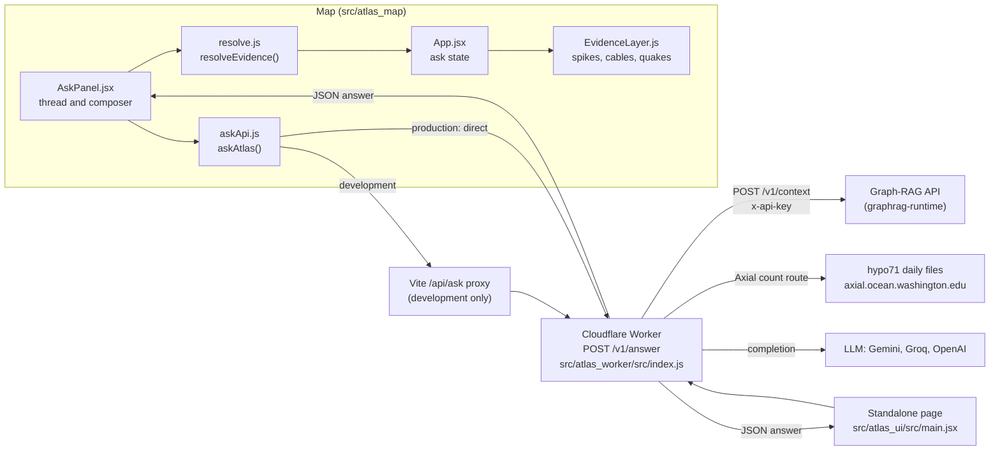

# Ask Atlas: question to evidence on the map

chapter: ask-atlas · paths: src/atlas_map/src/ask/ src/atlas_map/src/evidence/ src/atlas_map/src/scene/EvidenceLayer.js src/atlas_map/src/scene/evidenceMath.js src/atlas_map/src/scene/evidenceMath.test.js src/atlas_map/src/scene/evidence.css src/atlas_map/src/test/fixtures/ask/ src/atlas_map/e2e/ask.spec.js src/atlas_worker/ src/atlas_ui/ docs/superpowers/specs/2026-09-24-ask-atlas-evidence-design.md · as of 1047fc8

Ask Atlas is the question-answering feature of RCA Atlas (RCA: the Regional Cabled Array of the Ocean Observatories Initiative (OOI), a cabled ocean observatory off Oregon; `src/atlas_worker/src/helpers.js:129`). A visitor types a question into the left sidebar of the 3D map (or on the standalone page in `src/atlas_ui`) and gets a short answer whose numbered citations are drawn on the map: a glowing spike for each sensor or site it cites, a pulsing line for each fibre-optic route (distributed acoustic sensing, DAS), and points for the earthquakes it counts. The answer comes from a Cloudflare Worker (serverless JavaScript at Cloudflare's edge, `src/atlas_worker`). The Worker keeps the model and Graph-RAG keys out of the browser, asks the private Graph-RAG API for evidence ([graphrag-runtime](graphrag-runtime.md)), and asks a large language model (LLM) to write the cited answer. Graph-RAG is retrieval-augmented generation over a knowledge graph: the API returns text hits, graph neighbours and tool hints (`src/graphrag_runtime/app/models.py:42-78`). The spec's goal is that when an answer cites sensor evidence, the map shows exactly what and where it came from (`docs/superpowers/specs/2026-09-24-ask-atlas-evidence-design.md:9-12`). This chapter is one vertical slice: map sidebar, then Worker, then Graph-RAG, then LLM, then back to the map. The map shell and 3D scene it draws into belong to [atlas-map-scene](atlas-map-scene.md); the panels beside it belong to [atlas-map-panels](atlas-map-panels.md).

## At a glance

| Row | Value |
|---|---|
| Kind | Service plus two web clients: the Cloudflare Worker (`src/atlas_worker`), the map sidebar and evidence layer (`src/atlas_map/src/ask`, `evidence`, `scene/Evidence*`), and a standalone page (`src/atlas_ui`). |
| Stack | Worker: plain ES modules with no dependencies, run by Wrangler on Cloudflare, tested with `node --test` (`src/atlas_worker/package.json:6-7`). Map: React 18.3.1 and three.js 0.169.0 (`src/atlas_map/package.json:14,16`), Vite, Vitest on jsdom (`src/atlas_map/vite.config.js:26`), Playwright (`src/atlas_map/playwright.config.js`). Page: React 18, `border-beam`, `thinking-orbs` (`src/atlas_ui/package.json:10-16`). |
| Entry points | Worker: `default.fetch` in `src/atlas_worker/src/index.js:395-396`, route `POST /v1/answer`. Map: `AskPanel` rendered by `src/atlas_map/src/App.jsx:235`; `askAtlas()` in `src/atlas_map/src/ask/askApi.js:19`. Page: `src/atlas_ui/src/main.jsx:138`. |
| Reads | From the browser: the question, the model choice and the browser's time zone (`src/atlas_map/src/ask/AskPanel.jsx:74-81`, `askApi.js:18,23-24`). From Graph-RAG: hits, neighbours and tool hints at `POST /v1/context` ([graphrag-runtime](graphrag-runtime.md); `src/atlas_worker/src/index.js:417-420`). From the Axial host: the daily hypo71 earthquake catalog files (a University of Washington text format; see Glossary) (`index.js:10,368`; see [axial](axial.md)). From the LLM providers: completions (external; `index.js:257,283,319`). From the atlas bundle (sensors, sites, DAS layers) built by [atlas-map-data](atlas-map-data.md) and loaded by [atlas-map-scene](atlas-map-scene.md) (`src/atlas_map/src/data/bundle.js:38-43`). |
| Writes or serves | `POST /v1/answer` JSON to the map sidebar (`AskPanel.jsx:70`) and to the standalone page (`src/atlas_ui/src/main.jsx:101-108`). `GET /v1/live/*`, a narrow proxy to the live-data gateway, used by [atlas-map-scene](atlas-map-scene.md) (`src/atlas_map/src/api/gateway.js:5`; `index.js:402`). Spikes, cable pulses and quake points in the 3D scene (`src/atlas_map/src/scene/EvidenceLayer.js:10-13`), mounted by `App.jsx:104-120`. `localStorage["atlas.chat.open"]` and two CSS variables on `<html>` (`AskPanel.jsx:9,57-60`). `window.__atlas.evidence()` for the browser tests (`App.jsx:113`). `e2e/screens/*.png` screenshots from the e2e run (`src/atlas_map/e2e/ask.spec.js:23`). |

## How it works

1. **Ask.** `AskPanel` sends a question when the composer is submitted (Enter or ↵). While any question is pending it refuses a new one (`src/atlas_map/src/ask/AskPanel.jsx:52,74-81`). Every question stays in the thread; only the answer on screen has its evidence on the map (`src/atlas_map/src/App.jsx:127`).
2. **Request.** `askAtlas` posts `{query, answer_mode: "evidence", model, tz}` to `ASK_URL` (`src/atlas_map/src/ask/askApi.js:5,23-24`). In development `ASK_URL` is `/api/ask`, which Vite rewrites to the Worker's `/v1/answer` and stamps with `Origin: https://coszo.org` (`src/atlas_map/vite.config.js:7-10`). A production build calls the Worker directly (`askApi.js:5`).
3. **Gate.** The Worker answers preflight requests, serves `/health` and `/v1/live/*`, and for `POST /v1/answer` requires an allowed origin (403 otherwise), a trimmed query of 2 to 1,000 characters (400 otherwise), and a known model, or it uses `auto` (`src/atlas_worker/src/index.js:396-410`).
4. **Axial count shortcut.** A question that asks how many Axial earthquakes there were today, yesterday or on a `YYYY-MM-DD` date is answered from the catalog itself (`src/atlas_worker/src/helpers.js:85-105`; `index.js:412-413`). The Worker reads the one or two UTC (Coordinated Universal Time) catalog files that cover the asker's calendar day and returns the events with the count (`index.js:365-393`; `helpers.js:108-113`). This runs before the Graph-RAG configuration check, so it needs no Graph-RAG origin (`index.js:412-416`).
5. **Evidence.** Other questions go to Graph-RAG `POST /v1/context` with the `x-api-key` header (`index.js:417-420`). The Worker keeps the top 6 hits, or 16 for instrument-inventory questions, preferring hits whose title or text repeat the question's terms (`index.js:98-110`), and, for a named data product, only hits that name it (`index.js:186-196`).
6. **Route or synthesize.** A download question that names MultiDAS, OptoDAS or DAS24, and whose citations include that product's route, gets a fixed answer with its direct link and no LLM (`index.js:133-150`, `421-442`). `answer_mode: "quick"` gets the graph evidence with no LLM (`index.js:443-454`); no client in this repo sends that value. Everything else goes to `generateAnswer` (`index.js:455`).
7. **Cite.** `citations()` numbers each source; the number is its 1-based position in `answer_citations` (`index.js:64-84`, `299-304`). `evidencePackage` writes each hit under a header that carries its source numbers (`helpers.js:32-44`). `answerPrompt` asks for `[n]` after each claim and forbids ids and URLs in the text (`helpers.js:117-130`).
8. **Model.** For `auto`, the Worker tries Gemini twice, then Groq if its key is set, then OpenAI only when `AUTO_FALLBACK_OPENAI_MODEL` and `OPENAI_API_KEY` are both set (local development only). A named model gets no fallback: a Gemini model gets the two attempts (`index.js:317-342`), and a Groq or OpenAI model one call (`index.js:315-316`). Token limits differ by provider and by mode (`index.js:261`, `290`, `324`).
9. **Response.** A 200 JSON body with `answer`, `answer_model`, `answer_citations`, `answer_links`, `hits` (each with a roughly 280-character `excerpt`), `neighbors` and `tool_hints` (`index.js:456-463`; `helpers.js:15-26`). Any failure after the gate becomes 503 `answer temporarily unavailable` (`index.js:464-467`).
10. **Resolve.** `resolveEvidence(data, bundle)` gives each citation `n` one of two outcomes: a located item (a sensor, a site or a DAS cable, found by instrument id, by name in the text, or by URL), or a document for further reading. A citation that locates nothing is a document (`src/atlas_map/src/evidence/resolve.js:199-208`, `147-178`).
11. **Show.** `AskPanel` calls `onShow(ev)` with the resolved evidence (`AskPanel.jsx:70,72`). `App` keeps it in `ask` state (`App.jsx:53,236`). An effect in `App` hands it to `EvidenceLayer.show`, which groups items that share a location into one spike (`App.jsx:139-143`; `EvidenceLayer.js:123-136`; `evidenceMath.js:41-51`). The terrain is muted to 0.55 (`App.jsx:134`), and the camera frames the located items once per answer (`App.jsx:150-155`).
12. **Interact.** Hovering a superscript, a table row or a spike sets `hoverN`. Clicking one, or stepping with ← and →, sets `activeN` through `askActions.current.select`. That flies the camera and opens the station in the side panel (`App.jsx:163-178`; `AskPanel.jsx:92-115`; `EvidenceLayer.js:162-169`).
13. **Frame loop.** Each frame `EvidenceLayer.update` places the numbers, halos, hit strips and edge chips at projected positions (`App.jsx:109`; `EvidenceLayer.js:219-296`).
14. **Minimize.** Minimizing the sidebar calls `onOpenChange(false)` (`AskPanel.jsx:61`). `App` then gives the layer no evidence (`App.jsx:127`, `142`), so the spikes sink and the terrain returns (`EvidenceLayer.js:123-128`, `225-227`). Reopening shows the same evidence again without framing the camera (`App.jsx:128,150`).

The standalone page follows the same path with two differences. It posts no `tz`, so "today" there is the UTC day (`src/atlas_ui/src/main.jsx:101-104`). It strips `[n]` markers before display (`src/atlas_ui/src/main.jsx:9-10`) and shows its own sources list and a 2D evidence graph drawn from `hits` and `neighbors` (`src/atlas_ui/src/main.jsx:23-63,132`).

## Key files

Source files get a row each. Tests and fixtures are grouped by directory.

| File | Role |
|---|---|
| `src/atlas_worker/src/index.js` | Worker entry (469 lines). Routes, origin check, model choice, the Axial count shortcut, the Graph-RAG call, the download and quick routes, the LLM providers and their fallbacks, numbered citations, and error mapping. |
| `src/atlas_worker/src/helpers.js` | Pure helpers shared by `index.js` and the tests: `excerpt`, `publicHit`, `sourceKey`, `evidencePackage`, the hypo71 parser, the asker's-day window, `eventsInWindow`, `answerPrompt`. |
| `src/atlas_worker/wrangler.toml` | Worker name, entry point, public vars (`ALLOWED_ORIGIN`, `ANSWER_MODEL`, `OPENROUTER_FREE_MODEL`), and the secrets as comments. |
| `src/atlas_worker/package.json` | Scripts only: `check` (a dry-run deploy) and `test` (`node --test`). No dependencies. |
| `src/atlas_worker/README.md` | Deployment steps, the secrets to set, the rate-limit requirement, and the test command. |
| `src/atlas_ui/src/main.jsx` | The standalone page in one file: query form, call to the Worker without `tz`, `[n]` stripping, sources list, and a 2D evidence graph. |
| `src/atlas_ui/package.json` | Build scripts (`build`, `check`) and dependencies. Declares `react-force-graph-3d` and `three`, which `src/atlas_ui/src/main.jsx` does not import. |
| `src/atlas_ui/vite.config.js` | Vite config: React plugin and a relative base. |
| `src/atlas_ui/index.html` | HTML shell with `#root` and the module script. |
| `src/atlas_ui/src/style.css` | Page styles, written as a few long lines. |
| `src/atlas_ui/THIRD_PARTY_NOTICES.md` | MIT notices for `border-beam`, `thinking-orbs`, `react-force-graph-3d` and `three`. |
| `src/atlas_map/src/ask/AskPanel.jsx` | The sidebar: thread, headline, answer with superscripts, evidence table, further reading, composer, empty state, minimize, and the keys for the tour and Escape. |
| `src/atlas_map/src/ask/askApi.js` | Client: `ASK_URL` (dev proxy or direct Worker), the model list, `askAtlas()` with its error messages, and the time zone it sends. |
| `src/atlas_map/src/ask/answerText.js` | `parseAnswer`: turns answer text into paragraphs, list items, headings, bold runs and citation runs. |
| `src/atlas_map/src/ask/ask.css` | Sidebar styles (`.ask`, `.ask-table`, `.cite`), built on the map's tokens. |
| `src/atlas_map/src/evidence/resolve.js` | Pure `resolveEvidence(response, bundle)`: maps each citation to a sensor, site, DAS cable or document, and reads the quake events and count. Also `tourOf`. |
| `src/atlas_map/src/scene/EvidenceLayer.js` | three.js evidence layer (364 lines): spikes, halos, cable pulses, quake points, DOM numbers and edge chips. API: `show`, `clear`, `setActive`, `setHover`, `update`, `snapshot`, `dispose`. |
| `src/atlas_map/src/scene/evidenceMath.js` | Pure math: spike height, rise and sink timing, `eventShown`, `hypoMeters`, `quakePx`, `edgeChip`, `groupSpikes`, `frameView`. |
| `src/atlas_map/src/scene/evidence.css` | Styles for the `#atlas-evidence` overlay: spike base, number tag, halo and edge chip. |
| `docs/superpowers/specs/2026-09-24-ask-atlas-evidence-design.md` | The approved design (status line at `:3`): goal, demo questions, look, behaviour, architecture, errors, testing, out of scope. |

Tests and fixtures, grouped:

| Files | Role |
|---|---|
| `src/atlas_worker/test/helpers.test.js` | 13 `node --test` cases: hypo71 parsing and the 60-second roll, excerpts, the citation prompt, the Axial count route with `fetch` mocked, and the asker's-day windows. |
| `src/atlas_worker/test/fixtures/hypo71_20260923.dat`, `hypo71_20260924.dat`, `hypo71_20260925.dat` (skim) | Real daily catalog files (72, 99 and 5 lines, header included) used by the parser tests. |
| `src/atlas_map/src/ask/AskPanel.test.jsx`, `askApi.test.js`, `answerText.test.js` | Component and unit tests for the sidebar: asking, superscripts and ranges, hover and click, keys, errors, suggestions, minimize, client errors, and answer parsing. |
| `src/atlas_map/src/evidence/resolve.test.js` | Resolution against captured and hand-made answers, and the resolution rules. |
| `src/atlas_map/src/scene/evidenceMath.test.js` | Tests for the pure math in `evidenceMath.js`. |
| `src/atlas_map/src/test/fixtures/ask/` (skim) | `bundle.js` (`ASK_BUNDLE` and `askBundle()`, a slice of the atlas bundle) and ten JSON responses: `das`, `hydrate`, `inflation`, `inflation.v2`, `oxygen`, `quakes`, `quakes.today`, `quakes.v2`, `eruption`, `error-503`. |
| `src/atlas_map/e2e/ask.spec.js` | Playwright cases for the demo questions, selection, the tour, Escape, ranges, the quake table, reduced motion and minimize, with mocked responses from `src/atlas_map/e2e/mocks.js` (see [atlas-map-scene](atlas-map-scene.md)). |
| `src/atlas_ui/package-lock.json` (skim) | Lockfile with 153 `node_modules/` entries. Not read beyond its header. |

## Interfaces

### Worker HTTP routes (`src/atlas_worker/src/index.js:396-468`)

| Method and path | Behaviour |
|---|---|
| `OPTIONS` (any path) | 204 with CORS headers (`index.js:400`). |
| `GET /health` | `{"status":"ok"}` (`index.js:401`). |
| `GET /v1/live/*` | Proxies to `ATLAS_MAP_GATEWAY_ORIGIN` for the allowlisted paths only: `status/{id}`, `series/{id}` (with `/variables`), `plots/{id}`, `waveform/{code}` (with `/health`) and `files/{id}`. 404 for other paths. 503 if the origin is unset or the upstream fails. No Origin check (`index.js:39-62`, `402`). |
| `POST /v1/answer` | The answer route. 403 unless the request's `Origin` is `https://coszo.org` (`index.js:404`). |
| Anything else | 404 `{"error":"not found"}` (`index.js:403`). |

### `POST /v1/answer` request body

| Field | Type | Meaning |
|---|---|---|
| `query` | string | Trimmed; 2 to 1,000 characters, otherwise 400 `invalid query` (`index.js:406,410`). |
| `model` | string | One of `gemini-2.5-flash`, `gemini-3.5-flash-lite`, `groq-gpt-oss-120b`, `groq-gpt-oss-20b`, `groq-qwen3-8-27b`, `gpt-5.6-sol`, `gpt-5.5`, `gpt-5.5-pro`, `gpt-5.4-mini`; anything else is treated as `auto` (`index.js:237-247`, `408-409`). |
| `answer_mode` | string | `"quick"` asks for the no-LLM graph answer. The download and Axial routes answer without an LLM whatever its value, and they run first. Any other value, for other questions, takes the LLM path (`index.js:407`, `412-413`, `421-455`). Clients send `"evidence"` (`askApi.js:24`; `src/atlas_ui/src/main.jsx:104`). |
| `tz` | string | IANA time zone, cut to 64 characters. Used only for the Axial count day (`index.js:412`). Unknown zones fall back to UTC (`helpers.js:70-72`). |

### `POST /v1/answer` success body (200)

| Field | Type | Meaning |
|---|---|---|
| `query` | string | The trimmed question (`index.js:456-463`). |
| `answer` | string | The answer text. Citations are `[n]` markers (`helpers.js:128`). |
| `answer_model` | string | Which route answered, for example `gemini-2.5-flash`, `Groq GPT-OSS 120B`, `OpenAI gpt-5.4-mini`, `RCA Atlas graph route`, `RCA Atlas graph evidence (no LLM)`, `RCA Atlas evidence routing` or `axial_count_events (live catalog)` (`index.js:244-247,265,296,310,337,386,428,438,447`). |
| `answer_citations` | array | `{id, title, url}` in citation-number order (`index.js:66-83`). |
| `answer_links` | array | Same shape. Direct download links for download questions (`index.js:175-184`). Absent on the Axial count answer (`index.js:383-392`). |
| `hits` | array | Public hits: `chunk_id`, `collection_id`, `collection_label`, `title`, `score`, `citations`, `metadata`, `excerpt`. The full `text` is not returned (`helpers.js:15-26`). |
| `neighbors` | array | Graph neighbours, passed through from Graph-RAG (`index.js:461`). |
| `tool_hints` | array | Tool hints, passed through from Graph-RAG. On the Axial answer, one hint named `axial_count_events` (`index.js:390-391`). |
| `events` | array | Only on the Axial count answer: `{time, lat, lon, depth_km, mag}` (`index.js:389`; `helpers.js:56-63`). |

### Error bodies

| Status | Body | When (source) |
|---|---|---|
| 400 | `{"error":"invalid query"}` | Query missing, too short or too long (`index.js:410`). |
| 403 | `{"error":"origin not allowed"}` | Origin is not `https://coszo.org` (`index.js:404`). |
| 503 | `{"error":"service is not configured"}` | `ATLAS_API_KEY` or `ATLAS_API_ORIGIN` unset, and the question is not an Axial count (`index.js:414-416`). |
| 503 | `{"error":"answer temporarily unavailable"}` | Any other failure, including a question with no evidence (`index.js:306,464-467`). |
| 503 | `{"error":"live data service is not configured"}` or `{"error":{"source":"Atlas live data","message":...}}` | The `/v1/live/*` proxy (`index.js:42,60`). |

### Functions other code imports

- `src/atlas_worker/src/helpers.js` exports `excerpt`, `publicHit`, `sourceKey`, `evidencePackage`, `hypo71Rows`, `parseHypo71Events`, `axialDayWindow`, `eventsInWindow` and `answerPrompt`. `index.js:5` imports six of them, and `src/atlas_worker/test/helpers.test.js:4` imports eight. `hypo71Rows` is used only inside `helpers.js` (`helpers.js:56`).
- `src/atlas_map/src/evidence/resolve.js` exports `resolveEvidence` and `tourOf` (`AskPanel.jsx:3` imports both; `App.jsx:18` imports `tourOf`), plus `readableExcerpt`, `shortSite` and `SITE_COLOR`.
- `src/atlas_map/src/ask/askApi.js` exports `ASK_URL`, `MODELS`, `askAtlas` and `modelLabel`.
- `src/atlas_map/src/ask/AskPanel.jsx` exports the default `AskPanel` (`App.jsx:235`), `askStartsOpen` (`App.jsx:15`), `SUGGESTIONS`, `zoneAbbr` and `fmtMag`.
- `src/atlas_map/src/ask/answerText.js` exports `parseAnswer`.
- `src/atlas_map/src/scene/EvidenceLayer.js` exports the class `EvidenceLayer`, built at `App.jsx:104`, with `show(ev)`, `clear()`, `setActive(n)`, `setHover(n)`, `update(now)`, `snapshot()` and `dispose()` (`EvidenceLayer.js:105-364`).
- `src/atlas_map/src/scene/evidenceMath.js` exports `spikeHeight`, `riseAt`, `sinkAt`, `eventShown`, `hypoMeters`, `quakePx`, `edgeChip`, `groupSpikes` and `frameView`. `App.jsx:17` imports `hypoMeters` and `frameView` (used at `App.jsx:171` and `App.jsx:154`). `EvidenceLayer.js:7` imports `spikeHeight`, `riseAt`, `sinkAt`, `hypoMeters`, `quakePx`, `edgeChip` and `groupSpikes`; `eventShown` is imported only by its test (`evidenceMath.test.js:2`).

### Browser-visible hooks

- `window.__atlas.evidence()` returns the layer's snapshot plus the located items (`App.jsx:111-113`). Only the e2e tests read it.
- The overlay element `#atlas-evidence` is created by `App.jsx:216` and styled by `src/atlas_map/src/scene/evidence.css:2-3`.
- `localStorage["atlas.chat.open"]` remembers whether the sidebar is open (`AskPanel.jsx:9-10,57`).
- `--left-inset` (412px open, 16px closed) and `--strip-reserve` are set on `document.documentElement` (`AskPanel.jsx:59-60`).

### Files produced

- `src/atlas_map/e2e/screens/*.png`: screenshots written by `src/atlas_map/e2e/ask.spec.js` (for example `:23`, `:27`, `:37`, `:188`).

## Data shapes

### Worker to Graph-RAG `POST /v1/context`

| Field | Value the Worker sends | Limit in the API (`src/graphrag_runtime/app/models.py`) |
|---|---|---|
| `query` | The question (`index.js:418`) | 2 to 1,000 characters (`src/graphrag_runtime/app/models.py:13`). |
| `limit` | 24 for inventory questions, otherwise 10 (`index.js:418`; `MAX_HITS` at `index.js:8`) | 1 to 50 (`src/graphrag_runtime/app/models.py:14`). |
| `graph_hops` | 2 (`index.js:419`; `MAX_GRAPH_HOPS` at `index.js:9`) | 0 to 3 (`src/graphrag_runtime/app/models.py:21`). |
| `neighbors_per_seed` | 16 for inventory questions, otherwise 8 (`index.js:419`) | 1 to 25 (`src/graphrag_runtime/app/models.py:22`). |
| `tool_limit` | 3 (`index.js:419`) | 0 to 10 (`src/graphrag_runtime/app/models.py:23`). |

The API's request model forbids fields it does not define (`src/graphrag_runtime/app/models.py:9`, `extra="forbid"`), so every field the Worker sends must be one of the model's. The Worker sends these five, and the API fills the rest from its defaults (`models.py:12-23`). The header `x-api-key` carries `ATLAS_API_KEY` (`index.js:420`). The API checks its SHA-256 digest against its configured digests (`src/graphrag_runtime/app/main.py:49-51`).

### Graph-RAG response, as the Worker reads it

- `hits[]`: `chunk_id`, `collection_id`, `collection_label`, `title`, `text`, `score`, `lexical_score`, `vector_score`, `citations[]`, `metadata{}` (`src/graphrag_runtime/app/models.py:48-58`). The Worker keeps all of these except `text`, `lexical_score` and `vector_score`, and adds `excerpt` (`helpers.js:15-26`).
- `citations[]`: `source_id`, `title`, `url` (optional) (`src/graphrag_runtime/app/models.py:42-46`).
- `neighbors[]`: `collection_id`, `local_id`, `name`, `depth`, `direction`, `predicate`, `source_url` (optional) (`src/graphrag_runtime/app/models.py:61-69`).
- `tool_hints[]`: `collection_id`, `name`, `description`, `score`, `required_arguments[]`, `input_schema{}` (`src/graphrag_runtime/app/models.py:71-78`).

### The Worker's `answer_citations[]` and `answer_links[]`

Each entry is `{id, title, url}`. `id` is the citation's `source_id`, or the hit's `chunk_id` when there is none (`index.js:66-67`). Entries are deduplicated by `id` plus `url` (`index.js:78-83`). For the Axial count, `id` is `axial-live-catalog` for one file and `axial-live-catalog-YYYYMMDD` for two (`index.js:387-388`).

### hypo71 catalog rows

The Worker's comment gives the layout as `yyyymmdd HHMM SS.SS latD latM lonD lonM depth MW NWR GAP DMIN RMS ERH ERZ ID PMom SMom`, with longitude in degrees west (`helpers.js:46-47`). A row counts when it has at least 18 columns and its first column equals the file's day (`helpers.js:48-51`). The parser reads column 1 as the date, 2 as HHMM, 3 as seconds, 4 and 5 as latitude degrees and minutes, 6 and 7 as longitude degrees and minutes, 8 as depth in km, 9 as magnitude, and 16 as the event id (which the Worker does not keep) (`helpers.js:56-62`). Its output is `{time (ISO UTC), lat, lon (negative west), depth_km, mag}` (`helpers.js:62`). The sample file `src/atlas_worker/test/fixtures/hypo71_20260923.dat` has the header on line 1 and the first event on line 2.

### Axial count answer (extra fields)

- `events[]`: `{time, lat, lon, depth_km, mag}` in time order (`index.js:389`).
- `tool_hints[0]`: `{name: "axial_count_events", description, score: 1, required_arguments: ["day"], input_schema: {day, tz, label, today}}` (`index.js:390-391`).
- No `answer_links` key (`index.js:383-392`).

### Client: resolved evidence (`resolveEvidence` output)

| Field | Type and meaning | Source |
|---|---|---|
| `located[]` | Items on the map, each with `n`, `kind` (`sensor`, `site` or `cable`), `id`, `lon`, `lat`, `depth`, `family`, `color`, `code`, `label`, `site`, `siteId`, `refdes`, `title`, `excerpt`, `quote`, `sourceUrl`. A cable has `layers` (ids of its DAS layers) and no depth. | `resolve.js:87-96`, `98-108`, `110-114`, `206` |
| `documents[]` | Further reading: `n`, `title`, `url`, `excerpt`, `quote`. | `resolve.js:207` |
| `events` | Quake events `{n, time, lat, lon, depth_km, mag}` sorted by time, or `null`. | `resolve.js:182-186`, `209-210` |
| `count` | `{day, tz, today, n}` from the Axial `tool_hints`, or `null`. It is kept even when there are no events. | `resolve.js:188-193` |

### Bundle fields the resolver reads

| Collection | Fields read | Producer |
|---|---|---|
| `sensors[]` | `id`, `instrumentId`, `arcadaId`, `refdes`, `sources[]`, `access[].url`, `site`, `lat`, `lon`, `depth`, `waterDepth`, `family`, `name`, `type`, `manufacturer`, `model` (`resolve.js:29-37`, `98-108`, `116-119`). | `src/atlas_map_data/sensors.py:26-50` and `:77`; `site` is set by `src/atlas_map_data/sites.py:118`; `access` is filled by `src/atlas_map_data/build_atlas_bundle.py:58-59` |
| `sites[]` | `id`, `name`, `label` (the text before " · " is the short name), `lon`, `lat`, `seafloor`, `sensorIds[]` (`resolve.js:40-47`, `110-113`). | `src/atlas_map_data/sites.py:120-122` |
| `das.layers[]` | `id`, `kind`, `coords` (`[lon, lat]` pairs), `color` (`resolve.js:87-95`; `EvidenceLayer.js:172`). | `src/atlas_map_data/das.py:68,82,91` (written by `src/atlas_map_data/build_atlas_bundle.py:75`) |
| `familyByKey`, `sensorById`, `siteById` | Lookups built by the loader (`src/atlas_map/src/data/bundle.js:38-43`). The test bundle has the same shape (`src/atlas_map/src/test/fixtures/ask/bundle.js:6-10`). | [atlas-map-scene](atlas-map-scene.md) |

### Answer blocks from `parseAnswer`

`parseAnswer` returns `{type: "p" | "li" | "h", parts, level?}` (`src/atlas_map/src/ask/answerText.js:36-59`). `level` (0 to 2) applies to list items. Each part is `{t: "text", v}`, `{t: "b", v}` (bold) or `{t: "cite", n, to?}`, where `to` marks the end of a range such as `[1-15]` (`answerText.js:8-14`).

## Configuration and secrets

Names and locations only. No values appear in the repo, and none should appear here.

| Name | Read at | Purpose | Default or required |
|---|---|---|---|
| `ALLOWED_ORIGIN` (Worker var) | `index.js:13,36` | The one browser origin allowed to call `/v1/answer`. | `https://coszo.org` (`src/atlas_worker/wrangler.toml:8`). |
| `ANSWER_MODEL` (Worker var) | `index.js:318` | The Gemini model for `auto` and for unknown model names. | `gemini-2.5-flash` (`src/atlas_worker/wrangler.toml:9`; code default at `index.js:318`). |
| `OPENROUTER_FREE_MODEL` (Worker var) | `index.js:268` (default of an unused function) | None. Dead since commit `14868d7`. | `z-ai/glm-5.2:free` (`src/atlas_worker/wrangler.toml:12`). |
| `GEMINI_API_KEY` (secret) | `index.js:319` | Gemini completions, sent as a query parameter. | Required for the Gemini models. `auto` tries Gemini first and falls back to Groq (`src/atlas_worker/wrangler.toml:15`; `src/atlas_worker/README.md:18`). |
| `GROQ_API_KEY` (secret) | `index.js:256` | Groq completions: the `groq-*` models and `auto` fallback. | Optional (`src/atlas_worker/wrangler.toml:16`). |
| `OPENAI_API_KEY` (secret) | `index.js:282` | OpenAI completions: the `gpt-*` models and the local `auto` fallback. | Optional (`src/atlas_worker/wrangler.toml:18`). |
| `OPENROUTER_API_KEY` (secret) | `index.js:269` (unused function) | None. Dead since commit `14868d7`. | Listed in `src/atlas_worker/wrangler.toml:17` only. |
| `ATLAS_API_KEY` (secret) | `index.js:414,420` | Sent as `x-api-key` to Graph-RAG `/v1/context`. Must match the API's configured key (`src/atlas_worker/README.md:23-24`). | Required for non-count questions (`src/atlas_worker/wrangler.toml:19`). |
| `ATLAS_API_ORIGIN` (secret) | `index.js:414,417` | Base URL of the Graph-RAG API, an HTTPS Cloudflare Tunnel (`src/atlas_worker/README.md:23`). | Required for non-count questions (`src/atlas_worker/wrangler.toml:20`). |
| `ATLAS_MAP_GATEWAY_ORIGIN` | `index.js:42,48` | Base URL for the `/v1/live/*` proxy. | Required for live data. Not listed in `src/atlas_worker/wrangler.toml` or the Worker README; the map README mentions it for `.dev.vars` (`src/atlas_map/README.md:27`). |
| `AUTO_FALLBACK_OPENAI_MODEL` | `index.js:355-357` | Lets `auto` finish on an OpenAI model. Intended for local `.dev.vars` only (`index.js:353-354`; `src/atlas_map/README.md:28`). | Optional. Not set when deployed (commit `0fcd16d`). |
| `TURNSTILE_SECRET` | Not read by code | Described as optional bot protection (`src/atlas_worker/wrangler.toml:21-22`). | No code reads it. |
| `VITE_ATLAS_ASK` | `src/atlas_map/vite.config.js:7` | Development proxy target for `/api/ask`. | Defaults to the deployed Worker URL. Set to `http://127.0.0.1:8788` for `wrangler dev` (`src/atlas_map/README.md:25-26`). |
| `ATLAS_WORKER` (constant) | `src/atlas_map/src/api/gateway.js:2`; `src/atlas_map/src/ask/askApi.js:5` | Production URL of the Worker. | Hard-coded to `https://rca-atlas.quakehunt.workers.dev`. The standalone page hard-codes the same URL (`src/atlas_ui/src/main.jsx:7`). |
| `GRAPHRAG_API_KEY_SHA256` (Graph-RAG side) | `src/graphrag_runtime/app/config.py:20` | Digests of the API keys the Graph-RAG API accepts. The Worker's `ATLAS_API_KEY` is the plain key whose digest is listed here (`src/graphrag_runtime/README.md:27-33`). | Owned by [graphrag-runtime](graphrag-runtime.md). |

The Worker's CORS fallback uses `ALLOWED_ORIGIN` as well (`index.js:13-22`).

## Run and test

- Worker unit tests: `cd src/atlas_worker && npm test`, which runs `node --test` (`src/atlas_worker/package.json:7`). No install is needed.
- Worker dry-run: `npm run check` in `src/atlas_worker`, which runs `npx --yes wrangler deploy --dry-run` (`src/atlas_worker/package.json:6`).
- Worker deploy (maintainers only; the spec leaves deploys to Derek and Maleen, `docs/superpowers/specs/2026-09-24-ask-atlas-evidence-design.md:152`): `npx wrangler login --device`, then `npm run check` and `npx wrangler deploy` (`src/atlas_worker/README.md:11-12`). Secrets go in with `npx wrangler secret put NAME` (`src/atlas_worker/README.md:17-21`).
- Local Worker for unreleased changes: `npx wrangler dev --port 8788` in `src/atlas_worker`. Its keys live in `src/atlas_worker/.dev.vars`. The map README says that file is not committed (`src/atlas_map/README.md:25-28`), but no ignore rule covers it (see Open questions).
- Map dev server: `VITE_ATLAS_ASK=http://127.0.0.1:8788 npm run dev` in `src/atlas_map` (`src/atlas_map/README.md:25-26`). The dev port is 5175 (`src/atlas_map/vite.config.js:21`).
- Map unit tests: `npm test` in `src/atlas_map`, which runs `vitest run` (`src/atlas_map/package.json:10`).
- Map build: `npm run build` in `src/atlas_map` (`src/atlas_map/package.json:8`).
- Map end-to-end: `npm run e2e` in `src/atlas_map`, which runs `playwright test` (`src/atlas_map/package.json:11`). The Ask cases are in `e2e/ask.spec.js` and use mocked responses from `e2e/mocks.js` (`src/atlas_map/e2e/ask.spec.js:2`). The spec requires `npm test`, `npm run build` and `npm run e2e` to pass (`docs/superpowers/specs/2026-09-24-ask-atlas-evidence-design.md:183`).
- Standalone page: `npm run build` or `npm run check` in `src/atlas_ui` (`src/atlas_ui/package.json:7-8`). It has no test script and no dev script.
- Capturing a real answer for a fixture: `POST /v1/answer` with the header `Origin: https://coszo.org` (`docs/superpowers/specs/2026-09-24-ask-atlas-evidence-design.md:169-170`). The Worker rejects requests without that origin (`index.js:404`).

## Decisions and constraints

- **The Worker is the only public boundary.** Browsers send a question, a model choice, a time zone and `answer_mode` (`src/atlas_map/src/ask/askApi.js:23-24`), never a key. The Worker holds the Gemini and Graph-RAG keys (`src/atlas_worker/src/index.js:1-3`; `src/atlas_worker/README.md:7`). The header comment at `index.js:2` says "only a question", which is out of date.
- **One allowed origin.** `POST /v1/answer` accepts only `https://coszo.org` (`index.js:35-37,404`; `src/atlas_worker/wrangler.toml:8`). The dev proxy adds that origin (`src/atlas_map/vite.config.js:4-6,10`).
- **Rate limiting before launch.** A Cloudflare rate-limit rule on `POST /v1/answer` is required before the endpoint is enabled in production (`src/atlas_worker/README.md:25-26`). The repo cannot show whether it exists.
- **Citation numbers are the server's.** `[n]` is the 1-based index into `answer_citations`, and the client maps it from there (`helpers.js:115-116`; `index.js:302-305`; `resolve.js:1-2`; spec `:134-139`). The answer text must not contain ids or URLs (`helpers.js:128`).
- **Backward compatible.** Worker changes are additive, so the published `src/atlas_ui` page keeps working. That page strips `[n]` before display (spec `:141-146`; commit `d557fb6`). The client copes with a Worker that sends no `[n]`, no `excerpt` and no `events` (spec `:152-153`; `resolve.js:3-6`, `204-205`, `209-210`).
- **"Today" is the asker's day.** The browser's IANA zone is sent as `tz`, and the count reads that zone's day, from one or two UTC files (`helpers.js:66-68`; spec `:110-113`; commit `8457b94`).
- **Auto stays free when deployed.** `auto` uses Gemini, then Groq. OpenAI is a local-only fallback, set in `.dev.vars` (`index.js:343-355`; `src/atlas_map/README.md:27-28`; commit `0fcd16d`).
- **The Axial count bypasses Graph-RAG.** It reads the catalog directly and runs before the configuration check (`index.js:412-416`). The comment in `liveAxialCount` says a local day may reach a UTC day whose file does not exist yet, and only a day with no file at all fails (`index.js:369`).
- **Keyword gates.** The count route needs "axial", "earthquake", a "how many / count / number of" phrase and a day word (`helpers.js:87-94`). The compact style needs a download or availability phrase (`index.js:117-121`). Other questions get the research style (`index.js:122`). The scientific-question style is kept broad on purpose (`index.js:114-116`).
- **The live-data proxy is an allowlist.** It forwards only the listed gateway paths, so it cannot become a general proxy into the private host (`index.js:44-46`).
- **Evidence is per answer.** Closing the sidebar clears the map, and reopening restores the same answer without re-framing (`App.jsx:126-128`; commit `61a14d9`). A new answer replaces the evidence on the map, and clicking an earlier answer shows its evidence again (`src/atlas_map/src/ask/AskPanel.jsx:207-209`).
- **One spike per location.** Items at the same coordinates share a spike and merge their numbers (`src/atlas_map/src/scene/evidenceMath.js:39-40,45`; `src/atlas_map/src/scene/EvidenceLayer.js:148`).
- **Reduced motion.** Spikes appear at full height, sinking is instant, and flights jump (spec `:104-105`; `evidenceMath.js:12-13`; `src/atlas_map/src/scene/cameraMath.js:38`). Cable pulses stop (`EvidenceLayer.js:314`). The global block in `src/atlas_map/src/styles/tokens.css:9` also stops every CSS animation (the halo and the corpus line), as the comment at `src/atlas_map/src/overlay/overlay.css:14` assumes.
- **Keys yield to fields.** Arrow keys and Escape are ignored while typing in a field, select, slider or editable text. An empty question box is the exception (`src/atlas_map/src/ask/AskPanel.jsx:105-106`). Escape belongs to an open side panel first (spec `:80-82`; `AskPanel.jsx:33-34,104-107`).
- **Design source.** The spec was approved on 2026-09-24 by Derek, stacks on the HUD dock PR, and lists its own out-of-scope items (`docs/superpowers/specs/2026-09-24-ask-atlas-evidence-design.md:3-5,187`).

## History

- **2026-09-21, the Worker and its page.** The Atlas UI page is added in `02a74bf`, and it is wired to the secure Graph-RAG Worker, which first appears in `6d6ba87`. Follow-up commits refine the answer and simplify the evidence view (`2f70b5b`, `d73b04c`, `5307063`).
- **2026-09-24, model routing.** Verified free routes (`ffd0b43`) put Groq into the free Auto chain, and selectable models follow (`61fa0b2`, `b5ce705`). OpenRouter joins the chain (`c159b31`). GPT-5.4 mini is exposed (`6b3474b`). OpenRouter's selections and call sites are removed (`14868d7`), but its functions and constants stay in `index.js`.
- **2026-09-24, download and quick answers.** Named dataset downloads route to graph sources (`24b8e1e`), availability questions get compact answers (`db3adcf`), and no-LLM quick answers are added (`89891c1`).
- **2026-09-24, Ask Atlas spec.** The design is written (`e580d8f`). The Worker starts returning numbered citations, excerpts and quake events (`7ff7768`). The old page strips `[n]` (`d557fb6`).
- **2026-09-24, evidence on the map.** The resolver (`9823cd1`) and the evidence layer (`61e4daf`) land, and Ask Atlas replaces the chat (`5ac19b2`).
- **2026-09-24, interaction.** A cited range becomes one superscript (`3961a39`), and excerpts drop URLs (`adba50d`). The demo suggestions and captured answers arrive (`e2ed531`). Arrow keys tour with a panel open (`065f0bf`). Selecting opens the station panel instead of a card (`10178c1`). Closing clears the evidence (`61a14d9`).
- **2026-09-24, time and fallbacks.** Counts use the asker's calendar day (`8457b94`). The OpenAI fallback becomes local-only (`0fcd16d`), after `da95a58` had made it part of Auto.

## Gotchas

- **A pending question locks the sidebar.** The composer refuses new questions while one is pending, and the Ask button is disabled (`AskPanel.jsx:52,76,144`). There is no cancel. `askAtlas` sets no timeout of its own (`askApi.js:21-24`). The Graph-RAG and LLM calls each time out at 55 seconds (`index.js:231`). On a deployed `auto` answer the Worker can make three in sequence, two Gemini attempts and then Groq (`index.js:332-352`), so a slow answer can take minutes.
- **Retry can strand a question (inferred from code, not run).** `run` aborts the controller it shares with the in-flight question (`AskPanel.jsx:65-69`). Retry does not check `busy` (`AskPanel.jsx:82`). If Retry is clicked while another question is pending, that question's `askAtlas` call throws `AbortError` (`askApi.js:26`), `run` returns without updating the entry (`AskPanel.jsx:69`), and the entry stays pending. The composer then stays locked until reload. No test covers this path.
- **No evidence means 503.** If Graph-RAG returns no hits, `evidencePackage` returns an empty string and `generateAnswer` throws (`index.js:305-306`). The client shows "Answer temporarily unavailable (HTTP 503)" (`askApi.js:33`). This is inferred from code; the response has not been observed.
- **Keyword gates decide the route.** The question wording selects the Axial count, the download routes, the compact style and the no-LLM path (`helpers.js:87-94`; `index.js:117-121`, `407`). A count question worded differently falls through to Graph-RAG.
- **Download answers print product keys in lower case.** The fixed answer says "requested das25 data" because `namedDataProduct` returns lower-case keys (`index.js:127`, `309`, `167`). The generic routing answer runs only for products without a dedicated route (inferred).
- **Ranges that are too long or reversed collapse.** A range of 50 or more, or written backwards, renders as its first number and drops the rest (`answerText.js:11`). Numbers the evidence does not contain render as plain text (`answerText.js:27-28`; `answerText.test.js:21`).
- **Two meanings of "answer mode".** `answerMode(question)` in `index.js:112` chooses "compact" or "research" from the question's wording. The request field `answer_mode` (`index.js:407`) selects only the no-LLM "quick" path. Keep them apart when reading the code.
- **The quick path has no client.** No client in this repo sends `answer_mode: "quick"` (`askApi.js:24`; `src/atlas_ui/src/main.jsx:104` sends `"evidence"`). The path is reachable but unused here (inferred).
- **OpenRouter code is dead.** `OPENROUTER_FREE_MODELS` (`index.js:248-253`) and `generateOpenRouterAnswer` (`index.js:268-279`) have no callers since `14868d7`.
- **The live proxy has no Origin check.** `/v1/answer` checks Origin (`index.js:404`), but `/v1/live/*` does not (`index.js:402`). CORS headers still name only the allowed origin (`index.js:12-22`), so browsers from other origins cannot read the response. Non-browser callers are not restricted by this code (inferred).
- **`ATLAS_MAP_GATEWAY_ORIGIN` is easy to miss.** `/v1/live/*` returns 503 without it (`index.js:42`). It is missing from `src/atlas_worker/wrangler.toml:14-22` and the Worker README's secret list (`src/atlas_worker/README.md:14-21`).
- **The Worker README is out of date.** It says the Worker sends evidence "to Gemini" (`src/atlas_worker/README.md:3-5`). The code also calls Groq and OpenAI (`index.js:255-297`) and reads their keys (`index.js:256,282`).
- **The Gemini key travels in the URL.** The key is a query parameter (`index.js:319`). The Worker's own error paths carry only a status or a message, not the URL (`index.js:233`, `465`). Errors raised by the runtime itself are not checked (inferred). Keep the key out of any logging.
- **Reduced motion is handled globally.** `src/atlas_map/src/main.jsx:4` loads `tokens.css`, whose reduced-motion block sets `animation: none !important` on every element (`src/atlas_map/src/styles/tokens.css:9`). That stops the halo's `ev-ping` (`src/atlas_map/src/scene/evidence.css:16`) and the "Reading the corpus…" breathing (`src/atlas_map/src/ask/ask.css:28`), so the halo rests at the static values of `evidence.css:19`, as the spec asks (`docs/superpowers/specs/2026-09-24-ask-atlas-evidence-design.md:104-105`). Inferred from the CSS cascade, not run in a browser.
- **Hover does not set the active item.** The spec says hovering "sets the active item" (spec `:70`). The code keeps a separate `hoverN`, and the highlight uses `hoverN ?? activeN` (`AskPanel.jsx:118`; `EvidenceLayer.js:222`; `App.jsx:105`).
- **The sensor-location rule is missing.** The spec lists `sensor.location` among site-name matches (spec `:124`). `resolve.js` matches only site names and short labels (`resolve.js:40-47`).
- **A hard-coded inset.** The sidebar's 412 px is typed into `AskPanel.jsx:59`, not taken from `INSET.chat` (`src/atlas_map/src/ui/layout.js:2`).
- **Two constants for the same datum.** `hypoMeters` defaults to a 1,500 m datum (`evidenceMath.js:20`). The Python builder uses `DATUM_M = 1500.0` (`src/atlas_map_data/subsurface.py:30`). The layer reads the bundle's `datumM` first (`EvidenceLayer.js:195`), so both agree today.
- **Exported helpers the layer does not call.** `eventShown` is exported and tested (`evidenceMath.js:16`), but the layer reveals quakes in its shader (`EvidenceLayer.js:72`). `spikeHeight`'s `active` argument is never passed in production (`EvidenceLayer.js:239`). The 1.8× growth comes from `s.grow` (`EvidenceLayer.js:232`) (inferred: test-only).
- **Hand-written fixtures.** `inflation.v2.json` says its answer text was "written for the demo" (`src/atlas_map/src/test/fixtures/ask/inflation.v2.json:2`). The e2e and unit tests therefore do not prove how a live model cites sources.
- **Two hypo71 parsers.** The Worker's `parseHypo71Events` (`helpers.js:53-64`) re-implements `parse_hypo71` in `src/axial_earthquakes/axial_agent_tools.py:100-135` (see [axial](axial.md)). Changes to one should be mirrored in the other (inferred).
- **Unused dependencies in the standalone page.** `react-force-graph-3d` and `three` are declared (`src/atlas_ui/package.json:14,16`) and noticed (`src/atlas_ui/THIRD_PARTY_NOTICES.md:7-8`), but `src/atlas_ui/src/main.jsx` imports only React, `border-beam` and `thinking-orbs` (`src/atlas_ui/src/main.jsx:1-5`).
- **An orphan fixture.** `error-503.json` is referenced by no file. The e2e mocks write the same 503 inline (`src/atlas_map/e2e/mocks.js:27-28`).
- **Storage is not guarded.** `askStartsOpen` reads `localStorage` with no try block (`src/atlas_map/src/ask/AskPanel.jsx:10`), and the sidebar writes it on every open or close (`AskPanel.jsx:57`). Where storage is blocked, the read can throw, and nothing catches it (inferred).

## Glossary

| Term | Meaning |
|---|---|
| Ask Atlas | The question-answering feature on the map (spec `:9-12`). |
| Worker | A Cloudflare Worker: JavaScript run at Cloudflare's edge. Here it is the public boundary (`src/atlas_worker/README.md:1-7`). |
| Wrangler | Cloudflare's command-line tool for running and deploying Workers (`src/atlas_worker/README.md:11-12`). |
| Origin | The HTTP header that names the page that made a request. The Worker accepts only `https://coszo.org` (`index.js:35-37`). |
| CORS | Cross-origin resource sharing: the response headers that let a browser read a response from another origin (`index.js:12-22`). |
| Graph-RAG | Retrieval-augmented generation over a knowledge graph. The API returns text hits, graph neighbours and tool hints (`src/graphrag_runtime/app/models.py:42-78`). |
| LLM | Large language model. Gemini, Groq-hosted open models and OpenAI models write the answers (`index.js:255-297`). |
| Auto | The default model choice: Gemini, then Groq, then OpenAI only in local development (`index.js:343-361`). |
| `[n]` citation | A bracketed number in the answer that points at entry n of `answer_citations` (`helpers.js:115-116`). |
| Located, documents, events, count | The four outputs of `resolveEvidence`: map items, further reading, quake events and the Axial day count (`resolve.js:1-6`). |
| Spike | A glowing beam that rises from the seafloor at a located point (`EvidenceLayer.js:10-13`). |
| Cable (DAS route) | A fibre-optic route drawn as a glowing line with a moving pulse and no spike (`resolve.js:83-96`; spec `:95-97`). |
| DAS | Distributed acoustic sensing: a fibre-optic cable used as a line of acoustic sensors. The fixture answer spells it out (`src/atlas_map/src/test/fixtures/ask/das.json`). |
| Hypocentre | The point where an earthquake starts, given by latitude, longitude and depth (`src/atlas_map/src/scene/evidenceMath.js:18-19`). |
| hypo71 | The University of Washington's daily earthquake catalog format (`src/atlas_worker/src/helpers.js:46-47`). |
| Datum | The reference level for depths, 1.5 km (`evidenceMath.js:18-20`; `src/atlas_map_data/subsurface.py:30`). |
| Edge chip | A marker clamped to the edge of the free area, for evidence that is off screen (`evidenceMath.js:25-26`). |
| Free area | The map between the side panels and the top row (`App.jsx:188-189`). |
| Tour | Stepping through the evidence in order with ← and → (spec `:80-82`; `AskPanel.jsx:91-97`). |
| Quick answer | An answer built from graph evidence with no language model (`index.js:198-221`, `443-454`). |
| RCA | The OOI Regional Cabled Array (`src/atlas_worker/src/helpers.js:129`). |
| OOI | Ocean Observatories Initiative. The name is spelled out in the captured answer `src/atlas_map/src/test/fixtures/ask/eruption.json`. |
| COSZO | Cascadia Offshore Subduction Zone Observatory (`src/arcada_pipeline/build_arcada_graph.py:22`). |
| PI portal | The University of Washington's RCA principal-investigator data portal (`src/coszo_hub_tools/README.md:100-102`). |
| INSTRUMENT-<hash> | An instrument id. The resolver reads its first 18 hex digits (`resolve.js:150-151`; `src/coszo_hub_tools/build_pi_portal_graph.py:47-56`). |
| refdes | The OOI reference designator, built as site-node-code, for example `RS01SUM1-LJ01B-05-HYDLFA104` (`src/atlas_map_data/sensors.py:26`). |
| ARCADA | A corpus source whose instrument records carry `ARCADA-INSTRUMENT-` ids (`resolve.js:150`; `src/arcada_pipeline/build_arcada_graph.py:205`). |
| EarthScope station id | A seismic station id such as `station_OO_AXCC1`, mapped to `EARTHSCOPE-OO-AXCC1` (`resolve.js:68-69`). |
| BPR | Bottom pressure recorder, a seafloor pressure sensor. The captured inflation answer uses the term (`src/atlas_map/src/test/fixtures/ask/inflation.json`). |
| IANA time zone | A zone name such as `America/Los_Angeles`, sent as `tz` (`askApi.js:18`). |
| DOM | The browser's page-element tree. The evidence numbers, halos and chips are DOM elements placed over the canvas (`src/atlas_map/src/scene/EvidenceLayer.js:116-117`). |
| three.js | The WebGL 3D library the map is built on (`src/atlas_map/src/scene/EvidenceLayer.js:1`). |
| Vite proxy | The development-server rule that forwards `/api/ask` and adds the Origin header (`src/atlas_map/vite.config.js:9-10`). |
| UTC | Coordinated Universal Time. The catalog has one file per UTC day, and the Worker's day windows are built from UTC stamps (`src/atlas_worker/src/helpers.js:66-68`). |
| SHA-256 | A hash function. The Graph-RAG API stores digests of its clients' keys and compares the digest of the key each request presents (`src/graphrag_runtime/app/main.py:49-51`; `src/graphrag_runtime/app/config.py:20`). |
| Axial | Axial Seamount, the volcano whose earthquake catalog the Worker counts (`src/atlas_worker/src/index.js:10`; the 2015 eruption answer in `src/atlas_map/src/test/fixtures/ask/eruption.json`). |

## Open questions

- **Should `src/atlas_ui` keep its 2D evidence map?** The spec says the map "replaces" it (spec `:11-12`), but also puts `src/atlas_ui` out of scope beyond stripping `[n]` (spec `:187`). The page still renders it (`src/atlas_ui/src/main.jsx:43-63,132`). Answer: the spec's author, or a follow-up spec.
- **Is OpenRouter support meant to return?** Its functions and constants are unused since `14868d7` (`index.js:248-279`). Answer: a maintainer decision, then either delete the code or wire it back in.
- **Is `ATLAS_MAP_GATEWAY_ORIGIN` set on the deployed Worker?** The repo does not say (`index.js:42`). Answer: `npx wrangler secret list` for the deployed Worker, or its owner.
- **Which Worker is deployed?** The frontend has fallbacks for a Worker that sends no `[n]`, no `excerpt` and no `events`. Answer: call the deployed `POST /v1/answer` for a question with hits and check for `excerpt` and `events`.
- **Does the halo rest under reduced motion in a browser?** The spec says it must (spec `:104-105`). The global block at `src/atlas_map/src/styles/tokens.css:9` should stop the `ev-ping` animation (`src/atlas_map/src/scene/evidence.css:16`), but nothing here runs it. Answer: a browser check with `prefers-reduced-motion: reduce`, and an assertion in the e2e reduced-motion case (`src/atlas_map/e2e/ask.spec.js:252-263`).
- **Is `src/atlas_worker/.dev.vars` kept out of git?** The map README says it is not committed (`src/atlas_map/README.md:26`), but the root `.gitignore` covers only `.env` and `.env.*`, and `git check-ignore` finds no rule for it. Answer: add an ignore rule for it, or check `git status` before each commit.
- **Is aborting a pending question on Retry intended?** Answer: a Playwright case that fails one question, asks a slower one, then clicks Retry on the first (`AskPanel.jsx:65-69,82`).
- **Should `/v1/live/*` check Origin as `/v1/answer` does?** Answer: the Worker's owner. The code comment explains the allowlist (`index.js:44-46`) but not the missing Origin check.
- **Should a question with no hits get a "no evidence" answer instead of 503?** Answer: a product decision. The Worker logs such failures (`index.js:465`), so their frequency can be checked there.
- **Was dropping `sensor.location` from site matching intended?** Answer: the spec's author (spec `:124`; `resolve.js:40-47`).
- **Are `react-force-graph-3d` and `three` still needed by `src/atlas_ui`?** Answer: remove them and rebuild, or name the intended use (`src/atlas_ui/package.json:14,16`; `src/atlas_ui/src/main.jsx:1-5`).
- **Is `error-503.json` meant for a test?** Answer: delete it, or use it in `src/atlas_map/e2e/mocks.js` in place of the inline 503 (`src/atlas_map/e2e/mocks.js:27-28`).
- **Is the map gateway's `POST /chat` still used?** The map no longer calls `/chat` (no references under `src/atlas_map`). `src/atlas_map_gateway/routes_data.py:196` still defines it. Answer: the owner of [atlas-map-gateway](atlas-map-gateway.md).
- **Is `answer_mode: "quick"` still wanted?** No client sends it (`index.js:407`; commit `89891c1`). Answer: the maintainers.
- **Is the Turnstile check planned?** `src/atlas_worker/wrangler.toml:21-22` names it, but no code reads it. Answer: the maintainers.
- **Is the rate-limit rule for `POST /v1/answer` in place?** The README requires it before production (`src/atlas_worker/README.md:25-26`). Answer: the Cloudflare dashboard.

## Candidate project memory

- requirement · Worker deploys stay with the maintainers · Do not deploy the Worker from this work. Derek and Maleen deploy it, and the frontend must work against the deployed Worker first, with no `[n]`, no `excerpt` and no `events` · `docs/superpowers/specs/2026-09-24-ask-atlas-evidence-design.md:152-153`
- decision · Auto stays on free routes when deployed · The OpenAI fallback for `auto` is opt-in for local development through `.dev.vars`; the deployed Worker stays on its free routes · commit `0fcd16d`; `src/atlas_worker/src/index.js:353-355`; `src/atlas_map/README.md:27-28`
- requirement · The demo script · The four empty-state questions, in order, are the live demo: Hydrate Ridge inventory, dissolved oxygen, DAS data, and Axial quakes today. Three more are expected to work: the Axial inflation question, the BPR download and the 2015 eruption · `docs/superpowers/specs/2026-09-24-ask-atlas-evidence-design.md:18-29`
- decision · The published page keeps working · Worker changes are additive, and `src/atlas_ui` strips `[n]` markers so its display does not change · `docs/superpowers/specs/2026-09-24-ask-atlas-evidence-design.md:141-146`; commit `d557fb6`

## Verification

Checked 2026-10-09 against `1047fc8` by static reading and `git grep`; nothing was run, and no browser was used. Claims checked: 226 (198 path citations and 28 commit hashes), plus the named identifiers, test titles, the Key files list (`git ls-files` for the chapter's paths; no source file was missing) and the chapter links. Corrected 16 claims in place. Moved 1 unsupported claim to Open questions (that `src/atlas_worker/.dev.vars` is not committed; no ignore rule covers it). Defined 5 terms at first use or in the Glossary (OOI, Graph-RAG, UTC, SHA-256, Axial).

Most serious correction: the chapter said the reduced-motion halo and the "Reading the corpus…" line still animate. The global block in `src/atlas_map/src/styles/tokens.css:9`, loaded by `src/atlas_map/src/main.jsx:4`, sets `animation: none !important` under `prefers-reduced-motion`, so the gotcha was rewritten, its open question reworded, and the matching "bug" memory bullet removed.
