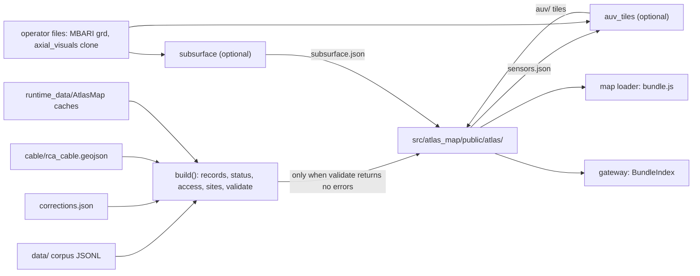

# Atlas map data bundle

chapter: atlas-map-data · paths: src/atlas_map_data/ · as of 1047fc8

The Atlas map is a static web page that shows where the RCA and COSZO sensors are, what they measure, what their status is, and where their data can be downloaded. RCA is the Regional Cabled Array, the Ocean Observatories Initiative (OOI) seafloor cable network (src/DATA_CORPUS_METHOD.md:9), which lands at Pacific City, Oregon (cable/build_geojson.py:130-132). COSZO is the companion sensor network that the repo README pairs with RCA (root README.md:1); its full name, Cascadia Offshore Subduction Zone Observatory, appears in src/coszo_pdf_pipeline/build_coszo_pdf_graph.py:43. This package is the build step that gives the page its data. It reads the corpus (the JSONL collections under `data/`), a few cached external sources, and a committed cable route, and writes one folder of JSON and binary files that the page loads at startup (src/atlas_map_data/README.md:3; docs/superpowers/specs/2026-09-23-atlas-map-design.md:106-108). Every build-time rule lives here: families, sites, status, reviewed corrections, and the 250 m depth check. The page loads this bundle at startup. At run time, live readings go through the gateway, which the Cloudflare Worker proxies in production (src/atlas_map/src/api/gateway.js:3-5), and Ask Atlas questions go to the Worker, which fetches Graph-RAG evidence built from the corpus ([ask-atlas](ask-atlas.md); src/atlas_worker/src/index.js:1-2). The bundle is also the sensor index the gateway loads (src/atlas_map_gateway/bundle_index.py:18-20).

Citation conventions: a bare file name is in `src/atlas_map_data/`, or in its `cable/` or `tests/` folder when the name is found there. A bare `README.md` is the package README, and `root README.md` is the repository README. `spec:N` is line N of docs/superpowers/specs/2026-09-23-atlas-map-design.md. Other paths are repo-relative.

## At a glance

| | |
|---|---|
| Kind | Offline pipeline. `build_atlas_bundle.py` writes a static bundle of JSON and binary files. Three optional builders sit beside it: `auv_tiles.py` (AUV, autonomous underwater vehicle, bathymetry tiles), `subsurface.py`, and the cable scripts in `cable/`. |
| Stack | Python 3.11 in a uv venv (README.md:5). The core build imports only the standard library (build_atlas_bundle.py:9-16; terrain.py:4-10). Optional: numpy and scipy for `subsurface.py` (subsurface.py:22-25), numpy and h5py for `auv_tiles.py` (auv_tiles.py:13-14). Cable scripts need shapely, pyproj and networkx (cable/README.md:3), and `skeleton.py` also imports numpy (skeleton.py:3). Tests use `unittest`. |
| Entry points | `python -m atlas_map_data.build_atlas_bundle [--out] [--refresh-terrain] [--refresh-external]` (build_atlas_bundle.py:90-95)<br>`python -m atlas_map_data.auv_tiles --source <grd>` (auv_tiles.py:102-108)<br>`python -m atlas_map_data.subsurface --source <dir>` (subsurface.py:166-171)<br>`python src/atlas_map_data/cable/merge_csv.py ooi_cables.csv` (cable/merge_csv.py:109-110) |
| Reads | Corpus under `data/` (paths.py:6):<br>Instruments rows and manifest, [corpus-instruments-ops](corpus-instruments-ops.md) (build_atlas_bundle.py:43, 82-83)<br>FETCH instruments, a transponder network at Axial, [corpus-instruments-ops](corpus-instruments-ops.md) (build_atlas_bundle.py:45)<br>Nereus entities and crosswalk (Nereus is an external public GraphQL status service that reports RCA operational status; src/nereus_pipeline/README.md:3, 7), [corpus-instruments-ops](corpus-instruments-ops.md) (build_atlas_bundle.py:49-50)<br>OOI DAS (distributed acoustic sensing, a fiber-optic line of sensors) channel geometry and MultiDAS coverage, [corpus-instruments-ops](corpus-instruments-ops.md) (das.py:61, 76)<br>PI (principal investigator) portal endpoints, [coszo-hub-sources](coszo-hub-sources.md) (build_atlas_bundle.py:37, 52)<br>Station channels, [repo-ops-data](repo-ops-data.md) (build_atlas_bundle.py:26)<br>Tracked `corrections.json` and `cable/rca_cable.geojson` (this chapter)<br>Runtime caches in `runtime_data/AtlasMap/` (paths.py:7), filled by the refresh flags (build_atlas_bundle.py:96-105). The QA/QC (quality assurance and quality control) plot index comes from [agentic-qaqc](agentic-qaqc.md) (build_atlas_bundle.py:103-105).<br>Operator-supplied: the MBARI (Monterey Bay Aquarium Research Institute) 1 m `.grd` (auv_tiles.py:39), an `axial_visuals` clone (subsurface.py:166-171), `ooi_cables.csv` (cable/merge_csv.py:3-4), and Marine Cadastre polygons (cable/skeleton.py:10). |
| Writes or serves | `src/atlas_map/public/atlas/` (paths.py:8). It is gitignored except `auv/` (root .gitignore:51-52).<br>Written only when validation passes (build_atlas_bundle.py:68-86): `families.json`, `sensors.json`, `sites.json`, `regions.json`, `cable.json`, `das.json`, `terrain/terrain.json`, `terrain/{axial,hydrate,overview}.bin`, and `manifest.json`, which is written last.<br>Optional: `subsurface.json` and `auv/index.json` with `auv/L*/*.bin.gz`.<br>Consumers: the map loader reads the JSON (src/atlas_map/src/data/bundle.js:35-37) and terrain bins (src/atlas_map/src/scene/grid.js:48), with the subsurface and AUV loaders (src/atlas_map/src/scene/SubsurfaceLayer.js:63; src/atlas_map/src/scene/AuvLod.js:27). [atlas-map-scene](atlas-map-scene.md) owns these. The gateway reads `sensors.json` (src/atlas_map_gateway/bundle_index.py:18-20; src/atlas_map_gateway/config.py:43), and [atlas-map-gateway](atlas-map-gateway.md) owns that. The Ask Atlas evidence code names `das.json` (src/atlas_map/src/evidence/resolve.js:10), and [ask-atlas](ask-atlas.md) owns that. |

## How it works

The main path is `build()` (build_atlas_bundle.py:42-87), run after an optional refresh (`main`, build_atlas_bundle.py:96-105).

1. **Refresh (optional, network).** `--refresh-terrain` downloads the GMRT (Global Multi-Resolution Topography) seafloor grids for `axial`, `hydrate` and `overview` (terrain.py:15-20, 105-113). `--refresh-external` caches the public ERDDAP (a data-server API) dataset list (access.py:70-78), the EarthScope station channels for network OO (access.py:81-97; OO is the OOI network code, inferred from access.py:81), and the QA/QC plot index (access.py:120-126). That index is fetched by `QAQCToolkit().get_index()` (build_atlas_bundle.py:105; src/agentic_qaqc/qaqc_agent_tools.py:69-80). Only these flags touch the network: `urlopen` is called at access.py:72 and access.py:84, `fetch_gmrt` at terrain.py:111, and the QA/QC request at src/agentic_qaqc/qaqc_agent_tools.py:63. `build()` reads files only (build_atlas_bundle.py:42-87).
2. **Sensor records.** Each Instruments row becomes a record (build_atlas_bundle.py:43-44). `sensor_from_row` maps the instrument type to a family and raises on an unknown type (sensors.py:34; families.py:32-38). It builds the reference designator from the OOI site, node and instrument code (sensors.py:25-27). It also sets the depth range from the node prefix: SF (shallow profiler) 5-200 m, PC (200 m platform) 200 m, and DP (deep profiler) 250 m to water depth minus 150 m (sensors.py:13-21). FETCH rows, a transponder network at the Axial summit, are appended as map-ready records with fixed repository routes (build_atlas_bundle.py:45-46; sensors.py:58-83).
3. **Corrections.** `apply_corrections` applies the reviewed table `corrections.json` and records each reason on the sensor (build_atlas_bundle.py:47; sensors.py:95-102).
4. **Status.** A Nereus snapshot entry, linked to the sensor's instrument id through an exact reference-designator crosswalk match, sets the status (status.py:13-28). A COSZO suite whose role is `new_sensor_suite` or `Oregon_Shelf_suite` becomes PLANNED (status.py:4, 31-32). Anything else is UNKNOWN (status.py:33). `STATUS_GROUP` maps each status to operating, offline, planned or unknown (status.py:5-10; build_atlas_bundle.py:57).
5. **Access routes.** `build_access` lists each sensor's public routes (access.py:129-167): an ERDDAP dataset if it is in the cache, QA/QC plots if listed, an OOI Data Explorer link for every reference designator, EarthScope station and hydrophone channels, and PI portal endpoints. Routes whose host is not in `ALLOWED_HOSTS` are dropped (access.py:168). If none remain, the sensor gets its documentation links (access.py:169-173).
6. **Terrain.** The three ESRI ASCII grids (a plain-text raster format) are parsed into Int16 (16-bit signed integer) arrays, with nodata set to -3000 (terrain.py:57-70). `Stack` answers elevation from the finest grid that covers a point, and otherwise returns -2500 m (terrain.py:88-102).
7. **Sites.** Only sensors with both coordinates are located (validate.py:9-11). `build_sites` joins located sensors within 150 m, transitively (sites.py:80-90). It names each site after its seafloor platform (sites.py:98-101) and makes labels unique (sites.py:58-70). Unlocated sensors attach to a site by site code, then location (sites.py:129-140), or are listed as unplaced.
8. **Validate.** `validate` returns error strings (validate.py:14-44). Any string fails the build.
9. **Write.** If there are no errors, the build writes the JSON files and the terrain bins (build_atlas_bundle.py:68-79). `cable.load_cable` produces `cable.json` (cable.py:19-46), and `das.build` produces `das.json` (das.py:74-92). `manifest.json` is written last (build_atlas_bundle.py:85-86).
10. **Optional builders.** `auv_tiles.build` writes 16 m and 4 m tiles over the summit, and 1 m tiles only within 1.2 km of a site (auv_tiles.py:37-66). It reads site positions from `sensors.json` (auv_tiles.py:107-111). `subsurface.build` writes `subsurface.json` (subsurface.py:158-163).
11. **Cable route (offline, not part of the build).** `cable/skeleton.py` turns Marine Cadastre corridor polygons into centerlines using a Voronoi medial axis and spur pruning (skeleton.py:1, 12-50), and writes `skeleton_raw.json` (skeleton.py:57). `cable/build_geojson.py` names the lines and primary nodes (PN, the seafloor hubs on the cable) and writes `rca_cable.geojson`, including approximate segments past the US exclusive economic zone (EEZ) (build_geojson.py:98-127, 158). `cable/merge_csv.py` replaces those approximations with the mapped route from `ooi_cables.csv`, moves PN3A, and adds secondary cables (merge_csv.py:86-103). The committed GeoJSON is the product, and the build reads it (build_atlas_bundle.py:73).



## Key files

Paths are relative to `src/atlas_map_data/`.

| File | Role |
|---|---|
| `README.md` | Build, test and optional-step commands, and the four conditions that fail the build (README.md:5-13). |
| `__init__.py` | Package docstring only (__init__.py:1). |
| `paths.py` | Repo-relative locations: `DATA`, `RUNTIME`, `BUNDLE`, `PACKAGE` (paths.py:5-9). |
| `corpus.py` | `load_jsonl`, the only JSONL reader (corpus.py:7-9). |
| `build_atlas_bundle.py` | Entry point and orchestration: records, status, access, sites, validation, writes, and the refresh flags (build_atlas_bundle.py:42-119). |
| `sensors.py` | Inventory and FETCH rows to sensor records, depth ranges, and corrections (sensors.py:13-102). |
| `families.py` | The six-family table and the type lookup, which raises on unknown types (families.py:4-38). |
| `status.py` | Nereus snapshot index, status resolution, and status groups (status.py:4-33). |
| `access.py` | Per-sensor data routes, the host allow list, and the three cache refreshers (access.py:14-174). |
| `sites.py` | Sites, regions and camera views, unique labels, and attachment of unlocated sensors (sites.py:10-143). |
| `validate.py` | Error strings that fail the build, and the 250 m depth tolerance (validate.py:6-44). |
| `terrain.py` | GMRT URL and grid extents, ESRI ASCII parsing, Int16 binary I/O, bilinear sampling, and the `Stack` (terrain.py:12-113). |
| `das.py` | DAS overlay layers: conventional OptaSense, MultiDAS schematic, and OptoDAS first span (das.py:15-92; the products are defined in the glossary). |
| `cable.py` | Reads the cable GeoJSON into `cable.json` lines and nodes (cable.py:9-46). |
| `corrections.json` | Two reviewed corrections: the Axial Base profilers, and the DAS placeholder coordinates (corrections.json:1-14). |
| `subsurface.py` | Optional. Axial earthquakes, the magma-chamber top, and caldera-wall fits from `axial_visuals` (subsurface.py:1-181). |
| `auv_tiles.py` | Optional. The MBARI 1 m grid as level-of-detail tiles (auv_tiles.py:1-118). |
| `requirements-auv.txt`, `requirements-subsurface.txt` | Extras for the two optional steps (requirements-auv.txt:1-2; requirements-subsurface.txt:1-2). |
| `cable/README.md` | Provenance of the cable route: charted, mapped, nodes, and where better data can be had (cable/README.md:1-8). |
| `cable/rca_cable.geojson` (skim) | The committed route: 43 features, 32 LineStrings (15 charted, 17 mapped) and 11 Points. Read for its properties and counts only. |
| `cable/skeleton.py` | Offline stage 1: corridor polygons to centerlines, writing `skeleton_raw.json` (not tracked). Needs shapely, networkx, pyproj and numpy (skeleton.py:1-57). |
| `cable/build_geojson.py` | Offline stage 2: named lines and node points, writing `rca_cable.geojson` (build_geojson.py:1-160). |
| `cable/merge_csv.py` | Offline stage 3, stdlib only: replaces approximate segments with the `ooi_cables.csv` route (merge_csv.py:1-110). |
| `tests/` (12 modules and `__init__.py`) | `test_full_build.py` needs the restored corpus and terrain caches, and skips otherwise (test_full_build.py:10-14). `test_auv_tiles.py` needs h5py and numpy (test_auv_tiles.py:7-13). `test_subsurface.py` needs numpy and scipy (test_subsurface.py:6-11). The other modules cover validate, sites, access, sensors, status, families, terrain, cable and das. |
| `tests/fixtures/tiny.asc` | A 3 by 2 ESRI ASCII grid for the terrain tests (tests/fixtures/tiny.asc:1-8; test_terrain.py:7). |

## Interfaces

**CLI commands**

| Command | Flags and defaults | Notes |
|---|---|---|
| `python -m atlas_map_data.build_atlas_bundle` | `--out` defaults to `src/atlas_map/public/atlas` (build_atlas_bundle.py:92). `--refresh-terrain` and `--refresh-external` (build_atlas_bundle.py:93-94). | Returns exit code 1 when validation fails (build_atlas_bundle.py:111-113). |
| `python -m atlas_map_data.auv_tiles` | `--source` (required). `--out` defaults to `<bundle>/auv`. `--sensors` defaults to `<bundle>/sensors.json` (auv_tiles.py:105-107). | Run after the main build, because it reads `sensors.json` (README.md:24). |
| `python -m atlas_map_data.subsurface` | `--source <dir>` (required). `--out` defaults to the bundle directory (subsurface.py:169-170). | Writes `subsurface.json`. |
| `python src/atlas_map_data/cable/merge_csv.py <csv>` | One positional path (merge_csv.py:110). | Rewrites `cable/rca_cable.geojson` in place (merge_csv.py:1-9). |
| `python src/atlas_map_data/cable/skeleton.py`, `.../cable/build_geojson.py` | No arguments. | Both read and write files in the working directory (skeleton.py:10, 57; build_geojson.py:10, 158). |

There are no HTTP routes, MCP tools, or environment variables. No Python module outside this package imports `atlas_map_data`. Other code reads the output files, and the map's copy of the build command is in src/atlas_map/src/data/bundle.js:1.

**Functions used inside the package**

- `build_atlas_bundle.build(out, runtime, data) -> dict` (build_atlas_bundle.py:42). Used by test_full_build.py:19.
- `validate.validate(sensors, sites, unplaced, total_rows, stack) -> list[str]` (validate.py:14).
- `sites.build_sites(located, unlocated, elev) -> (sites, unplaced)` (sites.py:77).
- `access.build_access(record, external, pi_endpoints, vertical_channels) -> list` (access.py:129).
- `terrain.read_esri_ascii`, `terrain.Stack`, `terrain.fetch_gmrt` (terrain.py:57, 88, 105).
- `cable.load_cable(path) -> dict` (cable.py:19). `das.build(data, cable) -> dict` (das.py:74).
- `families.family_for(instrument_type) -> str` (families.py:32).
- `auv_tiles.build(source, out, sites, cells=256, levels=((0, 16), (1, 4), (2, 1)), l2_radius_km=1.2)` (auv_tiles.py:37-38) and `auv_tiles.decode(data, cells, z_offset, z_scale)` (auv_tiles.py:31).
- `subsurface.build(src, out) -> dict` (subsurface.py:158).

**Files produced:** the outputs listed under "Writes or serves" above, plus the runtime caches `runtime_data/AtlasMap/terrain/{axial,hydrate,overview}.asc`, `erddap_datasets.json`, `qaqc_refdes.json` and `earthscope_channels.json` (paths.py:7; access.py:76, 95, 123; terrain.py:105-113).

## Data shapes

**`sensors.json`**: `{"sensors": [record, ...], "unplaced": ["<id>", ...]}` (build_atlas_bundle.py:70). A record:

| Field | Type | Meaning |
|---|---|---|
| `id` | string | Canonical id (sensors.py:30). |
| `instrumentId` | string | Corpus instrument id. It keys Nereus status and PI endpoints (sensors.py:31; status.py:28; access.py:164). |
| `name`, `type` | string | Display name and instrument type. The type must have a family (sensors.py:33-34). |
| `family` | string | One of `seismic`, `pressure`, `chemistry`, `currents`, `acoustic`, `fiber` (families.py:4-11). |
| `lat`, `lon` | number or null | Position. Null means unlocated (validate.py:9-11; sensors.py:35-36). |
| `depth` | number or null | Top of `depthRange` for profilers, else the water depth (sensors.py:37). |
| `depthRange` | [int, int] or null | Sampling band for SF, PC and DP nodes (sensors.py:13-21, 38). |
| `waterDepth` | number or null | Inventory depth (sensors.py:27, 39). |
| `siteCode`, `node`, `refdes` | string or null | OOI site code, node, and reference designator (sensors.py:25-27, 40-42). |
| `location`, `projects`, `coszoRole`, `manufacturer`, `model` | mixed | Copied from the inventory row (sensors.py:43-47). |
| `sources`, `arcadaId` | list, string | Source URLs and the ARCADA document id, an archive identifier whose expansion the sources read do not give (sensors.py:48-49). |
| `corrections` | list of strings | Reasons for applied corrections (sensors.py:102). |
| `status`, `statusSource`, `statusAsOf` | string or null | Status, its source, and the snapshot time (status.py:27-33). |
| `statusGroup` | string | `operating`, `offline`, `planned` or `unknown` (status.py:5-10; build_atlas_bundle.py:57). |
| `access` | list of route objects | Each has `kind`, `label`, `url` and `how`. Kinds are `erddap`, `qaqc`, `ooi_explorer`, `earthscope`, `pi_portal`, `documentation` and `repository` (access.py:136-167; sensors.py:77-82). |
| `site`, `region` | string | Set on located sensors (sites.py:117-118) and on unlocated sensors that attach to a site (sites.py:140). |
| `aliases` | list of strings | FETCH records only (sensors.py:73-75). |

**`sites.json`**: `{"sites": [...]}` (build_atlas_bundle.py:71). Each site has `id` (slug, with `-2` and so on for collisions; sites.py:110-115), `name`, `label` (unique; sites.py:58-70), `region`, `lat` and `lon` (the centroid, rounded to 6 places; sites.py:119-125), `seafloor` (metres, from terrain; sites.py:96), `sensorIds`, `parts` (distinct location names; sites.py:102), `column` (a list of `{kind, a, b}` water-column bands, sorted by `a`; sites.py:103-109, 123), and `unlocatedIds` (sites.py:124).

**`regions.json`**: `{"overview": view, "regions": [{key, label, lonMin, lonMax, view}]}` (build_atlas_bundle.py:72; sites.py:15-25). A view is `{ll, dist, polar, az, exag}`.

**`families.json`**: `{"families": [{key, label, color, glyph}]}` (families.py:4-11; build_atlas_bundle.py:69).

**`cable.json`**: `{"lines": [...], "nodes": [...], "hidden": n}` (cable.py:46).
- A line has `name`, `kind`, `route`, `accuracy` (`charted` or `mapped` in the committed file; test_cable.py:32 asserts that no line is approximate), `lengthKm`, `source` and `coords` as `[lon, lat]` pairs (cable.py:43-45). `kind` and `route` are parsed from the feature name (cable.py:35-40).
- A node has `code`, `name`, `accuracy`, `note`, `lon`, `lat` and `description` (cable.py:25-30).
- `hidden` counts the features skipped as undocumented (cable.py:32-34).

**`das.json`**: `{"layers": [...], "summary": {conventional, multidas, optodas}}` (das.py:91-92). A layer has `id`, `experiment`, `kind` (`conventional`, `multidas` or `optodas`), `cable`, `coords` as `[lon, lat]` pairs, `color`, `detail` and `caveat` (das.py:67-70, 81-89). A `multidas` layer also has `distance` `{start_m, end_m, length_m}` (das.py:83).

**`terrain/terrain.json`**: `{"credit", "grids": {name: {ncols, nrows, west, south, cellsize, min, max}}}` (terrain.py:52-54; build_atlas_bundle.py:79). Each `terrain/<name>.bin` is row-major little-endian Int16 metres, with row 0 at the north edge (terrain.py:33-36, 40, 73-77).

**`manifest.json`**: `builtAt` (UTC ISO time), `total`, `located`, `unlocated`, `unplaced`, `sites`, `corpusSnapshot` (`created_at` from `Instruments/manifest.json`, or null), `warnings` (cache warnings), and `errors` (always empty, because the file is written only when there are no errors) (build_atlas_bundle.py:80-86). The map treats a missing `manifest.json` as "bundle not built" (src/atlas_map/src/data/bundle.js:18-19, 35).

**`subsurface.json`** (optional): `credit`, `datumM` (1500), `rim` as `[a, b]` pairs in the source's order (see Open questions), `earthquakes` `{count, day0, lon0, lat0, scale: 1e-5, fields: [dLon, dLat, depthM, day], rows}`, and `surfaces` as a list of `{key, label, rows, cols, points}` (subsurface.py:147-149, 159-160). Points are `[lon, lat, elevation_m]` or null, row-major. Elevation is negative below sea level (subsurface.py:77-85). Earthquake `depthM` is metres below sea level, inferred from the datum comment (subsurface.py:10-12, 146).

**`auv/index.json`** (optional, tracked): `source`, `credit`, `west`, `north`, `cellDeg` (the longitude step in degrees, which the code also uses for latitude), `tileCells` (256), `zOffset` (-1000), `zScale` (10), `nx`, `ny`, and `levels: [{level, stride, cellDeg, tilesX, tilesY, tiles: [[ty, tx], ...]}]` (auv_tiles.py:54-98). Each tile `auv/L<level>/<ty>_<tx>.bin.gz` is a gzipped little-endian Int16 array of 257 by 257 values, delta-encoded along each row. Decode with a cumulative sum, then divide by `zScale` and add `zOffset` (auv_tiles.py:22-34). The tracked tiles are 30 at L0, 378 at L1 and 282 at L2 (`git ls-files`), 23 MB in total.

**Runtime caches** (all written with `retrievedAt` and `source`):
- `erddap_datasets.json`: `datasetIds` (access.py:70-78).
- `qaqc_refdes.json`: `refdes` (access.py:120-126).
- `earthscope_channels.json`: `network` and `stations: {code: {lat, lon, channels}}` (access.py:81-97).

**Inputs the build reads**
- Instruments row: `canonical_id`, `instrument_id`, `name`, `instrument_type`, `location`, `projects`, `coszo_role`, `site`, `node`, `instrument_code`, `latitude`, `longitude`, `depth_m`, `manufacturer`, `model`, `source_urls`, `arcada_document_id` (sensors.py:24-51; test_sensors.py:8-16).
- FETCH row: `canonical_id`, `instrument_id`, `name`, `instrument_type`, `latitude`, `longitude`, `location`, `projects`, `source_urls`, `instrument_type_aliases`, `station_identifier`, `station` (sensors.py:58-75).
- Station channels: `network`, `station`, `channel` (build_atlas_bundle.py:26-27).
- PI endpoints: `instrument_id`, `instrument_key`, `endpoint_id`, `label`, `url` (build_atlas_bundle.py:37-38; access.py:165-167).
- Nereus entities: `entity_type`, `reference_designator`, `operational_status`, `retrieved_at` (status.py:14, 21-23). Crosswalk: `reference_designator`, `instrument_graph_id`, `match_type` (status.py:16-19).
- DAS channel locations: `channel_number`, `cable`, `latitude`, `longitude` (src/ooi_das_geometry/build_ooi_das_geometry.py:70-76; das.py:61-65). MultiDAS coverage: `cable` and `saved_unmasked_intervals_m` as `{start_m, end_m, length_m}` (das.py:76-83; the record shape is at src/ooi_das_geometry/extract_multidas_mask_metadata.py:76-95).
- `corrections.json`: `corrections: [{match: {field: [values]}, set: {field: value}, reason}]` (sensors.py:86-102).
- `rca_cable.geojson`: features with `name`, `source`, `source_url`, `accuracy` (`charted`, `mapped`, `approximate` or `surveyed`), `length_km` and `line`, and geometry of type LineString or Point (cable.py:19-45; build_geojson.py:45-51). Points that do not match `PN<digit><letter>` are not used (cable.py:25).
- `ooi_cables.csv`: `Lat` and `Long` columns (merge_csv.py:72; the docstring calls the rows "bare Lat,Long", merge_csv.py:6).

## Configuration and secrets

There are no secrets, and this package reads no environment variables (`git grep` for `environ` and `getenv` under `src/atlas_map_data` finds nothing). The network calls are unauthenticated public requests to GMRT, ERDDAP, the EarthScope FDSN service, and the QA/QC index (terrain.py:12, 111; access.py:14-21, 72, 84; src/agentic_qaqc/qaqc_agent_tools.py:31-32, 61-64, 69-80).

| Name | Read at | Purpose | Default or required |
|---|---|---|---|
| `--out` | build_atlas_bundle.py:92 | Bundle output directory | `src/atlas_map/public/atlas` |
| `--refresh-terrain` | build_atlas_bundle.py:93, 96-99 | Download the three GMRT grids | Off. Needed once. |
| `--refresh-external` | build_atlas_bundle.py:94, 100-105 | Refresh the ERDDAP, EarthScope and QA/QC caches | Off. Needed once. |
| `--source` | auv_tiles.py:105; subsurface.py:169 | Path to the MBARI `.grd` or the `axial_visuals` clone | Required |
| `--sensors` | auv_tiles.py:107 | Site positions for the 1 m tiles | `<bundle>/sensors.json` |
| `DATA`, `RUNTIME`, `BUNDLE`, `PACKAGE` | paths.py:5-9 | `data/`, `runtime_data/AtlasMap/`, the bundle, this package | Computed from file location |
| `TOLERANCE_M` | validate.py:6 | Depth check tolerance, metres | 250 |
| `SITE_RADIUS_KM` | sites.py:12 | Site clustering distance, in km (150 m) | 0.15 |
| `DEFAULT_VERTICAL_CHANNEL`, `VERTICAL_PREFERENCE` | access.py:19-20 | Seismic channel fallback | HHZ, then EHZ, BHZ, SHZ |
| `HYDROPHONE_MATCH_KM` | access.py:23 | Max distance from a hydrophone to its HDH station | 2.0 |
| `ALLOWED_HOSTS` | access.py:24-29 | Hosts that access routes may use | 14 hosts |
| `GRIDS`, `FINEST_FIRST` | terrain.py:15-20 | Grid extents and resolutions | axial, hydrate (high), overview (med) |
| `NODATA_FILL`, `Stack.FALLBACK` | terrain.py:14, 89 | Nodata value and elevation outside all grids | -3000, -2500 m |
| `FETCH_RAW_DATA_URL`, `FETCH_DISTANCE_DATA_URL` | sensors.py:54-55 | Repository routes, pinned to a commit | Pinned |
| `DATUM_M`, `LAT0`, `LON0` | subsurface.py:27-30 | Subsurface frame and datum | 1500 m; LON0 -130.0089, LAT0 45.9547 |
| `Z_OFFSET`, `Z_SCALE`, `cells`, `levels`, `l2_radius_km` | auv_tiles.py:17, 38 | Tile encoding and levels | -1000; 10; 256; (16, 4, 1) m; 1.2 km |
| `NORTH_BACKBONE`, `PN3A_LOCAL`, `CALDERA` | merge_csv.py:24-26 | Row ranges in `ooi_cables.csv` | Tied to one CSV version |
| `L` | skeleton.py:31 | Spur-pruning length | 150 (projected metres) |

## Run and test

Commands from the package README (README.md:5-7, 15, 21-22, 30-32):

```sh
uv venv --python 3.11 .venv                                    # once
PYTHONPATH=src .venv/bin/python -m atlas_map_data.build_atlas_bundle --refresh-terrain --refresh-external   # first time
PYTHONPATH=src .venv/bin/python -m atlas_map_data.build_atlas_bundle                                        # after corpus rebuilds
PYTHONPATH=src .venv/bin/python -m unittest discover -s src/atlas_map_data/tests -t src -v                  # tests

# optional, after the main build (README.md:24)
uv pip install --python .venv/bin/python -r src/atlas_map_data/requirements-auv.txt
PYTHONPATH=src .venv/bin/python -m atlas_map_data.auv_tiles --source <path>/MBARI_AxialSeamount_V2506_AUV_Summit_AUVOverShip_Topo1mSq.grd

# optional subsurface
git clone https://github.com/MaleenKidiwela/axial_visuals <dir>
uv pip install --python .venv/bin/python -r src/atlas_map_data/requirements-subsurface.txt
PYTHONPATH=src .venv/bin/python -m atlas_map_data.subsurface --source <dir>

# optional cable refresh (merge_csv.py:3-4)
curl -LO https://raw.githubusercontent.com/MaleenKidiwela/CascadiaEarthquakes/main/ooi_cables.csv
python src/atlas_map_data/cable/merge_csv.py ooi_cables.csv
```

The build's failure conditions are listed in README.md:9-13. `test_full_build.py` expects 171 total, 155 located, 16 unlocated, 5 unplaced, 31 sites and 7 cable nodes on the real corpus (test_full_build.py:21-25, 50). It skips unless `data/Instruments/instruments.jsonl` and the three terrain caches exist (test_full_build.py:10-14). In this checkout `data/` holds only a README, `CORPUS_METHOD.md` and `cleanup_validation.json`, and `runtime_data/AtlasMap/` is absent. The tests were not run for this chapter.

## Decisions and constraints

- **One explicit family table, with unknown types as errors.** "One table; an unknown type is an error, never a default" (families.py:1; families.py:34-38). Source: code comment and commit d115926.
- **Profiler depth comes from the node code.** The water depth is kept separately (sensors.py:13-21, 37-39). Source: spec:82.
- **Position fixes are reviewed, with a reason.** A correction may clear a placeholder position, leaving the sensor unlocated (corrections.json:9-11; spec:144). Source: commit a0d1835 body, which says the DAS placeholder sits about 300 km offshore.
- **Located sensors with a depth must match GMRT within 250 m, or carry a correction.** Profilers are compared by water depth (validate.py:37). Corrected sensors are not checked (validate.py:6, 33-43). Source: README.md:13; spec:151, which says "seafloor sensor".
- **A site is one physical location.** Sensors within 150 m of each other form one site, transitively (sites.py:12, 80-81). Source: spec:142.
- **Status uses only the Nereus snapshot and the COSZO inventory role.** "Nothing is inferred beyond that" (status.py:27-33; spec:64).
- **Live access is limited to allowed hosts.** Documentation links are the fallback (access.py:24-29, 168-173). Source: commit 1d0d878.
- **No build-time network access.** Only the refresh flags reach the network (build_atlas_bundle.py:96-105; access.py:72, 84; terrain.py:111). spec:108 limits network use to refreshing "the terrain or cable caches"; the code refreshes terrain and the ERDDAP, EarthScope and QA/QC caches instead, and the cable route is built offline.
- **Charted cable is public domain and "not for navigation."** Segments past the US EEZ are approximate, then replaced by the mapped route (cable/README.md:5-6; build_geojson.py:15-16, 156).
- **DAS overlays are schematic.** MultiDAS and OptoDAS coordinates were not published, so intervals are drawn along the backbone centreline, never as channel locations (das.py:1-6, 36-39, 85, 90). The OptaSense caveat says the geometry is "not an asserted Silixa channel map" (das.py:70).
- **AUV tiles are committed without their source grid.** The MBARI grid is not in the repo, so the tiles are tracked and `auv/` is un-ignored (README.md:19-24; root .gitignore:51-52). Source: commit c8ceb14.
- **Heavy dependencies stay out of the core build.** Subsurface and AUV are "separate from the stdlib build" (subsurface.py:1; auv_tiles.py:1). The cable scripts are not needed to build the bundle (cable/README.md:3).
- **Hydrophones map to HDH only for OOI sensors.** COSZO's planned hydrophones have stations registered but publishing nothing yet (access.py:105-106; test_access.py:68-69). Source: commit b89832d.
- **FETCH has no reference designator, so it gets no Nereus, ERDDAP or QA/QC route** (sensors.py:61-63). Its repository routes are fixed (sensors.py:77-82).

## History

- **2026-09-23, first layers** (d115926, 146344b, a96eebc, 398d32f, b741f46, ff9463c): the family table, sensor records with reviewed corrections, status resolution, GMRT terrain, data-access routes, and physical sites were added in that order.
- **2026-09-23, cable and validation** (3d14f1e, 9b102c6, 71104cd): the researched cable route was converted for the atlas. Review fixes followed: HHZ as the default channel, transitive site clustering, site-code-first matching, and a "folded PN5A cable kind" (cable.py:38-40). The build then learned to validate and write the bundle.
- **2026-09-23, AUV tiles, PI routes and labels** (94d835c, 1d0d878, 3d4a2d9, d62c56a): the MBARI 1 m summit was tiled into level-of-detail tiles and credited. PI endpoint ids were carried on routes, host filtering moved before the documentation fallback, and site labels were made unique.
- **2026-09-23, placeholders** (a0d1835): the DAS placeholder positions were cleared, and an unknown Nereus status became a validation error. The commit body records 152 located and 28 sites at that point.
- **2026-09-24, live feeds and subsurface** (b89832d, 3a4a4e9): EarthScope seismic channels come from a cached inventory, OOI hydrophones map to HDH, the subsurface builder was added, and the mapped `ooi_cables.csv` route replaced straight-line segments.
- **2026-09-24, FETCH** (13c0168, 15fd69e, 6f346a3): FETCH transponders were added, then the DAS coverage overlay and FETCH search aliases. The real-corpus expectations rose from 168 total, 152 located and 28 sites to 171, 155 and 31 (test_full_build.py in 13c0168).
- **2026-09-24, DAS fix and tiles** (c2ee659, c8ceb14): the MultiDAS overlay extent was corrected, and the AUV tiles were committed, since their source grid is not in the repo.

## Gotchas

- **The counts check cannot fail.** `validate` compares `len(located) + len(unlocated)` with `total_rows` (validate.py:18-19), and `build` passes `len(records)` (build_atlas_bundle.py:66). `located` and `unlocated` partition `records`, so the comparison is always equal. README.md:9-11 and spec:150 say the build fails on this, and the unit test passes an explicit wrong total (test_validate.py:40-42).
- **Some failures raise instead of returning errors.** An unknown instrument type raises from `family_for` (families.py:34-38, via sensors.py:34). A longitude outside the four bands raises in `region_for` (sites.py:32), and a correction that matches nothing raises (sensors.py:98-99). A missing input or terrain file raises `FileNotFoundError` (build_atlas_bundle.py:43-50, 61). None of these writes anything, but `main` gives a traceback rather than the "build failed with N errors" message (build_atlas_bundle.py:111-113).
- **Correction matching is exact.** `_matches` tests `record.get(field) in values` (sensors.py:91-92). The Axial Base fix matches `lat` 45.9316 exactly (corrections.json:4). If the corpus coordinate changes, the fix stops matching and the build raises (sensors.py:98-99).
- **Corrected sensors skip the depth check** (validate.py:38). A wrong corrected position passes unchecked.
- **Access hosts are dropped silently.** The spec says a disallowed host fails the build (spec:152), but the code filters it out (access.py:168), and the test expects that (test_access.py:95-97).
- **Sites chain.** Clustering is transitive (sites.py:81), so a run of sensors each within 150 m of the next becomes one site however long it runs (test_sites.py:39-47).
- **Site names come from the seafloor.** Seafloor members weigh 100 and water-column members weigh 1 (sites.py:100-101).
- **Profiler `depth` is the shallow end, not the measurement depth** (sensors.py:37; depthRange at sensors.py:13-21). The depth check uses `waterDepth` for profilers (validate.py:37).
- **Two vertical-channel orders.** Station metadata prefers HHZ, BHZ, EHZ, SHZ (build_atlas_bundle.py:28); the inventory fallback prefers HHZ, EHZ, BHZ, SHZ (access.py:20). The orders differ only when BHZ and EHZ are both listed: metadata picks BHZ, and an inventory-only station picks EHZ.
- **Terrain elevation falls back silently.** Points outside every grid get -2500 m (terrain.py:89, 97-102). `validate` checks only located sensors (validate.py:33-35), and site centroids are not checked (sites.py:94-96).
- **Terrain is whole metres.** Values are rounded to integers and clamped to ±32000 (terrain.py:68). Nodata becomes -3000 (terrain.py:14, 68).
- **GMRT responses are saved unchecked.** `fetch_gmrt` writes the response bytes without inspecting them (terrain.py:111-112), so a non-ESRI body fails later, in `read_esri_ascii` (terrain.py:57-62).
- **The QA/QC index can come from a temp-dir cache.** `build_atlas_bundle.py:105` calls `QAQCToolkit().get_index()` with default arguments. The default cache is `rcn-agent-qaqc-index.json` in the system temp directory (src/agentic_qaqc/qaqc_agent_tools.py:54), and a copy up to 900 s old is returned without a request (src/agentic_qaqc/qaqc_agent_tools.py:50, 72-74). A `--refresh-external` run can therefore keep an index older than the one the RCA QA/QC site serves.
- **The AUV encoder clips silently.** Values are clipped to ±32000 after the offset and scale, so about -4200 m to +2200 m (auv_tiles.py:23). Tiles also assume one cell size for both axes (auv_tiles.py:42-44), so a grid with different latitude and longitude steps would be wrong (inferred; the source grid is absent).
- **The bundle write is not atomic.** Files are written one by one (build_atlas_bundle.py:68-86). A crash mid-write can leave new files beside an old `manifest.json`.
- **Cable scripts depend on the working directory.** `skeleton.py` reads `mc_rsn_backbone_polygons.geojson` (skeleton.py:10), which is not tracked (`git ls-files`). `build_geojson.py` reads `skeleton_raw.json` and writes `rca_cable.geojson` in the working directory (build_geojson.py:10, 158). The spec names `.context/cable/` as the author's working folder (spec:165), and that folder is not in this checkout.
- **Re-running `build_geojson.py` alone restores the straight segments.** It writes the approximate EEZ-to-PN3B lines (build_geojson.py:118-127), which only `merge_csv.py` replaces (merge_csv.py:86-90). The order is inferred from file dependencies, since no runbook is tracked.
- **`merge_csv.py` depends on one CSV version.** The row ranges are fixed (merge_csv.py:24-26), and only the north-backbone endpoints are asserted (merge_csv.py:79, 82). The docstring calls the file "bare Lat,Long rows" (merge_csv.py:6), but `DictReader` needs a header line (merge_csv.py:72) (inferred).
- **`load_cable` drops points and hides lines.** Points that do not match `PN<digit><letter>` are dropped (cable.py:25), which removes the landfall, the shore station, and two junction boxes (`MJ01C`, `LJ01B`). Features named "Unidentified..." and "path B" are hidden, five in all (cable.py:15-16, 32-34). The result is 27 visible lines, 7 nodes and `hidden` = 5.
- **DAS distances follow path A.** The backbone includes path A and not path B (das.py:22-30; cable.py:32-34). build_geojson.py:103 notes that which path is live is not documented.
- **DAS intervals past the route are cut short.** `_slice_by_distance` clamps distances to the route length (das.py:44). The docstring warns against stretching the last point (das.py:37-39).
- **A mask caveat is lost.** The MultiDAS source flags that masks may not have been applied for files from 2025-11-26 through 2025-12-02 (src/ooi_das_geometry/extract_multidas_mask_metadata.py:93). `das.py:85` does not carry that caveat into `das.json`.
- **The OptoDAS "first span" is 204 km.** `south[:101]` ends exactly at PN1A (das.py:88), which is the whole landfall-to-PN1A segment, not a short span.
- **The gateway matches PI endpoints by URL.** The bundle carries corpus endpoint ids, and the PI toolkit uses its own ids, so the gateway matches by URL (src/atlas_map_gateway/routes_data.py:45-53).
- **Cable total differs from the README.** `cable/README.md:5` gives about 85% charted. Line lengths in the file give 86.8% (798.6 of 920.1 km, including hidden stubs).

## Glossary

| Term | Meaning |
|---|---|
| Atlas bundle | The folder of JSON and binary files that this package writes to `src/atlas_map/public/atlas/` (paths.py:8). |
| AMC | Axial magma chamber, the magma body under Axial Seamount. The build draws the top of its reflector (subsurface.py:32, 132). |
| ARCADA | An archive identifier in the inventory (`arcada_document_id`). Its expansion is not in the sources read (sensors.py:49). |
| AUV | Autonomous underwater vehicle. The MBARI 1 m summit survey was made by one (auv_tiles.py:16). |
| Axial Seamount | The undersea volcano off Oregon. It names the first of the four map regions (sites.py:15-16), and its summit caldera hosts FETCH (src/fetch_transponders/build_fetch_corpus.py:107). |
| Charted, mapped, approximate, surveyed | Accuracy labels on cable features: from the Marine Cadastre (charted), from `ooi_cables.csv` (mapped), straight or proxy (approximate), and from OOI asset-management positions (surveyed) (cable/README.md:5-6; build_geojson.py:151-152). |
| COSZO | The companion Cascadia sensor network, short for Cascadia Offshore Subduction Zone Observatory (src/coszo_pdf_pipeline/build_coszo_pdf_graph.py:43). New COSZO suites are "planned" (root README.md:1; status.py:4). |
| Corrections | Reviewed fixes to a sensor's position, each with a reason (corrections.json; sensors.py:95-102). |
| DAS | Distributed acoustic sensing: a fiber-optic cable read as a line of strain or acoustic sensors (the expansion is general knowledge; das.py:1-7 uses the term). |
| DP, SF, PC | Deep profiler, shallow profiler and 200 m platform: OOI moorings whose node prefixes set depth ranges (sensors.py:10, 13-21). |
| Datum (1500 m) | The reference depth of the notebook's subsurface layers. The build adds it back (subsurface.py:10-12). |
| EEZ | Exclusive economic zone. The US EEZ limit is where the Marine Cadastre geometry ends (build_geojson.py:112, 118). |
| ERDDAP | A public data-server API. OOI publishes RCA datasets through it (access.py:14, 32-33). |
| EarthScope, FDSN | EarthScope is a seismic data archive. FDSN is the web-service standard its station service follows (access.py:21). |
| Seismic channel codes (HHZ, EHZ, BHZ, SHZ, HDH) | Three-letter SEED-style codes. Z is the vertical component. HDH is the hydrophone channel (access.py:17-22). |
| Family | One of six sensor groups, each with a colour and glyph (families.py:4-11). |
| FETCH | A cabled seafloor geodetic network at the Axial summit, with three ocean-bottom acoustic ranging stations (src/fetch_transponders/build_fetch_corpus.py:107). |
| GMRT | Global Multi-Resolution Topography, the seafloor grid service behind the terrain (terrain.py:12-13). |
| Graph-RAG | Graph-based retrieval-augmented generation, the repo's question-answering core. Outside this chapter (root README.md:1). |
| Int16 | A 16-bit signed integer. Terrain and AUV tiles are stored this way (terrain.py:64, 74; auv_tiles.py:23). |
| Junction box (MJ, LJ) | Node-name codes for cable junction boxes, as used in the cable notes (build_geojson.py:62, 151-152). The repo does not define them (inferred: OOI naming). |
| Level of detail (LOD) | Tiles at several resolutions, with the finest loaded nearest the camera (auv_tiles.py:1; spec:137). |
| Marine Cadastre | The public cable-area dataset of NOAA (US National Oceanic and Atmospheric Administration) and BOEM (Bureau of Ocean Energy Management), the source of the charted route (build_geojson.py:14-15). |
| MBARI | Monterey Bay Aquarium Research Institute, which surveyed the Axial summit at 1 m (auv_tiles.py:16). |
| MultiDAS, OptoDAS, OptaSense | DAS products named in the overlays. MultiDAS is the 2025–2026 unmasked spans, OptoDAS the south first span, and OptaSense the 2021 conventional channel geometry (das.py:69, 81, 88; src/ooi_das_geometry/build_ooi_das_geometry.py:159). |
| Nereus | An external public GraphQL status service that reports RCA operational status. The build reads a snapshot of it (src/nereus_pipeline/README.md:3, 7; spec:70). |
| Ocean Observatories Initiative (OOI) | The programme that runs RCA (src/DATA_CORPUS_METHOD.md:9). |
| PI portal | Directory of data from instrument principal investigators, hosted at piweb.ooirsn.uw.edu (access.py:41). |
| Primary node (PN) | A seafloor hub that takes power and data from the backbone and passes it to nearby sites (cable.py:12). |
| QA/QC | Quality assurance and quality control. The RCA QA/QC site serves pre-rendered plots (access.py:15, 140-141). |
| Reference designator (refdes) | OOI's instrument identifier, made of site, node and instrument code, for example `RS03AXPS-PC03A-4A-CTDPFA303` (sensors.py:25-27; test_access.py:23). |
| Region | One of four longitude bands (Axial, Oregon Slope Base, Hydrate Ridge, Oregon Shelf), each with a camera view (sites.py:15-25). |
| Safety box (KCE, VAA) | Avoidance areas on OOI safety flyers. The cable build puts PN1B, PN1D, PN5A and PN3B at their box centres (build_geojson.py:57-61, 137, 141, 143, 148). PN1C sits at a COSZO ROV site instead (build_geojson.py:74, 139), and PN3A at the MJ03A junction box (build_geojson.py:145). |
| Site (atlas) | A physical location: sensors within 150 m of each other, transitively (sites.py:1, 12, 80-81). |
| Stack | The terrain grids, finest first, that answer elevation queries (terrain.py:88-102). |
| Status group | `operating`, `offline`, `planned` or `unknown`, derived from the status (status.py:5-10). |
| UW | University of Washington. The PI portal host is under uw.edu (access.py:41), and the UW RCA team offers as-laid route files on request (cable/README.md:8). |
| Unlocated, unplaced | Unlocated means a null lat or lon (validate.py:9-11). Unplaced means unlocated and not attached to a site (sites.py:129-142). |
| Water column | The depths between seafloor and surface that a mooring samples (sensors.py:9; sites.py:103-109). |

## Open questions

- **What total should the counts check use?** `validate` compares against `len(records)` (validate.py:18-19; build_atlas_bundle.py:66). spec:150 suggests the raw inventory row count. Answer: the author of commit 71104cd, or a fix that passes the row counts from both inventory files and adds a test through `build()`.
- **Which vertical-channel order is intended?** BHZ before EHZ in station metadata (build_atlas_bundle.py:28), but EHZ before BHZ in the inventory fallback (access.py:20). Answer: a station that lists both in `StationMetadata/channels.jsonl`, or the author of commit b89832d.
- **Which MultiDAS path is live?** The backbone uses path A and hides path B (das.py:22-30; cable.py:32-34), and build_geojson.py:103 says which is live is undocumented. Answer: the UW as-laid route files (cable/README.md:8; spec:171).
- **Who names `multidas_unmasked_coverage.jsonl`?** `src/ooi_das_geometry/extract_multidas_mask_metadata.py` builds these records (`mask_record`, lines 65-95) and writes them to whatever path `--output` names (lines 101, 105). The reader is `src/ooi_das_geometry/ooi_das_geometry_tools.py:43`, and no tracked command uses that file name. Answer: whoever ran the extractor for the file (no run log is tracked), or [corpus-instruments-ops](corpus-instruments-ops.md).
- **Should a disallowed host fail the build?** The spec says yes (spec:152), and the code and test drop it (access.py:168; test_access.py:95-97). Answer: a product decision, then align the spec or the code.
- **Is the source pinned for the optional builders?** README.md:30 clones the default branch of `axial_visuals`, and `auv_tiles` assumes equal latitude and longitude steps (auv_tiles.py:42-44). Answer: the commit used for the last `subsurface.json` build, and the MBARI grid's coordinate arrays.
- **Is there a runbook for the cable pipeline?** The order skeleton, build_geojson, merge_csv is inferred from file dependencies. Answer: the authors of commits 3d14f1e and 3a4a4e9.
- **What is the column order of `axial_calderaRim.m`?** `rim()` keeps the number pairs in file order (subsurface.py:152-155), and `test_subsurface.py:38-41` writes lon first in its synthetic file. The source is not in the repo. Answer: the `axial_visuals` clone passed as `--source` (subsurface.py:166-171).

## Candidate project memory

- decision · AUV tiles committed without their source grid · the MBARI grid is not in git, so the 23 MB of summit tiles are tracked and `auv/` is un-ignored · README.md:24; commit c8ceb14
- requirement · Cable route is not for navigation · Marine Cadastre geometry is public domain and "not for navigation", so the map must keep each cable feature's accuracy label: lines are charted or mapped, nodes charted, approximate or surveyed · cable/README.md:5-6; build_geojson.py:156; src/atlas_map/src/ui/Tooltip.jsx:7-19
- bug · Counts check cannot fail · the spec promises a counts-reconcile failure, but `build` passes `len(records)`, so `validate` compares the record list with itself · spec:150; validate.py:18; build_atlas_bundle.py:66
- bug · Disallowed hosts are dropped, not failed · the spec says the build fails on a disallowed host, but `build_access` filters it silently and the test expects that · spec:152; access.py:168; test_access.py:95-97
- decision · DAS placeholder positions are cleared, not moved · the PI HTML placeholder 45.0, -128.0 leaves these experiments unlocated rather than placing them · corrections.json:9-11; commit a0d1835

## Verification

Checked 2026-10-09 against HEAD 1047fc8: 211 cited statements (332 distinct citation strings), plus the identifiers, commands and file names they name. Corrected 18 (wrong, misattributed, mis-cited or incomplete). Moved 1 to Open questions (the column order of `axial_calderaRim.m`).
