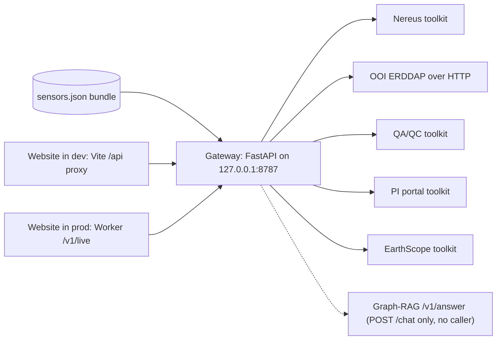

# Atlas map gateway

chapter: atlas-map-gateway · paths: `src/atlas_map_gateway/` · as of 1047fc8

The gateway is the small local service that answers the Atlas map's live questions: a sensor's operational status, its recent readings, its quality-control plots, the files in a PI (principal investigator) portal folder, and up to an hour of a seismic station's waveform. It is a FastAPI app (a Python web framework) run by uvicorn (a web server) on `127.0.0.1:8787` (`src/atlas_map_gateway/README.md:5-6`). The map itself is a static bundle written by [atlas-map-data](atlas-map-data.md), and anything that changes after the build comes through here. The gateway calls the upstream sources through toolkits that live in other folders. It adds what every call needs in one place: an allowlist taken from the bundle, a time-to-live (TTL) cache, a per-source concurrency limit, bounded requests and one error shape (`docs/superpowers/specs/2026-09-23-atlas-map-design.md:77`, `:177-184`). The site still works without it, from the bundle alone (`src/atlas_map/README.md:21`).

## At a glance

| Row | Value |
|---|---|
| Kind | Service: a local FastAPI app run by uvicorn on `127.0.0.1:8787` (`src/atlas_map_gateway/README.md:5-6`). |
| Stack | Python with FastAPI, uvicorn[standard], httpx (an HTTP client library) and pymseed (a Python decoder for MiniSEED, a binary seismic waveform format) (`src/atlas_map_gateway/requirements.txt:1-4`). Pydantic (a data-validation library) arrives with FastAPI and is imported directly (`src/atlas_map_gateway/routes_data.py:10`). No Python version is pinned in this folder. |
| Entry points | `atlas_map_gateway.main:app` (`src/atlas_map_gateway/main.py:50-54`), built by `build()` (`main.py:39-47`). `create_app` in `src/atlas_map_gateway/app.py:41-82` holds the shared state and registers the routes. |
| Reads | The bundle's `sensors.json`, located by `ATLAS_BUNDLE_DIR` (`src/atlas_map_gateway/config.py:43`) and written by [atlas-map-data](atlas-map-data.md) (`src/atlas_map_data/build_atlas_bundle.py:70`). Through toolkits: Nereus (the Regional Cabled Array's instrument status service) ([corpus-instruments-ops](corpus-instruments-ops.md), `src/nereus_pipeline/nereus_agent_tools.py`), the quality-control (QA/QC) plot index ([agentic-qaqc](agentic-qaqc.md), `src/agentic_qaqc/qaqc_agent_tools.py`), PI portal listings and EarthScope (a public seismic data service) waveforms ([coszo-hub-sources](coszo-hub-sources.md), `src/coszo_hub_tools/`). Direct HTTP (Hypertext Transfer Protocol): ERDDAP (Environmental Research Division's Data Access Program) readings from OOI (Ocean Observatories Initiative) (`src/atlas_map_gateway/erddap.py`). Chat only: the Graph-RAG (graph-augmented retrieval) `/v1/answer` route ([graphrag-runtime](graphrag-runtime.md), `src/atlas_map_gateway/main.py:18`). Settings come from the repo `.env` and the process environment (`src/atlas_map_gateway/config.py:37-38`). |
| Writes or serves | JSON (JavaScript Object Notation) routes for the live panels in `src/atlas_map/src/panels/live/`, which reach them through `src/atlas_map/src/api/gateway.js:5` ([atlas-map-panels](atlas-map-panels.md)). Production traffic arrives through the Cloudflare Worker's `/v1/live` proxy ([ask-atlas](ask-atlas.md), `src/atlas_worker/src/index.js:41-61`). Development traffic arrives through the `/api` proxy of Vite, the website's dev server (`src/atlas_map/vite.config.js:11`). MiniSEED waveform files go to a temp folder and are deleted after decoding (`src/atlas_map_gateway/routes_data.py:171-175`). `POST /chat` still answers requests, but nothing in this repo calls it (see Gotchas). |

## How it works

**Startup**

1. uvicorn imports `atlas_map_gateway.main` and reads `app`. A module-level `__getattr__` builds the app on first access, so tests can import `make_chat` without building it (`src/atlas_map_gateway/main.py:50-54`).
2. `build()` loads settings: the repo `.env` first, then the process environment, which wins (`src/atlas_map_gateway/config.py:37-38`). It calls `toolkits.make`, which sets timeout and retry defaults, creates a gateway-owned temp root for EarthScope files and imports the four toolkits (`src/atlas_map_gateway/main.py:41`; `src/atlas_map_gateway/toolkits.py:20-36`).
3. It indexes `sensors.json` (`src/atlas_map_gateway/bundle_index.py:17-34`). It builds the ERDDAP client with an 8 s timeout and the chat client with a 60 s timeout (`src/atlas_map_gateway/main.py:43-46`).
4. `create_app` installs the error handlers (`src/atlas_map_gateway/app.py:51`; `src/atlas_map_gateway/errors.py:28-46`), creates one `TTLCache` and one `HostLimiter` (`app.py:52-53`), and registers the routes (`app.py:56-81`; `src/atlas_map_gateway/routes_data.py:68`).

**Request path for data routes**

5. FastAPI checks the path and query first. Bad input gets a 422 before any upstream call (for example `routes_data.py:85-91` and `:153-156`).
6. The bundle is the allowlist. An unknown refdes (reference designator), PI instrument, endpoint or station gets a 404 before any upstream call (`app.py:62-63`; `routes_data.py:71-73`, `:105-106`, `:119-125`, `:150-152`; `src/atlas_map_gateway/bundle_index.py:1`).
7. The cache is checked (`src/atlas_map_gateway/cache.py:18-22`). On a miss the route takes a slot for its source (`cache.py:38-46`): at most 4 requests in flight per source, waiting up to 8 s, then a 503 (`config.py:16`, `:21`; `errors.py:38-40`).
8. The upstream call runs. Toolkit results go through `call_toolkit`, which maps a toolkit `ValueError` to 422 and a failed or malformed result to 502 (`src/atlas_map_gateway/app_support.py:16-29`). ERDDAP timeouts map to 504 (`src/atlas_map_gateway/erddap.py:26-32`).
9. The route reshapes the result. It keeps the exact designator (`app.py:70`), renames fields to the website's names (`routes_data.py:111-114`, `:137-141`), sorts file listings newest first and keeps 200 (`routes_data.py:64-65`, `:20`), and thins series to at most 2,000 points by keeping each bucket's min and max (`src/atlas_map_gateway/thinning.py:6-20`).
10. Only calls that return without an exception are stored (`cache.py:23`; `src/atlas_map_gateway/tests/test_foundation.py:84-90`). That includes a `None` result: when Nereus does not track the sensor, `fetch` returns `None`, so that 404 is cached for the status TTL (`app.py:71-72`, `:78-79`; `cache.py:19-29`). TTLs: status 2 min (`app.py:19`); variables 1 h, series, waveform and files 5 min, plots 30 min (`routes_data.py:19`). The plots TTL bounds only the gateway's own cache. The QA/QC toolkit it builds once at startup (`toolkits.py:32`) keeps its plot index in memory for the life of the process and is never asked to refresh (`src/agentic_qaqc/qaqc_agent_tools.py:70-71`), so new dashboard plots appear only after a gateway restart ([agentic-qaqc](agentic-qaqc.md)).

**Waveform specifics**

11. `/waveform/{NET.STA}` (NET.STA is a network and station code pair, such as OO.AXCC1) picks the channel from the request, else the bundle, else HHZ (the vertical seismometer channel code). It asks EarthScope for a window that ends two minutes before the current minute (`routes_data.py:157-160`), decodes the MiniSEED file with pymseed (`src/atlas_map_gateway/seismic.py:7-24`) and deletes that request's folder in a `finally` block (`routes_data.py:171-175`; `seismic.py:27-37`).

## Key files

Citations in this section without a folder are relative to `src/atlas_map_gateway/`.

| File | Role |
|---|---|
| `src/atlas_map_gateway/README.md` | Run and test commands, and the route table with cache TTLs (`README.md:5-24`). |
| `src/atlas_map_gateway/__init__.py` | One-line package docstring (`__init__.py:1`). |
| `src/atlas_map_gateway/app.py` | `create_app`, the `Deps` container, `/health` and `/status/{refdes}`, and the shared cache and limiter (`app.py:19-82`). |
| `src/atlas_map_gateway/app_support.py` | `call_toolkit`: maps toolkit results and exceptions to `UpstreamError` (`app_support.py:16-29`). |
| `src/atlas_map_gateway/bundle_index.py` | `BundleIndex`: refdes, ERDDAP dataset, EarthScope station, PI key and PI endpoint lookups from `sensors.json` (`bundle_index.py:10-52`). |
| `src/atlas_map_gateway/cache.py` | `TTLCache` (prunes expired entries on write; failures are not stored) and `HostLimiter` (per-source semaphores, which are counters capping concurrent calls; raises `Busy`) (`cache.py:14-46`). |
| `src/atlas_map_gateway/config.py` | `Settings`, `read_dotenv`, `load_settings`: defaults and precedence (`config.py:8-44`). |
| `src/atlas_map_gateway/erddap.py` | `ErddapClient`: variable info, CSV (comma-separated values) series parsing with NaN (not a number, ERDDAP's missing-value marker) skipped, the CSV download URL (`erddap.py:22-77`). |
| `src/atlas_map_gateway/errors.py` | `UpstreamError`, `Busy`, the `{error: {source, message}}` body, and the four exception handlers (`errors.py:12-46`). |
| `src/atlas_map_gateway/main.py` | `make_chat`, `build()`, and the lazy module-level `app` (`main.py:15-54`). |
| `src/atlas_map_gateway/requirements.txt` | The gateway's Python dependencies (`requirements.txt:1-4`). |
| `src/atlas_map_gateway/routes_data.py` | Data routes: `/series`, `/plots`, `/files`, `/waveform` and its `/health` variant, and `/chat` (`routes_data.py:68-202`). |
| `src/atlas_map_gateway/seismic.py` | `decode` (pymseed, imported when called) and `discard_request_dir` (`seismic.py:7-37`). |
| `src/atlas_map_gateway/thinning.py` | `minmax`: keeps each bucket's min and max, in time order (`thinning.py:6-20`). |
| `src/atlas_map_gateway/toolkits.py` | `make`: environment defaults, the EarthScope temp root, and loading of the four toolkits from their folders (`toolkits.py:14-36`). |
| `src/atlas_map_gateway/tests/__init__.py` | Empty package marker. |
| `src/atlas_map_gateway/tests/fakes.py` | Fake Nereus, QA/QC, PI and EarthScope clients, `deps()` and `SETTINGS` (`fakes.py:12-58`). |
| `src/atlas_map_gateway/tests/test_foundation.py` | Settings precedence and defaults, toolkit environment, bundle lookups, cache and limiter (`test_foundation.py:14-121`). |
| `src/atlas_map_gateway/tests/test_status.py` | `/status`: exact match, 404, 502, 504, 503, 500, shutdown hook, cache (`test_status.py:18-92`). |
| `src/atlas_map_gateway/tests/test_series.py` | Thinning, ERDDAP variables and series, NaN skipping, the 31-day cap, 422s, cache (`test_series.py:13-160`). |
| `src/atlas_map_gateway/tests/test_plots_files.py` | `/plots` and `/files`: exact refdes, endpoints, newest first, truncation (`test_plots_files.py:9-138`). |
| `src/atlas_map_gateway/tests/test_waveform.py` | MiniSEED decoding, the `/waveform` window, channel rule, cleanup, `/health` (`test_waveform.py:17-122`). |
| `src/atlas_map_gateway/tests/test_chat.py` | `/chat`: proxy and key placement, trimming, 422, 502, 504, 503 (`test_chat.py:13-74`). |
| Skim: `src/atlas_map_gateway/tests/fixtures/axcc1_hhz_20260901.mseed` | Binary, 15,360 bytes. A MiniSEED record for OO.AXCC1, channel HHZ, starting 2026-09-01. The header was read with `xxd`; the decoded values are asserted in `test_waveform.py:18-23` (200 Hz, 12,001 samples). |
| Skim: `src/atlas_map_gateway/tests/fixtures/bundle/sensors.json` | 13-line sample bundle with five records: an ERDDAP and QA/QC sensor, a sensor with no access routes, an EarthScope station, and two PI instruments (`sensors.json:1-13`). |

## Interfaces

**HTTP routes.** All are `GET` except `/chat`.

| Route | Function | Query and body | Notes |
|---|---|---|---|
| `/health` | `health` (`app.py:57`) | none | Returns `{"ok": true}`. |
| `/status/{refdes}` | `status` (`app.py:61`) | none | Nereus status for one sensor. 404 if the refdes is unknown (`app.py:62-63`) or Nereus does not track it (`app.py:79`). |
| `/series/{refdes}/variables` | `series_variables` (`routes_data.py:70`) | none | ERDDAP variables and time coverage. |
| `/series/{refdes}` | `series` (`routes_data.py:81`) | `var`, `start`, `end`, all required | ISO 8601 (standard date-time text) times. A time with no zone is read as UTC (Coordinated Universal Time) (`routes_data.py:37-42`). Range at most 31 days. |
| `/plots/{refdes}` | `plots` (`routes_data.py:104`) | none | Up to 200 QA/QC plot links for the exact refdes. |
| `/files/{instrument_key}` | `files` (`routes_data.py:118`) | `path` (default empty), `endpoint` (required when the instrument has several) | Up to 200 newest entries. |
| `/waveform/{station_id}` | `waveform` (`routes_data.py:145`) | `minutes` (default 10, 1 to 60), `channel` (three uppercase letters or digits, `routes_data.py:53`, `:155`) | `station_id` looks like `OO.AXCC1`. |
| `/waveform/{station_id}/health` | `waveform_health` (`routes_data.py:184`) | `channel` | A one-minute probe. See Gotchas for its error behavior. |
| `POST /chat` | `chat` (`routes_data.py:197`) | JSON `{"question": ...}`, 2 to 1,000 characters | Forwards to Graph-RAG `/v1/answer` (`main.py:15-36`). Not cached: it takes a limiter slot only (`routes_data.py:201-202`). |

FastAPI's docs pages are turned off (`app.py:50`); FastAPI's default OpenAPI schema route is still on (inferred, not checked).

**Errors.** Every error the gateway raises itself has the body `{"error": {"source": ..., "message": ...}}` (`errors.py:24-25`). FastAPI's own 404 and 405 responses do not (see Gotchas). Status codes: 404 unknown id or missing feed (`routes_data.py:33-34`); 422 bad input (`routes_data.py:29-30`; `errors.py:33-36`); 502 upstream failure, the default for `UpstreamError` (`errors.py:13`); 503 slot busy (`errors.py:38-40`); 504 upstream timeout (`app_support.py:22-23`; `erddap.py:29-30`); 500 `internal error` for anything else (`errors.py:42-46`). `source` values are `atlas`, `Nereus`, `ERDDAP`, `QA/QC`, `PI portal`, `EarthScope` and `Atlas chat`.

**Python imports.** Nothing outside `src/atlas_map_gateway/` imports this package. A case-sensitive `git grep` for `atlas_map_gateway` outside the folder finds only the design spec (`docs/superpowers/specs/2026-09-23-atlas-map-design.md:93`) and the site README (`src/atlas_map/README.md:8`). With `-i` it also finds the Worker's `ATLAS_MAP_GATEWAY_ORIGIN` (`src/atlas_worker/src/index.js:42`, `:48`); the Vite config does not match. The gateway's only direct Python import from another folder is `routes_data.py:12`, which imports `PI_DATASETS` from `coszo_hub_tools`; the toolkits are loaded by path in `toolkits.py:14-17`. The contract with other chapters is the HTTP routes and the bundle file.

**Files produced.** None are kept. MiniSEED files land in `atlas-gateway-earthscope-*/requests/<id>/` under a temp root (`toolkits.py:28-29`), and each request folder is deleted after decoding (`routes_data.py:171-175`). The root is removed at shutdown (`main.py:47`). The Nereus and QA/QC toolkits keep their own disk caches in the system temp folder (`src/nereus_pipeline/nereus_agent_tools.py:75`; `src/agentic_qaqc/qaqc_agent_tools.py:54`).

## Data shapes

**Input: `sensors.json`** (written by `src/atlas_map_data/build_atlas_bundle.py:70`, indexed by `src/atlas_map_gateway/bundle_index.py:17-34`).

| Field | Type | Meaning |
|---|---|---|
| `sensors[]` | list | One record per sensor or station. |
| `sensors[].id` | string | Record id, for example `EARTHSCOPE-OO-AXCC1` or `PI-COVIS`. |
| `sensors[].refdes` | string or null | OOI reference designator such as `RS03AXPS-PC03A-4A-CTDPFA303`. Keys status, plots and ERDDAP. |
| `sensors[].access[]` | list | Data routes, read by `kind`. |
| `access[]` with `kind` = `erddap` | | `datasetId`: the ERDDAP dataset (`src/atlas_map_data/access.py:136`). |
| `access[]` with `kind` = `earthscope` | | `network`, `station`, `channel`, such as HHZ or HDH (seismic channel codes, see Glossary) (`src/atlas_map_data/access.py:150-161`). |
| `access[]` with `kind` = `pi_portal` | | `instrumentKey`, `endpointId` (a `PI-PORTAL-ENDPOINT-…` corpus id) and `url`, the folder's URL (web address) (`src/atlas_map_data/access.py:165-167`). |
| `unplaced[]` | list | Ids without a map position. The gateway does not read it. |

**Output: JSON responses.** Times in points are `epochMs`: milliseconds since 1970-01-01 UTC (`src/atlas_map_gateway/erddap.py:75`).

| Route | Shape (field: meaning) |
|---|---|
| `/status/{refdes}` | `refdes`; `status` (Nereus operational code); `data` (`code`, `checkedAt`, `delay`, or null); `evidenceMode` (`live` or `snapshot`, unknown values pass through); `source` (`"Nereus"`); `sourceUrl` (`app.py:73-76`). |
| `/series/{refdes}/variables` | `variables[]` (`name`, `units`, `longName`); `coverage` (`start`, `end`) (`erddap.py:46-49`). |
| `/series/{refdes}` | `refdes`, `var`, `units`; `points` as `[epochMs, value]`; `rawCount` (before thinning); `downloadUrl`; `message` (`routes_data.py:97-100`). |
| `/plots/{refdes}` | `refdes`; `plots[]` with `variable`, `timeSpan`, `overlay`, `dataRange`, `depth`, `url` (`routes_data.py:111-114`). |
| `/files/{instrumentKey}` | `instrumentKey`, `endpointLabel`, `path`, `sourceUrl`; `entries[]` with `name`, `kind` (`directory` or `file`), `path` (relative to the endpoint root), `url`, `date` (`YYYY-MM-DD` or null); `truncated`; `message` (`routes_data.py:137-141`). |
| `/waveform/{NET.STA}` | `station`, `channel`, `rate` (Hz), `points` as `[epochMs, value]`, `rawCount`, `sourceUrl`, `message` (`routes_data.py:178-180`). An empty window has `rate` and `sourceUrl` null and the message "No recording in this window." (`routes_data.py:168-169`). |
| `/waveform/{NET.STA}/health` | `station`, `channel`, `recording` (boolean), `checkedAt`, `message` (`routes_data.py:192-194`). |
| `POST /chat` | `answer`, `model`, `citations[]` with `id`, `title`, `url` (`main.py:33-35`). |

**Upstream shapes the gateway depends on.**

- ERDDAP `info/{dataset}/index.json`: `table.rows`, each row with five cells (row type, variable name, attribute name, data type, value) (`erddap.py:39-47`).
- ERDDAP `tabledap` CSV: a `time,<variable>` header, a units row, then data rows. NaN rows are skipped (`erddap.py:61-77`).
- Nereus `instrument_status`: `ok`, `instruments[]` with `designator`, `operationalStatusCode` and `latestDataStatusConnection.status`, plus `evidence_mode` and `source_url` (`app.py:68-76`; `src/nereus_pipeline/nereus_agent_tools.py:161-162`).
- QA/QC `search_plots`: `plots[]` with `reference_designator`, `variable`, `time_span`, `overlay`, `data_range`, `depth_or_profile` and `url` (`src/agentic_qaqc/qaqc_agent_tools.py:102-112`, `:157`).
- PI portal `browse`: `endpoint_label`, `relative_path`, `source_url`, `truncated`, `entries[]` with `name`, `relative_path`, `kind`, `url`, `observation_date` (`src/coszo_hub_tools/pi_portal_agent_tools.py:467-472`, `:520-526`).
- EarthScope `download_waveform`: `ok`, `file`, `source_url` (`src/coszo_hub_tools/earthscope_fdsn_agent_tools.py:301`).
- Graph-RAG `/v1/answer`: request `query`, `limit`, `max_output_tokens` (the gateway sends 8 and 600). Response `answer`, `answer_model`, `answer_citations[]` (`src/graphrag_runtime/app/models.py:91-106`; `src/graphrag_runtime/app/main.py:145-150`). The request needs an `X-API-Key` header; a missing or unknown key is a 401 (`src/graphrag_runtime/app/main.py:49-52`, `:125`). The gateway turns that into a 502 with the detail "invalid API key" (`src/atlas_map_gateway/main.py:28-30`).

## Configuration and secrets

| Name | Read at | Purpose | Default or required |
|---|---|---|---|
| `ATLAS_API_URL` | `src/atlas_map_gateway/config.py:41` | Base URL of the Graph-RAG API, used only by `POST /chat`. | Optional. Default `http://127.0.0.1:<port>`. |
| `GRAPHRAG_API_PORT` | `config.py:39` | Port in that default. | Optional, default 8000. A blank value is not treated as unset (see Gotchas). |
| `ATLAS_API_KEY` | `config.py:42` | Sent as the `X-API-Key` header to Graph-RAG (`main.py:18`). Secret: set it in the environment or in the repo `.env` (`README.md:8`). Never record the value. | Optional at startup. Falls back to `GRAPHRAG_API_KEY`, then empty. |
| `GRAPHRAG_API_KEY` | `config.py:42` | Fallback for the key above. A blank placeholder is in `.env.example:18`. Secret. | Optional. |
| `ATLAS_BUNDLE_DIR` | `config.py:43` | Folder holding `sensors.json`. | Optional. Default `src/atlas_map/public/atlas` under the repo root. |
| `.env` at the repo root | `config.py:24-38` | Lower-precedence values for the names above. | Optional. A missing file is fine (`config.py:25-26`). |
| `PI_PORTAL_TIMEOUT_SECONDS` | `toolkits.py:22`, set only if absent | PI portal request timeout. | Set to 8. The toolkit's own default is 60 (`src/coszo_hub_tools/pi_portal_agent_tools.py:305`). |
| `EARTHSCOPE_TIMEOUT_SECONDS` | `toolkits.py:23`, set only if absent | EarthScope request timeout. | Set to 8. Toolkit default 120 (`src/coszo_hub_tools/earthscope_fdsn_agent_tools.py:80`). |
| `PI_PORTAL_MAX_RETRIES` | `toolkits.py:25`, set only if absent | PI portal retries. | Set to 1. Toolkit default 2 (`src/coszo_hub_tools/pi_portal_agent_tools.py:309`). |
| `EARTHSCOPE_RUNTIME_ROOT` | `toolkits.py:29`, always overwritten | Where EarthScope request folders are written. | A new `atlas-gateway-earthscope-*` temp folder per start. Toolkit default `runtime_data/EarthScope` (`src/coszo_hub_tools/earthscope_fdsn_agent_tools.py:77`). |
| Fixed limits | `config.py:16-21` | 8 s upstream timeout, 60 s chat timeout, 31 days, 60 minutes, 2,000 points, 4 requests per source. | Not read from the environment. |
| `ATLAS_MAP_GATEWAY_ORIGIN` | Read by the Worker, not the gateway (`src/atlas_worker/src/index.js:42`) | Origin of this gateway for the Worker's `/v1/live` proxy. | Required for live data through the Worker (`src/atlas_worker/src/index.js:42`). The local value goes in the Worker's `.dev.vars` (`src/atlas_map/README.md:26-27`); the production value is not written down (see Open questions). |
| Worker `ATLAS_API_KEY` | A Worker secret (`src/atlas_worker/README.md:19`, `:24`) | The Worker's copy of the Graph-RAG key. It has the same name as the gateway's key; whether the two values are equal is an open question. | Secret. |

## Run and test

- Install the gateway's dependencies into the venv: `uv pip install --python .venv/bin/python -r src/atlas_map_gateway/requirements.txt` (`src/atlas_map_gateway/README.md:5`).
- Build the bundle first, because the gateway needs `sensors.json`: `PYTHONPATH=src .venv/bin/python -m atlas_map_data.build_atlas_bundle --refresh-terrain --refresh-external` (`src/atlas_map/README.md:6`).
- Run: `PYTHONPATH=src .venv/bin/uvicorn atlas_map_gateway.main:app --app-dir src --host 127.0.0.1 --port 8787` (`src/atlas_map_gateway/README.md:6`). Check it with `GET /health`, which returns `{"ok": true}` (`app.py:57-58`).
- Site: `cd src/atlas_map && npm install && npm run dev`, then open http://127.0.0.1:5175 (`src/atlas_map/README.md:9-11`). Vite forwards `/api` to port 8787 (`src/atlas_map/vite.config.js:11`).
- Tests: `PYTHONPATH=src .venv/bin/python -m unittest discover -s src/atlas_map_gateway/tests -t src -v` (`src/atlas_map_gateway/README.md:24`).
- `pixi.toml` does not mention fastapi, uvicorn, httpx or pymseed (`git grep`), so the gateway's packages come only from its `requirements.txt`, as the README describes.

## Decisions and constraints

- **Live calls go through one place.** Even calls a browser could make directly go through the gateway. The design says this "keeps caching, rate limits, and error handling in one place" (`docs/superpowers/specs/2026-09-23-atlas-map-design.md:77`).
- **Reuse, not reimplementation.** The gateway calls each toolkit through its public methods, "so the gateway inherits their host allowlists, bounds and sanitizers" (`docs/superpowers/specs/2026-09-23-atlas-map-design.md:177-184`).
- **No open proxy.** Only ids in the bundle are served (`src/atlas_map_gateway/bundle_index.py:1`). The Worker repeats the rule with a path allowlist that "can never become a general proxy into the private VM" (`src/atlas_worker/src/index.js:39`, `:44-45`).
- **Bounds.** 31 days per series call (`config.py:18`; `routes_data.py:90-91`), 60 minutes per waveform (`config.py:19`; `routes_data.py:153-154`), 2,000 points (`config.py:20`), 8 s per upstream call (`config.py:16`), 4 in flight per source (`config.py:21`). The design spec agrees (`docs/superpowers/specs/2026-09-23-atlas-map-design.md:200-203`).
- **Thinning keeps spikes.** Min and max are kept per bucket so spikes survive (`src/atlas_map_gateway/thinning.py:7`).
- **One error shape, with a catch-all.** Unexpected exceptions are logged and returned as `internal error` with status 500 (`errors.py:42-46`; commit `a4e5f2d` body).
- **PI retries capped at one.** The comment says a slow listing "can hold a PI slot for ~25 s" with the toolkit's default of two retries (`src/atlas_map_gateway/toolkits.py:24-25`).
- **pymseed is optional at startup.** It is imported inside `decode()` so the status, ERDDAP, QA/QC and PI routes start without it (`src/atlas_map_gateway/seismic.py:8-14`; introduced in commit `6476e3b`).
- **Waveform files are temporary.** The gateway owns the EarthScope root, deletes each request folder after decoding, and only touches folders under `<root>/requests/` (`toolkits.py:26-29`; `seismic.py:27-37`; commit `a4e5f2d` body).
- **Shutdown uses a lifespan hook, not `atexit`.** `atexit` (Python's exit hooks) does not run on uvicorn's SIGTERM (stop-signal) path, so `create_app` takes an `on_shutdown` hook run from the lifespan (commit `20a8ccc` body; `app.py:42-48`; `main.py:47`).
- **Exact match after a looser toolkit match.** The toolkits match designators and plot refdes by substring (`src/nereus_pipeline/nereus_agent_tools.py:161`; `src/agentic_qaqc/qaqc_agent_tools.py:149`), so the gateway keeps only exact matches (`app.py:70`; `routes_data.py:114`). Reason inferred: without it, `REF + "X"` and `REF + "0"` would leak in (`tests/test_status.py:13`; `tests/test_plots_files.py:13`).
- **Bundle decides channels and ERDDAP ids.** The ERDDAP id is `ooi-<refdes lowercased>`, checked against the cached list (design spec `:196`; `src/atlas_map_data/access.py:32`, `:135`). The default channel is HHZ and hydrophones use HDH (`src/atlas_map_data/access.py:19`, `:161`; commit `b89832d`). A station's default stays its seismometer (`bundle_index.py:27-29`).
- **Health is not operational status.** `/waveform/{station}/health` is "deliberately not an OOI/Nereus operational status" (`routes_data.py:185-190`, commit `d101d30`).
- **Newest-first is computed after the cut.** The toolkit keeps the first 5,000 entries of a PI folder in listing order, then the gateway sorts them. The response says so when it happens (`routes_data.py:134-136`, `:141`; `README.md:20`).
- **Chat key stays server-side.** The design says the chat proxy "holds the Graph-RAG API key server-side" (`docs/superpowers/specs/2026-09-23-atlas-map-design.md:205`). Since the site stopped calling `/chat`, this is no longer exercised (see History).
- **Lazy app.** `main.py:50` builds `app` on first access so tests can import `make_chat` alone.
- **Module-level `ChatBody`.** It sits at module level because of postponed annotations; a function-local model would be read as a query parameter (`routes_data.py:24-25`).

## History

- **2026-09-23, `332be6d`, `81b978f`, `6c274c7`.** Scaffold with settings, bundle index, cache and limiter. Then the app factory with live Nereus status. Then expired entries are pruned on write, and the limiter is keyed by the display name.
- **2026-09-23, `2e61aca`, `bfe7780`, `929de78`.** ERDDAP readings with range caps and thinning. Then QA/QC plots and PI listings. Then a fix round for PI endpoint selection, newest-first listings and the 422 body.
- **2026-09-23, `e48c3b5`.** EarthScope MiniSEED waveforms. This commit introduced the two-minute window lag (`routes_data.py:158`).
- **2026-09-23, `6cef3e1`.** Real toolkits with the 8 s timeout, and `POST /chat` to Graph-RAG. Its commit body records a live run where chat returned 502 with the message "answer model is not configured"; the local Graph-RAG API answered HTTP 503.
- **2026-09-23, `a4e5f2d`, `20a8ccc`.** Normalized PI listings and status, the catch-all 500, the channel check, PI retries capped at one, per-request cleanup. Then the shutdown hook.
- **2026-09-24, `b89832d`.** EarthScope channel order HHZ, EHZ, BHZ, SHZ; hydrophones as HDH; a station's seismometer stays its default; variable names up to 255 characters (`routes_data.py:18`).
- **2026-09-24, `d101d30`, `6476e3b`.** `/waveform/{station}/health` added. `6476e3b` is titled as the Worker proxy, but its diff also moves the pymseed import into `decode()`.
- **2026-09-24, outside this folder: `a702985`, `5ac19b2`.** The site's chat moved from the gateway to the Worker's `/v1/answer` (`a702985`), then was replaced by Ask Atlas (`5ac19b2`). The gateway's `/chat` route lost its only caller.

## Gotchas

- **`POST /chat` has no caller.** The site's chat moved to the Worker and then to Ask Atlas (History). The route, `make_chat` and the chat settings are still wired (`main.py:43-47`) and still tested (`tests/test_chat.py`). The design spec still lists the route (`docs/superpowers/specs/2026-09-23-atlas-map-design.md:194`).
- **The health route returns 500 for some bad input (inferred from reading; not run).** `waveform_health` calls `waveform()` as a plain function and indexes the result (`routes_data.py:191-193`). For an unknown station, a malformed station id or a bad channel, `waveform()` returns a `JSONResponse` (`routes_data.py:148`, `:152`, `:156`; helpers at `:29-34`). Indexing that raises, so the catch-all returns 500 `internal error` (`errors.py:42-46`) where the main route returns 404 or 422. The test only covers the success case (`tests/test_waveform.py:57-62`).
- **A missing pymseed gives 500, not 503.** `decode()` raises `RuntimeError` when pymseed is absent (`seismic.py:11-14`). It is not an `UpstreamError`, so the catch-all returns 500 `internal error` and logs it (`errors.py:42-46`).
- **A PI "directory not found" becomes 502.** `browse` returns `directory_not_found` on HTTP 404 (`src/coszo_hub_tools/pi_portal_agent_tools.py:513-514`). `call_toolkit` turns any failed result into a 502 (`app_support.py:25-28`; `errors.py:13`). This is inferred from reading.
- **Waveform empty-window detection matches text.** The route looks for the substring "no waveform data" (`routes_data.py:167`), which the EarthScope toolkit writes (`src/coszo_hub_tools/earthscope_fdsn_agent_tools.py:288`). A reworded toolkit message would turn an empty window into a 502 (inferred).
- **Process-wide side effects.** `toolkits.make` sets environment defaults, always overwrites `EARTHSCOPE_RUNTIME_ROOT`, and inserts folders into `sys.path` (`toolkits.py:14-17`, `:22-29`). The tests restore `os.environ` and delete the temp root (`tests/test_foundation.py:32-51`), but nothing undoes the `sys.path` inserts.
- **Two copies of the PI module (inferred).** `routes_data.py:12` imports `coszo_hub_tools.pi_portal_agent_tools`, while `toolkits.py:33` imports the top-level `pi_portal_agent_tools` through `sys.path`. Python loads two module objects. Both read the same file, so the data agrees, but module state is separate.
- **State is per process.** The TTL cache, the limiter and the EarthScope temp root all live in the process (`app.py:52-53`; `toolkits.py:28`). The README runs one uvicorn process (`README.md:6`). Several workers would each keep their own (inferred).
- **The cache is not single-flight and has no size cap.** `get_or_set` releases the lock before calling the function, so concurrent cold misses each go upstream (`cache.py:18-30`). Only expiry prunes entries, on write (`cache.py:26-28`). Series keys include the time range, so distinct queries add entries.
- **No authentication or CORS (cross-origin browser access) in the gateway.** The package has no auth or CORS code (`git grep` for cors, middleware and API-key terms in the package finds only the Graph-RAG key). The protection is the loopback bind (`README.md:6`) and the Worker's path allowlist (`src/atlas_worker/src/index.js:39`).
- **Error shape covers four cases only.** The handlers cover `UpstreamError`, request validation, `Busy` and any other exception (`errors.py:28-46`). FastAPI's own 404 or 405 responses keep their default `{"detail": ...}` body (inferred).
- **A blank environment value is not a default.** `merged.get("GRAPHRAG_API_PORT", "8000")` returns the blank string when the line is present but empty, so the default URL becomes `http://127.0.0.1:` (`config.py:39-41`). `.env.example:20` has exactly that blank line (inferred).
- **Same key name, two callers.** The gateway's `ATLAS_API_KEY` (`config.py:42`) and the Worker's `ATLAS_API_KEY` secret (`src/atlas_worker/README.md:19`, `:24`) both present the Graph-RAG key. The Graph-RAG API accepts any key whose SHA-256 hash (a fixed-size digest, see Glossary) is in a set (`src/graphrag_runtime/app/main.py:49-51`; `src/graphrag_runtime/app/config.py:10`), so the two may hold one value or two (see Open questions).
- **A production outage reads as "busy" (inferred; the UI text lives in [atlas-map-panels](atlas-map-panels.md)).** If the Worker cannot reach the gateway, or `ATLAS_MAP_GATEWAY_ORIGIN` is unset, it returns 503 with an error body (`src/atlas_worker/src/index.js:42`, `:59-60`). The client maps 503 to `busy` (`src/atlas_map/src/api/gateway.js:1`, `:19-20`). A body with no `error` field reads as "not running" (`gateway.js:17-19`); what the dev proxy returns when the gateway is down is an open question.
- **A bundle endpoint missing from the toolkit's registry is a 502, not a 404.** `_toolkit_endpoint_id` matches the bundle URL against the toolkit's registry and raises `UpstreamError` when nothing matches (`src/atlas_map_gateway/routes_data.py:45-50`, `:126`). The default status is 502 (`errors.py:13`). The bundle and the toolkit must agree on every endpoint URL.
- **Files show only the newest 200.** `truncated` is true above 200 entries even when there is no upstream message (`routes_data.py:140-141`).
- **Unknown evidence modes pass through.** Only `live`, `live_cache`, and `snapshot_fallback` are mapped. Any other value is returned unchanged (`app.py:21`, `:76`; `tests/test_status.py:65`).
- **The `snapshot` mode cannot occur as configured.** `toolkits.py:31` builds the Nereus toolkit without `snapshot_dir`, so the toolkit's snapshot fallback never runs (`src/nereus_pipeline/nereus_agent_tools.py:76`, `:119`). When Nereus fails, `/status` returns an error instead of a snapshot answer, and the map's "from Nereus snapshot" label never appears through the gateway. See [live-panel](../flows/live-panel.md), finding F4.

## Glossary

| Term | Meaning |
|---|---|
| API | Application programming interface: the HTTP routes a program calls. |
| Bundle | The static data folder `src/atlas_map/public/atlas/`. Its `sensors.json` is the gateway's allowlist. |
| CDOM | Colored dissolved organic matter, a water-chemistry variable measured by a fluorometer. |
| CORS | Cross-origin resource sharing: browser rules that govern calls from one site to another origin. |
| CSV | Comma-separated values, the format of ERDDAP's `tabledap` downloads. |
| EarthScope | Public seismic data service, with FDSN (International Federation of Digital Seismograph Networks) web services at `service.earthscope.org/fdsnws` (`src/coszo_hub_tools/earthscope_fdsn_agent_tools.py:27`). |
| endpointId | The bundle's id for one PI portal folder, `PI-PORTAL-ENDPOINT-…`. The toolkit has its own ids such as `covis-raw` (`src/coszo_hub_tools/pi_portal_agent_tools.py:94`). |
| epochMs | Milliseconds since 1970-01-01 UTC, the time format of series and waveform points. |
| ERDDAP | Environmental Research Division's Data Access Program: the public data server OOI uses (`src/atlas_map_gateway/erddap.py:14`). |
| FastAPI | Python web framework used for the gateway. |
| FDSN | International Federation of Digital Seismograph Networks: the standard web services for seismic data. |
| Graph-RAG | Graph-augmented retrieval for answers over the project's corpus. Its API is in [graphrag-runtime](graphrag-runtime.md). |
| HDH | A hydrophone (pressure) channel code. The bundle builder gives it to the seismic station on the same node (`src/atlas_map_data/access.py:161`). |
| HHZ | A SEED (Standard for the Exchange of Earthquake Data) channel code: the vertical component of a high-rate seismometer. The bundle default (`src/atlas_map_data/access.py:19`). |
| Host limiter | Per-source semaphore (`HostLimiter`) allowing 4 requests in flight. |
| HTTP | Hypertext Transfer Protocol. |
| httpx | HTTP client library the gateway uses for upstream calls (`src/atlas_map_gateway/erddap.py:10`). |
| Instrument key | The PI portal's key for an instrument, such as `PI-COVIS` (`src/coszo_hub_tools/pi_portal_agent_tools.py:87`, `:249`). |
| ISO 8601 | The date-time text format used in query strings, such as `2026-09-20T00:00:00Z`. |
| JSON | JavaScript Object Notation, the response format of every gateway route. |
| lifespan | FastAPI's startup and shutdown hook; the gateway's temp-root cleanup runs there (`src/atlas_map_gateway/app.py:42-48`). |
| MiniSEED | A binary format for seismic waveform records. |
| NaN | Not a number: ERDDAP's missing-value marker, which the gateway skips (`src/atlas_map_gateway/erddap.py:71-72`). |
| Nereus | The instrument inventory and status service of the Regional Cabled Array (RCA) behind `nereus.ooirsn.uw.edu`, a GraphQL (query language) API (`src/nereus_pipeline/nereus_agent_tools.py:23`). |
| NET.STA | A seismic network and station code pair, such as `OO.AXCC1` (`src/atlas_map_gateway/routes_data.py:146`). |
| OOI | Ocean Observatories Initiative, which runs the instruments the atlas maps. |
| PI portal | The principal investigators' data portal at `piweb.ooirsn.uw.edu`, with one or more folder trees (endpoints) per instrument, four for COVIS (`src/coszo_hub_tools/pi_portal_agent_tools.py:33`, `:94-97`). |
| Pydantic | Data-validation library that FastAPI uses for request bodies (`src/atlas_map_gateway/routes_data.py:10`). |
| pymseed | Python package that decodes MiniSEED files (`src/atlas_map_gateway/seismic.py:12`). |
| QA/QC | Quality assurance and quality control. The QA/QC plots are pre-rendered charts at `ec2.qaqc.ooi-rca.net` (`src/agentic_qaqc/qaqc_agent_tools.py:31`). |
| RCA | Regional Cabled Array, the OOI cabled array the atlas covers (`src/agentic_qaqc/qaqc_agent_tools.py:174` names it). |
| Refdes | Reference designator: OOI's instrument id, such as `RS03AXPS-PC03A-4A-CTDPFA303`. |
| semaphore | A counter that caps concurrent use; `HostLimiter` keeps one per source (`src/atlas_map_gateway/cache.py:33-46`). |
| SHA-256 | Secure Hash Algorithm 256, a fixed-size digest. The Graph-RAG API keeps hashes of its keys, not the keys (`src/graphrag_runtime/app/main.py:50`; `.env.example:19`). |
| SIGTERM | The stop signal a process manager sends to a server (commit `20a8ccc` body). |
| TestClient | FastAPI's in-process test client, which the gateway's tests use (`src/atlas_map_gateway/tests/test_status.py:5`). |
| Thinning | Reducing a long series to at most 2,000 points by keeping each bucket's min and max. |
| Toolkit | A class in another folder that calls one upstream and returns `{ok, ...}` dictionaries (`NereusToolkit`, `QAQCToolkit`, `PIPortalToolkit`, `EarthScopeFDSNToolkit`). |
| TTL | Time to live: how long a cached answer may be reused. |
| URL | Uniform resource locator: a web address, as in the `url` and `sourceUrl` fields. |
| UTC | Coordinated Universal Time, the zone used when a time has none (`src/atlas_map_gateway/routes_data.py:42`). |
| uvicorn | Server that runs the gateway, speaking ASGI (Asynchronous Server Gateway Interface). |
| Vite | The website's dev server. Its `/api` proxy forwards to the gateway (`src/atlas_map/vite.config.js:11`). |
| Worker | The Cloudflare Worker in `src/atlas_worker/`, which fronts production traffic and proxies `/v1/live` to the gateway. |

## Open questions

- **Should `POST /chat` stay?** Does anything outside this repo call it? Evidence in repo: commits `a702985` and `5ac19b2` moved the site away from it, and the design spec still lists it (`:194`). Answer from the author or from the deployed gateway's access logs.
- **Is the 500 on unknown stations in `/waveform/{station}/health` intended?** Confirm with a call through FastAPI's test client (`TestClient`) to `/waveform/OO.NOPE/health`. The suite has no such case (`tests/test_waveform.py:57-62`).
- **Why does the waveform window end two minutes before the current minute?** `routes_data.py:158` (added in `e48c3b5`) gives no reason, and the commit body does not either. Likely EarthScope publishing lag (inferred). Confirm by timing a recent request, or ask the author.
- **Which CDOM variable name length is right?** `routes_data.py:17` says 158 characters. Commit `b89832d` says 152, and the variable name in `tests/test_series.py:118` (used by the test at `:117`) is 152 characters. Confirm against the dataset's ERDDAP `info` page.
- **Spec or code?** The design spec says `/status` returns "latest operational note" (`:188`) and that chat is "passed through unchanged" (`:194`). The code returns a `data` object (`app.py:73-76`) and trims chat to answer, model and citations (`main.py:33-35`). The tests describe the code (`tests/test_status.py:25-31`; `tests/test_chat.py:25-26`). Confirm with the author, then update the spec or the code.
- **How is the gateway deployed on the "private VM"?** The Worker's comment names one (`src/atlas_worker/src/index.js:45`), and `ATLAS_MAP_GATEWAY_ORIGIN` points at it. The README runs a single process on 127.0.0.1 (`README.md:6`). The Worker's deployers are named as Derek and Maleen (`docs/superpowers/specs/2026-09-24-ask-atlas-evidence-design.md:152`), but the gateway's deployment is not written down. Confirm with them.
- **Which Python environment is intended?** The README installs with `uv pip` into `.venv` (`README.md:5`), while the repo has a pixi manifest without these dependencies. Confirm with the author.
- **What does the dev proxy return when the gateway is down?** `src/atlas_map/src/api/gateway.js:17-19` reads a body with no `error` field as "not running". Vite's proxy error response is not in the repo, and there is no `node_modules` here to read it from (`src/atlas_map/vite.config.js:11`). Confirm by stopping the gateway, running `npm run dev`, and loading the site.
- **How is `ATLAS_MAP_GATEWAY_ORIGIN` set in production?** The Worker returns 503 when it is unset (`src/atlas_worker/src/index.js:42`), and the README documents only the local `.dev.vars` (`src/atlas_map/README.md:26-27`). Confirm with the Worker's deployers (`docs/superpowers/specs/2026-09-24-ask-atlas-evidence-design.md:152`).
- **Do the Worker's and the gateway's `ATLAS_API_KEY` hold the same value?** Both present the Graph-RAG key (`src/atlas_worker/README.md:24`; `src/atlas_map_gateway/main.py:18`). The Graph-RAG API accepts a set of key hashes (`src/graphrag_runtime/app/config.py:10`), so both readings are possible. Confirm with the deployers, or with the API's configured key hashes.

## Candidate project memory

- decision · Toolkits, not reimplementation · The gateway calls the four toolkits through public methods, so their host allowlists, bounds and sanitizers apply · `docs/superpowers/specs/2026-09-23-atlas-map-design.md:177-184`
- fact · Chat left the gateway · The site's chat moved to the Worker (`a702985`), then to Ask Atlas (`5ac19b2`). The gateway's `POST /chat` has no caller in the repo but is still implemented and tested · commits `a702985`, `5ac19b2`
- decision · Shutdown hook, not atexit · The EarthScope temp root is removed from a lifespan hook because `atexit` does not run on uvicorn's SIGTERM path · commit `20a8ccc` body
- requirement · Three-character channels · Waveform channels must match `[A-Z0-9]{3}`, because the toolkit would accept wildcards · commit `a4e5f2d` body; `src/atlas_map_gateway/routes_data.py:155-156`
- fact · PI listings are a first-5,000 slice · The toolkit keeps the first 5,000 entries of a PI folder in listing order, so "newest first" covers only those, and the response says so · commit `a4e5f2d` body; `src/coszo_hub_tools/pi_portal_agent_tools.py:517-519`; `src/atlas_map_gateway/routes_data.py:134-136`; `README.md:20`

## Verification

Verified 2026-10-09 against `1047fc8`. Each cited line was opened, and each named file, function, route, env var, flag and commit was checked with `git grep`, `git show` or the file itself. Tests and the dev server were not run.

- Claims checked: 316 (301 path citations, 15 commit hashes).
- Corrected: 16. Moved to Open questions: 3 (the dev proxy's response when the gateway is down, the production value of `ATLAS_MAP_GATEWAY_ORIGIN`, and whether the Worker's and gateway's `ATLAS_API_KEY` match).
- Key files: all 25 tracked files already had rows, so none were added.
