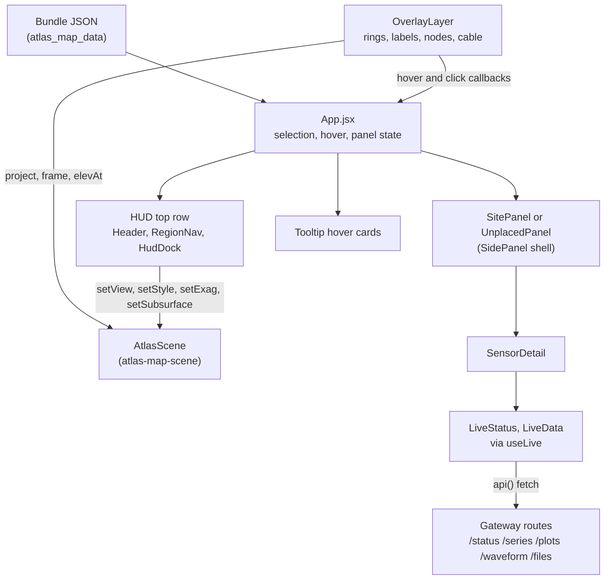

# Atlas map: panels, HUD and overlays

chapter: atlas-map-panels · paths: src/atlas_map/src/panels/ src/atlas_map/src/ui/ src/atlas_map/src/overlay/ docs/superpowers/specs/2026-09-24-hud-dock-design.md · as of 1047fc8

The Atlas map is the React and three.js website in `src/atlas_map/` that shows every sensor with a recorded position in the OOI Regional Cabled Array (RCA; OOI is the Ocean Observatories Initiative) and the COSZO network off Oregon (`src/atlas_map/src/ui/Header.jsx:13`). Each site sits at its true position on the seafloor, and the scene's height is seafloor depth (`docs/superpowers/specs/2026-09-23-atlas-map-design.md:253`); sensors with no recorded position are not drawn (see Decisions). Its 3D scene is covered in [atlas-map-scene](atlas-map-scene.md). This chapter covers the interface layered on that scene: the HUD (heads-up display, the top row of title, regions and a dock of three icon buttons), the right-hand side panels (a site's depth cross-section, the list of unplaced sensors, and a sensor's detail with live data), and the DOM overlay that draws site rings, labels, water-column labels, primary-node markers and cable hover over the canvas. The design problem is space. The map is the main interface, so the panels must leave the seafloor visible, and they reframe the camera only when they change the free area. `App.jsx` mounts all of it and owns the selection state. Sensor records come from [atlas-map-data](atlas-map-data.md) and live readings from [atlas-map-gateway](atlas-map-gateway.md). The chat sidebar and the evidence it puts on the map are in [ask-atlas](ask-atlas.md).

## At a glance

| Aspect | Detail |
|---|---|
| Kind | Browser UI: React components and one DOM-overlay class, rendered by the Atlas map website. No server, CLI or MCP tool lives in these paths. |
| Stack | React 18.3.1 (`src/atlas_map/package.json:14`); uPlot charts (`package.json:17`, `src/atlas_map/src/panels/live/Chart.jsx:2-3`); plain CSS (`ui/ui.css`, `panels/panels.css`, `overlay/overlay.css`); Vitest with Testing Library (`package.json:10`, `:21-22`); Playwright end-to-end tests (`package.json:11`). |
| Entry points | `src/atlas_map/src/App.jsx` mounts the HUD (`App.jsx:221-231`), the credit line, family strip, tooltip and chat (`:232-237`), and the side panels (`:238-249`). `OverlayLayer` is built once the scene is ready (`App.jsx:95-102`). |
| Reads | Bundle JSON loaded in `src/atlas_map/src/data/bundle.js:35-42`: `manifest.json`, `families.json`, `sensors.json`, `sites.json`, `regions.json`, `cable.json`, `das.json`, `terrain/terrain.json`. These are written by [atlas-map-data](atlas-map-data.md) (`src/atlas_map_data/build_atlas_bundle.py:65-82`). Live answers come from [atlas-map-gateway](atlas-map-gateway.md) through `src/atlas_map/src/api/gateway.js:24-30`. Scene state and projections come from [atlas-map-scene](atlas-map-scene.md) (`src/atlas_map/src/scene/AtlasScene.js`). Evidence for a chat answer comes from [ask-atlas](ask-atlas.md) (`App.jsx:127-143`). Three keys are read from `localStorage` (`ui/Minimize.jsx:7`). |
| Writes or serves | DOM only: the dock and its popovers (`ui/HudDock.jsx`), the markers and labels in `#atlas-overlay` (`App.jsx:215`; `overlay/OverlayLayer.js`), hover cards, and side panels. Calls into the scene: view, style, colour, exaggeration, DAS and subsurface setters (`ui/Controls.jsx:62-84`). Hover, selection and panel state go back to `App.jsx` (`:98-101`, `:57-64`). Consumers: `App.jsx`, and `src/atlas_map/src/ask/AskPanel.jsx:4` reuses `MinButton`. Clipboard writes for code snippets (`panels/GetThisData.jsx:16`). |

## How it works

### Layout and the top row

1. `App.jsx:221-231` puts two stacks in `.hud-top`: `left-stack` (the title card and `RegionNav`) and `right-stack` (`HudDock`). `ui/ui.css:4-6` fixes the row between `--left-inset` and `--right-inset`, so the dock moves left when a side panel opens.
2. `App.jsx:181-186` sets `--right-inset` to 472 px (`INSET.side`, `ui/layout.js:2`) while a site or unplaced panel is open and not minimized, and to 16 px otherwise. `App.jsx:202-207` passes the same widths to `scene.setInsets`, so the camera centres in the free area.
3. `App.jsx:191-201` measures the lower edge of the top row with `hudBottom` (`ui/layout.js:7-8`) and passes it to `scene.setInsetsY`. Popovers hang out of flow (`ui/ui.css:20`) and are not counted (`ui/layout.js:4-6`), so opening one never reframes the map.

### The dock and its popovers

4. `ui/HudDock.jsx:12` defines three buttons: Terrain controls, Legend and Help. Each click toggles membership in a Set (`:28-29`). A popover stays open until its own button is clicked again, and several can be open at once, stacked in button order (`:23-26`).
5. The Terrain popover (`ui/Controls.jsx:50-88`) is always mounted and hidden when closed (`HudDock.jsx:43-45`), so its switches keep their state. Its switches call the scene directly: view, style, colour and exaggeration (`Controls.jsx:62-68`); DAS coverage, shown only when `scene.dasLines` has entries (`:71-72`), and its three kinds, shown while DAS coverage is on (`:73-82`); the Subsurface switch, shown only when `scene.subsurface` exists (`:83-84`), and, while that switch is on, the earthquake timeline (`:85`; timeline at `:17-46`). The Axial detail readout polls `scene.auv.finest()` every 250 ms (`:58`, `:70`).
6. The Legend (`ui/Legend.jsx`) mounts only while open (`HudDock.jsx:46-47`). It sets its own `max-height` from its top edge: 8 px above the family strip when the strip reaches under it, otherwise 16 px above the bottom of the window, and never below 120 px (`Legend.jsx:12-26`).
7. Help is a fixed hint about moving the map (`HudDock.jsx:14-21`).

### The map overlay

8. `OverlayLayer` (`overlay/OverlayLayer.js:11-59`) creates DOM elements in its constructor: a card per region at the mean position of its located sensors (`:15-22`), a ring per site (`:23-35`), a water-column label for each site with a column (`:36-39`), a marker per primary node (`:40-45`), and two place names (`:9`, `:46`).
9. `App.jsx:109` calls `update()` on every frame (`OverlayLayer.js:74-123`). It projects each marker with `scene.project` (`:88-89`, `:110`) and hides markers that terrain covers (`:91`, using `scene/occlusion.js`). Opacity is set at `:95`: 0.12 when hidden, 0.2 when an Ask Atlas answer does not cite the site, 0.25 when the site's family is out of focus, otherwise 1. It keeps only the labels that `place` accepts (`:98`, `:101-102`; `overlay/labels.js:1-10`), and raises colliding region cards with `stems` (`:84-85`; `overlay/labels.js:14-25`).
10. Hover and click reach React through the handlers `onSiteHover`, `onSiteClick`, `onNodeHover`, `onNodeClick`, `onCableHover` and `onRegionClick` (`App.jsx:96-101`). A pointer move on the canvas finds the nearest cable segment within 7 px (`OverlayLayer.js:48-55`; `overlay/cableHover.js:1-10`). Points behind the camera are dropped before the test (`cableHover.js:12-22`).

### Hover cards

11. `App.jsx:98-101` stores `hover = {kind, item, x, y}`, and `App.jsx:234` renders `Tooltip`. `ui/Tooltip.jsx:66-94` draws one of three cards: a site card listing at most 14 sensors, grouped by platform (`:13`, `:39-64`); a primary-node card listing catalogued sites within 30 km, at most 12 of them (`:21-37`); or a cable-segment card (`:83-91`). A card that would run off the bottom opens above the cursor (`:70-75`).

### Side panels

12. A click on a site marker calls `openSite`, which selects the site, clears any open sensor and flies the camera (`App.jsx:58-61`, `:97`). `SitePanel` (`panels/SitePanel.jsx:6-45`) draws the depth cross-section, then the sensors grouped by family, then an "Also at this site" list of sensors that have no recorded position (`:33-42`).
13. `DepthSection` (`panels/DepthSection.jsx:12-55`) draws the seafloor from `profile()`, which samples 1 km each way from the site (`panels/crossSection.js:20-26`), on the scale from `depthScale()`. The scale is linear when the seafloor is shallower than 600 m or the site has no water column, and otherwise has a break (`crossSection.js:3-17`; the condition is at `:5`). `layout()` places each sensor (`crossSection.js:42-57`): in family order, spread across 8% to 92% of the width (`:39`, `:45-47`), with seafloor sensors snapped to the drawn floor (`:52-54`).
14. A click on a glyph or a list row calls `onSensor(id)` (`DepthSection.jsx:35`, `SitePanel.jsx:25`). `App.jsx:66-72` sets `sensorId`, and `SitePanel` then renders `SensorDetail` in place of its list (`SitePanel.jsx:16`; `App.jsx:211`, `:241`).
15. `SidePanel` (`panels/SidePanel.jsx:9-38`) is the shell that `SitePanel` and `UnplacedPanel` share. Escape goes back from a sensor to the list and then closes the panel, but Escape inside a text field is left to that field (`:10-16`). Minimizing hands the state to `App` (`sideMin`, `App.jsx:49`), which shows a tab at the bottom right (`SidePanel.jsx:17-24`; `panels/panels.css:9-13`).

### Sensor detail and live data

16. `SensorDetail` (`panels/SensorDetail.jsx:8-30`) shows the type, depth, manufacturer and model. It then shows `LiveStatus`, `LiveData` when the sensor has an erddap, earthscope, qaqc or pi_portal route (`:10`, `:19-20`), `GetThisData`, and the sources.
17. `LiveStatus` (`panels/live/LiveStatus.jsx:5-33`) asks the gateway for Nereus status when the sensor has a `refdes` (`:6`), and for EarthScope waveform health when it has none (`:7-9`, `:11-16`). The wording follows `evidenceMode`: "checked live", "from Nereus snapshot", or "from Nereus (mode)" (`:21-23`).
18. `LiveData` (`panels/live/LiveData.jsx:8-18`) shows one primary view, chosen in this order: `SeriesView` for ERDDAP, then `WaveformView` for EarthScope, then `PlotGallery` for QA/QC plots (`:13`). When ERDDAP is also present, QA/QC plots load only once their `
` opens (`:14`, `:20-28`). Each PI-portal route gets a `FileBrowser` (`:15`).
19. `SeriesView` (`panels/live/SeriesView.jsx:10-62`) picks its default variable with `defaultMeasurement` (`panels/live/measurement.js:14-18`) and offers 24 h, 7 d, 30 d and custom windows (`panels/live/ranges.js:6-11`, `:14-20`). The result is drawn by `Chart` (`panels/live/Chart.jsx:8-24`). `WaveformView` offers windows of 1 to 60 minutes (`WaveformView.jsx:8`, `:14`). `FileBrowser` walks PI-portal directories by `path` (`FileBrowser.jsx:6-22`).
20. Every gateway request goes through `useLive(key, fetcher)` (`panels/live/useLive.js:9-28`). A response for an old key is dropped, and Retry bumps a nonce. `api()` (`api/gateway.js:7-21`) turns the HTTP status into an error kind. `GetThisData` (`panels/GetThisData.jsx:4-23`) shows each access route with a copyable snippet from `snippetFor` (`panels/snippets.js:1-20`).

## Key files

Paths are relative to the repository root. Test files are grouped at the end.

| File | Role |
|---|---|
| `src/atlas_map/src/App.jsx` (not in these paths; see [atlas-map-scene](atlas-map-scene.md)) | Mounts the HUD and panels, owns selection, hover and panel state, and builds `OverlayLayer`. |
| `src/atlas_map/src/panels/SidePanel.jsx` | Shared right-hand shell: head, close and minimize controls, Escape handling, and the minimized tab. |
| `src/atlas_map/src/panels/SitePanel.jsx` | Site panel: region and label eyebrow, depth section, sensors by family, "Also at this site", and the sensor detail as children. |
| `src/atlas_map/src/panels/UnplacedPanel.jsx` | List of sensors with no position and no catalogued site, grouped by family. |
| `src/atlas_map/src/panels/SensorDetail.jsx` | One sensor: header, live status, live data, data-access routes and sources. |
| `src/atlas_map/src/panels/DepthSection.jsx` | SVG depth cross-section: seafloor line, depth ticks, sensor glyphs, click targets and the hover caption. |
| `src/atlas_map/src/panels/crossSection.js` | Depth scale, seafloor profile sampling, sensor layout, and the water-column placement rule. |
| `src/atlas_map/src/panels/GetThisData.jsx` | "Get this data" section: each access route, its how-to, and a copy button for its snippet. |
| `src/atlas_map/src/panels/snippets.js` | Builds the erddapy, EarthScope curl and PI-listing snippets from an access route. |
| `src/atlas_map/src/panels/panels.css` | Side panels, minimized tab, depth section, sensor detail and live-view styles. |
| `src/atlas_map/src/panels/live/useLive.js` | Keyed fetch hook: loading, ok and error states, a guard against stale responses, and retry. |
| `src/atlas_map/src/panels/live/LiveStatus.jsx` | Status line: Nereus status with its evidence mode, or EarthScope waveform availability, with fallbacks. |
| `src/atlas_map/src/panels/live/LiveData.jsx` | Chooses the primary live view (ERDDAP, EarthScope, QA/QC) and adds PI-portal file browsers. |
| `src/atlas_map/src/panels/live/SeriesView.jsx` | ERDDAP time series: variable picker, 24 h, 7 d, 30 d and custom windows, chart and CSV link. |
| `src/atlas_map/src/panels/live/WaveformView.jsx` | EarthScope seismic waveform for 1 to 60 minutes. |
| `src/atlas_map/src/panels/live/PlotGallery.jsx` | QA/QC plot images for one variable at a time, up to four. |
| `src/atlas_map/src/panels/live/FileBrowser.jsx` | PI-portal directory listing with navigation and the truncation notes. |
| `src/atlas_map/src/panels/live/Chart.jsx` | uPlot wrapper with a UTC time axis, drag to zoom and double-click to reset. |
| `src/atlas_map/src/panels/live/Failure.jsx` | One-line error message with a Retry button. |
| `src/atlas_map/src/panels/live/measurement.js` | Default variable for a sensor, chosen from its instrument class. |
| `src/atlas_map/src/panels/live/ranges.js` | Time-window presets that end at the newest reading, and custom-range validation with a 31-day cap. |
| `src/atlas_map/src/ui/HudDock.jsx` | Top-right dock of three icon buttons and their popovers (Terrain controls, Legend, Help). |
| `src/atlas_map/src/ui/Controls.jsx` | Terrain popover: 3D or 2D, relief or contours, depth or mono, exaggeration, Axial detail, DAS switches, Subsurface switch and quake timeline. |
| `src/atlas_map/src/ui/Legend.jsx` | Legend popover: symbols, DAS coverage, Beneath Axial, depth ramp and attribution. Fits its own height. |
| `src/atlas_map/src/ui/Header.jsx` | Title card with the located, operating and site counts, and the search box. Minimizable. |
| `src/atlas_map/src/ui/Search.jsx` | Search box and results listbox for sensors and sites. |
| `src/atlas_map/src/ui/RegionNav.jsx` | Region buttons with located counts, and the Unplaced sensors entry. Minimizable. |
| `src/atlas_map/src/ui/FamilyFilter.jsx` | Family chips at the bottom centre: single focus, shift to add. Minimizable. |
| `src/atlas_map/src/ui/Tooltip.jsx` | Hover cards for sites, primary nodes and cable segments. |
| `src/atlas_map/src/ui/Credit.jsx` | Always-visible credit line at the bottom right of the map. |
| `src/atlas_map/src/ui/Minimize.jsx` | `useMinimized` (persisted in `localStorage`), `MinButton` and `MinTab`. |
| `src/atlas_map/src/ui/Glyph.jsx` | The six family shapes as SVG, used in chips, cards and the depth section. |
| `src/atlas_map/src/ui/layout.js` | Side-panel widths (`INSET`) and the lower edge of the top row (`hudBottom`). |
| `src/atlas_map/src/ui/ui.css` | Top row, dock, popovers, region and family strip, legend, credit and tooltip styles. |
| `src/atlas_map/src/overlay/OverlayLayer.js` | DOM overlay class: region cards, site rings, column labels, primary nodes, places, cable hover, and the per-frame update. |
| `src/atlas_map/src/overlay/ring.js` | Site ring SVG: one arc per sensor, stroke by status, dash for unknown, halo when any sensor operates. |
| `src/atlas_map/src/overlay/labels.js` | Greedy label placement (`place`) and region-card stacking (`stems`). |
| `src/atlas_map/src/overlay/cableHover.js` | Nearest cable segment within 7 px (`nearest`) and the runs of points in front of the camera (`frontRuns`). |
| `src/atlas_map/src/overlay/overlay.css` | Styles for region cards, site markers and names, column labels, primary nodes and places. |
| `docs/superpowers/specs/2026-09-24-hud-dock-design.md` | Approved design for the dock: behaviour, layout consequences, visual style and tests. Its Testing section is out of date (see Open questions). |

Tests, grouped by directory (23 files):

| Files | Role |
|---|---|
| `src/atlas_map/src/panels/*.test.jsx`, `panels/*.test.js` (5: SensorDetail, SitePanel, UnplacedPanel, crossSection, snippets) | Status wording, Escape behaviour, depth-section target sizes, scale and layout maths, and snippet text. |
| `src/atlas_map/src/panels/live/*.test.jsx`, `live/*.test.js` (5: FileBrowser, LiveData, measurement, ranges, useLive) | Gateway fetch behaviour through stubs, range validation, default variable choice, and stale-response handling. |
| `src/atlas_map/src/ui/*.test.jsx`, `ui/*.test.js` (9: Controls, Credit, FamilyFilter, HudDock, Legend, RegionNav, Search, Tooltip, layout) | Dock toggling and state, minimize behaviour, legend credits, search and card contents. |
| `src/atlas_map/src/overlay/*.test.js` (4: OverlayLayer, cableHover, labels, ring) | Overlay focus and tab stops, cable hit testing, label priority, and ring segments. |

## Interfaces

**Imported by other code**
- `src/atlas_map/src/App.jsx` imports `OverlayLayer` (`App.jsx:4`), `FamilyFilter`, `Header`, `HudDock`, `RegionNav`, `Credit`, `SensorDetail`, `SitePanel`, `UnplacedPanel` and `Tooltip` (`:5-12`, `:14`), and `INSET` and `hudBottom` (`:13`).
- `src/atlas_map/src/ask/AskPanel.jsx:4` imports `MinButton` from `ui/Minimize.jsx` ([ask-atlas](ask-atlas.md)).
- `App.jsx:111-120` sets `window.__atlas` for the end-to-end tests: the scene, the overlay `layer`, and `open(id)`.

**Components** (props as declared)
- `HudDock({ scene, deep = false, onDeep, credit, auv = false, subsurface = null })` (`ui/HudDock.jsx:27`).
- `Controls({ scene, deep = false, onDeep })` (`ui/Controls.jsx:50`).
- `Legend({ credit, auv = false, subsurface = null })` (`ui/Legend.jsx:6`).
- `Header({ bundle, onPick })` (`ui/Header.jsx:5`); `Search({ bundle, onPick })` (`ui/Search.jsx:4`).
- `RegionNav({ regions, sensors, active, onSelect, unplaced = 0, unplacedOpen = false, onUnplaced })` (`ui/RegionNav.jsx:4`).
- `FamilyFilter({ families, sensors, focus, onChange })` (`ui/FamilyFilter.jsx:5`); `focus` is a Set of family keys.
- `Credit({ credit, auv = false, subsurface = false })` (`ui/Credit.jsx:4`).
- `Tooltip({ hover, bundle })` (`ui/Tooltip.jsx:66`); `hover` is `{ kind: "site" | "node" | "cable", item, x, y }` (`:77`).
- `SidePanel({ label, eyebrow, title, sub, closeLabel, onClose, onBack, inDetail, minimized = false, onMinimize, children })` (`panels/SidePanel.jsx:9`).
- `SitePanel({ site, bundle, elevAt, onClose, onBack, onSensor, minimized, onMinimize, children })` (`panels/SitePanel.jsx:6`).
- `UnplacedPanel({ bundle, onClose, onBack, onSensor, minimized, onMinimize, children })` (`panels/UnplacedPanel.jsx:7`).
- `SensorDetail({ sensor, bundle, onBack, backLabel })` (`panels/SensorDetail.jsx:8`).
- `LiveStatus({ sensor, manifest })` (`panels/live/LiveStatus.jsx:5`); `LiveData({ sensor })` (`panels/live/LiveData.jsx:8`).
- `Glyph({ glyph, color, size = 11 })` and the `SHAPES` map (`ui/Glyph.jsx:1-11`).

**Class and hooks**
- `new OverlayLayer(container, bundle, scene, handlers)` (`overlay/OverlayLayer.js:12`). Methods: `setFocus(focus)` (`:61`), `setEvidence(siteIds)` (`:70`), `setSelected(id)` (`:72`), `update()` (`:74`) and `dispose()` (`:125`). Handler names are listed in How it works, step 10.
- `useMinimized(key, initial = false)` returns `[min, setMin]` (`ui/Minimize.jsx:6`). `MinButton({ label, onClick })` (`:17`) and `MinTab({ children, className, onClick, title })` (`:22`).
- `useLive(key, fetcher)` returns `{ state, data, error, retry }` (`panels/live/useLive.js:9-27`).
- `hudBottom(leftStack, rightStack)` and `INSET` (`ui/layout.js:2`, `:7`).

**Helpers other code may reuse**
- `depthScale(site, height)`, `layout(site, sensors, familyOrder, width, height, prof)`, `profile(site, elevAt, n)`, `profileDepthAt(prof, fx)` and `FAN` (`panels/crossSection.js:3`, `:42`, `:20`, `:29`, `:39`).
- `snippetFor(route, sensor, now)` (`panels/snippets.js:1`).
- `defaultMeasurement(refdes, names)` (`panels/live/measurement.js:14`); `preset(key, now, dataEnd)` and `checkCustom(startLocal, endLocal)` (`panels/live/ranges.js:6`, `:14`).
- `ringSize(n)` and `ringSvg(site, sensorsById, familyByKey, size)` (`overlay/ring.js:4`, `:6`); `place(items)` and `stems(items, base, gap, maxSteps)` (`overlay/labels.js:1`, `:14`); `nearest(px, py, lines, maxPx)` and `frontRuns(proj)` (`overlay/cableHover.js:1`, `:13`).

**HTTP routes consumed.** These panels serve no route. They call [atlas-map-gateway](atlas-map-gateway.md) through `api/gateway.js:24-30` (the gateway's own table is `src/atlas_map_gateway/README.md:12-17`):

| Client function | Route | Called from |
|---|---|---|
| `status(refdes)` | `GET /status/{refdes}` | `panels/live/LiveStatus.jsx:6` |
| `waveformHealth(station, channel)` | `GET /waveform/{NET.STA}/health?channel=` | `LiveStatus.jsx:8-9` |
| `variables(refdes)` | `GET /series/{refdes}/variables` | `panels/live/SeriesView.jsx:11` |
| `series(refdes, {var, start, end})` | `GET /series/{refdes}?var=&start=&end=` | `SeriesView.jsx:22` |
| `waveform(station, minutes, channel)` | `GET /waveform/{NET.STA}?minutes=&channel=` | `panels/live/WaveformView.jsx:10` |
| `plots(refdes)` | `GET /plots/{refdes}` | `panels/live/PlotGallery.jsx:7` |
| `files(key, endpoint, path)` | `GET /files/{instrumentKey}?endpoint=&path=` | `panels/live/FileBrowser.jsx:8` |

In production the same paths sit under `https://rca-atlas.quakehunt.workers.dev/v1/live` (`api/gateway.js:2`, `:5`), which the Worker proxies (`src/atlas_worker/src/index.js:402`; see [ask-atlas](ask-atlas.md)). In development Vite proxies `/api` to `127.0.0.1:8787` (`src/atlas_map/vite.config.js:11`).

**CLI, MCP tools, files produced.** None. The DOM ids these panels set are `hud-pop-terrain`, `hud-pop-legend` and `hud-pop-help` (built by `pop` at `ui/HudDock.jsx:30`, set at `:43`, `:46` and `:48`) and the slider id `exag` (`ui/Controls.jsx:67`).

## Data shapes

**Bundle files.** Written by `src/atlas_map_data/build_atlas_bundle.py:65-82` and read by `data/bundle.js:35-42`.

| File | Shape and fields read here |
|---|---|
| `families.json` | `{ families: [{ key, label, color, glyph }] }`. Glyph names are the six keys of `SHAPES` (`src/atlas_map_data/families.py:5-10`; `ui/Glyph.jsx:2-7`). |
| `sensors.json` | `{ sensors: [...], unplaced: [sensor ids] }` (`build_atlas_bundle.py:70`). |
| `regions.json` | `{ overview: view, regions: [{ key, label, view }] }` (`build_atlas_bundle.py:72`; `ui/RegionNav.jsx:6-7`). |
| `sites.json` | `{ sites: [...] }` (`build_atlas_bundle.py:71`). |
| `cable.json` | `{ lines, nodes, hidden }` (`src/atlas_map_data/cable.py:46`). |
| `das.json` | `layers` with `kind` (`conventional`, `multidas`, `optodas`) and `color` (`src/atlas_map_data/das.py:15`; `scene/AtlasScene.js:113-116`). |
| `terrain/terrain.json` | `credit`, shown in the legend and credit line (`build_atlas_bundle.py:79`; `App.jsx:232`). |
| `manifest.json` | `corpusSnapshot`, the date used when a live status is unavailable (`build_atlas_bundle.py:82`; `panels/live/LiveStatus.jsx:27`). |

**Sensor record** (`sensors.py`, read by the panels; `Header.jsx:6-7`, `search.js:15-21`, `SensorDetail.jsx`):

| Field | Type and meaning |
|---|---|
| `id`, `name`, `type` | string. `type` has underscores replaced for display (`SensorDetail.jsx:15`). |
| `family` | string, a key in `families.json`. |
| `status` | string, one of OPERATIONAL, PARTIALLY_FUNCTIONAL, NOT_DEPLOYED, RETIRED, SUPERSEDED, RECOVERED, UNCABLED, PLANNED or UNKNOWN, labelled in `data/format.js:1-4`. |
| `statusGroup` | string: operating, offline, planned or unknown (`build_atlas_bundle.py:57`; `data/format.js:5-8`). |
| `statusSource`, `statusAsOf` | Where the status came from, and its date: `Nereus snapshot` (date from the Nereus `retrieved_at`), `Inventory: new COSZO sensor` (planned; no date), `FETCH source snapshot` (FETCH stations, status UNKNOWN), or null when no source is known (`src/atlas_map_data/status.py:21-33`; `src/atlas_map_data/sensors.py:76`). |
| `lat`, `lon` | number, or null when the sensor has no recorded position (`Header.jsx:6`; `search.js:18`). |
| `region`, `site` | string keys into `regions.json` and `sites.json`. |
| `depth`, `depthRange` | metres: a number, or a `[a, b]` pair for a moving sensor (`DepthSection.jsx:50`; `crossSection.js:48-55`). |
| `location` | string, the platform name used to group sensors in a site (`Tooltip.jsx:46`). |
| `refdes` | string or null: the OOI reference designator. Null for seismic stations (inferred from `src/atlas_map_data/sensors.py:26`, which sets it only when site, node and code all exist; `LiveStatus.jsx:6-7`). |
| `access` | array of access routes (below). |
| `sources`, `corrections` | arrays: provenance URLs, and text for any correction the build applied (`SensorDetail.jsx:22-27`). |
| `manufacturer`, `model` | strings. `aliases` is an array of strings, set only on FETCH stations (`src/atlas_map_data/sensors.py:73-75`), and searchable for every sensor (`search.js:16`). |

**Access route** (`src/atlas_map_data/access.py:134-172`; `sensors.py:78-80`). Every route has `kind`, `label`, `how` and `url`. Kind-specific fields: `erddap` has `datasetId`; `qaqc` has `refdes`; `earthscope` has `network`, `station` and `channel`; `pi_portal` has `instrumentKey` and `endpointId`. The panels treat `erddap`, `earthscope`, `qaqc` and `pi_portal` as live (`SensorDetail.jsx:10`). The kinds `ooi_explorer`, `documentation` and `repository` are links only.

**Site record** (`src/atlas_map_data/sites.py:120-124`): `id`; `name` (not unique); `label` (unique, used for display); `region`; `lat`, `lon`; `seafloor` (metres); `sensorIds` and `unlocatedIds` (arrays); `parts` (platform names, `Tooltip.jsx:45-48`); `column` (array of `{ kind, a, b }` water-column ranges in metres, `OverlayLayer.js:36-39`).

**Cable record** (`src/atlas_map_data/cable.py:27-46`). A node has `code`, `name`, `accuracy` (charted or approximate), `note`, `lon`, `lat` and `description`, and no `source`. A line has `name`, `kind`, `route`, `accuracy` (`charted` or `mapped` in the current file; `ui/Tooltip.jsx:7-11` also has text for `approximate`, which no current line uses), `lengthKm`, `source` and `coords`.

**Gateway responses** (`src/atlas_map_gateway/app.py:60-76` and `routes_data.py`):

| Route | Response shape (fields read) |
|---|---|
| `GET /status/{refdes}` | `{ refdes, status, data: { code, checkedAt } or null, evidenceMode: "live" or "snapshot", source, sourceUrl }` (`app.py:72-76`; `LiveStatus.jsx:19-24`). |
| `GET /series/{refdes}/variables` | `{ variables: [{ name, units, longName }], coverage: { start, end } }` (`src/atlas_map_gateway/erddap.py:43-49`; `SeriesView.jsx:14-17`). |
| `GET /series/{refdes}?var&start&end` | `{ refdes, var, units, points: [[ms, value]], rawCount, downloadUrl, message }` (`routes_data.py:80-101`; `SeriesView.jsx:56-59`). |
| `GET /plots/{refdes}` | `{ refdes, plots: [{ variable, timeSpan, overlay, dataRange, depth, url }] }` (`routes_data.py:103-115`; `PlotGallery.jsx:11-18`). |
| `GET /waveform/{station}?minutes&channel` | `{ station, channel, rate, points, rawCount, sourceUrl, message }` (`routes_data.py:144-181`; `WaveformView.jsx:18-21`). |
| `GET /waveform/{station}/health?channel` | `{ station, channel, recording, checkedAt, message }` (`routes_data.py:183-195`; `LiveStatus.jsx:13`). |
| `GET /files/{instrumentKey}?endpoint&path` | `{ instrumentKey, endpointLabel, path, sourceUrl, entries: [{ name, kind, path, url, date }], truncated, message }` (`routes_data.py:117-141`; `FileBrowser.jsx:15-20`). |
| Any error | `{ error: { source, message } }`. HTTP 404, 422, 502, 503 and 504 map to notfound, bad, upstream, busy and timeout. Any other status with an error body is "upstream". A failed request, or a response with no error body, is "unreachable" (`api/gateway.js:1`, `:14`, `:17-20`). Exception: the Worker's own 503 (no gateway origin configured) and 404 (path off its allowlist) send `{ error: "<text>" }`, a string, so `source` and `message` become `undefined` and the panel shows "undefined" (`src/atlas_worker/src/index.js:42`, `:46`; [live-panel](../flows/live-panel.md), finding F1). |

**Local shapes.**
- `hover`: `{ kind, item, x, y }` (`App.jsx:98-101`).
- `useLive` internal state: `{ key, state: "idle" | "loading" | "ok" | "error", data, error }` (`useLive.js:3`). The hook returns the same fields without `key`, plus `retry` (`:26-27`). The `error` value is the whole failed result, `{ ok: false, kind, source, message }`.
- Depth-section points: `{ id, family, x, y, y2? }` (`crossSection.js:46-56`).
- `focus`: a Set of family keys (`FamilyFilter.jsx:5`; `OverlayLayer.js:61`).

## Configuration and secrets

No environment variable, API key or secret is read in these paths. The gateway base URL is set in `src/atlas_map/src/api/gateway.js` (outside these paths).

| Name | Read at | Purpose | Default or required |
|---|---|---|---|
| `atlas.min.header` (localStorage) | `ui/Minimize.jsx:7`, `:9`, `:12`; set by `ui/Header.jsx:8` | Title card minimized to a tab. | Unset means expanded (`Minimize.jsx:6`). |
| `atlas.min.regions` (localStorage) | `ui/RegionNav.jsx:8` | Regions list minimized. | Unset means expanded. |
| `atlas.min.families` (localStorage) | `ui/FamilyFilter.jsx:12` | Family strip minimized. | Unset means expanded. |
| `--right-inset` (CSS custom property) | Set at `App.jsx:184`; read at `ui/ui.css:4`, `:83` | Right edge of the free map area. | 16 px (`src/atlas_map/src/styles/tokens.css:6`); 472 px while a side panel is open. |
| `--left-inset` | Set at `ask/AskPanel.jsx:59`; read at `ui/ui.css:4`, `:56` | Left edge of the free map area. | 16 px; 412 px while the chat is open. |
| `--strip-reserve` | Set at `ask/AskPanel.jsx:60`; read at `ui/ui.css:57` | Keeps the family strip clear of the minimized chat tab. | 0 px; 132 px while the chat is minimized. |
| `--side-reserve` | Set at `App.jsx:185`; read at `ui/ui.css:57` | Keeps the family strip clear of the minimized side tab. | 0 px; 284 px while the side tab is shown. |
| `--delay` (inline) | `panels/DepthSection.jsx:30`; used at `panels/panels.css:22` | Settle delay for each sensor glyph. | 500 ms plus 60 ms per family index. |
| `prefers-reduced-motion` | `styles/tokens.css:9` | Removes the dock entrance, the panel slide-in and the other animations. The overlay halo rests at 0.25 (`overlay/overlay.css:14-15`). | The operating system setting. |

## Run and test

Commands are taken from the atlas README and `package.json`. No command was run while writing this chapter, because the brief allows read-only commands only.

1. Build the data bundle first. Without it the app shows "The atlas data bundle has not been built yet" (`App.jsx:26-34`): `PYTHONPATH=src .venv/bin/python -m atlas_map_data.build_atlas_bundle --refresh-terrain --refresh-external` (`src/atlas_map/README.md:5-6`).
2. Optional live gateway: `PYTHONPATH=src .venv/bin/uvicorn atlas_map_gateway.main:app --app-dir src --host 127.0.0.1 --port 8787` (`README.md:7-8`). Without it "the map still works from the bundle, and live sections say so" (`README.md:21`).
3. Start the site: `cd src/atlas_map && npm install && npm run dev`, then open http://127.0.0.1:5175 (`README.md:9-11`; `package.json:7`).
4. Unit and component tests: `npm test`, which runs `vitest run` (`README.md:34`; `package.json:10`). To run only this chapter's tests, pass its directories from `src/atlas_map`: `npx vitest run src/panels src/ui src/overlay` (inferred from the Vitest CLI; not run here).
5. Browser tests: `npm run e2e`, which runs `playwright test` against a mocked gateway (`README.md:35`; `package.json:11`). The dock tests are in `src/atlas_map/e2e/atlas.spec.js:40-218`, and the screenshots they write to `e2e/screens/` are git-ignored (`.gitignore:56`).
6. Build: `npm run build` (`package.json:8`).

## Decisions and constraints

- The dock replaces the two tall right-hand panels (Terrain controls and Legend) so the map stays visible. The title, regions, family strip, chat and side panels keep their places (`docs/superpowers/specs/2026-09-24-hud-dock-design.md:5-10`).
- A dock popover stays open until its own button is clicked again. Escape and clicks elsewhere do not close it, and several can be open (`2026-09-24-hud-dock-design.md:16-18`; commit `8fa5e28`; `ui/HudDock.test.jsx:43-56`). The first version closed them on Escape and outside click (commit `1dd74a9`).
- The Terrain popover stays mounted so that its settings survive closing (`2026-09-24-hud-dock-design.md:21-22`; `ui/HudDock.jsx:25-26`; `ui/HudDock.test.jsx:57-68`).
- Opening a popover never reframes the camera, because `hudBottom` counts only the dock bar (`2026-09-24-hud-dock-design.md:36-37`; `ui/layout.js:4-6`; `ui/layout.test.js:7-11`).
- The legend's maximum height is measured from its own top. It ends 16 px above the window bottom, or 8 px above the family strip when the strip reaches under it (`ui/Legend.jsx:8-11`, `:18`; `2026-09-24-hud-dock-design.md:23-25`).
- The Controls and Legend minimize buttons are gone, because the dock replaces them (`2026-09-24-hud-dock-design.md:30-31`; `ui/Controls.test.jsx:26-30`; `ui/Legend.test.jsx:35-40`). Every other panel can minimize to a tab. Title, regions and families remember the choice (commit `f7f8ad7`; `ui/Minimize.jsx:4-5`). The side panel's state does not persist (`App.jsx:49`).
- Status is shown by stroke, and colour means family only. Operating is a thick stroke, offline a thick stroke at 30% opacity, planned a thin stroke, and unknown a thin dashed stroke (`docs/superpowers/specs/2026-09-23-atlas-map-design.md:246-253`; `overlay/ring.js:13-19`).
- Every family also has its own glyph, so identity never depends on colour alone (`2026-09-23-atlas-map-design.md:274`; `ui/Glyph.jsx`).
- Focusing a family fades the other families' segments to 7% (`2026-09-23-atlas-map-design.md:271`; `overlay/OverlayLayer.js:64`).
- Where labels collide, the site with more sensors keeps its label (`2026-09-23-atlas-map-design.md:256`; `overlay/labels.js:3`; `overlay/OverlayLayer.js:98`).
- A marker hidden behind terrain fades to 12% and loses its label and hover (`2026-09-23-atlas-map-design.md:255`; `overlay/OverlayLayer.js:91-95`).
- Sensors with no recorded position are never drawn. They are reachable from the Unplaced sensors list, from site rows and from search (commit `d5df2fc`; `panels/UnplacedPanel.jsx:5-6`; `data/search.js:19-21`; `2026-09-23-atlas-map-design.md:51`).
- A status answered from the Nereus snapshot is labelled "from Nereus snapshot", never "checked live" (commit `37044ae`; `panels/live/LiveStatus.jsx:21-23`; test at `panels/SensorDetail.test.jsx:70-74`).
- The default measurement is the sensor's own variable, not the co-located CTD's temperature or pressure (`panels/live/measurement.js:1-3`).
- Time windows end at the dataset's newest reading, not at the current time, because most ERDDAP datasets refresh about once a day (`panels/live/ranges.js:4-5`; commit `b89832d`).
- Custom ranges are limited to 31 days and are checked before any request (`panels/live/ranges.js:2`, `:18`; test at `panels/live/LiveData.test.jsx:35-48`; `2026-09-23-atlas-map-design.md:291`).
- Seafloor sensors snap to the drawn floor, using the same water-column rule as the build (`panels/crossSection.js:34-36`, `:52-54`; `src/atlas_map_data/sites.py:39-40`; commit `471a388`).
- Chart times are UTC, as in the rest of the atlas (`panels/live/Chart.jsx:17`; `panels/live/ranges.js:13`).
- While an Ask Atlas answer is on the map, the overlay only dims the sites it does not cite. Ask Atlas owns the evidence (`overlay/OverlayLayer.js:69-70`, `:94-95`; `docs/superpowers/specs/2026-09-24-ask-atlas-evidence-design.md:107`).
- Escape steps back from a sensor to its list, and a second Escape closes the panel (`panels/SidePanel.jsx:10-16`; `panels/SitePanel.test.jsx:29-38`). The behaviour came in commit `4905cc7`; `d5df2fc` moved it into `SidePanel.jsx`.
- Markers are tab stops only while they are visible (`overlay/OverlayLayer.js:96-97`; commit `37044ae`).

## History

- 2026-09-23, `f592e8a` and `127b381`: the first terrain switches and region navigation (`ui/Controls.jsx`, `ui/RegionNav.jsx`), then the overlay with anchored rings, moorings, the cable and primary nodes (`overlay/OverlayLayer.js`, `ring.js`, `labels.js`, `cableHover.js`).
- 2026-09-23, `eb5a7cf`, `ef1e75b`, `d9deec2` and `bb73b57`: hover cards, family focus, legend, header and search (`ui/Tooltip.jsx`, `FamilyFilter.jsx`, `Legend.jsx`, `Header.jsx`, `Search.jsx`); the site panel with its depth cross-section; sensor detail with live status and snippets; then live charts, waveforms, QA/QC plots and PI file browsing.
- 2026-09-23 to 2026-09-24, `448eca8`, `1cd21a2`, `1dd74a9` (spec `adbaf81`, merged as `4838877`, PR #4): the top row first wrapped and collapsed, which added `hudWraps` and `HUD_ROW_WIDTH` in `1cd21a2`. The dock in `1dd74a9` removed them, so the top row is now one button tall (`git log -S`).
- 2026-09-24, `f7f8ad7`: every panel minimizes to a tab, and `ui/Minimize.jsx` stores the choice in `localStorage`. The legend also started to scroll.
- 2026-09-24, `d5df2fc`: sensors with no recorded position became reachable through the Unplaced list, site rows and search. `SidePanel.jsx` was extracted as the shared shell.
- 2026-09-24, `8fa5e28`: dock popovers stay open until their button is clicked again, and several can be open at once. Its spec change touched only the Behaviour section.
- 2026-09-24, `61e4daf` and `37044ae`: `OverlayLayer.setEvidence` dims uncited sites for Ask Atlas. Arrow keys leave a focused panel alone, hidden markers leave the tab order, and the snapshot wording was corrected.

## Gotchas

- Dock popovers ignore Escape and outside clicks, so a keyboard user closes one only by pressing its button. Escape still reaches the side panel behind (`ui/HudDock.test.jsx:43-56`).
- The Terrain popover is mounted while closed. Its `Controls` therefore keeps polling `scene.auv.finest()` every 250 ms (`ui/Controls.jsx:58`) and holds the single `scene.onExag` callback (`:54`). A second mounted `Controls` would take that callback over.
- `hudBottom` ignores the popovers on purpose. An open popover can sit over the map and hide part of it (`ui/layout.js:4-6`).
- Overlay styles are written on every frame for every marker, column, node and place (`App.jsx:109`; `overlay/OverlayLayer.js:74-123`). The cost grows with the number of markers (inferred; not measured).
- Label collisions use an estimate of 6.4 px per character for label width (`overlay/OverlayLayer.js:98`), not the rendered text width (see Open questions).
- Depth-section click targets overlap once a site has 24 or more sensors. The layout spreads sensors across 312.48 viewBox units (`panels/crossSection.js:39`, `:45-47`, applied to a 372-unit width at `DepthSection.jsx:17`). That gives a spacing of 312.48 divided by (n minus 1), which falls below the 14-unit minimum width at `DepthSection.jsx:10` and `:18` once n is 24 or more. The comment at `DepthSection.jsx:8` says they never overlap. The test covers only a small site (`panels/SitePanel.test.jsx:75-85`).
- The node card's source text can never come from the bundle. `Tooltip.jsx:23` reads `node.source`, but `cable.py:27-30` writes no `source` for nodes, so the accuracy-based text in `Tooltip.jsx:16-19` always shows. The test at `ui/Tooltip.test.jsx:31-34` injects a source.
- The "Copied" label on a snippet appears even when the clipboard is unavailable. The state update runs regardless of `navigator.clipboard`, and the write's promise is never caught (`panels/GetThisData.jsx:16`).
- `useMinimized` reads and writes `localStorage` without try/catch (`ui/Minimize.jsx:9`, `:12`). If storage access is blocked, rendering the title card, regions or family strip would throw (inferred from the code; not tested).
- `Chart` measures its width once, when it is created (`panels/live/Chart.jsx:14`). Nothing resizes it, so after a window resize its canvas keeps the old width.
- `LiveData` shows only one primary view. A sensor with EarthScope and QA/QC routes but no ERDDAP route shows no QA/QC plots at all (`panels/live/LiveData.jsx:13-14`). Whether any sensor has that combination is unknown (inferred).
- A "24h" preset ends at the dataset's newest reading (`panels/live/ranges.js:6-10`), so it may not reach the present. `SeriesView` says so when the newest reading is more than 3 hours old (`panels/live/SeriesView.jsx:19`, `:53`).
- The waveform window always ends 2 minutes ago (`panels/live/WaveformView.jsx:20`; `src/atlas_map_gateway/routes_data.py:158`), so the newest two minutes are never shown.
- The file browser's "Showing the newest 200 entries." is literal text (`panels/live/FileBrowser.jsx:20`). The line appears only when the folder is not upstream-truncated, so the 200 shown are the newest. The 200 is the gateway's `MAX_FILE_ENTRIES` (`routes_data.py:20`, `:140`). For a folder over 5,000 entries, the toolkit returns only its first 5,000 in listing order, the gateway sorts that set newest first, and the browser shows the gateway's warning, "the newest may be missing", in place of that line (`routes_data.py:54-55`, `:133-135`, `:141`).
- The search box clears its text on Escape, and the side panel ignores Escape from text fields (`ui/Search.jsx:18`; `panels/SidePanel.jsx:12`).
- Search returns at most 8 results (`data/search.js:1`, `:23`). Sensors with no position rank just below located matches (`data/search.js:21`).
- Family chips are hidden when a family has no located sensors (`ui/FamilyFilter.jsx:19`). Fibre-optic experiments therefore never appear in the strip; they are listed on the cable card (`ui/Tooltip.jsx:87-89`).
- The cable card's description of the two backbone cables (`ui/Tooltip.jsx:90`) is hard-coded text. It goes stale if the cable topology changes.

## Glossary

| Term | Meaning |
|---|---|
| HUD | Heads-up display: here, the top row of title card, region list and dock, laid over the map (`App.jsx:219-220`). |
| Dock | The row of three 30 px icon buttons at the top right (`ui/HudDock.jsx:12`, `ui/ui.css:16`). |
| Popover | A panel that opens under the dock, from Terrain controls, Legend or Help. |
| Side panel | The 440 px panel at the right for a site or the unplaced list (`panels/panels.css:1`). |
| RCA | Regional Cabled Array, the OOI cabled observatory off Oregon (`ui/Header.jsx:13`). |
| OOI | Ocean Observatories Initiative, which operates the Regional Cabled Array (`ui/Header.jsx:13`). |
| COSZO | The second sensor network the atlas shows alongside the RCA (`ui/Header.jsx:13`). Its full name is not spelled out in the files read for this chapter. |
| Site | One physical location, grouping every sensor within 150 m of another (`docs/superpowers/specs/2026-09-23-atlas-map-design.md:142`). |
| Region | One of four map regions: Axial Seamount, Oregon Slope Base, Hydrate Ridge and Oregon Shelf (`src/atlas_map_data/sites.py:16-22`). |
| Family | One of six sensor families, each with its own colour and glyph (`src/atlas_map_data/families.py:5-10`). |
| Ring | A site's marker: one arc per sensor, coloured by family (`overlay/ring.js`). |
| Water column | The vertical line from a mooring up to the sea surface, with labels for the depths where sensors sample (`overlay/OverlayLayer.js:36-39`; `2026-09-23-atlas-map-design.md:254`). |
| Profiler | A moving instrument on a mooring, such as the shallow or deep profiler (`2026-09-23-atlas-map-design.md:254`). |
| Primary node (PN) | A hub on the cable, identified by a code such as PN5A (`src/atlas_map_data/cable.py:23-30`). |
| Cable route | A cable segment, marked charted, approximate or mapped (`ui/Tooltip.jsx:7-11`). |
| Located | A sensor with a recorded position (`lat` not null; `ui/Header.jsx:6`). |
| Unplaced | A sensor with no usable position and no catalogued site (`panels/UnplacedPanel.jsx:5-6`). |
| statusGroup | Groups the status words into operating, offline, planned and unknown (`data/format.js:5-8`). |
| Nereus | A public GraphQL service that reports OOI operational status per reference designator (`src/nereus_pipeline/README.md:3`; the gateway's status route, `src/atlas_map_gateway/app.py:67-76`). |
| evidenceMode | The `/status` field saying whether the answer is live or from a snapshot (`src/atlas_map_gateway/app.py:76`). |
| refdes | OOI reference designator, the instrument's identifier, for example `RS03AXBS-LJ03A-12-CTDPFB301` (`panels/live/LiveData.test.jsx:19`). |
| ERDDAP | An HTTP data server that exposes OOI datasets as tables; the atlas uses OOI's public instance (`src/atlas_map_data/access.py:14`). |
| QA/QC | Quality assurance and quality control; here, the RCA's pre-rendered QA/QC plot site (`src/atlas_map_data/access.py:15`). |
| PI portal | A principal investigator's own data portal, browsed as a directory listing (`src/atlas_map_data/access.py:165`). |
| EarthScope | The seismic data service used for waveforms (`src/atlas_map_data/access.py:21`). |
| FDSN | International Federation of Digital Seismograph Networks; the web-service standard EarthScope exposes (`src/atlas_map_data/access.py:21`). |
| MiniSEED | A binary format for seismic waveforms (`panels/snippets.js:15`). |
| Channel codes | Seismic channel names such as HHZ and EHZ (vertical seismometer channels) and HDH (a hydrophone channel) (`panels/snippets.js:12`; `src/atlas_map_data/access.py:18-22`, `:157-163`; commit `b89832d`). |
| DAS | Distributed acoustic sensing: fibre-optic sensing along a cable (`src/atlas_map_data/das.py:3-4`). |
| MultiDAS, OptoDAS, OptaSense | DAS systems whose coverage the legend shows (`ui/Legend.jsx:42-44`). |
| AUV | Autonomous underwater vehicle. The 1 m Axial summit terrain comes from an AUV survey (`ui/Legend.jsx:55`). |
| MBARI | Monterey Bay Aquarium Research Institute, which ran the Axial summit survey (`ui/Legend.jsx:55`). |
| GMRT | Global Multi-Resolution Topography, the seafloor grid and its CC BY 4.0 credit (`ui/Credit.jsx:7`). |
| AMC | Axial magma chamber; here, its top is drawn beneath Axial (`ui/Legend.jsx:49`). |
| EEZ | Exclusive Economic Zone, the US offshore zone beyond which the cable is only approximate (`ui/Tooltip.jsx:9`). |
| CTD | Conductivity, temperature and depth instrument (`panels/live/measurement.js:5`). |
| uPlot | The charting library behind `Chart` (`panels/live/Chart.jsx:2`). |

## Open questions

- Do any real sites have 24 or more sensors? If so, the depth-section click targets overlap (`panels/DepthSection.jsx:10`, `:18`). Answer: count `sensorIds` per site in a built `sites.json` (build with the command in Run and test, step 1).
- Is the Testing section of the dock spec stale? Its lines 50-52 say only one popover is open at a time, and that Escape and outside clicks close them. The Behaviour section (`:16-18`) and `ui/HudDock.test.jsx:30-56` reverse both. The status line names Derek as the approver, not the author (`2026-09-24-hud-dock-design.md:3`). Answer: ask Derek, then correct the Testing section.
- Do long site labels overlap on the map? The label width is estimated at 6.4 px per character (`overlay/OverlayLayer.js:98`) and no test measures rendered text. Answer: render the map in a browser at common window widths and compare each label's box with its text.
- Should the cable node's `source` come from the build? `ui/Tooltip.jsx:23` reads it, but `src/atlas_map_data/cable.py:27-30` never writes it. Answer: the owner of the cable build (see [atlas-map-data](atlas-map-data.md)) decides whether to add it or to remove the branch.
- Should a sensor with EarthScope and QA/QC routes but no ERDDAP route show its QA/QC plots (`panels/live/LiveData.jsx:13-14`)? Answer: count sensors with that combination in `sensors.json`, then decide.
- Should the legend's "Not deployed / retired" line cover SUPERSEDED, RECOVERED and UNCABLED too? They are in the same status group (`data/format.js:6-7`; `ui/Legend.jsx:33`). Answer: a product decision.
- Should `Chart` follow the window size? It does not today (`panels/live/Chart.jsx:14`). Answer: a product decision, then a resize listener if wanted.
- Should "Copied" appear only after the clipboard write succeeds (`panels/GetThisData.jsx:16`)? Answer: a product decision; the fix is small either way.

## Candidate project memory

- decision · Dock popovers stay open until their own button is clicked · Escape and outside clicks do not close them, several can be open at once, and the terrain settings survive closing · commit `8fa5e28`; `docs/superpowers/specs/2026-09-24-hud-dock-design.md` (Behaviour, lines 12-18)
- bug · The dock spec contradicts its own Behaviour section · the Testing section still says Escape and outside clicks close the popovers, the reverse of the Behaviour section and of `ui/HudDock.test.jsx:43` · `docs/superpowers/specs/2026-09-24-hud-dock-design.md:50-52`
- requirement · A snapshot status is never called a live check · a status answered from the Nereus snapshot reads "from Nereus snapshot" · commit `37044ae`; `src/atlas_map/src/panels/live/LiveStatus.jsx:21-23`
- requirement · Sensors with no recorded position stay reachable but are never drawn · they appear in the Unplaced sensors list, in site rows and in search · commit `d5df2fc`; `docs/superpowers/specs/2026-09-23-atlas-map-design.md:51`
- decision · The top row does not wrap, and the dock replaces the tall right-hand panels · the terrain controls, legend and help became icon buttons, and the wrap logic was removed · commit `1dd74a9`; `docs/superpowers/specs/2026-09-24-hud-dock-design.md:5-10` and `:33-38`

## Verification

- Checked on 2026-10-09 against commit `1047fc8`: 253 claim-bearing lines (bullets, table rows and paragraphs) carrying 570 citations, plus the 18 commits cited. Each cited file was read at the cited lines (whole files for the UI, overlay, panel and live modules; the cited ranges for the Python and gateway files). Named identifiers were located with `git grep`. Each commit was checked with `git show` or `git log`. The commands in Run and test were read from the READMEs and `package.json` and were not run.
- Key files: `git ls-files` lists 38 source files and the spec in these paths. The table has a row for each, and none is missing. The 23 test files are grouped by directory and counted correctly.
- Corrected: 13. The most serious: the opening paragraph said the map shows every catalogued sensor at its real position, but sensors with no recorded position are never drawn. Also corrected: the DAS kinds and the quake timeline depend on the DAS switch and the Subsurface switch; `statusSource` has three values beyond the snapshot; `aliases` is an array set only on FETCH stations; line accuracy in the current cable file is `charted` or `mapped`, so `approximate` is not used; the dock's DOM ids are not the only ones (`exag` is also set); the bundle.js citations now start at line 35, where `manifest.json` is read; the Escape step-back came from `4905cc7`, and `d5df2fc` only moved it; the file browser's "newest 200" line is not shown when the newest entries may be missing; the dock spec's status line names Derek as approver, not author; two glossary citations (Nereus, channel codes) were incomplete.
- Moved to Open questions: 1 (the label-width estimate at `overlay/OverlayLayer.js:98` is not measured against rendered text).
- Not checked against the repository: general-knowledge expansions of acronyms (FDSN, DAS, GraphQL) and the glossary definitions where the cited file only shows usage.
