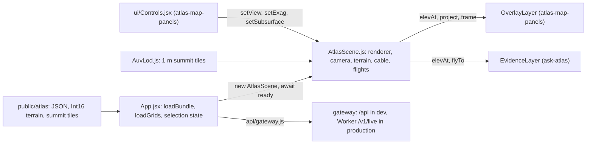

# Atlas map: shell and 3D scene

chapter: atlas-map-scene · paths: `:(glob)src/atlas_map/*` `src/atlas_map/public/` `src/atlas_map/e2e/atlas.spec.js` `src/atlas_map/e2e/mocks.js` `src/atlas_map/src/App.jsx` `src/atlas_map/src/main.jsx` `src/atlas_map/src/api/` `src/atlas_map/src/data/` `src/atlas_map/src/scene/` `:(exclude)src/atlas_map/src/scene/EvidenceLayer.js` `:(exclude)src/atlas_map/src/scene/evidenceMath.js` `:(exclude)src/atlas_map/src/scene/evidenceMath.test.js` `:(exclude)src/atlas_map/src/scene/evidence.css` `src/atlas_map/src/styles/` `src/atlas_map/src/test/setup.js` `src/atlas_map/src/test/fixtures.js` `docs/superpowers/specs/2026-09-23-atlas-map-design.md` · as of 1047fc8

This is the browser half of the Cascadia Offshore Sensor Atlas: a React page that draws the seafloor off Oregon as a navigable 3D map and places each catalogued sensor that has a usable position on it at that position and depth. Sensors without one are not drawn; those that name no catalogued site are listed in an Unplaced panel instead (`src/atlas_map/src/panels/UnplacedPanel.jsx:5-6`; see [atlas-map-panels](atlas-map-panels.md)). The sensors belong to the Regional Cabled Array (RCA), the Ocean Observatories Initiative (OOI) cabled seafloor network off Oregon (`src/DATA_CORPUS_METHOD.md:9-10`), and to COSZO, the Cascadia Offshore Subduction Zone Observatory, the second network in scope (`src/coszo_pdf_pipeline/build_coszo_pdf_graph.py:43`). The spec's goal is that a newcomer "within a minute understands what is measured where, what is running, and how to get the data" (spec:15). This chapter covers the shell (bundle loading, layout, selection state, the live-data client) and the three.js scene (terrain, cable, moorings, camera, and the 1 m Axial summit tiles). The overlays, HUD and side panels are in [atlas-map-panels](atlas-map-panels.md). The Ask Atlas sidebar and its evidence layer are in [ask-atlas](ask-atlas.md). `App.jsx` wires them into this shell (imports at `src/atlas_map/src/App.jsx:15-18`, state at `:50-58`, the evidence layer at `:104-108`, the evidence effects at `:126-178`, the sidebar at `:235-237`). That is why `scene/EvidenceLayer.js`, `scene/evidenceMath.js` and `scene/evidence.css` are excluded here. Every static input comes from the bundle that [atlas-map-data](atlas-map-data.md) writes into `src/atlas_map/public/atlas/`, and live lookups go through the [atlas-map-gateway](atlas-map-gateway.md). The design spec for the first version is `docs/superpowers/specs/2026-09-23-atlas-map-design.md`. It describes 168 sensors, 152 with trusted coordinates and 28 sites in four regions, from the 2026-09-19 corpus snapshot (spec:40-47).

## At a glance

| | |
|---|---|
| Kind | Web app. A React 18 single page built with Vite. The 3D scene is a plain three.js module that React does not render (`src/atlas_map/src/App.jsx:84-124`; spec:209). |
| Stack | React 18.3.1; three.js 0.169.0 with OrbitControls and Line2 from `three/examples` (`src/atlas_map/src/scene/AtlasScene.js:2-5`); Vite 8.3; uPlot 1.6.32 for live charts (`src/atlas_map/src/panels/live/Chart.jsx:2`; `src/atlas_map/package.json:13-27`, lockfile v3); Vitest 5 with jsdom 30; Playwright 1.63 (`package.json:19-27`). |
| Entry points | `src/atlas_map/index.html:16` loads `src/atlas_map/src/main.jsx:7`, which renders `App` (`src/atlas_map/src/App.jsx:21`). Scripts: `npm run dev` (Vite on 127.0.0.1:5175), `build`, `preview`, `test`, `e2e` (`src/atlas_map/package.json:6-11`). |
| Reads | The static bundle in `src/atlas_map/public/atlas/`, written by [atlas-map-data](atlas-map-data.md) (`src/atlas_map_data/paths.py:8`):<br>`manifest.json`, `families.json`, `sensors.json`, `sites.json`, `regions.json`, `cable.json`, `das.json`, `terrain/terrain.json` (`src/atlas_map/src/data/bundle.js:35-37`) and `terrain/{axial,hydrate,overview}.bin` (`src/atlas_map/src/scene/grid.js:47-48`).<br>Optional `subsurface.json`, which git ignores (`.gitignore:51`) and [atlas-map-data](atlas-map-data.md) writes.<br>The committed 1 m summit tiles `public/atlas/auv/` (built by [atlas-map-data](atlas-map-data.md); layout in Data shapes).<br>Live JSON from the [gateway](atlas-map-gateway.md): `/api` in development (`src/atlas_map/vite.config.js:11`), and the Worker's `/v1/live` in production (`src/atlas_map/src/api/gateway.js:5`; Worker in [ask-atlas](ask-atlas.md)).<br>Browser events, the `prefers-reduced-motion` query (`src/atlas_map/src/scene/AtlasScene.js:20`) and the viewport size. |
| Writes or serves | The built page: `vite build` writes `dist/` (`.gitignore:53`), served below a subpath (`src/atlas_map/vite.config.js:15-17`).<br>Runtime DOM: the canvas `canvas.atlas-scene` (`App.jsx:214`), `#atlas-overlay` (`App.jsx:215`) and `#atlas-evidence` (`App.jsx:216`), used by [atlas-map-panels](atlas-map-panels.md) and [ask-atlas](ask-atlas.md).<br>The `AtlasScene` object that the HUD, overlay and evidence layer call (see Interfaces).<br>The `window.__atlas` test hook (`App.jsx:111-120`), used by the Playwright tests.<br>No runtime file writes. Playwright screenshots go to `e2e/screens/`, which is ignored (`.gitignore:56`). |

## How it works



1. **Boot.** `main.jsx` mounts `<App/>` and imports the two stylesheets (`src/atlas_map/src/main.jsx:3-7`). `App` calls `loadBundle()` (`App.jsx:24`). That fetches `manifest.json` first, then seven files in parallel: families, sensors, sites, regions, cable, das and `terrain/terrain` (`src/atlas_map/src/data/bundle.js:34-44`). A missing manifest means the bundle is not built, and the page shows the build command (`bundle.js:15-32`; `App.jsx:26-34`). Until then it shows "Loading the atlas…" (`App.jsx:35`).
2. **Terrain grids.** `App` calls `loadGrids(bundle.terrainMeta)` (`App.jsx:86`). That fetches `terrain/<name>.bin` for each grid listed in `terrain.json`, in parallel. It rejects Vite's HTML fallback and any file whose byte count is not `ncols × nrows × 2` (`src/atlas_map/src/scene/grid.js:45-58`). `makeGrid` wraps each one as an Int16 array with a bilinear `sample` (`grid.js:4-17`).
3. **Scene object.** `new AtlasScene(canvas, bundle, grids)` (`App.jsx:88`) creates the WebGL renderer and a 30° perspective camera. It also creates OrbitControls with damping and zoom-to-cursor, and sets the mouse and touch mapping (`src/atlas_map/src/scene/AtlasScene.js:22-25`, `:50-55`). The starting height sampler is the three grids stacked (`AtlasScene.js:21`; `grid.js:19-22`). The camera jumps to the overview view, and the frame loop starts (`AtlasScene.js:69`, `:72`).
4. **Ready (async).** `AtlasScene.js:33-48` loads the optional subsurface JSON (`:34`) and builds the AUV summit LOD (`:36`, see step 11). It adds the overview, Axial and Hydrate Ridge terrain meshes (`:38-40`; the hydrate patch covers Hydrate Ridge and the slope base, spec:159), adds the subsurface layer when its data exists (`:41-46`), and replaces `elevAt` with a sampler that prefers the summit tiles (`:47`). `App` awaits `ready` (`App.jsx:89`) before it adds the cable, DAS lines and moorings (`App.jsx:91-93`), because those sample heights.
5. **Hooks and state.** `App` builds the overlay (`App.jsx:95-102`) and the evidence layer (`:104-107`). It calls both every frame through `sc.onFrame` (`:109`) and exposes `window.__atlas` (`:111-120`). Only then does it store the scene in state (`:121`), which lets the HUD render (`:217`).
6. **Framing.** Layout effects measure the top row, the side panels and the family strip, and push the free-area insets into the scene (`App.jsx:191-207`, calling `setInsetsY` and `setInsets` at `src/atlas_map/src/scene/AtlasScene.js:202-209`). The first framing is `jumpTo(fit(bundle.overview))` (`App.jsx:206`). `fit` widens the view distance to fill the free width (`AtlasScene.js:208`; `src/atlas_map/src/scene/cameraMath.js:52-53`).
7. **Each frame.** `_tick` (`AtlasScene.js:241-286`) runs in this order: advance any flight (`:243-249`); move the camera for held arrow keys (`:250-254`); run OrbitControls (`:258`); update the summit LOD (`:259`); ease the 2D, contour, colour and mute uniforms toward their targets (`:260-262`); update the subsurface and its glass (`:264-269`); ease the free-area shift (`:270-273`); re-lay the cable and moorings only when exaggeration or 2D changes (`:274-275`); store `frame` (`:281-282`). Then it calls `onFrame`, so the overlay and evidence layers place their DOM markers with this frame's camera (`:280-283`), and renders (`:284`).
8. **Input.** Left drag pans, right drag rotates, the wheel zooms toward the cursor (`AtlasScene.js:51`, `:54-55`). Ctrl, Cmd or Shift drag also rotates (the comment at `:53`). Any drag start (`:56`) or arrow key (`:61`) cancels a flight. Arrow keys move the view at 0.3 × camera distance per second (`cameraMath.js:14-28`). They do nothing while Ctrl, Cmd (Meta) or Alt is held (Shift does not block them), while a form field has focus, or while a `.panel` or `aside` has focus (`cameraMath.js:43-47`). Rotation slows as the camera closes in on its target (`cameraMath.js:33-35`).
9. **HUD and filters.** The HUD calls the scene directly for view, style, colour, exaggeration, DAS and subsurface (`src/atlas_map/src/ui/Controls.jsx:21`, `:62-72`, `:84`). A family focus mutes the terrain through `setMute` (`App.jsx:131-134`). So does an Ask Atlas answer with located evidence or earthquakes on the map (`App.jsx:130`).
10. **Terrain on the GPU.** The vertex shader lifts each vertex to `(elevation − drop) × 0.001 × exaggeration × (1 − flat)`, and sinks it where a finer tile covers it (`src/atlas_map/src/scene/terrainMaterial.js:17-25`). The fragment shader colours by depth (`:33-40`), draws contours (`:42-45`, `:61-63`), discards the detail-patch holes and the summit box (`:47-49`), and turns the seafloor glassy over the subsurface (`:50-51`, `:73`).
11. **Summit detail.** `AuvLod.update` runs at most every 200 ms (`src/atlas_map/src/scene/AuvLod.js:142-144`). It asks `wanted()` which tiles to show (`src/atlas_map/src/scene/auvTiles.js:9-25`). Under 4 km from the camera, 1 m tiles are wanted within 0.35 to 1.2 km of the target, the radius growing with distance. Under 25 km, 4 m tiles are wanted within 1.5 to 4 km of it. Up to six tiles load at a time (`AuvLod.js:152`). A 1 m tile is shown only after its 4 m parent is shown (`AuvLod.js:154-155`, `:161-165`).
12. **Flights.** `flyTo` takes 1.8 s (`AtlasScene.js:185-188`). `flyToPoint` takes 1.3 s and can aim below the seafloor for a hypocentre (`:189-193`). `setView` takes 0.9 s (`:230-239`), and `setSubsurface` takes 1.8 s (`:217-228`). With reduced motion, every flight is instant (`cameraMath.js:37-38`).

## Key files

| File | Role |
|---|---|
| `src/atlas_map/src/main.jsx` | Entry point. Mounts `App` into `#root` and imports `tokens.css` and `app.css` (`:1-7`). |
| `src/atlas_map/src/App.jsx` | The shell. Loads the bundle, builds the scene, layers and hooks, owns selection state and the framing effects (`:21-254`). Ask Atlas wiring is in the same file (see the hand-off above). |
| `src/atlas_map/index.html` | Page shell. Dark background before the CSS arrives (`:7-8`), title (`:9`), IBM Plex font link (`:12`). |
| `src/atlas_map/vite.config.js` | Build base `./` (`:17`), dev and preview proxies for `/api` and `/api/ask` (`:8-12`), port 5175 (`:20-21`), Vitest config (`:25-29`). |
| `src/atlas_map/package.json`, `package-lock.json` | Scripts (`:6-11`) and dependencies (`:13-27`). The lockfile is skim: 132 entries (131 packages plus the root), read only for the pinned versions. |
| `src/atlas_map/playwright.config.js` | Browser tests: `e2e/` directory, 1600×1000 viewport, Vite started as the web server (`:3-9`). |
| `src/atlas_map/README.md` | Run instructions (`:3-11`), optional builders for the summit and subsurface (`:13-19`), the Ask Atlas Worker setup (`:23-30`), test commands (`:32-35`). |
| `src/atlas_map/src/api/gateway.js` | Live-data client. Route wrappers and the error contract (`:1-30`). |
| `src/atlas_map/src/api/gateway.test.js` | Six tests for `api` error kinds, abort, and the query string (`:1-35`). |
| `src/atlas_map/src/data/bundle.js` | Bundle loader, `atlasUrl` for subpath hosting, `BundleMissingError` (`:1-44`). |
| `src/atlas_map/src/data/format.js` | Depth, range and date formatting; status labels and status groups (`:1-19`). Shared by the panels and overlay. |
| `src/atlas_map/src/data/nearby.js` | Great-circle distance and sites within 30 km (`:1-13`). |
| `src/atlas_map/src/data/search.js` | `searchAtlas`: ranks sites and sensors by name, type, refdes and aliases (`:1-24`). |
| `src/atlas_map/src/data/*.test.js` | Tests for bundle, format, nearby and search (15 `it` blocks). |
| `src/atlas_map/src/scene/AtlasScene.js` | The scene class: renderer, camera, controls, terrain, cable, DAS, moorings, flights, the per-frame loop, and the public surface (`:15-295`). |
| `src/atlas_map/src/scene/terrainMaterial.js` | Terrain shader: exaggeration, depth colours, contours, holes, clip box, glass and sinking (`:3-89`). |
| `src/atlas_map/src/scene/grid.js` | Int16 grids: fetch and validate (`loadGrids`), bilinear sampling, mesh arrays with smoothed slopes (`:4-61`). |
| `src/atlas_map/src/scene/AuvLod.js` | Level-of-detail loader for the summit tiles: index, base tiles, cache, retries and the GMRT fallback (`:23-169`). |
| `src/atlas_map/src/scene/auvTiles.js` | Pure tile helpers: decode, tile selection, mesh arrays with skirts, edge feathering, coverage rectangles (`:3-82`). |
| `src/atlas_map/src/scene/SubsurfaceLayer.js` | Subsurface layer: earthquake points, magma-chamber and fault surfaces, and the caldera rim line (`:61-132`). |
| `src/atlas_map/src/scene/subsurface.js` | Pure helpers for subsurface data: quake arrays, surface meshes, calendar months, glass window (`:4-55`). |
| `src/atlas_map/src/scene/cameraMath.js` | View poses, arrow-key motion, easing, input filters, framing between panels (`:3-53`). |
| `src/atlas_map/src/scene/geo.js` | Local projection: 1 unit = 1 km, north = −z (`:1-7`). |
| `src/atlas_map/src/scene/occlusion.js` | Sight-line test that hides a marker behind terrain (`:1-10`). |
| `src/atlas_map/src/scene/*.test.js` (except the evidence files) | Unit tests for AuvLod, auvTiles, cameraMath, geo, grid, loadGrids, occlusion and subsurface (47 `it` blocks). |
| `src/atlas_map/src/styles/tokens.css` | Colour, inset and font tokens, and the reduced-motion rule (`:1-9`). |
| `src/atlas_map/src/styles/app.css` | Base layout: full-window canvas and overlay, panel base style (`:1-12`). |
| `src/atlas_map/src/test/setup.js` | Vitest setup: Testing Library cleanup and a `matchMedia` stub (`:1-12`). |
| `src/atlas_map/src/test/fixtures.js` | A small bundle "in the exact shape plan 1 writes" (`:1-68`). The best written reference for the bundle shapes. |
| `src/atlas_map/e2e/atlas.spec.js` | 18 browser test declarations (20 runs; the framing test runs at three sizes) against the mocked gateway (`:13-314`). |
| `src/atlas_map/e2e/mocks.js` | Playwright route mocks for `/api/*`, with fixture answers for `/api/ask` (`:1-32`). |
| `src/atlas_map/public/atlas/auv/` | Committed 1 m summit tiles and their index. Layout only; see Data shapes. |
| `docs/superpowers/specs/2026-09-23-atlas-map-design.md` | Design spec (358 lines). Source of the scene's interaction and visual rules. Parts are out of date; see Decisions. |
| Not in this chapter | `src/atlas_map/src/scene/EvidenceLayer.js`, `evidenceMath.js`, `evidenceMath.test.js`, `evidence.css`: [ask-atlas](ask-atlas.md). |

## Interfaces

### Commands and routes

| Name | Where | What it does |
|---|---|---|
| `npm run dev` | `src/atlas_map/package.json:7` | Runs `vite` on 127.0.0.1:5175 with the proxies below (`vite.config.js:19-24`). |
| `npm run build` | `package.json:8` | `vite build`, output `dist/`. |
| `npm run preview` | `package.json:9` | `vite preview` with the same proxies (`vite.config.js:24`). |
| `npm test` | `package.json:10` | `vitest run` in jsdom, with `src/test/setup.js`, over `src/**/*.test.{js,jsx}` (`vite.config.js:25-29`). |
| `npm run e2e` | `package.json:11` | `playwright test` in `e2e/`, using Vite on port 5175 (`playwright.config.js:3-9`). |
| `/api/ask` (dev) | `vite.config.js:9-10` | Rewritten to the Worker's `/v1/answer`, with `Origin: https://coszo.org` set on the proxied request. |
| `/api/*` (dev) | `vite.config.js:11` | Forwarded to `http://127.0.0.1:8787`, with `/api` removed. |
| `GET ${ATLAS_WORKER}/v1/live/*` (production) | `src/atlas_map/src/api/gateway.js:5` | The Worker proxies allowed paths to the gateway (`src/atlas_worker/src/index.js:39`, `:402`). |

### Live-data client: `src/atlas_map/src/api/gateway.js`

`api(path, { signal, method, body, fetchImpl })` returns `{ ok: true, data }` or `{ ok: false, kind, source, message }` (`gateway.js:7-21`). `kind` is `notfound`, `bad`, `upstream`, `busy` or `timeout` for statuses 404, 422, 502, 503 and 504. It is `unreachable` for a network failure, or for an error response with no JSON `error` body (`gateway.js:1`, `:12-19`).

| Wrapper | Route it calls (`gateway.js:24-30`) |
|---|---|
| `status(refdes)` | `GET /status/{refdes}` |
| `variables(refdes)` | `GET /series/{refdes}/variables` |
| `series(refdes, params)` | `GET /series/{refdes}?…` |
| `plots(refdes)` | `GET /plots/{refdes}` |
| `waveform(station, minutes, channel)` | `GET /waveform/{station}?…` |
| `waveformHealth(station, channel)` | `GET /waveform/{station}/health?…` |
| `files(key, endpoint, path)` | `GET /files/{key}?…` |

Used by `src/atlas_map/src/panels/live/*.jsx` (for example `panels/live/SeriesView.jsx:2`). `ATLAS_WORKER` is imported by `src/atlas_map/src/ask/askApi.js:1`.

### Bundle, data helpers and scene helpers

| Name | Defined at | Used by |
|---|---|---|
| `BUILD_COMMAND`, `atlasUrl(path)`, `BundleMissingError`, `loadBundle(fetchImpl)` | `src/atlas_map/src/data/bundle.js:1`, `:6`, `:8-13`, `:34-44` | `App.jsx:2`; `scene/grid.js:1`; `scene/AuvLod.js:4`; `scene/SubsurfaceLayer.js:7` |
| `fmtDepth`, `fmtRange`, `statusLabel`, `statusGroup`, `fmtDate` | `src/atlas_map/src/data/format.js:11-19` | `overlay/OverlayLayer.js:3`; `overlay/ring.js:1`; `panels/*.jsx`; `ui/Tooltip.jsx:3`; `panels/live/LiveStatus.jsx:2` |
| `searchAtlas(bundle, query, limit)` | `src/atlas_map/src/data/search.js:1` | `src/atlas_map/src/ui/Search.jsx:2` |
| `distanceKm`, `sitesNear(sites, lon, lat, km)` | `src/atlas_map/src/data/nearby.js:4`, `:10` | `src/atlas_map/src/ui/Tooltip.jsx:4` |
| `LON0`, `LAT0`, `KX`, `KZ`, `toX`, `toZ`, `fromX`, `fromZ` | `src/atlas_map/src/scene/geo.js:2-7` | `overlay/OverlayLayer.js:1`; `panels/crossSection.js:1`; `scene/EvidenceLayer.js:5`; `scene/evidenceMath.js:1` |
| `isTypingTarget`, `approach` (and the other camera helpers) | `src/atlas_map/src/scene/cameraMath.js:30`, `:39` | `src/atlas_map/src/ask/AskPanel.jsx:2`; `scene/EvidenceLayer.js:6` |
| `occluded(cam, point, groundY, steps)` | `src/atlas_map/src/scene/occlusion.js:2` | `overlay/OverlayLayer.js:2` |
| `makeGrid`, `buildArrays`, `stack`, `loadGrids` | `src/atlas_map/src/scene/grid.js:4`, `:24`, `:19`, `:45`; `loadGrids` is re-exported at `AtlasScene.js:13` | `App.jsx:3` |
| `class AtlasScene` | `src/atlas_map/src/scene/AtlasScene.js:15` | `App.jsx:3`, `:88` |

### The `AtlasScene` surface

Other modules call these. The HUD calls the setters at `src/atlas_map/src/ui/Controls.jsx:21`, `:62-72` and `:84`. The overlay reads `elevAt`, `project`, `yFor`, `e` and `frame` (`overlay/OverlayLayer.js:75-121`). The evidence layer and `App.jsx` use the rest.

- Fields: `camera`, `controls`, `U` (uniforms, including `U.exag` and `U.flat`), `targets` (the eased targets, read by `e2e/ask.spec.js:9`), `frame` (`{ dist, regionMode, flat, exag, e }`, `AtlasScene.js:282`), `insets` and `insetsY` (`:19`, `:207`), `framed` (`:19`), `auv` (an `AuvLod`, or null; `stats()` and `finest()`), `subsurface` (a `SubsurfaceLayer`, or null; `credit` and `data`), `onFrame` (`:17`).
- Heights and projection: `elevAt(lon, lat)` (`:21`, `:47`), `e` (getter, `:176`), `yFor(lon, lat, meters)` (`:177`), `project(x, y, z)` (`:178`).
- Camera: `jumpTo(view)` (`:180`), `flyTo(view)` (`:185`), `flyToPoint(lon, lat, dist, meters)` (`:189`), `fit(view)` (`:208`), `setInsets(left, right, snap)` (`:202`), `setInsetsY(top, bottom)` (`:207`).
- Terrain and layers: `setExag(v)` (`:211`), `setStyle(s)` (`:212`), `setColor(c)` (`:213`), `setMute(m)` (`:214`), `setView(v)` (`:230`), `setSubsurface(on)` (`:217`), `setQuakesThrough(i)` (`:229`), `setDasVisible(on)` (`:125`), `setDasKindVisible(kind, on)` (`:130`).
- Construction and teardown: `addCable(cable)` (`:88`), `addDas(das)` (`:110`), `addMoorings(sites)` (`:135`), `dispose()` (`:288`).

### Test hook

`window.__atlas` is set in every build, not only in tests (`App.jsx:111-120`). It holds `scene`, `layer`, `flyTo`, `lod()`, `evidence()`, and `open(id)`, which opens a sensor or site by id. `e2e/atlas.spec.js` uses it (for example lines 4, 52, 107, 144).

### Files produced

None at runtime. The Playwright suite writes screenshots to `e2e/screens/` (`e2e/atlas.spec.js:17`, and similar lines; ignored by `.gitignore:56`).

## Data shapes

Field names come from the consumers in this chapter, with the producer named where it helps. The fixtures in `src/atlas_map/src/test/fixtures.js` show the same shapes in one place.

### Terrain: `terrain/terrain.json` and `terrain/<name>.bin`

- `terrain.json`: `credit` (string, shown on the map) and `grids`, keyed by `axial`, `hydrate` and `overview`. Each grid is `{ ncols, nrows, west, south, cellsize, min, max }` (`src/atlas_map/src/scene/grid.js:47-58`; `src/atlas_map_data/terrain.py:52-54`; written at `src/atlas_map_data/build_atlas_bundle.py:79`). The scene reads `ncols`, `nrows`, `west`, `south` and `cellsize`. `min` and `max` are not read here.
- `<name>.bin`: row-major 16-bit signed metres, row 0 at the north edge (`src/atlas_map_data/terrain.py:40`), `ncols × nrows × 2` bytes (`grid.js:6-7`, `:56-57`). The producer writes little-endian explicitly (`src/atlas_map_data/terrain.py:72-77`).
- `scene/grid.js:9` converts a point to a fractional cell index. Cell size is in degrees, because it is subtracted from longitudes and latitudes in that expression (inferred from the arithmetic).

### Summit tiles: `public/atlas/auv/index.json`

Written by `src/atlas_map_data/auv_tiles.py:98` (the index is built at `:54-55` and the levels are appended at `:95-96`), and read by `src/atlas_map/src/scene/AuvLod.js:38-42`.

| Field | Type | Meaning |
|---|---|---|
| `source`, `credit` | string | Source grid file name, and the credit line for the summit survey. |
| `west`, `north` | number | North-west corner of the survey, in degrees. |
| `cellDeg` | number | Finest cell size in degrees (1.2896e-5 in this index). |
| `tileCells` | integer | 256. Each tile stores 257 × 257 vertices (`AuvLod.js:39`). |
| `zOffset`, `zScale` | number | −1000 and 10. Metres = stored value / `zScale` + `zOffset` (`auvTiles.js:3-7`). |
| `nx`, `ny` | integer | Survey size in finest cells: 20,628 × 17,678. |
| `levels` | array | Three entries `{ level, stride, cellDeg, tilesX, tilesY, tiles }`, with strides 16, 4 and 1 finest cells. |
| `levels[].tiles` | array of `[ty, tx]` | The tiles that exist. Level 0: 30 of 6 × 5. Level 1: 378 of 21 × 18. Level 2: 282 of 81 × 70 (`AuvLod.js:42`). |

- Tile files are `auv/L{level}/{ty}_{tx}.bin.gz` (`AuvLod.js:71`; `auv_tiles.py:60`, `:93`). Each holds 257 × 257 little-endian Int16 values, delta-encoded along each row (a running sum that restarts at each row), then gzipped (`auvTiles.js:3-7`; `AuvLod.js:12-21`; `auv_tiles.py:28`, `:31-33`).
- Neighbouring tiles share one row and one column of vertices. The origin arithmetic puts a tile's 257th vertex on its neighbour's first (`AuvLod.js:60`, `auvTiles.js:33`). The builder slices `cells + 1` columns for this (`auv_tiles.py:85`).
- Counts on disk: 30 files in `L0/`, 378 in `L1/`, 282 in `L2/`, plus `index.json`. Total 22.9 MB (computed from `git ls-files`). The builder README says the 1 m level is kept within 1.2 km of each site (`src/atlas_map_data/README.md:24`).
- Computed from `cellDeg` and the projection constants in `geo.js:3`: a finest cell is 1.01 m east-west and 1.43 m north-south. The tiles span about 4.1 km, 1.0 km and 0.26 km east-west at levels 0, 1 and 2. See Open questions on the 1 m name.

### Sites: `sites.json` → `bundle.sites`

Fields this chapter reads: `id`, `name`, `label`, `lat`, `lon`, `seafloor` (metres), and `column`. `column` is a list of `{ kind, a, b }`, where `a` and `b` are depths in metres below the surface, `a` the shallower (`AtlasScene.js:138-141`, `:160-165`; `App.jsx:59-61`; `src/atlas_map/src/test/fixtures.js:34-42`). `a` equal to `b` draws a single-depth mark (`AtlasScene.js:164`). The panels read `region` (`src/atlas_map/src/panels/SitePanel.jsx:9`), `sensorIds` (`SitePanel.jsx:8`; `DepthSection.jsx:15`) and `unlocatedIds` (`SitePanel.jsx:33`). The hover card reads `parts` (`src/atlas_map/src/ui/Tooltip.jsx:45`).

### Regions: `regions.json`

`overview` is a view, and `regions` is a list of `{ key, label, lonMin, lonMax, view }` (`src/atlas_map/src/data/bundle.js:42`; `App.jsx:81`; producer `src/atlas_map_data/sites.py:15-25`). A view is `{ ll: [lon, lat], dist (km), polar (radians), az (radians), exag }` (`src/atlas_map/src/scene/cameraMath.js:5-12`; `AtlasScene.js:180-183`). The overview view has `exag` 6 (`sites.py:25`).

### Cable and DAS: `cable.json`, `das.json`

- `cable.json`: `lines` is a list. Each line has `coords` as `[lon, lat]` pairs, and `accuracy`, copied from the GeoJSON (`src/atlas_map_data/cable.py:43-45`). In the 27 lines that `cable.json` gets from `rca_cable.geojson`, the values are `charted` (10) and `mapped` (17). `approximate` appears only on nodes (3 of 7). Only the value `approximate` is drawn dashed (`AtlasScene.js:99`), so no line in the current data is dashed (see Open questions). The tooltip has wording for `charted`, `approximate` and `mapped` (`src/atlas_map/src/ui/Tooltip.jsx:7-11`). The cable tooltip reads `route` and `lengthKm` from each line (`src/atlas_map/src/ui/Tooltip.jsx:85`), and the overlay reads `nodes` (`src/atlas_map/src/overlay/OverlayLayer.js:40`). The builder also writes a `hidden` count (`src/atlas_map_data/cable.py:46`), which no file in the frontend reads. The shape is in `src/atlas_map/src/test/fixtures.js:50-56`.
- `das.json`: `layers` is a list of `{ id, kind, cable, color, coords, detail, caveat }`. `kind` is `conventional`, `multidas` or `optodas` (`AtlasScene.js:113-120`; producer `src/atlas_map_data/das.py:15`, `:67`, `:81`, `:88`). Only `optodas` is dashed (`AtlasScene.js:116`). The evidence code also reads `das.layers` (`src/atlas_map/src/evidence/resolve.js:88`, in ask-atlas).

### Sensors, families and manifest

- `sensors.json`: `sensors` is a list indexed by `id` (`bundle.js:40`). `unplaced` is a list of sensor ids, not objects (`bundle.js:40`; `src/atlas_map/src/panels/UnplacedPanel.jsx:9`; producer `build_atlas_bundle.py:70`). The scene does not read sensor fields. The search reads `name`, `type`, `refdes`, `id`, `aliases`, `site` and `lat` (`src/atlas_map/src/data/search.js:15-22`).
- `families.json`: `{ families: [{ key, label, color, glyph }] }` (`bundle.js:39`). Keys: `seismic`, `pressure`, `chemistry`, `currents`, `acoustic`, `fiber` (`src/atlas_map_data/families.py:5-10`).
- `manifest.json`: `builtAt`, `total`, `located`, `unlocated`, `unplaced`, `sites`, `corpusSnapshot`, `warnings`, `errors` (`build_atlas_bundle.py:80-84`). It is fetched first, and its absence is what signals an unbuilt bundle (`bundle.js:18`, `:35`). It is kept as `bundle.manifest` (`src/atlas_map/src/panels/SensorDetail.jsx:18`).

### Subsurface (optional): `subsurface.json`

Read by `SubsurfaceLayer.js:61-67`. It is not in git, and a missing file is silently skipped.

- `credit` (string), `datumM` (the depth datum, used by Ask Atlas for hypocentre depth, `src/atlas_map/src/scene/EvidenceLayer.js:195`), `rim` (`[lon, lat]` points around the caldera rim, `SubsurfaceLayer.js:127`).
- `earthquakes`: `{ lon0, lat0, scale, day0, rows }`. Each row is `[dLon / scale, dLat / scale, depth in metres below sea level, days since day0]`, sorted by time (`subsurface.js:3-11`). Producer `src/atlas_map_data/subsurface.py:159-162`.
- `surfaces`: a list of `{ key, label, rows, cols, points }`. The builder writes `key` as `amc` (magma-chamber top), `west-wall` or `east-wall` (caldera-wall faults) (`src/atlas_map_data/subsurface.py:77-85`, `:98`, `:117`, `:132`). `points` is a grid of `[lon, lat, elevation in metres]` or null (`subsurface.js:14-22`). The scene's style table has keys `amc` and `wall` only (`SubsurfaceLayer.js:14-17`).

## Configuration and secrets

| Name | Read at | Purpose | Default or required |
|---|---|---|---|
| `import.meta.env.PROD` | `src/atlas_map/src/api/gateway.js:5` | Chooses the Worker's `/v1/live` over the dev `/api` proxy. | Set by Vite: true in a production build, false in dev. |
| `import.meta.env.BASE_URL` | `src/atlas_map/src/data/bundle.js:6` | Prefix for every static bundle request, so the build works below a subpath. | From `base: "./"` (`vite.config.js:17`). Required for subpath hosting. |
| `VITE_ATLAS_ASK` | `src/atlas_map/vite.config.js:7` (dev and preview only) | Points the `/api/ask` proxy at a local Worker, such as `wrangler dev` on 8788 (`README.md:24-25`). | Optional. Default `https://rca-atlas.quakehunt.workers.dev`. |
| `ATLAS_WORKER` | Constant at `src/atlas_map/src/api/gateway.js:2` | Base URL of the RCA Atlas Worker, used in production. | Hard-coded. It is not an environment variable. |
| Dev proxy target `http://127.0.0.1:8787` | `vite.config.js:11` | The local gateway for `/api`. | Needed only for live data. Without it the live sections say so (`README.md:21`), and the message is in `src/atlas_map/src/panels/live/Failure.jsx:5`. |
| Dev port `5175` | `vite.config.js:20-21`; `playwright.config.js:6`, `:8` | Dev server and Playwright base URL. | Fixed. |
| Worker keys: `GEMINI_API_KEY`, `ATLAS_API_KEY`, `ATLAS_API_ORIGIN`, `ATLAS_MAP_GATEWAY_ORIGIN`, optional `OPENAI_API_KEY` and `AUTO_FALLBACK_OPENAI_MODEL` | `src/atlas_worker/.dev.vars`, which is not committed (`README.md:26-29`) | Used by the local Worker. This chapter's files do not read them. | Owned by [ask-atlas](ask-atlas.md). Names only here. |

Tunables in code, for orientation rather than configuration: `INTERVAL` 50, 20, 10 m (`AuvLod.js:6`); `RETRY_MS` 30 s (`:8`); `FEATHER_KM` 0.5 (`:9`); `cacheMax` 160 (`:40`); the region-label threshold at 160 km (`AtlasScene.js:282`); the default depth of −2500 m outside all grids (`grid.js:21`).

## Run and test

From `README.md:5-35`, in order:

```sh
# 1. Build the static bundle (needs the private corpus under data/; see Gotchas)
PYTHONPATH=src .venv/bin/python -m atlas_map_data.build_atlas_bundle --refresh-terrain --refresh-external

# 2. Live gateway (optional; without it the live sections say so)
PYTHONPATH=src .venv/bin/uvicorn atlas_map_gateway.main:app --app-dir src --host 127.0.0.1 --port 8787

# 3. The site
cd src/atlas_map && npm install && npm run dev      # http://127.0.0.1:5175

# Tests
npm test        # Vitest unit and component tests
npm run e2e     # Playwright, mocked gateway; screenshots in e2e/screens/
```

The optional 1 m summit and subsurface builders are in [atlas-map-data](atlas-map-data.md). The summit tiles are committed, so a checkout runs the 1 m view without rebuilding them (`README.md:13-15`).

## Decisions and constraints

- **Projection.** A local equirectangular frame centred at 127.15° W, 45.15° N, with 1 unit = 1 km and north = −z (`src/atlas_map/src/scene/geo.js:1-5`; `src/atlas_map/src/scene/geo.test.js:11-14`).
- **Height is seafloor depth.** A metre becomes `0.001 × exaggeration` world units, and 2D flattens it to 0 (`terrainMaterial.js:18`; `AtlasScene.js:176`). Sites sit on the seafloor, and nothing floats (spec:253; `AtlasScene.js:161`).
- **Integers on disk.** Terrain is 16-bit metres (`src/atlas_map_data/terrain.py:1`; `grid.js:6`). The summit tiles store decimetres from −1000 m, delta-encoded and gzipped (`auv_tiles.py:17`, `:23`, `:28`; `auvTiles.js:3-7`).
- **Only the summit tiles are committed.** The rest of `public/atlas/` is ignored, but `auv/` is kept because its MBARI source grid is not in the repo (`.gitignore:48-52`; commit c8ceb14).
- **Optional layers fail soft.** A missing AUV index, or a failed 16 m tile, leaves the summit to the GMRT grid (`AuvLod.js:25-35`, comment at `:29-34`). The subsurface is optional too (`SubsurfaceLayer.js:61-67`; README.md:17-19).
- **Coarser tiles sink rather than cut.** A coarser summit tile sinks 25 m beneath a finer one, so no crack shows at a level edge (`terrainMaterial.js:9-16`; commit 375b83d).
- **Panels take edges, the view centres the free area.** `centerShift` and `fitDist` (`cameraMath.js:49-53`; `AtlasScene.js:202-209`), added in commit 32709ee. The App-side inset calls were changed in commit 1cd21a2 (`App.jsx:191-207`).
- **Keys yield to forms and panels.** Arrow keys do nothing in form fields or inside a `.panel` or `aside`, so a panel can scroll (`cameraMath.js:30-31`, `:43-47`; commit 37044ae).
- **Reduced motion is honoured.** Flights jump to their end, easing snaps, and damping is off (`cameraMath.js:37-40`; `AtlasScene.js:51`, `:256`; spec:319).
- **Subpath hosting.** `base: "./"` (`vite.config.js:14-17`) and `atlasUrl` (`src/atlas_map/src/data/bundle.js:3-6`), from commits 4c78a21 and 5b4057b, so one build serves the Pages subpath and local preview.
- **Production calls the Worker.** The browser calls `${ATLAS_WORKER}/v1/live` in production (`gateway.js:2-5`), and the Vite proxy in development (`vite.config.js:11`). The comment says the static site "uses the same-origin-safe Worker proxy into that bounded gateway" (`gateway.js:3-4`).
- **DAS starts hidden.** `dasShown` is false, and each DAS line starts invisible (`AtlasScene.js:112`, `:118`; commit 4b5bc4d).
- **Survey shading is softened, heights are not.** The detail grids use a wider slope window for shading only (`AtlasScene.js:39-40`, `grid.js:24-34`), as spec:161 asks.

Where the code departs from the spec (`docs/superpowers/specs/2026-09-23-atlas-map-design.md`):

- **Seams.** The spec says detail patches "blend into [the overview] over the last 1 km" (spec:160). The code cuts the overview hole 0.35 km inside each patch (`AtlasScene.js:29`) and offsets the detail patches' depth (`AtlasScene.js:84`). Neither the scene nor the builder's `terrain.py` blends the GMRT detail patches into the overview. The only feathering is at the summit survey's edge (`auvTiles.js:60-62`).
- **Chat.** The spec's left chat panel, 380 px wide and collapsible (spec:214, :299-304), was replaced by Ask Atlas (commit 5ac19b2). See [ask-atlas](ask-atlas.md).
- **Bundle outputs.** The spec's output list (spec:121-137) omits `manifest.json`, `families.json`, `das.json` and `subsurface.json`, which the code reads (`bundle.js:35-37`; `SubsurfaceLayer.js:63`).
- **Gateway routes.** The spec's table (spec:186-194) omits `/waveform/{station}/health`. The client calls it (`gateway.js:29`), and the gateway serves it (`src/atlas_map_gateway/routes_data.py:183`).

## History

- 2026-09-23, `da68ca3`: design spec for the three new folders. Spec edits followed in `7fd6d4f`, `7e399bd`, `f0026df`, `17f75b1` and `348555a`.
- 2026-09-23, `a4e1c0b` to `f592e8a`: the site was scaffolded with bundle loading and tokens, then terrain rendering with drag, Ctrl-drag and arrow-key navigation (`4f57f04`), then the 3D/2D, style, colour and exaggeration controls with region flights.
- 2026-09-23, `0e35ba0` and `51eb84d`: missing bundles are detected behind Vite's HTML fallback, and missing terrain grids are reported by name.
- 2026-09-23, `127b381`: anchored site rings, moorings, cable, primary nodes and occlusion (the `occlusion.js` helper arrived here).
- 2026-09-23 and 2026-09-24, `375b83d`, `c2579ef`, `46090af`: the MBARI 1 m summit tiles were streamed with level-of-detail tiles, then made to fail soft, with a bounded cache, a 30-second retry and GMRT fallback.
- 2026-09-24, `3a4a4e9`: the Axial subsurface layer (quakes, magma-chamber top, faults) and the mapped cable route.
- 2026-09-24, `4c78a21`, `5b4057b`, `6476e3b`: subpath deployment (relative base, `atlasUrl`), and live data proxied through the Worker.
- 2026-09-24, `286b460` and `c8ceb14`: the page is dark from first paint, and the summit tiles are committed.

## Gotchas

- **`elevAt` changes after `ready`.** Before `ready` resolves, `elevAt` samples the three GMRT grids only (`AtlasScene.js:21`). After it, the sampler prefers the summit tiles (`:47`). Code that captured the function early keeps the old one. `App` waits for `ready` before it places the cable and moorings (`App.jsx:89-93`).
- **`dispose()` is partial.** It releases the renderer, the controls and the listeners (`AtlasScene.js:288-295`). It does not free the summit LOD, the terrain meshes, the cable, the DAS lines, the moorings or the subsurface, although `App.jsx:123` calls it on cleanup. `AuvLod.dispose` runs only when creation fails (`AuvLod.js:31`). This is harmless while the scene is built once per page load (inferred from `App.jsx:124`).
- **Off-grid points sit at −2,500 m.** `stack` returns −2500 for any point outside every grid (`grid.js:19-22`). Nothing reports the miss, so an off-grid position is drawn 2.5 km deep.
- **Missing files look like HTML.** Vite's SPA fallback answers a missing file with `index.html` and status 200. The code treats HTML as missing for the manifest (`bundle.js:18`, `:26`), the terrain (`grid.js:55`), the summit tiles (`AuvLod.js:15`) and the subsurface (`SubsurfaceLayer.js:64`).
- **Wall surfaces fall back to one style.** The builder writes the two caldera walls as `west-wall` and `east-wall` (`src/atlas_map_data/subsurface.py:98`, `:117`). The style table has no such keys, so both draw with the `wall` style through the fallback (`SubsurfaceLayer.js:97`). That looks intended but is not stated anywhere (inferred).
- **The scene hard-codes three grid names.** `axial`, `hydrate` and `overview` are read by name (`AtlasScene.js:21`, `:29`, `:35-40`). A `terrain.json` that lacks one of them fails with a TypeError (inferred), not with the "incomplete bundle" message.
- **A bare error response reads as "not running".** Any error response without a JSON `error` body becomes `unreachable`, with the text "The live data service is not running" (`api/gateway.js:19`). So a gateway timeout that arrives without a JSON body reads as "not running", not as a timeout.
- **`npm run preview` skips the local gateway.** Preview serves a production build, where `import.meta.env.PROD` is true, so live calls go to the Worker and not to the `/api` proxy that `preview` also configures (`src/atlas_map/src/api/gateway.js:5`; `src/atlas_map/vite.config.js:24`). Inferred from the code, not tested.
- **Byte order is assumed.** The browser reads terrain and tiles in platform byte order (`grid.js:6`, `AuvLod.js:20`). The producer writes little-endian explicitly (`terrain.py:72-77`, `auv_tiles.py:28`). These agree on every browser platform in use (inferred), but not on a big-endian host.
- **Summit tiles need `DecompressionStream`.** `fetchTile` gunzips with the browser's `DecompressionStream` (`AuvLod.js:17-18`). Without it, every base tile fails, the summit layer is dropped with a warning, and the summit falls back to GMRT (`AuvLod.js:29-34`). If a server sends `Content-Encoding: gzip`, the browser has already unzipped the file, and the magic-byte check skips the second step (`AuvLod.js:17`).
- **Input cancels flights.** Drag start (`AtlasScene.js:56`) and arrow keys (`:61`) clear the flight. A programmatic flight stops as soon as the user touches the map.
- **Frame time is capped.** `dt` is clamped to 50 ms (`AtlasScene.js:242`), so a background tab does not jump when it returns (inferred intent).
- **Exaggeration does nothing in 2D.** `e` multiplies by `1 − flat` (`AtlasScene.js:176`), and the HUD disables the exaggeration slider in 2D (`src/atlas_map/src/ui/Controls.jsx:67`). The e2e test asserts the disabled state (`e2e/atlas.spec.js:54`).
- **The in-app build hint omits the refresh flags.** `BUILD_COMMAND` is the bare command (`src/atlas_map/src/data/bundle.js:1`), but the README's first build uses `--refresh-terrain --refresh-external` (`README.md:6`). The flags fetch the GMRT grids and the external lists (`src/atlas_map_data/build_atlas_bundle.py:4-5`, `:93-94`). A fresh machine without the cached grids needs them (inferred from spec:118).
- **The e2e suite needs a built bundle.** One test fetches `/atlas/sensors.json` (`e2e/atlas.spec.js:240`), and the bundle is ignored by git (`.gitignore:51`). The builder reads corpus files under `data/` (spec:110-119). In this checkout `data/` holds three tracked files only, because `/data/**` is ignored (`.gitignore:23`). The repo says its data snapshots are attached to GitHub Releases and restored by a bootstrap tool (`.gitignore:21-22`), so the bundle cannot be rebuilt from this checkout alone. Treat the e2e suite as needing the full local data setup (inferred).
- **`window.__atlas` ships in production.** It is set without a dev guard (`App.jsx:111`).

## Glossary

| Term | Meaning |
|---|---|
| Atlas | This browser map in `src/atlas_map`, titled "Cascadia Offshore Sensor Atlas" (`index.html:9`). |
| Bundle | The static JSON and binary files under `public/atlas/`, which the page loads at startup (`src/atlas_map/src/data/bundle.js:34-44`). |
| RCA | The Regional Cabled Array, OOI's cabled seafloor network off Oregon (`src/DATA_CORPUS_METHOD.md:9-10`). |
| OOI | The Ocean Observatories Initiative, which operates RCA (`src/DATA_CORPUS_METHOD.md:9-10`). |
| COSZO | The second sensor network in scope (spec:9). Its expansion is not spelled out in the files read here. Other pipelines in the repo expand it as "Cascadia Offshore Subduction Zone Observatory" (`src/coszo_pdf_pipeline/build_coszo_pdf_graph.py:43`). |
| Axial Seamount | An undersea volcano off Oregon. It has the most sensors of the four regions (spec:44-48) and a magma chamber shown in the subsurface layer (`src/atlas_map/README.md:17-18`). |
| Caldera | The sunken summit of a volcano. Axial's central caldera sites sit in it (spec:46). |
| Magma chamber (AMC) | The axial magma chamber. Its top is the `amc` surface (`src/atlas_map/src/scene/SubsurfaceLayer.js:69`). |
| Subsurface | The earthquakes, magma-chamber top and caldera-wall faults beneath Axial (`src/atlas_map/README.md:17-18`). |
| Glass | The subsurface view: the seafloor turns translucent so the layers beneath show (`SubsurfaceLayer.js:9-11`; `terrainMaterial.js:50-51`). |
| Site | One physical location. Sensors within 150 m of each other form one site (spec:142). |
| Sensor | A catalogued instrument with a position, type, family, status and access routes (spec:123-131). |
| Reference designator (refdes) | OOI's instrument identifier. The gateway maps it to a dataset (spec:196). |
| Family | One of six instrument groups: seismic, pressure, chemistry, currents, acoustic, fiber (`src/atlas_map_data/families.py:5-10`). |
| Status group | `operating`, `offline`, `planned` or `unknown`, derived from a raw status (`src/atlas_map/src/data/format.js:5-8`). |
| Nereus | The source of operational status for the RCA instruments (spec:64). |
| Mooring | A site's vertical instrument line, drawn as a dashed line from the seafloor to the surface (spec:254; `AtlasScene.js:135-144`). |
| Water column | The depth range a mooring samples. It is drawn as solid bands on the mooring line (spec:254). |
| Profiler | An instrument that moves through the water column. The shallow one covers 5 to 200 m (spec:82). |
| Primary node (PN) | A square marker on the cable, labelled with its code, such as PN5A (spec:262). |
| Cable | The RCA cable route on the seafloor (spec:163-173; `AtlasScene.js:88-108`). |
| DAS | Distributed Acoustic Sensing, the fiber-optic experiments along the cable (`src/atlas_map/e2e/atlas.spec.js:259`). |
| GMRT | Global Multi-Resolution Topography (general knowledge; the repo does not spell the name out), the seafloor grid the terrain comes from (spec:157). |
| AUV | Autonomous underwater vehicle. MBARI's AUV survey made the 1 m summit grid (`src/atlas_map/public/atlas/auv/index.json`, `credit`). |
| MBARI | Monterey Bay Aquarium Research Institute (general knowledge; the repo does not expand it), which ran that survey (same credit line). |
| Vertical exaggeration | A height multiplier from 1× to 12× in the HUD slider (`src/atlas_map/src/ui/Controls.jsx:67`; spec:242). The scene applies it at `AtlasScene.js:176`. |
| LOD | Level of detail: coarse tiles everywhere, finer tiles near the camera (`AuvLod.js:23`). |
| Level and stride | Level 0, 1 or 2 of the summit tiles, with strides of 16, 4 and 1 finest cells (`index.json`; `auv_tiles.py:95`). |
| Skirt | A ring of extra vertices around a tile, dropped 25 m, which hides cracks between tiles (`auvTiles.js:43-52`). |
| Coverage mask | A texture that records which finer tiles are shown. A coarser tile sinks beneath them (`AuvLod.js:43-48`; `terrainMaterial.js:9-16`). |
| Feather | Easing the summit heights into GMRT across the survey's outer 0.5 km (`auvTiles.js:60-62`; `AuvLod.js:9`). |
| Insets | The pixels that panels cover on each side. The camera centres in what is left (`AtlasScene.js:199-209`; `cameraMath.js:49-53`). |
| Flight | An eased camera move with a fixed duration (`AtlasScene.js:185-197`). |
| Reduced motion | The OS setting `prefers-reduced-motion`, which makes flights instant (`cameraMath.js:37-40`). |
| Int16 | A 16-bit signed integer, the stored format for terrain and summit tiles (`grid.js:6`). |
| Gateway | The local FastAPI service for live lookups, on port 8787 (spec:175-177; `vite.config.js:11`). |
| Worker | The RCA Atlas Worker at `rca-atlas.quakehunt.workers.dev`, which serves Ask Atlas and proxies live data (`src/atlas_map/src/api/gateway.js:2`; `src/atlas_worker/src/index.js:402`). It is a Cloudflare Worker (`src/atlas_worker/README.md:3`), which the README's `wrangler dev` step (`src/atlas_map/README.md:24-25`) runs locally. |
| Vite | The dev server and bundler for the site (`src/atlas_map/package.json:25`). |
| three.js | The WebGL library the scene is built on (`package.json:16`). OrbitControls is its camera controller. |

## Open questions

- **Is the 1 m summit grid meant to be square?** The builder takes one cell size from the source's longitude spacing and applies it to both axes (`src/atlas_map_data/auv_tiles.py:42-44`). With `geo.js` constants, that is 1.01 m east-west and 1.43 m north-south (computed; see Data shapes). The "1 m" name is therefore approximate. Answer: the source grid's coordinate system, which is not in the repo (`.gitignore:49-50`), and the builder's intent.
- **Was a 1 km seam blend intended?** Spec:160 describes one. The code uses a 0.35 km hole and a depth offset (`AtlasScene.js:29`, `:84`), and no code blends the GMRT patches into the overview. Answer: the spec author's intent, or a look at the screenshots (`e2e/screens/` is not tracked).
- **Should `window.__atlas` ship to production?** It is set without a dev guard (`App.jsx:111`). Answer: the team's decision.
- **Which plans do the code comments mean?** `src/atlas_map/README.md:5` and `:7` cite "plan 1" and "plan 2". `grid.test.js:4` cites "plan 1's tiny.asc fixture", and `e2e/atlas.spec.js:104` cites "plan 1, Task 9". The repo tracks specs only, under `docs/superpowers/specs/`. Answer: the plan files, if they exist outside the repo.
- **Does `dispose()` need to free the scene's GPU resources?** It does not today (`AtlasScene.js:288-295`). This matters only if the scene is ever rebuilt. Answer: the team's plan for remounts or hot reload.
- **Which browsers are supported?** The code needs WebGL (`AtlasScene.js:22`) and `DecompressionStream` (`AuvLod.js:18`). Neither the README nor the spec lists supported browsers. Answer: the team's support policy.
- **Should the `mapped` cable lines be dashed?** The spec says approximate segments are dashed (spec:168, :173). The two backbone lines it calls approximate, the US EEZ limit to PN3A and PN3A to PN3B, carry accuracy `mapped` in `rca_cable.geojson`, as do 15 secondary-cable runs. Only `approximate` is dashed (`AtlasScene.js:99`), so no line in `cable.json` is dashed (checked with a read-only run of `cable.load_cable`). Answer: the team's choice of accuracy label or dash rule.

## Candidate project memory

- **decision** · Commit only the 1 m summit tiles · `public/atlas/auv/` is committed while the rest of the bundle is ignored, because the MBARI source grid is not in the repo · `.gitignore:48-52`, commit c8ceb14.
- **requirement** · The map works without the gateway · When the gateway is down, the map runs from the static bundle and live sections say "Live data unavailable. Showing snapshot from 2026-09-19." · `docs/superpowers/specs/2026-09-23-atlas-map-design.md:321-323`.
- **decision** · Sites sit on the seafloor · Each site marker is placed at its true seafloor position, and the scene's height is seafloor depth, so nothing floats · `docs/superpowers/specs/2026-09-23-atlas-map-design.md:253`.
- **fact** · The site is served below a subpath · The public atlas lives below `/rca-atlas/map2/` on the Pages deployment, so every static URL is built from `BASE_URL` · `src/atlas_map/vite.config.js:15-17`, `src/atlas_map/src/data/bundle.js:3-6`.
- **requirement** · Reduced motion is honoured · With reduced motion, flights jump to their end and easing snaps · `docs/superpowers/specs/2026-09-23-atlas-map-design.md:319`, `src/atlas_map/src/scene/cameraMath.js:37-40`.

## Verification

Checked 2026-10-09 against 1047fc8. Claims checked: 401 (374 distinct file, spec and `.gitignore` citations, plus 27 commit hashes). Identifiers and data values were checked with `git grep`, the cited ranges, and read-only scripts over `public/atlas/auv/index.json`, `rca_cable.geojson`, `package-lock.json` and `cable.load_cable`. Key files: 44 tracked non-tile files, none missing (tests and the tile index sit under grouped rows). Corrected: 14, of which 10 were wrong or mis-cited and 4 were re-labelled as general knowledge, inferred, or stated in the repo. Moved to Open questions: 0 existing claims; one question was added (whether `mapped` cable lines should be dashed).
