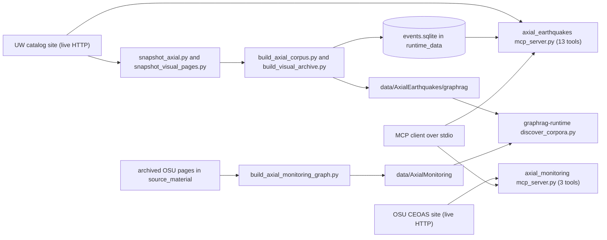

# Axial Seamount earthquakes and monitoring

chapter: axial · paths: 'src/axial_earthquakes/' 'src/axial_monitoring_website/' · as of 1047fc8

Axial Seamount is an active undersea volcano on the Juan de Fuca Ridge, off Oregon. Its caldera is instrumented by the Ocean Observatories Initiative (OOI) Regional Cabled Array (RCA) (`src/axial_earthquakes/build_axial_corpus.py:153-154`). This chapter covers two packages that describe it for RCA Atlas. `src/axial_earthquakes/` turns the University of Washington (UW) Axial earthquake catalog into an exact offline query store and a Graph-RAG corpus (retrieval-augmented generation over a graph of text chunks, entities and sources). It also serves 13 live Model Context Protocol (MCP) tools that answer counts, searches and figure requests from the UW site (`src/axial_earthquakes/axial_agent_tools.py:650-664`). `src/axial_monitoring_website/` archives the Oregon State University (OSU) Axial monitoring pages as a Graph-RAG corpus and serves 3 live MCP tools for the public bottom-pressure and tilt plots and the eruption-status page (`src/axial_monitoring_website/axial_monitoring_tools.py:87-91`). No other code in the repo imports either package. The Graph-RAG runtime finds their corpora by folder name ([graphrag-runtime](graphrag-runtime.md); `src/graphrag_runtime/discover_corpora.py:27-28`). The Ask Atlas Worker answers the daily-count question with its own copy of that logic ([ask-atlas](ask-atlas.md); `src/atlas_worker/src/index.js:365-393`).

## At a glance

| Aspect | Detail |
|---|---|
| Kind | Two stdio MCP servers (earthquake and monitoring) plus offline snapshot and build scripts |
| Stack | Python 3.9 or later (`str.removeprefix`, `src/axial_earthquakes/axial_agent_tools.py:228`); standard library only (`urllib`, `sqlite3`, `json`, `csv`, `unittest`); a POSIX shell launcher (`src/axial_earthquakes/run_mcp.sh:1-6`) |
| Entry points | `src/axial_earthquakes/run_mcp.sh` starts `mcp_server.py`; `src/axial_monitoring_website/mcp_server.py`; builders `build_axial_corpus.py`, `build_visual_archive.py`, `build_axial_monitoring_graph.py`; snapshot scripts `snapshot_axial.py`, `snapshot_visual_pages.py`, `snapshot_figures.py` |
| Reads | Live UW catalog over HTTP (external: daily HYPO71 files, ph2dt arrivals, focal-mechanism CSV, figures; `src/axial_earthquakes/axial_agent_tools.py:265-266`, `:479`, `:494`). Live OSU pages (external; `src/axial_monitoring_website/axial_monitoring_tools.py:19`, `:68`). Downloads written by the snapshot scripts (this chapter). Archived OSU pages in `source_material/original_documents/AxialCEOAS/` (release asset, see [repo-ops-data](repo-ops-data.md); `src/axial_monitoring_website/build_axial_monitoring_graph.py:26`). `runtime_data/AxialEarthquakes/graphrag/events.sqlite`, built by `build_axial_corpus.py` (`:107`) and distributed as a release asset ([repo-ops-data](repo-ops-data.md)) |
| Writes or serves | JSON-RPC replies on stdout to the MCP client that launched the server, as JSON text plus optional image content (`src/axial_earthquakes/mcp_server.py:14-20`). Files on disk: HTTP responses cached under `AXIAL_CACHE_DIR` (`axial_agent_tools.py:261-262`), and a copy of a figure, focal product or SVG only when a tool gets `output_path` (`axial_agent_tools.py:553-554`, `:612-613`, `:636-637`). The earthquake store and exports in `runtime_data/AxialEarthquakes/graphrag/`, read by the live tools' snapshot path (`build_axial_corpus.py:107-140`). The corpus in `data/AxialEarthquakes/graphrag/`, read by [graphrag-runtime](graphrag-runtime.md) through `src/graphrag_runtime/discover_corpora.py:27-28` and `:188-215`. The corpus in `data/AxialMonitoring/`, read by [graphrag-runtime](graphrag-runtime.md) through `discover_corpora.py:27`; a test fixture shows its chunks in an Ask Atlas answer (`src/atlas_map/src/test/fixtures/ask/inflation.v2.json:132`, [ask-atlas](ask-atlas.md)). The raw-source archive, always written to `--source-archive-dir` (the README passes `source_material/AxialEarthquakes/source_snapshot`) or, without that flag, to `<output-dir>/source/` (`build_axial_corpus.py:86`, `:180-187`). `build_visual_archive.py` adds `focal_months/` under the same flag (`build_visual_archive.py:39-46`) |

## How it works

Three paths meet here: an offline refresh that rebuilds the catalog store and corpus, a live MCP server that answers from the UW site or the store, and a monitoring path with its own offline builder and live tools.

**1. Offline refresh of the earthquake package.** The README gives four commands (`src/axial_earthquakes/README.md:50-63`). Run them in this order:

1. `snapshot_axial.py` downloads 11 public files into a source directory: the HYPO71 catalog, the focal-mechanism CSV and text files, and index pages (`src/axial_earthquakes/snapshot_axial.py:8-13`, `:17-20`).
2. `build_axial_corpus.py` parses the catalog with `parse_hypo71`, which skips malformed rows, rolls `60.00` seconds into the next minute, and keeps the file's UTC day (`src/axial_earthquakes/axial_agent_tools.py:100-146`; `build_axial_corpus.py:91`). It writes the `events`, `focal_mechanisms` and `metadata` tables to `events.sqlite` (`build_axial_corpus.py:107-137`), gzipped JSONL exports (`:139-140`), daily and monthly summaries (`:141-142`), the graph inputs (`:144-178`), a copy of the sources (`:180-187`), and the manifest, tool manifest and validation report (`:189-199`).
3. `snapshot_visual_pages.py` downloads each monthly focal-mechanism archive page linked from the focal index (`src/axial_earthquakes/snapshot_visual_pages.py:14-17`).
4. `build_visual_archive.py` indexes dated caldera and regional maps (`src/axial_earthquakes/build_visual_archive.py:25-37`) and per-event product URLs (`:49-53`). It writes its summaries (`:55-69`) and replaces `figures/manifest.jsonl` (`:69`). It appends its visual chunks to `chunks.jsonl` and also writes `visual_chunks.jsonl` (`:71-78`), and patches the manifest (`:79-81`). It must run after step 2: it requires `manifest.json` (`:79`) and reads `chunks.jsonl` only if that file exists (`:76-77`).

`snapshot_figures.py` is a fifth step that the README does not list. It downloads the 41 current figures in `FIGURES` (`src/axial_earthquakes/axial_agent_tools.py:31-73`) and patches the corpus manifest with figure counts (`src/axial_earthquakes/snapshot_figures.py:16-27`).

**2. The live earthquake server.** `run_mcp.sh` sets `AXIAL_DB_PATH` to the runtime store unless it is already set, then execs `mcp_server.py` (`src/axial_earthquakes/run_mcp.sh:5-6`). The server reads three environment variables (`mcp_server.py:24-28`). It reads one JSON-RPC message per stdin line and answers `initialize`, `tools/list` and `tools/call`. Notifications are ignored (`mcp_server.py:29-44`). `dispatch` maps the 13 tool names onto `AxialToolkit` methods (`axial_agent_tools.py:667-688`).

**3. The count path.** `axial_count_events` shows the pattern most answers follow. The day string becomes a UTC date (`resolve_utc_day`, `axial_agent_tools.py:88-97`). `_live_day` fetches `hypo71/hypo71_YYYYMMDD.dat` through `_fetch`, which reuses a file cache for 300 seconds unless `force_refresh` is set (`:251-263`, `:268-273`). It keeps only rows whose `event_date_utc` matches the day (`:272`). The result carries `evidence_mode: "live"`. In `auto` mode a failed fetch falls back to `events.sqlite` and is labelled `snapshot_fallback` with the live error (`:322-335`). Magnitude and depth filters apply after that (`:341`, `:358-368`).

**4. Figures and images.** `get_figure` fetches the JPEG bytes and base64-encodes them into an `_mcp_image` key (`axial_agent_tools.py:609-611`). `tool_result` turns that key into an image content block next to the JSON text (`mcp_server.py:14-20`). Focal-event products (`axial_agent_tools.py:552`) and the SVG from `axial_plot_events` (`:635`) use the same route.

**5. The monitoring tools.** `get_plot` accepts only the stream and product names in its allow-lists (`src/axial_monitoring_website/axial_monitoring_tools.py:61-67`). It fetches `graphs/<prefix><product>.png` from the OSU site (`:68-70`), checks the PNG signature (`:73-74`), and returns the image with a caution that the data are pre-QA (quality-assurance review not yet done) (`:36`, `:75`). `current_status` regex-parses the status page for the publisher's Yes or No answer (`:77-84`).

**6. The monitoring builder.** `build_axial_monitoring_graph.py` makes no network calls (`:4-6`). It checks the landing-page title (`:97-100`). It reads 20 archived pages and cuts each into 475-word chunks with 60-word overlap (`:29-33`, `:85-89`, `:110-131`). It adds 8 instrument streams and 9 products as endpoints (`:35-55`, `:140-160`). Then it writes pages, chunks, sources, entities, endpoints, relationships, `tools.jsonl`, a validation report, a manifest and a README (`:162-175`).

## Key files

| File | Role |
|---|---|
| `src/axial_earthquakes/README.md` | Package guide: UTC day rules, data layout, the 13 tools, refresh commands |
| `src/axial_earthquakes/axial_agent_tools.py` | Core module: HYPO71, ph2dt and focal-CSV parsers; `AxialToolkit` with 13 tool methods; `TOOL_SCHEMAS`; `dispatch`; `FIGURES` |
| `src/axial_earthquakes/mcp_server.py` | Stdio JSON-RPC loop; reads `AXIAL_BASE_URL`, `AXIAL_DB_PATH`, `AXIAL_CACHE_DIR`; wraps results as text and image content |
| `src/axial_earthquakes/run_mcp.sh` | Launcher: defaults `AXIAL_DB_PATH` to the runtime store, then execs `mcp_server.py` |
| `src/axial_earthquakes/snapshot_axial.py` | Downloads the 11 public catalog files into a source directory |
| `src/axial_earthquakes/snapshot_visual_pages.py` | Downloads the monthly focal-mechanism archive pages linked from the focal index |
| `src/axial_earthquakes/snapshot_figures.py` | Downloads the current figure set; writes `snapshot_manifest.jsonl`; not listed in the README |
| `src/axial_earthquakes/build_axial_corpus.py` | Builds `events.sqlite`, the JSONL exports, the Graph-RAG corpus, the source archive, the manifest, the tool manifest and the validation report |
| `src/axial_earthquakes/build_visual_archive.py` | Indexes dated maps, focal-event products and visual summaries; replaces `figures/manifest.jsonl`; appends visual chunks; patches the manifest |
| `src/axial_earthquakes/test_axial_agent_tools.py` | Nine `unittest` cases on a `FakeToolkit` with no network |
| `src/axial_monitoring_website/axial_monitoring_tools.py` | Allow-listed live tools for the OSU plots and status page; `TOOL_SCHEMAS` (3); `dispatch` |
| `src/axial_monitoring_website/mcp_server.py` | Stdio JSON-RPC loop for the three monitoring tools |
| `src/axial_monitoring_website/build_axial_monitoring_graph.py` | Offline builder: archived OSU pages become pages, chunks, sources, entities, endpoints, relationships, a validation report and a manifest |
| `src/axial_monitoring_website/test_axial_monitoring_tools.py` | Six `unittest` cases with an injected fetcher |

## Interfaces

### Command-line entry points

| Command | Flags | Output |
|---|---|---|
| `src/axial_earthquakes/run_mcp.sh` | none; honours a preset `AXIAL_DB_PATH` | the earthquake MCP server on stdio |
| `python3 src/axial_earthquakes/mcp_server.py` | none; env only (`mcp_server.py:24-28`) | same server, without the launcher |
| `python3 src/axial_earthquakes/snapshot_axial.py` | `--output-dir` (required), `--base-url` | 11 files (`snapshot_axial.py:8-13`) |
| `python3 src/axial_earthquakes/snapshot_visual_pages.py` | `--index` (required), `--output-dir` (required), `--base-url` | monthly focal pages (`snapshot_visual_pages.py:12`) |
| `python3 src/axial_earthquakes/snapshot_figures.py` | `--output-dir` (required), `--base-url` | current figures and `snapshot_manifest.jsonl` (`snapshot_figures.py:13`, `:23`) |
| `python3 src/axial_earthquakes/build_axial_corpus.py` | `--source-dir`, `--output-dir` (required); `--runtime-dir`, `--source-archive-dir` (optional) | store and corpus (`build_axial_corpus.py:79-82`) |
| `python3 src/axial_earthquakes/build_visual_archive.py` | `--source-dir`, `--corpus-dir` (required); `--source-archive-dir` | visual archive (`build_visual_archive.py:23`) |
| `python3 src/axial_monitoring_website/build_axial_monitoring_graph.py` | `--source` (default `source_material/original_documents/AxialCEOAS`; must sit inside the repo root, Gotcha 17), `--output` (default `data/AxialMonitoring`) | monitoring corpus (`build_axial_monitoring_graph.py:26-27`, `:180-181`) |
| `python3 src/axial_monitoring_website/mcp_server.py` | none | the monitoring MCP server on stdio (`mcp_server.py:24-25`) |

### MCP tools: earthquakes (`TOOL_SCHEMAS`, `src/axial_earthquakes/axial_agent_tools.py:650-664`)

| Tool | Arguments (default) | Returns |
|---|---|---|
| `axial_catalog_status` | `force_refresh` | update time, location coverage and waveform status from the UW home page (`:282-300`) |
| `axial_count_events` | `day` (`yesterday`), magnitude and depth bounds, `source` (`auto`), `force_refresh` | exact row count for one UTC day (`:302-356`) |
| `axial_search_events` | `start` (required), `end`, bounds, `source`, `limit` (500), `order` (`time_asc`), `force_refresh` | normalized events for a range; `auto` uses live only up to 31 days (`:370-435`) |
| `axial_get_event` | `event_id` (required), `live_day` | every solution for an event ID; focal rows come only from the store, so a `live_day` hit returns none (`:437-453`) |
| `axial_activity_summary` | `start` (required), `end`, `source` | counts, daily counts, magnitude and depth statistics, 10 largest events (`:455-472`) |
| `axial_arrivals` | `day` (required), `event_id`, `force_refresh` | station P and S picks from the daily ph2dt file; live only (`:474-486`) |
| `axial_focal_mechanisms` | `start` (required), `end`, `fault_type` (N, R, S or U), `source`, `limit` (500) | focal mechanisms for a range (`:488-513`) |
| `axial_list_figures` | none | names and URLs of the 41 current figures plus two dated-map patterns (`:515-521`) |
| `axial_get_figure` | `name` (required), `day` (required for dated maps), `output_path`, `force_refresh` | a JPEG as image content (`:598-614`) |
| `axial_get_focal_event_product` | `event_id` (required), `product` (`details`), `output_path`, `force_refresh` | detail-page text, or a PNG for `beachball`, `map` or `waveform` (`:523-555`) |
| `axial_monthly_focal_summary` | `month` as YYYY-MM (required), `include_events`, `limit`, `source`, `force_refresh` | focal counts by fault type and quality for one month (`:557-596`) |
| `axial_plot_events` | `start` (required), `end`, `source`, `output_path` | an SVG map of exact events (`:616-638`) |
| `axial_question_context` | `question` (required) | routes to a daily count or to catalog status (`:640-647`) |

### MCP tools: monitoring (`src/axial_monitoring_website/axial_monitoring_tools.py:87-91`)

| Tool | Arguments | Returns |
|---|---|---|
| `axial_monitoring_list_streams` | none | the four BOTPT streams, their OOI instrument names and live plot pages (`:58-59`) |
| `axial_monitoring_get_plot` | `stream` (required; `central_caldera`, `eastern_caldera`, `international_district`, `ashes`), `product` (default `bpr_7_days`; eight values) | a PNG with the publisher caution (`:61-75`) |
| `axial_monitoring_current_status` | none | the publisher's eruption-status answer: `yes`, `no` or `unparsed` (`:77-84`) |

### HTTP routes

None. Neither package runs an HTTP server; both only fetch from the publishers (`src/axial_earthquakes/axial_agent_tools.py:251-263`; `src/axial_monitoring_website/axial_monitoring_tools.py:52-56`).

### Functions and files used by other code

No other code imports these modules. A `git grep` for `axial_agent_tools`, `AxialToolkit`, `axial_monitoring_tools` and `AxialMonitoringToolkit` finds no hits outside the two package directories. Inside it, `build_axial_corpus.py:16` imports `FIGURES`, `TOOL_SCHEMAS`, `_finite_float`, `parse_focal_csv` and `parse_hypo71`. `build_visual_archive.py:11` and `snapshot_figures.py:9` import `FIGURES` and `DEFAULT_BASE_URL`. `build_axial_monitoring_graph.py:22` imports `TOOL_SCHEMAS`. The Ask Atlas Worker repeats the daily count in JavaScript and does not call these modules (`src/atlas_worker/src/index.js:365-393`, [ask-atlas](ask-atlas.md)).

## Data shapes

### Earthquake store: `events` table and `events.jsonl.gz`

Produced by `parse_hypo71` (`src/axial_earthquakes/axial_agent_tools.py:119-142`) and the table definition at `build_axial_corpus.py:112-117`.

| Field | Type | Meaning |
|---|---|---|
| `record_key` | TEXT, primary key | 24 hex characters: SHA-256 of the raw catalog line (`axial_agent_tools.py:120`) |
| `event_id` | TEXT | upstream ID; not unique, because some events have several solutions (`src/axial_earthquakes/README.md:30`) |
| `origin_time_utc` | TEXT | ISO 8601 time ending in `Z` (`axial_agent_tools.py:122`) |
| `event_date_utc` | TEXT | UTC day of the daily file that listed the row (`:126`) |
| `latitude`, `longitude` | REAL | decimal degrees; longitude is negative for west (`:117-118`) |
| `depth_km`, `magnitude_mw` | REAL | depth in km; moment magnitude Mw (`:129-130`) |
| `weighted_readings`, `azimuthal_gap_deg`, `nearest_station_km`, `rms_seconds`, `horizontal_error_km`, `vertical_error_km` | INTEGER, REAL | location-quality fields (`:131-136`) |
| `p_moment`, `s_moment` | REAL | the catalog's P and S moment values (`:137-138`) |
| `site_id`, `source_url`, `source_line` | TEXT, TEXT, INTEGER | constant `axial_seamount`; file URL; 1-based line number (`:139-141`) |

### Focal mechanisms: `focal_mechanisms` table and `focal_mechanisms.jsonl.gz`

Produced by `parse_focal_csv` (`axial_agent_tools.py:211-228`) and `parse_historical_focal` (`build_axial_corpus.py:52-59`). Fields: `event_id`, `origin_time_utc`, `latitude`, `longitude`, `depth_km`, `magnitude_mw`, `strike_deg`, `dip_deg`, `rake_deg`, `fault_type` (N, R, S or U; the class names are in the text at `build_axial_corpus.py:167`), `quality`, `analog_count` (the CSV's `nAnalogs`), `polarity_distance` (CSV `dPo`), `location_distance_km` (CSV `dLocKm`), `station_polarities` (integer values from the `Po_*` columns; blank and non-integer cells are dropped; stored as JSON text in `station_polarities_json`), and `source_url`. The primary key `focal_key` is 24 hex characters of a SHA-256 over the URL, ID, time and row index (`build_axial_corpus.py:134`).

### Daily and monthly summaries

`daily_summaries.jsonl` and `monthly_summaries.jsonl` hold `summary_id` (built as `axial_{period}_{key}`, giving `axial_day_YYYY-MM-DD` or `axial_month_YYYY-MM`; `build_axial_corpus.py:68`), `period_type`, `period_utc`, `earthquake_count`, magnitude minimum, maximum and mean, depth minimum, maximum and mean, `largest_event_id`, `largest_event_record_key`, `source_url` and `site_id` (`build_axial_corpus.py:63-74`).

### Graph-RAG corpus: `data/AxialEarthquakes/graphrag/`

- `chunks.jsonl`: `chunk_id`, `title`, `text`, `entity_ids`, `source_ids` and optional `metadata`. It holds four fixed chunks (`build_axial_corpus.py:164-168`), one per monthly summary (`:170-171`), and the visual chunks (`build_visual_archive.py:71-78`).
- `entities.jsonl`: `entity_id`, `entity_type`, `name`, `description` (`build_axial_corpus.py:152-157`).
- `relationships.jsonl`: `relationship_id`, `source_id`, `target_id`, `relationship_type` (`:158-162`).
- `sources.jsonl`: `source_id`, `title`, `url`, `source_type`, and optional `scope` (first row only), `record_count`, `date_semantics`, `update_frequency` (`:144-151`).
- `figures/manifest.jsonl`: first written with one row per current figure (`figure_id`, `name`, `source_url`, `scope`, `retrieval_mode`, `mime_type`) and two dated-map URL patterns (`build_axial_corpus.py:173-177`). `build_visual_archive.py:69` then replaces the file. A refreshed corpus therefore holds 43 rows keyed by `asset_id` and `asset_type`: the 41 figures (with `canonical_url`, `window`, `region_or_station_group`, `scope`) and two `url_pattern` rows.
- `visual_summaries.jsonl`, `visual_chunks.jsonl`, `figures/archive_manifest.jsonl`, `figures/focal_event_products.jsonl`: written by `build_visual_archive.py:47-78`. Archive rows carry `asset_id`, `asset_type`, `canonical_url`, `is_mutable` and `retrieval_mode`; figure rows add `window` and `region_or_station_group`, and dated-map rows add `date_utc` (`:28-37`). `url_pattern` appears only in `figures/manifest.jsonl` (`:69`). Focal product rows carry `event_id` and the detail, beachball, map and waveform URLs (`:53`).
- `manifest.json`, `tool_manifest.json`, `validation_report.json` (`build_axial_corpus.py:189-199`), `visual_validation_report.json` (`build_visual_archive.py:82-83`), and `figures/snapshot_manifest.jsonl` (`snapshot_figures.py:21`, `:23`).

### Monitoring corpus: `data/AxialMonitoring/`

- `pages.jsonl`: `page_id`, `url`, `title`, `site_host`, `source_format`, `selection_reason`, `content_sha256`, `text_path`, `retrieved_at`, `text_source`, `source_is_untrusted_data` (always true), `data_caveat` (`src/axial_monitoring_website/build_axial_monitoring_graph.py:124`).
- `sources.jsonl`: `source_id`, `name`, `url`, `publisher`, `access`, `content_sha256`, `retrieved_at`, `rights_note` (`:125`).
- `chunks.jsonl`: `chunk_id`, `page_id`, `source_url`, `title`, `section_heading`, `position`, `word_count`, `text`, `source_is_untrusted_data` (`:129`).
- `entities.jsonl`: site rows (type "Axial Seamount monitoring site") and stream rows (type "instrument_stream", with `canonical_id` and `data_caveat`) (`:144-149`).
- `endpoints.jsonl`: `endpoint_id`, `name`, `url`, `endpoint_type` (`public_live_plot`, `derived_plot`, `operational_alarm_page`, `forecast` or `status_page`), `refresh_cadence` on plots, `data_caveat` on the other endpoints, and `access` (`:151`, `:159`).
- `relationships.jsonl`: `source_id`, `predicate` (SOURCED_FROM, HAS_CHUNK, MENTIONS, LOCATED_AT, LIVE_DATA_AVAILABLE_AT or LINKS_TO), `target_id`. These rows have no `relationship_id` (`:136-160`).
- `tools.jsonl`: the three `TOOL_SCHEMAS` rows (`:168`). `validation_report.json`, `manifest.json` and `README.md` (`:171`, `:173`, `:175`).

### MCP result envelope

A success is `{"ok": true, ...}`. An error is `{"ok": false, "error": {"type": ..., "message": ..., ...}}` (`src/axial_earthquakes/axial_agent_tools.py:76-77`; `src/axial_monitoring_website/axial_monitoring_tools.py:39-40`). The server writes the result as one JSON text block with `ensure_ascii=False`. `isError` is `not ok` (`src/axial_earthquakes/mcp_server.py:14-20`). The `evidence_mode` label is `live`, `snapshot`, `snapshot_fallback` or `mixed_live_snapshot` (`axial_agent_tools.py:318`, `:330`, `:333`, `:395`, `:410`, `:502`, `:571`).

## Configuration and secrets

| Name | Read at | Purpose | Default or required |
|---|---|---|---|
| `AXIAL_BASE_URL` | `src/axial_earthquakes/mcp_server.py:25` | Base URL of the UW catalog | Optional; `http://axial.ocean.washington.edu` (`axial_agent_tools.py:27`) |
| `AXIAL_DB_PATH` | `mcp_server.py:26`; set by `run_mcp.sh:5` | Path to the SQLite store | Optional; `run_mcp.sh:5` defaults it to `runtime_data/AxialEarthquakes/graphrag/events.sqlite` under the repo root. The toolkit default is the same path (`axial_agent_tools.py:244-245`) |
| `AXIAL_CACHE_DIR` | `mcp_server.py:27` | Directory for cached HTTP responses | Optional; `<OS temp dir>/rcn-agent-axial-cache` (`axial_agent_tools.py:246`) |
| `--source`, `--output` | `src/axial_monitoring_website/build_axial_monitoring_graph.py:180-181` | Archived source and output directories | Optional; defaults are relative to the repo root (`:25-27`) |

The monitoring package reads no environment variables. Its base URLs are constants (`axial_monitoring_tools.py:18-19`), and its fetch timeout is 30 seconds (`:55`). Hard-coded limits in the earthquake package: a 45-second timeout (`axial_agent_tools.py:239`), a 300-second cache TTL (`:240`), a 31-day live range (`:29`), and a result cap of 5,000 (`:428`, `:512`).

**Secrets: none.** The README states that no credentials are required (`src/axial_earthquakes/README.md:46`).

## Run and test

- **Serve the earthquake tools:** `src/axial_earthquakes/run_mcp.sh` (`src/axial_earthquakes/README.md:36-40`). The launcher resolves its own paths (`run_mcp.sh:3-4`).
- **Serve the monitoring tools:** `python3 src/axial_monitoring_website/mcp_server.py`. There is no README or launcher in that directory (checked with `ls`).
- **Check the server without network access:** `printf '%s\n' '{"jsonrpc":"2.0","id":1,"method":"tools/list"}' | src/axial_earthquakes/run_mcp.sh` lists 13 tools. The monitoring server lists 3.
- **Refresh the earthquake snapshot:** run the four commands in `src/axial_earthquakes/README.md:50-63` from the project root. Add `snapshot_figures.py` if you want the figure snapshot; the README does not list it. Run it after `build_axial_corpus.py` (Gotcha 16).
- **Rebuild the monitoring corpus:** `python3 src/axial_monitoring_website/build_axial_monitoring_graph.py`. It needs `source_material/original_documents/AxialCEOAS/`, which is a release asset and is absent from this checkout.
- **Unit tests (standard-library `unittest`, no network):**
  - `cd src/axial_earthquakes && python3 -m unittest test_axial_agent_tools`: 9 tests. All passed at 1047fc8.
  - `cd src/axial_monitoring_website && python3 -m unittest test_axial_monitoring_tools`: 6 tests. All passed at 1047fc8.
  - Run them from the package directory, because the tests import sibling modules by bare name (`test_axial_agent_tools.py:8-9`; `test_axial_monitoring_tools.py:4-5`). Set `PYTHONDONTWRITEBYTECODE=1` to avoid writing `__pycache__`.
  - No README or `pixi.toml` task runs these tests (`pixi.toml` has no test entries).

## Decisions and constraints

- **Count valid catalog rows, not event IDs.** Upstream IDs repeat for multi-solution events, so each row gets a synthetic `record_key` and exact counts count rows (`src/axial_earthquakes/README.md:30`; `axial_agent_tools.py:120`).
- **Days are UTC.** "Yesterday" and calendar dates use UTC. The 07:00:00 on the archive index is a listing timestamp, not a day boundary (`src/axial_earthquakes/README.md:7`, `:15`). The file date sets `event_date_utc` (`axial_agent_tools.py:123-126`). `_live_day` drops rows from other days, in case a file is misnamed or redirected (`:271-272`).
- **Live first; the store is history and fallback.** Current-day and recent questions use the live tools. The snapshot is the historical store and the fallback (`src/axial_earthquakes/README.md:66`; `axial_agent_tools.py:322-335`).
- **A zero is not an error, and an unavailable file is not a zero.** A valid empty daily file counts as zero. An unavailable file returns an error (`src/axial_earthquakes/README.md:15`; `axial_agent_tools.py:326-327` for `source="live"`). Gotcha 1 below shows where `auto` mode breaks this.
- **Events stay out of the embedding corpus.** Individual events live in SQLite and JSONL, so an LLM does not retrieve approximate counts from embedded prose (`src/axial_earthquakes/README.md:32`; `src/DATA_CORPUS_METHOD.md:548-550`).
- **Visual archives are fetched on demand.** The corpus keeps an index of dated maps and per-event images. The images themselves are fetched by date or event ID (`src/axial_earthquakes/README.md:44`; `src/DATA_CORPUS_METHOD.md:557-559`).
- **Focal eligibility.** A focal mechanism needs a successful hypocenter plus at least five P picks and five S picks. The publisher's focal page summary gives this method (`build_visual_archive.py:60`, whose `source_urls` point at the publisher's focal page), and the corpus text repeats it (`build_axial_corpus.py:167`). The live CSV's schema drift is repaired by column count (`axial_agent_tools.py:188-190`, `:202-205`).
- **dLoc is not a station distance.** Focal responses warn that `dLoc` can be implausibly large (`axial_agent_tools.py:547`, `:552`).
- **The publisher's citation request is recorded.** The archive summary lists the citations the website asks for: Wilcock et al. (2016), and Wilcock, Waldhauser and Tolstoy (2017) with DOI 10.1594/IEDA/323843 (`build_visual_archive.py:61`).
- **Moment values may be inconsistent.** The archive summary repeats the catalog author's warning and says answers should not treat moments as fully quality controlled (`build_visual_archive.py:59`).
- **Monitoring images are not evidence.** The OSU plots are "volatile monitoring displays, not corpus figures or quality-controlled data". Numbers should come from OOI M2M, the OOI machine-to-machine data service (`src/axial_monitoring_website/axial_monitoring_tools.py:3-5`; `:36`).
- **Monitoring fetches are allow-listed.** The caller cannot choose a URL. The test checks that an unknown stream is rejected before any fetch (`axial_monitoring_tools.py:61-68`; `test_axial_monitoring_tools.py:33-36`).
- **The monitoring builder is offline.** It reads an archived snapshot, so a rebuild is reproducible (`build_axial_monitoring_graph.py:4-6`).
- **Web text is data, not instructions.** Pages and chunks carry `source_is_untrusted_data: true` (`build_axial_monitoring_graph.py:124`, `:129`).
- **Plots are live endpoints.** The builder records the publisher's 15-minute refresh and treats the changing plots as endpoints, not frozen observations (`build_axial_monitoring_graph.py:7-8`, `:151`, `:173`). It keeps the publisher's pre-QA caveat (`:124`) and the rights note that live plots remain at the publisher (`:125`).

## History

- 2026-09-20, `833c343` "Initialize RCA and COSZO Graph-RAG agent": added the earthquake package in one commit (10 files, 1,236 lines). No later commit touches `src/axial_earthquakes/`.
- 2026-09-24, `2315253` "Add Axial monitoring corpus and live plot tools": added the monitoring package (4 files, 354 lines). Its builder archived one landing page as one chunk. The same commit adds the `AxialMonitoring` entry to `discover_corpora.py:27`.
- 2026-09-24, `a273e27` "Ingest OSU Axial monitoring documentation": the builder now reads 20 archived pages from a directory and chunks each one (64 lines added, 42 removed in the builder).
- 2026-09-24, `cead7b9` "Retain Axial monitoring plot captions": image `alt` text is kept as "Figure caption: ..." in the cleaned text, with a test (`build_axial_monitoring_graph.py:64-70`; `test_axial_monitoring_tools.py:47-50`).
- 2026-09-24, `8457b94` (outside this chapter; it changes only the Ask Atlas Worker and map): "today" and "yesterday" are counted on the asker's calendar day in their time zone. The MCP tool was not changed, and its README still says UTC.

## Gotchas

1. **A missing day can read as zero in `auto` mode.** If the live daily file is down and the store has no rows for that day, `count_events` returns `ok: true`, `earthquake_count: 0`, `evidence_mode: "snapshot_fallback"` and a `live_error` (`axial_agent_tools.py:322-335`, `:350-355`). The README's "unavailable returns an error" holds only for `source="live"` (`:326-327`). Reproduced at 1047fc8 with every fetch stubbed to fail.
2. **Partial ranges fail silently.** In `auto` mode `search_events` fills failed days from the store only. The result has `evidence_mode: "mixed_live_snapshot"` and no list of failed days (`axial_agent_tools.py:407-410`, `:429-435`). Reproduced at 1047fc8: an 8-day range with one live day, seven failed days and an empty store for those days returned 1 event, `mixed_live_snapshot`, and no failure list.
3. **Long ranges skip the live feed in `auto` mode.** `auto` uses the store for ranges over 31 days (`:29`, `:392`), and the only signal is `evidence_mode: "snapshot"`; `source="live"` returns an error instead (`:397-398`).
4. **`get_event` with `live_day` drops focal mechanisms.** The focal lookup runs only in the store branch (`:437-453`). Reproduced at 1047fc8: `focal_mechanism_count` is 0 with `live_day` and 1 without it.
5. **Two answers to "yesterday".** Ask Atlas counts the asker's local day when the request carries a time zone (`src/atlas_worker/src/helpers.js:85-96`; `src/atlas_worker/src/index.js:365-393`; commit `8457b94`). `axial_count_events` always uses UTC (`src/axial_earthquakes/README.md:7`; `axial_agent_tools.py:88-97`). The two also recognise different questions. The Worker requires "axial", "earthquake" and a count phrase such as "how many" (`helpers.js:87`), and `axial_question_context` does not require "axial" (`axial_agent_tools.py:642-646`).
6. **Cached data and timestamps.** Responses reuse cached files for up to 300 seconds (`axial_agent_tools.py:240`, `:255`). `retrieved_at_utc` is stamped when the response is built, not when the data were fetched (`:297`, `:352`). Within the 300-second TTL only `force_refresh` bypasses a cached file, and an expired file is refetched without it (`:255`). The cache lives in the OS temp directory unless `AXIAL_CACHE_DIR` is set (`:246`).
7. **Exceptions lose the request ID.** Any exception that `dispatch` does not catch (everything except `TypeError`) reaches the server loop and becomes a JSON-RPC error with `id: null` and the raw Python message (`src/axial_earthquakes/mcp_server.py:46-47`; `src/axial_monitoring_website/mcp_server.py:43-44`). `dispatch` maps every `TypeError`, including a bug inside a tool, to `invalid_arguments` (`axial_agent_tools.py:685-688`). Reproduced at 1047fc8: a numeric `question` returns `id: null` with the message `'int' object has no attribute 'casefold'`.
8. **Arrivals have no snapshot.** `axial_arrivals` is live only (`axial_agent_tools.py:474-486`), and the store has no arrivals table (`build_axial_corpus.py:112-130`).
9. **Snapshot tools need the store.** `AXIAL_DB_PATH` defaults to `runtime_data/...`, which is absent from this checkout. Snapshot paths then return `snapshot_unavailable` or `no_evidence` errors (`axial_agent_tools.py:275-277`, `:340`, `:423`). Live-only calls still work.
10. **The focal cutover differs by tool.** `axial_focal_mechanisms` reads the live CSV from 2026-03-22 (`axial_agent_tools.py:495`). `axial_monthly_focal_summary` reads it from the start of 2026-03 (`:570`). See Open questions.
11. **There is no histogram tool.** `axial_plot_events` draws an SVG of exact events (`axial_agent_tools.py:616-638`). `src/model_eval/datasets/rca_eval_v1.jsonl:39` expects `axial_histogram`, which does not exist.
12. **The build's validation is weaker than it looks.** `validation_report.json` always says `"ok": true` (`build_axial_corpus.py:198`). Its `event_rows_match_source` check compares against the constant 317,696 (`:198`). A rebuild on newer data would report `false` for that check while `ok` stays `true`.
13. **Build order matters.** `build_visual_archive.py` requires `manifest.json` in the corpus directory (`build_visual_archive.py:79`) and reads `chunks.jsonl` only when it exists (`:76-77`). Without a prior `build_axial_corpus.py` run it fails on the missing manifest (read from the code; not run without one).
14. **Fewer streams are live than are archived.** Four BOTPT streams are live (`axial_monitoring_tools.py:20-25`). The corpus also lists four CTD seafloor sensors (`build_axial_monitoring_graph.py:40-43`), which no live tool can plot.
15. **Status is the publisher's text.** `current_status` returns `unparsed` when the page wording does not match (`axial_monitoring_tools.py:82-83`). The result says it is "not an independent eruption determination" (`:84`).
16. **Figure counts are lost when the corpus is rebuilt after the figure snapshot.** `snapshot_figures.py` writes `figure_products` and `figure_snapshots` into `manifest.json` only if that file exists (`snapshot_figures.py:24-27`). `build_axial_corpus.py` then rewrites `manifest.json` from scratch (`build_axial_corpus.py:196`). Run the figure snapshot after the corpus build. Reproduced at 1047fc8 with stubbed downloads: the counts were 43 and 41 in that order and absent in the reverse order.
17. **The monitoring builder fails when `--source` is outside the repo.** It computes `source_input` relative to the repo root (`build_axial_monitoring_graph.py:173`). By then it has already written the text files, the JSONL files and the validation report (`:122-172`), but not `manifest.json` or `README.md`. Reproduced at 1047fc8 with a `--source` in a scratch directory.

## Glossary

| Term | Meaning |
|---|---|
| Axial Seamount | Active submarine volcano on the Juan de Fuca Ridge, off Oregon (`src/axial_earthquakes/build_axial_corpus.py:153`) |
| OOI | Ocean Observatories Initiative, the National Science Foundation (NSF) funded observing network that runs the instruments |
| RCA | Regional Cabled Array, the OOI cabled seafloor array at Axial (`build_axial_corpus.py:153`). Not the same as the project name "RCA Atlas" |
| UW | University of Washington, which publishes the Axial earthquake catalog (`build_axial_corpus.py:165`) |
| OSU CEOAS | Oregon State University College of Earth, Ocean, and Atmospheric Sciences, which publishes the monitoring pages (`build_axial_monitoring_graph.py:124-125`) |
| OOI M2M | OOI's machine-to-machine data service, which the monitoring tools recommend for numbers (`axial_monitoring_tools.py:5`) |
| HYPO71 | A hypocenter-location program. The UW daily file `hypo71_YYYYMMDD.dat` is parsed as its catalog rows (`axial_agent_tools.py:100`). The corpus text calls the locations HYPOINVERSE (`build_axial_corpus.py:165`) |
| Hypocenter | An earthquake's location in latitude, longitude and depth |
| ph2dt | The UW daily phase-pick file format: station P and S picks per event (`axial_agent_tools.py:149-185`) |
| P and S picks | Arrival times of compressional (P) and shear (S) seismic waves at a station |
| Mw | Moment magnitude, the catalog's `magnitude_mw` (`axial_agent_tools.py:130`) |
| Focal mechanism | The fault orientation (strike, dip, rake) that best explains an earthquake. Fault classes are N (normal), R (reverse), S (strike-slip) and U (unclassified) (`build_axial_corpus.py:167`) |
| HASH | Program that estimates focal mechanisms from polarities (`build_visual_archive.py:60`) |
| Analogs, dPo, dLoc | Historical events used as analogs, and the polarity-distance and location-distance values from the focal workflow (`axial_agent_tools.py:223-225`) |
| RSAM | Real-time seismic-amplitude measurement: one-minute median absolute vertical amplitude in the 1-2 Hz and 2-4 Hz bands (`build_axial_corpus.py:156`) |
| Beachball | The diagram of a focal mechanism (`axial_agent_tools.py:530`) |
| BOTPT | Bottom Pressure and Tilt instrument package; stream names look like `BOTPT-A301-MJ03F` (`axial_monitoring_tools.py:21`) |
| BPR | Bottom pressure recorder, the pressure product (`bpr_*` plots; `axial_monitoring_tools.py:27`). The expansion is a domain gloss, not stated in the code |
| LILY | The publisher's tilt product prefix (`lily_*` plots; `axial_monitoring_tools.py:31`; the tool description calls them tilt plots at `:89`) |
| CTD | Conductivity, temperature and depth seafloor sensor (`build_axial_monitoring_graph.py:40-43`) |
| ASHES | The hydrothermal vent field at Axial (`build_axial_monitoring_graph.py:39`) |
| MJ03B, MJ03D, MJ03E, MJ03F | OOI platform codes for the ASHES, International District, Eastern Caldera and Central Caldera sites (`axial_monitoring_tools.py:21-24`) |
| Pre-QA | Published before quality-assurance review (`axial_monitoring_tools.py:36`) |
| MCP | Model Context Protocol, a JSON-RPC tool interface for AI agents |
| JSON-RPC, stdio | JSON-RPC 2.0 messages, one per line on standard input and output (`src/axial_earthquakes/mcp_server.py:29-31`) |
| Graph-RAG | Retrieval-augmented generation over a graph of chunks, entities, sources and relationships. See [graphrag-runtime](graphrag-runtime.md) |
| Chunk | A passage of text with an ID, which is embedded and retrieved (`build_axial_monitoring_graph.py:85-89`) |
| Snapshot, live, fallback | `snapshot` reads `events.sqlite`; `live` reads the UW site; `snapshot_fallback` is used when the live fetch fails (`axial_agent_tools.py:318-335`) |
| `record_key` | Synthetic row key from the raw catalog line (`axial_agent_tools.py:120`) |
| UTC | Coordinated Universal Time. The MCP tools use it for every day boundary (`axial_agent_tools.py:88-97`); Ask Atlas can use the asker's zone (Gotcha 5) |
| SHA-256 | A hash function, used for row keys and content hashes (`axial_agent_tools.py:120`) |
| JSONL | JSON Lines: one JSON object per line |
| SQLite | An embedded file database; the store is `events.sqlite` |
| CSV, HTTP | Comma-separated values; Hypertext Transfer Protocol |
| SVG, PNG, JPEG | Image formats returned by the tools |
| ISO 8601 | The standard timestamp format used in `origin_time_utc` |
| DOI, IEDA | Digital object identifier; the Interdisciplinary Earth Data Alliance, which hosts the catalog citation (`build_visual_archive.py:61`) |
| TTL | Time to live: how long a cached HTTP response is reused (`axial_agent_tools.py:240`) |
| URL | Uniform Resource Locator, a web address |
| POSIX | The portable Unix shell standard; the launcher is a `sh` script (`src/axial_earthquakes/run_mcp.sh:1`) |
| LLM | Large language model, the consumer of these tools' results |
| OS | Operating system; the default cache lives in its temp directory (`axial_agent_tools.py:246`) |

## Open questions

1. **Which date switches focal mechanisms to the live CSV?** The focal tool uses 2026-03-22 (`axial_agent_tools.py:495`). The monthly tool uses 2026-03 (`:570`). Answer: check the first `OriginTime` in the live CSV and the March 2026 month page, then add a test that asks both tools about 2026-03-10.
2. **Which "yesterday" is right?** The Ask Atlas Worker (commit `8457b94`) and `axial_count_events` (README:7) disagree for users outside UTC. Answer: a product decision, then one shared fixture for a non-UTC zone run against both implementations.
3. **How is the monitoring server launched?** The monitoring directory has no README or launcher, and no tracked config registers it. Answer: the maintainer. A `run_mcp.sh` like the earthquake one would settle it.
4. **Why does the corpus list eight streams when only four are live?** `build_axial_monitoring_graph.py:35-44` includes the CTD sensors, which `axial_monitoring_tools.py:20-25` cannot plot. Answer: the owner. Whether the OSU site serves CTD plots is not checked here, because this chapter's review made no network calls.
5. **Is `snapshot_figures.py` part of the refresh?** It is missing from the README's commands (`README.md:50-63`), yet it writes the figure snapshot that the README describes (`README.md:24`) and patches the manifest (`snapshot_figures.py:24-26`). Answer: the owner, or a refresh log.
6. **Does the cleanup rule still match what the builder writes?** `src/data_maintenance/clean_data_folder.py:234-235` rewrites `local_source` values that start with `source/`. `build_visual_archive.py:47` writes the path it was given, which is not a `source/` path (inferred). Answer: run the cleanup on a copy of a built corpus and inspect the rewritten rows.
7. **Are visual chunks embedding input or auxiliary?** `build_visual_archive.py:78` writes them into `chunks.jsonl`, which is the embedding input, and also into `visual_chunks.jsonl`. `src/graphrag_runtime/FIELD_MAP.md:51-52` says visual chunks are not in the canonical embedding set. Answer: the `axial_earthquakes` output of `discover_corpora.py` (`embedding_inputs` against `auxiliary_inputs`), and the chunk counts in `src/DATA_CORPUS_METHOD.md:550-560`.
8. **Is the monitoring corpus mapped?** `src/graphrag_runtime/FIELD_MAP.md` has no `axial_monitoring` row, and its last change (`29dca19`, 2026-09-21) predates the monitoring commits. The monitoring relationships have no `relationship_id` (`build_axial_monitoring_graph.py:136-160`). Answer: run normalization on a built monitoring corpus.
9. **Which eval tool names are right?** `src/model_eval/datasets/rca_eval_v1.jsonl:36-40` and `:49` name five tools that `TOOL_SCHEMAS` lacks: `axial_daily_count`, `axial_events_by_date`, `axial_histogram`, `axial_map` and `axial_figure_retrieval`. `rca_eval_v1_gold.jsonl:18-25` uses the real names. Answer: the eval owner, plus a check that every `expected_tool` appears in `tool_manifest.json`.
10. **Is the hard-coded `"ok": true` intended?** `build_axial_corpus.py:198` sets it as a literal. Answer: the author. If it is not intended, fold the checks into `ok`.
11. **Where do the annual counts come from?** `ANNUAL_COUNTS` in `build_visual_archive.py:14` has no citation. Answer: the published focal-mechanism page for each year.
12. **Is there a focal coverage gap?** The builder's manifest note says the downloaded focal sources lack 2025-03-08 through 2026-03-07 (`build_axial_corpus.py:194`). The source files are absent from this checkout, so this was not checked. Answer: list the event dates in `FM_ML_2022_2025.txt` and the live CSV from a source snapshot.

## Candidate project memory

- **decision** · Count valid catalog rows, not event IDs · Upstream IDs repeat for multi-solution events, so exact counts count rows and each row gets a synthetic `record_key` · `src/axial_earthquakes/README.md:30`
- **bug** · "Yesterday" differs between Ask Atlas and the MCP tool · The Worker counts the asker's local calendar day (commit `8457b94`), while `axial_count_events` uses UTC, so the two can disagree for users outside UTC · `src/axial_earthquakes/README.md:7`; commit `8457b94`
- **requirement** · Live first, labelled snapshot fallback · Current-day and recent questions use the live UW site; the store is for history and fallback, and each result carries `evidence_mode` · `src/axial_earthquakes/README.md:66`
- **decision** · Monitoring plots are volatile and pre-QA · The OSU plots are live endpoints, not corpus evidence, and numbers come from OOI M2M · `src/axial_monitoring_website/axial_monitoring_tools.py:3-5`
- **fact** · Events stay out of the embedding corpus · Individual events are stored in SQLite and JSONL, because an LLM should not retrieve approximate counts from embedded prose · `src/axial_earthquakes/README.md:32`

## Verification

- Checked 2026-10-09 against 1047fc8: 332 line citations and 209 named identifiers (paths, functions, tools, env vars, flags, tables, fields, commands) were opened or resolved. None is missing from the repo.
- Re-run: both unit suites (9 and 6 tests, all pass), both stdio servers' `tools/list` (13 and 3 tools), and scratch reproductions of the auto-mode fallback, partial ranges, `get_event` with `live_day`, the numeric-question error, both builders' outputs, and the monitoring builder's outside-repo failure. Scratch runs wrote nothing to the repo.
- Claims: 26 corrected (8 wrong facts, 3 wrong line numbers, 15 incomplete or imprecise). 1 moved to Open questions (focal coverage gap, question 12). 2 gotchas (16, 17) and 5 glossary terms added.
- Not checked: the live UW and OSU endpoints (no network). The release-asset folders (`data/`, `runtime_data/`, `source_material/`) are absent here, so their contents are unverified.
