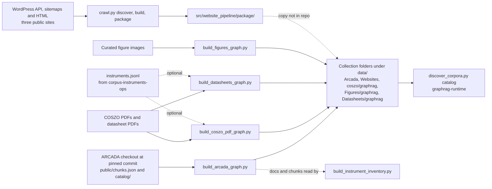

# Document, figure, website and ARCADA collections

chapter: corpus-docs-web · paths: 'src/coszo_pdf_pipeline/' 'src/figures_datasheets_pipeline/' 'src/website_pipeline/' 'src/arcada_pipeline/' · as of 1047fc8

This chapter covers five offline collection builders that turn project material into Graph-RAG collections: four `build_*.py` scripts and one website crawler, `crawl.py`. Graph-RAG (retrieval-augmented generation over a graph) answers a question from text chunks found by similarity search, and joins those chunks to a graph of named entities (places, projects, instruments) and their links, so each retrieved passage can be cited to a page, a figure or a web address. The builders cover: the COSZO project PDFs (COSZO is the Cascadia Offshore Subduction Zone Observatory); a figures package and a datasheets package (both in `figures_datasheets_pipeline`); a corpus of public web pages from three sites; and the ARCADA package, built from the pinned upstream `mhemmett/arcada` repository and shown in the app as RCA Information. RCA is the Regional Cabled Array, an observatory array of the Ocean Observatories Initiative (OOI). Each builder writes JSON Lines tables (JSONL: one JSON object per line), a `validation_report.json`, a `manifest.json` and a README into its output folder, and exits non-zero when its own checks fail (`src/coszo_pdf_pipeline/build_coszo_pdf_graph.py:650-651`; `src/arcada_pipeline/build_arcada_graph.py:436-437`). No other code imports these modules and `pixi.toml` defines no task for them, so a person runs them by hand. [graphrag-runtime](graphrag-runtime.md) later catalogs each output folder, [repo-ops-data](repo-ops-data.md) holds the source material and the project method note `src/DATA_CORPUS_METHOD.md`, and [corpus-instruments-ops](corpus-instruments-ops.md) builds the instrument records that two builders can link to.

## At a glance

| Row | Value |
|---|---|
| Kind | Pipeline: four offline collection builders, and one crawl script with three stages (`discover`, `build`, `package`) plus a one-time recovery script. No service, library API or web app. |
| Stack | Python 3; `pypdf` (reads PDF text), Pillow (images), `lxml` (parses HTML, `src/website_pipeline/crawl.py:5`). Command-line tools: Poppler (`pdftoppm` renders pages, `pdfimages` lists embedded images) and Tesseract, an OCR engine (OCR: optical character recognition, reading text from page images). `git` gives the ARCADA revision (`src/arcada_pipeline/build_arcada_graph.py:165-170`). The datasheets builder does not parse on Python 3.9 or 3.11, so it needs Python 3.12 or later (checked with `ast.parse`; see Gotchas). Requirements are in `src/coszo_pdf_pipeline/README.md:5` and `src/figures_datasheets_pipeline/README.md:10`. |
| Entry points | `python build_coszo_pdf_graph.py` · `python build_figures_graph.py` · `python build_datasheets_graph.py` · `python build_arcada_graph.py` · `python crawl.py discover`, then `build`, then `package` · `python recover_io_batch.py` (one-time). Flags are in Interfaces. |
| Reads | ARCADA checkout (external, pinned): `public/chunks.json`, `catalog/instruments.json`, `catalog/papers.json` (`build_arcada_graph.py:161-179`). Produced upstream; the local snapshot folder `src/arcada_pipeline/source_snapshot/` is gitignored (`.gitignore:40`). See [repo-ops-data](repo-ops-data.md).<br>COSZO PDFs: top-level `*.pdf` in `--source-dir` (`build_coszo_pdf_graph.py:298`). Source material, see [repo-ops-data](repo-ops-data.md).<br>Figure images: top-level image files in `--source-dir` (`build_figures_graph.py:141`), each needing a curated entry (`:35-51`). Source material, see [repo-ops-data](repo-ops-data.md).<br>Datasheet PDFs: `*.pdf` in `--source-dir` (`build_datasheets_graph.py:188`), each needing a `FILE_META` entry (`:39-49`). Source material, see [repo-ops-data](repo-ops-data.md).<br>`instruments.jsonl`, optional for the COSZO and datasheets builders (`build_coszo_pdf_graph.py:658`, `build_datasheets_graph.py:291`). Produced by [corpus-instruments-ops](corpus-instruments-ops.md) (`build_instrument_inventory.py:611`).<br>Public web: WordPress REST API, sitemaps and HTML of `coszo.org`, `oceanobservatories.org` and `interactiveoceans.washington.edu` (`crawl.py:11`). External.<br>Crawl intermediates written by this chapter's own stages: `cache/`, `wp_records.json`, `html_candidates.json`, `sitemap_urls.json`, `selected_pages.json`, `figure_results.json` (`crawl.py:8, 110, 214, 253`).<br>`/tmp/io_*.json` for `recover_io_batch.py`. These files are not in the repo (`recover_io_batch.py:11-12`). |
| Writes or serves | COSZO package to `--output-dir`, conventionally `data/coszo/graphrag` (`src/coszo_pdf_pipeline/README.md:17`). Served to [graphrag-runtime](graphrag-runtime.md) as `coszo_documents` (`src/graphrag_runtime/discover_corpora.py:41`).<br>Figures package to `data/Figures/graphrag` (`src/figures_datasheets_pipeline/README.md:8`). Served as `figures` (`discover_corpora.py:31`).<br>Datasheets package to `data/Datasheets/graphrag` (`src/figures_datasheets_pipeline/README.md:8`). Served as `datasheets` (`discover_corpora.py:30`).<br>ARCADA package to `data/Arcada` (`src/arcada_pipeline/PIPELINE_README.md:5`). Served as `arcada`, labelled RCA Information (`discover_corpora.py:26`; `src/graphrag_runtime/app/repository.py:7`). Also read by [corpus-instruments-ops](corpus-instruments-ops.md) (`src/instrument_inventory/build_instrument_inventory.py:196-197`) and matched by [ask-atlas](ask-atlas.md) on `ARCADA-INSTRUMENT-` IDs (`src/atlas_map/src/evidence/resolve.js:151`).<br>Website package to `src/website_pipeline/package/` (`crawl.py:9`). Nothing in the repo copies it into `data/Websites`, which the catalog serves as `websites` (`discover_corpora.py:40`). [corpus-instruments-ops](corpus-instruments-ops.md) cites nine of its pages as evidence (`build_instrument_inventory.py:95-144`), including `PAGE-2db48aa6813ce095` (`:95`). The data-folder cleanup handles its figures (`src/data_maintenance/clean_data_folder.py:165-200`; [repo-ops-data](repo-ops-data.md)). |

## How it works



### Shared pattern

- Each builder writes its tables, `validation_report.json`, `manifest.json` and `README.md` (`build_coszo_pdf_graph.py:558-648`; `build_figures_graph.py:200-224`; `build_datasheets_graph.py:270-285`; `build_arcada_graph.py:370-479`; `crawl.py:301-322`). The COSZO and datasheets builders delete their output folder only with `--overwrite` (`build_coszo_pdf_graph.py:305-306`; `build_datasheets_graph.py:185`). ARCADA always deletes it (`build_arcada_graph.py:172-173`). The figures builder never deletes it (`build_figures_graph.py:140`).
- Chunks are the only retrieval input. Each chunk has a `text` field. When a manifest names no embedding input, the catalog embeds `chunks.jsonl` (`src/graphrag_runtime/discover_corpora.py:188-190`), and it rejects an embedding file in which any record lacks text (`discover_corpora.py:105-106`).
- Source text is data, not instructions. Document, chunk and source records carry `source_is_untrusted_data: true`, for example `build_coszo_pdf_graph.py:448`, `build_arcada_graph.py:358` and `crawl.py:264`.
- Shared entities use `ENTITY-` plus the first 16 hex digits of the SHA-256 of the name (`build_arcada_graph.py:34-36`; `crawl.py:299`). The COSZO and figures builders hard-code the same IDs for COSZO and Regional Cabled Array (`build_coszo_pdf_graph.py:43-44`; `build_figures_graph.py:21-22`). Hashing the names reproduces those IDs (checked for this chapter), so the corpora join on them.

### COSZO PDF package (`build_coszo_pdf_graph.py`)

1. Lists the top-level PDFs in name order, requires `pdftoppm` and `tesseract` on the path, and derives each source ID and document ID from the file's SHA-256 (`build_coszo_pdf_graph.py:298-304`, `:339-342`).
2. Renders every page to a JPEG at `--dpi` with `pdftoppm` (`:143-165`, `:389`).
3. Reads each page's native text layer with pypdf (`:395`). Tesseract runs in page-segmentation mode 3 with TSV output (`:168-197`) when the native text is shorter than `--ocr-below-chars`, or the document is a visual one, or the page falls in a fixed DataMSRI range, or the text matches `VISUAL_RE`, which names a figure, table, diagram, schematic, map, photo, photograph or poster (`:400-407`; pattern at `:66`). `select_text` keeps OCR for sparse pages, makes a hybrid of native text and OCR labels for visual documents when the two differ (similarity below 0.82), and otherwise keeps native text (`:200-212`).
4. Writes page records with `NEXT_PAGE` edges. Pages with identical normalized text of 100 characters or more get a `SAME_CONTENT_AS` edge to the first copy, and are kept (`:422-460`).
5. Visual pages get a figure record that points to the full-page render. The render is hard-linked, or copied if linking fails (`:462-497`, `:468-470`).
6. Chunks never cross a page. A page of 650 words or fewer stays whole. Longer pages are cut near 450 words with 60 words of overlap, snapped to a nearby punctuation mark (`:215-235`, `:499-530`).
7. Entities are five shared names, fifteen generic instrument types (`:42-65`), and each instrument ID and alias from `--instrument-records`. An alias joins only if it is at least five characters and contains a digit (`:249-271`, `:320-330`). Literal matches add `MENTIONS` edges (`:503-524`). Instrument entities with no mention are dropped (`:553-556`).
8. The composite `COSZO Project DataMSRI.pdf` is split into 30 logical sections by hard-coded page ranges (`:67-98`, `:370-388`). Three duplicate or update edges between known sections and standalone PDFs are also hard-coded (`:539-551`).
9. Checks cover the PDF and page counts, page and figure image files, endpoint resolution, page coverage by a chunk or figure, and OCR on low-text pages (`:566-606`).

### Figures and datasheets (`build_figures_graph.py`, `build_datasheets_graph.py`)

Figures:

1. Every image must have an entry in `DESCRIPTIONS`, keyed by file name. A missing entry aborts the build (`build_figures_graph.py:142-144`). Each entry gives a title, a visual type and a factual description (`:35-51`).
2. Per image: SHA-256 (`:156-158`), Pillow for size and EXIF orientation (`:161-166`), then Tesseract in sparse-text mode 11 (`:100-127`, `:167`).
3. One figure record and one chunk per image. The chunk reads "Figure:", "Type:", "Description:" and up to 2,400 characters of OCR labels (`:171-185`).
4. Edges: literal entity matches on description and OCR (`:169`, `:188-189`), fixed `DEPICTS` edges to the site and primary-node entities for PN1B, PN1C and PN1D (`:59-69`, `:190-191`), and three visual families, each with `SAME_VISUAL_AS` and `ANNOTATED_VARIANT_OF` edges (`:53-57`, `:192-195`). Three edges point to website figure IDs (`:196-198`): two `SAME_VISUAL_AS` edges with the basis "cross-corpus perceptual match", and one `HAS_THUMBNAIL` edge with the basis "website corpus match". The repo computes no perceptual hash (see Open questions).
5. The source image is never copied or changed. `image_path` is `../<file name>` relative to the output folder (`:174`).

Datasheets:

1. Every PDF must have a `FILE_META` entry, or the build stops (`build_datasheets_graph.py:188-190`). Ten products and systems are declared in `PRODUCTS` (`:24-35`). Four instrument IDs in `COBSO_IDS` (`:56-61`) are read from `--instrument-records` when it is given (`:195-202`).
2. Per PDF: SHA-256 (`:215`), PDF bookmarks become section titles (`:142-158`, `:224`), and `pdfimages -list` finds pages with embedded raster images (`:110-117`, `:216`).
3. Native text per page. Tesseract (mode 11) runs on the TS-7800 schematic and on pages with under 100 native characters (`:227-233`).
4. Page-bounded chunks, as in the COSZO builder but without the punctuation snap (`:161-173`, `:241-248`).
5. Visual records for schematic pages, pages with rasters, visual keywords and sparse pages (`:236`, `:249-255`).
6. Fixed product edges: the current node controller, its candidate replacements, companion manuals, algorithm provenance, accepted sensor models, the historical SBE 54 context and the COBSO component links (`:260-268`).
7. Checks: every PDF and page is present, each page has a chunk or visual record, and the two intentional blank SEED pages are kept (`:271-275`; `:237` `is_intentional_blank`).

### ARCADA package (`build_arcada_graph.py`)

1. Reads `public/chunks.json` from the checkout given by `--repo`, hashes it, and records the HEAD commit and its date (`:161-170`). The two catalogs supply instrument and paper metadata (`:177-180`).
2. `prepare_rows` keeps every source row. It repairs duplicate rows whose text contains the placeholder "undefined": it copies missing fields from the best-scoring row with the same ID, writes a fixed description, and records the repair (`:57-112`).
3. Rows group into parent documents. Papers are keyed by DOI (digital object identifier, a persistent paper ID), and other rows by their parent key (`:115-129`, `:182-207`). Each document gets a Markdown review copy in `text/` (`:252-254`).
4. Edges: source, location and content-type nodes; five literal site patterns (`:17-23`, `:313-320`); instrument links to other documents or to unresolved reference nodes (`:228-238`, `:321-323`).
5. Chunks keep the upstream text and its overlapping paper boundaries. They are not re-chunked (`:325-363`; manifest limitation at `:466`).
6. Checks collect an `errors` list. A non-empty list writes `validation_report.json` and the audit file, then raises (`:376-437`). The check also requires exactly 802 source rows and six repairs (`:385-388`).

### Websites (`crawl.py`)

1. `discover` (`:65-111`). Fetches `robots.txt` for each host and saves it without parsing it (`:68`). For `interactiveoceans` and `oceanobservatories`, it lists the WordPress content types (`:80-81`) and pages through each allowed type with `per_page=100` (`:52-64`, `:82-89`). It reads only `sitemap-posts-` sitemaps and keeps URLs that the API index lacks. For `oceanobservatories.org`, it keeps only URLs that match the target regex (`:70-79`, `:90-94`). `coszo.org` has no API used here, so the crawler follows same-site HTML links from `https://coszo.org/` (`:69`, `:95-109`).
2. `build` (`:151-215`). Each WordPress record is scored with three regexes: `STRONG` for target-array evidence, `OTHER` for other OOI arrays and `UTILITY` for privacy and contact pages (`:12-14`). A page is accepted if its title or URL names the target, or if its title, URL and body together name the target at least twice and at least as often as other arrays (`:161-162`). It also needs 30 or more words and a title that is not a utility page. A title that names another array always excludes it (`:159-163`). Paragraphs about other arrays are removed unless they also name the target (`:167-168`). OOI technical pages (instrument classes, data products, PI instruments, sites, additional assets and knowledge-base entries) are accepted when an accepted RCA page links to them (`:174-182`). Sitemap-only and COSZO pages are fetched and cleaned in `one()` (`:188-200`). Exact-duplicate bodies collapse to one canonical URL, and the others are kept as `aliases` (`:206-213`).
3. `extract` (`:113-149`) removes navigation, footers, forms, scripts and related-post blocks. It turns headings, paragraphs, list items, table rows and captions into plain-text blocks, and collects image and link occurrences.
4. `package` (`:217-322`). Downloads a figure only when at least one occurrence has a caption (`:225-226`) and the image is at least 180 by 120 pixels (`:242`). It retries known alternative URLs (`:229-236`) and names each file by its detected format (`:241-245`). Then it writes heading-aware chunks of at most 600 words, built from 520-word units with a 50-word overlap (`:265-293`), the links (`:293-295`), five literal entity mentions (`:296-299`), and the validation report (`:302-318`).

### One-time recovery (`recover_io_batch.py`)

Merges records from an Interactive Oceans API batch that timed out (`src/website_pipeline/PIPELINE_README.md:13`). It reads 18 hard-coded page files and two metadata files from `/tmp` (`recover_io_batch.py:11-12`, `:23`), adds the records to `wp_records.json` and two candidates to `html_candidates.json` (`:17-33`). Missing page files are skipped, but the two metadata files are read without a check (`:23-24`), so a run without them raises `FileNotFoundError` before either JSON file is written. Its inputs are not kept in the repo.

## Key files

| File | Role |
|---|---|
| `src/coszo_pdf_pipeline/build_coszo_pdf_graph.py` | Builds the COSZO PDF package: page render, OCR, page-bounded chunks, entities, logical sections, validation. |
| `src/coszo_pdf_pipeline/README.md` | Purpose, requirements and the example command. |
| `src/figures_datasheets_pipeline/build_figures_graph.py` | Builds the figures package from the curated images. |
| `src/figures_datasheets_pipeline/build_datasheets_graph.py` | Builds the datasheets package from the nine PDFs named in `FILE_META` (`:39-49`), plus products and product edges. Needs Python 3.12 or later (`ast.parse` fails on 3.9 and 3.11; see Gotchas). |
| `src/figures_datasheets_pipeline/README.md` | Purpose, output folders and requirements for both figure and datasheet builders. |
| `src/website_pipeline/crawl.py` | Three-stage crawler and packager: `discover`, `build`, `package`. |
| `src/website_pipeline/recover_io_batch.py` | One-time merge of a timed-out Interactive Oceans API batch. |
| `src/website_pipeline/PIPELINE_README.md` | Stages, scope rule, commands and the acceptance rule. |
| `src/website_pipeline/AUDIT.md` | Final audit numbers for the website package, with known failures. |
| `src/arcada_pipeline/build_arcada_graph.py` | Builds the ARCADA package and its audit file. |
| `src/arcada_pipeline/PIPELINE_README.md` | Source commit, what is converted and kept, and the license note. |
| Skim: `src/arcada_pipeline/build_audit.json` | Repair audit from the last build: 802 source rows, 802 retained, six repaired rows (97 lines). |
| Skim: `src/website_pipeline/selection_log.jsonl` | One line per excluded, duplicate or failed page (1,974 lines). |
| Skim: `src/website_pipeline/discovery_failures.json` | Failures from the last discover run (one WordPress page listing timed out). |
| Tests | None under these paths. `git ls-files` lists no test file. |

## Interfaces

### Command line

| Command | Flags (required unless marked) | Writes |
|---|---|---|
| `python build_coszo_pdf_graph.py` | `--source-dir`, `--output-dir`, `--instrument-records` (optional), `--dpi` (default 150; render resolution in dots per inch), `--ocr-below-chars` (default 200), `--overwrite` (flag). `build_coszo_pdf_graph.py:656-661` | Seven JSONL tables, `validation_report.json`, `manifest.json`, `README.md`, `text/`, `page_images/`, `figures/` |
| `python build_figures_graph.py` | `--source-dir`, `--output-dir` (`build_figures_graph.py:232-233`) | `sources.jsonl`, `figures.jsonl`, `chunks.jsonl`, `entities.jsonl`, `relationships.jsonl`, `validation_report.json`, `manifest.json`, `README.md` |
| `python build_datasheets_graph.py` | `--source-dir`, `--output-dir`, `--instrument-records` (optional), `--dpi` (default 150), `--overwrite` (`build_datasheets_graph.py:291`) | `source_documents.jsonl`, `documents.jsonl`, `pages.jsonl`, `chunks.jsonl`, `figures.jsonl`, `entities.jsonl`, `relationships.jsonl`, reports, `text/`, `page_images/`, `figures/` |
| `python build_arcada_graph.py` | `--repo`, `--output`, `--audit-output` (`build_arcada_graph.py:485-487`) | `documents.jsonl`, `chunks.jsonl`, `entities.jsonl`, `relationships.jsonl`, `source_documents.jsonl`, `validation_report.json`, `manifest.json`, `README.md`, `text/`, and the audit file |
| `python crawl.py discover` · `build` · `package` | One positional stage, with those three choices (`crawl.py:325`). | discover: `wp_records.json`, `html_candidates.json`, `sitemap_urls.json`, `discovery_failures.json`, `discovery/<host>_robots.json`. build: `selected_pages.json`, `selection_log.jsonl`. package: `package/`; `figure_results.json` is written beside the code (`crawl.py:253`). |
| `python recover_io_batch.py` | No flags. Reads fixed `/tmp` paths (`recover_io_batch.py:11-12`). | Rewrites `wp_records.json` and `html_candidates.json`, only when both metadata files exist (`:23-24`) |

### Outbound HTTP (the crawler only)

All requests are plain GET calls with the user agent `COSZO-RCA-ResearchCorpus/1.0` and no credentials (`crawl.py:10`, `:34`).

- `https://{host}/robots.txt` (`crawl.py:68`).
- `https://{host}/wp-sitemap.xml` (`crawl.py:70`), then sitemaps whose URL contains `sitemap-posts-` (`crawl.py:73`).
- `https://{host}/wp-json/wp/v2/types` (`crawl.py:80`), and `https://{host}/wp-json/wp/v2/{type}` with `_fields`, `per_page=100` and `page` (`crawl.py:52-59`, `:85`).
- `https://coszo.org/` as the static-site seed (`crawl.py:95`).
- Image URLs from pages. Two fallbacks: `ooica.net` maps to `interactiveoceans.washington.edu`, and `-WxH` thumbnail suffixes are stripped (`crawl.py:231-233`).

### Functions imported by other chapters

None. `git grep` finds no import of these modules outside their own folders.

### Files other chapters read

Listed in At a glance and in Data shapes.

## Data shapes

Field types: str, int, float, bool, list, object. Each row lists one output file, its key fields and where the code writes them.

### COSZO package (`data/coszo/graphrag`, built by `build_coszo_pdf_graph.py`)

| File | Fields (type) and meaning |
|---|---|
| `source_documents.jsonl` | `source_id` (`COSZO-SOURCE-` + 16 hex of the file SHA-256), `filename`, `relative_path`, `media_type`, `sha256`, `byte_size`, `page_count`, `rights` (fixed text "unknown; preserve source terms", `:355`) (`:347-357`). |
| `documents.jsonl` | `document_id` (`COSZO-DOC-`), `source_id`, `parent_document_id` (logical sections only), `title`, `document_type` (values include map, composite_project_packet, presentation, project_description, concept_of_operations, technical_note, external_reference_guide, data_flow_diagram, poster, pdf_document, logical_packet_section), `page_start` and `page_end` (sections only), `page_count`, `is_composite` (bool), `scope` (`:358-388`). |
| `pages.jsonl` | `page_id` (`COSZO-PAGE-<12 hex>-NNNN`), `document_id`, `parent_document_id`, `source_id`, `page_number` (int), `locator` (`<file>.pdf#page=N`), `native_text`, `ocr_text`, `selected_text`, `extraction_method` (native, ocr, hybrid_native_ocr, none), three character counts, `selected_word_count`, `ocr_attempted` (bool), `ocr_mean_confidence` (float or null), `is_scan`, `is_visual_document`, `page_image_path`, `page_image_sha256`, `image_width_px`, `image_height_px`, `render_dpi`, `text_sha256` (null under 100 characters) (`:423-449`). |
| `chunks.jsonl` | `chunk_id` (`COSZO-CHUNK-`), `document_id`, `page_id`, `source_id`, `page_number`, `chunk_ordinal_on_page` (one-based), `locator`, `text` (the embedded field), `word_count`, `text_sha256`, `extraction_method`, `entity_ids` (list) (`:504-518`). |
| `figures.jsonl` | `figure_id` (`COSZO-FIG-<12 hex>-pNNNN-001`), `document_id`, `page_id`, `source_id`, `page_number`, `visual_type` (poster, data_flow_diagram, map, presentation_slide, full_page_scan, page_visual), `image_path`, `image_sha256`, `caption_or_page_text` (up to 4,000 characters), `ocr_text`, `representation` (`:483-496`). |
| `entities.jsonl` | `entity_id`, `name`, `entity_type` (project, observatory_array, site, instrument_type, instrument), `aliases`; instrument rows add `canonical_id` and `external_dataset` (`:320-333`, `:553-556`). |
| `relationships.jsonl` | `relationship_id`, `source_id`, `relationship_type` (this builder's key; the others use `predicate`), `target_id`, `evidence` (object or null). Types: DERIVED_FROM, HAS_PART, HAS_PAGE, NEXT_PAGE, HAS_FIGURE, HAS_CHUNK, NEXT_CHUNK, MENTIONS, SAME_CONTENT_AS, DUPLICATE_OF, UPDATES (`:280-292`, `:369-551`). |
| `validation_report.json` | `status` ("pass" or "fail"), `schema_version`, `checks` (object of booleans), `counts`, `problems` (`:580-606`). |
| `manifest.json` | `corpus_id` ("COSZO-PDF-GRAPHRAG"), `schema_version`, `generated_at`, `source_directory`, `source_count`, `page_count`, `files` (name to `sha256` and `records`), `validation_status`, `source_is_untrusted_data` (`:608-621`). It does not declare `embedding_input` or the graph inputs. |

### Figures package (`data/Figures/graphrag`, built by `build_figures_graph.py`)

| File | Fields (type) and meaning |
|---|---|
| `sources.jsonl` | `source_id` (`FIGURE-SOURCE-` + 16 hex), `filename`, `relative_path` (`../<name>`), `media_type`, `sha256`, `byte_size` (`:168`). |
| `figures.jsonl` | `figure_id` (`FIGURE-` + 16 hex of the image SHA-256), `source_id`, `title`, `visual_type` (site_map, site_map_annotation, regional_observatory_map, scientific_map, instrument_photo_plate, site_and_instrument_diagram, field_photo), `description` (curated), `ocr_text`, `ocr_engine` ("Tesseract"), `ocr_mean_confidence`, `image_path`, `image_sha256`, `image_format`, `width_px`, `height_px`, `color_mode`, `dpi` (list of floats or null), `entity_ids`, `visual_family_id` (for example VISUAL-FAMILY-PN1B, or null), `description_method` ("curated visual inspection") (`:171-179`). |
| `chunks.jsonl` | `chunk_id` (`FIGURE-CHUNK-`), `document_id` (equal to the figure ID), `parent_id`, `source_id`, `position` (always 0), `title`, `text`, `word_count`, `entity_ids`, `image_path` (`:180-185`). |
| `entities.jsonl` | `entity_id`, `name`, `entity_type`, `aliases`. Six external nodes are appended: three infrastructure nodes point to `../../Instruments/infrastructure.jsonl`, and three figure nodes to `../../Websites/figures.jsonl` (`:72-77`, `:148-149`). |
| `relationships.jsonl` | `relationship_id`, `source_id`, `predicate`, `target_id`, `evidence`. Predicates: DERIVED_FROM, HAS_CHUNK, MENTIONS, DEPICTS, SAME_VISUAL_AS, ANNOTATED_VARIANT_OF, HAS_THUMBNAIL (`:130-135`, `:186-198`). |
| `validation_report.json`, `manifest.json` | Manifest keys: `corpus_id` ("COSZO-RCA-FIGURES"), `schema_version`, `created_at`, `embedding_input` ("chunks.jsonl"), `node_inputs`, `edge_input`, `validation_status`, `counts`, `files` (`:217`). |

### Datasheets package (`data/Datasheets/graphrag`, built by `build_datasheets_graph.py`)

| File | Fields (type) and meaning |
|---|---|
| `source_documents.jsonl` | `source_id` (`DATASHEET-SOURCE-` + 16 hex), `filename`, `relative_path`, `media_type`, `sha256`, `byte_size`, `page_count` (`:217`). |
| `documents.jsonl` | `document_id` (`DATASHEET-DOC-` + 16 hex), `source_id`, `title`, `document_type` (algorithm_documentation, requirements_and_selection, product_datasheet, hardware_reference_manual, data_standard_manual, software_description, instrument_user_manual, electrical_schematic), `page_count`, `product_entity_ids` (list), `outline_entry_count` (`:39-49`, `:218`). |
| `pages.jsonl` | `page_id` (`DATASHEET-PAGE-<12 hex>-NNNN`), `document_id`, `source_id`, `page_number`, `locator`, `section_title` (PDF bookmark), `native_text`, `ocr_text`, `selected_text`, `extraction_method`, `native_character_count`, `selected_word_count`, `ocr_attempted`, `ocr_mean_confidence`, `is_intentional_blank` (bool), `page_image_path`, `page_image_sha256`, `width_px`, `height_px`, `render_dpi` (`:237`). |
| `chunks.jsonl` | `chunk_id` (`DATASHEET-CHUNK-`), `document_id`, `page_id`, `source_id`, `page_number`, `position_on_page` (one-based), `title`, `locator`, `text`, `word_count`, `entity_ids` (`:244`). |
| `figures.jsonl` | `figure_id` (`DATASHEET-FIG-<12 hex>-pNNNN-001`), `document_id`, `page_id`, `source_id`, `page_number`, `visual_type` (electrical_schematic or technical_page_visual), `image_path`, `image_sha256`, `caption_or_page_text`, `representation` (`:254`). |
| `entities.jsonl` | `entity_id`, `name`, `entity_type` (embedded_computer, data_standard, software, processing_method, system_role, pressure_sensor, instrument_component, instrument_model, project, observatory, instrument), `manufacturer`, `model`, `status` (`:194-202`). Product IDs hash `datasheet-product` plus a key, not the name (`:37`). |
| `relationships.jsonl` | `relationship_id`, `source_id`, `predicate`, `target_id`, `evidence`. Predicates: DERIVED_FROM, HAS_PAGE, NEXT_PAGE, HAS_CHUNK, NEXT_CHUNK, MENTIONS, HAS_FIGURE, DESCRIBES_OR_REFERENCES, CURRENT_PRODUCT, CANDIDATE_REPLACEMENT, COMPANION_DOCUMENT, BASED_ON, ACCEPTS_INPUT_FROM_MODEL, INCLUDES_COMPONENT, HISTORICALLY_USED_BY, REFERENCES_STANDARD (`:176-180`, `:220`, `:238-268`). |
| `validation_report.json`, `manifest.json` | Manifest keys: `corpus_id` ("COSZO-RCA-DATASHEETS"), `schema_version`, `created_at`, `embedding_input`, `node_inputs`, `edge_input`, `validation_status`, `counts`, `files` (`:278`). |

### ARCADA package (`data/Arcada`, built by `build_arcada_graph.py`)

| File | Fields (type) and meaning |
|---|---|
| `documents.jsonl` | `document_id` (`ARCADA-PAPER-`, `ARCADA-INSTRUMENT-`, `ARCADA-CONTEXT-` or `ARCADA-GUIDE-` + 20 hex; papers hash the DOI, others the parent key, `:206-207`), `source_document_id` (joins `source_documents.jsonl`), `source_record_id` (the upstream parent key, `:258`), `document_type` (paper, instrument, site_context, data_access_guide), `title`, `instrument_type`, `source_system`, `location`, `latitude`, `longitude`, `depth_m`, `site`, `node`, `instrument`, `stream`, `units`, `sample_rate_hz`, `start_date`, `end_date` (instrument fields from `catalog/instruments.json`), `doi`, `year`, `journal`, `first_author`, `source_url`, `keywords` (list), `linked_instrument_ids` (list), `source_chunk_ids`, `source_record_keys`, `text_path`, `content_sha256`, `repository_url`, `repository_commit`, `source_is_untrusted_data` (`:255-289`). |
| `chunks.jsonl` | `chunk_id` (`ARCADA-CHUNK-` + 20 hex of `source_record_key`), `document_id`, `parent_id`, `source_chunk_id` (the upstream ID), `source_record_key`, `source_row_index`, `source_row_repair` (object or null), `source_row_type`, `source_system`, `title`, `position` (zero-based), `word_count`, `text` (the embedded field), `location`, `keywords`, `source_url`, `doi`, `year`, `journal`, `first_author`, `linked_instrument_ids`, `fdsn_url`, `pi_base_url`, `ooi_page`, `source_metadata_original` (object), `source_text_sha256`, `normalized_text_sha256`, `repository_url`, `repository_commit` (`:328-359`). |
| `entities.jsonl` | `entity_id` (`ENTITY-` + 16 hex of the name, or `ARCADA-INSTREF-` + 20 hex for unresolved instrument references), `name`, `type` (the website uses this key too; COSZO, figures and datasheets use `entity_type`), `method`, `resolution_status` (references only) (`:214-238`, `:294-310`). |
| `relationships.jsonl` | `source_id`, `predicate`, `target_id`, plus metadata: `evidence` and `method` (MENTIONS), `source_instrument_id` (LINKS_INSTRUMENT), `source_path` and `repository_commit` (DERIVED_FROM). Predicates: DERIVED_FROM, HAS_TYPE, FROM_SOURCE, LOCATED_AT, MENTIONS, LINKS_INSTRUMENT, HAS_CHUNK, NEXT_CHUNK (`:218-219`, `:290-323`, `:360-363`). |
| `source_documents.jsonl` | `source_document_id` (`SOURCE-` + 16 hex of repository URL and commit, `:188`), `title`, `source_kind` ("git_repository_rag_export"), `source_url`, `git_commit`, `git_commit_date`, `source_path` ("public/chunks.json"), `source_sha256`, `repository_license` (`:189-200`). |
| `validation_report.json` | `status` ("passed" or "failed"), `errors` (list), `checks` (a fixed list of sentences, not computed results, `:421-428`). Only `errors` reflects the checks (`:418-429`). |
| `manifest.json` | `schema_version` ("1.0-graph"), `created_at`, `source_repository`, `source_commit`, `source_commit_date`, `source_file`, `source_sha256`, `source_rows` (802), `retained_source_rows`, `excluded_source_rows` (0), `repaired_placeholder_rows` (6), counts by type and predicate, `embedding_input`, `graph_node_inputs`, `graph_edge_input`, `source_urls_retained`, `limitations` (fixed text, `:439-468`). It declares no validation status. |
| `text/<document ID>.md` | One Markdown review copy per document (`:252-254`). |
| `src/arcada_pipeline/build_audit.json` | `created_at`, `source_rows` (802), `retained_rows` (802), `excluded_rows` (always an empty list), `repaired_rows` (six objects: `source_row_index`, `source_chunk_id`, `reason`, `canonical_source_row_index`, `graph_source_record_key`, `inferred_fields`), `source_sha256` (`:432-435`). |

### Websites package (`src/website_pipeline/package/`, built by `crawl.py package`)

| File | Fields (type) and meaning |
|---|---|
| `pages.jsonl` | `page_id` (`PAGE-` + 16 hex of the normalized URL, `crawl.py:212`), `url`, `title`, `text` (full clean text; repeats the chunk text), `text_path`, `figure_ids` (list), `site_host`, `published_at` and `modified_at` (WordPress only; null for HTML), `selection_reason` (RCA_dedicated_site, explicit_RCA_COSZO_body, technical_resource_linked_from_RCA_page, COSZO_site, RCA_dedicated_site_sitemap), `mixed_array_context` (bool), `source_format` (wordpress_api or html), `wp_id`, `aliases` (list), `content_sha256`, `retrieved_at`, `text_source`, `source_is_untrusted_data` (`:172`, `:182`, `:200`, `:264`). |
| `chunks.jsonl` | `chunk_id` (`<page_id>-CHUNK-NNN`), `page_id`, `source_url`, `title`, `section_heading`, `section_headings` (list), `section_spans` (list of `heading`, `word_start`, `word_end`), `position` (zero-based), `word_count`, `text`, `source_is_untrusted_data` (`:287-289`). |
| `figures.jsonl` | `figure_id` (`FIG-` + 16 hex of the image URL, `crawl.py:224`), `source_url`, `retrieved_url`, `path`, `status` (downloaded, metadata_only_uncaptioned_image, failed, excluded_small_image, unsupported_image), `width`, `height`, `sha256`, `retrieved_at`, `occurrences` (list of `source_url`, `alt_text`, `caption`, `page_url`, `page_id`), `caption_status` (`:225-246`). |
| `entities.jsonl` | Five rows with `entity_id` (`ENTITY-` + 16 hex), `name`, `type` (named_place_or_project), `method` (`:299`). |
| `relationships.jsonl` | `source_id`, `predicate`, `target_id`. Predicates: HAS_CHUNK, NEXT_CHUNK, HAS_FIGURE, LINKS_TO (adds `anchor_text`), MENTIONS (adds `target_label`, `evidence`, `method`). No `relationship_id` (`:289-298`). |
| `linked_documents.jsonl` | `page_id`, `url`, `label`, `status` ("linked_document_not_downloaded"). PDFs and office files linked from pages (`:295`). |
| `validation_report.json` | `status` ("passed" or "failed"), `errors`, `checks` (a fixed list, `:316`). |
| `manifest.json` | `schema_version` ("1.0"), `created_at`, `pages`, `pages_by_site`, `chunks`, `entities`, `relationships`, `figures_downloaded`, `figure_status_counts`, `scope`, `limitations` (fixed text). It declares no validation status and no embedding input (`:320`). |
| Crawl intermediates (in `src/website_pipeline/`) | `wp_records.json` (WordPress records keyed by normalized URL, with `site_host`), `html_candidates.json`, `sitemap_urls.json`, `discovery/<host>_robots.json`, `selected_pages.json`, `figure_results.json`, `cache/<sha256 of URL>.json` and `.bin`. Tracked in git: `selection_log.jsonl` (one object per excluded, duplicate or failed page, with `status` and `reason`, `canonical_url` or `error`) and `discovery_failures.json` (`crawl.py:8-9`, `:68`, `:110`, `:214`, `:253`). |

## Configuration and secrets

| Name | Read at | Purpose | Default or required |
|---|---|---|---|
| `--source-dir` | `build_coszo_pdf_graph.py:656`; `build_figures_graph.py:232`; `build_datasheets_graph.py:291` | PDF folder (COSZO, datasheets) or image folder (figures). | Required |
| `--output-dir` | `build_coszo_pdf_graph.py:657`; `build_figures_graph.py:233`; `build_datasheets_graph.py:291` | Where the package is written. | Required |
| `--instrument-records` | `build_coszo_pdf_graph.py:658`; `build_datasheets_graph.py:291` | `instruments.jsonl` from [corpus-instruments-ops](corpus-instruments-ops.md). A missing file means no instrument entities (`build_coszo_pdf_graph.py:250-251`). The README uses `data/Instruments/instruments.jsonl` (`src/coszo_pdf_pipeline/README.md:13`). | Optional |
| `--dpi` | `build_coszo_pdf_graph.py:659`; `build_datasheets_graph.py:291` | Page render resolution. | 150 |
| `--ocr-below-chars` | `build_coszo_pdf_graph.py:660` | Native text length below which OCR runs. The datasheets builder hard-codes 100 (`build_datasheets_graph.py:227`). | 200 |
| `--overwrite` | `build_coszo_pdf_graph.py:661`; `build_datasheets_graph.py:291` | Delete the output folder first. | Off |
| `--repo` | `build_arcada_graph.py:485` | Checkout of `mhemmett/arcada` with `public/chunks.json`, `catalog/` and a git history. | Required |
| `--output` | `build_arcada_graph.py:486` | Output folder (`data/Arcada`, `src/arcada_pipeline/PIPELINE_README.md:5`). | Required |
| `--audit-output` | `build_arcada_graph.py:487` | Path for the audit JSON. The tracked copy is `src/arcada_pipeline/build_audit.json`. | Required |
| `stage` (positional) | `crawl.py:325` | `discover`, `build` or `package`. | Required |
| `REPOSITORY_URL` | `build_arcada_graph.py:16` | Upstream URL recorded in provenance. | Constant |
| `HOSTS` | `crawl.py:11` | Hosts crawled. | Constant |
| `UA` | `crawl.py:10` | User-Agent header, `COSZO-RCA-ResearchCorpus/1.0`. | Constant |
| `STRONG`, `OTHER`, `UTILITY` | `crawl.py:12-14` | Regexes for target-array evidence, other OOI arrays, and utility pages. | Constant |
| Fetch limits | `crawl.py:30`, `:32`, `:35-37` | Negative-cache window 21,600 s (6 hours); 2 attempts; 30 s timeout; 24 MB cap per response. | Constant |
| Worker counts | `crawl.py:60`, `:201`, `:249` | 3 threads for WordPress listing pages (`:60`) and for sitemap-only and static pages (`:201`); 5 for figure downloads (`:249`). | Constant |

Environment variables: none are read by these four paths (no `os.environ` or `getenv` call; `git grep` finds none). Secrets: none. No keys, tokens or credentials appear in the code, and the crawler sends only public GET requests.

## Run and test

Commands from the READMEs:

```sh
# COSZO package (src/coszo_pdf_pipeline/README.md:9-14)
python build_coszo_pdf_graph.py \
  --source-dir "/path/to/data/coszo" \
  --output-dir "/path/to/data/coszo/graphrag" \
  --instrument-records "/path/to/data/Instruments/instruments.jsonl" \
  --overwrite

# Website corpus, run in this order (src/website_pipeline/PIPELINE_README.md:17-21)
python crawl.py discover
python crawl.py build
python crawl.py package
```

The figures, datasheets and ARCADA READMEs give no command. Use the flags in Interfaces. The website README says to run "with the bundled Python environment used by the project" (`src/website_pipeline/PIPELINE_README.md:15`). The repo does not define that environment (see Open questions).

Tests: none exist under these paths. The checks are each builder's own. The website package "is accepted only when `validation_report.json` reports `passed`" (`src/website_pipeline/PIPELINE_README.md:23`). COSZO, figures and datasheets report "pass" or "fail" (`build_coszo_pdf_graph.py:590`); ARCADA and the website report "passed" or "failed" (`build_arcada_graph.py:419`; `crawl.py:316`).

## Decisions and constraints

- **Keep every source row; repair, do not drop.** ARCADA keeps all 802 rows. Six placeholder-only duplicates get unique IDs and an audit trail (`src/arcada_pipeline/PIPELINE_README.md:9-10`; `build_arcada_graph.py:57-58`; `src/arcada_pipeline/build_audit.json`).
- **Keep upstream rights visible.** ARCADA's MIT license covers repository code and documentation. Paper text and scraped third-party pages keep their own rights and are not labelled MIT (`src/arcada_pipeline/PIPELINE_README.md:20`; `build_arcada_graph.py:198`). COSZO PDFs carry "unknown; preserve source terms" (`build_coszo_pdf_graph.py:355`).
- **Website scope is COSZO and RCA material, plus technical resources linked from it.** Other arrays are excluded by page tests and by array-name filters. In mixed articles, paragraphs devoted only to another array are removed where they can be separated (`src/website_pipeline/PIPELINE_README.md:8`, `:11`; `crawl.py:12-14`, `:159-182`). The method note adds that a few cross-array or external records remain when they are "direct evidence for an RCA/COSZO instrument, method, publication, or computational output" (`src/DATA_CORPUS_METHOD.md:12-14`).
- **Keep source URLs.** They are kept for citation, alias collapsing and refresh (`src/website_pipeline/PIPELINE_README.md:11`; `crawl.py:206-213`).
- **No invented image descriptions.** Uncaptioned website images stay metadata-only (`src/website_pipeline/AUDIT.md:16`; `crawl.py:225-226`, `:246`). Figure descriptions are "curated visual inspection" (`build_figures_graph.py:178`; `src/DATA_CORPUS_METHOD.md:441-442`).
- **Images are not copied or changed.** The figures package points at the original files (`src/figures_datasheets_pipeline/README.md:5`; `build_figures_graph.py:174`).
- **Duplicates are linked, not removed.** COSZO pages and chunks get `SAME_CONTENT_AS` edges (`build_coszo_pdf_graph.py:455-460`, `:525-530`). Website duplicates collapse to a canonical URL with `aliases` (`crawl.py:206-213`). The method note says the same (`src/DATA_CORPUS_METHOD.md:399-400`).
- **Embed chunks only.** The website README says to use `chunks.jsonl` for text ingestion and "Do not ingest both as independent documents" (`crawl.py:322`). The ARCADA README says to use `chunks.jsonl` for embedding and retrieval and "Do not ingest both documents and chunks as independent retrieval documents" (`build_arcada_graph.py:472-476`). The method note says only `chunks.jsonl.text` should be embedded (`src/DATA_CORPUS_METHOD.md:322-323`).
- **ARCADA is not re-chunked.** Upstream chunks keep their overlapping paper boundaries (`build_arcada_graph.py:466`; `src/DATA_CORPUS_METHOD.md:211-212`). Arcada's own embeddings and MiniSearch index stay in the snapshot, because its IDs and normalized text differ from the runtime's (`src/arcada_pipeline/PIPELINE_README.md:18`; `build_arcada_graph.py:463`).
- **Shared IDs for cross-corpus joins.** ARCADA's entity IDs match "the Literature and Websites entity convention" (`build_arcada_graph.py:35`).
- **Collection name.** ARCADA is shown as RCA Information. Its stable ID `arcada` and its upstream attribution stay (`src/DATA_CORPUS_METHOD.md:196-199`; `src/graphrag_runtime/discover_corpora.py:24-26`).
- **Figures need curated descriptions.** A new image cannot enter the package without one (`build_figures_graph.py:142-144`; `src/DATA_CORPUS_METHOD.md:794`).
- **Instrument IDs come from the inventory.** COSZO and datasheet links use exact instrument identifiers from the Instruments corpus (`src/DATA_CORPUS_METHOD.md:397-398`).
- **SBE 54 is historical.** The SBE 54 tsunameter is "obsolete context; do not equate with current COSZO APGs" (`build_datasheets_graph.py:267`).
- **Current node controller.** The Ocelot is the current node controller, and the SandCat and TS-7800 are candidate replacements (`build_datasheets_graph.py:261-262`).

## History

- 833c343 (2026-09-20), "Initialize RCA and COSZO Graph-RAG agent": the only commit that touches these four paths. It added all 14 tracked files, including the two logs and the ARCADA audit. The commit has no body.
- 29dca19 (2026-09-21), "Present Arcada corpus as RCA Information": changed how the ARCADA collection is shown, in ten files, but not the stable ID `arcada`. None of those files is in this chapter's paths (`git show --stat 29dca19`).
- The artifacts carry the date 2026-09-19: the discovery failure (`src/website_pipeline/discovery_failures.json:6`) and the ARCADA audit (`src/arcada_pipeline/build_audit.json:2`). The method note calls its counts the 2026-09-19 snapshot (`src/DATA_CORPUS_METHOD.md:172-173`).
- The website selection log is consistent with the audit: 1,959 excluded, 13 duplicates and 2 failures make 1,974 lines, matching `AUDIT.md:12` and `:14`.
- The 98-record recovery from a timed-out API batch is recorded in `AUDIT.md:12` and `PIPELINE_README.md:13`. It was done by `recover_io_batch.py`, which has no commit of its own.

## Gotchas

- **Successful website responses never expire.** `fetch()` returns any cached 200 body without an age check (`crawl.py:27-28`). A re-run of `discover` or `build` therefore keeps old pages and old listings. Refreshing needs the cached entries in `src/website_pipeline/cache/` removed. Failed fetches are cached for six hours and not retried in that window (`crawl.py:29-31`).
- **robots.txt is saved and never enforced.** `urllib.robotparser` is imported (`crawl.py:2`) and never used. The file is written to `discovery/<host>_robots.json` (`crawl.py:68`). No delay is set between successful requests; a retryable failure sleeps 1 s after the first attempt and 2 s after the second (`crawl.py:43`); concurrency is capped only by the thread pools (`crawl.py:60`, `:201`, `:249`).
- **Generated website files live in the source tree, and no rule ignores them.** Paths are built from the script's own folder (`crawl.py:7-9`), so `wp_records.json`, `cache/` and `package/` appear next to the code. `git check-ignore` matches none of them. `package` deletes `package/` on every run (`crawl.py:218`). `discover` overwrites `discovery_failures.json` each time (`crawl.py:110`).
- **Website figures take the detected format as their extension.** Camera MPO files are written as `.mpo` (`crawl.py:241-245`). The cleanup script later copies them to `.jpg` and rewrites `figures.jsonl` (`src/data_maintenance/clean_data_folder.py:165-167`, `:187-200`).
- **Re-rendering at a new DPI is silent.** COSZO and datasheets reuse existing page JPEGs by name (`build_coszo_pdf_graph.py:146-147`; `build_datasheets_graph.py:98-99`), yet record the current `--dpi` in each page (`build_coszo_pdf_graph.py:446`; `build_datasheets_graph.py:237`). Without `--overwrite`, images and recorded DPI can disagree. The datasheets check also accepts empty files.
- **Datasheets need Python 3.12 or later (inferred from a parse check).** Line 37 puts a backslash inside an f-string expression. Checked here: `ast.parse` fails on that line under Python 3.9 and 3.11, and succeeds under 3.12 and 3.14. The f-string change that allows this is PEP 701 (inferred; the builder was not run). The other three builders parse under 3.9.
- **Only top-level files are read.** The PDF and image globs are not recursive (`build_coszo_pdf_graph.py:298`; `build_figures_graph.py:141`; `build_datasheets_graph.py:188`). Files in subfolders are skipped with no message.
- **Fixed numbers break on a new source.** ARCADA requires exactly 802 rows and six repairs (`build_arcada_graph.py:385-388`). Its manifest says "Eleven" unresolved references (`:465`). The DataMSRI ranges assume 524 pages (`build_coszo_pdf_graph.py:97`), and nothing checks the ranges against the PDF's page count.
- **Validation reports differ in shape.** COSZO, figures and datasheets write `checks` as booleans. ARCADA and the website write a fixed list of sentences, so only `errors` shows what was tested (`build_arcada_graph.py:421-428`; `crawl.py:316`). ARCADA writes its report and audit before it raises, so a failed run leaves output but no `manifest.json` (`build_arcada_graph.py:430-437`).
- **The catalog cannot see the website or ARCADA validation.** It reads `validation_status` or `validation.passed` from the manifest (`src/graphrag_runtime/discover_corpora.py:225-227`) and never opens `validation_report.json` (no reference in `src/graphrag_runtime`). Neither manifest declares a status (`crawl.py:320`; `build_arcada_graph.py:439-468`), so both show `not_declared` (`discover_corpora.py:241`).
- **Field names differ by builder.** Relationships use `relationship_type` in COSZO (`build_coszo_pdf_graph.py:288`) and `predicate` elsewhere. Entities use `type` in ARCADA and the website, and `entity_type` elsewhere. The runtime accepts `predicate`, `relationship_type` and `type` as edge predicates (`src/graphrag_runtime/normalize_corpus.py:44`).
- **Position numbering differs.** Chunk ordinals are one-based in COSZO and datasheets (`build_coszo_pdf_graph.py:500`; `build_datasheets_graph.py:242`) and zero-based in ARCADA and the website (`build_arcada_graph.py:325`, `:339`; `crawl.py:289`).
- **Chunking differs by collection.** COSZO snaps chunk ends to punctuation (`build_coszo_pdf_graph.py:225-230`). Datasheets cut at word offsets (`build_datasheets_graph.py:161-173`). The website uses 520-word units inside headings (`crawl.py:277-287`). ARCADA keeps upstream chunks (`build_arcada_graph.py:466`).
- **Entity matching differs by builder.** The website's COSZO pattern has no word boundary and no long name (`crawl.py:296`). ARCADA also matches RSN and Caldera (`build_arcada_graph.py:18-19`). COSZO adds instrument aliases only when they are at least five characters and contain a digit (`build_coszo_pdf_graph.py:268`). The same place can therefore link in one corpus and not another.
- **Some IDs are hard-coded from other corpora.** The figures builder names three website figure IDs (`build_figures_graph.py:75-77`, `:196-198`). The instrument inventory hard-codes nine website page IDs as evidence (`build_instrument_inventory.py:95-144`), including `PAGE-2db48aa6813ce095` and its chunk (`:95`, `:318`). These are SHA-256 prefixes of URLs (`crawl.py:18`, `:212`, `:224`), and the inventory's validation never checks them (`build_instrument_inventory.py:683-705`), so a changed URL silently orphans them. The page ID was checked against the coszo instruments URL.
- **Missing instrument records pass silently.** COSZO returns no instrument terms when the file is missing (`build_coszo_pdf_graph.py:250-251`). Datasheets name an absent instrument by its raw ID (`build_datasheets_graph.py:200-202`).
- **Hard-coded PDF relations.** The COSZO builder's duplicate and update edges, and its `confidence` values (the string "high" at `build_coszo_pdf_graph.py:547` and the number 0.997 at `:549`), are fixed for these file names, and the code does not compute them.
- **The recovery script skips missing page files but not missing metadata files.** Missing `/tmp` page files are skipped (`recover_io_batch.py:15-16`), but the two metadata files are read without a check (`:23-24`). Without them the script raises `FileNotFoundError` before either JSON file is rewritten (`:32-33`). Its key uses `replace("www.", "")` on the whole URL (`:18`), which can differ from `norm()` (`crawl.py:19-23`) for uppercase hosts, fragments or entities (inferred: a merged record could then duplicate one already present).
- **`pages.jsonl` repeats the full text.** The website's `pages.jsonl` carries each page's full text (`crawl.py:264`) as well as the chunks (`crawl.py:289`). Only `chunks.jsonl` should be embedded (`crawl.py:322`; `discover_corpora.py:189-190`).
- **Datasheet product IDs do not join by name.** They hash `datasheet-product` and a key (`build_datasheets_graph.py:37`), not the product name.
- **OCR thresholds differ.** COSZO uses 200 characters by default (`build_coszo_pdf_graph.py:660`), datasheets hard-code 100 (`build_datasheets_graph.py:227`).

## Glossary

| Term | Meaning |
|---|---|
| Graph-RAG | Retrieval-augmented generation over a graph: text chunks for similarity search, plus entities and typed edges between records. |
| Chunk | A bounded piece of text that is embedded and cited. Stored in `chunks.jsonl`. |
| JSONL | JSON Lines: one JSON object per line. |
| Node and edge | A record in an entity or document table is a node. A row of `relationships.jsonl` is an edge with a predicate. |
| Manifest | `manifest.json`: counts, input files and status for a collection, read by the catalog. |
| Catalog | `src/graphrag_runtime/discover_corpora.py`, which finds every manifest under `data/` and lists its inputs. |
| OCR | Optical character recognition: reading text from page images. |
| Tesseract | The open-source OCR engine, run as the `tesseract` command. Its page segmentation mode (PSM) sets the layout assumption. |
| Poppler | PDF command-line tools. `pdftoppm` renders pages, `pdfimages -list` lists embedded images. |
| pypdf | Python library that reads PDF text, bookmarks and metadata. |
| Native text | The text layer already inside a PDF, read without OCR. |
| DPI | Dots per inch: the resolution of a rendered page image. |
| COSZO | Cascadia Offshore Subduction Zone Observatory. The project whose PDFs and website are included. |
| RCA | Regional Cabled Array, an observatory array of the Ocean Observatories Initiative. |
| OOI | Ocean Observatories Initiative, the program that runs RCA and other arrays. |
| Other arrays | Other OOI arrays, such as Pioneer, Endurance, Irminger, Station Papa and NEPTUNE/Endeavour. Excluded from the website corpus (`crawl.py:13`). |
| ARCADA | The upstream repository `mhemmett/arcada`. Its collection is labelled RCA Information. |
| RCA Information | The display name of the `arcada` collection (`discover_corpora.py:26`). |
| WordPress REST API | The `wp-json/wp/v2` endpoints that serve site content as JSON. |
| Sitemap | An XML list of a site's URLs. The crawler reads `wp-sitemap.xml` and `sitemap-posts-` files. |
| robots.txt | A site file that states crawler rules. Saved here, not applied. |
| Canonical URL and alias | The URL kept for a set of identical pages, and the other URLs listed under `aliases`. |
| DOI | Digital object identifier: a persistent identifier for a paper. |
| FDSN | International Federation of Digital Seismograph Networks. ARCADA rows keep `fdsn_url` links from that network (`build_arcada_graph.py:350`). |
| SEED | Standard for the Exchange of Earthquake Data. The datasheets include SEED Format Version 2.4 (`build_datasheets_graph.py:29`). |
| EEW | Earthquake early warning. |
| TDS EEW | Trident Data Services early-warning software (`build_datasheets_graph.py:30`). |
| WARN | A three-component accelerometer processing method named in the datasheet metadata (`build_datasheets_graph.py:31`). The repo gives no expansion. |
| Node controller | The COSZO Node Controller Computer, the system role in the node-controller requirements document (`build_datasheets_graph.py:32`, `:41`). |
| Primary node (PN1B, PN1C, PN1D) | Infrastructure nodes named in the figures (`build_figures_graph.py:72-74`). |
| SCPR | Self-calibrating pressure recorder (`build_figures_graph.py:28`). |
| GSSM | Geodetic and seismic sensor module (`build_figures_graph.py:29`). |
| COBSO | The inventory's instrument type for a broadband seismometer and strong-motion package (`build_instrument_inventory.py:314-318`). The repo does not expand the acronym. |
| SBE 54 | Sea-Bird SBE 54 tsunameter, a pressure sensor used in earlier RCA work (`build_datasheets_graph.py:28`, `:267`). |
| ICD | Interface control document: a specification for how two hardware parts connect. Several COSZO sections are ICDs (`build_coszo_pdf_graph.py:79-94`). |
| PCB | Printed circuit board. |
| Composite packet | A multi-part PDF split into logical sections. `COSZO Project DataMSRI.pdf` is one (`build_coszo_pdf_graph.py:67-98`). |
| Placeholder row | An ARCADA source row whose text contains "undefined" and that duplicates another row's ID (`build_arcada_graph.py:68`, `:77`). |
| DAS | Distributed acoustic sensing, a fibre-optic sensing method named in the COSZO instrument terms (`build_coszo_pdf_graph.py:64`). |
| Negative cache | Keeping a failed fetch for a set time (`crawl.py:29-31`). |
| MPO | Multi-Picture Object: a camera JPEG variant. Mislabeled files were moved aside by the cleanup script (`src/data_maintenance/clean_data_folder.py:165`). |
| Untrusted data | Source text treated as data and never as agent instructions (`source_is_untrusted_data`). |
| PDF | Portable Document Format: the source file type of the COSZO and datasheets builders (`build_coszo_pdf_graph.py:298`; `build_datasheets_graph.py:188`). |
| URL | Uniform Resource Locator: a web address. The crawler normalizes URLs before using them as keys (`crawl.py:19-23`). |
| HTTP | HyperText Transfer Protocol. The crawler sends plain GET requests only (`crawl.py:34`). |
| HTML | HyperText Markup Language, the markup of the web pages that the crawler parses with lxml (`crawl.py:5`, `:101`). |
| API | Application programming interface. Here: the WordPress REST API and an Interactive Oceans API batch (`crawl.py:52-59`; `recover_io_batch.py:1`). |
| JSON | JavaScript Object Notation, the text format of every `.json` and `.jsonl` file in this chapter. |
| SHA-256 | A 256-bit hash function. The builders use it for file checksums and for record IDs (`build_coszo_pdf_graph.py:101-106`, `:341`). |
| EXIF | Image metadata that can hold an orientation flag. Pillow's `exif_transpose` applies it (`build_figures_graph.py:162`). |
| TSV | Tab-separated values: the `tsv` output format of Tesseract, which the OCR helper parses (`build_coszo_pdf_graph.py:168-197`). |
| MIT | The MIT License, a permissive open-source license. It is ARCADA's repository license (`build_arcada_graph.py:198`). |
| RSN | Regional Scale Nodes, a name that the ARCADA builder matches as another name for RCA (`build_arcada_graph.py:18`). |
| WordPress | The site software whose `wp-json/wp/v2` endpoints the crawler reads for two of the three sites (`crawl.py:52-59`, `:69`, `:80`). |
| DataMSRI | The name in `COSZO Project DataMSRI.pdf`, the composite packet. The repo does not expand it (`build_coszo_pdf_graph.py:32`, `:67`). |
| TS-7800 | Technologic Systems TS-7800-V2, an embedded computer and candidate node-controller replacement (`build_datasheets_graph.py:27`, `:262`). |
| Ocelot | VersaLogic Ocelot VL-EPMs-21, the current node controller (`build_datasheets_graph.py:25`, `:261`). |
| SandCat | VersaLogic SandCat VL-EPM-39, a candidate node-controller replacement (`build_datasheets_graph.py:26`, `:262`). |
| APG | Absolute pressure gauge, the inventory's instrument type and code. The text says "APGs" (`build_instrument_inventory.py:330-332`). |
| PEP | Python Enhancement Proposal. PEP 701 is the f-string change behind the Python 3.12 floor (external reference; inferred). |

## Open questions

- **Which Python environment runs these builders?** `pixi.toml` lists only `okf-agent-memory` (`pixi.toml:6-7`). No tracked file in the repo declares pypdf, Pillow or lxml (`git grep`, including every `requirements*.txt`), and `src/website_pipeline/PIPELINE_README.md:15` refers to an environment the repo does not define. Answer: the owner's setup, or a requirements file if one exists.
- **What copies `src/website_pipeline/package/` into `data/Websites`?** No script in `scripts/` or `pixi.toml` does (`git grep`). Answer: the operator's steps for the last release, or a release script not in this repo.
- **Was the timed-out page listing ever recovered?** `discovery_failures.json:3-6` records page 8 of a WordPress `pages` listing that timed out. `recover_io_batch.py:11-12` does not include page 8. Answer: the `wp_records.json` behind the 98 recovered records (`AUDIT.md:12`), or a re-run after the cache entry is removed.
- **Can the 98 recovered records be reproduced?** Their `/tmp` inputs are gone (`recover_io_batch.py:11-12`). Answer: the count the script printed (`recover_io_batch.py:34`), if it was saved.
- **Which folder holds the COSZO PDFs?** The COSZO README says `data/coszo` (`src/coszo_pdf_pipeline/README.md:3`). The method note says the originals are under `source_material/original_documents/coszo` (`src/DATA_CORPUS_METHOD.md:376-379`), and its inbox rule names `source_material/inbox/<collection>/` (`:36-38`). Answer: the source path used for the last build, which is not recorded.
- **Do the three fixed website figure IDs still exist?** `build_figures_graph.py:75-77` and `:196-198` name `FIG-3c1fb5c3465e317d`, `FIG-2daa9e9a4918626e` and `FIG-dd22c26bea5112ce`. Answer: a search of the website figures file in `data/Websites` for those IDs.
- **Was a perceptual hash computed?** The edges say "perceptual hash and visual audit" and "cross-corpus perceptual match" (`build_figures_graph.py:194`, `:196-197`). The repo computes only SHA-256. Answer: the notes or script that made the match, which are not in the repo.
- **Does the DataMSRI packet still have 524 pages?** The last logical range ends at page 524 (`build_coszo_pdf_graph.py:97`). Answer: `page_count` in the COSZO `source_documents.jsonl`, or the PDF's own page count.
- **Which edge name is right?** The README that the figures builder writes says `VARIANT_OF` (`build_figures_graph.py:221`). The code writes `ANNOTATED_VARIANT_OF` (`:195`), and the method note agrees with the code (`src/DATA_CORPUS_METHOD.md:452-453`). Answer: an owner decision. Then fix line 221.
- **Does `figures_datasheets` match any collection?** `src/microsoft_graphrag_layer/README.md:17` passes `figures_datasheets` to `--collections`. The catalog names are `figures` and `datasheets` (`discover_corpora.py:30-31`), and `prepare_input.py:29` filters on `collection_id`. Answer: run `prepare_input.py` with that flag and count the rows written.
- **Should the crawler honour robots.txt?** It is saved and never applied (`crawl.py:2`, `:68`). None of the docs under `docs/` or `knowledge/` states a crawl policy. Answer: a written policy from the owner.

## Candidate project memory

- decision · RCA Information name with stable ID `arcada` · ARCADA is shown as RCA Information, but its ID and upstream attribution stay as Arcada for reproducibility · `src/DATA_CORPUS_METHOD.md:196-199`; commit 29dca19.
- requirement · ARCADA snapshot pinned to `mhemmett/arcada` commit 14294bca45ce5f65fd6541bea68ab40fbc870659 · The 802-row and six-repair checks hold only for that snapshot, so a new commit needs those constants updated · `src/arcada_pipeline/PIPELINE_README.md:3`; `src/arcada_pipeline/build_arcada_graph.py:385-388`.
- fact · Website audit numbers · 3,208 WordPress records, 98 recovered from a timed-out API batch, 1,959 pages excluded, 13 aliases, two pages and 12 legacy images that could not be retrieved · `src/website_pipeline/AUDIT.md:12-14`.
- requirement · ARCADA license scope · MIT covers repository code and documentation only; extracted paper text and scraped pages keep their own rights and are not labelled MIT · `src/arcada_pipeline/PIPELINE_README.md:20`; `src/arcada_pipeline/build_arcada_graph.py:198`.
- decision · Cross-array records kept only as direct evidence · records about other arrays remain when they are direct evidence for an RCA or COSZO instrument, method, publication or output · `src/DATA_CORPUS_METHOD.md:12-14`; `src/website_pipeline/PIPELINE_README.md:11`.

## Verification

- Checked 2026-10-09 against `1047fc8`, the commit in the header.
- Claims checked: 337. A claim is each table row, bullet, numbered step or prose sentence that cites a path, a line or a code identifier. Each was read against its cited lines, each named identifier was `git grep`ed, and each hash-derived ID was recomputed with SHA-256.
- Corrected: 26 edits, 13 factual (wrong or incomplete) and 13 wording or citation fixes. The most serious: the instrument inventory hard-codes nine website page IDs, not one, and its validation never checks them, so a changed URL silently orphans the evidence for nine pages (`build_instrument_inventory.py:95-144`, `:683-705`).
- Other factual fixes: the recovery script fails before it writes when its metadata files are missing (`recover_io_batch.py:23-24`); three edges, not two, point to website figure IDs (`build_figures_graph.py:196-198`); the ARCADA README forbids ingesting both documents and chunks, not documents alone; `figure_results.json` is written beside the code (`crawl.py:253`); ARCADA `documents.jsonl` also carries `source_document_id` and `source_record_id`.
- Moved to Open questions: 0. Every cited claim had evidence once its lines were read, so the wrong ones were rewritten to match the code.
- Re-checked and unchanged: all 14 tracked source files appear in Key files; the selection log has 1,974 lines (1,959 excluded, 13 duplicate, 2 failed); the COSZO and RCA entity IDs match the SHA-256 of their names, and `PAGE-2db48aa6813ce095` matches the normalized coszo.org URL; the ARCADA commit pin matches its README; no code imports these modules; `pixi.toml` defines no task; no `os.environ` or `getenv` call exists in these paths; the datasheets line-37 parse result matches Python 3.9, 3.11, 3.12 and 3.14.
- Added 18 glossary rows for terms the chapter used without a definition.
