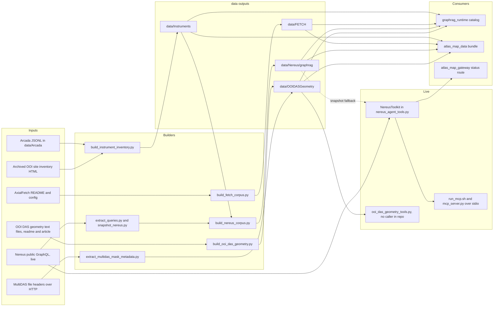

# Instrument, operations and DAS collections

chapter: corpus-instruments-ops · paths: src/instrument_inventory/ src/nereus_pipeline/ src/fetch_transponders/ src/ooi_das_geometry/ · as of 1047fc8

This chapter covers four source trees that build RCA Atlas's instrument-level and operational collections, and the live tools beside them. The Regional Cabled Array (RCA) is the cabled seafloor part of the Ocean Observatories Initiative (OOI), off the Oregon coast (`src/DATA_CORPUS_METHOD.md:9-10`; `src/ooi_das_geometry/build_ooi_das_geometry.py:206`). COSZO, the Cascadia Offshore Subduction Zone Observatory (`src/coszo_pdf_pipeline/build_coszo_pdf_graph.py:43`), is a second project whose own instrument suites sit at RCA's Oregon sites (`src/instrument_inventory/build_instrument_inventory.py:295-304`). `src/instrument_inventory/` merges these sources into one inventory of instrument records. `src/nereus_pipeline/` connects to Nereus, the RCA operational web system, through its public GraphQL API: an offline corpus of status, notes and telemetry, plus a stdio MCP (Model Context Protocol, a standard for serving tools to agents) server with ten live tools. `src/fetch_transponders/` indexes the three acoustic transponders of the FETCH network (an acoustic seafloor geodetic array on Axial Seamount, a submarine volcano). `src/ooi_das_geometry/` publishes the channel geometry of the RCA fiber-optic distributed acoustic sensing (DAS) cables and reads the saved-interval masks in the file headers of MultiDAS (Nokia's multi-span DAS system) recordings from the 2025-26 deployment, which the repository calls DAS25. The problem these solve: a question such as "which instruments are on Southern Hydrate Ridge, and are they working now?" needs a source-backed list with evidence, and current status needs a live answer with a timestamp, not a static file. The outputs go to `data/` and feed the Graph-RAG catalog (retrieval over a graph of entities and text chunks; [graphrag-runtime](graphrag-runtime.md)) and the map data bundle ([atlas-map-data](atlas-map-data.md)). The Nereus toolkit is also imported in-process by the map gateway ([atlas-map-gateway](atlas-map-gateway.md)).

## At a glance

| Aspect | Detail |
|---|---|
| Kind | Scripts. Three offline builders (instrument inventory, FETCH, DAS geometry), one Nereus corpus pipeline, one stdio MCP server (`rcn-agent-nereus`, ten tools) and one lookup library (DAS geometry tools). Nothing here is a web service or an HTTP route. |
| Stack | Python 3 standard library, except `msgpack` for MultiDAS headers (`src/ooi_das_geometry/extract_multidas_mask_metadata.py:27`), which the project does not declare (`pixi.toml:6-7`). The MCP launcher is a POSIX shell script (`src/nereus_pipeline/run_mcp.sh:1`). Outputs are JSONL (one JSON object per line) with JSON manifests. |
| Entry points | `src/nereus_pipeline/run_mcp.sh` (MCP over stdio). The command-line builders listed under Interfaces. The `build()` functions, which tests import. |
| Reads | `data/Arcada/documents.jsonl` and `chunks.jsonl`, the RCA Information catalog, produced by [corpus-docs-web](corpus-docs-web.md) (`src/instrument_inventory/build_instrument_inventory.py:196-197`). Archived OOI site inventories, `source_material/original_documents/OOISiteInventory/RS*.html`, kept under `source_material/`, which is packed into the transfer release (`scripts/build_transfer_release.sh:33`; see [repo-ops-data](repo-ops-data.md)). No tracked script writes these files (Open questions) (`build_instrument_inventory.py:57, 86`). The AxialFetch README and `config.py` under `source_material/original_documents/AxialFetch/` (`src/fetch_transponders/build_fetch_corpus.py:21-22, 61-64`). The OOI DAS geometry text files, `readme.pdf` and the DAS25 article under `source_material/original_documents/` (`src/ooi_das_geometry/build_ooi_das_geometry.py:26, 119, 143, 180-183`). Public MultiDAS file headers over HTTP (`extract_multidas_mask_metadata.py:52-62`). Nereus public GraphQL at `https://nereus.ooirsn.uw.edu/hasura/v1/graphql`, live (`src/nereus_pipeline/nereus_agent_tools.py:23, 73`). Offline snapshots in the directory named by `NEREUS_SNAPSHOT_DIR` (`src/nereus_pipeline/run_mcp.sh:6`). `data/Instruments/instruments.jsonl`, this chapter's output, for the Nereus crosswalk (`src/nereus_pipeline/README.md:32`; `build_nereus_corpus.py:95-100`). COSZO and PI facts are typed in as literals with evidence IDs that point to the Websites, workbook and PDF collections. The builder does not open those files (`build_instrument_inventory.py:89-172, 295-526`; only the reads at lines 57-58, 77 and 196-197 touch disk). |
| Writes or serves | `data/Instruments/` (instrument, chunk, entity, relationship, type and infrastructure files). Consumers: [graphrag-runtime](graphrag-runtime.md) (`src/graphrag_runtime/discover_corpora.py:33`), [atlas-map-data](atlas-map-data.md) (`src/atlas_map_data/build_atlas_bundle.py:43`), [agentic-qaqc](agentic-qaqc.md) (`src/agentic_qaqc/qaqc_agent_tools.py:262-264`), [literature-fulltext](literature-fulltext.md) (`src/literature_fulltext/build_candidate_graph.py:25`), [coszo-hub-sources](coszo-hub-sources.md) (`src/coszo_hub_tools/ooi_m2m_agent_tools.py:99`). `data/FETCH/`. Consumers: graphrag-runtime (`discover_corpora.py:32`), atlas-map-data (`build_atlas_bundle.py:45`). `data/Nereus/graphrag/` (corpus files, `tool_manifest.json`, snapshots). Consumers: graphrag-runtime (`discover_corpora.py:35`), atlas-map-data (`build_atlas_bundle.py:50`). The Nereus toolkit, served live over MCP and imported in-process by [atlas-map-gateway](atlas-map-gateway.md) (`src/atlas_map_gateway/toolkits.py:31`; `app.py:60-67`, route `/status/{refdes}`). `data/OOIDASGeometry/` (channel locations, chunks, `tools.jsonl`, and by convention the MultiDAS coverage file). Consumers: graphrag-runtime (`discover_corpora.py:36`), atlas-map-data (`src/atlas_map_data/das.py:61, 76`). The DAS lookup tools have no caller in the repository outside tests. |

## How it works

Four pipelines run offline, and one toolkit runs live. They share two conventions. Most records are marked `source_is_untrusted_data: true`, and each of the four corpus builders writes JSONL files plus a `manifest.json` into its output directory, naming the node, edge and embedding inputs.

### 1. Instrument inventory (`src/instrument_inventory/build_instrument_inventory.py`)

1. Archived OOI site inventories are parsed for make and model. A row is used only when its full reference designator appears in a cached page (`build_instrument_inventory.py:49-79`, docstring at `:52-54`).
2. Arcada instrument documents become `catalogued_instance` records, each with its Arcada document ID and the hardware from step 1 (`:209-292`, hardware override at `:275-280`). PREST records (the OOI tidal seafloor pressure class) are reclassified as absolute pressure gauges with Sea-Bird SBE 54 defaults, and the official site inventory overrides those defaults (`:261-280`).
3. COSZO records are typed in as literals: four sites (CZMID, CZOFF, CZOSH, CZSHF) times five instrument types (COBSO broadband seismometer package, DPG differential pressure gauge, HYDLF low-frequency hydrophone, APG absolute pressure gauge, VEL3D three-dimensional current meter), plus three GSSM (Geodetic and Seismic Sensor Module) packages and two SCPRs (Self-Calibrating Pressure Recorders), all `documented_project_instance` (`:295-412`). The Oregon Shelf (CZSHF) APG and current-meter records keep the four-unit workbook totals and are labelled as workbook-specified (`:355-358`).
4. Confirmed RCA PI instruments and time-bounded campaigns (the 2021 DAS/DTS community test and the 2014 DEMS deployment) are added by hand with their evidence (`:415-476`).
5. Reference-only identifiers that Arcada links but does not document stay as `reference_only` records with an unresolved status (`:479-503`). Deployment-site workbook assets go in as `deployment_site_reference` records (`:506-526`).
6. Entities and relationships are built (`:528-573`). Two taxonomy bridges were added so site traversal works: Southern Hydrate Ridge Summit is part of Southern Hydrate Ridge, and several instrument types are `IS_A` sensor or current-meter supertypes (`:548-568`).
7. One retrieval chunk per record is written (`:575-603`).
8. Outputs are written (`:611-680`). Science junction boxes go to `infrastructure.jsonl`, outside the instrument counts (`:663-680`). The validator checks unique IDs, relationship endpoints, chunk text, and evidence on every record. It hard-fails unless there are exactly 120 `catalogued_instance` and 25 `documented_project_instance` records (`:682-713`).

The method doc reports the current output as 168 instruments, four infrastructure records, 70 entities, 28 sources, 168 chunks and 1,037 relationships (`src/DATA_CORPUS_METHOD.md:364-365`). The 168 is the sum of the six record statuses: 120 + 25 + 3 + 2 + 11 + 7.

### 2. Nereus integration (`src/nereus_pipeline/`)

Three offline scripts refresh a corpus, and one live server answers questions.

1. `extract_queries.py` downloads the Nereus front-end bundle, finds the operations named in its tagged template literals, and writes eight `.graphql` documents plus `queries/metadata.json` (`src/nereus_pipeline/extract_queries.py:15-31`).
2. `snapshot_nereus.py` runs three of those operations (HelmQuery, ReportsPageQuery, EngineeringQuery) with caching off and writes sanitized JSON (`snapshot_nereus.py:9-18`).
3. `build_nereus_corpus.py` keeps only RCA designators (those starting `RS`), builds entities, observations, relationships, chunks, notes, telemetry and the crosswalk to the local instrument inventory, validates, and writes manifests (`build_nereus_corpus.py:29-114`). A failed validation still leaves the files on disk and exits with status 2 (`:105-114`).
4. At run time `run_mcp.sh` sets defaults for the environment and execs `mcp_server.py` (`run_mcp.sh:5-10`). The server reads one JSON-RPC message per stdin line and answers `initialize`, `tools/list` and `tools/call`. It ignores `notifications/*` (`mcp_server.py:15-27`).
5. Each `tools/call` goes through `dispatch` (`nereus_agent_tools.py:291-307`), which calls a `NereusToolkit` method. The HTTP call itself is made in `NereusToolkit.execute` (`:93-124`). `execute` returns a 60-second disk cache when it is fresh (`:70, 99-101`). Otherwise it POSTs the allowlisted operation to Nereus (`:102-116`) and redacts private network details (`:39-59, 113`). On an exception it falls back to a snapshot file, but only for HelmQuery, ReportsPageQuery and EngineeringQuery (`:86-91, 117-124`).



### 3. FETCH transponders (`src/fetch_transponders/build_fetch_corpus.py`)

The builder reads the archived AxialFetch README and `config.py`, not GitHub (`build_fetch_corpus.py:4-7, 61-64`). It checks that the README describes three ocean-bottom stations (`:65-66`) and parses `STATION_META` for coordinates and headings of stations 2502, 2503 and 2504 (`:45-57`). It writes three transponder records and six directed baselines (`:79-88, 119-160`). Module serial numbers and baseline lengths are literals in the script (`:79-88`), not values read from the archive. The output directory is deleted first (`:68-69`). The builder writes a note that no depth or manufacturer is asserted (`:135`) and a validation check for that (`:182`). The check does not affect `status`, and nothing raises on it. The test asserts it (`test_fetch_transponders.py:29`).

### 4. OOI DAS channel geometry and MultiDAS masks (`src/ooi_das_geometry/`)

1. `parse_locations` reads the north and south files, each row `channel latitude longitude depth`, and enforces integer channels, valid WGS84 coordinates (the standard latitude and longitude system) and increasing channel numbers (`build_ooi_das_geometry.py:56-93`).
2. `parse_locations` builds one record per OptaSense channel at 2 m spacing, marked preliminary (`:68-88`), and `build` writes them to `channel_locations.jsonl` (`:211`). It also writes source records with SHA-256 checksums, the DAS25 article chunk when the article file exists (`:180-203`), one figure record (`:204-210`), and `tools.jsonl` (`:218-223`).
3. `extract_multidas_mask_metadata.py` reads only the MessagePack header of each MultiDAS file, using at most the first 1 MiB and no HTTP Range header (`extract_multidas_mask_metadata.py:52-62`). It converts the `chunk_meta.masked` list into saved intervals (`:65-95`).
4. `OoiDasGeometryToolkit` answers three lookups from the JSONL files: a channel by cable and number, the nearest channel to a coordinate, and the saved spans of a cable (`ooi_das_geometry_tools.py:28-71`).

## Key files

| File | Role |
|---|---|
| `src/instrument_inventory/PIPELINE_README.md` | Purpose of the inventory, its six source distinctions, and where the runtime package belongs (`:3-16`). |
| `src/instrument_inventory/build_instrument_inventory.py` | The 751-line builder. Its `official_ooi_hardware` and `build` functions do all the work; no other module imports it. |
| `src/nereus_pipeline/README.md` | Integration overview: credential-free scope, data and runtime split, MCP launch, refresh commands (`:3-36`). |
| `src/nereus_pipeline/nereus_agent_tools.py` | Core module: redaction, the cache and snapshot logic in `NereusToolkit`, the ten `TOOL_SCHEMAS` and `dispatch` (`:23-307`). |
| `src/nereus_pipeline/mcp_server.py` | Stdio JSON-RPC loop with `initialize`, `tools/list` and `tools/call` (`:15-27`). |
| `src/nereus_pipeline/run_mcp.sh` | Launcher. Sets `NEREUS_QUERY_DIR`, `NEREUS_SNAPSHOT_DIR`, `NEREUS_CACHE_DIR` and `NEREUS_PYTHON` defaults, then execs the server (`:5-10`). |
| `src/nereus_pipeline/build_nereus_corpus.py` | Turns three snapshots into the Graph-RAG package, validates it, and writes `tool_manifest.json` and `manifest.json` (`:29-114`). |
| `src/nereus_pipeline/snapshot_nereus.py` | Captures HelmQuery, ReportsPageQuery and EngineeringQuery responses as sanitized JSON (`:9-18`). |
| `src/nereus_pipeline/extract_queries.py` | Re-extracts the allowlisted GraphQL documents from the Nereus front-end bundle (`:7-31`). |
| `src/nereus_pipeline/queries/AppLayoutQuery.graphql` | Banners and alert overrides, used only by the health check. |
| `src/nereus_pipeline/queries/HelmQuery.graphql` | All instruments and nodes, with status, monitoring flags and current or latest deployments. The query has no `where` filter, so the RCA scope is applied in code (`nereus_agent_tools.py:138-140`; `build_nereus_corpus.py:32-33`). The main inventory source. |
| `src/nereus_pipeline/queries/ReportsPageQuery.graphql` | Instruments, nodes, operational notes with linked instruments, and status statistics. Takes a cutoff date. |
| `src/nereus_pipeline/queries/EngineeringQuery.graphql` | Node engineering telemetry: board states, voltages, currents, temperatures, humidity, and ground-fault values. |
| `src/nereus_pipeline/queries/StatusHistoryChartInstrumentQuery.graphql`, `StatusHistoryChartNodeQuery.graphql` | Activity and operational status histories, parameterized by ID, days, interval and start time. |
| `src/nereus_pipeline/queries/PowerCurrentChartInstrumentQuery.graphql`, `PowerCurrentChartNodeQuery.graphql` | Power-current histories for an instrument or a node. |
| `src/nereus_pipeline/queries/metadata.json` | Skim only. Provenance of the query set: source and GraphQL URLs, frontend bundle URL and SHA-256, retrieval time, and the operation list (`:2-7`). |
| `src/nereus_pipeline/test_nereus_agent_tools.py` | Unit tests. They pin the tool count, 126 RCA instruments and 28 nodes from the snapshot, redaction, and the SVG plot as MCP image content (`:25-42`). They read `snapshots/` beside the test file, or else `data/Nereus/graphrag/snapshots` (`:21-23`). |
| `src/fetch_transponders/build_fetch_corpus.py` | The FETCH builder (204 lines). |
| `src/fetch_transponders/test_fetch_transponders.py` | Contract tests: three transponders, six directed ranges, no depth or manufacturer, and the non-generic-acoustic wording (`:19-37`). They need the archived AxialFetch snapshot. |
| `src/ooi_das_geometry/build_ooi_das_geometry.py` | Channel geometry, DAS25 article and figure, and `tools.jsonl` (245 lines). |
| `src/ooi_das_geometry/extract_multidas_mask_metadata.py` | Header-only MultiDAS reader and CLI (`:98-111`). |
| `src/ooi_das_geometry/ooi_das_geometry_tools.py` | `OoiDasGeometryToolkit`, the three `TOOL_SCHEMAS`, and `dispatch` (`:28-89`). |
| `src/ooi_das_geometry/test_build_ooi_das_geometry.py`, `test_extract_multidas_mask_metadata.py`, `test_ooi_das_geometry_tools.py` | Unit tests for the builder, the header parser, and the lookups. The builder and lookup tests use temporary files. The header test imports `msgpack`. |

## Interfaces

### Command-line builders

| Command | Flags and defaults | Code |
|---|---|---|
| `python3 src/instrument_inventory/build_instrument_inventory.py --data-root DIR --output DIR` | Both required. Reads `DIR/Arcada/`, and reads the OOI HTML from `DIR`'s parent under `source_material/`. Deletes `--output` first. | `build_instrument_inventory.py:746-751, 83-84, 86` |
| `python3 src/fetch_transponders/build_fetch_corpus.py [--source DIR] [--output DIR]` | Defaults `source_material/original_documents/AxialFetch` and `data/FETCH`. Deletes the output first. | `build_fetch_corpus.py:21-23, 68-69, 197-198` |
| `python3 src/nereus_pipeline/extract_queries.py --output-dir DIR [--base-url URL]` | Base URL defaults to `https://nereus.ooirsn.uw.edu`. | `extract_queries.py:14` |
| `python3 src/nereus_pipeline/snapshot_nereus.py --output-dir DIR [--cutoff ISO]` | Cutoff defaults to `2025-01-01T00:00:00Z`. Cache TTL is zero. | `snapshot_nereus.py:9, 11` |
| `python3 src/nereus_pipeline/build_nereus_corpus.py --snapshot-dir DIR --query-dir DIR --output-dir DIR [--instrument-inventory FILE]` | The first three are required. | `build_nereus_corpus.py:117` |
| `src/nereus_pipeline/run_mcp.sh` | No arguments. Starts the stdio MCP server. | `run_mcp.sh:1-10` |
| `python3 src/ooi_das_geometry/build_ooi_das_geometry.py [--source-dir DIR] [--output-dir DIR]` | Defaults `source_material/original_documents/OOI_DAS_Geometry` and `data/OOIDASGeometry`. Does not delete the output. | `build_ooi_das_geometry.py:237-238` |
| `python3 src/ooi_das_geometry/extract_multidas_mask_metadata.py --url URL [--url URL ...] --output FILE` | Both required. Writes one JSON line per URL. | `extract_multidas_mask_metadata.py:100-101, 105` |

### MCP tools (`rcn-agent-nereus`, ten tools)

The schemas are `TOOL_SCHEMAS` (`src/nereus_pipeline/nereus_agent_tools.py:277-288`). Every tool returns a JSON envelope with `ok`, and on failure `error.type` and `error.message` (`:35-36`).

| Tool | Arguments | Behavior |
|---|---|---|
| `nereus_health` | none | Live AppLayoutQuery with forced refresh; no snapshot fallback (`:126-130`). |
| `nereus_inventory` | `include_non_rca` (default false), `force_refresh` | RCA instruments and nodes only unless `include_non_rca` (`:138-140`). |
| `nereus_instrument_status` | `designator` | Substring match on the designator, so partial strings can match several rows (`:156-162`). |
| `nereus_node_status` | `designator_or_site` | Substring match on designator or site (`:164-170`). |
| `nereus_operational_notes` | `query`, `cutoff` (default one year back), `limit` (default 100, clamped to 1-500) | Keeps only notes linked to an RCA instrument (`:172-190`). |
| `nereus_engineering_telemetry` | `node` | RCA nodes only, with network details excluded (`:192-203`). |
| `nereus_status_history` | `entity_type` (instrument or node), `designator`, `days` (1-3650), `interval` (MINUTE, HOUR, DAY, WEEK, MONTH), `started_at` | Resolves the entity through the inventory, then calls a StatusHistoryChart query (`:214-230`). |
| `nereus_power_history` | same as status history | Same, with PowerCurrentChart (`dispatch` at `:300`). |
| `nereus_plot_power_history` | same, plus `output_path` | Returns an SVG as MCP image content (`mimeType` `image/svg+xml`, `:261`). Writes the file when `output_path` is given (`:262-263`). |
| `nereus_question_context` | `question`, `limit` (default 20) | Bundles instrument, node, note and telemetry results. If the question has no designator, the whole question text is used as the identifier (`:266-274`). |

### DAS lookup tools (library only)

`TOOL_SCHEMAS` in `src/ooi_das_geometry/ooi_das_geometry_tools.py:74-78` names three tools: `ooi_das_channel_location` (cable and channel number), `ooi_das_nearest_channel` (cable, latitude, longitude), and `ooi_das_multidas_unmasked_spans` (cable). `dispatch` wraps any exception in an error envelope (`:81-89`). The same schemas are written into `data/OOIDASGeometry/tools.jsonl` with `requires_user_invocation_after_corpus_answer` set (`build_ooi_das_geometry.py:218-223`). No server in this repository registers them.

### Functions other code imports

- `NereusToolkit` (`src/nereus_pipeline/nereus_agent_tools.py:62`) is loaded by path (`src/atlas_map_gateway/toolkits.py:13-17`) and constructed at `toolkits.py:31`. The gateway calls `instrument_status` for `/status/{refdes}` (`src/atlas_map_gateway/app.py:60-67`).
- `_without_network_details` is imported by `build_nereus_corpus.py:7` and `snapshot_nereus.py:6`. `TOOL_SCHEMAS` is imported by `build_nereus_corpus.py:7`.
- `TOOL_SCHEMAS` from the DAS lookup module is imported by `build_ooi_das_geometry.py:22`.
- `OoiDasGeometryToolkit`, `dispatch`, `parse_locations`, `build` (both FETCH and DAS), `mask_record` and `parse_header` are imported only by the test files.

### Files produced

| Builder | Output directory | Files |
|---|---|---|
| Instrument inventory | `--output` (`data/Instruments` by the PIPELINE_README convention, `src/instrument_inventory/PIPELINE_README.md:16`) | `instruments.jsonl`, `chunks.jsonl`, `entities.jsonl`, `sources.jsonl`, `relationships.jsonl`, `instrument_types.jsonl`, `instrument_inventory.md`, `instrument_type_summary.md`, `infrastructure.jsonl`, `validation_report.json`, `manifest.json`, `README.md` (`build_instrument_inventory.py:611-742`). |
| FETCH | `data/FETCH` (`build_fetch_corpus.py:23`) | `instruments.jsonl`, `entities.jsonl`, `chunks.jsonl`, `sources.jsonl`, `relationships.jsonl`, `validation_report.json`, `manifest.json`, `README.md` (`:184-192`). |
| Nereus corpus | `--output-dir` (`data/Nereus/graphrag` by the README, `src/nereus_pipeline/README.md:33`) | `snapshots/helm.json`, `snapshots/reports.json`, `snapshots/engineering.json`, `sources.jsonl`, `entities.jsonl`, `observations.jsonl`, `relationships.jsonl`, `chunks.jsonl`, `operational_notes.jsonl`, `engineering_telemetry.jsonl`, `instrument_crosswalk.jsonl`, `validation_report.json`, `tool_manifest.json`, `manifest.json`, `README.md` (`build_nereus_corpus.py:91-113`). |
| Nereus snapshots | `--output-dir` (`snapshot_nereus.py:9-18`) | `helm.json`, `reports.json`, `engineering.json`. |
| Nereus queries | `--output-dir` (`extract_queries.py:14, 26-31`; the README uses `src/nereus_pipeline/queries`) | Eight `.graphql` files and `metadata.json`. |
| OOI DAS geometry | `data/OOIDASGeometry` (`build_ooi_das_geometry.py:238`) | `channel_locations.jsonl`, `sources.jsonl`, `entities.jsonl`, `chunks.jsonl`, `relationships.jsonl`, `figures.jsonl` (only if the article is present, `:216-217`), `tools.jsonl`, `manifest.json`. |
| MultiDAS coverage | `--output` of the extractor. By convention `data/OOIDASGeometry/multidas_unmasked_coverage.jsonl`, which the lookup and map code read (`ooi_das_geometry_tools.py:43`; `src/atlas_map_data/das.py:76`). No tracked file or document names the command that writes it. | One JSON line per URL (`extract_multidas_mask_metadata.py:103-105`). |

## Data shapes

### `data/Instruments/instruments.jsonl`

One row per record. Keys vary by record family: the base keys come from `add()` (`build_instrument_inventory.py:176-193`), and the optional keys come from its keyword arguments (`:282-291`).

| Field | Type | Meaning |
|---|---|---|
| `instrument_id` | string | `INSTRUMENT-` plus the first 18 hex characters of the SHA-256 of `canonical_id` (`:179`). |
| `canonical_id` | string | Stable key for the record, for example `COSZO-OO-CZMID-VEL3D` or `PI-DAS25` (`:180`). |
| `name`, `instrument_type`, `location` | string | Display name, normalized type and site label. |
| `projects` | string list | For example `["Regional Cabled Array", "COSZO"]`. |
| `record_status` | enum string | `catalogued_instance`, `documented_project_instance`, `confirmed_PI_instrument`, `time_bounded_campaign`, `reference_only` or `deployment_site_reference`. Labels at `:629-638`. |
| `deployment_state` | string | Free-text state as the source states it, for example `source_catalogue_state_not_normalized` (`:283`), `status_not_stated_in_workbook` (`:521`) or `specified_in_current_project_sources` (`:350`). It is not an operational status. |
| `evidence` | list of objects | Each has `source_id`, and optionally `record_id` and `locator` (`ev()` at `:36-42`). |
| `source_is_untrusted_data` | boolean | Always true (`:188`). |
| `site`, `node`, `station`, `network`, `instrument_code` | string or null | For Arcada records these are the document's site and node. For COSZO records `site` holds the primary node code and `node` the parent node code (`:365`). |
| `latitude`, `longitude`, `depth_m` | number or null | As published by the source (`:286`, `:366-367`). |
| `manufacturer`, `model`, `sensor_components` | string, string, list | Hardware. The official OOI site inventory overrides earlier defaults (`:275-280`). |
| `arcada_document_id`, `official_ooi_hardware_verified`, `official_ooi_instrument_class` | string, boolean, string | Arcada records only (`:288, 290-291`). |

### `chunks.jsonl`, `relationships.jsonl`, `entities.jsonl`

- `chunks.jsonl` (`:595-602`): `chunk_id` (`INSTRUMENT-CHUNK-` plus hash), `document_id` and `parent_id` (both the instrument ID), `position` (always 0), `title`, `text` (a fixed template of "Instrument:", "Canonical identifier:", "Type:", "Projects:", "Location:", "Status:", "Deployment state:", "Aliases:" and "Sensor components:" lines, `:580-585`, then conditional "Measurement roles:", "Manufacturer:", "Model:" and "Notes:" lines at `:587-594`), `word_count`, `canonical_id`, `instrument_type`, `projects`, `location`, `record_status`, `source_urls`, `source_is_untrusted_data`.
- `relationships.jsonl`: `source_id`, `predicate`, `target_id`, and for `SUPPORTED_BY` the evidence fields. Predicates are `HAS_TYPE` (`:537`), `PART_OF` (`:539`, and Summit to Ridge at `:556`), `LOCATED_AT` (`:543`), `SUPPORTED_BY` (`:545`), `IS_A` (`:563`, `:567`, `:572`) and `HAS_CHUNK` (`:603`). Duplicates are removed (`:609`).
- `entities.jsonl`: `entity_id` is `ENTITY-` plus 16 hex characters of the name's hash (`:20-21`). `type` is `observatory`, `project`, `instrument_type`, `location` or `instrument_supertype`, and `method` names how the entity was made (`:531-573`).
- `instrument_types.jsonl` (`:617-626`): `entity_id`, `name`, `record_count`, `counts_by_status`, and up to five `example_canonical_ids`.
- `infrastructure.jsonl` (`:664-680`): `infrastructure_id`, `name`, `type` (`science_junction_box`), `site`, `parent_node`, `location`, `projects`, `record_status` (`documented_project_infrastructure` or `existing_RCA_infrastructure_used_by_COSZO`), `source_id`, `source_record_id`.
- `validation_report.json` (`:706-710`): `status` is `"passed"` or `"failed"`, plus `errors` and `checks`.
- `manifest.json` (`:717-732`): `schema_version` `"1.0-graph"`, counts, `counts_by_status`, `counts_by_type`, input roles, and notes.

### FETCH: `data/FETCH/instruments.jsonl` and `relationships.jsonl`

- `instruments.jsonl` (`build_fetch_corpus.py:123-135`): three rows. `instrument_id` is `FETCH-TRANSPONDER-2502`, `-2503` or `-2504`, which is not hashed, unlike the inventory. Other fields: `canonical_id` (`FETCH-2502` and so on), `instrument_type` `acoustic_ranging_station`, `instrument_type_aliases`, `station` (Eastern, Western or Northern), `station_identifier`, `caldera_position`, `latitude`, `longitude`, `heading_degrees` (from the config), `module_serial_hex` (a literal), `projects` (`["FETCH", "Regional Cabled Array"]`), `record_status` `documented_project_instance`, `deployment_state` `status_not_stated_in_source_snapshot`, `measurement_roles` and `notes`. There is no `depth_m` or `manufacturer` key.
- `relationships.jsonl` (`:109-170`): predicates `DESCRIBES`, `HAS_STATION`, `HAS_TYPE`, `LOCATED_AT`, `SUPPORTED_BY`, `PRODUCES`, `RAW_DATA_AVAILABLE_AT`, `AVAILABLE_AT`, `RANGES_TO` (with `baseline_id`, `direction` and `nominal_length_km`), `CONNECTS` and `GENERATES`.
- `validation_report.json` (`:182`): `status` is `"pass"` or `"fail"`, with checks for three transponders, six baselines, endpoint resolution, and no unsupported depth or manufacturer.

### Nereus corpus files

- `sources.jsonl` (`build_nereus_corpus.py:36-39`): `source_id` (`NEREUS-SOURCE-WEB`, `NEREUS-SOURCE-GRAPHQL`), `url`, `retrieved_at`, and for GraphQL the bundle URL and SHA-256.
- `entities.jsonl` (`:46, 48, 55, 57, 71, 81`): IDs prefixed `NEREUS-SITE-`, `NEREUS-NODE-<site>-<designator>`, `NEREUS-INSTRUMENT-<refdes>`, `NEREUS-DEPLOYMENT-<id>`, `NEREUS-ASSET-<id>` and `NEREUS-NOTE-<id>`. `entity_type` is `site`, `infrastructure_node`, `instrument`, `deployment`, `asset` or `operational_note`.
- `observations.jsonl` (`:61, 66, 88`): `observation_id` (a hash), `entity_type` (`status_observation` or `engineering_telemetry`), `subject_id`, `status_type`, `observed_at`, and `values` or `value`.
- `relationships.jsonl` (`:42`): `relationship_id`, `source_id`, `predicate`, `target_id`, and `evidence` with `source_id` and `retrieved_at`. Predicates are `HAS_NODE`, `PARENT_OF`, `HAS_CURRENT_DEPLOYMENT`, `HAS_LATEST_DEPLOYMENT`, `USES_ASSET`, `HAS_STATUS_OBSERVATION`, `HAS_INSTRUMENT`, `HOSTS_INSTRUMENT`, `HAS_OPERATIONAL_NOTE` and `HAS_ENGINEERING_TELEMETRY` (`:48-88`).
- `chunks.jsonl` (`:44`): `chunk_id`, `document_id`, `parent_id`, `position`, `title`, `text`, `record_type` (`node`, `instrument`, `operational_note`, `engineering_telemetry` or `deployment`), `retrieved_at`, `source_url`, `source_is_untrusted_data`.
- `instrument_crosswalk.jsonl` (`:98-100`): `nereus_entity_id`, `reference_designator`, `instrument_graph_id`, `instrument_graph_canonical_id`, and `match_type`, which is `exact_reference_designator` or `not_present_in_current_instrument_graph`.
- `validation_report.json` (`:103-106`): `status` (`pass` or `fail`), `checks` (endpoints resolve, RCA scope is non-empty, and no private network addresses remain), `counts` and `problems`.
- `tool_manifest.json` (`:109`): `server`, `access` (`credentials_required` false), `environment` and `tools` (the ten `TOOL_SCHEMAS`).
- `manifest.json` (`:112`): `corpus_id` `RCA-NEREUS-GRAPHRAG`, `schema_version` `1.0.0`, `snapshot_time`, counts, `validation_status`, and a SHA-256 and record count for each file.
- Snapshot JSON (`snapshot_nereus.py:17`): `operation`, `variables`, `retrieved_at`, `source_url`, `source_is_untrusted_data` and `data`.
- Live envelope: `evidence_mode` is `live`, `live_cache` or `snapshot_fallback` (`nereus_agent_tools.py:101, 116, 123`). Several results also carry `network_details_excluded: true` (`:153, 203, 230`).
- `queries/metadata.json` (`:2-7`): `source_url`, `graphql_url`, `frontend_bundle_url`, `frontend_bundle_sha256`, `retrieved_at` (2026-09-19) and the `operations` list.

### DAS geometry files

- `channel_locations.jsonl` (`build_ooi_das_geometry.py:69-88`): `channel_id` (`OOI-RCA-OPTASENSE-NORTH-CHANNEL-00942`, the form in the test at `test_build_ooi_das_geometry.py:32`), `channel_number`, `cable` (`north` or `south`), `instrument_id` (the 2021 campaign ID, see Decisions), `instrument_key` (`PI-DAS-OPTASENSE-SILIXA`), `interrogator` (`OptaSense QuantX DAS`), `latitude` and `longitude` (WGS84), `depth_m` (as published; the test values are negative, which suggests negative means below sea level (inferred)), `channel_spacing_m` (2), `location_status` (`preliminary_published_channel_location`), `applicability` (states that the mapping is not a Silixa claim), the source URL, file name and SHA-256, `documented_campaign`, and `documented_data_dates`.
- `multidas_unmasked_coverage.jsonl` (`extract_multidas_mask_metadata.py:80-95`): `record_type` (`multidas_spatial_mask_coverage`), `source_url`, `retrieved_at_utc`, `format_magic`, `format_version`, `cable` (taken from the URL, `:85`), `sampling_rate_hz`, `channel_spacing_m`, `gauge_length_setting`, `stream_start_epoch_utc`, `saved_unmasked_intervals_m` (a list of `start_m`, `end_m` and `length_m`), `saved_unmasked_length_m`, `maximum_saved_distance_m`, `source_field_name` (`chunk_meta.masked`), `interpretation` and `caveat`.
- `figures.jsonl` (`:204-210`): title, caption, external `image_url`, `source_url`, `document_id`, `source_id` and `credit`.

## Configuration and secrets

| Name | Read at | Purpose | Default or required |
|---|---|---|---|
| `NEREUS_BASE_URL` | `src/nereus_pipeline/mcp_server.py:16` | Override of the Nereus origin. | Optional. Defaults to `https://nereus.ooirsn.uw.edu` (`nereus_agent_tools.py:23`). |
| `NEREUS_QUERY_DIR` | `run_mcp.sh:5`, `mcp_server.py:16` | Directory holding the allowlisted `.graphql` files. | Optional. The launcher defaults to `src/nereus_pipeline/queries`. |
| `NEREUS_SNAPSHOT_DIR` | `run_mcp.sh:6`, `mcp_server.py:16` | Directory holding `helm.json`, `reports.json` and `engineering.json` for offline fallback. | Optional. The launcher defaults to `data/Nereus/graphrag/snapshots`, which is absent from this checkout. |
| `NEREUS_CACHE_DIR` | `run_mcp.sh:7`, `mcp_server.py:16` | Disk cache for live responses. | Optional. Defaults to `${TMPDIR:-/tmp}/rcn-agent-nereus-cache` (`run_mcp.sh:7`; `nereus_agent_tools.py:75`). |
| `NEREUS_PYTHON` | `run_mcp.sh:8` | Interpreter used to run the server. | Optional. Defaults to `python3`. |
| `TMPDIR` | `run_mcp.sh:7` | Root for the default cache directory. | Optional. |

No other environment variable is read in this chapter. The Nereus integration is credential-free: it says so (`src/nereus_pipeline/README.md:3`), and the build writes `credentials_required: false` (`build_nereus_corpus.py:109`). Its live request sends only `Content-Type` and `User-Agent` headers, with no credential header (`nereus_agent_tools.py:105`). The MultiDAS fetch also sends only a `User-Agent` (`extract_multidas_mask_metadata.py:55`). The root `.env.example` lists no variables for these tools.

## Run and test

Start the live Nereus server from the project root (`src/nereus_pipeline/README.md:14-18`):

```sh
src/nereus_pipeline/run_mcp.sh
```

Refresh the Nereus corpus (`src/nereus_pipeline/README.md:24-34`):

```sh
python3 src/nereus_pipeline/extract_queries.py --output-dir src/nereus_pipeline/queries
python3 src/nereus_pipeline/snapshot_nereus.py --output-dir tmp/nereus-snapshots
python3 src/nereus_pipeline/build_nereus_corpus.py \
  --snapshot-dir tmp/nereus-snapshots \
  --query-dir src/nereus_pipeline/queries \
  --instrument-inventory data/Instruments/instruments.jsonl \
  --output-dir data/Nereus/graphrag
```

Rebuild the other collections. No README gives these commands. They follow from the argument parsers and defaults (inferred):

```sh
python3 src/instrument_inventory/build_instrument_inventory.py --data-root data --output data/Instruments
python3 src/fetch_transponders/build_fetch_corpus.py
python3 src/ooi_das_geometry/build_ooi_das_geometry.py
python3 src/ooi_das_geometry/extract_multidas_mask_metadata.py --url <public MultiDAS file URL> --output data/OOIDASGeometry/multidas_unmasked_coverage.jsonl
```

Tests. No command is documented. The test files import bare module names, so each directory must be on the path (inferred from `test_fetch_transponders.py:11`; `test_nereus_agent_tools.py:3-4`). Suggested form, run from the project root (inferred): `python3 -m unittest discover -s src/<directory>`.

- Nereus tests need a `snapshots/` directory beside the test file, or else `data/Nereus/graphrag/snapshots` (`test_nereus_agent_tools.py:21-23`). The data path is absent here.
- FETCH tests need `source_material/original_documents/AxialFetch` (`build_fetch_corpus.py:21-22`). It is absent here.
- The inventory has no test file. Its builder needs `data/Arcada/` (`build_instrument_inventory.py:196-197`), which is absent here.
- The DAS builder and lookup tests use temporary files and need no source material. The MultiDAS header test needs `msgpack`, which the project does not declare (`test_extract_multidas_mask_metadata.py:5`).

## Decisions and constraints

1. The Nereus integration uses only public, allowlisted, read-only GraphQL operations, needs no account, and does not scrape pages. The backend rejects arbitrary GraphQL (`src/nereus_pipeline/README.md:3, 24`).
2. Operational state, telemetry, notes and histories are queried live. The packaged snapshot is an offline fallback, and answers must carry timestamps because statuses change (`src/nereus_pipeline/README.md:7-8, 36`). The fallback applies only to three operations (`nereus_agent_tools.py:86-91`).
3. Private network fields and private IPv4 addresses are removed from live results, caches, snapshots and the corpus. The MCP schemas expose no override (`src/nereus_pipeline/README.md:9`; `nereus_agent_tools.py:141-143`; `test_nereus_agent_tools.py:33-34`). The sanitizer is recursive because operational-note prose can carry an address after the structured fields are removed (`src/DATA_CORPUS_METHOD.md:751-753`).
4. The inventory does not infer current operational status from a catalog entry. Catalog state is kept as the source states it (`src/instrument_inventory/PIPELINE_README.md:14`; `build_instrument_inventory.py:727`).
5. Science junction boxes are infrastructure and are excluded from instrument counts (`src/instrument_inventory/PIPELINE_README.md:14`; `build_instrument_inventory.py:663-680`).
6. COSZO's workbook totals are kept. The Oregon Shelf APG and current-meter records are labelled workbook-specified, because the website describes three new-node units (`src/instrument_inventory/PIPELINE_README.md:14`; `build_instrument_inventory.py:356-358, 729`).
7. Hardware enrichment uses only exact full-designator matches. Historical records that the site inventory does not list stay unresolved (`build_instrument_inventory.py:52-54`).
8. Campaign, reference-only and historical records carry their own status labels so that they are not counted as persistent deployments (`build_instrument_inventory.py:478`, `:730`). Commit `e6f241f` ("Classify PREST as absolute pressure gauges") set the PREST rule (`:258-274`).
9. FETCH records no depth or manufacturer, because the archived snapshot does not establish them (`src/DATA_CORPUS_METHOD.md:189-190`; `build_fetch_corpus.py:135, 182`). Raw time series stay in source material, and the graph-ready collection does not copy them (`build_fetch_corpus.py:4-7`; `:190`).
10. DAS channel positions apply to the OptaSense QuantX geometry only. They must not be applied to Silixa channels (`src/ooi_das_geometry/build_ooi_das_geometry.py:4-8, 81`; `src/atlas_map_data/das.py:70`).
11. PI-DAS25 is the shared inventory entity for the 2025-26 multi-span deployment. It must not be merged with the 2021 OptaSense and Silixa campaign (`build_ooi_das_geometry.py:32-35`).
12. A MultiDAS file's `chunk_meta.masked` list names intervals that were saved, not masked out. Distance outside those intervals is absent from the stream (`extract_multidas_mask_metadata.py:4-8, 91-93`). The header is read only, never the strain-rate array (`:4-8`).
13. Cross-collection instrument merging needs explicit evidence, not matching raw IDs. The graph layer forbids merging on raw ID match (`src/graphrag_runtime/FIELD_MAP.md:39-42`). Several IDs here are hashes that other builders reuse by value (see Gotchas).

## History

- `833c343` (2026-09-20), "Initialize RCA and COSZO Graph-RAG agent": the first inventory builder (612 lines) and the whole Nereus integration (README, builder, MCP server, tools, eight GraphQL documents, snapshot script) arrived in one commit.
- `29dca19` (2026-09-21), "Present Arcada corpus as RCA Information": a four-line README change. The internal collection ID `arcada` stays (`src/graphrag_runtime/discover_corpora.py:24-26`).
- `e6f241f` ("Classify PREST as absolute pressure gauges") and `b228658` ("Enrich OOI instrument hardware metadata"): PREST normalization, then parsing of the archived OOI site inventory with exact-designator matching (`build_instrument_inventory.py:49-79, 261-280`).
- `d92bac4` ("Enrich DAS interrogator hardware metadata"): adds the 2021 DAS experiment README and the UW Fiber Lab DAS 2025 documentation as sources, and the interrogator make, model and components for PI-DAS24, PI-DAS25 and the 2021 record (`build_instrument_inventory.py:246-257, 461-462`).
- `7f66a9c` ("Add OOI DAS channel geometry corpus builder") and `adb7e60` ("Ingest official OOI DAS25 article"): channel geometry, the DAS25 article chunk, and the figure record (`build_ooi_das_geometry.py:117-210`).
- `5771db7` ("Extract MultiDAS spatial mask metadata") and `4f3b9d6` ("Add DAS geometry lookup tools"): the header-only extractor, then the three lookups (`extract_multidas_mask_metadata.py`; `ooi_das_geometry_tools.py`).
- `de23f70` ("Validate rebuilt DAS corpus graph"): pre-seeds the two DAS `instrument_reference` entities so that the relationships to them resolve (`build_ooi_das_geometry.py:147-152`).
- `28ba439` (2026-09-24), "Add FETCH acoustic ranging corpus": the FETCH builder and its tests, and in the same commit the Summit-to-Ridge and sensor-supertype bridges in the inventory (`build_instrument_inventory.py:548-573`).

## Gotchas

- **Nereus fallback is partial.** Only HelmQuery, ReportsPageQuery and EngineeringQuery have snapshots (`nereus_agent_tools.py:86-91`). When Nereus is unreachable, `nereus_health`, the status and power histories and the plot tool return `nereus_unavailable` even if snapshot files exist (`:118-124`). The history tools resolve the entity through the inventory, which falls back to the HelmQuery snapshot when Nereus is down, so the entity can resolve while the history call fails (`:221, 227-228`).
- **A GraphQL error does not fall back.** `graphql_error` returns directly (`nereus_agent_tools.py:111-112`). The snapshot path runs only on exceptions (`:117`). A failed cache write also lands in that path (inferred), so a successful live call can be replaced by snapshot data.
- **Lookups are substring matches.** `instrument_status` and `node_status` match substrings (`:161, 169`), so a partial designator can return several rows. Check `total_matches`.
- **Every lookup refetches the inventory.** `instrument_status` and `node_status` call `inventory()` (`:157, 165`), `engineering_telemetry` does too (`:196`), and `history` resolves its entity through those two (`:221`). The 60-second cache limits the cost, but bursts refetch. `health()` always forces a refresh (`:127`).
- **Free-text questions find nothing.** `question_context` uses the whole question as the identifier when it finds no designator (`:269`). Operational-note matching is a substring test on the note's JSON (`:185-187`).
- **Notes are filtered twice.** Notes older than a year are excluded by default (`:173`), and notes not linked to an RCA instrument are dropped (`:177-182`).
- **Failed validation leaves files behind.** `build_nereus_corpus.py` writes all outputs, including `manifest.json` with `validation_status` `fail`, before exiting with status 2 (`:101-114`). Do not treat a directory as complete without reading `validation_report.json`.
- **Output directories are wiped or overwritten.** The inventory and FETCH builders delete their output first (`build_instrument_inventory.py:83-84`; `build_fetch_corpus.py:68-69`). The DAS and Nereus builders overwrite files in place, so stale files can remain (`build_ooi_das_geometry.py:124`; `build_nereus_corpus.py:29`).
- **Hard-coded counts.** The inventory fails unless the Arcada supply yields exactly 120 catalogued and 25 COSZO records (`build_instrument_inventory.py:693-696, 712-713`). Changing the upstream catalog therefore needs a code change.
- **Hash-derived IDs are a contract.** `instrument_id` is a hash of `canonical_id` (`:179`). The PI-portal builder hard-codes these values for ten records, including three DAS entries (`PI-DAS-OPTASENSE-SILIXA`, `PI-DAS24`, `PI-DAS25`; `src/coszo_hub_tools/build_pi_portal_graph.py:46-57`), and the DAS builder hard-codes two (`src/ooi_das_geometry/build_ooi_das_geometry.py:31-35`). Renaming a canonical ID would break those joins (inferred from the hashing). Hashing the canonical IDs confirms the joins: `INSTRUMENT-981a1c15a947d3b1a1` is the hash of `RCA-DAS-2021-COMMUNITY-TEST`, the 2021 campaign record, and `INSTRUMENT-8f08939e9167bac57c` is the hash of `PI-DAS25`.
- **The README overstates the inventory's inputs.** `PIPELINE_README.md:3` says the builder compiles the Websites, Literature, COSZO document, workbook and StationXML collections. The code reads only the Arcada JSONL files and the archived OOI HTML (`build_instrument_inventory.py:57-58, 196-197`). The other sources enter as literals with IDs that nothing checks.
- **The inventory's hardware defaults can silently go missing.** If `source_material/original_documents/OOISiteInventory` is absent, `glob` returns nothing and no error is raised (Python `Path.glob` behavior), so the enrichment is skipped silently. Manufacturer and model then keep their earlier values: null for most catalogued records, the SBE 54 default for PREST, and the hard-coded values for PI-DAS24 and PI-DAS25 (`build_instrument_inventory.py:57, 86, 247-248, 253-254, 261-280`).
- **Status vocabularies differ.** The inventory writes `"passed"` and `"failed"` (`:706`). FETCH and Nereus write `"pass"` and `"fail"` (`build_fetch_corpus.py:182`; `build_nereus_corpus.py:105`). Filter on the right value for each collection.
- **The DAS manifest reports a fixed pass.** `validation_status` is the constant `"pass"` (`build_ooi_das_geometry.py:229`). The builder runs no validation of its own. In the builder, commit `de23f70` only seeds the two entities (`:147-152`); the same commit's ID-normalization change is in `src/graphrag_runtime/normalize_corpus.py`. Check the data rather than the manifest.
- **The DAS article is optional and fails loudly when malformed.** If the article file is missing, the article chunk and figure are skipped silently (`build_ooi_das_geometry.py:180-184`). If the page wrapper markup changes, the build raises (`:99-101`).
- **Cable detection by file name.** The MultiDAS extractor sets `cable` only when the URL contains `_north_` or `_south_` (`extract_multidas_mask_metadata.py:85`). Otherwise the record has `cable: null`, and the lookup silently skips it (`ooi_das_geometry_tools.py:67`).
- **Mask metadata may be unapplied in a date window.** The record's own `caveat` says mask metadata was present but not necessarily applied from 2025-11-26 through 2025-12-02, so validate each file's array shape before treating it as masked (`extract_multidas_mask_metadata.py:93`).
- **Header read limit.** The extractor reads at most 1 MiB (`extract_multidas_mask_metadata.py:52`). A larger header would fail as truncated (`:40-42`) (inferred from the code).
- **Undeclared dependency.** `msgpack` is imported but not declared in `pixi.toml` (`pixi.toml:6-7`; `extract_multidas_mask_metadata.py:25-30`). Without it, the extractor raises `RuntimeError`.
- **Lookup tools need a manual step.** `multidas_unmasked_spans` fails with `FileNotFoundError` until the coverage file exists (`ooi_das_geometry_tools.py:43`). `dispatch` wraps the failure in an error envelope (`:86-89`).
- **Silent substitution in the query extractor.** Unknown `${fragment}` references are replaced by an empty string (`extract_queries.py:23`). A fragment that moved in a new bundle would give a shorter GraphQL document, which Nereus would then reject (inferred).
- **Tagged-template regex.** `extract_queries.py` finds operations by the minified tag name `je` (`:19`). A renamed tag would fail the run loudly (`:27-28`).
- **Plot output is SVG.** `nereus_plot_power_history` returns `image/svg+xml` (`nereus_agent_tools.py:261`). MCP image blocks are usually raster; whether a given client renders SVG is unverified.
- **The MCP server is minimal.** Batch requests are not supported, and an exception is returned with `id: null` (`mcp_server.py:19-27`).

## Glossary

| Term | Meaning |
|---|---|
| RCA | Regional Cabled Array, the cabled seafloor part of OOI off the Oregon coast (`src/DATA_CORPUS_METHOD.md:9-10`; `src/ooi_das_geometry/build_ooi_das_geometry.py:206`). |
| OOI | Ocean Observatories Initiative (`src/DATA_CORPUS_METHOD.md:9`). |
| COSZO | Cascadia Offshore Subduction Zone Observatory, a second project whose instrument suites sit at RCA's Oregon sites (`src/coszo_pdf_pipeline/build_coszo_pdf_graph.py:43`; `src/DATA_CORPUS_METHOD.md:9-10`). |
| Nereus | RCA's operational web system, hosted at `nereus.ooirsn.uw.edu`, with a public GraphQL API (`src/nereus_pipeline/README.md:3`). |
| Arcada | The pinned upstream catalog package. Presented to users as RCA Information (`src/graphrag_runtime/discover_corpora.py:24-26`). |
| PI | Principal investigator. "PI" records are instruments and experiments that appear on the RCA PI data portal (`src/instrument_inventory/build_instrument_inventory.py:414`; `src/DATA_CORPUS_METHOD.md:666`). |
| Reference designator (refdes) | OOI's address for a sensor, such as `RS01SLBS-MJ01A-12-VEL3DB101`: site, node, then a sensor number and instrument code. The pattern is at `nereus_agent_tools.py:25`. |
| Canonical ID | The stable key of an inventory record (`build_instrument_inventory.py:180`). |
| record_status | The inventory label for what kind of record a row is (`build_instrument_inventory.py:629-638`). |
| Graph-RAG | Retrieval-augmented generation over a graph of entities plus text chunks. The root README uses the term at `README.md:1-4`; the definition itself is general background. |
| Chunk | A text unit with an ID that is embedded for retrieval (`build_instrument_inventory.py:595-602`). |
| JSONL | JSON Lines: one JSON object per line (`build_instrument_inventory.py:24-29`). |
| GraphQL | A query language. Nereus exposes only allowlisted operations (`src/nereus_pipeline/README.md:24`). |
| Hasura | The GraphQL engine that serves Nereus, as the path `/hasura/v1/graphql` suggests (`nereus_agent_tools.py:73`). |
| MCP | Model Context Protocol. Tools served over stdio as JSON-RPC (`mcp_server.py:2, 20`). |
| Snapshot | A captured public response, kept as an offline fallback (`snapshot_nereus.py:2`). |
| evidence_mode | The provenance label on a live result: `live`, `live_cache` or `snapshot_fallback` (`nereus_agent_tools.py:101, 116, 123`). |
| FETCH | The Axial Seamount network of three acoustic ranging stations (transponders) that measure distances between one another (`build_fetch_corpus.py:2-7, 107`). |
| Transponder | In this context, a seafloor acoustic ranging station (`build_fetch_corpus.py:93`). |
| Baseline | A directed acoustic range between two FETCH stations (`build_fetch_corpus.py:152-160`). |
| Axial Seamount | An active submarine volcano on the Juan de Fuca Ridge (`src/axial_earthquakes/build_axial_corpus.py:153`). |
| DAS | Distributed acoustic sensing: a fiber-optic cable read as a line of channels at fixed spacing (the expansion appears at `src/atlas_map/src/test/fixtures/ask/das.json:1`). |
| DTS | Distributed temperature sensing, the same fiber technique applied to temperature. Domain background, not in the repository. |
| OptaSense, Silixa | Makers of DAS interrogators, the instruments that read the fiber (`build_instrument_inventory.py:461-462`). |
| MultiDAS | The Nokia multi-span DAS system of the 2025-26 deployment (`build_ooi_das_geometry.py:150`). |
| OptoDAS | An Alcatel Subsea Networks DAS interrogator, used on the south cable's first span (`build_instrument_inventory.py:247-249, 255`). |
| Channel | One position along a DAS cable, at 2 m spacing for the OptaSense geometry (`build_ooi_das_geometry.py:79`). |
| Saved interval | A distance range along a cable that a masked MultiDAS file stored (`extract_multidas_mask_metadata.py:4-8`). |
| Spatial mask | A file-specific restriction on which cable distances were saved (`extract_multidas_mask_metadata.py:4-8`). |
| OFDR | The leading tag of MultiDAS files, the magic string `OFDR1MAGIC` (`extract_multidas_mask_metadata.py:22`). The acronym is domain background (optical frequency-domain reflectometry); the repository does not expand it. |
| msgpack | A binary serialization format used for MultiDAS headers (`extract_multidas_mask_metadata.py:27`). |
| GMRT | Global Multi-Resolution Topography, the bathymetry source for DAS depth (`build_ooi_das_geometry.py:168`). Domain background. |
| WGS84 | The coordinate reference system for latitude and longitude (`build_ooi_das_geometry.py:78`). |
| PREST | OOI's tidal seafloor pressure class, an absolute pressure gauge (`build_instrument_inventory.py:112, 261-274`). |
| SCPR | Self-Calibrating Pressure Recorder (`build_instrument_inventory.py:396`). |
| APG | Absolute pressure gauge (`build_instrument_inventory.py:330-335`). |
| GSSM | Geodetic and Seismic Sensor Module, a COSZO package (`build_instrument_inventory.py:376`). |
| VEL3D | Three-dimensional current meter (`build_instrument_inventory.py:336-341`). |
| DPG | Deep-sea differential pressure gauge (`build_instrument_inventory.py:320-324`). |
| HYDLF | Low-frequency hydrophone (`build_instrument_inventory.py:325-329`). |
| COBSO | COBSO broadband seismometer and strong-motion package (`build_instrument_inventory.py:313-319`). |
| Science junction box | Infrastructure that carries science cables. Kept out of instrument counts (`src/instrument_inventory/PIPELINE_README.md:14`). |
| StationXML | The seismic station-metadata XML format (domain background), cited as evidence for COSZO channels (`build_instrument_inventory.py:310`). |
| Crosswalk | A file that joins Nereus reference designators to the local instrument graph (`src/nereus_pipeline/README.md:10`). |
| Workbook | The COSZO deployment spreadsheets, cited as evidence and not read by the code (`build_instrument_inventory.py:159-162`). |
| API | Application programming interface. Here, Nereus's public GraphQL endpoint and the tool calls that wrap it (`src/nereus_pipeline/README.md:3`). |
| CLI | Command-line interface: the `python3` builders listed under Interfaces. |
| CZMID, CZOFF, CZOSH, CZSHF | COSZO station codes for the Mid Slope, Offshore, Outer Shelf and Shelf sites (`build_instrument_inventory.py:295-304`). |
| DAS24 | The repository's name for the 2024 multiplexed RCA DAS experiment, an OptoDAS configuration (`build_instrument_inventory.py:246-250`). |
| DAS25 | The repository's name for the 2025-26 multi-span deployment, kept separate from the 2021 campaign (`build_ooi_das_geometry.py:32-35`). |
| DEMS | Diffuse Effluent Measurement System, a 2014 camera and temperature campaign system at ASHES (`build_instrument_inventory.py:467-476`). |
| HTML | HyperText Markup Language. The OOI site inventories are archived as HTML (`build_instrument_inventory.py:57-59`). |
| HTTP | Hypertext Transfer Protocol. Used for MultiDAS headers and the Nereus POST (`extract_multidas_mask_metadata.py:52-62`; `nereus_agent_tools.py:102-107`). |
| IPv4 | Internet Protocol version 4 address. The adapter redacts private, loopback, link-local and reserved literals (`nereus_agent_tools.py:27, 49-58`). |
| JSON | JavaScript Object Notation, the record format of every `.json` and `.jsonl` file here. |
| JSON-RPC | The JSON message format that the MCP server reads and writes over stdio (`mcp_server.py:17-27`). |
| MiB | Mebibyte, 2^20 bytes. The MultiDAS header reader stops after 1 MiB (`extract_multidas_mask_metadata.py:52`). |
| PDF | Portable Document Format. `readme.pdf` and the other DAS documentation are PDFs (`build_ooi_das_geometry.py:143`). |
| POSIX | The portable Unix shell standard. The MCP launcher is a `/bin/sh` script (`run_mcp.sh:1`). |
| RS | The two-letter prefix that starts every RCA reference designator (`nereus_agent_tools.py:25`). |
| SBE 54 | Sea-Bird Electronics SBE 54, the absolute pressure sensor that OOI names for PREST records (`build_instrument_inventory.py:268-270`). |
| SHA-256 | A 256-bit hash used for checksums and stable IDs (`build_ooi_das_geometry.py:38-43`). |
| stdio | Standard input and output, the transport the MCP server uses (`mcp_server.py:7, 17`). |
| SVG | Scalable Vector Graphics, an XML image format. The power plot is SVG (`nereus_agent_tools.py:261`). |
| TTL | Time to live: how long a cached response stays fresh (`cache_ttl_seconds`, `nereus_agent_tools.py:70`). |
| URL | Uniform Resource Locator. Source records keep URLs as provenance (`build_instrument_inventory.py:91`). |
| UW | University of Washington. Its Fiber Lab wrote the DAS 2025 documentation (`build_instrument_inventory.py:152-153`). |

## Open questions

- **Who writes the MultiDAS coverage file, and from which URLs?** The lookup tools and the map code read `multidas_unmasked_coverage.jsonl` (`src/ooi_das_geometry/ooi_das_geometry_tools.py:43`; `src/atlas_map_data/das.py:76`). No tracked file names the command that writes it. Answer: the maintainer's run record, or a release manifest in `data/`.
- **Is any agent actually served the DAS lookup tools?** `OoiDasGeometryToolkit` and `dispatch` have no caller outside tests. Answer: the agent configuration outside this repository, or a server entry that imports `ooi_das_geometry_tools.py`.
- **Which Nereus tool names does the evaluation set expect?** The Model Lab dataset expects `nereus_file_status` and `nereus_ping_status` (`src/model_eval/datasets/rca_eval_v1.jsonl:44-45`). The server defines neither (`nereus_agent_tools.py:277-288`). Answer: the owner of the evaluation set, who should map these to `nereus_instrument_status` or add the tools.
- **Does the live adapter cover MAC addresses and internal hostnames?** The method doc lists them among the excluded data (`src/DATA_CORPUS_METHOD.md:744-746`). The live adapter redacts private-network IPv4 literals in strings (public addresses pass through) and drops keys with a fixed list of names (`nereus_agent_tools.py:27-32, 49-58`). The data-maintenance sanitizer covers the built data (`src/data_maintenance/sanitize_sensitive_network_info.py:4-6`). Answer: run `audit_sensitive_network_info.py` on a live Nereus response that contains a MAC address or hostname in note text.
- **Where do the FETCH serial numbers and baseline lengths come from?** They are literals (`build_fetch_corpus.py:79-88`), and the builder parses only coordinates and headings from the config (`:45-57`). Answer: the archived AxialFetch README, which is absent from this checkout.
- **Are the COSZO Oregon Shelf APG and current-meter units deployed?** The records keep the workbook's four-unit totals (`build_instrument_inventory.py:356-358`). Answer: confirmation from the COSZO project.
- **Are the hard-coded PI and COSZO evidence IDs still valid?** The inventory cites page and chunk IDs such as `PAGE-2db48aa6813ce095-CHUNK-001` (`build_instrument_inventory.py:95-125`) without reading the collections. Answer: check each cited ID against `data/Websites/pages.jsonl` and the workbook.
- **How is `msgpack` provisioned?** It is not declared in `pixi.toml` or any requirements file (`pixi.toml:6-7`). Answer: the maintainers' environment, or a dependency entry in `pixi.toml`.
- **Does an MCP client render the SVG from `nereus_plot_power_history`?** The tool returns `image/svg+xml` (`nereus_agent_tools.py:261`). Answer: a test call from the client in use.
- **Who captured the archived OOI site-inventory HTML, and when?** `build_instrument_inventory.py` reads `source_material/original_documents/OOISiteInventory/RS*.html` (`:57, 86`). `scripts/build_transfer_release.sh:33` packs `source_material/` into a release archive, but no tracked script writes these HTML files. Answer: the release manifest or the capture record for the `source_material/` archive.

## Candidate project memory

- **decision** · Nereus status is queried live · Operational state, telemetry, notes and histories come from live allowlisted queries. The packaged snapshot is an offline fallback, and answers must carry timestamps · `src/nereus_pipeline/README.md:7-8, 36`
- **requirement** · No network details leave the Nereus adapter · Private network fields and private addresses are removed from live results, caches, snapshots and the corpus, and no MCP switch overrides this · `src/nereus_pipeline/README.md:9`; `src/DATA_CORPUS_METHOD.md:751-753`
- **decision** · Catalog state is not promoted to operational status · The inventory keeps the source's status wording and infers nothing about current operation. Junction boxes stay out of instrument totals · `src/instrument_inventory/PIPELINE_README.md:14`
- **decision** · COSZO workbook totals are kept as workbook-specified · The Oregon Shelf APG and current-meter records keep the four-unit workbook totals, because the website describes three new-node units · `src/instrument_inventory/PIPELINE_README.md:14`; `src/instrument_inventory/build_instrument_inventory.py:356-358`
- **decision** · FETCH records no depth or manufacturer · The archived snapshot does not establish either field, so the graph does not state them · `src/DATA_CORPUS_METHOD.md:189-190`

## Verification

Checked on 2026-10-09 against `1047fc8`.

- Claims checked: 407. Every `path` or `path:line` citation in the chapter as it stood before this pass (221 of them with line numbers) was opened or confirmed with `git grep`, and cross-repo citations were read in place. Identifiers, flags, env vars, routes, tool names, tables and commands were grepped but are not counted separately.
- Corrected: 17. These cover the FETCH "asserts" wording (three places), the inventory's "defaults" fallback, the history tools' lookup order, the Nereus request headers, the HelmQuery scope, the IPv4 redaction scope, the DAS record attribution, the `de23f70` scope, the PI-portal DAS count, the `deployment_state` examples, the test snapshot path, the Nereus output directory, the dispatch path, the manifest scope, the Graph-RAG citation, the chunk-text template and the `:261-274` range.
- Moved to Open questions: 1. The repo-ops-data attribution of the OOI site-inventory HTML; no tracked script writes those files.
- Added: 1 Gotcha (the mask-application caveat, `extract_multidas_mask_metadata.py:93`) and 22 Glossary rows for acronyms and units the body used without definition.
- Key files: all 27 tracked files under the four paths have a row. None were missing.
- History: all 11 commits named exist, with the stated subjects and dates. Their bullets match `git show --stat`, with the `de23f70` scope now qualified.
