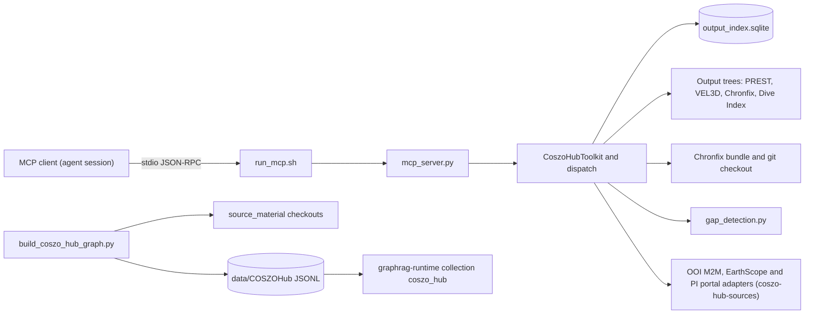

# COSZO Hub MCP server and core tools

chapter: coszo-hub-core · paths: `src/coszo_hub_tools/README.md` `src/coszo_hub_tools/mcp_server.py` `src/coszo_hub_tools/run_mcp.sh` `src/coszo_hub_tools/coszo_hub_agent_tools.py` `src/coszo_hub_tools/build_coszo_hub_graph.py` `src/coszo_hub_tools/chronfix_model.py` `src/coszo_hub_tools/gap_detection.py` `src/coszo_hub_tools/extract_das_hdf5_metadata.py` `src/coszo_hub_tools/test_coszo_hub_agent_tools.py` `src/coszo_hub_tools/test_extract_das_hdf5_metadata.py` · as of 1047fc8

This chapter covers the core of `src/coszo_hub_tools/` for the COSZO Hub. It has three parts: a stdio Model Context Protocol (MCP) server that answers questions about live instrument outputs; the Python toolkit behind it; and an offline builder that turns the same repositories into the static Graph-RAG snapshot `data/COSZOHub`. It also has three helpers: a gap-detector port for PREST pressure data, a clock-correction validator for Chronfix, and a DAS (distributed acoustic sensing) metadata extractor. COSZO Hub is the public `coszo-hub` GitHub organization. Its computational repositories run the PREST (absolute seafloor pressure), VEL3D (sea-water velocity), Chronfix (clock correction) and Dive Index (a wave-and-wind hindcast for remotely operated vehicle dive conditions) pipelines (`src/coszo_hub_tools/README.md:3-4`, `src/coszo_hub_tools/build_coszo_hub_graph.py:40-45`). Those pipelines keep writing files, but a Graph-RAG corpus (graph-based retrieval-augmented generation, where answers are grounded in a graph of entities and text chunks) is a frozen snapshot. The server therefore rescans the output directories at query time, so new files can be answered without a rebuild (`src/coszo_hub_tools/README.md:6-10`). In RCA Atlas the snapshot is the `coszo_hub` collection read by [graphrag-runtime](graphrag-runtime.md) (`src/graphrag_runtime/discover_corpora.py:29`). The same server also exposes three live source adapters for the Ocean Observatories Initiative (OOI) machine-to-machine (M2M) API, EarthScope FDSN web services and the UW (University of Washington) portal for Regional Cabled Array (RCA) principal-investigator (PI) data. Those adapters are documented in [coszo-hub-sources](coszo-hub-sources.md). Nothing here serves HTTP. The only other code that loads this directory is the atlas map gateway, and it loads two source adapters, not this chapter's modules (`src/atlas_map_gateway/toolkits.py:33-34`).

## At a glance

| Item | Detail |
|---|---|
| Kind | MCP server (stdio, JSON-RPC 2.0) with a Python toolkit, plus two offline command-line tools: a snapshot builder and a DAS metadata extractor (`src/coszo_hub_tools/mcp_server.py:1-13`, `src/coszo_hub_tools/build_coszo_hub_graph.py:1-7`, `src/coszo_hub_tools/extract_das_hdf5_metadata.py:1-12`). |
| Stack | Python standard library (`sqlite3`, `csv`, `json`, `subprocess`, `hashlib`). `numpy` is needed only on the Chronfix path (`src/coszo_hub_tools/coszo_hub_agent_tools.py:544-545`), and `pixi.toml` does not declare it (`pixi.toml:6-7`). External commands: `git` (`src/coszo_hub_tools/coszo_hub_agent_tools.py:508`), `pdftoppm` from Poppler (`src/coszo_hub_tools/coszo_hub_agent_tools.py:777`), and `h5dump` from the HDF5 tools (`src/coszo_hub_tools/extract_das_hdf5_metadata.py:37-38`). No MCP SDK is imported (`src/coszo_hub_tools/mcp_server.py:1-13`). |
| Entry points | `src/coszo_hub_tools/run_mcp.sh` starts the server. `src/coszo_hub_tools/build_coszo_hub_graph.py --repository-root DIR --output-dir DIR` builds the snapshot. `src/coszo_hub_tools/extract_das_hdf5_metadata.py INPUT --output FILE [--source-url URL]` extracts DAS metadata. Python callers use `CoszoHubToolkit`, `TOOL_SCHEMAS` and `dispatch` from `coszo_hub_agent_tools.py`. |
| Reads | (1) Four output trees produced by the upstream COSZO Hub pipelines: PREST, VEL3D, the HYS14 Chronfix correction directory, and Dive Index. By default they sit under the git-ignored checkouts in item (2); each can be overridden with a `COSZO_*_OUTPUT_ROOT` variable (`src/coszo_hub_tools/coszo_hub_agent_tools.py:49-75`, `:239-242`). (2) Local git checkouts under `source_material/repositories/coszo-hub/`, a release asset (`.gitignore:28`; see [repo-ops-data](repo-ops-data.md)). (3) The Chronfix bundle: `hour_times.npy`, `delta_t_hourly_clean.npy` and `trigger_periods.csv` (`src/coszo_hub_tools/coszo_hub_agent_tools.py:547`). (4) Constants and toolkits from the three live source adapters, documented in [coszo-hub-sources](coszo-hub-sources.md) (`src/coszo_hub_tools/coszo_hub_agent_tools.py:32-46`). (5) For the DAS extractor, one raw OptoDAS-style HDF5 file that the operator supplies from outside `data/` (`src/coszo_hub_tools/extract_das_hdf5_metadata.py:4-11`). |
| Writes or serves | (1) MCP results on stdout, read by the MCP client that launched the server, usually an agent session (`src/coszo_hub_tools/mcp_server.py:11-22`). (2) Derived local state: `runtime_data/COSZOHub/output_index.sqlite`, table `files`, and `runtime_data/COSZOHub/cache/dive-index-pages/` (`src/coszo_hub_tools/coszo_hub_agent_tools.py:243`, `:779`). (3) The `data/COSZOHub/` snapshot (JSONL, figures, README, manifest). [graphrag-runtime](graphrag-runtime.md) reads it as collection `coszo_hub` (`src/coszo_hub_tools/build_coszo_hub_graph.py:321-397`, `src/graphrag_runtime/discover_corpora.py:29`). The question sets in [eval-experiments](eval-experiments.md) name this collection (`src/model_eval/datasets/rca_eval_v1.jsonl:31-35`). (4) A DAS metadata JSONL at an operator-chosen path; the README example is under `data/PIPortal/` (`src/coszo_hub_tools/extract_das_hdf5_metadata.py:131`, `src/coszo_hub_tools/README.md:162-165`). No reader of this file exists in the repository. |



## How it works

1. **Startup.** `run_mcp.sh` chooses the interpreter: `COSZO_PYTHON` if it is set, otherwise a hard-coded path if that file exists and is executable, otherwise `python3`. It sets `PYTHONDONTWRITEBYTECODE=1` and replaces itself with `mcp_server.py` (`src/coszo_hub_tools/run_mcp.sh:3-12`). `main()` builds one `CoszoHubToolkit` from `COSZO_HUB_REPOSITORY_ROOT`, `COSZO_HUB_INDEX_PATH` and `COSZO_HUB_CACHE_DIR` (`src/coszo_hub_tools/mcp_server.py:25-30`). The constructor resolves the four output roots, the index and cache paths, the Chronfix refresh interval and the three source toolkits, then creates the `files` table (`src/coszo_hub_tools/coszo_hub_agent_tools.py:217-263`).
2. **Protocol.** The server reads one JSON object per stdin line. `initialize` answers with protocol version `2025-06-18` and server name `rcn-agent-coszo-hub` (`src/coszo_hub_tools/mcp_server.py:35-36`). `tools/list` returns `TOOL_SCHEMAS` (`:37-38`). `tools/call` runs `dispatch` and wraps the result with `tool_result`, which sets `isError` when `ok` is false and turns an `_mcp_image` payload into an image content block (`:39-41`, `:16-22`). Notifications are ignored. Other methods get error -32601 (`:42-46`). Each response is one line on stdout (`:11-13`).
3. **Routing.** `dispatch` sends names that start with `pi_portal_`, `earthscope_` or `ooi_m2m_` to the source adapters. The other 19 names go to a table of lambdas. Any exception becomes `{"ok": false, "error": {...}}` (`src/coszo_hub_tools/coszo_hub_agent_tools.py:859-892`).
4. **Index refresh.** Five tools call `scan()` before they answer: `coszo_output_status` and `coszo_list_outputs` (default `rescan=true`, `src/coszo_hub_tools/coszo_hub_agent_tools.py:305-307`, `:322-323`), `coszo_find_diagnostic_figure` (always, `:406`), `coszo_question_context` (through `list_outputs`), and `coszo_sync_repository` (after its pull, `:811`). The metric tools read the CSV files directly and never use the index (`:417-441`). `scan` walks each root recursively, skipping `.git` and `.DS_Store` (`:265-268`). For each file it derives the station, observation date and kind (`:282-297`). It upserts a row for every file without comparing modification times (`:288-297`), and it deletes rows that this scan did not see (`:299`). Queries then run against SQLite (`:316-338`).
5. **Single-file reads.** `_resolve` joins a relative path to the root and refuses any path that leaves it (`:340-349`). `read_output` returns CSV rows (at most 1,000) or text (at most 200,000 characters), and gives guidance for binary files (`:351-372`). `get_figure` returns a PNG or JPEG as image content (`:391-401`).
6. **Pressure and velocity metrics.** `metric_rows` reads every `*variability.csv` under the root, filters by station and date, and tags each row with its source path and commit (`:417-441`). `metric_summary` turns those rows into coverage, corrected-gap days, missing-sample counts and jitter flags (`:443-460`).
7. **Gap detection.** `detect_pressure_gaps` checks that there are between 2 and 2,000,000 timestamps and that the algorithm is valid, then calls `gap_detection.detect_gaps` (`:465-485`). Anomaly mode falls back to legacy below 100 samples (`src/coszo_hub_tools/gap_detection.py:125-126`).
8. **HYS14 clock correction.** HYS14 is an OOI ocean-bottom seismometer (OBS) at Hydrate Ridge, and its clock error is what the Chronfix model corrects (`src/coszo_hub_tools/coszo_hub_agent_tools.py:104-108`). `chronfix_model` first calls `refresh_hys14_correction` (`src/coszo_hub_tools/coszo_hub_agent_tools.py:546`, `:487-527`). If `COSZO_CHRONFIX_OUTPUT_ROOT` is set, the files are read in place. Otherwise, when the checkout is a git repository, it runs `git pull --ff-only`, at most once per refresh interval. It then reads the three bundle files, reads them again if their size or mtime changed during the read, and returns SHA-256 hashes and a combined fingerprint (`:547-565`). Query times are linearly interpolated over valid hours and set to NaN inside trigger intervals (`:592-604`). Corrected UTC is the apparent time minus delta_t (`:611`, `:615-616`). `hys14_correct_times` labels each time `corrected`, `trigger_interval` or `outside_model_or_missing` (`:627-668`). `hys14_clock_context` decides whether the correction applies. A supplied target instrument must be `OO.HYS14.OBS`. Without a target, the correction applies only when the question contains an affected-instrument keyword and no unaffected one (`:697-720`).
9. **Dive Index.** `compute_dive_index` multiplies significant wave height by 10 m wind speed in knots (`:754-767`). `dive_index_page` renders one page of the newest Dive Index PDF with `pdftoppm` into the cache (`:769-787`).
10. **Question routing.** `question_context` picks a repository, station and date range from keywords, then runs `list_outputs`, plus `metric_summary` for pressure or velocity and `hys14_clock_context` when the question names HYS14 (`:816-833`).
11. **Snapshot build (offline).** `build()` reads the four trees under `--repository-root` (`src/coszo_hub_tools/build_coszo_hub_graph.py:253-259`), writes the JSONL files, copies selected figures, renders every Dive Index page if `pdftoppm` is present, and writes the README and manifest (`:321-397`). The graph has repository, instrument, algorithm, service, credential and artifact-schema nodes (`:124-143`), one `AgentTool` node per tool schema (`:215-251`), and one `DataArtifact` per output file (`:271-279`).
12. **DAS metadata (offline).** `extract_file` calls `h5dump` for a few `/cableSpec` datasets and builds one record (`src/coszo_hub_tools/extract_das_hdf5_metadata.py:75-120`). `main()` writes it to the `--output` path (`:123-136`).

## Key files

| File | Role |
|---|---|
| `src/coszo_hub_tools/README.md` (190 lines) | Package guide. Lines 1-36 and 136-190 belong to this chapter: purpose, growing outputs, credential rules, HYS14 routing, DAS extraction, run and test, snapshot build. Lines 38-134 describe the three live source adapters and belong to [coszo-hub-sources](coszo-hub-sources.md). |
| `src/coszo_hub_tools/mcp_server.py` (53) | Stdio JSON-RPC loop: `initialize`, `tools/list`, `tools/call`. Builds the toolkit from `COSZO_HUB_*` variables. |
| `src/coszo_hub_tools/run_mcp.sh` (12) | Launcher. Chooses the interpreter, then `exec`s `mcp_server.py`. |
| `src/coszo_hub_tools/coszo_hub_agent_tools.py` (892) | The core. `CoszoHubToolkit`, the 19 COSZO tool schemas, `dispatch`, and the constants for repositories, stations, the Dive Index and the HYS14 target. Also appends and routes the source adapters' tools. |
| `src/coszo_hub_tools/build_coszo_hub_graph.py` (410) | Offline builder for the `data/COSZOHub` snapshot: JSONL graph, chunks, metrics, diagnostics, figures, README and manifest. |
| `src/coszo_hub_tools/chronfix_model.py` (177) | Standalone validator and interpolator for the Chronfix bundle, with stricter checks than the live path. Nothing in the repository imports it. |
| `src/coszo_hub_tools/gap_detection.py` (129) | Pure-Python port of the PREST legacy and anomaly gap detectors. |
| `src/coszo_hub_tools/extract_das_hdf5_metadata.py` (140) | CLI that extracts the `/cableSpec` metadata of one DAS HDF5 file into one JSON record. |
| `src/coszo_hub_tools/test_coszo_hub_agent_tools.py` (121) and `src/coszo_hub_tools/test_extract_das_hdf5_metadata.py` (49) | unittest suites for the toolkit and the extractor. Grouped because they sit in one directory. |

## Interfaces

Line numbers in this section refer to `src/coszo_hub_tools/coszo_hub_agent_tools.py` unless another path is given.

### Command-line entry points

- `src/coszo_hub_tools/run_mcp.sh` takes no arguments. It reads `COSZO_PYTHON` (`src/coszo_hub_tools/run_mcp.sh:4-5`).
- `python3 src/coszo_hub_tools/build_coszo_hub_graph.py --repository-root DIR --output-dir DIR`. Both flags are required. It prints the manifest as JSON (`src/coszo_hub_tools/build_coszo_hub_graph.py:401-406`).
- `python3 src/coszo_hub_tools/extract_das_hdf5_metadata.py INPUT --output PATH [--source-url URL]`. `--output` is required. It prints `das_spatial_metadata_id`, `sensor_count`, `sensor_distance_end_m`, `sensor_spacing_median_m` and `georeferenced_channel_positions` (`src/coszo_hub_tools/extract_das_hdf5_metadata.py:123-135`).

### MCP tools

The server handles `initialize`, `tools/list` and `tools/call` (`src/coszo_hub_tools/mcp_server.py:35-41`). It advertises 41 tools. The 19 below are defined at `src/coszo_hub_tools/coszo_hub_agent_tools.py:836-855`. The other 22 (10 OOI M2M, 6 EarthScope, 6 PI portal) are appended at `src/coszo_hub_tools/coszo_hub_agent_tools.py:856` and documented in [coszo-hub-sources](coszo-hub-sources.md). A dagger (†) marks a required argument.

| Tool | Arguments | What it does (lines) |
|---|---|---|
| `coszo_output_status` | `rescan` (true) | Counts, bytes and newest file per kind for each root (`:305-314`). |
| `coszo_list_outputs` | `repository`, `station`, `kind`, `start`, `end`, `include_non_rca` (false), `limit` (200, max 2,000), `newest_first` (true), `rescan` (true) | Filters the index (`:316-338`). |
| `coszo_read_output` | `repository`†, `relative_path`†, `limit` (200, max 1,000) | Reads a CSV or text file inside a root (`:351-372`). |
| `coszo_get_figure` | `repository`†, `relative_path`† | Returns a PNG or JPEG as image content (`:391-401`). |
| `coszo_find_diagnostic_figure` | `repository`† (pressure or velocity), `station`†, `day`† | Returns the first match in relative-path order (`:403-415`). |
| `coszo_metric_rows` | `repository`† (pressure or velocity), `station`, `start`, `end`, `gaps_only` (false), `has_data_only` (false), `limit` (500), `newest_first` (false) | Rows from every `*variability.csv` (`:417-441`). |
| `coszo_metric_summary` | `repository`† (pressure or velocity), `station`, `start`, `end` | Coverage and gap summary (`:443-460`). |
| `coszo_list_stations` | none | The static station lists (`:462-463`, `:77-87`). |
| `coszo_pressure_detect_gaps` | `timestamps_seconds`† (2 to 2,000,000), `nominal_sample_period_seconds`†, `algorithm` ("anomaly"), `request_duration_seconds` | Runs the gap detector (`:465-485`). |
| `coszo_refresh_hys14_correction` | `force` (false) | Fast-forward pull of the Chronfix checkout, or reports a mounted live directory (`:487-527`). |
| `coszo_chronfix_model` | `query_times` (at most 1,000), `refresh` (true), `force_refresh` (false) | Reads and fingerprints the bundle and interpolates delta_t (`:541-620`). |
| `coszo_hys14_correct_times` | `apparent_times`† (1 to 1,000), `target_instrument`† (`OO.HYS14.OBS`), `channel` (three characters) | Corrected UTC for each time, with a status (`:627-677`). |
| `coszo_hys14_clock_context` | `question`, `day`, `apparent_times`, `target_instrument`, `channel` | Routing context for HYS14 questions. Applies the correction only when the target or the question says so (`:679-749`). |
| `coszo_dive_index_config` | none | Formula, thresholds, sites and period (`:751-752`). |
| `coszo_compute_dive_index` | `significant_wave_height_m`†, `wind_speed_mps` or both `u10_mps` and `v10_mps` | Dive Index value and threshold flags (`:754-767`). |
| `coszo_dive_index_page` | `page` (1, range 1 to 200) | Renders a page of the newest Dive Index PDF (`:769-787`). |
| `coszo_collection_readiness` | `repository`† (pressure or velocity) | Reports whether the two OOI variables are set (booleans only, never values) and whether the upstream wrapper exists (`:789-797`). |
| `coszo_sync_repository` | `repository`† (one of the four) | `git pull --ff-only` on one checkout, then a rescan (`:799-814`). |
| `coszo_question_context` | `question`†, `limit` (100) | Routes a question to a repository, station, dates and summary (`:816-833`). |

**How this code reaches the source adapters.** `coszo_hub_agent_tools.py` imports the OOI M2M, EarthScope and PI portal modules at load time (`src/coszo_hub_tools/coszo_hub_agent_tools.py:32-46`), creates default instances of their toolkits in the constructor (`:234-236`), appends their schema lists to `TOOL_SCHEMAS` (`:856`), and routes calls by name prefix (`:860-865`). The builder imports their constants to create graph nodes and edges (`src/coszo_hub_tools/build_coszo_hub_graph.py:34-36`, `:152-186`). The adapters' internals are documented in [coszo-hub-sources](coszo-hub-sources.md).

### Python names

- `CoszoHubToolkit(repository_root, index_path, cache_dir, roots, ooi_m2m_toolkit, earthscope_toolkit, pi_portal_toolkit)` (`src/coszo_hub_tools/coszo_hub_agent_tools.py:217-226`). Its methods are the tool names without the `coszo_` prefix, for example `list_outputs` and `hys14_correct_times`. Two differ: `coszo_output_status` calls `status`, and `coszo_pressure_detect_gaps` calls `detect_pressure_gaps` (the mapping is at `:866-886`).
- `TOOL_SCHEMAS` and `dispatch(toolkit, name, arguments)` (`src/coszo_hub_tools/coszo_hub_agent_tools.py:836-892`).
- Constants `SUPPORTED_REPOSITORIES`, `PRESSURE_STATIONS`, `VELOCITY_STATIONS`, `DIVE_CONFIG` and `HYS14_CHRONFIX_TARGET` (`src/coszo_hub_tools/coszo_hub_agent_tools.py:49-114`). The builder imports `DIVE_CONFIG`, `PRESSURE_STATIONS`, `SUPPORTED_REPOSITORIES`, `TOOL_SCHEMAS` and `VELOCITY_STATIONS`, plus the private helpers `_coerce_scalar`, `_date_from_path`, `_kind` and `_station_from_path` (`src/coszo_hub_tools/build_coszo_hub_graph.py:23-33`).
- `gap_detection.detect_gaps(timestamps_seconds, nominal_sample_period_seconds, algorithm="anomaly", request_duration_seconds=None, max_samples=5_000_000)` returns a `GapResult` (`src/coszo_hub_tools/gap_detection.py:97-103`).
- `chronfix_model.load_correction_model`, `inspect_correction_model` and `ChronfixModel` (`src/coszo_hub_tools/chronfix_model.py:27-34`, `:96-106`, `:154-162`). Nothing in the repository imports them.
- `extract_das_hdf5_metadata.extract_file(path, source_url=None)` (`src/coszo_hub_tools/extract_das_hdf5_metadata.py:75`). Only its test imports it (`src/coszo_hub_tools/test_extract_das_hdf5_metadata.py:6`).
- No module outside `src/coszo_hub_tools/` imports this chapter's code.

### Files produced

- `runtime_data/COSZOHub/output_index.sqlite` (`src/coszo_hub_tools/coszo_hub_agent_tools.py:229`, `:248-263`).
- `runtime_data/COSZOHub/cache/dive-index-pages/<mtime_ns>-<page as three digits>.png` (`:230`, `:779`).
- `data/COSZOHub/` with `repositories.jsonl`, `tools.jsonl`, `entities.jsonl`, `relationships.jsonl`, `chunks.jsonl`, `metrics.jsonl`, `diagnostics.jsonl`, `figures.jsonl`, `README.md`, `manifest.json` and `figures/` (`src/coszo_hub_tools/build_coszo_hub_graph.py:321-397`).
- The DAS metadata JSONL at the path given to `--output` (`src/coszo_hub_tools/extract_das_hdf5_metadata.py:131`).

## Data shapes

The data snapshot and the source checkouts are absent from this checkout: `data/`, `runtime_data/` and `source_material/` hold only READMEs and a few tracked files. The shapes below therefore come from the code. The project method document gives the snapshot's record counts (`data/CORPUS_METHOD.md:571-576`); those were not re-checked here.

### Output index table `files`

Created at `src/coszo_hub_tools/coszo_hub_agent_tools.py:248-263`. It is derived state: `scan()` rebuilds it, so deleting it should be safe (inferred from the code).

| Field | Type | Meaning |
|---|---|---|
| `repository` | TEXT | A key of `SUPPORTED_REPOSITORIES` (`:50`). Part of the primary key. |
| `relative_path` | TEXT | Path under the repository's output root. Part of the primary key. |
| `absolute_path` | TEXT | Resolved path on disk. |
| `extension` | TEXT | Lower-cased suffix. |
| `kind` | TEXT | From `_kind()` (`:194-211`): for example `temporal_variability_table`, `timing_diagnostic_figure`, `figure`, `clock_correction_table`, `metrics_table`, `diagnostic_text`, `output_artifact`. |
| `station` | TEXT | Reference designator or site code found in the path, such as `RS01SUM1` (`:181-186`). |
| `observation_date` | TEXT | `YYYY-MM-DD` parsed from the path (`:189-191`). |
| `byte_size` | INTEGER | File size. |
| `mtime_ns` | INTEGER | Modification time in nanoseconds. Stored, but never compared on rescan. |
| `modified_at_utc` | TEXT | Modification time, ISO 8601 in UTC. |
| `in_scope` | INTEGER | 0 for non-RCA VEL3D files (`:286`). |
| `last_scan` | TEXT | Scan identifier. Rows not seen in the latest scan are deleted (`:299`). |

### Chronfix bundle (input)

Read in `src/coszo_hub_tools/coszo_hub_agent_tools.py:547-557`. The validating module `src/coszo_hub_tools/chronfix_model.py:116-151` checks more.

| File | Type | Meaning |
|---|---|---|
| `hour_times.npy` | 1-D NumPy datetime64 array | Hourly time axis, treated as UTC (`src/coszo_hub_tools/coszo_hub_agent_tools.py:594`). The validator requires a datetime64 dtype and strictly increasing values (`src/coszo_hub_tools/chronfix_model.py:124`, `:130-131`). |
| `delta_t_hourly_clean.npy` | 1-D numeric array of the same length | Clock error in seconds for each hour. Non-finite values mean no correction (`src/coszo_hub_tools/coszo_hub_agent_tools.py:577`). |
| `trigger_periods.csv` | CSV with `start_index` and `end_index` | Index pairs for clock-discontinuity intervals. The validator requires them to be sorted and non-overlapping (`src/coszo_hub_tools/chronfix_model.py:135-149`). |

### `coszo_chronfix_model` result

Built at `src/coszo_hub_tools/coszo_hub_agent_tools.py:578-617`.

| Field | Type | Meaning |
|---|---|---|
| `n_hours`, `n_valid`, `n_missing`, `n_trigger_periods` | int | Counts over the hourly axis and the trigger list. |
| `coverage_start`, `coverage_end` | string | First and last hour. |
| `delta_t_seconds_min`, `delta_t_seconds_max` | float | Range over valid hours. |
| `trigger_periods` | list (at most 200) | Trigger rows with `start_time_utc` and `end_time_utc` added. |
| `refresh` | object | The refresh outcome: mode, updated flag, commits, warning (`:503-525`). |
| `correction_files` | list | Per file: `name`, `path`, `byte_size`, `mtime_ns`, `modified_at_utc`, `sha256` (`:530-539`). |
| `bundle_fingerprint_sha256` | string | SHA-256 over the three file hashes (`:565`). |
| `source_commit` | string | Chronfix commit after refresh, or the pinned commit (`:587`). |
| `queries` | list | When query times are given: `apparent_time`, `delta_t_seconds`, `corrected_true_utc` and `correction` (`:614-616`). |

### `coszo_hys14_correct_times` rows

Each row is a query row plus `in_trigger_interval`, `status` (`corrected`, `trigger_interval` or `outside_model_or_missing`) and `action` (`src/coszo_hub_tools/coszo_hub_agent_tools.py:648-668`).

### Gap detector result

`GapResult` (`src/coszo_hub_tools/gap_detection.py:13-23`) has these fields: `sample_rate_hz`, `sample_period_seconds`, `gap_indices`, `segment_splits`, `is_full`, `n_gaps`, `n_segments`, `algorithm_requested` and `algorithm_used`, plus a `diagnostics` object. The legacy diagnostics are `multiplier`, `gap_threshold_seconds`, `expected_npts` and `gap_total_missing_estimate` (`:59-60`). The anomaly diagnostics are `dt_first_guess_seconds`, `n_ideal`, `true_missing`, `n_gaps_raw`, `fractional_residual_max_abs`, `jitter_unstable` (true when the maximum fractional residual exceeds 0.4) and `sigma_ms` (`:91-94`). The tool adds `ok`, `source_algorithm` and `source_commit` (`src/coszo_hub_tools/coszo_hub_agent_tools.py:481-482`).

### Snapshot JSONL (builder output)

Written by `src/coszo_hub_tools/build_coszo_hub_graph.py:321-328`. Common graph-record fields are `id`, `type`, `name`, `summary`, `source_url`, `repository`, `commit_sha`, `license`, `properties` and `tags` (`:70-78`). Edges have `id`, `type` ("edge"), `from`, `to`, `predicate`, `evidence_url`, `repository` and `commit_sha` (`:81-84`).

| File | Record shape |
|---|---|
| `repositories.jsonl` | Graph records of type `Repository`, one per repository (`:95-103`). |
| `tools.jsonl` | `AgentTool` records: `input_schema`, `runtime`, and flags `reads_growing_outputs`, `uses_live_ooi_m2m`, `uses_live_earthscope_fdsn`, `uses_live_pi_portal` (`:215-224`). |
| `entities.jsonl` | Graph records for instruments, algorithms, credentials, services, artifact schemas, streams, routing policy, software and authoritative sources, tools, and `DataArtifact` records (`:110-112`, `:124-143`, `:152-182`, `:271-277`). |
| `relationships.jsonl` | Edges, including `PRODUCES`, `CALLS`, `CORRECTS_CLOCK_OF` and `AUTO_APPLIES_TO_ALL_CHANNELS_OF` (`:188-213`, `:230-251`). |
| `chunks.jsonl` | `text_chunk` records: `id`, `type`, `title`, `text`, `entity_ids`, `repository`, `commit_sha`, `source_url` (`:101-103`, `:146-148`, `:226-228`); the tool chunks at `:226-228` have no `repository` or `commit_sha`. |
| `metrics.jsonl` | `MetricObservation` records: source artifact ID, relative path, `source_row`, commit, and every CSV column (`:286-288`). |
| `diagnostics.jsonl` | Artifact record plus `text` (at most 100,000 characters) and `parsed_fields` from `key: value` lines (`:289-295`). |
| `figures.jsonl` | Artifact records for PNG and JPEG files (`:296-297`). |
| `manifest.json` | Schema version, commits, counts, copied figures, runtime paths and PI portal counts (`:378-396`). |
| `figures/` | Copied PNGs: all Chronfix PNGs, VEL3D files with `fig*` and `summary` in the path, and every Dive Index report page (`:300-319`). |

### DAS metadata record

Built by `extract_file` (`src/coszo_hub_tools/extract_das_hdf5_metadata.py:100-120`).

| Field | Type | Meaning |
|---|---|---|
| `das_spatial_metadata_id` | string | `DAS-SPATIAL-` plus 18 hex digits of a hash over the resolved file path and the file's SHA-256 (`:70-72`, `:101`). Moving the file changes the ID. |
| `record_type` | string | Always `das_hdf5_spatial_metadata` (`src/coszo_hub_tools/extract_das_hdf5_metadata.py:102`). |
| `source_file`, `source_url` | string | Local path, and the URL the operator supplied. |
| `source_file_sha256`, `source_file_size_bytes` | string, int | File identity. |
| `metadata_path` | string | Always `/cableSpec`. |
| `cable_ids`, `cable_lengths_m` | lists | From `/cableSpec/cables` and `/cableSpec/cableLengths`. |
| `sensor_count`, `sensor_distance_start_m`, `sensor_distance_end_m`, `sensor_spacing_median_m` | int, float | Along-fiber distances from `/cableSpec/sensorDistances`. |
| `coordinate_system` | string | From `/cableSpec/positions/coordinateSystemName`. |
| `georeferenced_channel_positions` | bool | True only when every channel has a valid WGS84 position (`:86-92`). |
| `channel_locations` | list | `channel_index`, `distance_m`, `longitude`, `latitude`, `depth_m`. Empty unless georeferenced. |
| `caveats` | list | Explains when positions are absent (`:117-119`). |

### Tool results

Success returns `{"ok": true, ...}`. Failure returns `{"ok": false, "error": {"type": ..., "message": ...}}` (`src/coszo_hub_tools/coszo_hub_agent_tools.py:141-142`). The MCP wrapper puts the JSON in a text content block, adds an image block when present, and sets `isError` when `ok` is false (`src/coszo_hub_tools/mcp_server.py:16-22`).

## Configuration and secrets

Only the names and their reading sites are recorded here. No values are recorded.

| Name | Read at | Purpose | Default or required |
|---|---|---|---|
| `COSZO_HUB_REPOSITORY_ROOT` | `src/coszo_hub_tools/mcp_server.py:27`, `src/coszo_hub_tools/coszo_hub_agent_tools.py:228` | Directory of the four checkouts. The Chronfix refresh and the sync tool also use it. | Optional. Default `<repo>/source_material/repositories/coszo-hub`. |
| `COSZO_HUB_INDEX_PATH` | `src/coszo_hub_tools/mcp_server.py:28`, `src/coszo_hub_tools/coszo_hub_agent_tools.py:229` | SQLite index path. | Optional. Default `<repo>/runtime_data/COSZOHub/output_index.sqlite`. |
| `COSZO_HUB_CACHE_DIR` | `src/coszo_hub_tools/mcp_server.py:29`, `src/coszo_hub_tools/coszo_hub_agent_tools.py:230` | Cache for rendered Dive Index pages. | Optional. Default `<repo>/runtime_data/COSZOHub/cache`. |
| `COSZO_PRESSURE_OUTPUT_ROOT` | `src/coszo_hub_tools/coszo_hub_agent_tools.py:53`, `:240` | PREST output tree. | Optional. Default `<repository root>/absolute-seafloor-pressure/PREST-data-collection/output`. Listed in `.env.example:13`. |
| `COSZO_VELOCITY_OUTPUT_ROOT` | `src/coszo_hub_tools/coszo_hub_agent_tools.py:71`, `:240` | VEL3D output tree. | Optional. Default `<repository root>/sea-water-velocity/VEL3D-data-collection/output`. Listed in `.env.example:14`. |
| `COSZO_CHRONFIX_OUTPUT_ROOT` | `src/coszo_hub_tools/coszo_hub_agent_tools.py:59`, `:240`, `:490` | Directory holding the HYS14 Chronfix bundle. When set, the files are read in place and no `git pull` runs. | Optional. Default `<repository root>/chronfix/examples/HYS14`. Listed in `.env.example:15`. |
| `COSZO_DIVE_OUTPUT_ROOT` | `src/coszo_hub_tools/coszo_hub_agent_tools.py:65`, `:240` | Dive Index output tree. | Optional. Default `<repository root>/dive-index-hindcast`. Listed in `.env.example:16`. |
| `COSZO_CHRONFIX_REFRESH_TTL_SECONDS` | `src/coszo_hub_tools/coszo_hub_agent_tools.py:231` | Minimum seconds between Chronfix pulls. Negative values are clamped to 0. | Optional. Default 300. |
| `COSZO_PYTHON` | `src/coszo_hub_tools/run_mcp.sh:4-5` | Interpreter for the server. | Optional. When unset, a hard-coded path is used if it exists and is executable (`:6-7`), otherwise `python3` (`:9`). |
| `OOI_USERNAME`, `OOI_TOKEN` | `src/coszo_hub_tools/coszo_hub_agent_tools.py:795-796` (presence check only). Used by the OOI adapter in [coszo-hub-sources](coszo-hub-sources.md). | Credentials for live OOI M2M calls. Never returned or persisted (`data/CORPUS_METHOD.md:597-598`). | Required only for live OOI collection. Set in the environment of the process that launches `run_mcp.sh`. Names listed in `.env.example:11-12`. This code does not read `.env`. |

The adapter variables (`OOI_M2M_*`, EarthScope and PI portal limits) are documented in [coszo-hub-sources](coszo-hub-sources.md).

## Run and test

No command was run to write this chapter. The commands below are copied from the README and the configs.

```sh
# Start the MCP server over stdio (README.md:176). Set the COSZO_*_OUTPUT_ROOT variables first (README.md:21-26).
src/coszo_hub_tools/run_mcp.sh

# Tests, as written in README.md:177-181.
python3 -m unittest src/coszo_hub_tools/test_coszo_hub_agent_tools.py -v
python3 -m unittest src/coszo_hub_tools/test_ooi_m2m_agent_tools.py -v
python3 -m unittest src/coszo_hub_tools/test_earthscope_fdsn_agent_tools.py -v
python3 -m unittest src/coszo_hub_tools/test_pi_portal_agent_tools.py -v
PYTHONPATH=src/coszo_hub_tools python3 -m unittest src/coszo_hub_tools/test_extract_das_hdf5_metadata.py -v

# Rebuild the static snapshot after an intentional new snapshot (README.md:186-190).
python3 src/coszo_hub_tools/build_coszo_hub_graph.py \
  --repository-root source_material/repositories/coszo-hub \
  --output-dir data/COSZOHub

# Extract DAS metadata from one authorized file (README.md:161-166). Keep the raw file outside data/.
python3 src/coszo_hub_tools/extract_das_hdf5_metadata.py \
  /secure/raw/DAS25/example.hdf5 \
  --source-url http://piweb.ooirsn.uw.edu/das25/data/OptoDAS/.../example.hdf5 \
  --output data/PIPortal/das_spatial_metadata.jsonl
```

- The three `test_ooi`, `test_earthscope` and `test_pi_portal` lines belong to [coszo-hub-sources](coszo-hub-sources.md).
- Requirements: Python 3.9 or later (inferred from `str.removeprefix` at `src/coszo_hub_tools/build_coszo_hub_graph.py:158`). numpy for the Chronfix code and for `src/coszo_hub_tools/test_coszo_hub_agent_tools.py:11`. `git`, `pdftoppm` and `h5dump` when those features are used. No requirements file in `src/coszo_hub_tools/` lists these, and `pixi.toml:6-7` does not list numpy.
- The first test line may fail as written. `src/coszo_hub_tools/test_coszo_hub_agent_tools.py:13` imports `coszo_hub_agent_tools` by bare name, and `python3 -m unittest <path>` does not add the file's directory to `sys.path` (inferred; not run). The README sets `PYTHONPATH` for the DAS test only (`README.md:181`).

## Decisions and constraints

1. **Live rescan instead of corpus rebuilds for growing outputs.** The snapshot is static; the server rescans and indexes at query time (`src/coszo_hub_tools/README.md:6-10`). Source: README.
2. **Growing raw data never enters `data/`.** The index lives under `runtime_data/`, and the builder writes summaries, selected figures and metadata (`src/coszo_hub_tools/README.md:28-30`, `src/coszo_hub_tools/build_coszo_hub_graph.py:4-6`). Source: README and builder docstring.
3. **Credentials gate only live OOI collection.** Existing outputs, public Chronfix models and request planning need no credentials (`src/coszo_hub_tools/README.md:32-36`). `coszo_collection_readiness` reports whether the two variables are set, never their values (`src/coszo_hub_tools/coszo_hub_agent_tools.py:795-797`). Source: README.
4. **The website repository is excluded.** `coszo-hub.github.io` duplicates the COSZO website corpus (`src/coszo_hub_tools/README.md:12-13`, `src/coszo_hub_tools/build_coszo_hub_graph.py:381`, `data/CORPUS_METHOD.md:553-554`). Source: README and method document.
5. **The HYS14 clock correction is instrument-scoped.** One OBS clock, derived and validated on the 8 Hz vertical MHZ channel, applies to every channel on that clock. It never applies to PREST, VEL3D, other instruments or already-corrected UTC (`src/coszo_hub_tools/README.md:138-145`). The code keeps that rule fully only when a target instrument is passed (`src/coszo_hub_tools/coszo_hub_agent_tools.py:634`, `:699-700`); its scope warnings are at `:675-676` and `:713-714`. Without a target, a question with an affected-instrument word (for example `earthquake` or `obs`) and no PREST or VEL3D word applies the correction to any ISO timestamp in it (`:697-698`, `:717-720`; see Gotchas). Source: README and code text.
6. **Each correction call reports the model it used.** The bundle is re-read on each call, and its hashes and fingerprint are returned, so an answer can name the exact version (`src/coszo_hub_tools/README.md:147-153`, `src/coszo_hub_tools/coszo_hub_agent_tools.py:564-565`). Source: README.
7. **Query times inside a trigger window are not corrected, but that guarantee stops there.** Such times get NaN (`src/coszo_hub_tools/coszo_hub_agent_tools.py:599-604`) and status `trigger_interval`, with the advice to split or exclude the interval (`:662-664`, `:713`). Interpolation still runs over every finite hour (`:597-598`), so a query between the last finite hour before a window and the window's first hour can be interpolated across the window when the window's own hours are non-finite. A pure-Python replay of that logic on synthetic values gave 2.5 s for 02:30 with NaN at 03:00 to 05:00. The bundle is absent from this checkout (Open question 13). Source: code text.
8. **Upstream checkouts move only by fast-forward.** Both the refresh path and the sync tool use `git pull --ff-only` (`src/coszo_hub_tools/coszo_hub_agent_tools.py:509`, `:807`). Why: not stated (inferred: avoids merge commits in a source snapshot; confirm with the author).
9. **Non-RCA VEL3D stations are out of scope by default.** Station names beginning with `CE` are flagged out of scope (`src/coszo_hub_tools/coszo_hub_agent_tools.py:286`, `:312`). The builder says the default tools "retain the RCA Series B outputs" (`src/coszo_hub_tools/build_coszo_hub_graph.py:44`). "Series B" is not defined in these files.
10. **Agent-supplied paths and sizes are bounded.** Paths must stay inside a root (`src/coszo_hub_tools/coszo_hub_agent_tools.py:340-349`). Row, timestamp and text limits apply (`:332`, `:356`, `:368`, `:469`, `:593`, `:632`). Why: inferred (these tools are called by an agent).
11. **The gap detectors are a pure-Python port.** The docstring says the port is of the upstream PREST detectors and needs no filesystem, credential or network access. Anomaly mode falls back to legacy below 100 samples "as in the source pipeline" (`src/coszo_hub_tools/gap_detection.py:1`, `:104-107`, `:125-126`). Source: code docstring.
12. **DAS extraction reads metadata only.** It reads the small `/cableSpec` datasets, never the strain array, and records the file's SHA-256 and the operator's URL (`src/coszo_hub_tools/extract_das_hdf5_metadata.py:4-11`, `:101-105`). Source: code docstring and README (`src/coszo_hub_tools/README.md:168-171`).
13. **No invented geography.** A distance axis is not latitude or longitude. Per-channel WGS84 positions are kept only when every channel has one (`src/coszo_hub_tools/README.md:168-171`, `src/coszo_hub_tools/extract_das_hdf5_metadata.py:86-99`). Source: README.
14. **Repositories are pinned.** Each repository has a pinned commit and a license string in code (`src/coszo_hub_tools/coszo_hub_agent_tools.py:50-75`). The builder stamps those commits onto most records (`src/coszo_hub_tools/build_coszo_hub_graph.py:70-78`). Source: code.
15. **The MCP protocol is hand-written over stdio.** No SDK is imported (`src/coszo_hub_tools/mcp_server.py:1-13`). Why: inferred (no dependency).
16. **Dive Index parameters are code constants.** The formula, the thresholds 40 and 70, the four sites and the 2006 to 2025 period sit in `DIVE_CONFIG` (`src/coszo_hub_tools/coszo_hub_agent_tools.py:89-102`), and the builder reuses them (`src/coszo_hub_tools/build_coszo_hub_graph.py:116-119`). Why: not stated.

## History

- 2026-09-20, commit `833c343` by Maleen Kidiwela, "Initialize RCA and COSZO Graph-RAG agent": created all 17 files in `src/coszo_hub_tools/`, eight of this chapter's ten (the DAS extractor and its test came later, in `450519e`). The commit has no body.
- 2026-09-24, commit `450519e`, "Add DAS HDF5 spatial metadata extractor": added `extract_das_hdf5_metadata.py`, its test, and the README section on DAS25 metadata (`src/coszo_hub_tools/README.md:155-171`). The commit has no body.
- 2026-09-24, commit `d92bac4`, "Enrich DAS interrogator hardware metadata": touched two source-adapter files (`build_pi_portal_graph.py`, `test_pi_portal_graph.py`) and `src/instrument_inventory/build_instrument_inventory.py`, none of this chapter's files.
- Only two commits touch this chapter's ten paths, and neither message gives a reason for the HYS14 routing, the refresh rules or the scope rules. Their rationale lives in the README and in code comments (inferred from `git log`; confirm with the author).

## Gotchas

- **Five tools walk the output trees before answering.** `coszo_output_status` and `coszo_list_outputs` rescan by default and walk all four trees unless `repository` is given. `coszo_question_context` does so through `list_outputs`, `coszo_find_diagnostic_figure` always rescans its one repository, and `coszo_sync_repository` rescans the repository it pulled (`:811`). Each scan stats every file (`src/coszo_hub_tools/coszo_hub_agent_tools.py:282-298`, `:306-307`, `:322-323`, `:406`). The index has no modification-time check, so "incremental" means upsert plus deletion of vanished rows (`:299`), not skipping unchanged files. Cost grows with file count (inferred; not measured).
- **A missing root looks like an empty result.** A root that does not exist yields no rows, the rows are deleted, and the scan still returns `ok: true` (`src/coszo_hub_tools/coszo_hub_agent_tools.py:281`, `:299`, `:303`). `metric_rows` returns zero rows (`:424`). The sign is `exists: false` in the `coszo_output_status` result (`:313`); `coszo_list_outputs` shows nothing.
- **An empty `COSZO_HUB_REPOSITORY_ROOT` is not treated as unset.** `mcp_server.py` passes the empty string through (`src/coszo_hub_tools/mcp_server.py:27`), and `Path("")` is the current directory (`src/coszo_hub_tools/coszo_hub_agent_tools.py:228`). The same empty value reaches `COSZO_HUB_INDEX_PATH` and `COSZO_HUB_CACHE_DIR` (`:229-230`): the index path then names the current directory, which SQLite cannot open (inferred; not run), and the cache lands in the working directory. The output-root variables handle empty values correctly (`:240-241`).
- **Keyword routing uses substring matching.** `question_context` tests `rov` and `wave`, so "approved" and "waveform" route to the Dive Index (`src/coszo_hub_tools/coszo_hub_agent_tools.py:822`). `hys14_clock_context` tests `obs`, so "observed" counts as affected-instrument evidence (`:698`). With no target instrument, an ISO timestamp in such a question gets the correction applied (`:717-720`).
- **A Chronfix call can run `git pull`.** `coszo_chronfix_model` defaults to `refresh=true`, and `coszo_hys14_correct_times` has no switch and always refreshes (`src/coszo_hub_tools/coszo_hub_agent_tools.py:546`, `:643`). A refresh runs `git pull --ff-only` in the source checkout, with 20-second and 180-second timeouts, at most once per refresh interval (`:501-511`, `:231`). Setting `COSZO_CHRONFIX_OUTPUT_ROOT` skips the pull (`:490-494`).
- **One slow call blocks the server.** The stdin loop handles one line at a time (`src/coszo_hub_tools/mcp_server.py:31`). A 180-second pull (`src/coszo_hub_tools/coszo_hub_agent_tools.py:509`) or a 120-second `pdftoppm` render (`:783`) delays every other request.
- **Two protocol gaps.** `ping` is not handled and gets error -32601 (`src/coszo_hub_tools/mcp_server.py:44-46`). `initialize` always answers `2025-06-18` and never reads the client's requested version (`:36`).
- **Large files are read whole.** `get_figure` loads and base64-encodes any PNG or JPEG with no size limit (`src/coszo_hub_tools/coszo_hub_agent_tools.py:397-401`). `read_output` reads the whole file before cutting text at 200,000 characters (`:367-368`). `_artifact_meta` hashes files up to 20 MB (`:376`).
- **The nominal sample period is ignored.** `detect_gaps` validates `nominal_sample_period_seconds` (`src/coszo_hub_tools/gap_detection.py:119-120`), but both algorithms discard it (`:41`, `:64`) and estimate the period from the timestamps.
- **There are two Chronfix implementations.** `src/coszo_hub_tools/chronfix_model.py` rejects non-increasing hour arrays and overlapping triggers (`:130-131`, `:148-149`) and caps queries at 10,000 (`:167`). The live path does none of those checks and caps queries at 1,000 (`src/coszo_hub_tools/coszo_hub_agent_tools.py:593`). Nothing imports `chronfix_model.py` (see Open questions).
- **The builder and the live tools disagree in four places.** The builder hard-codes the Dive Index file name `RCA_DiveIndex_2006_2025.pdf` (`src/coszo_hub_tools/build_coszo_hub_graph.py:313`), while the live page tool renders the newest PDF (`src/coszo_hub_tools/coszo_hub_agent_tools.py:773-776`). The builder skips Dive pages without a warning when `pdftoppm` is missing (`src/coszo_hub_tools/build_coszo_hub_graph.py:314`). The builder does not exclude `.DS_Store` (`:264`), which the live scan does (`src/coszo_hub_tools/coszo_hub_agent_tools.py:268`). The HYS14 alias lists differ: the builder has three (`src/coszo_hub_tools/build_coszo_hub_graph.py:142`), the live code has four, including "southern hydrate summit" (`src/coszo_hub_tools/coszo_hub_agent_tools.py:120`).
- **Commit provenance can fall back silently.** `commit()` returns the pinned commit when `git rev-parse` fails (`src/coszo_hub_tools/build_coszo_hub_graph.py:63-67`). A graph record can then cite a commit that the checkout does not have.
- **The DAS extractor overwrites its output.** `main()` uses `write_text` (`src/coszo_hub_tools/extract_das_hdf5_metadata.py:131`), so running it for several files into one `--output` keeps only the last record. The README example points at one shared path (`src/coszo_hub_tools/README.md:162-165`).
- **The DAS extractor scrapes `h5dump` text.** It parses `h5dump -d` output with regular expressions (`src/coszo_hub_tools/extract_das_hdf5_metadata.py:45-67`) and requires `h5dump` on `PATH` (`:37-38`). A missing `sensorDistances` raises an error (`:76-78`). Missing position datasets quietly become empty lists (`:79-84`).
- **numpy is undeclared.** `pixi.toml` declares only `okf-agent-memory` (`pixi.toml:6-7`), and `pixi.lock` has no numpy entry. Without numpy in the host Python, Chronfix tool calls return an error whose type is the exception name (`src/coszo_hub_tools/coszo_hub_agent_tools.py:544-545`, `:619-620`).
- **The launcher prefers a path from another machine.** When `COSZO_PYTHON` is unset, `run_mcp.sh` tries a hard-coded interpreter under another user's home directory before `python3` (`src/coszo_hub_tools/run_mcp.sh:6-9`). Set `COSZO_PYTHON` explicitly on other machines.
- **The Chronfix test depends on the environment.** `test_chronfix_bundle_is_reopened_after_update` expects `local_snapshot` (`src/coszo_hub_tools/test_coszo_hub_agent_tools.py:104-105`). The code returns `mounted_live_directory` whenever `COSZO_CHRONFIX_OUTPUT_ROOT` is set, even when the test passes explicit roots (`src/coszo_hub_tools/coszo_hub_agent_tools.py:490-494`). The test also copies an upstream `gap_algorithms.py` into a directory that no code path reads (`src/coszo_hub_tools/test_coszo_hub_agent_tools.py:38-42`).
- **Metric tools skip the non-RCA exclusion.** `scan` and `status` exclude CE-prefixed VEL3D stations (`src/coszo_hub_tools/coszo_hub_agent_tools.py:286`, `:312`). `metric_rows` reads every `*variability.csv` with no such check (`:424-438`). If those files contain CE rows, metric answers can include non-RCA stations (inferred; the data is absent).

## Glossary

| Term | Meaning |
|---|---|
| MCP | Model Context Protocol. A JSON-RPC protocol through which an agent discovers and calls tools (`src/coszo_hub_tools/mcp_server.py:35-41`). |
| stdio | Standard input and output. Here, the transport: one JSON message per line (`src/coszo_hub_tools/mcp_server.py:31`). |
| JSON-RPC 2.0 | The request and response format under MCP (`src/coszo_hub_tools/mcp_server.py:47`). |
| Graph-RAG | Graph-based retrieval-augmented generation. Answers are grounded in a graph of entities, relationships and text chunks (`src/coszo_hub_tools/build_coszo_hub_graph.py:2`). |
| Collection | A named Graph-RAG corpus. `COSZOHub` maps to collection `coszo_hub` (`src/graphrag_runtime/discover_corpora.py:29`). |
| COSZO | The project's name, used for the COSZO Hub outputs and corpus. It stands for Cascadia Offshore Subduction Zone Observatory (`src/coszo_pdf_pipeline/build_coszo_pdf_graph.py:43`). The project website is coszo.org (`src/atlas_worker/src/index.js:13`). |
| COSZO Hub | The public `coszo-hub` GitHub organization of computational repositories (`src/coszo_hub_tools/README.md:3-4`). |
| OOI | Ocean Observatories Initiative, the program whose instruments and data these tools query (`data/CORPUS_METHOD.md:9`). |
| M2M | Machine-to-machine. The OOI data API (`src/coszo_hub_tools/build_coszo_hub_graph.py:126`). |
| RCA | Regional Cabled Array, the OOI cabled array in this project's scope (`data/CORPUS_METHOD.md:9-10`). |
| FDSN | International Federation of Digital Seismograph Networks (expansion from general knowledge, not in the repository). Its web-service standard is what the EarthScope adapter calls (`src/coszo_hub_tools/README.md:74-75`; see [coszo-hub-sources](coszo-hub-sources.md)). |
| PI | Principal investigator. The UW RCA PI portal publishes PI-run datasets (`src/coszo_hub_tools/README.md:100-103`). |
| UW | University of Washington. The portal host `piweb.ooirsn.uw.edu` is under the uw.edu domain (`src/coszo_hub_tools/README.md:102-103`). |
| PREST | The absolute seafloor pressure instrument family and its collection pipeline (`src/coszo_hub_tools/build_coszo_hub_graph.py:41`). |
| VEL3D | The sea-water velocity (current-meter) instrument family and its collection pipeline (`src/coszo_hub_tools/build_coszo_hub_graph.py:44`, `src/coszo_hub_tools/coszo_hub_agent_tools.py:819`). |
| Chronfix | The clock-correction package and its correction bundle (`src/coszo_hub_tools/build_coszo_hub_graph.py:42`). |
| HYS14 | The OOI Hydrate Ridge ocean-bottom seismometer station whose clock the Chronfix model corrects (`src/coszo_hub_tools/coszo_hub_agent_tools.py:104-108`). |
| OBS | Ocean-bottom seismometer (`src/coszo_hub_tools/README.md:138-139`). |
| MHZ | The 8 Hz vertical seismic channel on HYS14 used to derive and validate the Chronfix model (`src/coszo_hub_tools/build_coszo_hub_graph.py:141`). |
| SEED channel code | A three-character channel name such as BHZ or HHZ (`src/coszo_hub_tools/coszo_hub_agent_tools.py:641`). |
| Dive Index | A COSZO hindcast index for ROV dive conditions (ROV is expanded as remotely operated vehicle from general knowledge): significant wave height times 10 m wind speed in knots (`src/coszo_hub_tools/coszo_hub_agent_tools.py:90-91`). |
| CAWCR | Centre for Australian Weather and Climate Research (expansion from general knowledge, not in the repository). Its wave and wind hindcast is the Dive Index source (`src/coszo_hub_tools/build_coszo_hub_graph.py:128`). |
| OPeNDAP | A protocol for remote access to gridded scientific data (`src/coszo_hub_tools/build_coszo_hub_graph.py:128`). |
| Apparent time | A timestamp as the instrument clock wrote it, before correction (`src/coszo_hub_tools/coszo_hub_agent_tools.py:671`). |
| delta_t | Clock error in seconds. True UTC is apparent time minus delta_t (`src/coszo_hub_tools/coszo_hub_agent_tools.py:615-616`). |
| Trigger period | An interval of clock discontinuity. Query times inside it get NaN (`src/coszo_hub_tools/coszo_hub_agent_tools.py:602`); Decision 7 gives the limit of that guarantee. |
| Bundle fingerprint | SHA-256 over the three bundle files' hashes, identifying the exact model used (`src/coszo_hub_tools/coszo_hub_agent_tools.py:564-565`). |
| Legacy and anomaly detectors | The two PREST gap algorithms. Legacy uses a median interval and an adaptive threshold. Anomaly fits a sample clock and reconstructs integer steps (`src/coszo_hub_tools/gap_detection.py:40-94`). |
| OLS | Ordinary least squares, the linear fit that the anomaly detector uses to estimate the sample period (`src/coszo_hub_tools/gap_detection.py:75-80`). |
| Jitter | Scatter of sample times around the fitted clock. The anomaly detector flags a fractional residual above 0.4 (`src/coszo_hub_tools/gap_detection.py:94`). |
| Output root | A directory that a pipeline writes to, configured per repository (`src/coszo_hub_tools/coszo_hub_agent_tools.py:239-242`). |
| Source-material checkout | A local git clone of a COSZO Hub repository under `source_material/`, which the repository ignores (`src/coszo_hub_tools/coszo_hub_agent_tools.py:502`; `.gitignore:28`). |
| Fast-forward pull | `git pull --ff-only`, which fails rather than merging (`src/coszo_hub_tools/coszo_hub_agent_tools.py:509`). |
| DAS | Distributed acoustic sensing, a fiber-optic method that records strain or phase along a cable (`src/coszo_hub_tools/extract_das_hdf5_metadata.py:4-6`; the method itself is general knowledge). |
| OptoDAS | The DAS interrogator family whose HDF5 layout the extractor is written for (`src/coszo_hub_tools/extract_das_hdf5_metadata.py:5`). |
| HDF5 | Hierarchical Data Format version 5, the file format of the DAS files this extractor reads (`src/coszo_hub_tools/extract_das_hdf5_metadata.py:2`). |
| h5dump | The HDF5 command-line tool used to read datasets (`src/coszo_hub_tools/extract_das_hdf5_metadata.py:35-42`). |
| WGS84 | World Geodetic System 1984, the coordinate reference for latitude and longitude (`src/coszo_hub_tools/extract_das_hdf5_metadata.py:87-88`). |
| pdftoppm | A Poppler command that renders PDF pages to PNG (`src/coszo_hub_tools/coszo_hub_agent_tools.py:777-783`). |
| SHA-256 | A cryptographic hash used for file identity and provenance throughout (`src/coszo_hub_tools/extract_das_hdf5_metadata.py:27-32`). |
| JSONL | JSON Lines: one JSON object per line. The format of the snapshot and the DAS record (`src/coszo_hub_tools/build_coszo_hub_graph.py:48-52`). |
| SQLite | The embedded database used for the output index (`src/coszo_hub_tools/coszo_hub_agent_tools.py:248`). |
| MiniSEED, StationXML, NetCDF | Waveform, station-metadata and array data formats named in the artifact schemas (`src/coszo_hub_tools/build_coszo_hub_graph.py:135-137`). |
| Reference designator | An OOI instrument address such as `RS01SUM1-LJ01B-09-PRESTB102` (`src/coszo_hub_tools/coszo_hub_agent_tools.py:78-79`). |

## Open questions

1. **Is `chronfix_model.py` meant to be used?** Nothing imports it, and its validation and query cap differ from the live path (`src/coszo_hub_tools/chronfix_model.py:167`, `src/coszo_hub_tools/coszo_hub_agent_tools.py:593`). It would be answered by the author's intent, or by a commit that wires it in or deletes it.
2. **Which deployment sets the four `COSZO_*_OUTPUT_ROOT` variables?** `.env.example:13-16` lists them empty, and the README gives `/srv/coszo/...` examples (`src/coszo_hub_tools/README.md:21-26`). The deployment configuration or the operator would answer this.
3. **How do agents launch this server?** The repository has no MCP client configuration for it, and the builder writes no `tool_manifest`, unlike other builders (for example `src/nereus_pipeline/build_nereus_corpus.py:109`). The owner's client configuration, or a manifest from the author, would answer this.
4. **Does the first README test line run as written?** Run it from the repository root with and without `PYTHONPATH=src/coszo_hub_tools` (`src/coszo_hub_tools/README.md:177-180`). The test run would answer this.
5. **Is numpy meant to come from the host Python?** `pixi.toml:6-7` declares no numpy (it declares only `okf-agent-memory`), but the Chronfix code and its test need numpy. A dependency declaration or the author's environment note would answer this.
6. **Are the `obs` and `wave` keyword matches intended?** `src/coszo_hub_tools/test_coszo_hub_agent_tools.py:84-93` checks the HYS14 applicability of three questions, one of which contains "waveform". It asserts nothing about the repository that `question_context` resolves. The author's test cases or a routing spec would answer this.
7. **What is "RCA Series B"?** The builder uses the phrase (`src/coszo_hub_tools/build_coszo_hub_graph.py:44`). `src/instrument_inventory/build_instrument_inventory.py:271` defines "PREST Series B" for `-PRESTB` designators, and this checkout defines no VEL3D series. Is the CE-prefix rule the complete definition of non-RCA? The VEL3D pipeline's documentation in the coszo-hub repository would answer this. That repository is not in this checkout.
8. **Is re-statting every file on every call intended?** The answer would come from timing `coszo_output_status` on a production-sized tree (inferred).
9. **Does the Chronfix per-channel claim hold for every channel on the OBS clock?** The README and builder state it (`src/coszo_hub_tools/README.md:140-145`, `src/coszo_hub_tools/build_coszo_hub_graph.py:141`). The evidence sits in the Chronfix repository, which is not here. Its validation figures would answer this.
10. **Do the eval questions name tools that the server lacks?** `src/model_eval/datasets/rca_eval_v1.jsonl` names `chronfix_lookup`, `chronfix_correct` and `coszo_output_discovery` (lines 33, 34 and 53). None of them is defined in this package. The owner of [eval-experiments](eval-experiments.md) would answer this.
11. **Does the catalog pick up the DAS metadata file?** The README example writes to `data/PIPortal/`. `src/graphrag_runtime/discover_corpora.py:47-65` does not list that file name. A catalog run over a corpus containing it would answer this.
12. **What does COSZO stand for?** Answered during synthesis: Cascadia Offshore Subduction Zone Observatory, the alias the corpus builders attach to the COSZO entity (`src/coszo_pdf_pipeline/build_coszo_pdf_graph.py:43`; `src/literature_pipeline/code/build_graph_corpus.py:56`).
13. **Are the hours inside a trigger window non-finite in the bundle?** If they are, a query between the last finite hour before a window and the window's first hour is interpolated across the window (`src/coszo_hub_tools/coszo_hub_agent_tools.py:597-598`, `:602`; Decision 7). The bundle files `delta_t_hourly_clean.npy` and `trigger_periods.csv` are absent from this checkout. Their NaN pattern in each window would answer this.

## Candidate project memory

- decision · HYS14 clock correction is scoped to one instrument · The Chronfix shift applies to the OO.HYS14 OBS clock, never to PREST, VEL3D, other instruments or already-corrected UTC · `src/coszo_hub_tools/README.md:138-145`
- decision · Growing outputs are read live, not copied · The static corpus holds metadata and selected figures, and the MCP server rescans output trees at query time · `src/coszo_hub_tools/README.md:6-10`, `:28-30`
- requirement · Raw DAS files stay outside the corpus · Only the `/cableSpec` metadata record is extracted, with the source file's SHA-256 and the operator's URL · `src/coszo_hub_tools/README.md:155-166`
- decision · Along-fiber distance is not geographic · A DAS distance axis is never converted to latitude and longitude, and WGS84 positions are kept only when every channel has one · `src/coszo_hub_tools/README.md:168-171`
- decision · The coszo-hub.github.io repository is excluded from the snapshot · Its content duplicates the COSZO website corpus · `src/coszo_hub_tools/README.md:12-13`

## Verification

Checked on 2026-10-09 against `1047fc8`. Claims checked: 376 cited line references, plus the tool, test and commit counts and the config names they rest on. Corrected: 25 statements (the main ones: the trigger-window "never interpolated across" claim, "most output tools call `scan()`", the claim that commit 833c343 created all ten owned files, and the d92bac4 file list). Moved to Open questions: 1 (whether trigger-window hours are non-finite, now Open question 13). Method: read the chapter, the ten owned files, both tests, the brief and the plan in full; `git grep`, `git log`, `git ls-files` and `git show --stat` for each identifier, importer and commit; an AST count of the adapter schemas; and a pure-Python replay of the trigger mask. Nothing was run in the repository.
