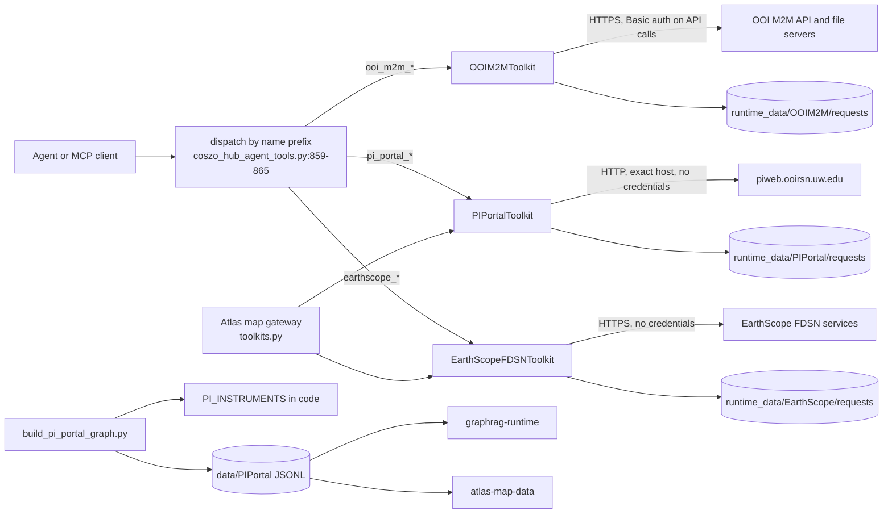

# COSZO Hub sources: PI portal, OOI M2M, EarthScope FDSN

chapter: coszo-hub-sources · paths: `'src/coszo_hub_tools/*pi_portal*' 'src/coszo_hub_tools/*ooi_m2m*' 'src/coszo_hub_tools/OOI_M2M_SOURCES.md' 'src/coszo_hub_tools/*earthscope_fdsn*'` · as of 1047fc8

These three adapters let an agent fetch live data from three external services during a conversation, instead of answering from a snapshot. The UW RCA Principal Investigator (PI) portal publishes ten audited datasets from the Regional Cabled Array (RCA), the cabled Ocean Observatories Initiative (OOI) site at Axial Seamount and Southern Hydrate Ridge (`src/coszo_hub_tools/README.md:102-104`, `src/coszo_hub_tools/build_pi_portal_graph.py:62-104`). The OOI machine-to-machine (M2M) API lets a user with an OOI account find instruments, plan NetCDF data requests and download results. The EarthScope FDSN (International Federation of Digital Seismograph Networks) web services serve public seismic station metadata, waveforms and coverage. Each adapter is a standard-library Python module with a list of Model Context Protocol (MCP) tool schemas and a dispatcher (`src/coszo_hub_tools/ooi_m2m_agent_tools.py:465`, `:479`; `pi_portal_agent_tools.py:702`, `:712`; `earthscope_fdsn_agent_tools.py:348`, `:358`). Each checks outbound URLs against an approved host, bounds its requests and downloads, and writes results under `runtime_data/`, outside the Graph-RAG corpus (`ooi_m2m_agent_tools.py:144-151`, `pi_portal_agent_tools.py:314-322`, `earthscope_fdsn_agent_tools.py:84-90`). The PI builder also writes a static routing corpus, so availability questions can be answered before any live call (`src/coszo_hub_tools/build_pi_portal_graph.py:656-734`). The COSZO Hub MCP server, documented in [coszo-hub-core](coszo-hub-core.md), registers these tools (`src/coszo_hub_tools/coszo_hub_agent_tools.py:856`). The Atlas map gateway, documented in [atlas-map-gateway](atlas-map-gateway.md), loads two of the toolkits by folder path (`src/atlas_map_gateway/toolkits.py:13-17`, `:33-34`).

## At a glance

| Item | Detail |
|---|---|
| Kind | Three source adapters (library modules that expose MCP tool schemas and a dispatcher) and one static corpus builder (a script). |
| Stack | Python 3 standard library only: `urllib` for HTTP, `html.parser` and `xml.etree` for listings and catalogs, `hashlib` for SHA-256 (`src/coszo_hub_tools/ooi_m2m_agent_tools.py:16-30`, `src/coszo_hub_tools/pi_portal_agent_tools.py:13-29`, `src/coszo_hub_tools/earthscope_fdsn_agent_tools.py:12-23`). |
| Entry points | MCP tools routed by name prefix in `dispatch` (`src/coszo_hub_tools/coszo_hub_agent_tools.py:859-865`). Python classes `OOIM2MToolkit`, `PIPortalToolkit`, `EarthScopeFDSNToolkit`. CLI: `python3 src/coszo_hub_tools/build_pi_portal_graph.py --output DIR` (`src/coszo_hub_tools/build_pi_portal_graph.py:738-748`). |
| Reads | (1) The live OOI M2M API at `ooinet.oceanobservatories.org` (`src/coszo_hub_tools/ooi_m2m_agent_tools.py:34`) and OOI THREDDS catalogs and async-result pages on `oceanobservatories.org` (`ooi_m2m_agent_tools.py:144-151`). External. (2) `OOI_USERNAME` and `OOI_TOKEN` from the environment, needed only for live API calls (see Configuration). (3) The local instrument inventory `data/Instruments/instruments.jsonl`. The path is the one the consumers expect; [corpus-instruments-ops](corpus-instruments-ops.md) writes the file with `src/instrument_inventory/build_instrument_inventory.py:611`, and the directory comes from `--output` (`:749`). It feeds local search (`ooi_m2m_agent_tools.py:218-236`) and the shared IDs and hardware fields of the PI builder (`build_pi_portal_graph.py:180-205`, `:470-486`). (4) PI portal HTTP directories at `piweb.ooirsn.uw.edu` (`pi_portal_agent_tools.py:33`). External, no credentials. (5) EarthScope FDSN services at `service.earthscope.org` (`earthscope_fdsn_agent_tools.py:27-30`). External, no credentials. (6) The PI registry and graph enrichment are Python literals in `pi_portal_agent_tools.py:48-228`, not a data file. |
| Writes or serves | (1) JSON tool results with an `ok` flag, returned to the MCP client through [coszo-hub-core](coszo-hub-core.md) (`coszo_hub_agent_tools.py:859-865`) and to the Atlas gateway, which calls `browse` and `download_waveform` (`src/atlas_map_gateway/routes_data.py:132`, `:165`). (2) Downloads and manifests under `runtime_data/OOIM2M/requests/<id>/`, `runtime_data/PIPortal/requests/<id>/` and `runtime_data/EarthScope/requests/<id>/`. The reader is the user or the agent. The gateway puts EarthScope MiniSEED in its own temporary root (`src/atlas_map_gateway/toolkits.py:26-29`) and deletes each request directory after decoding (`src/atlas_map_gateway/routes_data.py:173-175`, `src/atlas_map_gateway/seismic.py:27-36`). (3) The static corpus `data/PIPortal/` (eight JSONL files, `manifest.json`, `README.md`; `build_pi_portal_graph.py:656-734`). It is read by [graphrag-runtime](graphrag-runtime.md) (`src/graphrag_runtime/discover_corpora.py:37`, `src/graphrag_runtime/normalize_corpus.py:126`) and by [atlas-map-data](atlas-map-data.md) (`src/atlas_map_data/build_atlas_bundle.py:37`). |

## How it works



1. **Routing.** `dispatch` sends names that start with `pi_portal_`, `earthscope_` or `ooi_m2m_` to the matching `dispatch_*` function (`src/coszo_hub_tools/coszo_hub_agent_tools.py:860-865`). Each `dispatch_*` calls the named method with the arguments as keyword arguments. Any exception becomes `{"ok": false, "error": {"type": ..., "message": ...}}` (`src/coszo_hub_tools/ooi_m2m_agent_tools.py:479-497`, `pi_portal_agent_tools.py:712-726`, `earthscope_fdsn_agent_tools.py:358-372`).
2. **Limits are read once.** Each toolkit reads its runtime root, timeouts and byte or count limits from environment variables in `__init__` (`ooi_m2m_agent_tools.py:97-104`, `pi_portal_agent_tools.py:303-310`, `earthscope_fdsn_agent_tools.py:76-80`). The MCP server builds them with defaults (`coszo_hub_agent_tools.py:234-236`). The Atlas gateway sets some variables before it builds its own copies (`src/atlas_map_gateway/toolkits.py:22-34`).
3. **Guard before every request.** OOI requires HTTPS and an `oceanobservatories.org` host, and refuses credentials in the URL (`ooi_m2m_agent_tools.py:144-151`). The PI adapter requires the exact host `piweb.ooirsn.uw.edu`, port 80 or 443, and no query, fragment or credentials (`pi_portal_agent_tools.py:314-322`). EarthScope requires HTTPS on `service.earthscope.org`, a subdomain of `earthscope.org`, or `service.iris.edu` (`earthscope_fdsn_agent_tools.py:84-90`). Each adapter checks the final URL after redirects as well (`ooi_m2m_agent_tools.py:173`, `pi_portal_agent_tools.py:395`, `earthscope_fdsn_agent_tools.py:143`).
4. **Discovery is read-only and bounded.** OOI live search walks at most 100 nodes per call (`ooi_m2m_agent_tools.py:246`). PI `browse` returns at most 5,000 entries (`pi_portal_agent_tools.py:517-519`). PI `find_files` walks breadth-first, with defaults of depth 3, 100 directories and 1,000 files (`pi_portal_agent_tools.py:528-587`). EarthScope search and availability cap rows at 5,000 (`earthscope_fdsn_agent_tools.py:243`, `:342`).
5. **Plan before acting.** OOI `plan_request` validates the reference designator, method, stream, interval and 31-day window without a network call (`ooi_m2m_agent_tools.py:287-313`). `request_data` submits an estimate unless `estimate_only` is false (`:289`, `:344-346`). EarthScope `plan_waveform` allows one exact station and at most 24 hours (`earthscope_fdsn_agent_tools.py:185-198`). PI `plan_download` resolves each path under the endpoint and caps the list at 10 (`pi_portal_agent_tools.py:596-618`).
6. **Persist with provenance.** OOI writes `request.json` through a temporary file and an atomic replace, with mode 0600 and no credentials (`ooi_m2m_agent_tools.py:324-336`, `:370`). PI and EarthScope write a `manifest.json` per request, with the source URL, retrieval time, byte count and SHA-256 of each file (`pi_portal_agent_tools.py:686-699`, `earthscope_fdsn_agent_tools.py:260-281`).
7. **OOI results go through status and catalogs.** `request_status` polls `status.txt` and then `status.json`, and marks the request complete on an HTTP 200 (`ooi_m2m_agent_tools.py:372-386`). `list_result_files` reads the async download index and the THREDDS XML catalog, and keeps the allowed suffixes (`:388-429`). `download_results` writes the chosen files into `files/` under a byte budget (`:431-462`).
8. **The static corpus is built offline.** `build()` reads the in-code registry and an optional instrument corpus. It writes eight JSONL files plus `manifest.json` and `README.md`, and raises `ValueError` if any validation check fails (`build_pi_portal_graph.py:406-735`, checks at `:312-403`). Its routing policy says to answer from the corpus first and to call live tools only when the user asks (`build_pi_portal_graph.py:622-627`).

## Key files

| File | Role |
|---|---|
| `src/coszo_hub_tools/ooi_m2m_agent_tools.py` (497 lines) | OOI M2M client. Status, local and live instrument search, vocabulary, deployments, streams, request planning, estimate or submission, status, result listing and bounded download. Defines `OOIM2MToolkit`, `OOI_M2M_TOOL_SCHEMAS` (`:465`) and `dispatch_ooi_m2m` (`:479`). |
| `src/coszo_hub_tools/pi_portal_agent_tools.py` (726 lines) | PI portal client. The audited ten-dataset registry `PI_INSTRUMENTS` (`:48-162`) with graph enrichment (`:167-260`), exact-host HTTP, directory browse, recursive find, download plans and bounded downloads with manifests. Defines `PIPortalToolkit`, `PI_PORTAL_TOOL_SCHEMAS` (`:702`) and `dispatch_pi_portal` (`:712`). |
| `src/coszo_hub_tools/earthscope_fdsn_agent_tools.py` (372 lines) | EarthScope FDSN client. Channel search, waveform plan and MiniSEED download, StationXML download, and availability with explicit HTTP 410 handling. Defines `EarthScopeFDSNToolkit`, `OFFICIAL_SOURCES` (`:31`), `EARTHSCOPE_TOOL_SCHEMAS` (`:348`) and `dispatch_earthscope` (`:358`). |
| `src/coszo_hub_tools/build_pi_portal_graph.py` (748 lines) | Builds the static PI routing corpus with no network code. Shared-ID and site tables (`:30-150`), graph builders (`:293-309`, `:406-735`), validation (`:312-403`) and `main()` (`:738`). |
| `src/coszo_hub_tools/OOI_M2M_SOURCES.md` (22 lines) | Provenance. Pinned commits and licences of the two reference projects, OOINet (GPL-3.0) and ooi-harvester (MIT), and what the adapter took from each as a design pattern (`:10-13`). |
| Tests: `test_ooi_m2m_agent_tools.py` (152), `test_pi_portal_agent_tools.py` (159), `test_earthscope_fdsn_agent_tools.py` (93), `test_pi_portal_graph.py` (178), all in `src/coszo_hub_tools/` | Offline `unittest` suites. Each adapter takes an injected `http_get` callable, so the tests use fake servers (`test_ooi_m2m_agent_tools.py:12-16`, `test_pi_portal_agent_tools.py:11-15`, `test_earthscope_fdsn_agent_tools.py:9-13`). The graph test needs the private instrument corpus for its hardware assertions (see Run and test). |

## Interfaces

### CLI

- `python3 src/coszo_hub_tools/build_pi_portal_graph.py --output DIR [--instrument-corpus PATH]` (`src/coszo_hub_tools/build_pi_portal_graph.py:738-744`). It writes `instruments.jsonl`, `endpoints.jsonl`, `sites.jsonl`, `sources.jsonl`, `tools.jsonl`, `entities.jsonl`, `relationships.jsonl`, `chunks.jsonl`, `manifest.json` and `README.md` into DIR (`:656-734`), then prints the manifest as JSON (`:743-744`).
- The three adapters have no CLI. They are reached through the MCP server, documented in [coszo-hub-core](coszo-hub-core.md).

### MCP tools

Names and arguments come from the schema lists. Network means an outbound call.

OOI M2M (`OOI_M2M_TOOL_SCHEMAS`, `src/coszo_hub_tools/ooi_m2m_agent_tools.py:465-476`):

| Tool | Network | Required arguments | Notes |
|---|---|---|---|
| `ooi_m2m_status` | none | none | Reports whether each credential variable is set and never returns values (`ooi_m2m_agent_tools.py:196-208`). |
| `ooi_m2m_search_instruments` | local file; live needs credentials | none; `source` is `local` or `live` | Live search requires `array` (`:238-239`). |
| `ooi_m2m_vocabulary` | live, authenticated | `reference_designator` | Accepts any valid OOI reference designator (`:112-117`). |
| `ooi_m2m_deployments` | live, authenticated | `reference_designator` | Optional `deployment` number and `limit` (`:262-268`). |
| `ooi_m2m_list_streams` | live, authenticated | `reference_designator` | Optional `method`. Skips method names that contain "bad" (`:278-279`). |
| `ooi_m2m_plan_request` | none | `reference_designator`, `method`, `stream`, `begin`, `end` | Never contacts OOI (`:311-313`). |
| `ooi_m2m_request_data` | live, authenticated | same as plan | `estimate_only` defaults to true. Writes the request record (`:344-370`). |
| `ooi_m2m_request_status` | public HTTP | `request_id` | Polls `status.txt`, then `status.json` (`:372-386`). |
| `ooi_m2m_list_result_files` | public HTTP | `request_id` | Default suffixes `.nc`, `.json`, `.txt` (`:423-429`). |
| `ooi_m2m_download_results` | public HTTP | `request_id` | `max_files` defaults to 100. Optional `max_total_bytes` (`:431-462`). |

EarthScope FDSN (`EARTHSCOPE_TOOL_SCHEMAS`, `src/coszo_hub_tools/earthscope_fdsn_agent_tools.py:348-355`):

| Tool | Network | Required arguments | Notes |
|---|---|---|---|
| `earthscope_fdsn_status` | none | none | Endpoints, limits and the availability caveat (`earthscope_fdsn_agent_tools.py:157-168`). |
| `earthscope_search_channels` | public HTTP | `network` | `level` is `network`, `station` or `channel`. `limit` up to 5,000 (`:222-246`). |
| `earthscope_plan_waveform` | none | `network`, `station`, `channel`, `begin`, `end` | One exact station and at most 24 hours (`:185-198`). |
| `earthscope_download_waveform` | public HTTP | same as plan | MiniSEED file plus manifest (`:283-301`). |
| `earthscope_download_stationxml` | public HTTP | `network`, `station` | `level` is `station`, `channel` or `response` (`:303-327`). |
| `earthscope_query_availability` | public HTTP | `network`, `station`, `channel`, `begin`, `end` | Returns `service_unavailable` on HTTP 410 (`:329-345`). |

PI portal (`PI_PORTAL_TOOL_SCHEMAS`, `src/coszo_hub_tools/pi_portal_agent_tools.py:702-709`):

| Tool | Network | Required arguments | Notes |
|---|---|---|---|
| `pi_portal_status` | none | none | Host policy, dataset and endpoint counts, limits (`pi_portal_agent_tools.py:476-495`). |
| `pi_portal_list_instruments` | none | none; optional `query` | Registry records plus `download_locations` (`:497-506`). |
| `pi_portal_browse` | public HTTP | `instrument_id` | `endpoint_id` is required when a dataset has several endpoints (`:339-341`). Optional `relative_path` and `limit` up to 5,000 (`:508-526`). |
| `pi_portal_find_files` | public HTTP | `instrument_id` | Optional `endpoint_id`, `relative_path`, `pattern`, `extensions`, `start` and `end` (dates read from the path), `max_depth`, `max_directories`, `max_files` (`:528-594`). |
| `pi_portal_plan_download` | none | `instrument_id`, `relative_paths` | At most 10 paths (`:596-618`). |
| `pi_portal_download_files` | public HTTP | `instrument_id`, `relative_paths` | Writes `files/` and `manifest.json` (`:646-699`). |

The schema enum for `instrument_id` lists the ten canonical IDs (`pi_portal_agent_tools.py:705-708`). The Python resolver also accepts aliases such as `COVIS` (`:325-333`).

### Python names other chapters import

- `OOIM2MToolkit`, `OOI_M2M_TOOL_SCHEMAS`, `dispatch_ooi_m2m`: `src/coszo_hub_tools/coszo_hub_agent_tools.py:37-41`, `:234`, `:856`, `:865`. `SOURCE_REFERENCES` (`ooi_m2m_agent_tools.py:38-53`) is imported by `src/coszo_hub_tools/build_coszo_hub_graph.py:34` ([coszo-hub-core](coszo-hub-core.md)).
- `PIPortalToolkit`, `PI_PORTAL_TOOL_SCHEMAS`, `dispatch_pi_portal`: `coszo_hub_agent_tools.py:42-45`, `:236`, `:856`, `:861`. `PI_INSTRUMENTS` is imported by `build_coszo_hub_graph.py:36` and `build_pi_portal_graph.py:22-27`.
- `PI_DATASETS` is a backward-compatible alias of `PI_INSTRUMENTS` (`pi_portal_agent_tools.py:259-260`). [atlas-map-gateway](atlas-map-gateway.md) imports it in `src/atlas_map_gateway/routes_data.py:12` and `:47`.
- `PIPortalToolkit.browse(instrument_id, endpoint_id, relative_path, limit)` (`pi_portal_agent_tools.py:508-509`) is called by `src/atlas_map_gateway/routes_data.py:132`.
- `EarthScopeFDSNToolkit.download_waveform(network, station, channel, begin, end, location)` (`earthscope_fdsn_agent_tools.py:283-284`) is called by `src/atlas_map_gateway/routes_data.py:165`. `src/atlas_map_gateway/toolkits.py:33-34` loads both toolkits by folder path.
- `EarthScope` names `OFFICIAL_SOURCES` (`earthscope_fdsn_agent_tools.py:31`), imported as `EARTHSCOPE_OFFICIAL_SOURCES` by `build_coszo_hub_graph.py:35`.
- `build(output_dir, instrument_corpus=None)` (`build_pi_portal_graph.py:406`) and `GRAPH_FILES` (`:141`) are used by `src/coszo_hub_tools/test_pi_portal_graph.py:10-19`.

### Files produced

- `runtime_data/OOIM2M/requests/<local-request-id>/request.json`, plus `files/` after a download.
- `runtime_data/PIPortal/requests/<local-request-id>/files/` and `manifest.json`.
- `runtime_data/EarthScope/requests/<local-request-id>/`: the MiniSEED file, named `<net>.<sta>.<loc>.<cha>.<start>.mseed`, or `<net>.<sta>.station.xml`, plus `manifest.json` (`earthscope_fdsn_agent_tools.py:292-295`, `:324`).
- `data/PIPortal/` from the builder: eight JSONL files, `manifest.json` and `README.md`.

## Data shapes

Every tool result is an envelope. Success is `{"ok": true, ...}`. Failure is `{"ok": false, "error": {"type": str, "message": str, ...}}` (`ooi_m2m_agent_tools.py:65-66`, `pi_portal_agent_tools.py:267-268`, `earthscope_fdsn_agent_tools.py:65-66`).

**OOI `request.json`** (`ooi_m2m_agent_tools.py:359-368`, plus `:384` and `:460`):

| Field | Type | Meaning |
|---|---|---|
| `schema_version` | string | `"1.0"`. |
| `local_request_id` | string | `ooi-<UTC timestamp>-<12 hex>`, checked by `REQUEST_ID_RE` (`:57`). |
| `ooi_request_uuid` | string or null | OOI's `requestUUID`. |
| `created_at_utc`, `updated_at_utc` | string | ISO-8601 UTC with a `Z` suffix. |
| `state` | string | `estimated` or `submitted`; becomes `complete` after an HTTP 200 status file. |
| `request` | object | `reference_designator`, `method`, `stream`, `begin`, `end`, `duration_days`, `estimate_only`. |
| `thredds_catalog`, `download_catalog` | string or null | URLs from OOI's `allURLs`, matched by the words "thredds" and "async_results" or "download" (`:350-351`). |
| `status_urls` | list of string | `<download>/status.txt` and `<download>/status.json`. |
| `size_calculation_bytes`, `time_calculation_seconds`, `response_message` | number or string or null | OOI's estimate fields. |
| `files` | list | One entry for each file the download call reached: `name`, `url`, `downloaded`, `byte_size`, `sha256` and `path` when downloaded (`:458`). A non-2xx response gives `downloaded: false` and `http_status` (`:448`). |
| `last_status_checks` | list | `url`, `http_status`, `content_type`, `body_preview` (first 2,000 characters). |

**PI `manifest.json`** (`pi_portal_agent_tools.py:690-699`, failure form at `:678-687`): `schema_version` (`"1.0"`), `status` (`complete` or `failed`), `local_request_id` (`piportal-…`), `retrieved_at_utc`, `instrument_id`, `instrument_name`, `endpoint_id`, `endpoint_url`, `credential_used` (always false), `file_count`, `total_bytes`, and `files`. Each file entry has `relative_path`, `source_url`, `file`, `filename`, `byte_size`, `sha256` and `content_type`. A failed manifest also has `error` with `type` and `message`.

**EarthScope `manifest.json`** (`earthscope_fdsn_agent_tools.py:267-277`, `:296-300`, `:325-326`): `schema_version`, `local_request_id` (`earthscope-…`), `retrieved_at_utc`, `file`, `filename`, `byte_size`, `sha256`, `kind` (`MiniSEED waveform` or `FDSN StationXML`), `source_url`, `content_type` and `selection`. The waveform selection holds network, station, location, channel, starttime, endtime and duration_hours. The StationXML selection holds the query parameters.

**Inputs read:**

- Local inventory rows (`ooi_m2m_agent_tools.py:225-233`): `canonical_id` (rows whose value fails the reference-designator pattern are skipped), `name`, `instrument_type`, `location`, `site`, `node`, `instrument_code`, `projects`, `latitude`, `longitude`, `depth_m`. Lines that are not valid JSON are skipped (`:226-227`).
- PI directory entries (`pi_portal_agent_tools.py:467-473`): `name`, `relative_path` (relative to the endpoint root, with a trailing `/` for directories), `kind` (`directory` or `file`), `url` and `observation_date` (YYYY-MM-DD parsed from a 20xx date in the path, or null).
- EarthScope text records (`earthscope_fdsn_agent_tools.py:200-220`): a dict keyed by the `#` header fields of the FDSN text response, or `{"raw": line}` if no header has been seen.

**Static corpus** (`build_pi_portal_graph.py`). The counts for instruments, endpoints, sites, sources, relationships and chunks are from `src/DATA_CORPUS_METHOD.md:732-734`; a count from the builder's logic agrees. The other counts follow from the code.

| File | Rows and key fields | Meaning |
|---|---|---|
| `instruments.jsonl` (`:471-498`) | 10 rows. `instrument_id` is the shared `INSTRUMENT-…` ID when one is known, otherwise `PI-PORTAL-INSTRUMENT-…`. Also `portal_instrument_key`, `name`, `aliases`, `physical_site`, `site_id`, `manufacturer`, `model`, `sensor_components`, `formats`, `observed_layout`, `caveats`, `official_url`, `endpoint_ids`, `shared_instrument_id_reused`. | One logical PI dataset or experiment. |
| `endpoints.jsonl` (`:451-466`) | 31 rows. `endpoint_id` (`PI-PORTAL-ENDPOINT-…`, a hash of the URL), `instrument_id`, `label`, `url`, `host`, `scheme`, `role`, `formats`, `path_pattern`, `public`, `credentials_required`. | One public download branch. |
| `sites.jsonl` (`:423-431`) | 6 rows. `site_id` (`ENTITY-…`), `name`, `aliases`, `latitude`, `longitude`, `dataset_keys`. | A physical location shared with the Instruments corpus. The three RCA cable sites have null coordinates (`:81-97`). |
| `sources.jsonl` (`:242-288`) | 12 rows. `source_id`, `source_kind`, `source_url` or `source_path`, `host`, `role`. The portal row carries `audit_date`. | Provenance: the portal, the shared corpus, and one official OOI page per dataset. |
| `tools.jsonl` (`:547-558`) | 6 rows. `tool_id`, `name`, `description`, `input_schema`, `mode` (`static_registry`, `live_browse`, `download_plan` or `live_download`), `requires_user_invocation_after_corpus_answer`, `writes_only_to_runtime_data`. | Agent-facing copy of the schemas, with the execution policy. |
| `entities.jsonl` (`:583-592`) | 2 rows: the RCA observatory node and the routing-policy node. | Graph anchors. |
| `relationships.jsonl` (`_edge`, `:220-230`) | 373 rows. `relationship_id`, `source_id`, `predicate`, `target_id`, `evidence_source_ids`, `source_is_untrusted_data`. | Predicates: `DOWNLOADABLE_FROM`, `HOSTED_BY`, `LOCATED_AT`, `DOCUMENTED_BY`, `PART_OF`, `HAS_CHUNK`, `ACCESSIBLE_WITH`, `BROWSES`, `PLANS_DOWNLOAD_FROM`, `DOWNLOADS_FROM`, `USE_CORPUS_FIRST_THEN_INVOKE_TOOL`, `PREFERS_STATIC_SOURCE`. |
| `chunks.jsonl` (`:513-527`, `:566-580`, `:629-643`) | 17 rows. `chunk_id`, `parent_id`, `content_kind` (`instrument_download_routing`, `agent_tool` or `routing_policy`), `title`, `text`, `word_count`, `source_ids`, `source_urls`. | Text that is embedded and retrieved. The manifest names it as the embedding input (`:685`). |
| `manifest.json` (`:669-699`) | `schema_version` `"1.0-graph"`, `audit_date` `"2026-09-19"`, counts, `relationships_by_predicate`, `validation`. | Build record. |

## Configuration and secrets

No secret values appear in this chapter. `ooi_m2m_status` reports only whether each credential variable is set (`ooi_m2m_agent_tools.py:199`).

| Name | Read at | Purpose | Default or required |
|---|---|---|---|
| `OOI_USERNAME` | `src/coszo_hub_tools/ooi_m2m_agent_tools.py:100` | HTTP Basic user name for live OOI API calls. | Required for live calls. Blank in `.env.example:11`. |
| `OOI_TOKEN` | `ooi_m2m_agent_tools.py:101` | HTTP Basic token paired with the user name. | Required for live calls. Blank in `.env.example:12`. |
| `OOI_M2M_RUNTIME_ROOT` | `ooi_m2m_agent_tools.py:98` | Where request records and downloads go. | `runtime_data/OOIM2M` under the repo. |
| `OOI_INSTRUMENT_INVENTORY` | `ooi_m2m_agent_tools.py:99` | Local inventory for local search. | `data/Instruments/instruments.jsonl` under the repo. Private, absent from this checkout. |
| `OOI_M2M_MAX_REQUEST_DAYS` | `ooi_m2m_agent_tools.py:102` | Longest accepted request window. | `31`. |
| `OOI_M2M_MAX_DOWNLOAD_BYTES` | `ooi_m2m_agent_tools.py:103` | Byte budget for one download call. | `2147483648` (2 GiB). |
| `OOI_M2M_TIMEOUT_SECONDS` | `ooi_m2m_agent_tools.py:104` | Socket timeout. | `30`. |
| `PI_PORTAL_RUNTIME_ROOT` | `pi_portal_agent_tools.py:304` | Where PI request folders and manifests go. | `runtime_data/PIPortal` under the repo. |
| `PI_PORTAL_TIMEOUT_SECONDS` | `pi_portal_agent_tools.py:305` | Socket timeout. | `60`. The gateway sets its own default (`src/atlas_map_gateway/toolkits.py:22`). |
| `PI_PORTAL_MAX_INDEX_BYTES` | `pi_portal_agent_tools.py:306` | Largest directory listing accepted. | `10485760` (10 MiB). |
| `PI_PORTAL_MAX_DOWNLOAD_BYTES` | `pi_portal_agent_tools.py:307` | Byte budget for one download call. | `536870912` (512 MiB). |
| `PI_PORTAL_MAX_DOWNLOAD_FILES` | `pi_portal_agent_tools.py:308` | Files per download call. | `10`. |
| `PI_PORTAL_MAX_RETRIES` | `pi_portal_agent_tools.py:309` | Retries, capped at 5. | `2`. The gateway sets `1` (`toolkits.py:25`). |
| `PI_PORTAL_RETRY_BACKOFF_SECONDS` | `pi_portal_agent_tools.py:310` | Base of the exponential backoff. | `0.5`. |
| `EARTHSCOPE_RUNTIME_ROOT` | `earthscope_fdsn_agent_tools.py:77` | Where MiniSEED and StationXML files go. | `runtime_data/EarthScope` under the repo. The gateway forces a temporary root (`toolkits.py:29`). |
| `EARTHSCOPE_MAX_REQUEST_HOURS` | `earthscope_fdsn_agent_tools.py:78` | Longest waveform window. | `24`. |
| `EARTHSCOPE_MAX_DOWNLOAD_BYTES` | `earthscope_fdsn_agent_tools.py:79` | Byte cap for one waveform download. | `536870912` (512 MiB). |
| `EARTHSCOPE_TIMEOUT_SECONDS` | `earthscope_fdsn_agent_tools.py:80` | Socket timeout. | `120`. The gateway sets its default (`toolkits.py:23`). |
| `RCN_INSTRUMENT_CORPUS` | `src/coszo_hub_tools/build_pi_portal_graph.py:181` | Path to the shared instruments file, used for enrichment. | Unset. Falls back to `data/Instruments/instruments.jsonl` under the repo, then under the working directory (`:183-189`). |

## Run and test

Exact commands from the coszo-hub-core README (`src/coszo_hub_tools/README.md:177-180`):

```sh
python3 -m unittest src/coszo_hub_tools/test_ooi_m2m_agent_tools.py -v
python3 -m unittest src/coszo_hub_tools/test_earthscope_fdsn_agent_tools.py -v
python3 -m unittest src/coszo_hub_tools/test_pi_portal_agent_tools.py -v
```

Build the static PI corpus (`src/DATA_CORPUS_METHOD.md:737-739`):

```sh
python3 src/coszo_hub_tools/build_pi_portal_graph.py \
  --instrument-corpus data/Instruments/instruments.jsonl \
  --output data/PIPortal
```

- `test_pi_portal_graph.py` has no README entry. The same pattern should run it (inferred).
- The test files import sibling modules by bare name (`test_ooi_m2m_agent_tools.py:6`, `test_pi_portal_agent_tools.py:8`, `test_pi_portal_graph.py:10`). Those imports resolve only when `src/coszo_hub_tools` is on `sys.path`. The README sets `PYTHONPATH=src/coszo_hub_tools` only for the DAS test (`README.md:181`). This is inferred from the imports; it was not run while writing this chapter.
- `test_pi_portal_graph.py:101-109` expects the interrogator manufacturer and model from the shared inventory. Without `data/Instruments/instruments.jsonl`, those fields are null (`build_pi_portal_graph.py:484-485`), so that test should fail (inferred; not run). `data/Instruments/` is absent from this checkout (checked).
- The adapters have no live tests in these paths. The method doc says a live smoke test reads only directory metadata or a small text file (`src/DATA_CORPUS_METHOD.md:730`). No script for it was found in the tracked files.

## Decisions and constraints

- **OOI credentials are needed only for live API calls.** Planning, local search, status, catalog reads and downloads run without them. Sources: `src/coszo_hub_tools/README.md:32-36`, `ooi_m2m_agent_tools.py:156-157`, `:187-188`, `:377`, `:392`, `:446`.
- **Credentials appear only in the Authorization header.** The Basic header is built inside `_http` (`ooi_m2m_agent_tools.py:166-168`) and sent to OOI over HTTPS. They are not placed in URLs (`:150`), returned by tools or written to disk. Tests check this (`test_ooi_m2m_agent_tools.py:90-94`, `:126-128`). Source: `ooi_m2m_agent_tools.py:9-11`; `src/coszo_hub_tools/OOI_M2M_SOURCES.md:20-23`.
- **The OOI adapter is independent of its reference projects.** It uses only the standard library and does not import OOINet (GPL-3.0) or ooi-harvester (MIT). Their source is not copied into the corpus. Pinned commits are recorded in `OOI_M2M_SOURCES.md:3-6`, `:8-13`, `:15-18`.
- **OOI M2M is out of scope for the first Atlas map.** The design spec lists "Authenticated OOI M2M downloads (needs an OOI account)" as not in the first version (`docs/superpowers/specs/2026-09-23-atlas-map-design.md:35`) and marks OOI M2M "needs credentials, out of scope" (`:75`).
- **Hosts are allowlisted, and the final URL is re-checked after redirects.** PI: the exact host only (`pi_portal_agent_tools.py:314-322`, `src/coszo_hub_tools/README.md:117-119`). OOI: the `oceanobservatories.org` domain only (`ooi_m2m_agent_tools.py:144-151`). EarthScope: `service.earthscope.org`, `earthscope.org` subdomains and `service.iris.edu` (`earthscope_fdsn_agent_tools.py:84-90`).
- **Requests are bounded by default.** OOI windows are 31 days (`ooi_m2m_agent_tools.py:102`, `README.md:61-62`). EarthScope waveform requests are one exact station and 24 hours, "following EarthScope guidance" (`earthscope_fdsn_agent_tools.py:78`, `:185-189`, `:198`, `README.md:83-85`). PI downloads are capped at 10 files and 512 MiB (`pi_portal_agent_tools.py:307-308`, `README.md:129-130`).
- **Estimate first.** OOI request estimates are the default (`ooi_m2m_agent_tools.py:289`, `README.md:51-53`). Data generation needs `estimate_only=false`.
- **Corpus first, live tools on request.** The routing policy says to answer availability from the static corpus and to invoke live PI tools only when the user asks to browse, find, plan or download (`build_pi_portal_graph.py:622-627`, `:589`; `src/DATA_CORPUS_METHOD.md:691-695`, `:709-713`; `README.md:109-113`).
- **Downloads are runtime evidence, not corpus input.** `pi_portal_agent_tools.py:7-8`, `earthscope_fdsn_agent_tools.py:6-7`, `build_pi_portal_graph.py:626`, `build_coszo_hub_graph.py:353` (OOI downloads go to `runtime_data/OOIM2M`).
- **Continuous streaming goes to SeedLink.** These FDSN tools cover bounded historical or near-real-time requests (`src/coszo_hub_tools/README.md:89-92`, `earthscope_fdsn_agent_tools.py:165`).
- **EarthScope's availability service may return HTTP 410.** This is the 2026 cloud transition. The tool reports it explicitly, and station and dataselect calls continue (`README.md:89-90`, `earthscope_fdsn_agent_tools.py:336-337`). The notice is listed in `earthscope_fdsn_agent_tools.py:47-51`.
- **The audited registry is the ID authority.** Shared instrument IDs come from the code's crosswalk, not from whichever local corpus is present (`build_pi_portal_graph.py:196-199`, `test_pi_portal_graph.py:61-68`). The scope is exactly ten datasets (`build_pi_portal_graph.py:30-41`, `:407-410`).
- **Separate site nodes for each cable extent.** The 2021 campaign, DAS24 and DAS25 "did not cover the same physical portion of the RCA fiber system" (`build_pi_portal_graph.py:59-61`).
- **Graph rows are marked as untrusted data.** Instrument, endpoint, site, source, tool, chunk and relationship rows carry `source_is_untrusted_data: true` (`build_pi_portal_graph.py:227`, `:251`, `:265`, `:430`, `:465`, `:497`, `:525`, `:557`). The two entity rows do not (`:583-592`).
- **The Atlas gateway reuses these toolkits.** The map design says it "imports his existing toolkits rather than reimplementing them" (`docs/superpowers/specs/2026-09-23-atlas-map-design.md:177-182`). It also lowers PI retries to one (`src/atlas_map_gateway/toolkits.py:24-25`).

## History

- **2026-09-20, `833c343`, "Initialize RCA and COSZO Graph-RAG agent" (Maleen Kidiwela).** Created all nine files in this chapter in one commit: the three adapters, their tests, the builder, its test and `OOI_M2M_SOURCES.md`. The adapter and document files add 1,617 lines (`git show --stat`). `git log --follow` shows no earlier names.
- **2026-09-24, `d92bac4`, "Enrich DAS interrogator hardware metadata."** Adds 18 and removes 1 line across the builder and its test. Instrument records and the DAS chunk text now carry manufacturer, model and sensor components from the shared inventory (`build_pi_portal_graph.py:298-301`, `:484-486`).
- **No other commit touches these files.** The three adapters have not changed since `833c343`.
- **2026-09-23, gateway commits outside this chapter's paths.** `bfe7780` "Serve QA/QC plots and PI portal listings through the gateway", `1d0d878` "Carry PI endpoint ids on portal routes; filter hosts before the documentation fallback", `a4e5f2d` "Gateway final fixes: normalized PI listings and status, catch-all errors, waveform hardening", `e48c3b5` "Serve recent seismic recordings decoded from EarthScope MiniSEED" and `20a8ccc` "Gateway: remove the EarthScope temp root on app shutdown" are gateway commits that use these toolkits (subject lines only; the diffs were not checked).

## Gotchas

- **One oversize OOI file aborts the whole download call.** `download_results` passes the remaining budget as `max_bytes` (`ooi_m2m_agent_tools.py:446`). `_http` raises `M2MError` when the body is larger (`:175-179`). Nothing in the loop catches it (`:442-456`), so the call returns an error. Files already written stay in `files/`, and `request.json` is not updated (`:459-461` never runs). PI downloads avoid this by writing a failed manifest (`pi_portal_agent_tools.py:677-689`).
- **PI retries also repeat oversize responses.** `_http` retries on `PIPortalError` (`pi_portal_agent_tools.py:420`). The size checks raise that error (`:389`, `:398`, `:401`). An oversize response is therefore requested up to `max_retries + 1` times, which is 3 by default, before the error returns. The README says retries leave "response-size limits" unchanged (`src/coszo_hub_tools/README.md:124-125`). The limit itself is unchanged, but the request count is not.
- **PI `find_files` does not report truncation.** `browse` caps a directory at 5,000 entries and sets `truncated` (`pi_portal_agent_tools.py:517-519`, `:525`). `find_files` reads `entries` without checking that flag (`:561-564`). The gateway's listing route shows a "more than 5,000 entries" notice (`src/atlas_map_gateway/routes_data.py:54`, `:141`).
- **The COVIS guard is narrow.** It applies only to the `covis-raw` endpoint, and only when `relative_path` is empty and no pattern, extension or date bound is set (`pi_portal_agent_tools.py:534-535`). The method doc says large DAS collections "must be filtered before download" (`src/DATA_CORPUS_METHOD.md:726-727`), but no code guard does this for DAS (inferred).
- **Date filters drop undated files.** When `start` or `end` is set, files with no date in their path are skipped (`pi_portal_agent_tools.py:576-577`). `observation_date` only recognises years 2000 to 2099 (`:37-38`).
- **`DAS` is an ambiguous alias.** The alias resolves to the 2021 experiment only (`pi_portal_agent_tools.py:102`). DAS24 and DAS25 have other aliases (`:117`, `:125`).
- **EarthScope 404 means different things.** Search and availability return `ok: true` with `nodata: true` (`earthscope_fdsn_agent_tools.py:239-240`, `:338-339`). Waveform and StationXML downloads return errors, `no_data` and `no_metadata` (`:287-288`, `:319-320`).
- **The EarthScope `truncated` flag can be wrong at exactly `limit` rows.** `_parse_pipe_text` compares `len(lines)`, which includes the `#` header, with `len(rows)` (`earthscope_fdsn_agent_tools.py:218`). The flag is inferred from the code and was not run.
- **The default blank location appears as `--` in filenames.** The `"blank"` fallback (`earthscope_fdsn_agent_tools.py:294`) cannot trigger, because the regex keeps `-`. A default waveform is therefore named `OO.HYS14.--.MHZ.<start>.mseed` for the channel that `src/coszo_hub_tools/README.md:138-140` names (an illustration, not a live file).
- **The EarthScope search schema text does not match its enum.** The description says "station-epoch" (`earthscope_fdsn_agent_tools.py:350`), but the code accepts only `network`, `station` and `channel` (`:225`).
- **Limits are read at construction.** Changing an environment variable after a toolkit is built has no effect. The gateway's `setdefault` calls must run before its toolkits are built, and `make()` does that (`src/atlas_map_gateway/toolkits.py:22-34`).
- **Two sites share one alias.** `rca-fiber` and `rca-full-cables` both list "RCA north and south backbone cables" (`build_pi_portal_graph.py:80`, `:94`). Any alias lookup over `sites.jsonl` is ambiguous.
- **Undocumented host.** `service.iris.edu` is in the EarthScope allowlist (`earthscope_fdsn_agent_tools.py:87`). No URL in this module uses it, and the coszo-hub README does not mention it.
- **Plain HTTP and no CORS.** The PI portal is served over HTTP without CORS, so a browser cannot call it directly, and the gateway proxies it (`docs/superpowers/specs/2026-09-23-atlas-map-design.md:74`, `:102`; `src/coszo_hub_tools/README.md:116-117`).
- **Dead code.** `schema_by_name` (`build_pi_portal_graph.py:532`) is never used. `GRAPH_FILES` (`:141`) is used only by tests.

## Glossary

| Term | Meaning |
|---|---|
| MCP | Model Context Protocol. The tool protocol the COSZO Hub server exposes; each tool has a JSON input schema. |
| OOI | Ocean Observatories Initiative, the observatory program whose instrument data the M2M API serves (`src/coszo_hub_tools/ooi_m2m_agent_tools.py:34`). |
| OOI M2M | The OOI machine-to-machine data API at `ooinet.oceanobservatories.org/api/m2m` (`ooi_m2m_agent_tools.py:34`). |
| RCA | Regional Cabled Array, the OOI cabled observatory with sites at Axial Seamount and Southern Hydrate Ridge (`build_pi_portal_graph.py:86`). |
| PI | Principal Investigator. Here, the research teams whose datasets sit on the UW portal. |
| PI portal | The UW RCA data site at `piweb.ooirsn.uw.edu`, a plain-HTTP directory tree (`README.md:102-104`, `:117`). |
| OOINet | An open-source OOI client project (GPL-3.0), used only as a design reference (`OOI_M2M_SOURCES.md:12`). |
| ooi-harvester | An open-source OOI data harvester (MIT), used only as a design reference (`OOI_M2M_SOURCES.md:13`). |
| Reference designator (refdes) | OOI's instrument identifier in the form `ARRAY-NODE-PORT-INSTRUMENT` (`ooi_m2m_agent_tools.py:55`, `:115`). |
| Deployment | An OOI installation period for an instrument, numbered (`ooi_m2m_agent_tools.py:262-268`). |
| Method and stream | OOI delivery route (for example `telemetered`, `recovered_inst`) and the named data stream within it (`ooi_m2m_agent_tools.py:270-285`). |
| NetCDF | Network Common Data Form, the self-describing scientific file format that OOI requests return (`ooi_m2m_agent_tools.py:302`). |
| THREDDS | A data-server catalog format. The adapter reads its XML to list files (`ooi_m2m_agent_tools.py:402-421`). |
| Async results | The output folder that OOI fills for a submitted request, with `status.txt` and `status.json` (`ooi_m2m_agent_tools.py:351`, `:358`). |
| FDSN | International Federation of Digital Seismograph Networks. The standard web services for seismic station and waveform data. |
| EarthScope | The seismic data service that runs the FDSN endpoints at `service.earthscope.org` (`earthscope_fdsn_agent_tools.py:27`). |
| Station, dataselect, availability | The three FDSN services used here: station metadata, waveform selection and coverage (`earthscope_fdsn_agent_tools.py:28-30`). |
| NET, STA, LOC, CHA | Network, station, location and channel codes in an FDSN selection (`earthscope_fdsn_agent_tools.py:54-57`). |
| MiniSEED | The standard binary waveform file format returned by dataselect (`earthscope_fdsn_agent_tools.py:194`). |
| StationXML | The FDSN XML format for station metadata (`earthscope_fdsn_agent_tools.py:303-327`). |
| SeedLink | The streaming protocol for continuous real-time seismic data, which these tools do not use (`earthscope_fdsn_agent_tools.py:165`). |
| HTTP 410 | "Gone". Here, the availability service's response during the 2026 transition (`earthscope_fdsn_agent_tools.py:336-337`). |
| DAS | Distributed Acoustic Sensing: a fiber-optic cable read as a line of acoustic sensors. |
| DTS | Distributed Temperature Sensing: the same kind of fiber read for temperature (`pi_portal_agent_tools.py:101`). |
| OptoDAS, MultiDAS, OptaSense, Silixa | Vendor interrogator products or data formats named in the PI registry (`pi_portal_agent_tools.py:102`, `:107-112`, `:130-131`). |
| HDF5 | Hierarchical Data Format 5, the container used by DAS files (`pi_portal_agent_tools.py:121`). |
| COVIS | Cabled Observatory Vent Imaging Sonar (`pi_portal_agent_tools.py:88`). |
| SCPR | Self-Calibrating Pressure Recorder (`pi_portal_agent_tools.py:135`). |
| A-0-A (A0ABPA301) | A calibrated pressure instrument at Central Caldera (`pi_portal_agent_tools.py:149`). |
| CTD-DO | Conductivity, temperature and depth with a dissolved-oxygen sensor (`pi_portal_agent_tools.py:80`). |
| MARUM | The research group whose sonars, camera and CTD appear in the PI registry (`pi_portal_agent_tools.py:50`, `:66`, `:80`). |
| Graph-RAG | Retrieval-augmented generation over a knowledge graph plus text chunks; see [graphrag-runtime](graphrag-runtime.md). |
| Chunk | A text record in `chunks.jsonl` that gets embedded and retrieved (`build_pi_portal_graph.py:513-527`). |
| Corpus-first routing | The rule that availability questions are answered from the static corpus before any live call (`build_pi_portal_graph.py:622-627`). |
| Shared instrument ID | An `INSTRUMENT-…` identifier from the shared Instruments corpus, reused so PI records join the same instrument (`build_pi_portal_graph.py:43-57`). |
| Manifest | A JSON record of one request's files, source URLs, byte counts and SHA-256 hashes. |
| SHA-256 | A cryptographic hash of a file's bytes, recorded so downloads can be checked later (`ooi_m2m_agent_tools.py:458`). |

## Open questions

- **Should an oversize OOI file skip rather than abort the download?** This is the author's call. A test with a file larger than the remaining budget would show the current behaviour. No such test exists in `test_ooi_m2m_agent_tools.py`.
- **Why does `list_streams` skip method names that contain "bad"?** (`ooi_m2m_agent_tools.py:278-279`). The author, or the OOINet source at the pinned commit (`OOI_M2M_SOURCES.md:12`), would say.
- **Is `service.iris.edu` meant to be allowed?** (`earthscope_fdsn_agent_tools.py:87`). The author, or a live call that shows a redirect to it.
- **Should PI retries skip size-limit errors?** (`pi_portal_agent_tools.py:420`). A call-counting version of `test_download_total_byte_limit_is_enforced` (`test_pi_portal_agent_tools.py:149-155`) would show the current number of requests.
- **Do the README test commands run from the repo root?** (`README.md:177-180`). Running them in a clean shell from the repo root would show whether the bare imports resolve.
- **Does the graph test pass without the private instrument corpus?** (`test_pi_portal_graph.py:101-109`). Running it where `data/Instruments/instruments.jsonl` exists would answer this.
- **Is `INSTRUMENT-e49ff2e8088de867de` retired in favour of `INSTRUMENT-981a1c15a947d3b1a1`?** (`pi_portal_agent_tools.py:200`, `build_pi_portal_graph.py:43-50`). The builder comment says the 2021 record uses the campaign-level instrument "rather than one provider's partial Arcada record" (`build_pi_portal_graph.py:43-45`). It names neither ID, so reading the partial record as the first ID is inferred. The owner of [corpus-instruments-ops](corpus-instruments-ops.md) would know.
- **Is the PI portal still plain HTTP?** (`pi_portal_agent_tools.py:251`, `src/coszo_hub_tools/README.md:116-117`). A live GET to `https://piweb.ooirsn.uw.edu/` would answer this. The code already accepts HTTPS on the same host (`:316`).
- **When does EarthScope's availability service leave its 2026 transition?** (`earthscope_fdsn_agent_tools.py:47-51`). A live `earthscope_query_availability` call, or the EarthScope notice, would answer this.
- **Does any consumer resolve sites by alias?** Two sites share one alias (`build_pi_portal_graph.py:80`, `:94`). A check of [graphrag-runtime](graphrag-runtime.md) and [atlas-map-data](atlas-map-data.md) would answer this.
- **Should the OOI THREDDS XML use a hardened parser?** The adapter uses `xml.etree` on a response capped at 20 MiB by default (`ooi_m2m_agent_tools.py:154`, `:408`). A security review would decide.

## Candidate project memory

- **decision** · OOI M2M stays out of the first Atlas map · Authenticated OOI M2M downloads are excluded because they need an OOI account · `docs/superpowers/specs/2026-09-23-atlas-map-design.md:35`, `:75`
- **decision** · The Atlas gateway reuses the PI and EarthScope toolkits · The design says it "imports his existing toolkits rather than reimplementing them" · `docs/superpowers/specs/2026-09-23-atlas-map-design.md:177-182`
- **requirement** · EarthScope waveform requests stay bounded · One exact station and 24 hours by default, "following EarthScope guidance", with continuous streaming on SeedLink · `src/coszo_hub_tools/README.md:83-92`
- **fact** · The PI portal is plain HTTP without CORS · Browsers cannot call it directly, so the Atlas gateway proxies it · `docs/superpowers/specs/2026-09-23-atlas-map-design.md:74`, `:102`
- **fact** · DAS records inherit interrogator hardware from the shared inventory · Added on 2026-09-24 in commit `d92bac4` · `git show d92bac4`, `src/coszo_hub_tools/build_pi_portal_graph.py:484-486`

## Verification

Checked 2026-10-09 against HEAD `1047fc8`.

- Claims checked: 251. One per cited statement, table row, bullet or glossary row. Each cited line was opened, and each identifier was confirmed with `git grep` or the file read. Domain terms (DAS, DTS, FDSN, SeedLink, NetCDF) were checked against how the code uses them, not against external references.
- Corrected: 12 edits. Six fixed wrong or misleading statements: the opening said the Atlas gateway imports two toolkits (it loads them by folder path); the host section called OOI and EarthScope allowlists "exact" (both accept subdomains); the COVIS guard applies only to the `covis-raw` endpoint; two History subjects were truncated; the builder comment does not name the `INSTRUMENT-e49ff…` ID; and the OOI `files` field omitted failed entries. Five were citation fixes: the corpus-first rule now cites `src/DATA_CORPUS_METHOD.md:691-695, :709-713`; gateway deletion cites `seismic.py`; OOI runtime-only downloads cite `build_coszo_hub_graph.py:353`; the plain-HTTP glossary entry cites `README.md:117`; the EarthScope example cites the README. The opening's uncited claims now have citations. One label: `data/Instruments/` absence is checked, not inferred.
- Moved to Open questions: 0. Every claim was supported by code, docs or git history, and the inferred claims are labelled.
- Key files: `git ls-files` on the four path globs returns the nine files the table already lists, so none were added.
- Not run: the builder and the tests. Static-corpus counts were derived from the builder's code and agree with `src/DATA_CORPUS_METHOD.md:732-734`.
