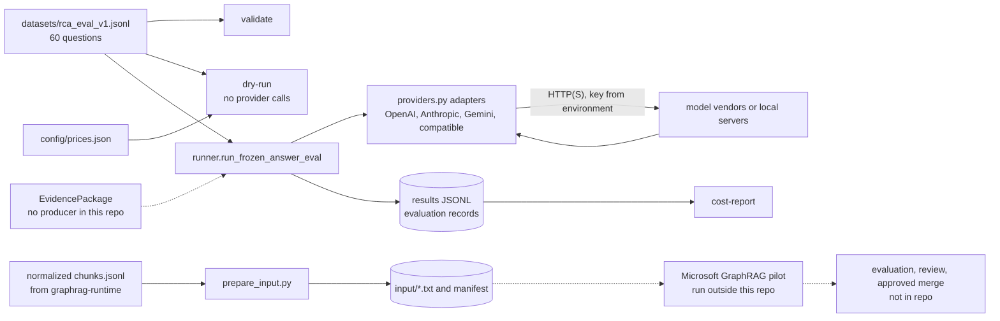

# Model Lab and Microsoft GraphRAG layer

chapter: eval-experiments · paths: 'src/model_eval/' 'src/microsoft_graphrag_layer/' · as of 1047fc8

Two optional evaluation tools that sit beside the production Graph-RAG runtime ([graphrag-runtime](graphrag-runtime.md)) and do not feed it. Graph-RAG answers a question by retrieving passages and a graph of entities and edges, then asking a large language model (LLM) to write the answer from that evidence (`src/graphrag_runtime/README.md:16-18`). The **Model Lab** (`src/model_eval/`) is built to answer one question for RCA Atlas: which LLM should write the answers? It is meant to send the same frozen evidence package to several answer models, record each answer with its cost and provenance, and name no champion without results from RCA's own questions. No command yet runs that answer path (see Gotchas). RCA is the Regional Cabled Array, the cabled seafloor observatory of the Ocean Observatories Initiative (OOI) that the corpus covers (`src/DATA_CORPUS_METHOD.md:9-11`). The **Microsoft GraphRAG candidate layer** (`src/microsoft_graphrag_layer/`) exports Atlas text chunks in the input format of Microsoft's GraphRAG indexer, so an external pilot can propose entities and relations. Its output is candidate-only and never enters the authoritative PostgreSQL graph (`src/microsoft_graphrag_layer/README.md:3-5`). Nothing else in the repo imports either package (checked with `git grep`).

## At a glance

| | |
|---|---|
| Kind | Library and scripts: a Python package with a command-line interface (CLI, `model_eval`), one standalone script, and one pilot config template. No service, web page or MCP (Model Context Protocol) tool. |
| Stack | Python 3, standard library only (imports checked). The GraphRAG pilot also needs Microsoft GraphRAG, which the repo does not pin (`src/microsoft_graphrag_layer/settings.template.yaml:2`), and access to the OpenAI API (application programming interface). |
| Entry points | `python -m model_eval` (run from the repo root with `PYTHONPATH=src`) with `validate`, `dry-run` or `cost-report` (`src/model_eval/__main__.py:19-46`); `python3 src/microsoft_graphrag_layer/prepare_input.py` (`src/microsoft_graphrag_layer/prepare_input.py:14-50`); library calls such as `runner.run_frozen_answer_eval` (`src/model_eval/runner.py:70`). |
| Reads | (1) `src/model_eval/datasets/rca_eval_v1.jsonl` and `rca_eval_v1_gold.jsonl`: 60 questions and 60 gold reference answers. No generator in the repo; the questions came in commit `e91311a` and the gold answers in `8804880` (who wrote them is not recorded, see Open questions). (2) `src/model_eval/config/prices.json` and `embedding_indexes.json`: hand-kept config. (3) The pilot input, conventionally `runtime_data/GraphRAG/normalized/chunks.jsonl`, written by [graphrag-runtime](graphrag-runtime.md)'s normalizer (`src/graphrag_runtime/normalize_corpus.py:270-274, 343`). It is not in this checkout. (4) API keys from environment variables (see Configuration). |
| Writes or serves | (1) Evaluation records appended to a JSONL file (`src/model_eval/runner.py:41-67`), read by `cost-report` (`src/model_eval/__main__.py:44-46`). No command or other code path writes them (Gotcha 1). (2) JSON on stdout from `validate` and `dry-run` (`src/model_eval/__main__.py:36-42`), for the operator. (3) Pilot input: `<output>/input/<chunk_id>.txt` and `<output>/atlas_source_manifest.jsonl` (`src/microsoft_graphrag_layer/prepare_input.py:22-45`), read by the external GraphRAG run. (4) Candidate GraphRAG output, written by the pilot and reviewed before any merge. No code in this repo reads it. |

## How it works

The two halves share no code. Each has its own path.

### Model Lab: comparing answer models

1. **Check the question set.** `validate` requires at least 50 unique question IDs (`src/model_eval/__main__.py:30-34`). The set has 60 questions in 14 categories, 41 with `answer_mode` `corpus` and 19 with `tool`. Each question has exactly one gold row (`src/model_eval/tests/test_model_lab.py:50-54`).
2. **Freeze the evidence.** The design is that retrieval runs once per question and every answer model receives the same immutable `EvidencePackage` (`src/model_eval/README.md:3-6`; `src/model_eval/schemas.py:18-27`). Helpers exist for three retrieval steps: route the query to indexes, fuse ranked lists with reciprocal rank fusion (RRF, k=60), and expand the graph by at most three hops (`src/model_eval/README.md:16-21`; `src/model_eval/retrieval.py:13-60`). The README also says candidates are filtered and reranked before a package is frozen (`src/model_eval/README.md:19-21`), but no filter or rerank code exists in the package. No code here builds a live package. The only constructor call is a test fixture (`src/model_eval/tests/test_model_lab.py:25`). The live source is presumably the Graph-RAG runtime (inferred; see Open questions).
3. **Ask each model.** `runner.run_frozen_answer_eval` loops over questions and providers and hands every provider the same package object (`src/model_eval/runner.py:74-86`). Each adapter sends the same system prompt, which requires bracketed evidence IDs (`src/model_eval/providers.py:35-41`), and the same evidence block (`src/model_eval/providers.py:44-45`; `src/model_eval/schemas.py:29-35`). Two `Budget` fields are used: `max_output_tokens` goes into the request body and `timeout_seconds` sets the HTTP timeout (`src/model_eval/providers.py:91, 95`).
4. **Record the answer.** The adapter returns a `ModelResponse` (`src/model_eval/schemas.py:65-75`). The runner applies a `Price` looked up in a `price_by_model` mapping that its caller supplies (`src/model_eval/runner.py:72, 79-82`), then appends one JSON record per answer (`src/model_eval/runner.py:41-61, 83-85`).
5. **Report.** `cost-report` sums records by `answer_model` (`src/model_eval/costs.py:29-39`). `dry-run` projects cost for N questions and M models with no provider call, assuming 4,000 input and 800 output tokens per request (`src/model_eval/runner.py:90-101`).

No code selects a champion. `src/model_eval/config/champion_challenger.json` names `local_bge_small` as the retrieval champion and leaves the answer champion `null` until a credentialed RCA evaluation runs (`src/model_eval/config/champion_challenger.json:3-5`).

### Microsoft GraphRAG candidate layer

1. `prepare_input.py` reads normalized chunks, keeps only the named collections (an exact match on `collection_id`, `src/microsoft_graphrag_layer/prepare_input.py:21, 29`), and skips chunks with an empty body (`src/microsoft_graphrag_layer/prepare_input.py:33-34`).
2. For each chunk it writes one `.txt` with a provenance header (chunk ID, collection, title, source URL) followed by the body (`src/microsoft_graphrag_layer/prepare_input.py:38-42`), and one manifest row (`src/microsoft_graphrag_layer/prepare_input.py:43-45`).
3. An operator initializes a pinned GraphRAG release in a pilot directory, copies `settings.template.yaml` to `settings.yaml`, puts `GRAPHRAG_API_KEY` in that directory's ignored `.env`, and runs indexing there (`src/microsoft_graphrag_layer/README.md:20-24`). The template uses OpenAI `gpt-4.1-mini` for extraction and `text-embedding-3-large` for embeddings, nine entity types, one gleaning pass (a second extraction pass for missed entities), and claim extraction (`src/microsoft_graphrag_layer/settings.template.yaml:3-21`).
4. Outputs are candidates. Each candidate edge must keep its Atlas references and pass evaluation and review before a separately approved merge (`src/microsoft_graphrag_layer/README.md:3-9`). No merge tooling exists in the repo.



Dashed arrows mark steps that run outside this repo or that have no caller in it.

## Key files

| File | Role |
|---|---|
| `src/model_eval/README.md` | Design rules for the Model Lab, its commands and the champion policy. |
| `src/model_eval/__init__.py` | Package docstring; re-exports `AnswerRequest`, `EvidencePackage`, `ModelResponse` and `Usage` (`:3-5`). |
| `src/model_eval/__main__.py` | CLI with `validate`, `dry-run` and `cost-report` (`:19-46`). |
| `src/model_eval/schemas.py` | Frozen dataclasses: evidence items and packages, `Budget`, requests, `Usage`, responses (`:7-78`). |
| `src/model_eval/providers.py` | Four answer adapters (OpenAI Responses, Anthropic Messages, Gemini generateContent, OpenAI-compatible chat), the shared prompt, citation helpers, the HTTP transport and `provider_from_config` (`:23-199`), which has no caller. |
| `src/model_eval/runner.py` | Frozen-evidence answer loop, evaluation records, JSONL append, dry-run estimate, `QueryCache` (`:23-101`). `run_frozen_answer_eval` and `QueryCache` have no production caller. |
| `src/model_eval/orchestrator.py` | `GraphRAGOrchestrator`: retrieve, optionally recommend tools, answer. It writes no record (`:10-33`). |
| `src/model_eval/retrieval.py` | Query routing, reciprocal rank fusion, bounded graph expansion (`:13-60`). No production caller. |
| `src/model_eval/embeddings.py` | Index-spec loader, HTTP embedding client for remote providers, content-hash cache (`:13-94`). Only `load_index_specs` has a production caller (the CLI). |
| `src/model_eval/metrics.py` | Recall at k, reciprocal rank, nDCG and a bundle function (`:7-25`). No production caller. |
| `src/model_eval/costs.py` | `Price`, token-cost arithmetic, price loader, cost report (`:11-39`). |
| `src/model_eval/config/providers.json` | Answer-model registry (13 entries): provider, model, base URL, key variable name. No code reads it. |
| `src/model_eval/config/prices.json` | Per-million-token prices for three GPT models, verified 2026-09-21 (`:2-10`). Read by `dry-run`. |
| `src/model_eval/config/embedding_indexes.json` | Twelve embedding-index specs and the RRF constant (`:3-17`). Read by `validate` and the tests. |
| `src/model_eval/config/champion_challenger.json` | Retrieval champion, answer champion (null), challenger list, selection policy (`:2-8`). No code reads it. |
| `src/model_eval/datasets/rca_eval_v1.jsonl` | Skim: 60 evaluation questions (JSONL, one object per line). |
| `src/model_eval/datasets/rca_eval_v1_gold.jsonl` | Skim: 60 gold rows, one per question, with reference answers, expected sources and review status. |
| `src/model_eval/tests/__init__.py`, `src/model_eval/tests/test_model_lab.py` | One docstring; 18 unit tests with mock transports, no network (`src/model_eval/tests/test_model_lab.py:42-165`). |
| `src/microsoft_graphrag_layer/README.md` | Pilot procedure and rules for the candidate layer. |
| `src/microsoft_graphrag_layer/prepare_input.py` | Exports chunks as GraphRAG input files plus a manifest (`:14-50`). |
| `src/microsoft_graphrag_layer/settings.template.yaml` | GraphRAG settings template: OpenAI models, entity types, gleaning, claims (`:3-21`). |

## Interfaces

**CLI (`python -m model_eval`, with `PYTHONPATH=src`):**

- `validate [--dataset PATH]`: prints `questions`, `categories` and `indexes` as JSON (`src/model_eval/__main__.py:22-23, 30-38`). The default dataset is `src/model_eval/datasets/rca_eval_v1.jsonl`.
- `dry-run [--dataset PATH] [--models MODEL ...]`: default models `gpt-5.6-sol gpt-5.6-terra gpt-5.6-luna` (`src/model_eval/__main__.py:24-26, 39-43`).
- `cost-report RESULTS`: sums a results JSONL by answer model (`src/model_eval/__main__.py:27-28, 44-46`).

**CLI (`prepare_input.py`):** `--chunks PATH --output DIR [--collections NAME ...] [--limit N]` (`src/microsoft_graphrag_layer/prepare_input.py:15-19`). Prints `{"documents": N, "output": ...}` (`:49`).

**HTTP routes and MCP tools:** none.

**Library functions:** nothing outside the package imports them. Inside it, the CLI calls `load_index_specs`, `load_prices`, `dry_run_estimate` and `cost_report` (`src/model_eval/__main__.py:7-9, 35, 41-45`). `run_frozen_answer_eval`, `provider_from_config`, `ContentHashEmbeddingCache` and `metrics.retrieval_scores` have no caller at all; the rest are used only inside the package or by the tests.

- `runner.run_frozen_answer_eval(questions, evidence_by_id, providers, output, *, embedding_model, index_version, price_by_model=None) -> int` (`src/model_eval/runner.py:70-87`).
- `runner.evaluation_record(...)` (`src/model_eval/runner.py:41-61`); `runner.dry_run_estimate(questions, models, prices, *, evidence_tokens=4000, output_tokens=800)` (`src/model_eval/runner.py:90-92`); `runner.QueryCache(root)` (`src/model_eval/runner.py:23-38`).
- `orchestrator.GraphRAGOrchestrator(retriever, answer_provider, tool_router=None).answer(question_id, question) -> ModelResponse` (`src/model_eval/orchestrator.py:22-33`).
- Adapters: `providers.OpenAIResponsesProvider`, `AnthropicProvider`, `GeminiProvider`, `OpenAICompatibleProvider` (`src/model_eval/providers.py:76, 108, 133, 164`); `providers.provider_from_config(config, *, transport=...)` (`src/model_eval/providers.py:191-199`).
- `embeddings.load_index_specs(path)`, `HTTPEmbeddingProvider(spec, *, transport=...)`, `ContentHashEmbeddingCache(root)` (`src/model_eval/embeddings.py:92, 32, 71`).
- `costs.load_prices`, `estimate_cost`, `cost_report` (`src/model_eval/costs.py:24, 18, 29`).
- `retrieval.route_query`, `reciprocal_rank_fusion`, `graph_expand` (`src/model_eval/retrieval.py:13, 32, 45`); `metrics.recall_at`, `reciprocal_rank`, `ndcg_at`, `retrieval_scores` (`src/model_eval/metrics.py:7, 11, 15, 23`).
- Package root re-exports `AnswerRequest`, `EvidencePackage`, `ModelResponse`, `Usage` (`src/model_eval/__init__.py:3-5`).

**Files produced:** pilot input text files and manifest, written when the CLI is run (`src/microsoft_graphrag_layer/prepare_input.py:22-45`). The model-lab files are written only when a production caller exists, and the repo has none: evaluation JSONL (`src/model_eval/runner.py:64-67`), QueryCache JSON files (`src/model_eval/runner.py:35-38`) and embedding-cache JSON files (`src/model_eval/embeddings.py:85-89`).

## Data shapes

**Question row** (`src/model_eval/datasets/rca_eval_v1.jsonl`, first row at line 1):

| Field | Type and meaning |
|---|---|
| `id` | string, unique across the file (checked by `src/model_eval/__main__.py:32-34`). |
| `category` | string; one of 14 values, such as `chronfix`, `qaqc`, `visual`, `tool_selection`. |
| `question` | string, the question text. |
| `answer_mode` | `corpus` (41 rows) or `tool` (19 rows). |
| `expected_collections` | list of strings naming corpus collections (see Gotchas). |
| `expected_entities` | list of strings, present on 35 rows. |
| `expected_tool` | string, present on the 19 rows whose `answer_mode` is `tool`. |
| `expected_edge_types` | list of strings, present on the 5 rows of category `graph_edges`. |

**Gold row** (`src/model_eval/datasets/rca_eval_v1_gold.jsonl`, first row at line 1):

| Field | Type and meaning |
|---|---|
| `question_id` | string, matches one question `id`. |
| `reference_answer` | string, the expected answer; asserted non-empty (`src/model_eval/tests/test_model_lab.py:55`). |
| `required_chunk_ids`, `required_entity_ids`, `required_citations` | Optional lists: the chunks, entities and sources a good answer must use. `required_citations` holds objects with `title` and optional `url`, `source_id` or `locator`. |
| `tool_expectation` | `required` (20 rows) or `prohibited` (40 rows). |
| `expected_tool`, `expected_edge_types` | Optional, as in the question row. |
| `review_status` | `corpus_verified` (45 rows) or `requires_human_review` (15 rows); asserted at `test_model_lab.py:56`. |

**Evidence** (`src/model_eval/schemas.py`):

| Type | Fields |
|---|---|
| `EvidenceItem` (`:7-15`) | `stable_id` (string, for example `chunk:...`), `kind` (`chunk`, `figure` or other), `text`, `source_url`, `locator`, `score`, `metadata`. |
| `EvidencePackage` (`:18-27`) | `package_id`, `corpus_version`, `graph_version`, `query`, `items` (tuple), `graph_entities` and `graph_edges` (tuples of strings), `retrieval_trace` (dict). Frozen. |
| `Budget` (`:38-44`) | `max_input_tokens` 32000, `max_output_tokens` 2000, `max_cost_usd` 1.0, `max_tool_calls` 3, `timeout_seconds` 60.0. Only two are used (see Gotchas). |
| `AnswerRequest` (`:47-54`) | `question_id`, `question`, `evidence`, `prompt_version` (default `rca-answer-v1`), `budget`, `tools`. |
| `Usage` (`:57-62`) | `input_tokens`, `output_tokens`, `cached_input_tokens`, `estimated_cost_usd` (default 0.0). |
| `ModelResponse` (`:65-75`) | `provider`, `model` (the requested name), `exact_model_version` (the name the vendor returned), `answer`, `citations`, `tool_calls`, `usage`, `latency_ms`, `raw_metadata`. |

**Evaluation record** (one JSON object per line, built at `src/model_eval/runner.py:45-61`): `schema_version` ("1.0"), `run_at_utc`, `question_id`, `corpus_version`, `graph_version`, `embedding_model`, `index_version`, `answer_provider`, `answer_model`, `answer_model_exact_version`, `prompt_version`, `evidence_package_id`, `retrieved_chunk_ids`, `retrieved_figure_ids`, `retrieved_graph_entities`, `retrieved_graph_edges`, `tool_calls`, `tool_results`, `answer`, `citations`, `input_tokens`, `output_tokens`, `cached_input_tokens`, `latency_ms`, `estimated_cost_usd`, `automated_scores` (dict, empty by default), `human_scores` (dict, empty by default).

**Price** (`src/model_eval/costs.py:11-15`): `input_per_million`, `output_per_million`, `cached_input_per_million` (default 0.0). The file `src/model_eval/config/prices.json` holds `currency`, `verified_at`, a `models` map of these objects, and a `notes` string (`src/model_eval/config/prices.json:2-10`).

**Index spec** (`src/model_eval/embeddings.py:13-23`): `name`, `model`, `provider`, `dimension`, `content_types` (tuple), `version`, `status` (default `candidate`), `api_key_env`, `base_url`. Each entry of `src/model_eval/config/embedding_indexes.json` maps onto these fields (`:5-16`).

**Chunk row read by the pilot** (written by `src/graphrag_runtime/normalize_corpus.py:270-274`): `chunk_id`, `collection_id`, `title`, `body`, `source_url` (may be null; `prepare_input.py:36` then uses `metadata.source_url`), `metadata` (the raw source record), `text_sha256`. `prepare_input.py` also accepts `text` in place of `body` (`:32`).

**Pilot document** (`src/microsoft_graphrag_layer/prepare_input.py:38-41`): four header lines, `Atlas chunk ID:`, `Collection:`, `Title:`, `Source URL:`, then a blank line and the body.

**Manifest row** (`src/microsoft_graphrag_layer/prepare_input.py:43-45`): `graphrag_document` (file name), `chunk_id`, `collection_id`, `source_url`, `text_sha256`.

## Configuration and secrets

Names only. Values are never stored in the repo. `.env` files are ignored by git (`.gitignore:12-14`), and `.env.example` lists the names used here (`.env.example:1-19`).

| Name | Read at | Purpose | Default or required |
|---|---|---|---|
| `OPENAI_API_KEY` | `src/model_eval/providers.py:80, 84-86` (OpenAI adapter); `src/model_eval/embeddings.py:42` for the `openai_baseline` index (`src/model_eval/config/embedding_indexes.json:16`) | Bearer key for OpenAI answers and the OpenAI baseline embedding. | Required: the adapter raises `ProviderError` when it is missing. |
| `ANTHROPIC_API_KEY` | `src/model_eval/providers.py:112, 116-118` | `x-api-key` header for Anthropic answers. | Required (fails closed). |
| `GEMINI_API_KEY` | `src/model_eval/providers.py:137, 141-143`; `src/model_eval/embeddings.py:42` for `visual_gemini` (`src/model_eval/config/embedding_indexes.json:8`) | Google key, sent in the URL query (`src/model_eval/providers.py:150`). | Required (fails closed). |
| `MOONSHOT_API_KEY` | Not read by name. Reached through `api_key_env` in `src/model_eval/config/providers.json:10-13`, via `provider_from_config`, which nothing calls (`src/model_eval/providers.py:191-199`). | Moonshot (Kimi) bearer key. | Optional in code: when unset, no Authorization header is sent (`src/model_eval/providers.py:174-175`). |
| `OPENAI_COMPATIBLE_API_KEY` | `src/model_eval/providers.py:168` (default name), `:174` | Key for vLLM, SGLang, Ollama or another compatible server. | Optional; local servers often need none. |
| `VOYAGE_API_KEY`, `JINA_API_KEY`, `COHERE_API_KEY` | `src/model_eval/embeddings.py:42-44`, via `src/model_eval/config/embedding_indexes.json:6-7, 9-10` | Remote candidate embedding indexes. | Required only when that index is embedded. No code path does so in this repo. |
| `GRAPHRAG_API_KEY` | `src/microsoft_graphrag_layer/settings.template.yaml:8, 14` | OpenAI key used by the pilot's GraphRAG run. | Required in the pilot's ignored `.env` (`src/microsoft_graphrag_layer/README.md:21-22`). The same name is the Graph-RAG runtime's client key (`.env.example:18`). |
| `OPENAI_COMPATIBLE_BASE_URL` | Not read by any code (`.env.example:10` only). | Would override the compatible-server URL. | Unused. The URL is hard-coded in `src/model_eval/config/providers.json:16`. |

## Run and test

Documented in `src/model_eval/README.md:30-36`:

```sh
PYTHONPATH=src python3.12 -m model_eval validate
PYTHONPATH=src python3.12 -m model_eval dry-run --models gpt-5.6-sol gpt-5.6-terra gpt-5.6-luna
PYTHONPATH=src python3.12 -m model_eval cost-report results/evaluation.jsonl
```

Checked in this worktree with `python3` (3.9.6). `python3.12` is not installed here.

- `validate` printed 60 questions, 14 categories and 12 indexes.
- `dry-run` printed 1.92, 1.056 and 0.1056 USD for the three models at 60 requests each, with `network_requests_sent` 0.
- `cost-report` needs `results/evaluation.jsonl`. No command in the repo writes it, and `results/` does not exist.
- Unit tests are not in any README. Inferred from the imports at `src/model_eval/tests/test_model_lab.py:10-18`: `PYTHONPATH=src python3 -m unittest model_eval.tests.test_model_lab`. This ran here: 18 tests, all pass.

Pilot, from `src/microsoft_graphrag_layer/README.md:13-22`:

```bash
python3 src/microsoft_graphrag_layer/prepare_input.py \
  --chunks runtime_data/GraphRAG/normalized/chunks.jsonl \
  --output /tmp/atlas-ms-graphrag-pilot \
  --collections literature websites figures_datasheets --limit 100
```

Then install and initialize a pinned Microsoft GraphRAG release in the output directory (the template's first line names `graphrag init`, `src/microsoft_graphrag_layer/settings.template.yaml:1`), copy the template, set `GRAPHRAG_API_KEY`, and run indexing. The README gives no commands for these steps. Note that `figures_datasheets` is not a collection ID (see Gotchas).

## Decisions and constraints

- **Same evidence for every answer model; no re-embedding per model.** `src/model_eval/README.md:3-6`; `src/model_eval/runner.py:74-86`.
- **Credentials come only from environment variables.** The config lists variable names, never values. `src/model_eval/README.md:9-11`; `src/model_eval/config/providers.json:4-16`.
- **Tests use mock transports, so they need no network.** `src/model_eval/README.md:11-12`; `src/model_eval/providers.py:19-20`; `src/model_eval/tests/test_model_lab.py:94-135`.
- **Dry runs send nothing.** `src/model_eval/README.md:30-31` ("no-network cost projection"); `src/model_eval/runner.py:101`; `src/model_eval/tests/test_model_lab.py:81-85`.
- **Production retrieval stays on the deployed index.** `local_bge_small` (BAAI/bge-small-en-v1.5, 384 dimensions, revision `52398278842ec682c6f32300af41344b1c0b0bb2`) is the retrieval champion, "existing validated RCA Atlas deployment". `src/model_eval/config/champion_challenger.json:3`; `src/model_eval/config/embedding_indexes.json:5`; `src/graphrag_runtime/build_embeddings.py:20-22` (same model and revision).
- **Champions come only from RCA Atlas results.** Public benchmarks are not selection evidence. `src/model_eval/config/champion_challenger.json:7`; `src/model_eval/README.md:42-43`.
- **The answer champion is unselected.** It stays null until a credentialed RCA evaluation runs. `src/model_eval/config/champion_challenger.json:4-5`.
- **Only verified prices are recorded.** Other providers are added after their documentation is checked. `src/model_eval/config/prices.json:10`.
- **Fusion and graph expansion have fixed bounds.** RRF with k=60 (`src/model_eval/config/embedding_indexes.json:3`; `src/model_eval/retrieval.py:32-33`); graph expansion capped at three hops (`src/model_eval/retrieval.py:48`; `src/model_eval/README.md:19-20`).
- **Answers must cite exact evidence IDs.** The shared prompt requires them (`src/model_eval/providers.py:37-41`). Only the Gemini adapter filters citations to supplied IDs (`src/model_eval/providers.py:48-51, 158`); commit `2cdfc02`, "Validate current Gemini models and provenance".
- **Gold answers are corpus-grounded and carry a review status.** Commit `8804880`, "Add corpus-grounded evaluation answers"; `src/model_eval/tests/test_model_lab.py:50-56`.
- **The GraphRAG layer covers only unstructured documents.** `src/microsoft_graphrag_layer/README.md:3-4`.
- **Candidates never write to the authoritative graph, and must keep their provenance.** `src/microsoft_graphrag_layer/README.md:3-9`; `src/microsoft_graphrag_layer/prepare_input.py:3-6`.
- **The pilot uses its own key, and its output stays outside git as a versioned external artifact.** `src/microsoft_graphrag_layer/README.md:20-27`.
- **RCA Information is the public name of the Arcada corpus.** Commit `29dca19`, "Present Arcada corpus as RCA Information"; `src/graphrag_runtime/discover_corpora.py:24-26` (the stable internal ID stays `arcada`).

## History

- `e91311a` (2026-09-21), "Add portable Graph-RAG deployment and model lab": created the Model Lab, 18 files under `src/model_eval/`, alongside runtime deployment changes.
- `8804880` (2026-09-21), "Add corpus-grounded evaluation answers": added the 60-row gold file and 8 test lines.
- `29dca19` (2026-09-21), "Present Arcada corpus as RCA Information": renamed the collection in 3 question rows and 1 gold row, and changed `tool-004` from a tool question to a corpus question because no `arcada_retrieval` tool exists. The same commit added the runtime's label mapping (`src/graphrag_runtime/app/repository.py:7`) and changed the label in `src/graphrag_runtime/discover_corpora.py:26`.
- `2cdfc02` (2026-09-21), "Validate current Gemini models and provenance": replaced `gemini-3.1-pro-preview` and `gemini-3.8-flash` with `gemini-2.5-pro` and `gemini-2.5-flash` in `providers.json`; strengthened the shared system prompt to require exact evidence IDs for every adapter, and added citation extraction and the `Sources:` fallback to the Gemini adapter only. `champion_challenger.json` was not updated.
- `8b80d29` (2026-09-21), "Add Microsoft GraphRAG candidate extraction layer": added `prepare_input.py`, the settings template and the README (102 lines, three files, no other changes).
- These five commits are the entire history of both paths. Commit bodies are empty, so the reasons above come from subjects and diffs.

## Gotchas

1. **Only three CLI commands exist, and none calls a model.** `run_frozen_answer_eval` and `GraphRAGOrchestrator` have no caller (`src/model_eval/runner.py:70`; `src/model_eval/orchestrator.py:23`). The README's `cost-report` example reads a file that nothing writes (`src/model_eval/README.md:35`). The two caches have no production caller either: `QueryCache` (`src/model_eval/runner.py:23`) and `ContentHashEmbeddingCache` (`src/model_eval/embeddings.py:71`). The README says query and embedding caches avoid repeat work (`src/model_eval/README.md:40-41`), but no run path reaches them.
2. **Most of `Budget` is not enforced.** `max_input_tokens`, `max_cost_usd` and `max_tool_calls` are defined (`src/model_eval/schemas.py:40-43`) and read nowhere, although `src/model_eval/README.md:40-41` says Budget limits them. Input is never truncated (`src/model_eval/schemas.py:29-35`).
3. **Tool recommendations go nowhere.** The orchestrator attaches tools to the request (`src/model_eval/orchestrator.py:31-33`), but no adapter reads `request.tools`, and `ToolRouter.execute` is never called (`src/model_eval/orchestrator.py:19`). Records always have empty `tool_calls` and `tool_results` (`src/model_eval/schemas.py:72`; `src/model_eval/runner.py:55-56`).
4. **Citations are recorded for Gemini only.** Only `GeminiProvider` sets `ModelResponse.citations` (`src/model_eval/providers.py:158`). OpenAI, Anthropic and compatible-server records carry `"citations": []` (`src/model_eval/runner.py:57`). Gemini also appends a `Sources:` line when the answer cites no supplied evidence ID (`src/model_eval/providers.py:54-59, 155`), so the stored answer is not always the model's own text. Invalid IDs are dropped from `citations` but left in the text (`src/model_eval/providers.py:48-51`).
5. **Unpriced models cost zero in records and null in dry runs.** Adapters never set `estimated_cost_usd` (`src/model_eval/schemas.py:62`). A model missing from the price map is recorded at 0.0 (`src/model_eval/runner.py:79-82`), while `dry-run` reports `null` for the same case (`src/model_eval/runner.py:95-97`). `cost-report` sums the zeros (`src/model_eval/costs.py:34-38`) and understates spend silently. `src/model_eval/config/prices.json` covers three models (`src/model_eval/config/prices.json:6-8`).
6. **Dry-run figures are assumptions.** Every request is priced at 4,000 input and 800 output tokens (`src/model_eval/runner.py:91`), not from a real package or budget. `network_requests_sent` is a constant 0 (`src/model_eval/runner.py:101`), not a measurement. Dry runs assume no cached input, and reasoning tokens are not modeled.
7. **Errors lose detail, and one failure stops the run.** `json_transport` turns any `URLError` or `ValueError` into `provider request failed: <ExceptionType>` (`src/model_eval/providers.py:28-32`). An HTTP error is a `URLError` subclass, so the status code and the vendor's message are dropped. Nothing retries. `run_frozen_answer_eval` catches nothing (`src/model_eval/runner.py:76-78`), so earlier records stay in the file and the run stops.
8. **Re-running appends.** `append_jsonl` opens the file in append mode (`src/model_eval/runner.py:66`) and records carry no run ID. A second run doubles every record, and `cost-report` double-counts.
9. **"Fail closed" does not cover every adapter.** `src/model_eval/README.md:11-12` promises it. `OpenAICompatibleProvider` sends no Authorization header when its variable is unset (`src/model_eval/providers.py:174-175`), and `provider_from_config` routes `moonshot` there (`src/model_eval/providers.py:198-199`). This is latent because nothing calls `provider_from_config`.
10. **Gemini's key travels in the URL.** The Gemini answer call (`src/model_eval/providers.py:150`) and the Google embedding call (`src/model_eval/embeddings.py:52`) put `?key=` in the URL. The other adapters use headers (`src/model_eval/providers.py:94, 122, 175`). The error path does not echo the URL (`src/model_eval/providers.py:31-32`), but proxies and server logs can record it.
11. **Unused helpers have defects.** `recall_at` returns 1.0 with no relevant items (`src/model_eval/metrics.py:8`), and `ndcg_at` returns 1.0 with no judgments (`src/model_eval/metrics.py:19-20`), so unlabeled questions score perfect. `route_query` checks for identifiers only when `keyword` is absent, but `keyword` is always in the base list (`src/model_eval/retrieval.py:14, 19-20`), so that branch never runs. The two `Retriever` protocols disagree: `src/model_eval/orchestrator.py:14` takes `question: str`, and `src/model_eval/runner.py:16` takes `question: dict`. `retrieval_scores` labels one query's reciprocal rank as `mrr` (`src/model_eval/metrics.py:23-25`), not the mean over queries that the Glossary defines.
12. **Gold labels are not scored by code.** Four unit-test assertions read the gold file (`src/model_eval/tests/test_model_lab.py:53-56`): question-ID coverage, no duplicate question IDs, a non-empty reference answer and an allowed review status. `validate` checks only the question file's count and uniqueness (`src/model_eval/__main__.py:30-34`).
13. **The dataset disagrees with itself.** `chronfix-001` is `corpus` in the question file (`src/model_eval/datasets/rca_eval_v1.jsonl:31`) but requires tool `coszo_hys14_clock_context` in the gold file (`src/model_eval/datasets/rca_eval_v1_gold.jsonl:14`). Nine of the 30 distinct `expected_tool` names appear nowhere else in the repo, for example `pi_portal_search`, `chronfix_lookup` and `axial_daily_count`. The `expected_collections` values mix naming schemes: `RCA Information` is a display label for the ID `arcada` (`src/graphrag_runtime/app/repository.py:7`), and `coszo` matches no source key or ID (`src/graphrag_runtime/discover_corpora.py:29, 41`), on question rows 17 and 59.
14. **The pilot example silently drops two collections.** `figures_datasheets` is not a collection ID. The IDs are `figures` and `datasheets` (`src/graphrag_runtime/discover_corpora.py:30-31`). The filter is an exact match (`src/microsoft_graphrag_layer/prepare_input.py:29`), so the example exports only `literature` and `websites`, and the script prints only a total (`src/microsoft_graphrag_layer/prepare_input.py:49`). The name comes from the pipeline directory `src/figures_datasheets_pipeline/` (inferred).
15. **`prepare_input.py` keeps stale and duplicate output.** It never clears `input/` (`src/microsoft_graphrag_layer/prepare_input.py:22-23`) and rewrites the manifest on each run (`:24`, `:26`). A narrower rerun leaves old `.txt` files behind, and GraphRAG will index them if it reads the whole folder (inferred from the README's indexing step). Duplicate chunk IDs overwrite each other while the manifest gets two rows (`:37, 43-45`). Without `--collections`, every collection is exported (`:18, 29`). `--limit` stops after the first N exported documents in file order (`:47-48`).
16. **Chunk IDs become file names unchanged.** The file is `docs / f"{chunk_id}.txt"` (`src/microsoft_graphrag_layer/prepare_input.py:37`). An ID containing `/` makes the write fail, because the script creates no subdirectories. IDs with `:`, such as the gold file's `chunk:...` form, cannot be created on Windows (inferred).
17. **The content hash is not in the document.** `src/microsoft_graphrag_layer/README.md:7-8` says each document carries its content hash. The header has no hash (`src/microsoft_graphrag_layer/prepare_input.py:38-41`); the hash appears only in the manifest (`:43-45`).
18. **One name, three meanings.** `GRAPHRAG_API_KEY` is the pilot's OpenAI key (`settings.template.yaml:8, 14`), the Graph-RAG runtime's client key (`.env.example:18`; `src/graphrag_runtime/README.md:12`), and a fallback for the map gateway's API key (`src/atlas_map_gateway/config.py:42`). A root `.env` copied into a pilot would send the runtime client key to OpenAI as the API key (inferred from `src/microsoft_graphrag_layer/settings.template.yaml:8`).
19. **Microsoft GraphRAG is unpinned.** `src/microsoft_graphrag_layer/settings.template.yaml:2` says to pin it in the pilot environment. The repo's dependency files, `pixi.toml` and `pixi.lock`, do not mention GraphRAG at all. The only `graphrag` strings in YAML or TOML files are the runtime's compose settings (`src/graphrag_runtime/compose.yaml`) and this template.

## Glossary

| Term | Meaning |
|---|---|
| Answer model | An LLM that writes the answer from evidence. The Model Lab compares several. |
| BAAI bge-small-en-v1.5 | A 384-dimension text-embedding model from the Beijing Academy of Artificial Intelligence (BAAI). It is the production retrieval index (`src/model_eval/config/embedding_indexes.json:5`). |
| Atlas chunk ID | Stable ID of one passage in the normalized corpus (`src/graphrag_runtime/normalize_corpus.py:271`). |
| Budget | Per-request limits on tokens, cost, tool calls and time (`src/model_eval/schemas.py:38-44`). |
| Cached input tokens | Prompt tokens a provider serves from its cache, billed at a lower rate (`src/model_eval/config/prices.json:6-8`; `src/model_eval/costs.py:18-21`). |
| Candidate | An entity, relation or report that GraphRAG proposes and no one has reviewed yet (`src/microsoft_graphrag_layer/README.md:3-5`). |
| Champion / challenger | The model in use, and the models tested against it (`src/model_eval/config/champion_challenger.json`). |
| Chronfix | A clock-correction model derived from the 8 Hz vertical channel of the HYS14 seismometer (`src/coszo_hub_tools/README.md:136-140`). |
| Collection | A named group of corpus records, such as literature or websites (`src/graphrag_runtime/discover_corpora.py:26-41`). |
| COSZO | A project name used in two corpus collections, COSZO documents and COSZO Hub outputs (`src/graphrag_runtime/discover_corpora.py:29, 41`). The docs read do not spell out the name (`src/DATA_CORPUS_METHOD.md:9-11`). |
| Dry run | A cost estimate that makes no provider calls (`src/model_eval/runner.py:90-101`). |
| API | Application programming interface: the vendor endpoint an adapter calls. |
| Embedding | A fixed-length vector for a text, used for similarity search. |
| GPT | OpenAI's model family. The Model Lab prices three of its models (`src/model_eval/config/prices.json:6-8`). |
| HTTP(S) | The web request protocol, plain or over TLS. The adapters use `urllib` for it (`src/model_eval/providers.py:23-32`). |
| MCP | Model Context Protocol, the interface the repo's live agent tools use. This chapter exposes none. The repo's MCP servers include `src/coszo_hub_tools/mcp_server.py:2`. |
| EvidencePackage | The frozen set of evidence items, with corpus and graph versions, that every answer model receives (`src/model_eval/schemas.py:18-35`). |
| Gleaning | In Microsoft GraphRAG, a second extraction pass that asks the model for entities it missed (`src/microsoft_graphrag_layer/settings.template.yaml:19`). |
| Gold row / reference answer | A hand-checked expected answer with the sources it must use (`src/model_eval/datasets/rca_eval_v1_gold.jsonl`). |
| Graph expansion | Adding neighbors of seed nodes, up to a hop limit (`src/model_eval/retrieval.py:45-60`). |
| Graph-RAG | Retrieval-augmented generation over passages plus a graph of entities and edges (`src/graphrag_runtime/README.md`). |
| GraphRAG (Microsoft) | Microsoft's open-source pipeline. It uses an LLM to extract entities, relations, claims and community reports from text (`src/microsoft_graphrag_layer/settings.template.yaml:17-21`; community reports are named in `src/microsoft_graphrag_layer/README.md:3-5`). |
| HYS14 | An OOI ocean-bottom seismometer at Hydrate Ridge (`src/coszo_hub_tools/README.md:138-139`). |
| JSONL | JSON Lines: one JSON object per line. |
| LLM | Large language model. |
| Mock transport | A test double that replaces the HTTP call (`src/model_eval/providers.py:19-20`). |
| Axial (Axial Seamount) | A seamount on the Juan de Fuca Ridge (`src/model_eval/datasets/rca_eval_v1_gold.jsonl:10`). Its earthquake catalog is the AxialEarthquakes collection (`src/graphrag_runtime/discover_corpora.py:28`). |
| Nereus | An operational data service that Atlas reads through its public GraphQL operations (`src/nereus_pipeline/README.md:3`; `src/graphrag_runtime/discover_corpora.py:35`). |
| nDCG, MRR, recall at k | Ranking metrics: normalized discounted cumulative gain, mean reciprocal rank, and the share of relevant items in the top k (`src/model_eval/metrics.py:7-20`). |
| OpenAI-compatible server | A server that speaks OpenAI's chat-completions API, such as vLLM, SGLang or Ollama (`src/model_eval/config/providers.json:18-19`). |
| OOI | Ocean Observatories Initiative, which operates the RCA (`src/DATA_CORPUS_METHOD.md:9-11`). |
| PostgreSQL | The relational database that holds the authoritative graph (repo root `README.md:3-4`). |
| PREST | An OOI seafloor-pressure instrument family, per the gold reference text (`src/model_eval/datasets/rca_eval_v1_gold.jsonl:1`). |
| QA/QC | Quality assurance and quality control. |
| RCA | Regional Cabled Array, the OOI cabled seafloor observatory the corpus covers (`src/DATA_CORPUS_METHOD.md:9-11`). |
| RRF | Reciprocal rank fusion: merges ranked lists by summing 1/(k + rank) (`src/model_eval/retrieval.py:32-42`). |
| Stable ID | An identifier that does not change between builds, such as `chunk:...` or a figure ID (`src/model_eval/schemas.py:9`). |
| Tool expectation | Whether a question must, or must not, call a live tool (`tool_expectation` in the gold file). |

## Open questions

1. **Who runs the answer comparison?** Nothing in the repo calls `run_frozen_answer_eval`, builds a live `EvidencePackage`, or writes `results/evaluation.jsonl`. Answer: a planned runner command or the owner's notes. The live package source is presumably [graphrag-runtime](graphrag-runtime.md) (inferred).
2. **Are the registries meant to be read?** `src/model_eval/config/providers.json` and `src/model_eval/config/champion_challenger.json` have no reader. Answer: a planned runner CLI, or confirmation that they are documentation only.
3. **Which Gemini models are the challengers?** `src/model_eval/config/champion_challenger.json:6` lists `gemini-3.1-pro-preview` and `gemini-3.8-flash`. After commit `2cdfc02`, `src/model_eval/config/providers.json:14-15` lists `gemini-2.5-pro` and `gemini-2.5-flash`, and the challenger list was not updated. Answer: the author's validation notes for `2cdfc02`, or the vendor's model list at evaluation time.
4. **Is the `chronfix-001` tool expectation right?** The question row says corpus (`src/model_eval/datasets/rca_eval_v1.jsonl:31`); the gold row says a tool is required (`src/model_eval/datasets/rca_eval_v1_gold.jsonl:14`). The gold text says the answer must not hard-code a correction value, which suggests a live tool is needed (inferred). Answer: a ruling from the domain owner, then a fix to whichever file is wrong.
5. **Are the nine unmatched tool names stale?** Answer: compare each name with the tool registrations in the owning chapters, such as [coszo-hub-core](coszo-hub-core.md), [coszo-hub-sources](coszo-hub-sources.md) (PI portal), [corpus-instruments-ops](corpus-instruments-ops.md) (Nereus), [axial](axial.md) and [agentic-qaqc](agentic-qaqc.md). A name that appears nowhere cannot be called.
6. **How does Anthropic count cached tokens?** Anthropic's API may report cache reads separately from input tokens (inferred; the repo does not document this, and the Anthropic usage documentation would confirm it). The adapter reads `cache_read_input_tokens` into `cached_input_tokens` (`src/model_eval/providers.py:127-128`). If so, `estimate_cost` (`src/model_eval/costs.py:19`) undercounts uncached input once Anthropic prices are added. Answer: one real Anthropic response with cache hits, checked before any Anthropic price is added.
7. **What was the identifier branch in `route_query` for?** As written it never runs (`src/model_eval/retrieval.py:14, 19-20`). Either the base list or the condition is wrong (inferred). Answer: the author.
8. **Who evaluates and approves GraphRAG candidate merges?** The README requires evaluation and a separately approved merge (`src/microsoft_graphrag_layer/README.md:8-9`), but no code, test or doc names an owner or a harness. The pilot README says to evaluate candidate edges "against Atlas gold questions" (`src/microsoft_graphrag_layer/README.md:22-23`), which may mean the Model Lab gold file (inferred); that file has `expected_edge_types` on only five rows. Answer: a process document or a commit that adds the review step.
9. **Which Microsoft GraphRAG release is pinned?** The template says to pin one (`src/microsoft_graphrag_layer/settings.template.yaml:2`), but none is recorded. Answer: the pilot's own lock file, which is not in the repo.
10. **Who wrote the question set and gold answers, and how were they checked?** The repo has no generator and no author note for them. The only record is the commit author: `e91311a` and `8804880` are both by Maleen Kidiwela (`git log`), and neither commit has a body. Answer: an author note, or the owner's notes on how each gold answer was verified.

## Candidate project memory

- decision · Champions come only from RCA results · Public benchmarks are not selection evidence, and the answer champion stays unselected until a credentialed RCA evaluation runs · `src/model_eval/config/champion_challenger.json:4-7`; `src/model_eval/README.md:42-43`
- requirement · GraphRAG candidates never reach the authoritative graph directly · Candidate edges keep the Atlas chunk ID, collection, source URL and content hash, and need evaluation, review and a separately approved merge. The code writes the hash to the manifest only · `src/microsoft_graphrag_layer/README.md:3-9`; `src/microsoft_graphrag_layer/prepare_input.py:43-45`
- requirement · Pilot keys stay separate · The Microsoft GraphRAG pilot uses its own `GRAPHRAG_API_KEY` in an ignored `.env` and does not reuse Gemini or Atlas runtime secrets · `src/microsoft_graphrag_layer/README.md:20-27`
- decision · Prices come only from provider documentation · A model is priced only after its provider documentation is checked; until then it stays unpriced · `src/model_eval/config/prices.json:10`
- decision · Arcada is presented as RCA Information · Commit `29dca19` renamed the Arcada corpus in the evaluation expectations; the stable internal ID stays `arcada` · commit `29dca19`; `src/graphrag_runtime/discover_corpora.py:24-26`

## Verification

- Checked 2026-10-09 against commit `1047fc8`: 194 claims (sentences, table rows and list items that cite a file or name an identifier or commit). Every source file in the two paths was read in full, every cited path and line number was checked against the working tree, identifiers, env vars and tool names were grepped across the repo, and the dataset counts, `validate`, `dry-run` and the 18 unit tests were re-run (`python3 -B`, so no bytecode was written).
- Corrected: 18. The largest: the retrieval stage was said to have filter and rerank helpers (none exist); the gold file was said to be read by two assertions (four); the caches and the CLI's use of library functions were misdescribed; `python -m model_eval` was shown without the `PYTHONPATH=src` it needs; and the Gemini `Sources:` fallback was described with the wrong trigger.
- Moved to Open questions: 1. The "hand-written" provenance of the question and gold sets is unsupported; it is now Open question 10.
- Added: the cache and adapter caller notes, the Graph-RAG citation, the MRR label note, and the owning chapters and gold-question lead in Open questions.
- File list: all 22 tracked files in `src/model_eval/` and `src/microsoft_graphrag_layer/` are in Key files; none was missing.
