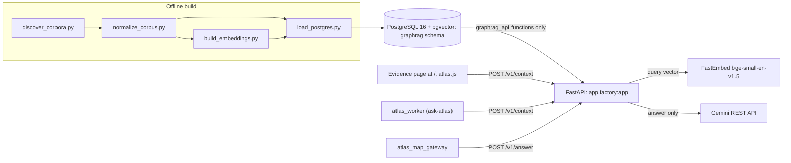

# Graph-RAG runtime: build, database and API

chapter: graphrag-runtime · paths: 'src/graphrag_runtime/' · as of 1047fc8

This chapter covers the Graph-RAG runtime: the code that turns the RCA and COSZO collections into one searchable PostgreSQL database and serves it over HTTP. Graph-RAG here means retrieval over a graph. Each retrieval unit, a passage called a chunk, is linked to the documents, sources and entities it belongs to, and entities are joined by typed edges (for example an `OBSERVES` predicate, `src/axial_earthquakes/build_axial_corpus.py:161`). RCA is the Regional Cabled Array, the seafloor observatory off Oregon (`app/static/index.html:11`; `docs/superpowers/specs/2026-09-23-atlas-map-design.md:11`). COSZO, the Cascadia Offshore Subduction Zone Observatory (`src/coszo_pdf_pipeline/build_coszo_pdf_graph.py:43`), is the other sensor network in the same corpus (`docs/superpowers/specs/2026-09-23-atlas-map-design.md:9`). Each collection is produced by a collection chapter and arrives in one of several manifest dialects (`discover_corpora.py:4`). The runtime makes them comparable in four offline steps (discover, normalize, embed, load) and loads them into PostgreSQL 16 with the pgvector extension. A small FastAPI service then exposes bounded search, graph-neighbour and tool-routing calls, plus a private evidence page. Its consumers are the Ask Atlas Worker ([ask-atlas](ask-atlas.md)) and the map chat gateway ([atlas-map-gateway](atlas-map-gateway.md)). The corpus itself is private and absent from this checkout.

Citations are relative to `src/graphrag_runtime/` unless they begin with another top-level directory. Secrets are named, never valued.

## At a glance

| Row | Detail |
|---|---|
| Kind | Pipeline (five offline Python scripts plus SQL migrations) and a web service (FastAPI API with a static evidence page), run with Docker Compose (`compose.yaml:1-41`). |
| Stack | Python 3.12 image (`Dockerfile:1`); FastAPI, pydantic v2, Gunicorn with Uvicorn workers, psycopg 3 with psycopg-pool and pgvector (`requirements.txt:1-7`); FastEmbed 0.7.3 running `BAAI/bge-small-en-v1.5`, 384 dimensions (`requirements-local-embeddings.txt:2`, `build_embeddings.py:20-27`); PostgreSQL 16 with pgvector (`compose.yaml:3`); plain HTML, CSS and JavaScript for the page (`app/static/`). |
| Entry points | `discover_corpora.py`, `normalize_corpus.py`, `build_embeddings.py`, `prefetch_model.py`, `load_postgres.py`; `migrations/001_initial.sql`, `migrations/002_local_api_role.sql`, `validate_loaded_build.sql`; service `app.factory:app` (`Dockerfile:13`) and `app.main:create_app` (`app/main.py:24`). |
| Reads | `data/**/manifest.json` and each collection's JSONL inputs, produced by these chapters: RCA Information (`arcada`), Websites, COSZO documents, Datasheets and Figures by [corpus-docs-web](corpus-docs-web.md); Instruments, FETCH, Nereus and OOI DAS geometry by [corpus-instruments-ops](corpus-instruments-ops.md); Literature by [literature-corpus](literature-corpus.md); Axial earthquakes and Axial monitoring by [axial](axial.md); COSZO Hub by [coszo-hub-core](coszo-hub-core.md); PI portal by [coszo-hub-sources](coszo-hub-sources.md) (`src/coszo_hub_tools/build_pi_portal_graph.py:406`); QAQC by [agentic-qaqc](agentic-qaqc.md); StationMetadata by [repo-ops-data](repo-ops-data.md) (`src/data_maintenance/clean_data_folder.py:133,146`). Also `runtime_data/GraphRAG/corpus_catalog.json` (from discover), `runtime_data/GraphRAG/normalized/` and `runtime_data/GraphRAG/embeddings/` (loader inputs), the FastEmbed model cache, environment variables (see Configuration), client requests and Gemini responses. |
| Writes or serves | Catalog, normalized load files and embedding files (see Interfaces). The `graphrag` schema, written only by the loader (`load_postgres.py`) and read only through four `graphrag_api` functions (`migrations/001_initial.sql:361-365`; `migrations/002_local_api_role.sql:17-20`). HTTP routes `/health`, `/v1/search`, `/v1/neighbors`, `/v1/tools`, `/v1/context`, `/v1/answer`; the page at `/` and `/assets/*`. Consumers: [ask-atlas](ask-atlas.md) calls `/v1/context` (`src/atlas_worker/src/index.js:417`); [atlas-map-gateway](atlas-map-gateway.md) calls `/v1/answer` (`src/atlas_map_gateway/main.py:18`); [eval-experiments](eval-experiments.md) reads normalized `chunks.jsonl` for its Microsoft GraphRAG pilot (`src/microsoft_graphrag_layer/README.md:15`). |

## How it works

1. **Catalog.** `discover_corpora.py` finds every `data/**/manifest.json` (`discover_corpora.py:279-280`) and maps each dialect to one collection record: a single canonical embedding input, graph node inputs, edge inputs, structured inputs, auxiliary inputs and tool definitions (`discover_corpora.py:183-255`). Each input gets a byte size, SHA-256 and JSONL record count (`discover_corpora.py:129-141`). The build fingerprint hashes every manifest and input hash but no timestamps (`discover_corpora.py:258-271`; `test_discover_corpora.py:49-51`). The catalog is written to `runtime_data/GraphRAG/corpus_catalog.json` (`discover_corpora.py:346`, `332-338`).
2. **Normalize.** `normalize_corpus.py` re-checks every catalogued file's byte size, SHA-256 and record count before reading it (`normalize_corpus.py:217-237`). The build ID is the full catalog fingerprint (`normalize_corpus.py:176-179`). Logical nodes are keyed by `(collection, local_id)` while every physical row stays in `node_records` (`normalize_corpus.py:243-262`). Chunks come only from embedding inputs, and each chunk links to documents, parents, pages, sources and entities (`normalize_corpus.py:265-281`, `51-59`). Edges become physical `edge_records` plus unique `edge_facts` (`normalize_corpus.py:282-292`). Tool definitions are collected (`normalize_corpus.py:303-318`). Before publishing, it asserts that every edge endpoint and chunk link resolves and that the counts equal the catalog totals (`normalize_corpus.py:326-367`), then deletes any previous output and renames the staging directory into place (`normalize_corpus.py:374-376`). That is not an atomic swap: for a moment neither directory exists.
3. **Embed.** `build_embeddings.py` reads only embedding inputs (`build_embeddings.py:106-143`), rejects blank text, missing IDs and duplicate collection/ID pairs (`build_embeddings.py:128-138`), and embeds with FastEmbed `passage_embed` in batches of 128 by default (`build_embeddings.py:235`, `317`). Each batch is checked for shape, finiteness and unit norm (`build_embeddings.py:318-324`), written to the memory-mapped matrix and flushed before the progress checkpoint advances (`build_embeddings.py:325-333`). The model is pinned by name, revision and ONNX SHA-256 (`build_embeddings.py:20-26`). The manifest records `distance_metric: cosine` and `pgvector_type: vector(384)` (`build_embeddings.py:350-351`).
4. **Load.** `load_postgres.py` refuses an unvalidated build and requires the build ID to equal the catalog fingerprint (`load_postgres.py:38-43`). It runs one transaction under an advisory lock (`load_postgres.py:46-50`). It inserts `corpus_builds` with `validation_passed=false` (`load_postgres.py:51-56`), then the tables with `ON CONFLICT DO NOTHING` (`load_postgres.py:65-133`), then the embeddings with model provenance (`load_postgres.py:135-154`). It compares row counts with the manifest and checks each embedding's text hash against its chunk (`load_postgres.py:156-189`), sets `validation_passed=true`, and with `--activate` calls `graphrag.activate_build` (`load_postgres.py:190-192`; `migrations/001_initial.sql:214-235`).
5. **Serve.** `app/factory.py:3` builds the app at import with `Settings.from_env()` (`app/config.py:18-34`). The app mounts `app/static` at `/assets` and serves `index.html` at `/` (`app/main.py:43-44`, `54-57`). Every `/v1/*` route requires the `X-API-Key` header, whose SHA-256 must match a digest in `GRAPHRAG_API_KEY_SHA256` (`app/main.py:49-52`). `PostgresRepository` never reads a base table; it calls the four `graphrag_api` functions through a connection pool with a transaction-local timeout (`app/repository.py:20-59`, `78-142`).
6. **Retrieve inside PostgreSQL.** `graphrag_api.hybrid_search` ranks chunks by pgvector cosine distance and by English full-text rank, each over the top n×4, fuses the two lists with reciprocal-rank fusion (k=60, default weights 0.55 vector and 0.45 lexical), and attaches one citation per chunk (`migrations/001_initial.sql:237-306`). `graphrag_api.graph_neighbors` walks `edge_facts` in both directions with a recursive query capped at three hops (`001_initial.sql:308-345`). `graphrag_api.route_tools` matches tool names and descriptions with full-text search and returns metadata only (`001_initial.sql:347-359`).
7. **Context and answer.** `/v1/context` runs search, then graph expansion from the top hits' nodes (at most 20 seeds), then tool routing (`app/main.py:98-122`). `/v1/answer` does the same and, when `GEMINI_API_KEY` is set, sends the first eight hits (2,400 characters each, 18,000 in total) and up to 30 relationships to Gemini. It maps `[chunk_id]` markers in the reply back to citations (`app/main.py:124-156`; `app/answering.py:16-69`). Without a key it returns 503 (`app/main.py:126-127`).
8. **Evidence page.** `index.html` loads `atlas.js`, which keeps the key in memory, calls only `/v1/context`, and renders hits, neighbours and tool hints (`app/static/index.html:44`; `app/static/atlas.js:3`, `37-50`, `26-36`). The page never calls `/v1/answer`.



Operators run the stack in this order (`README.md:36-62`; root `README.md:15-22`): `docker compose up -d db` (the init SQL creates the schema on first start, `compose.yaml:9-12`), then `docker compose --profile load run --rm loader` (`load_postgres.py --activate` over the mounted normalized and embedding directories, `compose.yaml:29-37`), then `docker compose up -d api` (`compose.yaml:18-28`). Discover, normalize, prefetch and embedding run outside Compose.

## Key files

Every tracked file under the paths has a row.

| File | Role |
|---|---|
| `discover_corpora.py` | Step 1. Builds `corpus_catalog.json` from every `data/**/manifest.json`, with per-input hashes, record counts and the build fingerprint (357 lines). |
| `normalize_corpus.py` | Step 2. Verifies catalog inputs, writes eleven JSONL files and `build_manifest.json`, asserts counts and endpoints, then deletes any previous output and renames the staging directory, which is not atomic (394 lines). |
| `build_embeddings.py` | Step 3. Deterministic, resumable 384-dimension embedding matrix with row mapping, progress checkpoint and manifest; `--reuse-dir` reuses unchanged vectors (391 lines). |
| `prefetch_model.py` | The download step for the local build. `EMBEDDINGS.md:22` calls it the only networked step, but the Dockerfile also downloads the model at image build (`Dockerfile:7`). Downloads the FastEmbed model and checks its ONNX SHA-256 (60 lines). |
| `load_postgres.py` | Step 4. One-transaction loader with count and provenance checks; `--activate` calls `graphrag.activate_build` (208 lines). |
| `validate_loaded_build.sql` | Post-load SQL gate with hard-coded expected counts. Nothing in the repository invokes it (see Open questions, item 7). |
| `migrations/001_initial.sql` | Schema, indexes, the four `graphrag_api` functions, `activate_build`, and the REVOKEs (374 lines). |
| `migrations/002_local_api_role.sql` | Development-only API role, password read from the environment, grants and session limits. |
| `app/factory.py` | Module-level `app = create_app()`, the target Gunicorn loads. |
| `app/main.py` | `create_app`: routes, `X-API-Key` check, error mapping, static mounts, Gemini wiring (161 lines). |
| `app/repository.py` | `PostgresRepository`: connection pool, transaction-local timeout, calls to the four SQL functions, row shaping (142 lines). |
| `app/models.py` | Pydantic request and response models with their bounds (115 lines). |
| `app/config.py` | `Settings` dataclass and environment parsing (34 lines). |
| `app/embeddings.py` | `BGE384Provider`, a lazy FastEmbed query embedder, and `checked_embedding`, a dimension guard (43 lines). |
| `app/answering.py` | `GeminiAnswerer`: frozen evidence package and the Gemini REST call (69 lines). |
| `app/__init__.py` | Exports `create_app` (5 lines). |
| `app/static/index.html` | Evidence page markup, served at `/`. |
| `app/static/atlas.js` | Evidence page logic: in-memory key, calls `/v1/context`, renders results (68 lines). |
| `app/static/atlas.css` | Skim: one minified line of styles, about 9.8 KB. |
| `compose.yaml` | Services `db`, `api` and `loader` (profile `load`); secrets come from `.env` (41 lines). |
| `compose.rootless.yaml` | Override for rootless Docker: host networking during image build for `api` and `loader`. |
| `Dockerfile` | `python:3.12-slim` image; bakes the model into `/models`; starts Gunicorn (13 lines). |
| `.dockerignore` | Keeps `.git`, `.env`, `tests` and caches out of the build context. |
| `requirements.txt` | Runtime dependencies (7 lines). |
| `requirements-local-embeddings.txt` | Adds `fastembed==0.7.3` to the runtime set. |
| `requirements-dev.txt` | Adds `httpx` (for the FastAPI test client) and `numpy`. |
| `README.md` | Operator guide: setup, build and load, public isolation, verification. |
| `EMBEDDINGS.md` | Embedding builder spec: model pin, outputs, resume rules, pgvector contract. |
| `FIELD_MAP.md` | Per-collection mapping of node files, chunk links and edge fields, with audited counts (see Open questions). |
| `test_discover_corpora.py` | Top-level catalog tests against the real `data/` tree. Outside the README's `tests/` command. |
| `tests/test_api.py` | API tests with a fake repository and embedder: authentication, bounds, composition. |
| `tests/test_build_embeddings.py` | Builder tests with a fake embedder: matrix, resume, changed source, duplicate IDs, vector reuse. |
| `tests/test_runtime_contract.py` | Counts from a real normalized build (needs private data), plus grant and SQL-text checks. |
| `tests/test_ui_assets.py` | Page checks: calls `/v1/context`, no `localStorage`, no key in the assets. |

## Interfaces

### Command-line entry points

| Command | Flags (default) | Source |
|---|---|---|
| `python discover_corpora.py --project-root PATH [--output PATH]` | `--output` defaults to `PATH/runtime_data/GraphRAG/corpus_catalog.json` | `discover_corpora.py:341-347` |
| `python normalize_corpus.py --project-root PATH [--catalog PATH] [--output PATH]` | defaults `runtime_data/GraphRAG/corpus_catalog.json` and `runtime_data/GraphRAG/normalized` | `normalize_corpus.py:380-387` |
| `python build_embeddings.py --catalog PATH --output-dir PATH --cache-dir PATH [--project-root PATH] [--batch-size 128] [--threads 4] [--reuse-dir PATH]` | the three path flags are required | `build_embeddings.py:359-368` |
| `python prefetch_model.py --cache-dir PATH [--threads 4]` | `--cache-dir` required | `prefetch_model.py:23-27` |
| `python load_postgres.py --dsn DSN --normalized PATH [--embeddings PATH] [--activate]` | `--dsn` and `--normalized` required | `load_postgres.py:196-202` |

### Python names

`discover_corpora.build_catalog(project_root, *, generated_at=None)`, `write_catalog(project_root, output)`, `COLLECTION_NAMES` (`discover_corpora.py:274`, `332`, `23`). `normalize_corpus.normalize(project_root, catalog_path, output)` (`normalize_corpus.py:173`). `build_embeddings.build_embeddings(...)`, `load_records(...)`, and the pins `MODEL_NAME`, `MODEL_REVISION`, `MODEL_SHA256`, `MODEL_DIMENSION` (`build_embeddings.py:20-25`, `95`, `229`). `load_postgres.load_build(dsn, normalized, *, activate, embeddings=None)` (`load_postgres.py:30`). `app.factory:app` and `app.main:create_app(*, settings, repository, embedding_provider)` (`app/factory.py:3`, `app/main.py:24-25`). `app.config.Settings.from_env()` (`app/config.py:8`, `19`). `app.repository.PostgresRepository` and the `Repository` protocol (`app/repository.py:10`, `20`). A search of the repository found no importer of these modules outside `src/graphrag_runtime/`.

### HTTP routes

Clients send the key in the `X-API-Key` header (`app/main.py:49`). Unknown JSON fields are rejected with 422 because every request model forbids extra fields (`app/models.py:8-9`; `tests/test_api.py:71-73`).

| Method and path | Auth | Request model | Response | Errors |
|---|---|---|---|---|
| `GET /` | none | none | `index.html` with `Cache-Control: no-store` (`app/main.py:54-57`) | none |
| `GET /health` | none | none | `{"status": "ok"}` (`app/main.py:59-64`) | 503 when `runtime_health().ready` is false |
| `POST /v1/search` | key | `SearchRequest` (`app/models.py:12-17`) | `{query, hits[]}` (`app/models.py:80-82`) | 401; 422 when both weights are 0; 503 |
| `POST /v1/neighbors` | key | `NeighborsRequest` (`app/models.py:31-34`) | `{neighbors[]}` (`app/models.py:109-110`) | 401; 503 |
| `POST /v1/tools` | key | `ToolsRequest` (`app/models.py:37-39`) | `{query, tool_hints[]}` (`app/models.py:113-115`) | 401; 503 |
| `POST /v1/context` | key | `ContextRequest` (`app/models.py:20-23`) | `{query, hits, neighbors, tool_hints}` (`app/models.py:85-87`) | 401; 422 when both weights are 0; 503 |
| `POST /v1/answer` | key | `AnswerRequest` (`app/models.py:90-91`) | `ContextResponse` plus `answer`, `answer_model`, `answer_latency_ms`, `input_tokens`, `output_tokens`, `answer_citations[]` (`app/models.py:100-106`) | 401; 422 when both weights are 0; 503 when no Gemini key or the model call fails |

Static files under `/assets/*` come from `app/static` (`app/main.py:44`). OpenAPI and documentation pages are disabled (`app/main.py:41-42`).

### SQL functions in schema `graphrag_api`

These four functions are the only objects the API role may execute (`migrations/002_local_api_role.sql:17-20`).

| Function | Signature and defaults | Bounds | Source |
|---|---|---|---|
| `runtime_health()` | returns `ready`, `build_id`, `chunk_count`, `embedding_count`; `ready` is true when the active build has chunks and every chunk has an embedding (`001_initial.sql:211`) | 2 s statement timeout | `migrations/001_initial.sql:198-212` |
| `hybrid_search(query_text, query_embedding vector(384), result_limit=12, collection_filter=NULL, model_filter='BAAI/bge-small-en-v1.5', lexical_weight=0.45, vector_weight=0.55)` | limit clamped to 1-50; at most 20 collections; query text capped at 1,000 characters | 5 s | `001_initial.sql:237-306` |
| `graph_neighbors(start_collection, start_local_id, max_depth=1, node_limit=100, predicate_allowlist=NULL)` | depth clamped to 0-3; node limit to 1-250; allowlist at most 50 predicates | 5 s | `001_initial.sql:308-345` |
| `route_tools(query_text, result_limit=8)` | limit clamped to 1-20 | 3 s | `001_initial.sql:347-359` |

### Files produced

- `runtime_data/GraphRAG/corpus_catalog.json` (`discover_corpora.py:346`).
- Normalized directory, built in `<output>.building` and renamed (`normalize_corpus.py:180`, `374-376`): `collections.jsonl`, `source_files.jsonl`, `node_records.jsonl`, `nodes.jsonl`, `node_identifiers.jsonl`, `chunks.jsonl`, `chunk_links.jsonl`, `edge_records.jsonl`, `edge_facts.jsonl`, `structured_records.jsonl`, `tools.jsonl`, `build_manifest.json` (`normalize_corpus.py:335-373`).
- Embedding directory: `embeddings.npy`, `embedding_rows.jsonl`, `embedding_progress.json`, `embedding_manifest.json` (`build_embeddings.py:246-249`, `342-355`).
- Model cache under `--cache-dir`, which holds `model_optimized.onnx` in FastEmbed's layout (`build_embeddings.py:210-218`; `prefetch_model.py:41`).

## Data shapes

### Catalog: `corpus_catalog.json`

| Field | Type | Meaning |
|---|---|---|
| `catalog_schema_version` | string | `"1.0"` (`discover_corpora.py:21`). |
| `build_fingerprint_sha256` | 64 hex characters | Hash of every collection's manifest and input hashes; no timestamps (`discover_corpora.py:258-271`). |
| `totals` | object | `collections`, `embedding_chunks`, `graph_node_records`, `graph_edge_records`, `structured_records`, and file counts (`discover_corpora.py:286-300`). |
| `collections[]` | object | `collection_id`, `name`, `scope`, `schema_version`, `validation_status`, `root_path`, `manifest` descriptor (role `collection_manifest`), and the input lists (`discover_corpora.py:235-255`). |
| `*_inputs[]`, `tool_definitions[]` | descriptor | `path`, `role` (`embedding`, `graph_node`, `graph_edge`, `structured`, `auxiliary` or `tool_definition`), `byte_size`, `sha256`, `records`, `text_records`, `id_fields` (`discover_corpora.py:129-141`). |
| `validation` | object | `passed` and the list of checks (`discover_corpora.py:317-328`). `passed` is always `true` in a written catalog (`discover_corpora.py:318`): most listed checks are enforced by raising `CatalogError` (`discover_corpora.py:95`, `97`, `106`, `131`, `284`). One listed check, "runtime indexes are kept outside data", has no code that enforces it (`discover_corpora.py:326`). |

### Normalized files

| File | Key fields | Source |
|---|---|---|
| `collections.jsonl` | `build_id`, `collection_id`, `name`, `root_path`, `scope`, `manifest` | `normalize_corpus.py:200-204` |
| `source_files.jsonl` | `file_id` (`collection_id:relative_path`), `relative_path`, `roles[]`, `sha256`, `byte_size`, `record_count` | `normalize_corpus.py:219`, `238-242` |
| `node_records.jsonl` | `local_id`, `record_kind` (the file name stem), `line_no`, `payload` (the full row), `payload_sha256`, `source_is_untrusted_data` (true when absent) | `normalize_corpus.py:246-253` |
| `nodes.jsonl` | `local_id`, `display_name`, `summary`, `source_url`, `record_kinds[]`, `representative_payload` (the first row seen) | `normalize_corpus.py:257-262`, `322-324` |
| `node_identifiers.jsonl` | `identifier`, `identifier_type` (for example `local_id`, `aliases`, `doi`) | `normalize_corpus.py:263-264`, `339-342` |
| `chunks.jsonl` | `chunk_id` (equal to the node's local ID), `node_local_id`, `title`, `section_heading`, `body`, `source_url`, `locator`, `text_sha256`, `metadata` (the full row) | `normalize_corpus.py:270-275` |
| `chunk_links.jsonl` | `chunk_id`, `link_type` (`DOCUMENT`, `PARENT`, `PAGE`, `SOURCE` or `ENTITY`), `target_local_id` | `normalize_corpus.py:276-281`, `344-347` |
| `edge_records.jsonl` | `raw_edge_id`, `source_local_id`, `predicate`, `target_local_id`, `payload` | `normalize_corpus.py:284-291` |
| `edge_facts.jsonl` | unique `collection_id`, `source_local_id`, `predicate`, `target_local_id` | `normalize_corpus.py:292`, `349-352` |
| `structured_records.jsonl` | `record_id` (first ID field, else `line:N`), `subject_id`, `observed_at`, `payload` | `normalize_corpus.py:295-302` |
| `tools.jsonl` | `name`, `description`, `input_schema`, `runtime`, `manifest_path`, `metadata` | `normalize_corpus.py:309-318` |
| `build_manifest.json` | `build_id`, `catalog_fingerprint_sha256`, `created_at_utc`, `counts{}`, `assertions{}`, `passed` | `normalize_corpus.py:368-372` |

### Embedding files

- `embeddings.npy`: float32 matrix, shape (record count, 384), unit-normalized (`build_embeddings.py:274-277`, `322-324`).
- `embedding_rows.jsonl`: `row_index`, `collection_id`, `source_path`, `source_line`, `chunk_id`, `record_id`, `text_sha256` (`build_embeddings.py:56-65`).
- `embedding_progress.json` (checkpoint, `status` `building` or `complete`) and `embedding_manifest.json` (final). Shared fields: `catalog_fingerprint_sha256`, `model_name`, `model_source_repository`, `model_revision`, `model_sha256`, `dimension`, `record_count`, `mapping_sha256`, `next_row`, `reused_record_count`, `incremental_reuse`, `embedded_row_indices`. The manifest adds `model_id`, `model_artifact_sha256`, `matrix_file`, `matrix_sha256`, `mapping_file`, `dtype`, `distance_metric`, `pgvector_type`, `model_max_tokens`, `fastembed_version` (`build_embeddings.py:287-304`, `338-355`).

### PostgreSQL schema `graphrag` (`migrations/001_initial.sql`)

| Table | Key columns | Source |
|---|---|---|
| `corpus_builds` | `build_id` (64 hex, primary key), `catalog_fingerprint_sha256` (unique), `schema_version`, `created_at_utc`, `manifest jsonb`, `validation_passed bool` | `001_initial.sql:11-18` |
| `active_corpus` | `singleton` (primary key, must be true), `build_id` | `001_initial.sql:20-23` |
| `collections` | `(build_id, collection_id)` primary key, `name`, `root_path`, `scope`, `manifest` | `001_initial.sql:25-33` |
| `source_files` | `source_file_pk`, `file_id` (unique per build), `sha256`, `byte_size`, `record_count` | `001_initial.sql:35-46` |
| `source_file_roles` | `(source_file_pk, role)`; role is `embedding`, `graph_node`, `graph_edge`, `structured`, `auxiliary` or `tool` | `001_initial.sql:48-52` |
| `nodes` | `node_pk`; unique `(build_id, collection_id, local_id)`; `display_name`, `summary`, `source_url`, `record_kinds text[]`, `representative_payload jsonb` | `001_initial.sql:54-66` |
| `node_records` | physical rows: `line_no`, `node_pk`, `record_kind`, `payload_sha256`, `source_is_untrusted_data bool default true`, `payload jsonb`; unique `(source_file_pk, line_no)` | `001_initial.sql:68-78` |
| `node_identifiers` | `(node_pk, identifier, identifier_type)`; index on `lower(identifier)` | `001_initial.sql:80-87` |
| `chunks` | `chunk_pk`; unique `(build_id, collection_id, chunk_id)`; `node_pk` unique; `title`, `section_heading`, non-blank `body`, `source_url`, `locator`, `text_sha256`, `metadata`; generated `search_tsv` with weights A (title), B (heading), C (body) | `001_initial.sql:89-111` |
| `chunk_links` | `(chunk_pk, link_type, target_node_pk)` | `001_initial.sql:113-118` |
| `edge_records` | physical edges: `raw_edge_id`, `source_node_pk`, `predicate`, `target_node_pk`, `payload` | `001_initial.sql:120-131` |
| `edge_facts` | unique `(build_id, collection_id, source_node_pk, predicate, target_node_pk)`; indexes on source, target and predicate | `001_initial.sql:133-146` |
| `structured_records` | `record_id`, `subject_id`, `observed_at`, `payload jsonb` with a GIN `jsonb_path_ops` index | `001_initial.sql:148-161` |
| `tools` | unique `(build_id, collection_id, name)`; `input_schema`, `description`, generated `search_tsv` | `001_initial.sql:163-181` |
| `embeddings` | `(chunk_pk, model_id)` primary key; `model_revision`, `model_artifact_sha256`, `dimensions` (must be 384), `normalized`, `text_sha256`, `embedding vector(384)`; HNSW index with `m=16`, `ef_construction=64` | `001_initial.sql:183-196` |

### API response models (`app/models.py`)

- `SearchHit`: `chunk_id`, `collection_id`, `collection_label`, `title`, `text`, `score`, `lexical_score`, `vector_score`, `citations[]` (`source_id`, `title`, `url`), `metadata` (`node_local_id`, `locator`) (`models.py:42-58`; `repository.py:89-103`).
- `Neighbor`: `collection_id`, `local_id`, `name`, `depth`, `direction` (`out` or `in`), `predicate`, `source_url` (`models.py:61-68`; `repository.py:122-127`).
- `ToolHint`: `collection_id`, `name`, `description`, `score`, `required_arguments[]`, `input_schema` (`models.py:71-77`; `repository.py:137-141`).
- `AnswerCitation`: `id`, `title`, `url` (`models.py:94-97`).

## Configuration and secrets

| Name | Read at | Purpose | Default or required |
|---|---|---|---|
| `POSTGRES_PASSWORD` | `compose.yaml:7`, `34` | Owner password for the `db` container and the loader. | Required by Compose (`:?`). Set in `.env`. |
| `GRAPHRAG_API_DATABASE_PASSWORD` | `compose.yaml:8`, `21`; `migrations/002_local_api_role.sql:3-5` | Password of the API database role. | Required by Compose. Set in `.env`. |
| `GRAPHRAG_API_KEY_SHA256` | `app/config.py:19-24`; `compose.yaml:22` | Comma-separated SHA-256 hex digests of accepted client keys. Input is case-insensitive and stored lowercased (`app/config.py:20`). The server never holds the key. | Required, at least one. Set in `.env`. |
| `GRAPHRAG_API_KEY` | `.env.example:18`; read by clients, for example `src/atlas_map_gateway/config.py:42` | The raw key a client sends in `X-API-Key`. The API does not read it. | Client side only. |
| `DATABASE_URL` | `app/config.py:25-27`; `compose.yaml:21` (api), `33` (loader, unused) | Connection string for `graphrag_api_role`. | Required by the API. |
| `GRAPHRAG_STATEMENT_TIMEOUT_MS` | `app/config.py:28`; `compose.yaml:25`; `app/repository.py:57-58` | Timeout set per transaction by the repository; whether it also bounds the functions is Open question 11. | `4000`; clamped to 250-15000. |
| `GRAPHRAG_POOL_MIN`, `GRAPHRAG_POOL_MAX` | `app/config.py:29-30` | Connection pool size per Gunicorn worker. | `1` and `10`; clamped to 1-20 and 1-50. |
| `GRAPHRAG_EMBEDDING_MODEL` | `app/config.py:32`; `app/repository.py:84` | Model name for query embedding and the `hybrid_search` filter. | `BAAI/bge-small-en-v1.5`. |
| `GRAPHRAG_MODEL_CACHE` | `app/embeddings.py:28`; `Dockerfile:10` | FastEmbed cache directory for the API. | Unset (FastEmbed default). The image sets `/models`. |
| `GRAPHRAG_EMBEDDING_OFFLINE` | `app/embeddings.py:29`; `Dockerfile:10` | When `1`, `true` or `yes`, FastEmbed uses local files only. | Unset (may download). The image sets `true`. |
| `GEMINI_API_KEY` | `app/config.py:33`; `compose.yaml:23` | Enables `/v1/answer`. Passed only to the API container (`README.md:20-21`). | Empty, so `/v1/answer` returns 503. |
| `GRAPHRAG_ANSWER_MODEL` | `app/config.py:34`; `compose.yaml:24`; `.env.example:5` | Gemini model name. | `gemini-2.5-flash`. |
| `GRAPHRAG_API_PORT` | `compose.yaml:26`; `.env.example:20`; `src/atlas_map_gateway/config.py:39` | Loopback port published for the API. | `8000` in Compose. |
| `HF_HUB_OFFLINE` | `build_embeddings.py:193` (set to `1`); `prefetch_model.py:28` (removed); `README.md:55` | Hugging Face hub offline switch. Prefetch must reach the network. | Build: set. Prefetch: removed. |
| `OWNER_DATABASE_URL` | `README.md:60` (shell placeholder only) | Owner connection string passed as `--dsn`. The code does not read it. | Operator supplied. |

## Run and test

```sh
# Environment (README.md:31-34). Fill .env; the client key's digest goes in GRAPHRAG_API_KEY_SHA256.
cp ../../.env.example ../../.env
printf %s "$GRAPHRAG_API_KEY" | sha256sum | awk '{print $1}'

# Discover and normalize (README.md:39; src/DATA_CORPUS_METHOD.md:106-108)
python3 src/graphrag_runtime/discover_corpora.py --project-root <project root>
python normalize_corpus.py --project-root /path/to/project --output /path/to/normalized

# Embed (README.md:53-59)
python src/graphrag_runtime/prefetch_model.py --cache-dir runtime_data/GraphRAG/models/fastembed
HF_HUB_OFFLINE=1 python src/graphrag_runtime/build_embeddings.py \
  --catalog runtime_data/GraphRAG/corpus_catalog.json --project-root "$PWD" \
  --cache-dir runtime_data/GraphRAG/models/fastembed --output-dir runtime_data/GraphRAG/embeddings

# Load and activate (README.md:60-61)
python load_postgres.py --dsn "$OWNER_DATABASE_URL" --normalized /path/to/normalized \
  --embeddings /path/to/embeddings --activate

# Compose (root README.md:15-22; rootless variant README.md:81-87)
cd src/graphrag_runtime
docker compose up -d db
docker compose --profile load run --rm loader
docker compose up -d api
GRAPHRAG_API_PORT=18000 docker compose -f compose.yaml -f compose.rootless.yaml up -d db   # rootless hosts only
```

Verification (`README.md:93-104`, `EMBEDDINGS.md:55-60`):

```sh
python -m unittest discover -s tests -v          # run from src/graphrag_runtime (imports need it on sys.path)
python -m py_compile normalize_corpus.py load_postgres.py app/*.py tests/*.py
docker compose config --quiet
PYTHONPATH=src/graphrag_runtime python3 -m unittest -v src/graphrag_runtime/tests/test_build_embeddings.py
```

Not documented, and needs private data: `python -m unittest test_discover_corpora` (from `src/graphrag_runtime`, `test_discover_corpora.py:9`, `15-16`). `tests/test_runtime_contract.py` needs a normalized build under `runtime_data/GraphRAG/normalized` (`tests/test_runtime_contract.py:7-8`, `13`). The README's production checklist: apply both migrations to an empty PostgreSQL/pgvector database, load the build, verify manifest counts, and exercise each API function with only the restricted role (`README.md:101-104`).

## Decisions and constraints

- **Build identity is the full catalog fingerprint.** Truncation was rejected so that independently built snapshots cannot share a database identity (`normalize_corpus.py:177-179`, code comment). The loader requires the build ID to equal the fingerprint and refuses a collision (`load_postgres.py:42-43`, `62-63`; `migrations/001_initial.sql:12-13`).
- **Node identity is `(collection_id, local_id)`.** Raw IDs are not globally unique; 71 occur in more than one collection, so nodes must not be merged on raw ID alone (`FIELD_MAP.md:5-7`, `41-43`; `normalize_corpus.py:254`; `migrations/001_initial.sql:64`).
- **Physical rows are kept, logical nodes are derived.** Every source row survives in `node_records` or `edge_records`; the logical view is what queries use (`README.md:42-45`; `normalize_corpus.py:248-262`; `FIELD_MAP.md:6-7`).
- **Only canonical embedding inputs are embedded.** Auxiliary JSONL, such as the Axial visual chunks, is catalogued but not embedded a second time (`discover_corpora.py:308-311`; `FIELD_MAP.md:51-52`).
- **The embedding model is pinned and verified.** Name, revision and ONNX SHA-256 are fixed (`build_embeddings.py:20-26`); the builder and prefetch refuse a mismatched file (`build_embeddings.py:201`, `218`, `224-225`; `prefetch_model.py:41-45`). The code comment says the hash check "rejects silently changed upstream artifacts" (`prefetch_model.py:38-39`). Why prefetch is a separate step is inferred: the build runs with `HF_HUB_OFFLINE=1` (`build_embeddings.py:193`), so the download has to happen first.
- **Vectors are reused only for identical text from the same pinned model.** Reuse keys on collection, record ID and text hash, not row index, so catalog growth does not force re-embedding (`build_embeddings.py:160-175`; commit `28ba439`).
- **The public API role has no table access.** It can execute four functions, and each of them sets a fixed `search_path` (`migrations/001_initial.sql:201`, `251`, `318`, `350`). The grants are at `migrations/002_local_api_role.sql:14-20` and `22-25`, and the REVOKEs at `migrations/001_initial.sql:361-374` (`README.md:69-76`; `tests/test_runtime_contract.py:34-41`).
- **No SQL reaches the API.** The repository passes parameters only, and the API accepts no raw `tsquery` fragments (`README.md:73-75`; `app/repository.py:82-86`, `114-116`, `134-135`).
- **Activation is one pointer flip.** It runs under an advisory lock and refuses builds that have not passed validation (`migrations/001_initial.sql:214-235`; `README.md:64-67`).
- **API keys are stored only as digests, and more than one may be valid.** The server splits `GRAPHRAG_API_KEY_SHA256` on commas (`app/config.py:20`), compares digests in constant time (`app/main.py:50-51`), and returns 401 otherwise (`app/main.py:52`). Using several digests for rotation is inferred; the code does not say so.
- **Development credentials are development-only.** The role file says it is "Development-only role used by compose.yaml" and that production provisions the role through its secret manager (`migrations/002_local_api_role.sql:1-2`; `README.md:47-49`). Commit `e91311a` replaced committed development literals with required `.env` values (`compose.yaml:7-8`, `21-22`).
- **The Gemini key goes only to the API container.** It must never reach a browser or the public Pages preview (`README.md:20-21`; `compose.yaml:23`).
- **The browser keeps the key in memory.** It is never saved to local storage or a URL (`README.md:12-14`; `app/static/atlas.js:3`; `tests/test_ui_assets.py:12`).
- **Tool routing returns metadata; tools never run here.** `route_tools` returns descriptions and argument names, and live tools are a separate layer (`migrations/001_initial.sql:347-359`; `app/repository.py:133-142`; `src/DATA_CORPUS_METHOD.md:141`).
- **RCA Information is the display name of `arcada`.** The internal ID stays `arcada` for provenance (`discover_corpora.py:24-26`; commit `29dca19`; `src/DATA_CORPUS_METHOD.md:194-197`).
- **Every retrieval input is bounded.** Result limits, collection filters, depth, node limit, predicate allowlist and query length all have caps (`app/models.py:13-34`; `migrations/001_initial.sql:258`, `265`, `280`, `338`, `344`, `358`).
- **Interactive API documentation is off** (`app/main.py:41-42`). The reason is not recorded; keeping the public surface small is inferred.

## History

- **2026-09-20, `833c343`:** initial runtime (catalog, normalizer, embedder, loader, schema, API, tests). The first migration already creates an HNSW index (`migrations/001_initial.sql:195-196`), while `EMBEDDINGS.md:51-53` in the same commit says an exact scan is viable. See Open questions.
- **2026-09-21, `e91311a`:** portable Compose stack and rootless override. Committed development credentials were replaced by required `.env` values, and the API role's password moved to the environment (`compose.yaml`; `migrations/002_local_api_role.sql`).
- **2026-09-21, `29dca19`:** the `arcada` collection is presented as "RCA Information" (`discover_corpora.py:24-26`; `app/repository.py:7`).
- **2026-09-21, `3b03745` and `8eb1160`:** the evidence page was added at `/` (`app/static/atlas.js`, `index.html`, `tests/test_ui_assets.py`), then its asset paths were made relative.
- **2026-09-21, `d6b2339`:** `POST /v1/answer` with Gemini synthesis, the frozen evidence package, and citation mapping (`app/answering.py`; `app/main.py:124-156`).
- **2026-09-24, `2315253` and `7f66a9c`:** Axial monitoring and OOI DAS geometry added to `COLLECTION_NAMES` (`discover_corpora.py:27`, `36`).
- **2026-09-24, `de23f70`:** PI-portal tool IDs get their own primary-ID rule (`normalize_corpus.py:118-121`). The contract expectations moved from 13 to 15 collections and from 6,565 to 6,663 chunks (`tests/test_runtime_contract.py:15-19`; `test_discover_corpora.py:22`).
- **2026-09-24, `28ba439`:** FETCH added to `COLLECTION_NAMES` (`discover_corpora.py:32`), and incremental vector reuse via `--reuse-dir` added to the builder (`build_embeddings.py:160-189`, `367`). The collection-count expectation was not changed (see Gotchas).

## Gotchas

- **The collection count is inconsistent at HEAD.** `COLLECTION_NAMES` maps 16 names (`discover_corpora.py:23-42`), but `test_discover_corpora.py:19-22` requires the discovered IDs to equal all 16 and the total to equal 15, which no data set can satisfy. Commit `28ba439` added FETCH without updating that test.
- **Physical rows collapse per collection.** Two rows with the same local ID in one collection become one logical node. The first row in sorted file order supplies `display_name` and `representative_payload` (`normalize_corpus.py:217`, `254-262`). The expected counts in `FIELD_MAP.md:54-58` show this (for example 1,728 physical and logical Nereus rows, but 3,161 physical and 2,136 logical COSZO Hub rows).
- **Structured rows without a fallback ID get `line:N`.** Only `ID_FALLBACKS` are read (`normalize_corpus.py:37-41`, `295`). These IDs are unique only within a file, through `(source_file_pk, line_no)` (`migrations/001_initial.sql:157`).
- **The loader's count checks have a blind spot.** They cover nine tables, not `node_identifiers`, `chunk_links` or `source_file_roles`, and every insert uses `ON CONFLICT DO NOTHING` (`load_postgres.py:65-133`, `156-161`). A dropped row in those tables passes the load.
- **Chunk ID rules must agree across two files.** The embedder takes the first of `chunk_id`, `id`, `entity_id`, and so on (`build_embeddings.py:29-36`). The normalizer uses a per-file primary ID (`normalize_corpus.py:114-134`). A mismatch is a `KeyError` in the loader (`load_postgres.py:153`), not a clean error (inferred).
- **Query and passage embeddings use different FastEmbed entry points.** The API calls `query_embed` (`app/embeddings.py:32`) and the builder calls `passage_embed` (`build_embeddings.py:317`). The API checks dimensions but not the model hash (`app/embeddings.py:28-35`, `39-43`). A different cached file would be used silently (inferred).
- **A different embedding model name yields lexical-only results with no error.** Vector hits filter on `model_id` (`migrations/001_initial.sql:264`); lexical hits do not (`001_initial.sql:273-274`). The repository passes the configured name on every search (`app/repository.py:84`) (inferred from the SQL).
- **Scores are small rank values, not probabilities.** With default weights the best possible `score` is 1/61, about 0.016 (`001_initial.sql:280-281`). The page prints three decimals (`app/static/atlas.js:24`).
- **The connection budget is exactly full.** Two Gunicorn workers, each with a pool maximum of 10, make 20 connections (`Dockerfile:13`; `app/config.py:13`, `30`), equal to the role's `CONNECTION LIMIT 20` (`migrations/002_local_api_role.sql:12-13`). Raising `GRAPHRAG_POOL_MAX` without raising the role limit makes connections fail, which surface as 503s (inferred).
- **Graph walks are bounded by depth, not by the node limit.** `graph_neighbors` makes one database call per seed, up to 20 per request (`app/repository.py:107-131`). Its recursion stops at three hops and cycles per path, and `LIMIT` applies after the walk (`migrations/001_initial.sql:321-345`). Hub nodes can be slow until the 5 s timeout (inferred; measure).
- **The Gemini key is in a URL.** The request puts `key=` in the query string (`app/answering.py:50`). Failures are logged with `LOGGER.exception` (`app/main.py:152`, `155`). Check that no logged text includes the URL (inferred from `urllib` behaviour).
- **A timeout while reading the Gemini response is reported as a generic error.** A read timeout raises `TimeoutError`, which is not in the caught tuple (`app/answering.py:57`), so it becomes the generic 503 (`app/main.py:154-156`) (inferred).
- **The Gunicorn timeout is shorter than the Gemini timeout.** Workers get 30 s (`Dockerfile:13`); the Gemini call allows 45 s (`app/answering.py:33`). Whether a worker is killed depends on the worker class's heartbeat (inferred).
- **The model in the image is not hash-checked.** The Dockerfile downloads the model with no SHA-256 check (`Dockerfile:7`), unlike `prefetch_model.py` (`prefetch_model.py:41-45`) (FastEmbed's own checks are not inspected here).
- **The untrusted-data marker never leaves the database.** It is stored (`normalize_corpus.py:252`; `migrations/001_initial.sql:75`) but no API model carries it (`app/models.py:42-58`), and the Gemini evidence package does not include it (`app/answering.py:16-29`).
- **Migrations run only on an empty volume.** The Compose init scripts run when the `pgdata` volume is first created (`compose.yaml:9-12`; official image behaviour, inferred). Editing a migration does not change an existing volume.
- **The local stack runs as a superuser.** `graphrag_owner` is the image's bootstrap user (`compose.yaml:5-6`), and it runs the migrations that create the `SECURITY DEFINER` functions (`compose.yaml:11-12`). In the official image that user is a superuser (inferred; confirm with `\du`).
- **The loader's `DATABASE_URL` is unused.** `load_postgres.py` reads no environment variable; the connection comes from `--dsn` (`compose.yaml:33-34`; `load_postgres.py:198`).
- **The API role script stops silently without its password.** `002_local_api_role.sql` runs `\quit` when the variable is missing (`002:8-9`). Compose makes the variable required (`compose.yaml:8`), so this matters only for manual runs.
- **A stale comment names a module that does not exist.** `app/main.py:161` says to use `app.asgi:create_app`; there is no `app/asgi.py`. The Dockerfile runs `app.factory:app` (`Dockerfile:13`).
- **The app is built at import.** `app/factory.py:3` creates the app when the module loads, so a missing `GRAPHRAG_API_KEY_SHA256` or `DATABASE_URL` fails the import (`app/config.py:21-27`).
- **API tests skip only when FastAPI is missing.** `tests/test_api.py` catches `ImportError` (`tests/test_api.py:4-9`) and skips the class (`39`). Importing the test client without httpx raises `RuntimeError` instead, which that `except` does not catch, so the module errors rather than skips (Starlette 1.0.1 and 1.7.0 in the local uv cache, `starlette/testclient.py`; inferred for other versions).
- **`/health` reports not ready until embeddings match.** It is 503 unless every chunk of the active build has an embedding (`migrations/001_initial.sql:204-211`; `app/main.py:62-63`).
- **The page's collection count is hard-coded.** `index.html:20` says "13 collections" as fixed text, which will be wrong for a build with a different count.
- **Citation links are escaped but not scheme-checked.** `atlas.js:22` HTML-escapes the URL but does not reject `javascript:`. Source data is curated, so the risk is low (inferred).
- **Old development credentials remain in git history.** From the initial commit `833c343` (2026-09-20) through `c9267e0`, the parent of `e91311a`, `compose.yaml` holds the placeholder owner password `change-me`, a literal password for `graphrag_api_role` and a literal SHA-256 digest of the API client key (`git show c9267e0:src/graphrag_runtime/compose.yaml`; values deliberately not recorded here). `e91311a` replaced them with required `.env` values, and HEAD no longer contains them. If the API-role password or the key behind that digest was ever used outside local development, rotate it.

## Glossary

| Term | Meaning |
|---|---|
| Graph-RAG | Retrieval-augmented generation over a graph: passages (chunks) linked to entities, documents and sources, with typed edges between entities. |
| RCA | Regional Cabled Array (`app/static/index.html:11`), the seafloor observatory off Oregon (`docs/superpowers/specs/2026-09-23-atlas-map-design.md:9-11`). |
| COSZO | Cascadia Offshore Subduction Zone Observatory, the other sensor network in the corpus (`docs/superpowers/specs/2026-09-23-atlas-map-design.md:9`; `src/coszo_pdf_pipeline/build_coszo_pdf_graph.py:43`). |
| OOI | Ocean Observatories Initiative, which operates the cabled array (general knowledge; the code uses the abbreviation, `discover_corpora.py:36`). |
| Axial | Axial Seamount, the underwater volcano instrumented by the Axial collections (`discover_corpora.py:28`). |
| DAS | Distributed acoustic sensing, fibre-optic sensing along a cable (general knowledge; `discover_corpora.py:36` uses the term "OptaSense DAS"). |
| FETCH | Acoustic ranging stations (`discover_corpora.py:32`). |
| PI portal | The RCA PI (principal investigator) data portal (`discover_corpora.py:37`). |
| QAQC | Quality assurance and quality control (`discover_corpora.py:38`). |
| HITL | Human in the loop: the live QAQC notes source (`src/agentic_qaqc/build_agentic_graph.py:54`; `FIELD_MAP.md:50`). |
| StationXML | Seismic-station metadata XML; the collection is `OOI StationXML metadata` (`discover_corpora.py:39`; the format itself is general knowledge). |
| FDSN | Federation of Digital Seismograph Networks, the seismic data standards body; the term appears in `FIELD_MAP.md:39`. |
| Arcada | Upstream package behind the RCA Information collection (`discover_corpora.py:24-26`; `src/DATA_CORPUS_METHOD.md:194-197`). |
| Chunk | One retrieval passage: a text body with a full-text column, `search_tsv` (a tsvector, not an embedding). Its embedding is a separate row in `graphrag.embeddings` (`migrations/001_initial.sql:89-111`, `183-196`). |
| Logical node | One entity per `(collection_id, local_id)` after deduplication (`normalize_corpus.py:254-262`). |
| Physical record | One raw JSONL row, kept in `node_records` or `edge_records` (`migrations/001_initial.sql:68-78`, `120-131`). |
| Edge fact | Unique `(collection, source, predicate, target)` row used for traversal (`normalize_corpus.py:292`). |
| Predicate | The typed relation on an edge, for example `OBSERVES` (`src/axial_earthquakes/build_axial_corpus.py:161`). The source field may be `relationship_type` (`normalize_corpus.py:44`); the API field is `predicate` (`app/models.py:67`). |
| Structured record | Exact-match sidecar row kept as JSONB and not embedded (`normalize_corpus.py:293-302`). |
| Auxiliary input | Catalogued JSONL that is neither embedded nor node-linked (`discover_corpora.py:211-212`; `FIELD_MAP.md:51-52`). |
| Tool definition | Metadata for a live tool that is routed but never executed here (`discover_corpora.py:214-216`; `app/repository.py:133-142`). |
| Build ID, fingerprint | SHA-256 over all catalog inputs, used as the build's identity (`discover_corpora.py:258-271`; `normalize_corpus.py:179`). |
| Active build | The single build queries read, named in `graphrag.active_corpus` (`migrations/001_initial.sql:20-23`, `214-235`). |
| Embedding | A list of floats that represents a text's meaning; here 384 of them (`build_embeddings.py:25`). |
| BGE | BAAI's `bge-small-en-v1.5` English embedding model (`build_embeddings.py:20`). |
| FastEmbed | Python library that runs ONNX embedding models (`build_embeddings.py:195`). |
| ONNX | Open model file format; the pinned file is `model_optimized.onnx` (`build_embeddings.py:23`). |
| pgvector | PostgreSQL extension that stores vectors and ranks them (`migrations/001_initial.sql:3`; `EMBEDDINGS.md:50-53`). |
| Cosine distance | Angle-based distance, written `<=>` in SQL (`migrations/001_initial.sql:260`). |
| HNSW | Approximate nearest-neighbour index type in pgvector (`migrations/001_initial.sql:195-196`). |
| Full-text search | PostgreSQL lexical ranking with `tsvector` and `websearch_to_tsquery` (`migrations/001_initial.sql:102-106`, `270`). |
| RRF | Reciprocal-rank fusion: merges two rank lists with 1/(k + rank), k = 60 here (`migrations/001_initial.sql:280-281`). |
| SECURITY DEFINER | A function that runs with its owner's privileges rather than the caller's (`migrations/001_initial.sql:198-200`). |
| Advisory lock | Application-level PostgreSQL lock used to serialise loads and activation (`load_postgres.py:50`; `migrations/001_initial.sql:223`). |
| MVCC | PostgreSQL's multi-version concurrency control, which gives readers a consistent snapshot (`README.md:66-67`). |
| Recursive CTE | `WITH RECURSIVE`, the SQL form used for graph walks (`migrations/001_initial.sql:321-345`). |
| DSN | Data source name, the connection string passed to `--dsn` (`load_postgres.py:198`). |
| FastAPI, Gunicorn, Uvicorn, pydantic | The Python web framework, process manager, ASGI server and data-validation library (`requirements.txt:1-7`). |
| psycopg, psycopg-pool | PostgreSQL driver and its connection pool (`requirements.txt:4-5`). |
| Constant-time compare | `hmac.compare_digest`, which compares digests without leaking timing (`app/main.py:51`). |
| Gemini | Google's LLM family; the default model is `gemini-2.5-flash` (`app/config.py:16`). |
| Evidence package | The frozen hits and relationships given to the answer model (`app/answering.py:16-29`). |
| JSONL | JSON Lines: one JSON object per line. |
| API | Application programming interface. Here, the FastAPI routes built by `create_app` (`app/main.py:24`). |
| HTTP | Hypertext Transfer Protocol, the transport for the API routes (`app/main.py:49`). |
| SQL | Structured Query Language, used by the migrations and the four `graphrag_api` functions (`migrations/001_initial.sql:198-359`). |
| SHA-256 | SHA-2 hash with a 256-bit digest, used for file, build and API-key digests (`discover_corpora.py:76-81`; `app/main.py:50`). |
| GIN | Generalized inverted index, used here for full-text and JSONB search (`migrations/001_initial.sql:111`, `161`). |
| Pin | A fixed version, revision or hash that a build must match (`build_embeddings.py:20-26`). |

## Open questions

1. **Which collection set is current?** Four counts appear. The SQL gate, the status file, the README, `FIELD_MAP.md` and the method's prose say 13 (`validate_loaded_build.sql:10`; `runtime_data/GraphRAG/deployment_status.json:7`; `README.md:3`; `FIELD_MAP.md:54-58`; `src/DATA_CORPUS_METHOD.md:95-96`). The method's own table lists 14 rows (`src/DATA_CORPUS_METHOD.md:153-168`). The tests expect 15 (`tests/test_runtime_contract.py:15`; `test_discover_corpora.py:22`). The code maps 16 (`discover_corpora.py:23-42`). Answer: run `discover_corpora.py` on the current release and compare `totals.collections`, and check which of the AxialMonitoring, OOIDASGeometry and FETCH manifests exist.
2. **Is the HNSW index intended?** `EMBEDDINGS.md:51-53` says an exact scan is viable and HNSW can wait. `migrations/001_initial.sql:195-196` builds HNSW, and `001_initial.sql:253` tunes its iterative scan. Answer: decide, then run `EXPLAIN ANALYZE` on `hybrid_search` against a loaded build and record the pgvector version (the image tag `pgvector/pgvector:pg16` does not pin it, `compose.yaml:3`).
3. **Which normalization rules are real?** `FIELD_MAP.md` specifies rules the normalizer does not implement. These are the parent-title fallback for chunk titles (`FIELD_MAP.md:26-27` against `normalize_corpus.py:269`), the `section_headings` array (`FIELD_MAP.md:27` against `normalize_corpus.py:272`), `position` mapping (`FIELD_MAP.md:28`), `effective_untrusted` (`FIELD_MAP.md:35`), `identity_members` merging (`FIELD_MAP.md:39-41`), FDSN network and station fields (`FIELD_MAP.md:39`; the code reads only `fdsn_id`, `normalize_corpus.py:49`), and the structured keys `summary_id`, `occurrence_id`, `term_id` and `note_id` (`FIELD_MAP.md:46-49` against `normalize_corpus.py:37-41`). Answer: inspect the upstream rows in the release and decide whether `FIELD_MAP.md` or the code is the contract.
4. **Should synthesis see the untrusted-data marker?** The normalizer defaults it to true (`normalize_corpus.py:252`; `migrations/001_initial.sql:75`), and `FIELD_MAP.md:33-35` asks for a nullable value plus `effective_untrusted`. No API model or evidence package carries it (`app/models.py:42-58`; `app/answering.py:16-29`). Answer: the owner of the evidence policy decides whether synthesis must see the flag; the default (true today) then follows from that decision.
5. **Is `query_embed` the right query-side call?** The API uses `query_embed` (`app/embeddings.py:32`) and the builder uses `passage_embed` (`build_embeddings.py:317`). Answer: for `bge-small-en-v1.5` under FastEmbed 0.7.3, compare the two outputs for one string against the model's documented retrieval instruction. [eval-experiments](eval-experiments.md) already runs this model in its own index (`src/model_eval/config/embedding_indexes.json`).
6. **Does the production owner need to be a superuser?** Compose makes `graphrag_owner` the bootstrap user (`compose.yaml:5-6`) and runs the migrations as that user (`compose.yaml:11-12`). Answer: run `\du` and `\df+ graphrag_api.*` in the `db` container, and provision a dedicated owner role for production. `README.md:47-49` asks for a dedicated owner/migration role; it does not say non-superuser.
7. **Who runs the validation gate?** Nothing in the repository invokes `validate_loaded_build.sql`, and its counts are the 13-collection set. Answer: the release owner ([repo-ops-data](repo-ops-data.md)) states whether it is an operator step and updates its counts.
8. **Does the Gemini key appear in logs?** The key is in the request URL (`app/answering.py:50`), and failures are logged with `LOGGER.exception` (`app/main.py:152`, `155`). Answer: force a Gemini failure in a test environment and read the log output.
9. **Is the connection budget intended?** Two workers at a pool maximum of 10 equal the role's limit of 20 (`Dockerfile:13`; `app/config.py:13`, `30`; `migrations/002_local_api_role.sql:13`). Answer: load-test at the planned concurrency and watch `pg_stat_activity`.
10. **What does COSZO stand for?** Answered during synthesis: Cascadia Offshore Subduction Zone Observatory, the alias the corpus builders attach to the COSZO entity (`src/coszo_pdf_pipeline/build_coszo_pdf_graph.py:43`; `src/literature_pipeline/code/build_graph_corpus.py:56`).
11. **Which statement timeout applies inside the functions?** The repository sets 4 s per transaction (`app/repository.py:57-58`), and each function carries its own `SET statement_timeout` (`migrations/001_initial.sql:202`, `252`, `319`, `351`). Whether an in-function `SET` changes the limit for the statement already running is not verified here, and PostgreSQL's timer behaviour is not checked against this build. Answer: load a build, set `statement_timeout` to 4 s in a transaction, run a `graphrag_api.graph_neighbors` call that takes longer than 4 s, and record whether it is cancelled at 4 s or 5 s.
12. **Is migration 002 meant for production?** `README.md:47-49` and `migrations/002_local_api_role.sql:1-2` say the API role is for local Compose only, but the production checklist at `README.md:101-102` says to apply both migrations to the production database. Answer: the release owner decides which applies; then fix the README and the memory bullet below.

## Candidate project memory

- fact | Audited build counts (build prepared 2026-09-20) · 23,404 physical node records map to 21,938 logical nodes and 6,565 chunks, and 71 raw IDs repeat across collections; stale since the 2026-09-24 collection additions · `src/graphrag_runtime/FIELD_MAP.md:42-43`, `54-58`; the date is in `runtime_data/GraphRAG/deployment_status.json:3`.
- requirement | Production API role · provision the API database role and password through the secret manager or infrastructure code; `002_local_api_role.sql` is for local Compose only · `src/graphrag_runtime/migrations/002_local_api_role.sql:1-2`; `src/graphrag_runtime/README.md:47-49`. `src/graphrag_runtime/README.md:101-102` asks for both migrations in production, which conflicts with this (Open questions, item 12).
- requirement | Gemini key placement · the Gemini key goes only to the API container, never to a browser or the public Pages preview · `src/graphrag_runtime/README.md:20-21`.
- decision | Display name · the `arcada` collection appears to users as RCA Information, and `arcada` stays the internal provenance ID · `src/graphrag_runtime/discover_corpora.py:24-26`; commit `29dca19`.
- bug | FIELD_MAP drift · `FIELD_MAP.md` specifies section_headings, position, effective_untrusted, the parent-title fallback and identity_members, none of which `normalize_corpus.py` implements · `src/graphrag_runtime/FIELD_MAP.md:26-41`; `src/graphrag_runtime/normalize_corpus.py:252`, `269`, `272`.

## Verification

Checked 2026-10-09 against HEAD `1047fc8`. Claims checked: 396 `path:line` citations in the chapter as it stood, plus the file-level citations, named identifiers, line counts and commit diffs they rely on (`git grep`, `git show`, direct reads). Corrected: 15, three of them citation-only. Moved to Open questions: 1 (the statement-timeout gotcha, now item 11). Most serious correction: the Key files row called `prefetch_model.py` the only networked step for the model, but `Dockerfile:7` also downloads it at image build, with no hash check.
