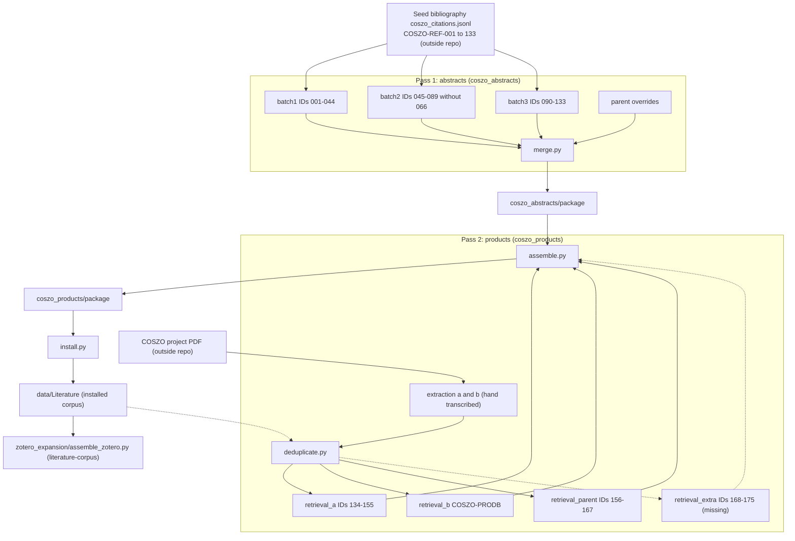

# COSZO abstract and product retrieval batches

chapter: literature-batches · paths: src/literature_pipeline/code/coszo_abstracts/ src/literature_pipeline/code/coszo_products/ · as of 1047fc8

The COSZO project's portable document format (PDF) file, `COSZO Project DataMSRI.pdf` (outside this repository), lists the references the project cites and the publications its team produced. COSZO is the Cascadia Offshore Subduction Zone Observatory (`src/literature_pipeline/code/build_graph_corpus.py:56`). This chapter covers the scripts that turned those lists into literature records with abstracts. Two trees do the work. `coszo_abstracts/` takes the main bibliography (references COSZO-REF-001 to COSZO-REF-133) and, in numbered batches, looks up each work and its abstract in public scholarly indexes. `coszo_products/` takes the "Products" sections of the PDF (each team member's publication list), keeps the works that the first tree does not already hold, and retrieves those the same way. Tree 2 ends in a package that `install.py` copies into the literature data folder, where the Zotero expansion and the runtime corpus read it (see [literature-corpus](literature-corpus.md)). Tree 1's package is the base of that package, but no script here installs it (see Open questions). The abstracts matter because they are the first evidence layer an agent searches before asking for full text (`src/literature_pipeline/README.md:20-22`; `src/DATA_CORPUS_METHOD.md:280-283`).

Paths below are relative to `src/literature_pipeline/code/` unless a full path is shown. These scripts are one-off pipeline steps, not a service. None of them can run from the repository alone (see Gotchas).

## At a glance

| Item | Detail |
|---|---|
| Kind | Pipeline of one-off retrieval and assembly scripts. No service, no tests. Tree 1: `coszo_abstracts/` (batches 1 to 3, parent overrides, merge, QA). Tree 2: `coszo_products/` (PDF transcription, dedup, retrieval a, b and parent, assemble, install). |
| Stack | Python 3 standard library (`urllib`, `json`, `difflib`, `html.parser`, `xml.etree`, `concurrent.futures`). `pypdf` in 4 scripts (`coszo_abstracts/parent/build_overrides.py:4`, `coszo_abstracts/parent/extra_reports.py:4`, `coszo_products/a/extract_layout.py:2`, `coszo_products/b/extract_products_b.py:4`) and the Poppler `pdftotext` command (`coszo_abstracts/batch1/manual_enrich.py:34`). Neither is declared in `pixi.toml`. |
| Entry points | Each script is run directly with `python3 <path>`. Six files define `main()`: `coszo_abstracts/batch2/resolve_batch.py:268`, `coszo_abstracts/batch2/retrieve_secondary.py:108`, `coszo_abstracts/merge.py:14`, `coszo_products/assemble.py:17`, `coszo_products/retrieval_b/retrieve.py:149` and the `before_expansion/` backup of `assemble.py` (`coszo_products/before_expansion/coszo_retrieval_provenance/products_expansion/assemble.py:17`). The other scripts do their work at import time. The run order is in How it works. |
| Reads | Seed bibliography `coszo_citations.jsonl`, hard-coded at `coszo_abstracts/batch1/retrieve.py:13`, not in the repo (produced upstream, see Open questions; data releases are in [repo-ops-data](repo-ops-data.md)). COSZO PDF, read by `coszo_products/a/extract_layout.py:4` and `coszo_products/b/extract_products_b.py:6`. The installed corpus in `data/Literature/`, read by `coszo_products/deduplicate.py:11`. Hand-written extraction files from the PDF: `extraction_a.jsonl` and `extraction_b.jsonl`, made by `coszo_products/a/build_extraction.py` and `coszo_products/b/extract_products_b.py`. Raw responses under each stage's `raw/` folder (mostly written by these scripts; not tracked). External application programming interfaces (APIs): Crossref (DOI metadata), OpenAlex (open scholarly index), Europe PMC (biomedical index), Semantic Scholar, PubMed E-utilities and NCBI PMC BioC (both from the National Center for Biotechnology Information, NCBI), Elsevier, DataCite, the NSF (National Science Foundation) Award API, the USGS (U.S. Geological Survey) Publications API, and publisher pages through doi.org. |
| Writes or serves | `coszo_abstracts/package/` from `coszo_abstracts/merge.py:9`: `coszo_literature.jsonl`, `abstracts/*.md`, `coszo_abstracts_review_queue.jsonl`, `coszo_abstracts_manifest.json`, `coszo_abstracts_README.md`, `coszo_retrieval_provenance/`. It is the base that `coszo_products/assemble.py:8` starts from. `coszo_products/package/` from `coszo_products/assemble.py:9`, which adds `records/*.md`, `coszo_citation_occurrences.jsonl`, `coszo_additional_citations.jsonl` and `coszo_all_citations.md`. `coszo_products/install.py:7` copies that package into `data/Literature/`. Consumers: `zotero_expansion/assemble_zotero.py:60-61` (literature-corpus), then `literature.jsonl`, read by `src/literature_fulltext/acquire_open_fulltext.py:21` ([literature-fulltext](literature-fulltext.md)) and by the graph build ([literature-corpus](literature-corpus.md)). |

## How it works

The work runs in two passes. Pass 1 gives each seed reference an abstract or a recorded reason it has none. Pass 2 takes the PDF's Products sections, finds the works that pass 1 does not already cover, and runs the same kind of retrieval on them. Most numbered steps read the previous step's `results.jsonl` and rewrite it; the first step of each pass starts from the seed or from raw responses. The order below comes from the data dependencies and the file docstrings, since no run log or README is tracked (inferred).

### Pass 1: abstracts for the seed bibliography

1. **batch1 (IDs 001 to 044).** Six scripts, run in this order.
   - `retrieve.py` searches Crossref with the full citation string (line 71) and OpenAlex with a title guessed from it (line 77; `extract_title`, lines 31-36). A candidate is verified when title similarity is at least 0.80 and the year is within one year of the cited year (line 103). Output is the first-pass `results.jsonl` (line 152).
   - `resolve_batch.py` searches again by exact title, using a title typed in for each of the 44 IDs (`titles`, lines 24-67). It accepts a candidate at similarity 0.90 or more with the first author's surname and a year within one (line 99). It also asks Europe PMC and Semantic Scholar by DOI (digital object identifier, a persistent publication ID; lines 113-132). An abstract is adopted only if it has at least 50 words (line 104). Writes `results.stage2.jsonl` and `results.jsonl` (lines 155-156).
   - `manual_enrich.py` applies per-record fixes. It takes abstracts labelled "Abstract" from publisher pages for 015 and 034 (lines 24-31), from the first page of an author-hosted PDF for 022 (lines 32-40), from a repository page for 031, a Springer description in JSON-LD (structured data embedded in a web page) for 037, a NOAA page for 041 and a Caltech record for 043. It hand-copies the abstract for 036 (line 50), and records that it was checked against the indexed scan because the publisher page returned HTTP 403 (lines 52-54). It leaves conference landing records 012 and 024 as not_found (lines 83-89), moves an unlabelled Nature standfirst (010) and a sidebar paragraph (044) to `source_description` (lines 91-96), and corrects the DOI for 018 (lines 98-100).
   - `patch_remaining.py` fills the rest from official sources: USGS catalog for 040 (lines 17-20), DataCite for 013 (lines 22-25), NSF award pages for 007 and 014 (lines 27-32), the report of the Cascadia Region Earthquake Workgroup (CREW) for 021 (lines 34-37) and the Elsevier API for 029 (lines 39-41). It then records which provider's endpoint carried each automatically found abstract (lines 43-67).
   - `finalize.py` replaces the provisional USGS summary with the official text (lines 11-15), gives reason codes to the four abstracts that remain unavailable (003, 012, 024, 029; lines 34-41), and asserts the output shape: 44 rows, unique IDs in order, required keys and allowed statuses (lines 43-51).
   - `verify_links.py` tests each `full_text_url` with a ranged GET. A link is kept only if it answers 200 or 206 with a non-empty body (line 17); otherwise it is removed (line 25). Writes `full_text_link_checks.json` (line 26).

2. **batch2 (IDs 045 to 089, without 066).** The code skips 066 (`coszo_abstracts/batch2/resolve_batch.py:274`); merge.py says 066 is a second occurrence of 064 (`coszo_abstracts/merge.py:73`).
   - `resolve_batch.py` searches OpenAlex and Crossref by the titles in `TITLES` (lines 21-66). It applies 12 DOI overrides (lines 68-81) and accepts a match at similarity 0.88 or more with a year within two (line 175; 058, 060 and 075 are exempt from the year test). It then reads the DOI's Crossref record (lines 203-219), an exact-title OpenAlex abstract (lines 220-233), and the landing page's abstract meta tags at 35 words or more (lines 234-250). A full-text link is kept if the response is a PDF or HTML (lines 251-261). A resolver exception is written as status `blocked` (line 282).
   - `retrieve_secondary.py` is the "Exact-DOI recovery pass" (its docstring, line 2). For each DOI it reads OpenAlex, Crossref, Semantic Scholar (only while no abstract is held, line 78) and the landing page. The DOI and `paper_url` are set without a check (lines 46-47). The OpenAlex, Crossref and Semantic Scholar steps need token similarity of 0.75 or more (lines 29-30, 54, 69, 83). The OpenAlex step overwrites an existing abstract (lines 57-58), while Crossref and Semantic Scholar fill only an empty one (lines 72, 78). The landing-page fallback has no title test (lines 89-98). It marks 071 and 074 as no-abstract-expected (lines 102-103). It imports `TITLES` from `resolve_batch` (line 110).
   - `manual_augment.py`, which calls itself the "final gap review" (line 23), hand-enters abstracts for 051, 057, 060, 061, 069, 085 and 086 (lines 7-16). It records National Academies descriptions for 071 and 074 as `source_description` (lines 30-43), and 079 (a USGS Opinion) as having no abstract (lines 25-29). It notes the version-of-record choices for 059, 075 and 077 (lines 49-54) and clears 086's full-text link (lines 55-56).
   - `verify_links.py` is stricter than batch1. A link is kept only when the response starts with `%PDF` or is typed as PDF (lines 16-18). Landing pages 083 and 086 are dropped by name, with the comment "metadata/DOI landing pages, not links to full text" (lines 8-11).

3. **batch3 (IDs 090 to 133).** Scripts run in this order.
   - `collect.py` stores the raw Crossref (bibliographic query) and OpenAlex (title search) responses for all 44 IDs (lines 42-52, six workers at line 54).
   - Targeted raw fetches: `retrieve.py` saves publisher HTML for 13 DOIs (lines 8-27). `retrieve_secondary.py` saves Semantic Scholar records for 097, 112 and 113, and Elsevier XML for 112 and 113 (lines 8-30). `retrieve_records.py` saves the DataCite records for two Interdisciplinary Earth Data Alliance (IEDA) datasets (121, 122) and seven NSF award records (lines 9-25). `verify_links.py` checks three hard-coded PDF links and each OpenAlex open-access PDF, and writes `fulltext_link_checks.json` (lines 8-32).
   - `analyze.py` prints the three best candidates per record, and `inspect_abstracts.py` prints reconstructed OpenAlex abstracts, for a person to review. Neither writes anything. `inspect_abstracts.py` (and `verify_links.py`) must run with the working directory set to `batch3/`, because they `exec` `analyze.py` by a relative path (see Gotchas).
   - `build_results.py` decides each row, in this order. Manual metadata for 13 IDs (lines 30-44). An OpenAlex record is used when its title similarity is 0.85 or more (lines 75-82). Abstract text comes from the OpenAlex inverted index, except where a row is typed in: 095 and 112 (lines 46-47, 87-90, 106), 113 from a saved repository text (lines 53-56, 107), and 125 and 131 from Nature HTML (lines 49-52, 108). NSF and DataCite descriptions go to `source_description` (lines 91-101). 097 and 103 are no-abstract (lines 102-105). 101 is not_found because the catalog exposes only an excerpt (lines 111-115). Status rules are at lines 120-124. Writes `results.jsonl` and `summary.json` (lines 134-138).
   - `qa.py` checks 44 rows, IDs 090 to 133 in order, required keys, abstract and status agreement, and each resolved DOI against OpenAlex (lines 10-26). It exits non-zero on errors (line 31).

4. **parent (overrides).** This is not a numbered batch. It holds records that batches 1 to 3 did not resolve well, and it is applied after them (`coszo_abstracts/merge.py:27-29`). `parent/build_overrides.py` writes five records: 045 and 058 (DataCite abstracts labelled "Abstract", lines 9-14), 047 (the first-page abstract of an IODP, Integrated Ocean Drilling Program, proposal cover sheet, not the full proposal, lines 16-20), 087 (a UW repository abstract, lines 21-31) and 068 (a report from SZ4D, Subduction Zones in 4D, with an executive summary and no abstract, lines 32-34). `parent/extra_reports.py` runs afterwards. It removes and re-adds 004, 023, 033 and 039, which are report prefaces or executive summaries, plus the USGS abstract for 039 (lines 6-15). It writes `parent_overrides.jsonl` (line 16).

5. **merge and QA.** `merge.py` takes the canonical references, which are the seed rows with no `duplicate_of` (line 16). That gives 132 works (inferred from the batch ranges, 44 + 44 + 44, with 066 excluded). It reads batches 1 to 3 (lines 20-26), then applies the parent overrides, which win (lines 27-29). It asserts that every canonical ID has a result (line 30). Each abstract must be retrieved, have a source URL and a date, have at least 20 words, and not repeat another work's text (lines 37-45). It then writes the package, copies the provenance folders (lines 80-90) and writes checksums (lines 94-95). The top-level `qa.py` prints per-batch status counts and flags abstracts whose title tokens cover under 0.78 of the title, that are under 50 or over 650 words, or that contain HTML or legal text (lines 9-22).

### Pass 2: products (new works from the PDF's Products sections)

6. **Extraction (hand transcription).** `a/extract_layout.py` writes layout text for PDF pages 33 to 40 as a reading aid (lines 4-10). `a/build_extraction.py` lists 40 occurrences from pages 34 to 39 (packet pages 116 to 129). Each has its section (`Products Most Closely Related...` or `Other Significant Products...`), owner, item number and the DOIs printed in the citation. Owners that the page does not print are marked inferred (lines 25-29, 49-52, 88-91). `b/extract_products_b.py` lists 15 occurrences from pages 40 to 45 (lines 14-105). It also caches page text for pages 40 to 45 (lines 107-122). Outputs are `extraction_a.jsonl` and `extraction_b.jsonl` in the products root (`coszo_products/a/build_extraction.py:4`; `coszo_products/b/extract_products_b.py:8`).

7. **Dedup.** `deduplicate.py` sorts occurrences by first PDF page (line 21). Each one is matched, in order, by DOI, then by exact normalized citation, then by title substring of at least 35 characters (lines 30-38). Every occurrence gets a `COSZO-ADD-###` ID (line 25). A single match makes it an alias of that work. Anything else makes a new canonical record numbered from COSZO-REF-134 (line 23, lines 43-55). Every new record is also written to `dedup_review.json` with its three closest fuzzy candidates (lines 46-49). Outputs are `additional_occurrences.jsonl`, `new_citations.jsonl` and `dedup_review.json` (lines 57-59).

8. **Retrieval a (IDs 134 to 155).** `retrieve.py` fetches Crossref by DOI, or runs a bibliographic search when no DOI is printed (lines 48-66). It also runs an issue-level Crossref search for 150 (lines 68-73). `retrieve_secondary.py` fetches exact Crossref records for eight DOIs (lines 93-97), publisher pages (lines 100-102), an OpenAlex retry (lines 105-111; the build notes record HTTP 429 on both attempts, `build_results.py:226`), Semantic Scholar (lines 112-118), and Europe PMC for 143 and 149 (lines 121-126). Its skip list (line 94) matches the citations that print a DOI (inferred; see Open questions). `build_results.py` holds the metadata for 22 works (lines 12-122). It takes abstracts from Crossref, from an Oceanography page for 135, the Geosphere PDF text for 136, a ScienceDirect extract file (lines 166-168), a Royal Holloway page for 141, Nature Reviews HTML for 149, the USGS record for 150 and an SSA (Seismological Society of America) PDF for 154 (lines 150-189). Only 144, 146 and 147 get `source_description` (lines 192-196). Writes `retrieval_a/results.jsonl` (line 272).

9. **Retrieval b (COSZO-PRODB-001 to 009).** `retrieve.py` resolves eight hard-coded works (lines 19-28). It uses PubMed by PMID or PMCID, Europe PMC by PMCID, Crossref and OpenAlex by DOI (match at 0.92 or more, year within one, first author present), the PMC BioC XML, and the publisher's abstract meta tags at 40 words or more (lines 49-133). Every full-text link is checked (lines 134-143). Command-line arguments name the works to re-run, and the rest are copied from the existing file (lines 149-163). `finalize.py` then types in the abstracts for PRODB-007 and PRODB-009 (lines 8-28) and removes text-and-data-mining terms that were recorded as licenses (lines 35-38). PRODB-003 is not in the list. Its DOI matches the batch2 override for COSZO-REF-085 (`coszo_abstracts/batch2/resolve_batch.py:80`), so it is an alias, not a new work (inferred).

10. **Retrieval parent (IDs 156 to 167).** `fetch.py` runs one Crossref bibliographic search per citation (lines 5-11). `build_results.py` types in abstracts for 156 to 159, 163, 166 and 167 (lines 27-84). It reads Crossref abstracts for 160, 162, 164 and 165 (lines 13-22, 60-72). It records 161 as not_found, with the reason in its notes (line 92). Writes `results.jsonl`, `web_evidence.json` and `raw_manifest.json`, which is a list of SHA-256 file hashes for the raw folder (lines 178-193). The name "parent" here means something different from the parent overrides in tree 1 (see Gotchas).

11. **Retrieval extra (IDs 168 to 175).** Referenced by `assemble.py` (lines 23-29; 91-92) but not in the repo. Not described further.

12. **Assemble and install.** `assemble.py` starts from the abstracts package (lines 8, 18, 69). It adds the new records from each retrieval folder (lines 23-38), maps batch-b and extra IDs back to their `COSZO-ADD` occurrences with fixed offsets (lines 26-29), and corrects the year of 151 to 2010 (lines 39-40). It fails if two records share a DOI (lines 41-46). It writes the occurrence table (lines 47-61), checks each abstract (lines 73-90), writes `records/*.md` (lines 103-118), the manifest and README (lines 124-158), the provenance folder (lines 173-179) and checksums (lines 185-186). `install.py` checks the checksums of `package/`, copies it into `data/Literature/`, saves each file it replaces under `before_expansion/`, and checks the copy again (lines 11-26).

13. **Downstream.** `zotero_expansion/assemble_zotero.py` reads the installed `coszo_literature.jsonl` and `coszo_citation_occurrences.jsonl` (lines 60-61) and writes `literature.jsonl` (line 165). That file is the canonical corpus that the graph build and the full-text tool read. `prepare_runtime.py` is a one-off in the literature-corpus chapter. It copies this chapter's `.py` files from the author's working folder into the repository (lines 74-78, skipping `/package/` at line 77) and moves `coszo_retrieval_provenance/` out of the data folder (lines 50-53).

## Key files

Each row is one tracked file. Paths are relative to `src/literature_pipeline/code/`. There are no tests and no data files in these trees.

| File | Role |
|---|---|
| `coszo_abstracts/batch1/retrieve.py` | Pass 1 first search: Crossref and OpenAlex by citation, for IDs 001 to 044. |
| `coszo_abstracts/batch1/resolve_batch.py` | Exact-title search with typed-in titles; Europe PMC and Semantic Scholar; writes stage-2 results. |
| `coszo_abstracts/batch1/manual_enrich.py` | Per-record fixes from publisher pages and PDFs, and one hand-copied abstract (036). |
| `coszo_abstracts/batch1/patch_remaining.py` | Fills records from USGS, DataCite, NSF, CREW and Elsevier sources; records which endpoint carried each abstract. |
| `coszo_abstracts/batch1/finalize.py` | Replaces a provisional summary, gives reason codes for unavailable abstracts, asserts output shape. |
| `coszo_abstracts/batch1/verify_links.py` | Live ranged check of each `full_text_url`. |
| `coszo_abstracts/batch2/resolve_batch.py` | Title search for IDs 045 to 089 with 12 DOI overrides; defines `TITLES`. |
| `coszo_abstracts/batch2/retrieve_secondary.py` | "Exact-DOI recovery pass": OpenAlex, Crossref, Semantic Scholar and landing-page fallbacks. |
| `coszo_abstracts/batch2/manual_augment.py` | "Final gap review": hand-entered abstracts for seven works and source descriptions for two. |
| `coszo_abstracts/batch2/verify_links.py` | Full-text check that keeps only PDFs; drops two landing pages by name. |
| `coszo_abstracts/batch3/collect.py` | Raw Crossref and OpenAlex responses for IDs 090 to 133. |
| `coszo_abstracts/batch3/retrieve.py` | Publisher HTML for 13 DOIs. |
| `coszo_abstracts/batch3/retrieve_secondary.py` | Semantic Scholar and Elsevier XML for 097, 112 and 113. |
| `coszo_abstracts/batch3/retrieve_records.py` | DataCite (two IEDA datasets) and NSF award raw records. |
| `coszo_abstracts/batch3/verify_links.py` | Checks candidate PDFs; writes `fulltext_link_checks.json`; loads `analyze.py` via `exec`. |
| `coszo_abstracts/batch3/analyze.py` | Diagnostic: prints the three best candidates per record. Writes nothing. |
| `coszo_abstracts/batch3/inspect_abstracts.py` | Diagnostic: prints reconstructed OpenAlex abstracts. Loads `analyze.py` via `exec`. |
| `coszo_abstracts/batch3/build_results.py` | Decides each row for IDs 090 to 133, with typed-in metadata and abstracts; writes `results.jsonl` and `summary.json`. |
| `coszo_abstracts/batch3/qa.py` | Checks batch 3 results; non-zero exit on errors. |
| `coszo_abstracts/parent/build_overrides.py` | Writes five override records (045, 047, 058, 068, 087). |
| `coszo_abstracts/parent/extra_reports.py` | Rewrites the override file with four report records (004, 023, 033, 039; 033 only if its PDF exists, line 11). Must run after `build_overrides.py`. |
| `coszo_abstracts/merge.py` | Builds `coszo_abstracts/package/` from the batches and overrides; asserts and copies provenance. |
| `coszo_abstracts/qa.py` | Cross-batch heuristic report (title coverage, word counts, artifacts). |
| `coszo_products/a/extract_layout.py` | Layout text of PDF pages 33 to 40, as a reading aid. |
| `coszo_products/a/build_extraction.py` | Hand-transcribed 40 occurrences (pages 34 to 39); writes `extraction_a.jsonl`. |
| `coszo_products/b/extract_products_b.py` | Hand-transcribed 15 occurrences (pages 40 to 45); writes `extraction_b.jsonl`; caches page text. |
| `coszo_products/deduplicate.py` | Matches occurrences to the installed corpus and to earlier new works; mints COSZO-REF-134 onward and COSZO-ADD IDs. |
| `coszo_products/assemble.py` | Builds `coszo_products/package/`: occurrences, records, README, manifest, provenance, checksums. |
| `coszo_products/install.py` | Verifies `package/`, copies it into `data/Literature/`, backs up replaced files. |
| `coszo_products/before_expansion/coszo_retrieval_provenance/products_expansion/assemble.py` | Backup of the earlier `assemble.py`, made by `install.py`. It lacks the `records/` output. |
| `coszo_products/retrieval_a/retrieve.py` | First-pass Crossref and OpenAlex for IDs 134 to 155, plus an issue search for 150. |
| `coszo_products/retrieval_a/retrieve_secondary.py` | Exact Crossref, publisher pages, OpenAlex retry, Semantic Scholar and Europe PMC. |
| `coszo_products/retrieval_a/build_results.py` | Results for IDs 134 to 155: typed-in metadata and abstracts from several sources. |
| `coszo_products/retrieval_b/retrieve.py` | Eight COSZO-PRODB works through PubMed, Europe PMC, Crossref, OpenAlex and PMC. |
| `coszo_products/retrieval_b/finalize.py` | Types in abstracts for PRODB-007 and -009; clears text-and-data-mining licenses; writes `manual_web_sources.json`. |
| `coszo_products/retrieval_parent/fetch.py` | Crossref bibliographic search for IDs 156 to 167. |
| `coszo_products/retrieval_parent/build_results.py` | Results for IDs 156 to 167; typed-in abstracts; reads `*_crossref_direct.json` (see Gotchas). |

## Interfaces

- **Command line.** Only `coszo_products/retrieval_b/retrieve.py` reads arguments: `sys.argv[1:]` names the COSZO-PRODB works to resolve (line 151); the others are copied from the existing `results.jsonl`. No other script takes flags. Paths are fixed in the source.
- **Imports.** `coszo_abstracts/batch2/retrieve_secondary.py:110` runs `from resolve_batch import TITLES`. `coszo_abstracts/batch3/inspect_abstracts.py:2` and `batch3/verify_links.py:7` run `exec(open('analyze.py').read().split('rows=[]')[0])`. No other chapter imports any function from these trees. The Zotero step is coupled through files, not imports: `zotero_expansion/assemble_zotero.py:9` sets `RAW` to the `coszo_products/` folder beside it (`code/coszo_products/`), reads Zotero exports from there (line 75) and copies five of them into provenance (line 174). Those exports are not tracked, and that folder holds only `.py` files, so this step cannot run from the repository alone.
- **Module-level execution.** Most scripts run their work at import time, so importing one fetches data. The exceptions are the scripts that guard `main()` with `__name__`: `batch2/resolve_batch.py:290`, `batch2/retrieve_secondary.py:119`, `retrieval_b/retrieve.py:165`, `merge.py:98`, `coszo_products/assemble.py:189` and its `before_expansion/` backup (`coszo_products/before_expansion/coszo_retrieval_provenance/products_expansion/assemble.py:170`).
- **HTTP routes and MCP tools.** None. These scripts are clients only.
- **Files produced.** Per stage, named as in the code:
  - `coszo_abstracts/batchN/`: `results.jsonl` (batch1 also `results.stage2.jsonl`, `full_text_link_checks.json`; batch3 also `summary.json`, `qa_report.json`, `initial_attempts.json`), and `raw/` (not tracked; `raw/fulltext_link_checks.json` is written there by `batch3/verify_links.py:32`).
  - `coszo_abstracts/parent_overrides.jsonl` (written by `parent/build_overrides.py:35` and `parent/extra_reports.py:16`).
  - `coszo_abstracts/package/`: `coszo_literature.jsonl`, `abstracts/<ID>.md`, `coszo_abstracts_review_queue.jsonl`, `coszo_abstracts_manifest.json`, `coszo_abstracts_README.md`, `coszo_collection_checksums.json`, and `coszo_retrieval_provenance/` (each batch's `raw/`, `*.jsonl`, `*.py`, `*.json` and `*.md`, copied at `merge.py:85-90`).
  - `coszo_products/extraction_a.jsonl`, `extraction_b.jsonl`, `new_citations.jsonl`, `additional_occurrences.jsonl`, `dedup_review.json`.
  - `coszo_products/retrieval_*/results.jsonl`; `retrieval_parent/raw_manifest.json` and `retrieval_parent/attempts.json`; `retrieval_parent/raw/web_evidence.json`; `retrieval_b/raw/manual_web_sources.json`.
  - `coszo_products/package/`: `coszo_literature.jsonl`, copies of `coszo_citations*` from `coszo/deliverables` (`assemble.py:71-72`), `coszo_citation_occurrences.jsonl`, `coszo_additional_citations.jsonl`, `coszo_all_citations.md`, `coszo_abstracts_review_queue.jsonl`, `coszo_abstracts_manifest.json`, `coszo_abstracts_README.md`, `records/<ID>.md`, `abstracts/<ID>.md`, `coszo_retrieval_provenance/products_expansion/` (which holds `retrieval_id_mapping.json`), `coszo_collection_checksums.json` (`coszo_products/assemble.py:119-186`).

## Data shapes

**Pass result row** (`results.jsonl`, written by every retrieval stage; the template is `coszo_abstracts/batch1/retrieve.py:150` and `coszo_abstracts/batch3/build_results.py:132`).

| Field | Type | Meaning |
|---|---|---|
| `id` | string | `COSZO-REF-###` for seed and pass-2 works; `COSZO-PRODB-###` in retrieval_b. |
| `resolved_title`, `resolved_doi`, `paper_url` | string or null | Verified title, DOI and landing page. Null when no match was accepted. |
| `abstract` | string or null | Verbatim abstract. Null unless status is `retrieved`. |
| `abstract_status` | enum | `retrieved`, `not_found`, `no_abstract_expected`, `unresolved_citation`; `blocked` is also written by batch2 on a resolver exception (`batch2/resolve_batch.py:282`). `finalize.py:49` allows only those five. |
| `abstract_source_url`, `metadata_source_url` | string or null | Where the abstract text and the metadata were read. |
| `retrieved_at` | ISO-8601 string | Retrieval time. Products stage 1 uses one fixed date instead (`coszo_products/retrieval_a/build_results.py:10`). |
| `license` | string or null | License as the source states it. |
| `full_text_url` | string or null | Direct full-text link, kept after a live check in most stages (see Decisions). |
| `notes` | string | Free text: the reasoning behind the row. Null in batch 3 when a row has no notes (`coszo_abstracts/batch3/build_results.py:132`). |
| `attempts` | list of `{url, result}` | Every request made for the row and its outcome. |
| `source_description` (+ `source_description_url`, `source_description_type`) | string or null | Non-abstract text: report descriptions, dataset descriptions, standfirsts. Never used as an abstract. |
| `publication_year`, `resolved_authors`, `resource_type` | products only | Set by `coszo_products/retrieval_a/build_results.py:252-270`. |

**Merged record** (`coszo_literature.jsonl`). The seed fields the code reads are `id`, `citation`, `citation_as_extracted`, `year_as_cited`, `dois_as_cited`, `resource_type`, `duplicate_of`, `canonical_id` and `provenance` (`coszo_abstracts/merge.py:16`, `:50`; `coszo_products/assemble.py:36-38`). The merged row adds the result fields, `source_occurrence_ids`, `abstract_file`, `full_text_status`, and `schema_version` (`"1.0"` in merge.py:50, `"1.1"` in assemble.py:75).

**Extraction row** (`extraction_a.jsonl`, `extraction_b.jsonl`; `coszo_products/a/build_extraction.py:10-20`): `citation` (string), `doi_as_cited` (list of strings), `pdf_pages_1_based` and `printed_packet_pages` (lists of ints), `section` (one of two fixed strings), `owner` (string), `item_number` (string or null), `notes` (string).

**New-work row** (`new_citations.jsonl`; `coszo_products/deduplicate.py:50-55`): `id` = `canonical_id` (COSZO-REF-134 onward), `duplicate_of` (null), `citation`, `citation_as_extracted`, `year_as_cited`, `resource_type` (`unclassified` until resolved), `resource_type_status` (`pending_metadata_resolution`), `dois_as_cited`, `source_links` (doi.org URLs with `verification_status` = `not_checked`), `abstract` (null), `abstract_status` (`not_yet_retrieved`), `full_text_status` (`not_yet_checked`), `review_notes`, `provenance` (source document, section, PDF pages, packet pages, `extracted_date` = `2026-09-18`), `source_occurrence_ids`.

**Occurrence row** (`coszo_citation_occurrences.jsonl`; `coszo_products/assemble.py:47-61`): `occurrence_id`, `canonical_id`, `citation`, `citation_as_extracted`, `section`, `pdf_pages_1_based`, `printed_packet_pages`, `owner`, `owner_status` (`inferred`, `explicit_or_section_context` or `not_applicable`), `match_method` (`original_bibliography`, `doi`, `exact_citation`, `title`, `manual_review` or `new_work`), `doi_as_cited`.

**Abstract file** (`abstracts/<ID>.md`): title, citation, abstract text, and a provenance block with the source URL, retrieval date and notes (`coszo_abstracts/merge.py:59-63`; `coszo_products/assemble.py:99-102`).

Manifests and reports: `coszo_abstracts_manifest.json` (keys in `merge.py:69`), `coszo_abstracts/batch3/qa_report.json` (`qa.py:29`), `summary.json` (`batch3/build_results.py:138`), `full_text_link_checks.json` (`batch1/verify_links.py:26`), `raw/fulltext_link_checks.json` (`batch3/verify_links.py:32`), `dedup_review.json` (`deduplicate.py:59`), `retrieval_id_mapping.json` (`assemble.py:179`), `raw_manifest.json` (`retrieval_parent/build_results.py:193`).

## Configuration and secrets

No environment variables, API keys or tokens are read in these trees. A search of both trees for `os.environ`, `getenv`, `api_key`, `Authorization`, `secret` and `password` finds nothing. The settings below are constants in the source.

| Name | Read at | Purpose | Default or required |
|---|---|---|---|
| `SRC` (also `INPUT`, `SEED`) | `coszo_abstracts/batch1/retrieve.py:13`; `batch1/resolve_batch.py:9`; `batch2/resolve_batch.py:17`; `batch3/collect.py:7`; `batch3/analyze.py:7`; `batch3/build_results.py:8`; `merge.py:8`; `coszo_abstracts/qa.py:5` | Seed bibliography `coszo_citations.jsonl` | Hard-coded path on the author's machine. Required, and absent from the repo. |
| `OUT`, `BASE`, `ROOT` | Each script, for example `batch1/retrieve.py:14` | Output folder. A `tmp/` folder on the author's machine for batch 1, batch 2, `batch3/collect.py:8`, and products `a/`, `b/`, `retrieval_a/` and `retrieval_b/`; the script's own folder (`__file__`) for the other batch 3 scripts, parent, merge, qa, deduplicate, assemble, install and retrieval_parent | Hard-coded or derived from `__file__`. |
| `UA` | `batch1/retrieve.py:19`; `batch1/resolve_batch.py:10`; `batch2/resolve_batch.py:19`; `batch3/collect.py:11`; `retrieval_b/retrieve.py:17` | User-Agent sent to APIs | Default. Contains the placeholder address `research@example.org`. |
| OpenAlex `mailto` | `batch1/retrieve.py:77` | Contact parameter for OpenAlex | Placeholder `research@example.org`. |
| `LIB` and `TARGET` | `coszo_products/deduplicate.py:5`; `coszo_products/install.py:7` | Installed literature folder, `data/Literature` | Hard-coded. Required for dedup and install. |
| `PDF` and `source` | `coszo_products/b/extract_products_b.py:6`; `coszo_products/a/extract_layout.py:4` | COSZO project PDF | Hard-coded. Required for those two scripts only. |
| `CACHED` | `coszo_products/b/extract_products_b.py:7` | Cached page text (`coszo/pages.json`) | Hard-coded. |
| `nextid` | `coszo_products/deduplicate.py:23` | First canonical number for new works | 134. |
| `RETRIEVED` | `coszo_products/retrieval_a/build_results.py:10` | Retrieval date stamped on each row | `2026-09-18`. |
| `DOIS`, `DOI_OVERRIDES`, `dois`, `doi`, `doi_by_id` | `batch2/retrieve_secondary.py:9`; `batch2/resolve_batch.py:68`; `batch3/retrieve.py:8`; `retrieval_a/build_results.py:12`; `retrieval_a/retrieve_secondary.py:11` | Hard-coded DOIs for specific IDs | Constants. |
| `parent_overrides.jsonl` | `coszo_abstracts/merge.py:27` | Overrides applied after the batches | Optional. Skipped if absent (`merge.py:28`). |

## Run and test

- No README, Makefile, pixi task or test covers these trees. `pixi.toml` has no COSZO or literature task. No command is documented.
- Run order, as the data dependencies require (inferred): batch1 (`retrieve.py`, `resolve_batch.py`, `manual_enrich.py`, `patch_remaining.py`, `finalize.py`, `verify_links.py`); batch2 (`resolve_batch.py`, `retrieve_secondary.py`, `manual_augment.py`, `verify_links.py`); batch3 (`collect.py`, then `retrieve.py`, `retrieve_secondary.py`, `retrieve_records.py`, `verify_links.py`, then `build_results.py`, `qa.py`); parent (`build_overrides.py`, then `extra_reports.py`); `merge.py`; `qa.py`. Products: `a/extract_layout.py`, `a/build_extraction.py`, `b/extract_products_b.py`, `deduplicate.py`, `retrieval_a/retrieve.py`, `retrieval_a/retrieve_secondary.py`, `retrieval_a/build_results.py`, `retrieval_b/retrieve.py`, `retrieval_b/finalize.py`, `retrieval_parent/fetch.py`, `retrieval_parent/build_results.py`, `assemble.py`, `install.py`.
- Invocation shape: `python3 <path-to-script>`. Batch 3's `analyze.py`-based scripts must run with the working directory set to `batch3/` (`batch3/inspect_abstracts.py:2`). The only script that takes arguments is `retrieval_b/retrieve.py` (line 151).
- Built-in checks: `batch3/qa.py` (exit status, lines 10-31); assertions in `merge.py` (lines 30, 39-46, 93), `batch1/finalize.py` (lines 44-51), `coszo_products/assemble.py` (lines 35, 46, 63-67, 82-90, 183-184) and `install.py` (lines 13, 26). `coszo_abstracts/qa.py` prints but does not exit with an error.
- The checks need the seed file, the PDF and the raw folders, none of which are in the repo, so they cannot run from a clean checkout.

## Decisions and constraints

- **The abstract is the source's own text, with markup and whitespace normalized.** Nothing is generated. One abstract gets a space fixed in its text (`coszo_products/assemble.py:78-79`). `merge.py:61` writes "Text is a source abstract, not an agent-generated summary." Products say the same (`coszo_products/assemble.py:100`). A missing abstract stays null and is listed for review (`merge.py:66-67`; `coszo_products/assemble.py:150`). The method doc gives the reason: records without a reliable abstract keep a bibliographic chunk "instead of fabricated text" (`src/DATA_CORPUS_METHOD.md:251-253`).
- **Reports, grants, datasets and manuscripts never use the abstract field** (`coszo_abstracts/batch1/resolve_batch.py:134-137`). Batch 2's landing-page fallback is looser (see Gotchas). Standfirsts and sidebars are kept as `source_description` (`batch1/manual_enrich.py:91-96`). Products do the same for 144, 146 and 147 (`coszo_products/retrieval_a/build_results.py:192-202`).
- **Matches are checked on title and year; the author is a hard test only in some stages.** The thresholds are 0.80 with a year test and no author test (`batch1/retrieve.py:103`; the author adds a 0.08 rank bonus, lines 92 and 99), 0.90 with surname and year (`batch1/resolve_batch.py:99`), 0.88 with a year within two (`batch2/resolve_batch.py:175`; the author adds to the rank only, line 164), 0.85 with title alone in batch 3 (`batch3/build_results.py:75`), and 0.92 in products, where PubMed uses the title alone (`coszo_products/retrieval_b/retrieve.py:58`) and the Crossref and OpenAlex checks also require the first author (`coszo_products/retrieval_b/retrieve.py:92, 103`).
- **Exact-title checks reject fuzzy collisions.** The batch1 comment says so (`batch1/resolve_batch.py:80`), and the code drops earlier fuzzy matches that fail the exact-title test (`batch1/resolve_batch.py:107-109`).
- **DOI identifies a work first.** The method doc says so (`src/DATA_CORPUS_METHOD.md:249-250`), and dedup follows it (`coszo_products/deduplicate.py:30-38`). A DOI collision stops the assembly (`coszo_products/assemble.py:41-46`).
- **A full-text link counts only after a live check, in most stages.** The check is at `batch1/verify_links.py:9-25`, `batch2/verify_links.py:12-25`, `batch3/verify_links.py:24-32` (its result is read by `batch3/build_results.py:126-129`) and `coszo_products/retrieval_b/retrieve.py:134-143`. The parent overrides (`coszo_abstracts/parent/build_overrides.py:31, 34`; `coszo_abstracts/parent/extra_reports.py:8`) and `coszo_products/retrieval_a/build_results.py:113-122` keep links that no check in those scripts tested; their status fields say so. A DOI or landing page is not full text (`coszo_products/assemble.py:150`; `batch2/verify_links.py:8`). A proposal cover sheet is not the proposal (`coszo_abstracts/parent/build_overrides.py:20`).
- **The version of record wins over a preprint or conference copy.** `batch1/manual_enrich.py:98-100` and `batch2/manual_augment.py:50, 54` name the published DOI and record the preprint or meeting copy as not retained. For the 2022 American Geophysical Union (AGU) meeting record, the 2025 journal version's abstract "was not substituted" (`batch1/manual_enrich.py:88`).
- **Unverified abstracts are recorded as not_found, not replaced.** `batch1/finalize.py:34-41` gives reasons. `coszo_products/retrieval_parent/build_results.py:92` says a related text was not substituted.
- **Every citation occurrence is kept.** Repeated citations map to one work with several occurrence edges (`src/DATA_CORPUS_METHOD.md:239-240`; `coszo_products/b/extract_products_b.py:73, 91, 103`).
- **Partial pages are not reconstructed.** Gaps in the PDF are documented, and missing packet pages are noted in the manifest (`coszo_products/assemble.py:132-133`).
- **Owner names that the page does not print are labelled inferred.** `coszo_products/a/build_extraction.py:26-29` and `coszo_products/assemble.py:60`.
- **Provenance stays out of the runtime corpus.** The method doc says so (`src/DATA_CORPUS_METHOD.md:276-277`), and `prepare_runtime.py:50-53` moves the provenance folders out of the data folder.
- **Install is verified before and after, and nothing is silently replaced.** `coszo_products/install.py:11-26` checks checksums and backs up replaced files (docstring, line 1).

## History

- The only commit that touches these paths is `833c343` (2026-09-20), "Initialize RCA and COSZO Graph-RAG agent", which adds all 37 files. Nothing later changes them (`git log --all -- <both paths>`). The commit subject gives no reasons, so the why is in code comments and the method doc.
- The retrieval stamps predate the commit: `2026-09-18` in `coszo_products/retrieval_a/build_results.py:10` and `coszo_products/deduplicate.py:52` (inferred: the data was gathered first, then committed).
- Pass 2 numbering follows PDF page order from COSZO-REF-134 (`coszo_products/deduplicate.py:23, 46`). IDs 134 to 155 come from PDF pages 34 to 36, 156 to 167 from pages 37 to 39, and the PRODB works from pages 40 to 45 (inferred from the titles and DOIs in the extraction and results files).
- An older `assemble.py` survives in `before_expansion/`. `install.py` saved it when it replaced the target file. The older copy lacks the `records/` output that the current file writes (`diff` of the two files, lines 70, 103-118, 184).
- Tree 1 grew in stages: a first pass (`batch1/retrieve.py`), an exact-title pass (`batch1/resolve_batch.py`), manual per-record fixes (`batch1/manual_enrich.py`), then patches and finalize, then batch 2 with a DOI recovery pass (`batch2/retrieve_secondary.py:2`) and a "final gap review" (`batch2/manual_augment.py:23`). Batch 3 centres on one result builder (`build_results.py`), checked by `qa.py`, and is fed by raw-collection scripts and two diagnostics (inferred from the file set).
- `prepare_runtime.py` later copied the `.py` files from the author's working folder into the repository (lines 69-79). This is how these trees reached git (inferred: the tracked files are exactly the `.py` files).

## Gotchas

1. **Hard-coded paths outside the repo.** Nearly every script reads or writes under `/Users/quakehunter/...`. The seed path has a folder named `RCN Agent ` with a trailing space (`coszo_abstracts/batch1/retrieve.py:13`). The scripts cannot run on another machine without editing those constants.
2. **Inputs are not tracked.** The seed file, the PDF, every `raw/` folder and every `package/` folder are absent. `prepare_runtime.py` copies only `.py` files and skips `/package/` (line 77). The `.gitignore` (checked) does not list `raw/` or `package/`, so their absence from git is most likely a choice (inferred).
3. **Some inputs were made by hand.** No script in batch 1 writes the publisher HTML, PDF or JSON used by `manual_enrich.py`, `patch_remaining.py` and `finalize.py` (for example `COSZO-REF-015_nature.html`, `COSZO-REF-040_usgs.json`, `COSZO-REF-006_usgs.json`). The batch-3 text for 113 (`batch3/build_results.py:54`) and products' `web_publisher_extracts.json` (`coszo_products/retrieval_a/build_results.py:166`) are not written by any script here either. Their origin is not recorded.
4. **Assembly cannot finish from this tree.** `coszo_products/assemble.py` reads `retrieval_extra/results.jsonl` (line 24), `code/coszo/deliverables/coszo_citations.jsonl` (line 48) and copies `coverage_audit.json` and `manual_matches.json` (lines 175-178, after a `copytree` of `retrieval_extra` at line 175). None of these exist in the repo. `deduplicate.py` also needs `manual_matches.json` only if it exists (line 22).
5. **A clean run fails at import.** `coszo_products/retrieval_parent/build_results.py:14` reads `<ID>_crossref_direct.json`, but `fetch.py:9` writes `<ID>_crossref.json`. The first call is in the `abstracts` dict literal (line 60), so the script stops before writing anything. Nothing in the tree writes the `_direct` file.
6. **JSON is saved with an `.html` suffix.** `coszo_products/retrieval_a/retrieve_secondary.py:74` picks `.xml` only when the content type contains "xml", so Crossref JSON becomes `*_crossref_exact.html`. `build_results.py:135-140` reads it back as JSON, so the name is misleading but works.
7. **"Full text" means different things in different stages.** Batch 1 keeps any link that answers 200 or 206 with bytes or a Content-Length header (`batch1/verify_links.py:17`). Batch 2's resolver accepts HTML (`batch2/resolve_batch.py:257`), but its verify step keeps PDFs only (`batch2/verify_links.py:16-17`). Products accept HTML only for PMC (`coszo_products/retrieval_b/retrieve.py:140`).
8. **Typed-in text is data in code.** Abstracts for 036, 051, 057, 060, 061, 069, 085, 086, 095, 112, 156 to 159, 163, 166, 167, PRODB-007 and PRODB-009 are typed into the scripts (for example `batch1/manual_enrich.py:50`, `batch2/manual_augment.py:7-16`, `coszo_products/retrieval_b/finalize.py:8-28`). Their fidelity depends on the raw evidence, which is not in the repo, so this chapter cannot check them.
9. **Rerunning a step resets its output.** `batch1/retrieve.py` rewrites `results.jsonl` from scratch (line 152). Later manual edits are not reapplied, and each later step reads the output of the step before it.
10. **Per-record branches.** Many results depend on IDs written into the code: the year exemptions for 058, 060 and 075 (`batch2/resolve_batch.py:175`), the batch-3 special cases (`batch3/build_results.py:87-119`), the `nextid` of 134 (`coszo_products/deduplicate.py:23`), the fixed offsets of 40 and 55 that map batch-b and extra IDs back to occurrences (`coszo_products/assemble.py:27, 29`), the 151 year fix (line 40), and the 2026-09-18 constant. A changed seed breaks these silently.
11. **"Parent" means two things.** In tree 1 it is the override set applied after the batches (`merge.py:27-29`). In tree 2 it is the retrieval for IDs 156 to 167, from PDF pages 37 to 39 (`coszo_products/retrieval_parent/`). The code does not explain the name in either tree.
12. **Word-count floors differ.** Batch 1 needs 50 words (`batch1/resolve_batch.py:104, 140`). Batch 2's landing page needs 35 (`batch2/resolve_batch.py:247`; `batch2/retrieve_secondary.py:96`). Products' landing page needs 40 (`coszo_products/retrieval_b/retrieve.py:132`). The merge and assemble asserts need 20 (`merge.py:42`; `assemble.py:84`). A 36-word text can pass batch 2 and fail batch 1's rule.
13. **Script-relative `exec` depends on the working directory.** `batch3/inspect_abstracts.py:2` and `batch3/verify_links.py:7` read `analyze.py` relative to the current directory, not the script's directory.
14. **Importing `resolve_batch` runs its module body.** `batch2/retrieve_secondary.py:110` imports it, which executes the top of `resolve_batch.py` (paths and `TITLES`). No network call happens at import, but the file must sit beside the importer.
15. **Occurrence counts are not work counts.** Duplicate occurrences are kept on purpose (`coszo_products/b/extract_products_b.py:73, 91, 103`), so the 15 `extraction_b` occurrences produce only eight retrieved works (PRODB-001 to 009, without 003).
16. **Dedup reads the installed corpus.** `deduplicate.py:11` reads `data/Literature/coszo_literature.jsonl`, not the package. Re-running dedup after an install changes which records are "new". How the abstracts package was first installed is not in these scripts (Open questions).
17. **Blocked and rate-limited sources.** ADS (NASA Astrophysics Data System) returned HTTP 405 or 429 (`batch1/manual_enrich.py:85`). OpenAlex returned 429 during the retry (`coszo_products/retrieval_a/build_results.py:226`). Publisher and aggregator pages returned 403 to automated fetches for records 157, 161 and 165 (`coszo_products/retrieval_parent/build_results.py:108, 126, 143`). The scripts keep these outcomes in `attempts` and `notes`. Apart from the one OpenAlex retry in `coszo_products/retrieval_a/retrieve_secondary.py:105-111`, they do not retry. 161 ends as not_found (line 61).
18. **Some abstract sources are indexes, not publishers.** `abstract_source_url` for 036 points to ResearchGate (`batch1/manual_enrich.py:52`), and for 157 to ResearchGate (`coszo_products/retrieval_parent/build_results.py:88`). Check the source before citing one.
19. **Undeclared dependencies.** `pypdf` and `pdftotext` are needed but not in `pixi.toml`. Other pipelines name `pypdf` in their READMEs (`src/coszo_pdf_pipeline/README.md:5`) and import it (`src/coszo_pdf_pipeline/build_coszo_pdf_graph.py:20`).
20. **Placeholder contact.** The User-Agent and the OpenAlex `mailto` use `research@example.org` (`batch1/retrieve.py:19, 77`). The address is not a real contact. Whether the providers then treat these requests as anonymous is an Open question.
21. **Generic meta tags count as abstracts in batch 2.** The landing-page fallback accepts `description` and `og:description` meta tags of 35 words or more (`coszo_abstracts/batch2/resolve_batch.py:243-248`), not only tags labelled as abstracts, so the "labelled abstract" rule does not hold for those records.

## Glossary

| Term | Meaning |
|---|---|
| COSZO | Cascadia Offshore Subduction Zone Observatory (`build_graph_corpus.py:56`). The project whose PDF these scripts mine. |
| COSZO-REF-### | Canonical ID of a seed or pass-2 work (001 to 133 seed; 134 onward new). |
| COSZO-ADD-### | ID of a citation occurrence that was not in the seed (`deduplicate.py:25`). |
| COSZO-PRODB-### | Working IDs for the eight works in retrieval_b. |
| Seed | The main bibliography, `coszo_citations.jsonl`, with one row per citation occurrence. |
| Canonical record | One row per distinct work. Occurrences point to it through `canonical_id`. |
| Occurrence | One place a citation appears in the PDF, with its page and section. |
| Packet page | The printed page number of the PDF's personnel packet. Separate from the one-based PDF page (`coszo_products/assemble.py:159`). |
| Products sections | Two lists in the PDF: "Products Most Closely Related to the Proposed Project" and "Other Significant Products" (`coszo_products/a/build_extraction.py:6-7`). |
| DOI | Digital object identifier, a persistent ID for a publication, dataset or report. |
| Crossref | Public registry of DOI metadata (`api.crossref.org`). |
| OpenAlex | Open scholarly index (`api.openalex.org`). Stores abstracts as an inverted index: word to positions. |
| Inverted index | OpenAlex's abstract format. Rebuilt into text by sorting word positions (`batch1/retrieve.py:49-54`). |
| JATS | Journal Article Tag Suite, the XML markup that Crossref abstracts use. Stripped with a regex (`batch1/retrieve.py:44-47`). |
| Semantic Scholar | Public scholarly graph API, queried by DOI. |
| Europe PMC | Europe PubMed Central, a biomedical literature index. |
| PubMed, PMID, PMCID | PubMed is the NCBI biomedical index; PMID is a PubMed record number; PMCID is a PubMed Central article number. |
| PMC BioC | NCBI's XML format for PubMed Central articles (`retrieval_b/retrieve.py:112`). |
| DataCite | DOI registration agency for datasets and reports (`api.datacite.org`). |
| IEDA | Interdisciplinary Earth Data Alliance, which issues the `10.26022/IEDA/...` DOIs used for two datasets. |
| NSF | National Science Foundation. Its Award API returns grant records. |
| USGS | U.S. Geological Survey. Its Publications Warehouse API returns catalog text. |
| NOAA | National Oceanic and Atmospheric Administration. |
| OOI | Ocean Observatories Initiative, a U.S. NSF-funded ocean observing facility (described in `coszo_products/retrieval_parent/build_results.py:79`). |
| IODP | Integrated Ocean Drilling Program, named in a citation at `coszo_products/a/build_extraction.py:43`. |
| SZ4D | Subduction Zones in 4D, a research initiative with a report in the parent overrides (`coszo_abstracts/parent/build_overrides.py:32`). |
| CREW | Cascadia Region Earthquake Workgroup, whose scenario report is record 021. |
| SSA | Seismological Society of America. |
| Source description | Text that is not an abstract: report descriptions, dataset descriptions, standfirsts. Stored separately. |
| Full-text link | A direct PDF or HTML link to the work, kept after a live check in most stages (see Decisions). |
| Typed-in | Text hand-entered into a script. Not produced by any automated step. |
| TDM | Text and data mining. A common term in license strings that the scripts treat as not an article license (`retrieval_b/finalize.py:36`). |
| PDF | Portable document format. The COSZO project file is a PDF with a personnel packet. |
| API | Application programming interface: a web address that returns structured data to a program. |
| JSON, JSONL | JSON is a text data format. JSONL (JSON Lines) holds one JSON object per line. |
| JSON-LD | JSON used as linked data inside a web page; some publisher pages carry article metadata this way. |
| HTTP status codes | 200 and 206 are success (206 is partial content); 403 is refused; 405 is method not allowed; 429 is too many requests. |
| Ranged GET | An HTTP request for only the first bytes of a file (the `Range` header), used to test a link without downloading it. |
| SHA-256 | A cryptographic hash of a file, used here as a checksum. |
| Title similarity | Ratio from 0 to 1 given by Python's `difflib.SequenceMatcher` on normalized titles. Batch 2's resolver takes the higher of this and token similarity (`coszo_abstracts/batch2/resolve_batch.py:95-100`). |
| Token similarity | Share of words two titles have in common (Jaccard), used by the DOI recovery pass in batch 2. |
| Owner | The person whose product list an occurrence sits under in the PDF. Inferred where the page does not print it. |
| Standfirst | A short unlabelled summary under a journal article title. Not an abstract. |
| Sidebar | An unlabelled text box on a publisher page. Not an abstract. |
| Version of record | The published, citable version of a work, as opposed to a preprint or a conference paper. |
| Polite pool | External API policy: faster access that OpenAlex and Crossref say they give clients who give a contact address. Not checked here (see Open questions). |
| ADS | NASA Astrophysics Data System, an index of astronomy, physics and planetary science literature. |
| AGU | American Geophysical Union, which publishes the meeting abstracts that some records cite. |
| NCBI | National Center for Biotechnology Information, which runs PubMed and PubMed Central. |
| Pass 1, pass 2 | Abstract batches for the seed (pass 1) and retrieval for new works from the Products sections (pass 2). |

## Open questions

- **Where does the seed come from?** `coszo_abstracts/merge.py:8` expects `data/Literature/coszo_citations.jsonl`, and `coszo_products/assemble.py:48` expects `code/coszo/deliverables/coszo_citations.jsonl`. Neither producer is in the repo. This would be answered by the data release (repo-ops-data) or by the author's `coszo/` folder.
- **What were the extra works?** `retrieval_extra/`, `extraction_extra.jsonl`, `coverage_audit.json`, `manual_matches.json` and `visual_audit/` are referenced but absent. IDs 168 to 175 (`coszo_products/assemble.py:91-92`) depend on them. Answer: the author's `tmp/coszo_products/` folder or the source-material release.
- **Which step wrote `*_crossref_direct.json`?** `coszo_products/retrieval_parent/build_results.py:14` reads it. Answer: an earlier version of `fetch.py` or a manual fetch.
- **How were the typed-in raw sources fetched?** Batch 1's publisher HTML, PDF and JSON (see Gotcha 3), batch 3's `COSZO-REF-113_repository.txt` (`batch3/build_results.py:54`) and products' `web_publisher_extracts.json` (`coszo_products/retrieval_a/build_results.py:166`). Answer: the author's shell history or the `raw/` folders.
- **Why does retrieval_a's Crossref step skip exactly these 13 IDs?** `coszo_products/retrieval_a/retrieve_secondary.py:94`. The list matches the citations that print a DOI (`coszo_products/a/build_extraction.py:31-128`), so the skipped records were fetched by the first pass (inferred). Answer: check which `*_crossref.json` files exist.
- **What does "parent" mean in tree 2?** Retrieval for IDs 156 to 167 (`coszo_products/retrieval_parent/`). Nothing explains it. Answer: the author.
- **Are the typed-in transcriptions correct?** The repo has no raw evidence to check them against. Answer: the `raw/` folders, or a second transcription.
- **Was the first abstracts package installed by this code?** `coszo_products/install.py:6` copies only `coszo_products/package/`, but `deduplicate.py:11` reads the installed `coszo_literature.jsonl`. Answer: the install history of `data/Literature/`.
- **Should `before_expansion/` be tracked?** It holds one file, an older `assemble.py`. It is a backup made by `install.py`. Answer: the maintainer's choice.
- **Where are the Zotero exports that the Zotero step reads?** `zotero_expansion/assemble_zotero.py:9` reads them from the `coszo_products/` folder beside it (lines 75, 174), but only `.py` files are tracked there. Answer: the author's working folder, or the sources in [literature-corpus](literature-corpus.md).
- **Do the Crossref and OpenAlex rate limits treat the placeholder address as an identified client?** The scripts send `research@example.org` (`batch1/retrieve.py:19, 77`). The providers' policy is external and was not checked here. Answer: the providers' current API documentation, or a test against the live endpoints.

## Candidate project memory

- `decision · Abstracts are source text only, and a missing abstract stays null, never generated · records without a reliable abstract keep a bibliographic chunk instead of fabricated text · src/DATA_CORPUS_METHOD.md:251-253`
- `decision · Overlap between the COSZO PDF and the Ocean Observatories Initiative (OOI) Zotero collections is provenance, not a duplicate work · "Collection overlap remains provenance rather than a duplicate work" · src/DATA_CORPUS_METHOD.md:251`
- `decision · Acquisition history, audits and review queues stay outside the runtime corpus, in archive, provenance and reports · src/DATA_CORPUS_METHOD.md:276-277`
- `requirement · Agents search the abstract corpus first, and use full text only when an abstract is relevant but insufficient · src/literature_pipeline/README.md:20-22`
- `fact · The combined package holds 398 citation occurrences resolving to 336 canonical works, and all occurrences are retained · src/DATA_CORPUS_METHOD.md:239-243`

## Verification

- Checked 2026-10-09 against HEAD `1047fc8`. Every tracked file was opened (the one backup copy through a full diff against `coszo_products/assemble.py`). Every cited `path:line` and `line N` was opened: 194 and 152 locators. Each of the 482 unique named identifiers was searched with `git grep`; those with no verbatim match are relative paths, line ranges and runtime outputs, which were checked against their files by hand.
- The Key files table matches `git ls-files` (37 of 37 rows, none missing or extra). The commit `833c343` adds all 37 files, as stated.
- Corrected 28 statements: 16 plainly wrong (the `main()` count, the tree-1 install claim, the `analyze.py` working-directory claim and "best" candidate, the `__name__` exceptions, the `SRC` row's `LIB` entry, the `OUT` folder rule, the author-match rule, the full-text live-check rule, the `notes` type in batch 3, the pypdf claim, the "do not retry" claim, the "single build script" claim, the Crossref and OpenAlex query description, the batch-2 rule that fields change only on a threshold match, and the "labelled abstract" rule); 12 imprecise (wording, line references, the dedup alias, the batch-2 title-similarity glossary entry, and similar).
- Moved to Open questions: 1 (the polite-pool policy claim). Added: 2 open questions, the Zotero export coupling in Interfaces, and Gotcha 21 (batch 2 generic meta tags).
- Coordinator spot-check (2026-10-09): 3 claims re-checked against the code. Two held: the `*_crossref_direct.json` import failure (`coszo_products/retrieval_parent/build_results.py:14`, `:60`; `retrieval_parent/fetch.py:9`) and the match thresholds (`batch1/retrieve.py:103`, `batch1/resolve_batch.py:89-99`, `batch2/resolve_batch.py:164`, `:175`, `batch3/build_results.py:75`). One was still wrong and is fixed: six files define `main()`, not five, because the `before_expansion/` backup of `assemble.py` also does (`:17`, guarded at `:170`).
