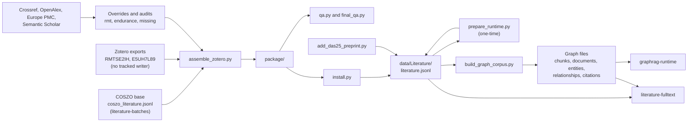

# Literature corpus and graph build

chapter: literature-corpus · paths: `'src/literature_pipeline/' ':(exclude)src/literature_pipeline/code/coszo_abstracts/' ':(exclude)src/literature_pipeline/code/coszo_products/'` · as of 1047fc8

The literature corpus is the project's bibliography. It holds 336 canonical works, the 398 citation occurrences that show where each work is cited (an occurrence is one place a work is listed or cited), and, for 291 works, a formal abstract that could be sourced. COSZO (Cascadia Offshore Subduction Zone Observatory) supplies 183 works from its proposal PDF. Two public Zotero collections in the OOI Publications group add 153 more. OOI is the Ocean Observatories Initiative; the two collections cover the Regional Cabled Array (RCA) and the Coastal Endurance Array. Zotero is a reference manager, and its group libraries are the public source here. A preprint on distributed acoustic sensing (DAS, fiber-optic sensing of seafloor vibration) was added later from Crossref metadata. The sources disagree: one paper can carry two DOIs (a persistent identifier for a publication), citation strings are inconsistent, and some abstracts were copied from other papers. This part of the repo reconciles those sources into one canonical file, keeps each source fact with its URL and attempt log, and converts the result into graph files for the Graph-RAG runtime (retrieval-augmented generation over a graph of documents, text chunks and entities).

In RCA Atlas this part sits between the source collections and the runtime. [literature-batches](literature-batches.md) gathers the COSZO base that this part starts from. [graphrag-runtime](graphrag-runtime.md) loads the graph files, and [literature-fulltext](literature-fulltext.md) reads the canonical file for on-demand full text. The canonical file, the Zotero exports and the graph outputs are private release content and are absent from this checkout, so this chapter is written from code, manifests and committed reports.

## At a glance

| | |
|---|---|
| Kind | Pipeline of offline scripts. There is no service, route or MCP server. People run the scripts by hand, and nothing in the repo runs them in order (`pixi.toml:1-7` declares one dependency and no tasks). |
| Stack | Python 3 standard library only (`src/literature_pipeline/code/build_graph_corpus.py:2-14`). The metadata lookups use `urllib` (`src/literature_pipeline/code/zotero_expansion/audit_rmt.py:11-12`). The glossary step needs the `pdftotext` program from Poppler (`src/literature_pipeline/code/build_graph_corpus.py:86`). |
| Entry points | `code/build_graph_corpus.py` (command line: `--input`, `--glossary`, `--output`); `code/add_das25_preprint.py` (`--catalog`, `--metadata`); `code/prepare_runtime.py` (one-time migration, no arguments); `code/zotero_expansion/*.py` (run in the order given under How it works). |
| Reads | `data/Literature/literature.jsonl`, the canonical catalog. This chapter assembles, installs and edits it. `data/Literature/coszo_literature.jsonl` and `coszo_citation_occurrences.jsonl`, the COSZO base ([literature-batches](literature-batches.md)). Zotero exports for collections `RMTSE2IH` and `E5UH7L89`. No tracked script writes them, and they are not in this checkout. The glossary: a runtime copy at `data/Literature/Glossary.pdf` (`src/literature_pipeline/code/prepare_runtime.py:115`) and the original in `source_material/` ([repo-ops-data](repo-ops-data.md); the rewrite targets `source_material/original_documents/Literature/Glossary.pdf`, `src/data_maintenance/clean_data_folder.py:226`). The DAS25 Crossref record, `source_material/original_documents/Literature/essoar_15004068_v1_crossref.json` ([repo-ops-data](repo-ops-data.md)). Public metadata APIs. Crossref, OpenAlex, Europe PMC and Semantic Scholar are queried by this chapter's scripts (`src/literature_pipeline/code/zotero_expansion/retrieve_missing.py:13-18`). PubMed is queried by the batch code (`src/literature_pipeline/code/coszo_products/retrieval_b/retrieve.py:52`), and the Endurance overrides read PubMed XML from an untracked folder, `src/literature_pipeline/tmp/zotero_expansion/raw/` (`src/literature_pipeline/code/zotero_expansion/build_endurance_overrides.py:11`, `:93`). |
| Writes or serves | `package/`, the assembled corpus, which `install.py` copies into `data/Literature/`. `data/Literature/literature.jsonl`, edited in place by `add_das25_preprint.py` and `prepare_runtime.py`. Graph files written to the builder's `--output` folder and expected beside the canonical file: `documents`, `chunks`, `entities`, `relationships`, `citations`, `source_documents` and `glossary_terms` (`.jsonl`), plus `text/`, `validation_report.json`, `manifest.json` and `README.md`. Consumers: [graphrag-runtime](graphrag-runtime.md) (embeds `chunks.jsonl`, loads the graph); [literature-fulltext](literature-fulltext.md) (its MCP server reads the canonical file, `src/literature_fulltext/run_mcp.sh:5`; the agent is told to search `chunks.jsonl` first, `src/literature_fulltext/build_tool_manifest.py:21`); [corpus-instruments-ops](corpus-instruments-ops.md) (cites `OOI-ZOT-###` IDs as evidence, `src/instrument_inventory/build_instrument_inventory.py:458`). Committed audit and QA outputs under `reports/`, read by people. |

## How it works

The order below is the order in which the files depend on each other. It is inferred from reads and writes, because nothing in the repo runs the chain. One exception: `retrieve_missing.py` reads the package that step 5 writes (see step 2), so a first assembly must exist before step 2 can run (inferred).

1. **Inputs from other chapters.** [literature-batches](literature-batches.md) writes the COSZO base: `src/literature_pipeline/code/coszo_abstracts/merge.py:65` writes `coszo_literature.jsonl`, and `src/literature_pipeline/code/coszo_products/assemble.py:119-120` writes it together with `coszo_citation_occurrences.jsonl`. `assemble_zotero.py` reads both files as the baseline (`src/literature_pipeline/code/zotero_expansion/assemble_zotero.py:60-61`). `build_dedup_audit.py` reads only `coszo_literature.jsonl` (`src/literature_pipeline/code/zotero_expansion/build_dedup_audit.py:24-26`). The Zotero exports are named in `src/literature_pipeline/code/zotero_expansion/assemble_zotero.py:11-14`: `RMTSE2IH` ("Regional Cabled Array", two files) and `E5UH7L89` ("Coastal Endurance Array", one file). The source group is `https://www.zotero.org/groups/5351356/ooipublications` (`src/literature_pipeline/code/build_graph_corpus.py:139`).

2. **Metadata lookups over the network.** Each script writes one summary file. `audit_rmt.py` and `retrieve_missing.py` also save the raw responses; `fetch_endurance_crossref.py` keeps only selected fields (`src/literature_pipeline/code/zotero_expansion/fetch_endurance_crossref.py:24-33`).
   - `zotero_expansion/audit_rmt.py` checks each Regional Cabled Array DOI against Crossref with two workers (`:98`), at least 0.18 s between requests (`:71`), up to five attempts, and back-off on HTTP 429 (`:68`, `:83-85`). It reuses a saved response when one exists (`:55-64`). It writes `crossref_validations.json` (`:100`).
   - `zotero_expansion/fetch_endurance_crossref.py` queries Crossref for each Endurance DOI with four workers (`:41`), with no retry or back-off, and writes `endurance_crossref.json` (`:11`, `:48`).
   - `zotero_expansion/retrieve_missing.py` reads `package/ooi_zotero_literature.jsonl` (`:7`), which step 5 writes, and takes the records that have a DOI but no abstract (`:8`). It queries Crossref, OpenAlex, Europe PMC and Semantic Scholar (`:13-18`), saves raw responses under `missing_raw/` (`:23`) and logs each attempt in `missing_attempts.json` (`:28`).

3. **Curated reconciliation.** These scripts write override files. An override is a reviewed correction keyed by Zotero item key. For many keys the abstract text is typed into the script; the others come from saved Crossref or API responses (`src/literature_pipeline/code/zotero_expansion/build_rmt_overrides.py:162-174`, `src/literature_pipeline/code/zotero_expansion/build_missing_results.py:12-22`).
   - `zotero_expansion/build_rmt_overrides.py` covers the 19 keys in `all_keys` (`:124-129`). It adds or replaces abstracts taken from publisher pages and repositories (`:46-82`), corrects 4 titles (`:90-95`), decodes HTML entities (`:169-171`), and clears a Nature News & Views standfirst (a short publisher summary, not an abstract) instead of keeping it (`:141-146`). It writes `rmt_overrides.jsonl` (`:14`, `:215`).
   - `zotero_expansion/build_endurance_overrides.py` writes 8 records (`:54-148`, `:150`). One abstract has a scraped page preamble removed (`:48-49`, `:107`), and a spurious creator is removed (`:85`).
   - `zotero_expansion/build_missing_results.py` takes one API response for each of 7 keys (`:6-8`), requires at least 80 words (`:21`), and writes `missing_results.jsonl` (`:25`).

4. **Audits (reports only).** `zotero_expansion/build_rmt_audit.py` (142 items, writes `rmt_audit.json`), `zotero_expansion/build_endurance_audit.py` (38 items, writes `endurance_audit.json`) and `zotero_expansion/build_dedup_audit.py` (checks the 180 Zotero occurrences against the COSZO base and writes `dedup_audit.json`, `:481`). Assembly does not read these reports. `assemble_zotero.py:175` only copies them into provenance.

5. **Assembly.** `zotero_expansion/assemble_zotero.py` starts from a copy of the whole COSZO base folder (`:62-63`). It loads the three override files, and a later file overwrites an earlier one for the same key (`:68-70`). It groups Zotero items by DOI, or by normalized title when there is no DOI (`:76-80`, `:87`). A group matches an existing record by DOI or title (`:89`), or through the manual key map that sends `PU7BMBHB` to `COSZO-REF-019` (`:71`). Every other group becomes a new `OOI-ZOT-###` record (`:85`, `:94`), with its abstract taken from the override or from the Zotero `abstractNote` (`:95-96`). The script writes `literature.jsonl` at schema `1.2` (`:123`, `:141`, `:165`), the Zotero-only and all-occurrence files, a review queue of records without an abstract (`:169`), Markdown views in `records/` and `abstracts/` (`:158-164`), provenance copies (`:171-180`), `literature_manifest.json` (`:188`), a README (`:189-203`) and SHA-256 checksums (`:206-207`). It asserts one work per DOI (`:148`), abstracts of at least 20 words with a source URL (`:151-153`), and no two records with the same abstract (`:156`).

6. **QA.** `zotero_expansion/qa.py` asserts the counts (336 records, 153 OOI records, 398 occurrences, 291 abstract files and the status counts, `:8-12`, `:31`) and checks specific known-bad keys (`:22-30`). `zotero_expansion/final_qa.py` runs independent consistency checks: counts (`:110-115`), identity (`:127-150`), abstract provenance (`:156-180`), a near-duplicate screen with five-word shingles at Jaccard 0.8 (`:194-220`), known corrections (`:229-268`) and checksums (`:344-381`). It writes `final_qa_report.json` (`:410`). The committed report says `result: pass` with no issues (`src/literature_pipeline/reports/final_qa_report.json:4-5`).

7. **Install.** `zotero_expansion/install.py` verifies the package checksums (`:9-10`), copies changed files into `data/Literature/` (`:12-19`), keeps one backup of each file it replaces in `before_zotero_expansion/` (`:16-18`), and verifies the copies again (`:20`). It never deletes files that a new package no longer ships.

8. **DAS25 preprint.** `add_das25_preprint.py` appends work `OOI-DAS-2026-001` and one occurrence to the catalog, built from Crossref metadata and abstract (`:21-22`, `:44-65`). It does nothing if the DOI is already present (`:31-33`). It rewrites the catalog in place (`:66`), without a temporary file.

9. **One-time runtime split.** `prepare_runtime.py` records a migration that has already run (inferred: the committed graph manifest counts 398 embedded occurrences, `src/literature_pipeline/runtime_manifest.json:39`, and the builder reads occurrences only from embedded `source_occurrences`, `src/literature_pipeline/code/build_graph_corpus.py:286`). It embeds each work's occurrences into `literature.jsonl` and sets schema `1.3-runtime` (`:18-33`). It moves the provenance folders out of the data folder (`:50-55`), archives every other file in `data/Literature/` except `literature.jsonl` and `Glossary.pdf` (`:57-66`), copies the scratch scripts and reports into this folder (`:69-89`), and asserts 336 works and 398 occurrences (`:20`, `:117`).

10. **Graph build.** `code/build_graph_corpus.py --input literature.jsonl --glossary Glossary.pdf --output DIR` reads the canonical rows (`:122`) and extracts eight glossary terms with `pdftotext -layout` (`:84-116`). It writes one document per work with its text (`:186-228`), 520-word chunks with 50 words of overlap (`:233-237`, `:240-259`), entities and edges for authors, resource types, topics and sections (`:265-333`), one citation row per occurrence (`:285-315`), and glossary entities and chunks (`:335-365`). It then validates the result (`:396-447`), writes `validation_report.json` (`:449-461`), `manifest.json` (`:463-493`) and a README (`:494-503`). It depends on step 9: it reads `source_occurrences` from each work (`:286`) and checks them against `source_occurrence_ids` (`:419-424`).

11. **Consumers.** `src/graphrag_runtime/discover_corpora.py:34` maps the `Literature` folder to collection `literature`. `src/graphrag_runtime/normalize_corpus.py:124-125` keys `source_documents.jsonl` by `source_document_id` for this collection, and `src/graphrag_runtime/FIELD_MAP.md:18` lists its ID fields. `src/literature_fulltext/run_mcp.sh:5` points the full-text service at the canonical file, and `src/literature_fulltext/build_tool_manifest.py:21` tells agents to search `data/Literature/chunks.jsonl` first. `src/data_maintenance/sanitize_sensitive_network_info.py` also reads and rewrites files in this folder (see Gotchas).

## Key files

Paths are relative to `src/literature_pipeline/`. Behavior and line references are under How it works, Interfaces and Data shapes.

| File | Role |
|---|---|
| `README.md` | Folder guide: the canonical file stays unchanged, what each graph file holds, what the archive, provenance and reports folders contain, and the on-demand full-text integration (`README.md:1-26`). The author is not recorded (see Open questions). |
| `runtime_manifest.json` | Committed manifest with the graph-build shape (`schema_version` `2.0-graph`, created 2026-09-19): 336 works, 291 with abstracts, 353 chunks, 250 entities, 2,122 relationships, 398 occurrences (`runtime_manifest.json:2-40`). |
| `code/build_graph_corpus.py` | Graph builder: canonical catalog and glossary PDF in, graph files, validation report and manifest out (`:119`, command line `:507-513`). |
| `code/add_das25_preprint.py` | Adds the DAS25 preprint (DOI `10.22541/essoar.15004068/v1`) to the canonical catalog from Crossref metadata. Idempotent (`:31-33`). Added in commit `2ea6c00`. |
| `code/prepare_runtime.py` | One-time migration that reduces the data folder to the canonical JSONL and the glossary, and archives the rest. Hard-coded machine paths (`:7-8`) and count assertions (`:20`, `:117`). |
| `code/zotero_expansion/assemble_zotero.py` | Builds `package/` from the COSZO base, the two Zotero exports and the overrides (`:59`, command entry `:210`). |
| `code/zotero_expansion/qa.py` | Assertion-based checks on `package/`: counts, abstract status, known bad keys (`:5`, `:8-31`). |
| `code/zotero_expansion/final_qa.py` | Independent consistency checks on the package. Writes `final_qa_report.json`. Hard-coded machine paths (`:17-19`). |
| `code/zotero_expansion/install.py` | Verified copy of `package/` into `data/Literature/`, with one backup per replaced file. Hard-coded target path (`:6`). |
| `code/zotero_expansion/audit_rmt.py` | Crossref validation of the Regional Cabled Array DOIs, with raw responses cached in `raw_crossref/`. Writes `crossref_validations.json` (`:100`). Hard-coded root (`:15`). |
| `code/zotero_expansion/build_rmt_audit.py` | Audit of the Regional Cabled Array export. Mostly typed-in findings checked against Crossref. Writes `rmt_audit.json` (`:17`). |
| `code/zotero_expansion/build_rmt_overrides.py` | Writes `rmt_overrides.jsonl`: 19 curated records with abstract or title changes, HTML-entity decoding, and provenance notes (`:124-129`, `:215`). |
| `code/zotero_expansion/build_endurance_audit.py` | Audit of the Coastal Endurance Array export. Mostly typed-in findings. Writes `endurance_audit.json` (`:16`). |
| `code/zotero_expansion/build_endurance_overrides.py` | Writes `endurance_overrides.jsonl`: 8 curated records (`:54-150`). |
| `code/zotero_expansion/fetch_endurance_crossref.py` | Crossref lookup for each Endurance DOI. Writes `endurance_crossref.json` beside itself (`:11`). |
| `code/zotero_expansion/retrieve_missing.py` | Queries four metadata APIs for OOI records that have a DOI and no abstract. Writes `missing_raw/` and `missing_attempts.json` (`:6-28`). |
| `code/zotero_expansion/build_missing_results.py` | Writes `missing_results.jsonl` from 7 chosen API responses (`:6-8`, `:25`). |
| `code/zotero_expansion/build_dedup_audit.py` | Dedup audit: classifies the 180 Zotero occurrences against the COSZO base. Writes `dedup_audit.json` (`:122-147`, `:481`). |
| `reports/` (skim) | Committed copies of the audit and QA outputs: `dedup_audit.json` (5,930 lines, generated 2026-09-18), `rmt_audit.json` (416 lines, 2026-09-18), `endurance_audit.json` (299 lines, 2026-09-18), `final_qa_report.json` (145 lines, 2026-09-19, `result: pass`). The three audits have a `summary` object. `final_qa_report.json` has `result`, `issues` and `checks` instead. The rest is per-item detail. |

## Interfaces

**Command line**

- `python3 src/literature_pipeline/code/build_graph_corpus.py --input PATH --glossary PATH --output DIR`. All three are required (`src/literature_pipeline/code/build_graph_corpus.py:509-511`). The builder deletes `DIR` first if it exists (`:123-124`).
- `python3 src/literature_pipeline/code/add_das25_preprint.py [--catalog PATH] [--metadata PATH]` (`src/literature_pipeline/code/add_das25_preprint.py:27-28`). It prints `{"status": "added", ...}` or `{"status": "already_present", ...}` (`:32`, `:67`).
- `code/prepare_runtime.py` takes no arguments, and its paths are fixed in the code (`:7-13`).
- `code/zotero_expansion/*.py` take no flags. `assemble_zotero.py` (`:59`, `:210`), `audit_rmt.py` (`:91`, `:109`), `build_dedup_audit.py` (`:114`, `:485`) and `final_qa.py` (`:85`, `:415`) define a `main()` function behind a `__main__` guard. The other scripts run their code when the file is loaded, for example `build_rmt_overrides.py:39-43` and `qa.py:5-8`.

**HTTP routes, MCP tools, imported functions.** None. The full-text MCP server is in [literature-fulltext](literature-fulltext.md). No file in the repo imports a module from this chapter (`git grep` for `literature_pipeline` imports returns nothing).

**Files produced (names as written by the code)**

- Graph builder (`src/literature_pipeline/code/build_graph_corpus.py:388-394`, `:459`, `:493`, `:494`): `documents.jsonl`, `chunks.jsonl`, `entities.jsonl`, `relationships.jsonl`, `citations.jsonl`, `source_documents.jsonl`, `glossary_terms.jsonl`, `text/<work_id>.md`, `validation_report.json`, `manifest.json`, `README.md`.
- Assembly (`src/literature_pipeline/code/zotero_expansion/assemble_zotero.py:158-207`): `package/literature.jsonl`, `ooi_zotero_literature.jsonl`, `literature_occurrences.jsonl`, `ooi_zotero_occurrences.jsonl`, `literature_review_queue.jsonl`, `zotero_existing_matches.json`, `records/<id>.md`, `abstracts/<id>.md`, `zotero_retrieval_provenance/`, `literature_manifest.json`, `README.md`, `literature_collection_checksums.json`. `final_qa.py:345` also checks `coszo_collection_checksums.json`, which this chapter does not write. It is written by `src/literature_pipeline/code/coszo_abstracts/merge.py:95` and `src/literature_pipeline/code/coszo_products/assemble.py:186`.
- Lookups and overrides: `crossref_validations.json` (`audit_rmt.py:100`), `raw_crossref/` (`audit_rmt.py:21`), `endurance_crossref.json` (`fetch_endurance_crossref.py:11`), `missing_raw/<KEY>_<source>.json` and `missing_attempts.json` (`retrieve_missing.py:23`, `:28`), `rmt_overrides.jsonl` (`build_rmt_overrides.py:14`), `rmt_raw/web_extractions.json` (`build_rmt_overrides.py:115`), `endurance_overrides.jsonl` (`build_endurance_overrides.py:12`), `missing_results.jsonl` (`build_missing_results.py:25`).
- Audits and QA: `rmt_audit.json` (`build_rmt_audit.py:17`), `endurance_audit.json` (`build_endurance_audit.py:16`), `dedup_audit.json` (`build_dedup_audit.py:27`), `final_qa_report.json` (`final_qa.py:19`, `:410`).
- Install: `before_zotero_expansion/` (`install.py:7`, `:16-18`).
- DAS25: `data/Literature/literature.jsonl`, edited in place (`add_das25_preprint.py:66`).

## Data shapes

**Canonical work row** (`data/Literature/literature.jsonl`, one JSON object per line, written by `src/literature_pipeline/code/zotero_expansion/assemble_zotero.py:108-143`)

| Field | Type | Meaning |
|---|---|---|
| `id`, `canonical_id` | string | Work ID. `COSZO-REF-###` for the COSZO base, `OOI-ZOT-###` for new Zotero works (`:94`), `OOI-DAS-2026-001` for the DAS25 preprint (`add_das25_preprint.py:22`). |
| `citation`, `citation_as_extracted` | string | Citation formatted from the Zotero item or the COSZO extraction (`assemble_zotero.py:29-39`, `:108`). |
| `resolved_title`, `resolved_doi`, `paper_url` | string, string or null, string | Title and lowercase DOI after resolution (`:117`). |
| `resolved_authors` | list of string (optional) | Present only when an override supplies it (`:124`). |
| `resource_type` | string | Mapped from the Zotero item type to `journal_article`, `book_chapter` or `thesis`; other types pass through (`:40-41`, `:109`). The DAS25 record uses `preprint` (`add_das25_preprint.py:52`). |
| `abstract`, `abstract_status`, `abstract_source_url` | string or null; string; string | Source abstract and how it was obtained. Statuses in use: `retrieved` (291 works, `qa.py:31`), `no_abstract_expected`, `not_found`, `unresolved_citation` (`qa.py:31`). The DAS25 record uses `retrieved_from_crossref` (`add_das25_preprint.py:55`). |
| `attempts` | list of `{url, result}` | Retrieval log for the record (`assemble_zotero.py:123`; `build_rmt_overrides.py:196-212`). |
| `source_occurrence_ids` | list of string | Occurrence IDs that cite this work (`assemble_zotero.py:141`). |
| `source_occurrences` | list of occurrence objects | Added by `prepare_runtime.py:30`. The runtime form of the occurrence edge. |
| `schema_version` | string | `1.2` after assembly (`assemble_zotero.py:123`, `:141`); `1.3-runtime` after `prepare_runtime.py:33` and in the DAS25 record (`add_das25_preprint.py:64`). |
| `notes`, `license`, `source_rights`, `full_text_status`, `retrieved_at` | string or null, mixed | Provenance and rights. `license` is null for Zotero works (`assemble_zotero.py:120`), and `full_text_status` is `not_checked` (`:114`). `FIELD_MAP.md:60-61` records that `license` and `notes` have mixed JSON types across corpora. |

**Occurrence rows** (`literature_occurrences.jsonl`)

- COSZO rows come from `coszo_citation_occurrences.jsonl`. The graph build reads `occurrence_id`, `citation`, `citation_as_extracted`, `section`, `collection_key`, `collection_name`, `zotero_item_url`, `zotero_api_url`, `owner`, `owner_status`, `pdf_pages_1_based`, `printed_packet_pages`, `match_method` and `doi_as_cited` (`src/literature_pipeline/code/build_graph_corpus.py:289-309`).
- Zotero rows (`assemble_zotero.py:81-84`): `occurrence_id` (`ZOTERO-<collection key>-<item key>`), `zotero_key`, `collection_key`, `collection_name`, `title`, `doi` (normalized or null), `item_type`, `date`, `zotero_item_url`, `zotero_api_url`. `canonical_id` is added at `:129`.
- DAS25 row (`add_das25_preprint.py:44-48`): `occurrence_id` `CROSSREF-ESSOAR-15004068-V1`, `canonical_id`, `citation`, `doi`, `collection_name` `RCA DAS literature audit`, `source_url`, `match_method` `verified_crossref_doi`.

**Graph files** (written by `src/literature_pipeline/code/build_graph_corpus.py`). Each ID is a prefix plus a hash. `ENTITY-` and `SOURCE-` use 16 hex characters (`:25-31`). The other prefixes use 20 (`:21-22`).

| File | Row shape (key fields) | Lines |
|---|---|---|
| `documents.jsonl` | `document_id` (the work ID), `canonical_id`, `title`, `citation`, `publication_year` (integer or null), `doi` (lowercase), `source_url`, `abstract`, `abstract_status`, `content_sha256` (of `text/<id>.md`), `text_path`, `source_occurrence_ids`, `text_source` (fixed string), `source_is_untrusted_data` (true) | `:204-228` |
| `chunks.jsonl` | `chunk_id` (`LIT-CHUNK-` prefix), `document_id`, `parent_id`, `document_type` (`literature_work` or `glossary`), `section_headings`, `position`, `content_kind` (`abstract`, `source_description`, `bibliographic_record` or `glossary_definition`), `source_word_start`, `source_word_end`, `word_count`, `text`, `doi`, `publication_year`, `resource_type`, `source_is_untrusted_data`. Glossary chunks use `GLOSSARY-CHUNK-` IDs and add `entity_id`, `source_file`, `source_page`, `source_urls`. | `:240-259`, `:347-355` |
| `entities.jsonl` | `entity_id` (`ENTITY-` for authors, topics, resource types and glossary terms; `SECTION-` for proposal sections and Zotero collections; `RESOURCE-` for web resources), `name`, `type` (`author`, `resource_type`, `place`, `observatory`, `project`, `research_topic`, `glossary_term`, `web_resource`, `zotero_collection`, `proposal_section`), `method`. Authors add `identity_status` = `name_only_unverified`. Glossary terms add `aliases`, `category`, `definition`. | `:25-27`, `:181-184`, `:270`, `:276`, `:327`, `:341-345`, `:360-364` |
| `relationships.jsonl` | `source_id`, `predicate`, `target_id`, plus predicate fields such as `author_position`, `name_as_cited`, `evidence`, `citation_id`, `section`, `source_pages`, `occurrence_ids` and `method`. Predicates: `HAS_CHUNK`, `NEXT_CHUNK`, `AUTHORED_BY`, `HAS_RESOURCE_TYPE`, `MENTIONS`, `CITES`, `LISTED_IN`, `DEFINES`, `REFERENCES_RESOURCE`, `MODERNIZES`, `STREAMS_FORMAT`, `IMPLEMENTS_PROTOCOL`. | `:175-176`, `:260-283`, `:311-333`, `:346`, `:365`, `:375-378` |
| `citations.jsonl` | `citation_id` (`CITATION-` prefix, hashed from source document and occurrence), `occurrence_id`, `source_document_id`, `document_id`, `citation`, `section`, `collection_key`, `collection_name`, `zotero_item_url`, `zotero_api_url`, `owner`, `owner_status`, `pdf_pages_1_based`, `printed_packet_pages`, `match_method`, `dois_as_cited`, `provenance`, `source_is_untrusted_data` | `:285-309` |
| `source_documents.jsonl` | Three rows: the COSZO PDF (`source_kind` `pdf_bibliography`), the Zotero group (`zotero_group`, with `source_url` and `retrieved_at`), and the glossary (`glossary_pdf`, with `sha256` and `page_count`) | `:142-168` |
| `glossary_terms.jsonl` | Eight rows: `term_id`, `name`, `aliases`, `category`, `definition_raw`, `definition`, `source_document_id`, `source_file`, `source_page`, `source_urls`, `extraction_method` | `:103-115` |
| `validation_report.json` | `status` (`passed` or `failed`), `errors` (list), `checks` (list of check names) | `:449-458` |
| `manifest.json` | `schema_version` (`2.0-graph`), counts (`documents`, `chunks`, `entities`, `entities_by_type`, `relationships`, `relationships_by_predicate`, and others), SHA-256 of the canonical file and of the glossary, `embedding_input` (`chunks.jsonl`), `graph_node_inputs`, `graph_edge_input`, `evidence_input`, `limitations` | `:463-492` |

**Inputs from the lookups and overrides**

- Zotero export: a JSON list of wrappers, each with `key`, `version`, `links` (`alternate.href`, `self.href`), `meta.parsedDate` and `data` (`itemType`, `title`, `DOI`, `date`, `creators`, `abstractNote`, `url`). Read at `assemble_zotero.py:75-84` and `build_dedup_audit.py:124-138`. The dedup script also accepts an object with an `items` key (`:125`).
- Override row (`rmt_overrides.jsonl`, `endurance_overrides.jsonl`, `missing_results.jsonl`): `zotero_key`, `abstract`, `abstract_status` (not written by `build_endurance_overrides.py`; assembly sets `retrieved` for an override that carries an abstract, `assemble_zotero.py:96`, `:137`), `abstract_source_url`, `retrieved_at`, `notes`, `attempts`, and optionally `resolved_title`, `resolved_authors`, `resolved_creators` and `pages`. Read at `assemble_zotero.py:95-107`, `:118-119` and `:136-140`.
- `crossref_validations.json`: a list of `{key, doi, status, message, source_url, raw_path}`, where status is `ok`, `missing_doi` or `error` (`audit_rmt.py:55-88`). `missing_doi` rows have only `key`, `doi` and `status`, and `error` rows have `error` in place of `message` and `raw_path`.
- `endurance_crossref.json`: `{source, records}`, where `records` maps each DOI to `{status, url, title, type, published, abstract, publisher, container_title}` (`fetch_endurance_crossref.py:24-33`), or to `{status, url, error}` when the lookup fails (`fetch_endurance_crossref.py:35`).
- `missing_attempts.json`: a list of `{zotero_key, source, url, result}` (`retrieve_missing.py:24-28`).

## Configuration and secrets

| Name | Read at | Purpose | Default or required |
|---|---|---|---|
| `--input` | `src/literature_pipeline/code/build_graph_corpus.py:509` | Canonical `literature.jsonl` | Required |
| `--glossary` | `build_graph_corpus.py:510` | Glossary PDF with eight terms | Required |
| `--output` | `build_graph_corpus.py:511`, `:123-124` | Output folder. Deleted first if it exists | Required |
| `--catalog` | `src/literature_pipeline/code/add_das25_preprint.py:27` | Catalog to append the DAS25 work to | Default `ROOT/data/Literature/literature.jsonl`, where `ROOT` is the repo root (`:20`) |
| `--metadata` | `add_das25_preprint.py:28` | Crossref JSON for the DAS25 DOI | Default `ROOT/source_material/original_documents/Literature/essoar_15004068_v1_crossref.json` |
| `pdftotext` on PATH | `build_graph_corpus.py:86` | Extracts the glossary text (Poppler) | Required. Not declared in `pixi.toml` (`pixi.toml:6-7` lists only `okf-agent-memory`) |
| `WORK`, `PROJECT` | `src/literature_pipeline/code/prepare_runtime.py:7-8` | Scratch and project roots of the machine that wrote the scripts | Fixed to `/Users/quakehunter/...`. Not configurable |
| `ROOT`, `BASE`, `TARGET`, `INPUTS`, `OUTDIR` | Eight scripts with machine paths (see Gotchas) | Input and output folders | Fixed in the code. Six scripts build `tmp/...` paths from `ROOT`. `build_endurance_audit.py:8` and `build_endurance_overrides.py:9` compute `ROOT` from the script's location |
| Contact and user-agent strings | `zotero_expansion/audit_rmt.py:66`, `fetch_endurance_crossref.py:18`, `retrieve_missing.py:9` | Identify the client to the public APIs | Fixed text. `fetch_endurance_crossref.py:18` uses the placeholder address `metadata-audit@example.org` |

No environment variables are read by this chapter's code (checked with `git grep` for `environ` and `getenv`). No API keys, tokens or passwords are used. The Zotero group and the metadata APIs are queried without credentials.

## Run and test

- **Build the graph files.** `python3 src/literature_pipeline/code/build_graph_corpus.py --input data/Literature/literature.jsonl --glossary data/Literature/Glossary.pdf --output <new empty folder>`. The flags are at `src/literature_pipeline/code/build_graph_corpus.py:509-511`, and the runtime locations are at `src/literature_pipeline/code/prepare_runtime.py:59` and `:115`. `pdftotext` must be on PATH. Use a new folder, because the builder deletes `--output` if it exists (`:123-124`).
- **Add the DAS25 record.** `python3 src/literature_pipeline/code/add_das25_preprint.py`. This edits `data/Literature/literature.jsonl` in place and does nothing if the DOI is present (`src/literature_pipeline/code/add_das25_preprint.py:31-33`, `:66`).
- **Check a package.** `python3 src/literature_pipeline/code/zotero_expansion/qa.py` needs `code/zotero_expansion/package/` (`qa.py:5`), which is not tracked. `final_qa.py` needs the paths of the machine that wrote it (`final_qa.py:17-19`).
- **Tests.** None. No test file is in this chapter's paths (`git ls-files` shows none). The full-text tools have tests in [literature-fulltext](literature-fulltext.md).
- **Not executed for this chapter.** The inputs are private release content, and the hard-coded paths point at another machine. The statements here come from reading the code and the committed outputs.

## Decisions and constraints

- **The canonical file is not rewritten by the graph build.** The builder hashes its input before and after the run and fails if the bytes changed (`src/literature_pipeline/code/build_graph_corpus.py:120`, `:425-426`). The README says the graph conversion is additive (`src/literature_pipeline/README.md:3`).
- **Author nodes come only from structured names.** The README says the builder "deliberately avoids guessing author identities or work-to-work citation edges from inconsistent citation strings" (`src/literature_pipeline/README.md:14`). Author edges are created only from structured metadata (`build_graph_corpus.py:265-271`). The method document says the same (`src/DATA_CORPUS_METHOD.md:268-270`).
- **Topic edges are literal matches with evidence.** Thirteen topics are fixed regular expressions (`build_graph_corpus.py:55-69`). Each match records the text around it as evidence (`:279-283`). The README calls these "curated literal matches with evidence" (`src/literature_pipeline/README.md:14`).
- **Chunks are the only embedding input.** The graph README tells consumers to embed `chunks.jsonl` and not to embed documents as separate retrieval items (`src/literature_pipeline/code/build_graph_corpus.py:496-500`). The method document agrees (`src/DATA_CORPUS_METHOD.md:258-260`).
- **Chunks are 520 words with a 50-word overlap.** `src/literature_pipeline/code/build_graph_corpus.py:233-237`; `src/DATA_CORPUS_METHOD.md:257`.
- **No abstract is invented.** A work without a verified abstract keeps a bibliographic chunk, or a `source_description` chunk when it has a source description (`build_graph_corpus.py:250`; `src/DATA_CORPUS_METHOD.md:252-253`). Descriptions, standfirsts, manuals, books, grants, datasets and websites are not promoted to abstracts (`src/literature_pipeline/code/zotero_expansion/assemble_zotero.py:202`). Crossref editorial summaries do not replace formal abstracts (`src/literature_pipeline/code/zotero_expansion/build_rmt_audit.py:200`, `:246-248`).
- **A DOI decides identity; titles are used only without a DOI.** The assembly and the dedup audit both work this way (`assemble_zotero.py:76-77`, `:87-89`; `build_dedup_audit.py:156-160`). The method document and the generated README say the same (`src/DATA_CORPUS_METHOD.md:249-250`; `assemble_zotero.py:200`).
- **Collection overlap is provenance, not a second work.** Seven Zotero items sit in both Zotero collections. They share one canonical record and stay as separate occurrences (`src/DATA_CORPUS_METHOD.md:250-251`; `src/literature_pipeline/reports/endurance_audit.json:19`; `build_endurance_audit.py:166`).
- **A different DOI counts as the same work only with strong evidence.** The rule needs a title similarity of at least 0.99, the same year, every Zotero author surname found in the existing citation, and an explicit version link in the existing record (`src/literature_pipeline/code/zotero_expansion/build_dedup_audit.py:253-263`, policy text `:402-421`).
- **Publishers that block automated access get metadata only.** The DAS25 record keeps Crossref metadata and the abstract, stores no full text, and does not claim a PDF was downloaded (`src/literature_pipeline/code/add_das25_preprint.py:2-8`, `:60`; commit `2ea6c00`).
- **The citation count is checked against the catalog, not a constant.** Commit `48036f6` replaced a fixed check of 398 citations with the count derived from `source_occurrence_ids` (`src/literature_pipeline/code/build_graph_corpus.py:419-424`).
- **Full text is on demand and bounded.** The abstract comes first; full text is fetched only when an abstract is not enough (`src/literature_pipeline/README.md:18-26`; `src/DATA_CORPUS_METHOD.md:280-292`). The acquisition code lives in [literature-fulltext](literature-fulltext.md).
- **Provenance and archives stay out of the runtime folder.** `src/literature_pipeline/code/prepare_runtime.py:57-58` says the runtime folder keeps only the canonical JSONL and the glossary PDF. `src/literature_pipeline/README.md:16` names the archive, provenance and reports folders. `.gitignore:37-39` ignores the first two, and `scripts/build_transfer_release.sh:33-36` ships them in the source-material release asset.
- **Source text is untrusted.** The document, chunk, citation and source-document rows carry `source_is_untrusted_data: true` (for example `build_graph_corpus.py:149`, `:227`, `:258`, `:308`). Entity and relationship rows (`build_graph_corpus.py:175-176`, `:270`, `:341-345`) and glossary-term rows (`:103-115`) do not, although glossary-term entities carry PDF text in `definition` (`:343`). The generated README says all abstract, citation, website and PDF text is untrusted data, not instructions (`build_graph_corpus.py:500-501`).

## History

- **2026-09-18 to 2026-09-19.** The audit and QA reports were generated on a machine whose paths start with `/Users/quakehunter`, before the folder was committed. Run dates are at `reports/dedup_audit.json:3`, `reports/rmt_audit.json:3`, `reports/endurance_audit.json:3` and `reports/final_qa_report.json:2`; the `/Users/quakehunter` paths are at `reports/dedup_audit.json:7`, `reports/rmt_audit.json:8`, `reports/endurance_audit.json:4` and `reports/final_qa_report.json:3`.
- **2026-09-20, commit `833c343`, "Initialize RCA and COSZO Graph-RAG agent".** The whole folder entered git in one commit: the graph builder, the one-time runtime script, the Zotero scripts, the reports, the README and `runtime_manifest.json`. It is the first commit in this folder's history.
- **2026-09-23, commit `48036f6`, "Derive literature citation validation from catalog".** The citation check in `build_graph_corpus.py` changed from a fixed 398 to the count derived from `source_occurrence_ids`, and the check's label changed to "canonical citation occurrences preserved".
- **2026-09-24, commit `2ea6c00`, "Add DAS25 preprint catalog ingestion".** Added `add_das25_preprint.py` (71 lines). The commit tracks only the script, not the catalog it edits.
- **Before git.** `prepare_runtime.py:69-79` copied the Zotero scripts from a scratch workspace (`WORK/tmp/...`) into `code/`, and `:82-89` copied the reports. The scripts kept the scratch-relative paths (inferred from the code; no git history covers this step).

## Gotchas

- **Most inputs are missing from this checkout.** `git ls-files` lists no `zotero_*.json` file, no override JSONL file, no `missing_results.jsonl`, no `crossref_validations.json` and no `package/`. The release asset carries the provenance folders (`.gitignore:37-39`). Without them, `qa.py` fails when it reads `package/` (`qa.py:7`), and `install.py` fails at `install.py:9`.
- **The scripts were moved, and their paths did not move with them.** `build_endurance_audit.py:8` and `build_endurance_overrides.py:9` compute `ROOT` as `parents[2]`. In `code/zotero_expansion/` that is `src/literature_pipeline/`, not the scratch root the scripts were written for, so their `tmp/` inputs are missing here (inferred from `prepare_runtime.py:69-79`).
- **The two ends of the Endurance chain do not meet.** `fetch_endurance_crossref.py:11` writes `code/zotero_expansion/endurance_crossref.json`. `build_endurance_audit.py:15` reads `src/literature_pipeline/tmp/zotero_expansion/endurance_crossref.json`.
- **The Zotero export location is inconsistent.** Six scripts read `tmp/coszo_products/...` under a root: the scratch root for `build_dedup_audit.py:20-22`, `build_rmt_audit.py:13-14`, `build_rmt_overrides.py:10-11` and `audit_rmt.py:17-18`, and `src/literature_pipeline/` for `build_endurance_audit.py:9-12` and `build_endurance_overrides.py:10`. `assemble_zotero.py:9` and `fetch_endurance_crossref.py:10` instead read `code/coszo_products/`.
- **Eight scripts hard-code another machine's paths.** The `/Users/quakehunter/...` paths are at `prepare_runtime.py:7-8`, `assemble_zotero.py:8`, `audit_rmt.py:15`, `build_dedup_audit.py:18` and `:25`, `build_rmt_audit.py:11`, `build_rmt_overrides.py:8`, `final_qa.py:17` and `install.py:6`. The committed reports also record those paths (`reports/dedup_audit.json:7`).
- **A missing override file is skipped without an error.** `assemble_zotero.py:68-70` loads each override file only `if (ROOT/name).exists()`. The package then builds without those corrections. `qa.py:22-29` would catch a loss for the known keys, but no check covers the other keys.
- **Re-running `prepare_runtime.py` is destructive.** It rewrites the canonical file (`:45-47`), moves provenance folders and archives everything except the canonical file and the glossary (`:50-66`), renames a `Source Code` folder to `src` when `src` is missing (`:37-39`), rewrites `src/literature_pipeline/README.md` (`:102`) and `runtime_manifest.json` (`:113`), and asserts 336 works and 398 occurrences (`:20`, `:117`), which the DAS25 record breaks.
- **`runtime_manifest.json` does not match its writer.** The committed file has the graph-build shape (`schema_version` `2.0-graph`, `chunks`, `entities_by_type`; `runtime_manifest.json:2-11`; `build_graph_corpus.py:463-492`). The shape `prepare_runtime.py:103-112` writes, with `runtime_folder` and `support_folder`, is absent. The committed file was probably copied from a graph build's `manifest.json` (inferred).
- **The DAS25 record moves the counts.** The committed manifest is dated 2026-09-19 (`runtime_manifest.json:3`) and reports 336 works and 398 occurrences. The DAS25 commit is dated 2026-09-24 (`2ea6c00`). A rebuild after that ingestion should report 337 works and 399 occurrences, and a third `zotero_collection` entity named "RCA DAS literature audit" (inferred from `add_das25_preprint.py:46` and `build_graph_corpus.py:316-319`). The output README hard-codes "398" (`build_graph_corpus.py:498`), so it would be wrong. `FIELD_MAP.md:56` expects 942 literature nodes, which equals 336 documents, 353 chunks, 250 entities and 3 source documents (`runtime_manifest.json:6-10`, `:41`). That count would change too. The DAS25 record also uses `abstract_status` `retrieved_from_crossref` (`add_das25_preprint.py:55`), while every other retrieved abstract uses `retrieved` (`assemble_zotero.py:96`, `qa.py:31`). No code under `src/` filters on the value (`git grep`).
- **The graph builder deletes its output folder.** `build()` calls `shutil.rmtree(output)` when the folder exists (`build_graph_corpus.py:123-124`). Pointing `--output` at `data/Literature/` would delete the canonical file and the glossary. Build into a new folder and move the files (inferred from `:123-126`).
- **The builder's source paths need a later rewrite.** `build_graph_corpus.py:147` writes the proposal's `source_path` as `../Project info/COSZO Project DataMSRI.pdf`, and `:163` writes the glossary's as `Glossary.pdf`. `src/data_maintenance/clean_data_folder.py:226-227` rewrites both to `source_material/` paths, so a rebuild must be followed by that step.
- **The builder needs embedded occurrences.** It reads `source_occurrences` from each work (`build_graph_corpus.py:286`) and fails validation if they do not match `source_occurrence_ids` (`:419-424`). Run the `prepare_runtime.py` step first, or the citation check fails.
- **OOI-ZOT IDs depend on input order.** New IDs are assigned in first-seen order across both collections and files (`assemble_zotero.py:78`, `:85`, `:94`). A changed export, or a changed file order, renumbers every later new work. Other code cites these IDs by value (`src/instrument_inventory/build_instrument_inventory.py:458`, `:459`, `:470`).
- **Entities are keyed by name.** `entity_id` hashes the normalized name (`build_graph_corpus.py:25-27`, `:269`). Two people with the same name become one node, marked `name_only_unverified` (`:270`). `add_entity` keeps the first row written for an ID (`setdefault`, `:170-172`).
- **Outputs are not byte-identical between runs.** The manifest's `created_at` is the current time (`build_graph_corpus.py:18`, `:465`), and new Zotero records get the current time as `retrieved_at` (`assemble_zotero.py:119`). Chunk, entity and citation IDs are content hashes, so they stay stable (`build_graph_corpus.py:21-22`, `:239`). The README's word "reproduces" therefore means the same IDs and counts, not the same bytes (inferred).
- **The audit reports record decisions, not detections.** `build_endurance_audit.py:50-107` and `build_rmt_audit.py:76-111` and `:128-145` type in the findings. Some summary counts are literals: `build_endurance_audit.py:196-201` (`abstract_quality_issues` 6, `title_issues` 2, `creator_issues` 1, `existing_coszo_package_matches` 1) and `build_rmt_audit.py:210` and `:217` (zero placeholder and mismatch counts). `build_dedup_audit.py:301-311` hard-codes one pair as distinct works.
- **`final_qa.py` writes a fixed note about past edits.** The `package_edits_during_qa` entry (`final_qa.py:399-408`) is static text describing an earlier repair (stale hashes). It is not computed in the run that writes it.
- **Poppler is an undeclared dependency.** `build_graph_corpus.py:86` runs `pdftotext` with no check. `pixi.toml` does not declare it. A missing binary raises an error from `subprocess.run`. `literature_fulltext_tools.py:620` checks for the program first, and the Poppler requirement is stated in other pipeline READMEs (`src/coszo_pdf_pipeline/README.md:5`, `src/figures_datasheets_pipeline/README.md:10`).
- **The glossary parser matches by prefix.** Each term must start a paragraph of the PDF text (`build_graph_corpus.py:92-94`), and the build requires exactly eight terms (`:446-447`). Changed wording in the glossary stops the build with "Glossary term not found".
- **Install copies but never deletes.** Files that a new package drops stay in `data/Literature/` (`install.py:12-19`). Backups are kept only for the first replacement of each file (`:16-18`).
- **Assembly starts from a copy of the whole base folder.** `assemble_zotero.py:62-63` removes `package/` and copies everything in `BASE` into it, so anything else in `data/Literature/` at that time is carried into the package (inferred from the code).
- **A sanitizer outside this chapter can rewrite files here.** `src/data_maintenance/sanitize_sensitive_network_info.py` scans `data/` and `src/literature_pipeline/` for `.json`, `.jsonl` and `.md` files (`:27`, `:244`). It rewrites a file when its text matches the redaction rules in `sanitize_text` (`:53`; the rewrite is at `:259-264`), and it rehashes every `*checksums.json` under `src/literature_pipeline/` (`:270`; `refresh_archive_checksums`, `:215-235`). Its run step is in `src/DATA_CORPUS_METHOD.md:763`. If it rewrites the canonical file, the SHA-256 in `src/literature_pipeline/runtime_manifest.json:42` no longer matches (inferred: whether any file matches depends on contents that this checkout lacks).

## Glossary

| Term | Meaning |
|---|---|
| Graph-RAG | Retrieval-augmented generation over a graph. Text chunks are embedded for search, and documents, entities and relationships form the graph around them. |
| COSZO | Cascadia Offshore Subduction Zone Observatory. The project whose proposal PDF starts the bibliography (`src/literature_pipeline/code/build_graph_corpus.py:56`). |
| OOI | Ocean Observatories Initiative. Its public Zotero group, OOIPublications, supplies the two new collections (`build_graph_corpus.py:139`). |
| RCA | Regional Cabled Array, an OOI cabled seafloor observatory. Its Zotero collection key is `RMTSE2IH` (`src/literature_pipeline/code/zotero_expansion/assemble_zotero.py:12`). `build_graph_corpus.py:57` matches the name, not the key. |
| Coastal Endurance Array | An OOI array off the US Pacific Northwest coast (domain background; the code does not describe it). Its Zotero collection key is `E5UH7L89` (`assemble_zotero.py:13`). |
| RMT | Filename prefix for the Regional Cabled Array outputs (`rmt_audit.json`, `rmt_overrides.jsonl`). The code does not expand it (inferred). |
| Endurance | Filename prefix for the Coastal Endurance Array outputs (`endurance_audit.json`, `endurance_overrides.jsonl`). |
| Zotero | Reference manager. Its group libraries hold the public bibliographies used here. |
| DOI | Digital Object Identifier. A persistent identifier for a publication, such as `10.1029/...`. |
| Crossref | A public metadata service for DOIs (`src/literature_pipeline/code/zotero_expansion/audit_rmt.py:65`). |
| OpenAlex, Europe PMC, Semantic Scholar | Public scholarly metadata services queried for missing abstracts (`src/literature_pipeline/code/zotero_expansion/retrieve_missing.py:13-18`). |
| PubMed, PubMed Central (PMC) | The US National Library of Medicine's biomedical literature index and its full-text archive. Source of some abstracts (`build_rmt_overrides.py:79-80`, `build_endurance_overrides.py:26`). |
| JATS | Journal Article Tag Suite, the XML markup Crossref uses for abstracts. `plain_jats` strips it (`build_rmt_overrides.py:20-27`). |
| API | Application programming interface. Here, the HTTP endpoints of the metadata services. |
| JSONL | JSON Lines: one JSON object per line. |
| SHA-256 | A content hash. Used for checksums and for stable IDs (`build_graph_corpus.py:21-31`). |
| HTML | Web page markup. Some Zotero abstracts contain HTML entities such as `&apos;` and `&lt;`. `build_rmt_audit.py:113-126` reports them, and `build_rmt_overrides.py:169-171` decodes them for two records (`ZV7QT6SP`, `CW9HX8FH`). |
| Canonical work | One row in `literature.jsonl`, identified by `id` and `canonical_id`. |
| Source occurrence (citation occurrence) | One place where a work is cited, such as a proposal section or a Zotero collection. There are 398 in total, each with an `occurrence_id`. |
| Abstract | A paper's formal summary, taken from the publisher, Crossref or PubMed. The generated README states that descriptions are not promoted to abstracts (`src/literature_pipeline/code/zotero_expansion/assemble_zotero.py:202`), but the code stores any Zotero `abstractNote` as the abstract (`assemble_zotero.py:95-96`). See Open questions. |
| Standfirst | A short publisher summary or teaser that is not a formal abstract (`build_rmt_overrides.py:141-146`). |
| News & Views | A Nature commentary article type. Its text is a standfirst. |
| Override | A reviewed correction for one Zotero key, stored in an override file and applied at assembly. |
| Package | The assembled folder `package/` produced by `assemble_zotero.py` and installed by `install.py`. |
| Runtime folder | `data/Literature/` after `prepare_runtime.py`: the canonical JSONL and the glossary PDF only (`prepare_runtime.py:115`). |
| Chunk | A window of up to 520 words of a work's text, with 50 words shared with the next window (`build_graph_corpus.py:233-237`). |
| Entity | A graph node: author, resource type, topic, place, project, glossary term, web resource, Zotero collection or proposal section. |
| Relationship (edge) | A typed link between two nodes, such as `HAS_CHUNK`, `CITES`, `LISTED_IN` or `AUTHORED_BY`. |
| Glossary term | One of eight definitions extracted from `Glossary.pdf` (`build_graph_corpus.py:72-81`). |
| Poppler, pdftotext | Command-line PDF tools. `pdftotext -layout` extracts the glossary text. |
| DAS | Distributed acoustic sensing: fiber-optic measurement of vibration or strain along a cable. |
| DAS25 | The DAS preprint about the 2025-2026 RCA deployment (`src/literature_pipeline/code/add_das25_preprint.py:62`), added in commit `2ea6c00`. Its work ID is `OOI-DAS-2026-001`. Its publication year is open (see Open questions). |
| ESS Open Archive | The preprint server that hosts the DAS25 record (`add_das25_preprint.py:2`, `:43`). |
| MCP | Model Context Protocol, the tool protocol used by the full-text service in [literature-fulltext](literature-fulltext.md). |
| `COSZO-REF-###` | Work IDs for the COSZO PDF bibliography. |
| `OOI-ZOT-###` | Work IDs for new works from the Zotero exports, numbered in first-seen order (`assemble_zotero.py:94`). |
| Jaccard similarity | The size of the overlap of two sets divided by the size of their union. Used with five-word shingles to flag near-duplicate abstracts (`final_qa.py:194-220`). |
| Shingle | A run of consecutive words, here five tokens, used to compare texts. |

## Open questions

- **Is the DAS25 work in the current release's canonical file?** The answer is the record count of the release's `literature.jsonl` (337 or 336 works), or the `documents` count in the next `manifest.json` from `build_graph_corpus.py`.
- **What wrote the Zotero exports?** `zotero_RMTSE2IH_top1.json`, `zotero_RMTSE2IH_top2.json`, `zotero_E5UH7L89_top1.json` and the two `*_collection.json` files have no tracked writer (`git grep`). The answer is in the source-material release's provenance folder or from the author.
- **Which folder holds the Zotero exports?** `code/coszo_products/` (`assemble_zotero.py:9`, `fetch_endurance_crossref.py:10`) or `tmp/coszo_products/` (the other scripts)? Running the chain against the release files would show which path resolves, or the author's scratch layout would settle it.
- **Is `runtime_manifest.json` meant to be the `prepare_runtime.py` manifest or the graph-build manifest?** Git cannot say, because the file has one commit. The author of commit `833c343` (Maleen Kidiwela) would know, and a release copy of the file would show which writer produced it.
- **Why is `PU7BMBHB` mapped by hand?** The dedup audit classifies it as `same_work_different_version` (`src/literature_pipeline/reports/dedup_audit.json:64-78`). Its published DOI, `10.1029/2023jb026413`, differs from the existing record's DOI, `10.22541/essoar.167525205.55700045/v1`. The answer is the author's note, or the existing record's `verified_metadata` in the COSZO base file.
- **Should `build_graph_corpus.py` write the source-material paths itself?** It writes `../Project info/...` and `Glossary.pdf` (`:147`, `:163`), and `clean_data_folder.py:226-227` rewrites them. The owner of [repo-ops-data](repo-ops-data.md) would decide.
- **Is Poppler a supported dependency for the graph build?** `pixi.toml` does not declare it, while other pipeline READMEs list Poppler as a requirement. The answer is the release README or a `pixi.toml` change.
- **What is the DAS25 publication year?** `src/literature_pipeline/code/add_das25_preprint.py:62` describes a 2025-2026 deployment, and the work ID says 2026 (`OOI-DAS-2026-001`). The year comes from the Crossref record (`add_das25_preprint.py:51`, `:57`), which is not in this checkout. Reading that record's `published` field would answer it.
- **Are all Zotero `abstractNote` values formal abstracts?** `assemble_zotero.py:95-96` stores each one as the abstract, and `assemble_zotero.py:202` states the policy. Curated overrides cleared a standfirst (`build_rmt_overrides.py:141-146`), so the policy depends on those corrections. An audit of the Zotero exports for non-formal text would answer it.
- **Who wrote `src/literature_pipeline/README.md`?** The file appears only in commit `833c343`, and its body differs from the text that `prepare_runtime.py:91-101` writes. No code in this checkout writes this text. The commit author would know.

## Candidate project memory

- decision · Author nodes only from structured names · Author edges come from verified structured metadata only. Citation strings are never parsed to invent authors or work-to-work citation edges, because they are inconsistent · `src/literature_pipeline/README.md:14`; `src/DATA_CORPUS_METHOD.md:268-270`.
- decision · DAS25 is metadata-only · The DAS25 preprint keeps Crossref metadata and its abstract, with no full text, because the publisher blocks automated retrieval. The record does not claim a PDF was downloaded · `src/literature_pipeline/code/add_das25_preprint.py:2-8`; commit `2ea6c00`.
- decision · Citation count comes from the catalog · The graph build checks citation rows against each work's `source_occurrence_ids` and not against a fixed 398, so catalog growth needs no code change (inferred) · commit `48036f6`.
- fact · Collection overlap is provenance · Seven Zotero items sit in both the Regional Cabled Array and the Coastal Endurance Array collections. They share one canonical record and stay as separate occurrences · `src/DATA_CORPUS_METHOD.md:250-251`; `src/literature_pipeline/reports/endurance_audit.json:19`.
- fact · Committed graph counts predate DAS25 (inferred) · The committed manifest (336 works, 398 occurrences, created 2026-09-19) predates commit `2ea6c00` (2026-09-24), which adds one work and one occurrence · `src/literature_pipeline/runtime_manifest.json:3,5,39`; commit `2ea6c00`.

## Verification

Checked 2026-10-09 against `1047fc8`. About 370 claims were checked, counting each cited statement or table row once. 24 were corrected in place, and 3 were moved to Open questions: the DAS25 publication year, the author of the folder README, and whether every Zotero `abstractNote` is a formal abstract. Each cited `path:line` was opened and each named identifier was confirmed with `git grep`. Commit claims were confirmed with `git show`. `git ls-files` lists 22 tracked files under the chapter's paths, and the Key files table covers all 22, so no row was added. One connection was added: a data-maintenance sanitizer that can rewrite files in this folder (How it works step 11 and Gotchas).
