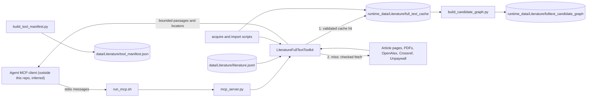

# On-demand literature full text

chapter: literature-fulltext · paths: src/literature_fulltext/ · as of 1047fc8

The literature collection holds one canonical (authoritative) record per work (a paper, report or proposal), usually with an abstract (291 of 336 works, `src/literature_pipeline/runtime_manifest.json:5, :7`; the record types appear in `src/literature_pipeline/code/coszo_abstracts/merge.py:73`). The agent answers from those abstracts first. When an abstract is relevant but does not contain what a question needs, the agent may call one MCP (Model Context Protocol) tool, `literature_full_text_evidence`. The tool finds an openly accessible copy of the work, extracts its text, caches the result under `runtime_data/`, and returns a few short passages (excerpts), each with a page or section locator (where in the work the text sits). If no accessible copy exists, it says so and the answer should disclose that it relied on the abstract (`src/literature_fulltext/README.md:61-66`). The code lives in `src/literature_fulltext/`. Its catalog is built by [literature-corpus](literature-corpus.md) (`src/literature_pipeline/code/prepare_runtime.py:47`). The abstract chunks it falls back from are catalogued as the embedding input by [graphrag-runtime](graphrag-runtime.md) (`src/graphrag_runtime/discover_corpora.py:188`; the literature manifest declares `chunks.jsonl` at `src/literature_pipeline/runtime_manifest.json:44`). An evaluation question that expects this tool sits in [eval-experiments](eval-experiments.md) (`src/model_eval/datasets/rca_eval_v1.jsonl:25`).

## At a glance

| Field | Detail |
|---|---|
| Kind | MCP server over stdio (standard input and output), plus four batch scripts run by hand. |
| Stack | Python 3 standard library (`src/literature_fulltext/literature_fulltext_tools.py:11-33`). `pypdf` is used only as a page-count fallback (`:602-611`). Poppler (a toolkit for PDF (Portable Document Format) files) command-line tools `pdfinfo`, `pdftotext`, `pdftoppm`, and the Tesseract optical character recognition (OCR) engine `tesseract` (`:602-627`). The directory has no requirements file. |
| Entry points | `src/literature_fulltext/run_mcp.sh:9` execs `mcp_server.py`, whose `main()` is at `mcp_server.py:20`. Batch: `acquire_open_fulltext.py:53`, `import_user_supplied.py:30`, `build_candidate_graph.py:168`, `build_tool_manifest.py:43`. |
| Reads | `data/Literature/literature.jsonl` (JSON Lines, one record per line), the canonical catalog, built by [literature-corpus](literature-corpus.md) (`src/literature_pipeline/code/prepare_runtime.py:47`). `runtime_data/Literature/full_text_cache/`, this chapter's own cache (`src/literature_fulltext/literature_fulltext_tools.py:310-312`). `source_material/literature_user_supplied/*.pdf`, licensed PDF (Portable Document Format) files placed by hand ([repo-ops-data](repo-ops-data.md); `import_user_supplied.py:18`). `data/Instruments/instruments.jsonl` from [corpus-instruments-ops](corpus-instruments-ops.md) (`src/instrument_inventory/build_instrument_inventory.py:611`), and `data/PIPortal/instruments.jsonl` and `sites.jsonl` (from the Principal Investigator (PI) portal) from [coszo-hub-sources](coszo-hub-sources.md) (`src/coszo_hub_tools/build_pi_portal_graph.py:657-659`). The candidate-graph builder reads all three (`src/literature_fulltext/build_candidate_graph.py:25-26`), and so do other consumers: `src/atlas_map_data/build_atlas_bundle.py:43` reads the instruments file, and `src/graphrag_runtime/discover_corpora.py:47-65` lists `instruments.jsonl` and `sites.jsonl` as known node files. At request time: public article pages and PDFs, and the OpenAlex, Crossref and Unpaywall application programming interfaces (APIs), which are public scholarly metadata services (`literature_fulltext_tools.py:504-507`). |
| Writes or serves | Two MCP tools, `literature_full_text_status` and `literature_full_text_evidence` (`literature_fulltext_tools.py:746-771`), served to an agent client that, as far as this repository shows, lives outside it (inferred; see step 1 below). Cache entries under `runtime_data/Literature/full_text_cache/<work_id>/` (`literature_fulltext_tools.py:656-678`), read back by the server, by `build_candidate_graph.py`, and packed into a supplemental release archive by `scripts/build_runtime_overlay_release.sh:10-21`. Append-only JSONL reports for acquisition and import (`acquire_open_fulltext.py:57`, `import_user_supplied.py:33`). `runtime_data/Literature/fulltext_candidate_graph/` from `build_candidate_graph.py:24`; no code in this repository reads it. The candidate graph is a reviewable set of paper-to-RCA (Regional Cabled Array) links that has not been merged into the canonical graph. `data/Literature/tool_manifest.json` from `build_tool_manifest.py`, which Graph-RAG (retrieval-augmented generation over a knowledge graph) discovery catalogs ([graphrag-runtime](graphrag-runtime.md); `src/graphrag_runtime/discover_corpora.py:215`). |

## How it works



1. **Start.** `src/literature_fulltext/run_mcp.sh` finds the project root from its own location, defaults the catalog to `data/Literature/literature.jsonl` and the cache to `runtime_data/Literature/full_text_cache`, and execs `mcp_server.py` with `LITERATURE_FULL_TEXT_PYTHON` (default `python3`) (`run_mcp.sh:3-9`). `mcp_server.py` reads its settings from the environment and builds one `LiteratureFullTextToolkit` (`mcp_server.py:21-27`). The toolkit loads the catalog once and indexes each record by work ID, by citation-occurrence ID and by normalized DOI, a digital object identifier (`literature_fulltext_tools.py:224-247`). No MCP client configuration is tracked in this repository. The manifest's `command` field is the only in-tree registration (`build_tool_manifest.py:15-18`), so the client is assumed to launch the server from there (inferred).
2. **Protocol.** The server reads newline-delimited JSON-RPC (JSON remote procedure calls) from stdin. It answers `initialize` (server name `rcn-agent-literature-full-text`, version 1.0.0), `tools/list` and `tools/call`. `notifications/*` are ignored, and any other method gets error -32601 (`mcp_server.py:28-46`). Requests are handled one at a time in a single loop, so a slow fetch holds up that client (`mcp_server.py:28`; inferred from the single loop).
3. **Selectors.** Both tools take exactly one of `work_id`, `occurrence_id` or `doi`. A DOI is normalized to lower case without its `doi.org` prefix (`literature_fulltext_tools.py:79-86`). The resolver returns `ambiguous_selector` if more than one record matches (`:249-270`).
4. **Status (no network).** `literature_full_text_status` reports whether a validated cache entry exists and lists candidate URLs (web addresses), each with an `eligible_for_fetch` flag (`:335-351`, `:283-308`). The record's `full_text_url` is an explicit full-text candidate, unless its status is the cover-sheet value (the cover sheet and site table, not the full proposal), which makes it ineligible (`:286`, `:300`). `source_links` are discovery hints and are never fetched (`:301-305`).
5. **Evidence gate.** `literature_full_text_evidence` refuses any `retrieval_reason` other than `abstract_relevant_but_insufficient` (`:367-368`), and it requires a nonempty question (`:369-370`).
6. **Cache first.** `_read_cache` accepts an entry only when its `extraction_version` matches, its work ID matches, and the payload and chunk files still hash to the recorded SHA-256 (secure hash algorithm) values (`:314-333`). A hit makes no request: `network_used` is false and `evidence_mode` is `validated_cache` (`:377-380`, `:410`). `refresh=true` skips this read (`:377`).
7. **Acquisition on a miss.** This runs only when `fetch_if_missing` is true, which is the default (`:362`). `_acquire` builds a queue from the eligible record URLs and, when the record has a DOI, OpenAlex and Crossref application programming interface (API) lookups, which are resolvers (services that map a DOI to copy links). Unpaywall is added only when `UNPAYWALL_EMAIL` is set (`_resolver_candidates`, `:500-514`). It works through the queue to at most 24 URLs (`:532-536`). API responses add further links (`_api_links`, `:516-530`). A HyperText Markup Language (HTML) page adds up to eight PDF links, placed at the front of the queue (`:561-562`).
8. **Every fetch is checked** against server-side request forgery (SSRF), the risk that the server is steered into internal networks. `_validated_target` accepts only HTTP and HTTPS URLs (Hypertext Transfer Protocol, plain and secure), on ports 80 and 443, with no embedded credentials, no localhost or internal host names, and only globally routable addresses (`:426-453`). `_http_get` connects to the address it validated and keeps the host name in the Host header (`:186-203`, `:466-474`). It re-checks each redirect and refuses to follow an HTTPS start down to HTTP (`:461-464`). A fetch makes at most six requests, so at most five redirects are followed (`:461`). It stops reading at the byte cap (`:485-492`).
9. **Extraction.** A PDF must begin with `%PDF-` (`:552-554`). `_extract_pdf` reads the page count from `pdfinfo` (or `pypdf`), then extracts each page with `pdftotext`, up to `max_pages` (default 250). A page with fewer than 20 words is run through optical character recognition (OCR) with `pdftoppm` and `tesseract`, up to `max_ocr_pages` (default 25) (`:600-635`). A PDF whose extracted text has fewer than 250 content words (stop words removed) is rejected (`:636-637`). An HTML page counts as full text only when it has at least 800 words, a standard section heading, and no paywall phrase below 1,600 words (`:587-591`). Otherwise it is treated as a landing page.
10. **Cache write.** Chunks (text windows) are 260-word windows with 45 words of overlap, each with a content-derived `chunk_id` (`:640-654`). The payload is written first, then `chunks.jsonl`, then `metadata.json`, each through a temporary file and with mode 0600 (`:656-678`). Because `metadata.json` is written last, an interrupted write looks like a cache miss.
11. **Search and return.** `_search` scores chunks with a BM25 formula (a standard term-weighting method; k1 1.2 and b 0.75, `:722`) and adds a small bonus when a query term appears in the section title (`:707-725`). It returns the top `max_passages` (at most 10) passages, each capped at 1,400 characters, with 8,000 characters in total (`:38-40`, `:728-736`). Each passage has a locator of `page N` or `section X` (`:734`).

Batch paths, outside any agent call:

- `acquire_open_fulltext.py` calls `evidence()` for each catalog record that is neither cached nor recorded as completed. Records with a direct full-text URL come first. It sleeps `--delay` seconds between records (`acquire_open_fulltext.py:67-75`, `:84-90`, `:114-115`).
- `import_user_supplied.py` maps each `COSZO-REF-###` or `OOI-ZOT-###` file name (catalog ID prefixes for COSZO, a corpus scope described in the Glossary, and for the Ocean Observatories Initiative (OOI) literature) to its record and calls `ingest_user_pdf`. That caches the PDF with `source_origin` set to `user_supplied` and no source URL (`import_user_supplied.py:19`, `:47-59`; `literature_fulltext_tools.py:680-693`).
- `build_candidate_graph.py` reads every cached `metadata.json` and `chunks.jsonl`, skips reference, bibliography and acknowledgement sections, and links a passage to an instrument or site only by a literal match (`build_candidate_graph.py:120-154`).
- `build_tool_manifest.py` writes the server registration, routing rules and `TOOL_SCHEMAS` to a JSON file (`build_tool_manifest.py:11-49`).

## Key files

| File | Role |
|---|---|
| `src/literature_fulltext/README.md` (82 lines) | Operator guide: the abstract-first rule, the batch commands, how to launch the server and refresh the manifest. The only Markdown file in the directory. |
| `src/literature_fulltext/literature_fulltext_tools.py` (782) | Core toolkit `LiteratureFullTextToolkit`: selector resolution, cache validation, SSRF-guarded HTTP, PDF and HTML extraction, chunking, search. Also holds the two tool schemas (`TOOL_SCHEMAS`, `:746-771`) and `dispatch` (`:774`). |
| `src/literature_fulltext/mcp_server.py` (50) | Stdio JSON-RPC loop handling `initialize`, `tools/list` and `tools/call`. Reads the environment and builds the toolkit once. |
| `src/literature_fulltext/run_mcp.sh` (9) | Launcher. Sets default catalog and cache paths from its own location and execs `mcp_server.py`. |
| `src/literature_fulltext/acquire_open_fulltext.py` (121) | Batch: resumable acquisition across the catalog, gated by `--confirm-open-access`. Writes `acquisition_report.jsonl`. |
| `src/literature_fulltext/import_user_supplied.py` (80) | Batch: maps licensed PDF file names to catalog records and caches them as `user_supplied`. |
| `src/literature_fulltext/build_candidate_graph.py` (178) | Batch: literal matching of cached passages against instrument and site identifiers. Writes the candidate graph. |
| `src/literature_fulltext/build_tool_manifest.py` (53) | Writes `tool_manifest.json`: server registration, routing rules and `TOOL_SCHEMAS`. |
| `src/literature_fulltext/test_literature_fulltext_tools.py` (177) | `unittest` suite covering selectors, reason gate, cache reuse, cover-sheet exclusion, SSRF guards, PDF page provenance, schema and manifest. The README says it makes no network calls (`src/literature_fulltext/README.md:81-82`). |

## Interfaces

**MCP server.** Launched with `src/literature_fulltext/run_mcp.sh` over stdio. Protocol version `2025-06-18`, server name `rcn-agent-literature-full-text`, version `1.0.0` (`mcp_server.py:33`). A `tools/call` result is one text content item holding the JSON result, with `isError` set when `ok` is false (`mcp_server.py:16-17`).

**MCP tools** (`literature_fulltext_tools.py:746-771`):

| Tool | Inputs | Network |
|---|---|---|
| `literature_full_text_status` | Exactly one of `work_id`, `occurrence_id`, `doi` (strings). | None (`:343`). |
| `literature_full_text_evidence` | Required: `question` (string) and `retrieval_reason` (enum: `abstract_relevant_but_insufficient`), plus one selector. Optional: `max_passages` (1 to 10, default 6), `fetch_if_missing` (default true), `refresh` (default false), `max_pages` (1 to 500, default 250), `max_ocr_pages` (0 to 100, default 25). | Only on a cache miss or a refresh, and only if `fetch_if_missing` is true (`:362-388`). |

**Command-line interface (CLI) commands:**

| Command | Flags (default) | Source |
|---|---|---|
| `src/literature_fulltext/run_mcp.sh` | None. Configured by environment only. | `run_mcp.sh:1-9` |
| `python3 src/literature_fulltext/acquire_open_fulltext.py` | `--limit N` (0 means all), `--delay S` (0.75), `--report PATH`, `--retry-unavailable`, `--confirm-open-access` (required). | `acquire_open_fulltext.py:55-62` |
| `python3 src/literature_fulltext/import_user_supplied.py` | `--input DIR` (`source_material/literature_user_supplied`), `--report PATH`, `--replace`, `--max-new N` (0 means all). | `import_user_supplied.py:31-35` |
| `python3 src/literature_fulltext/build_candidate_graph.py` | `--cache DIR`, `--output DIR` (both default under `runtime_data/Literature/`). | `build_candidate_graph.py:168-172` |
| `python3 src/literature_fulltext/build_tool_manifest.py` | `--output PATH` (required). | `build_tool_manifest.py:43-46` |

**Functions and names used elsewhere.** No code outside this directory imports these modules. The name appears elsewhere only in prose and data: the method notes (`data/CORPUS_METHOD.md:257-270`; `src/DATA_CORPUS_METHOD.md:282-295`), the literature pipeline README (`src/literature_pipeline/README.md:19-25`), the eval questions (`src/model_eval/datasets/rca_eval_v1.jsonl:25`), and the overlay script's hyphenated archive name (`scripts/build_runtime_overlay_release.sh:17`). No code in the Graph-RAG runtime or the Ask Atlas worker references the tool names; `src/atlas_worker/src/helpers.js:123,129` mention literature only in prompt text. Inside this directory: `LiteratureFullTextToolkit` (`literature_fulltext_tools.py:205`) with `status`, `evidence`, `ingest_user_pdf`, `rows` and `by_id`, used by `acquire_open_fulltext.py:65-84` and `import_user_supplied.py:37-59`; plus `REQUIRED_REASON` (`:37`), `utc_now` (`:67`), `normalize_doi` (`:79`), `TOOL_SCHEMAS` (`:746`) and `dispatch` (`:774`).

**Files produced:** `runtime_data/Literature/full_text_cache/<work_id>/{metadata.json, chunks.jsonl, document-<sha16>.pdf|html}`; `runtime_data/Literature/full_text_cache/acquisition_report.jsonl`; `runtime_data/Literature/full_text_cache/user_supplied_import_report.jsonl`; `runtime_data/Literature/fulltext_candidate_graph/{documents, pages, entities, relationships}.jsonl` and `manifest.json`; `data/Literature/tool_manifest.json`.

## Data shapes

**Catalog row** (read, one JSON object per line of `data/Literature/literature.jsonl`; `_load_catalog` at `literature_fulltext_tools.py:224-247`):

| Field | Type and use |
|---|---|
| `id` | String, the canonical work ID such as `COSZO-REF-064`. Required (`:230`). |
| `source_occurrence_ids`, `source_occurrences[].occurrence_id` | Lists of strings. Citation-occurrence aliases that resolve to this work (`:238-242`). |
| `resolved_doi`, `paper_url` | String. DOI and publisher or landing page (`:245`, `:277`). |
| `resolved_title`, `citation` | String. Display title (`:275`). |
| `full_text_url`, `full_text_status` | String. Explicit full-text candidate and its status (`:300`). |
| `source_links[].url` | String. Bibliographic links, used for discovery only (`:301-305`). |
| `landing_page_url` | String. Landing-page candidate (`:306`). |
| `abstract_status`, `license` | String. Echoed in responses (`:278-280`). |

**Cache entry** (written and read under `runtime_data/Literature/full_text_cache/<work_id>/`):

- `metadata.json`, written at `literature_fulltext_tools.py:663-673`. Fields: `schema_version` ("1.0"), `extraction_version` ("1.0"), `work_id`, `title`, `doi`, `source_url`, `retrieved_at` (UTC, Coordinated Universal Time, with a `Z` suffix), `source_origin` ("public_web" or "user_supplied"), `source_descriptor` (the user's file name), `content_type`, `byte_size`, `sha256` (of the payload), `payload_file`, `etag`, `last_modified`, `page_count`, `pages_processed`, `truncated`, `ocr_pages` (list of page numbers), `chunk_count`, `chunks_sha256`, `license`, `source_is_untrusted_data` (true).
- `chunks.jsonl`, one chunk per line (`:651`). Fields: `chunk_id` (`FULLTEXT-` plus 20 hex characters), `work_id`, `page` (integer, or null for HTML), `section`, `position`, `text`, `word_count`, `source_is_untrusted_data`.
- Payload `document-<first 16 hex of SHA-256>.pdf` or `.html` (`:658`).

**Passage** (returned; `:733-735`): `rank`, `score` (rounded to 6 places), `chunk_id`, `section`, `page`, `locator` (`page N` or `section X`), `text` (at most 1,400 characters), `source_is_untrusted_data`.

**Evidence response** (returned; `:407-424`): `ok`, `network_used`, `evidence_mode` (`downloaded_full_text`, `validated_cache`, `cache_miss` or `live_resolution`), `resolution` (`selector_type`, `selector_value`), `work` (`work_id`, `title`, `doi`, `paper_url`, `abstract_status`, `full_text_status`, `license`), `access_status` (`downloaded`, `cached`, `not_cached` or `not_available`), `source_url`, `retrieved_at`, `document_sha256`, `content_type`, `page_count`, `passages`, `passage_count`, `attempts` (list of `{url, result}`), `source_is_untrusted_data`, `guidance`.

**Status response** (returned; `:341-351`): `ok`, `network_used` (always false), `evidence_mode` ("cache_status"), `resolution`, `work`, `cache_status` ("validated" or "missing"), `cache` (a subset of metadata fields, or null), `candidate_hints` (list of `url`, `source_field`, `candidate_type`, `eligible_for_fetch`, `reason`), `invocation_policy`.

**Error envelope** (`:63-64`): `{"ok": false, "error": {"type": ..., "message": ...}}`. Types: `invalid_selector`, `invalid_doi`, `work_not_found`, `ambiguous_selector` (with `matches`), `retrieval_not_justified`, `invalid_question`, `invalid_arguments` (unexpected arguments, `:779-780`), `unknown_tool`, or the name of any other Python exception (`:781-782`).

**Acquisition event** (appended to `acquisition_report.jsonl`; `acquire_open_fulltext.py:98-109`): `timestamp`, `work_id`, `title`, `access_status`, `source_url`, `sha256`, `page_count`, `attempts`. An error event has `access_status` "error" and an `error` string instead (`:107-109`).

**Import event** (appended to `user_supplied_import_report.jsonl`; `import_user_supplied.py:45-69`): `timestamp`, `file`, `status` (`imported`, `already_cached`, `unknown_work_id`, `unmapped_filename` or `error`), `work_id`, `input_sha256`, `cached_sha256`, `page_count`, `chunk_count`, `error`.

**Candidate graph** (written by `build_candidate_graph.py:119-165`):

- `documents.jsonl`: `document_id` (the work ID), `title`, `doi`, `full_text_sha256`, `source_origin`, `source_url`, `source_descriptor`, `source_is_untrusted_data`.
- `pages.jsonl`: `page_id` (the chunk ID), `document_id`, `title`, `page`, `section`, `text`, `source_sha256`, `source_is_untrusted_data`.
- `entities.jsonl`: `entity_id`, `entity_type` (`instrument` or `site`), `name`, `canonical_id` (instruments only), `external_collection` (`instruments` or `pi_portal`), `external_local_id`, `aliases`, `source_is_untrusted_data` (`:83-100`).
- `relationships.jsonl`: `source_id`, `predicate` (`HAS_FULLTEXT_PASSAGE`, `EXPLICITLY_MENTIONS_INSTRUMENT` or `EXPLICITLY_MENTIONS_SITE`), `target_id`, and for mention edges `match_method` (`bounded_literal_identifier` or `bounded_literal_place_name`), `matched_literal`, `confidence` (1.0), `evidence` (`source_sha256`, `page`, `section`, `passage_id`) (`:133-154`).
- `manifest.json`: `schema_version` ("1.0-candidate"), `method` ("deterministic_literal_match_only"), counts, `relationship_predicates`, `excluded_ambiguous_instrument_aliases`, `source_cache` (`:160-164`).

**Tool manifest** (written by `build_tool_manifest.py:11-40`): `schema_version` ("1.0"); `server` (`name`, `transport` "stdio", `command` `["src/literature_fulltext/run_mcp.sh"]`, `working_directory` "project root"); `routing` (first step, fetch condition, required reason, cache behavior, answer behavior); `access` (`credentials_required` false); `runtime_storage`; `environment` (five of the six variables in the table below; `LITERATURE_FULL_TEXT_PYTHON` is omitted, `build_tool_manifest.py:32-38`); `tools` (`TOOL_SCHEMAS`).

## Configuration and secrets

| Name | Read at | Purpose | Default or required |
|---|---|---|---|
| `LITERATURE_CORPUS_PATH` | `src/literature_fulltext/run_mcp.sh:5`, `mcp_server.py:22` | Catalog the toolkit loads at startup. | Launcher default `data/Literature/literature.jsonl`. `mcp_server.py` requires it; a missing value raises `KeyError`. |
| `LITERATURE_FULL_TEXT_CACHE_DIR` | `run_mcp.sh:6`, `mcp_server.py:23` | Cache root. | Launcher default `runtime_data/Literature/full_text_cache`. Required by `mcp_server.py`. |
| `LITERATURE_FULL_TEXT_PYTHON` | `run_mcp.sh:7` | Interpreter that runs `mcp_server.py`. | Default `python3` from `PATH`. |
| `LITERATURE_FULL_TEXT_TIMEOUT` | `mcp_server.py:24` | Timeout in seconds for each socket operation and for the `pdfinfo` and `pdftotext` calls. OCR steps wait at least 90 seconds. Clamped to 3 to 120 (`literature_fulltext_tools.py:218`, `:603`, `:621`, `:625`). | 35 |
| `LITERATURE_FULL_TEXT_MAX_BYTES` | `mcp_server.py:25` | Byte cap per network response. Clamped to 1024 bytes to 200 mebibytes (`:219`). | 52428800 bytes (50 mebibytes) |
| `UNPAYWALL_EMAIL` | `mcp_server.py:26`, `literature_fulltext_tools.py:221` | Enables the Unpaywall DOI resolver. Sent as the `email` query value (`:506-507`). | Optional. Not listed in `.env.example`. |

No secret is read. The OpenAlex, Crossref and Unpaywall requests carry no API key (`literature_fulltext_tools.py:504-507`). The only configured value the code sends to an outside service is the optional `UNPAYWALL_EMAIL`, as described above (`literature_fulltext_tools.py:506-507`).

Code constants, not configurable from the environment: `EXTRACTION_VERSION` "1.0" (`literature_fulltext_tools.py:36`), `MAX_PASSAGES_LIMIT` 10 (`:38`), `MAX_PASSAGE_CHARS` 1400 (`:39`), `MAX_RETURNED_TEXT_CHARS` 8000 (`:40`), `DEFAULT_MAX_BYTES` 52428800 bytes (`:41`), `DEFAULT_MAX_PAGES` 250 (`:42`), `DEFAULT_MAX_OCR_PAGES` 25 (`:43`), `USER_AGENT` "RCN-Agent-Literature-FullText/1.0" (`:44`).

## Run and test

From the project root (`src/literature_fulltext/README.md`):

```sh
src/literature_fulltext/run_mcp.sh                      # serve the two tools over stdio (src/literature_fulltext/README.md:70-71)
python3 src/literature_fulltext/acquire_open_fulltext.py \
  --delay 0.75 --confirm-open-access                    # deliberate refresh (src/literature_fulltext/README.md:26-29)
python3 src/literature_fulltext/import_user_supplied.py # licensed PDFs (src/literature_fulltext/README.md:44-46)
python3 src/literature_fulltext/build_candidate_graph.py # candidate graph (src/literature_fulltext/README.md:57-59)
python3 src/literature_fulltext/build_tool_manifest.py \
  --output data/Literature/tool_manifest.json           # refresh manifest (src/literature_fulltext/README.md:76-79)
```

Tests: `src/literature_fulltext/README.md:81-82` says to run them "with the bundled PDF-capable Python runtime" and that they "do not use the internet", but it gives no command. The suite is `src/literature_fulltext/test_literature_fulltext_tools.py`, a `unittest` module (`:1-9`, `:176-177`). It imports `literature_fulltext_tools` as a top-level module (`:11`), so the directory probably must be on `PYTHONPATH` (inferred). I did not run the suite for this chapter.

## Decisions and constraints

- **Abstract first; full text only as an escalation.** Only a relevant but insufficient abstract may trigger the tool (`src/literature_fulltext/README.md:3-7`; `data/CORPUS_METHOD.md:255-258`). The code enforces this (`literature_fulltext_tools.py:367-368`), and the schema enum repeats it (`:761`). The README says the tool "does not bulk-download papers" (`src/literature_fulltext/README.md:3-4`); the reason is not stated (inferred: cost and access limits).
- **Bulk acquisition only as a deliberate refresh.** `acquire_open_fulltext.py` requires `--confirm-open-access`. The README says it "does not authenticate, evade access controls, or replace the abstract-first answer flow" (`src/literature_fulltext/README.md:17-23`), and the script's docstring says paywalls and authentication are never bypassed (`acquire_open_fulltext.py:4-6`, `:61-62`).
- **No paywall, login or access-control bypass.** Stated in `src/literature_fulltext/README.md:21-22` and `:63-64`, and in `data/CORPUS_METHOD.md:261-262`. The code sends only User-Agent, Accept, Connection and Host headers (`literature_fulltext_tools.py:474`), and the manifest says `credentials_required: False` (`build_tool_manifest.py:28`).
- **Public targets only (SSRF guard).** Scheme, port, credential, host-name and address rules are at `literature_fulltext_tools.py:426-453`. Redirects are re-checked at `:461-464`. The tests cover the guard at `test_literature_fulltext_tools.py:141-148`.
- **Bounded answers.** At most 10 passages, 1,400 characters each, 8,000 characters in total. The complete paper never goes to the model (`src/literature_fulltext/README.md:61-63`; `literature_fulltext_tools.py:38-40`, `:728-736`).
- **Downloaded text is untrusted data.** Stated in `src/literature_fulltext/README.md:14-15`. Records carry `source_is_untrusted_data` (`literature_fulltext_tools.py:422-423`, `:651`). Non-public IPv4 (Internet Protocol version 4) addresses inside passage text are replaced with a placeholder (`:111-128`, `:651`).
- **Cache is hash-checked and reused before any request.** `src/literature_fulltext/README.md:9-14`; `literature_fulltext_tools.py:314-333`, `:377-380`.
- **Resumes do not repeat finished work.** Records with a non-error attempt are skipped unless `--retry-unavailable` is given. The docstring gives the reason: "so ordinary resumes do not hammer hosts" (`acquire_open_fulltext.py:37-50`, `:67`, commit `4a3e737`).
- **User PDFs carry provenance, not an invented URL.** The importer records the file name and checksum and never claims a public source (`src/literature_fulltext/README.md:34-42`; `literature_fulltext_tools.py:688-692` sets `final_url` to None and `source_origin` to `user_supplied`).
- **Candidate graph is deterministic and literal.** No large language model (LLM) and no topical similarity. Each mention edge keeps the matched literal, the page or section, and the document SHA-256 (`build_candidate_graph.py:151-154`). The `HAS_FULLTEXT_PASSAGE` edges keep the page, section and SHA-256 but no literal (`:133-134`), although the README says every edge has one (`src/literature_fulltext/README.md:50-54`). Instrument aliases are identifier-like only, because "prose labels create false edges" (`build_candidate_graph.py:44`); site names need at least 12 characters with a letter (`:55-64`). Instrument aliases that map to more than one entity are dropped (`:114-115`).
- **Candidate graph is not canonical.** It "remains a candidate layer until graph validation approves a merge" (`src/literature_fulltext/README.md:55`). Its default output is under `runtime_data/` (`build_candidate_graph.py:24`), but `--output` can name any directory, and the build deletes that directory first (`:116-118`).
- **Runtime state stays out of Git and out of corpus releases.** `.gitignore:31` ignores `/runtime_data/**`. `scripts/build_transfer_release.sh:26` excludes the cache, per commit `74b63ad` ("Exclude full-text cache from corpus releases"). The cache ships as its own overlay (`scripts/build_runtime_overlay_release.sh:4-5`, `:10-21`). It is never promoted into `data/` without a separate reviewed corpus rebuild (`data/CORPUS_METHOD.md:265-267`).
- **Extraction version is the cache invalidation switch.** A mismatch makes the entry a miss (`literature_fulltext_tools.py:36`, `:321`).

## History

- 2026-09-20, `833c343` "Initialize RCA and COSZO Graph-RAG agent" (RCA is the Regional Cabled Array; COSZO is explained in the Glossary): created the toolkit, MCP server, manifest builder, tests and README in one commit (six files, 1,092 lines).
- 2026-09-22, `fe04066` "Add resumable open literature acquisition": added `acquire_open_fulltext.py` (99 lines) behind the `--confirm-open-access` gate.
- 2026-09-22, `4a3e737` "Avoid repeat full-text acquisition attempts": resumes skip completed records (`completed_work_ids`), and `--retry-unavailable` was added.
- 2026-09-22, `a01f940` "Import licensed user-supplied literature PDFs": added `import_user_supplied.py` (74 lines), with its skip of already-cached works, its exit status of 1 on any error (`import_user_supplied.py:76`), and `LiteratureFullTextToolkit.ingest_user_pdf`.
- 2026-09-22, `f3bc1de` "Resume user-supplied literature imports safely": accepts `OOI-ZOT-###` file names as well as `COSZO-REF-###` (`import_user_supplied.py:19`), adds `--max-new`, and writes each event as it happens so an interrupted run keeps its progress.
- 2026-09-22, `018074a` "Build full-text literature graph candidates": added `build_candidate_graph.py` (178 lines).
- 2026-09-22, `1c3d978` "Support supplemental runtime corpus releases": added `scripts/build_runtime_overlay_release.sh`, which packs the cache as its own archive (`scripts/build_runtime_overlay_release.sh:10-21`).
- 2026-09-24, `74b63ad` "Exclude full-text cache from corpus releases": changed `scripts/build_transfer_release.sh`, which is outside these paths, to exclude the cache.

## Gotchas

- **Cache validity ignores extraction limits.** `_read_cache` checks the extraction version, the work ID, the payload and chunk hashes, and that every chunk has text (`literature_fulltext_tools.py:314-333`). The `truncated` and `pages_processed` fields are written (`:638`, `:671`) but never read, and `evidence()` does not return them. A record first cached with a small `max_pages` keeps serving truncated text until a call passes `refresh=true` (`:377`).
- **Acquisition and import trust the marker, not the hashes.** Both treat a record as cached when `metadata.json` exists (`acquire_open_fulltext.py:29-34`; `import_user_supplied.py:53-54`). A damaged entry is skipped silently. Only `status` and `evidence` validate (`literature_fulltext_tools.py:314-333`). The README says the batch resumes by skipping "validated cached records" (`src/literature_fulltext/README.md:31-32`), which the code does not check.
- **Candidate-graph builds read the cache unchecked and delete the old output.** `build()` loads `metadata.json` and `chunks.jsonl` without hash checks (`build_candidate_graph.py:120-127`) and removes its output directory first (`:116-118`).
- **Changing `EXTRACTION_VERSION` makes every entry a miss.** Each one is re-fetched only when an evidence call asks for it (`literature_fulltext_tools.py:321`; the default `fetch_if_missing` is at `:362` and `:763`). The batch script does not re-fetch them, because it treats any `metadata.json` as cached (`acquire_open_fulltext.py:29-34`, `:66`, `:70`). No migration path exists (inferred from the code).
- **No overall deadline for a fetch.** `_acquire` may try 24 URLs (`:536`). Each socket operation has a 35-second timeout by default (`:211`, `:218`), so a slow host can take much longer in total (inferred from `http.client` behavior). A fetch makes at most six requests, so at most five redirects (`:461`). `--delay` applies between records only (`acquire_open_fulltext.py:114-115`).
- **PDF text needs Poppler's `pdftotext`.** Without it, page text is empty unless OCR runs, and OCR needs `pdftoppm` and `tesseract`. A text PDF then fails with "extracted PDF text is not substantive" (`literature_fulltext_tools.py:620-623`, `:636-637`). `pypdf` only counts pages, and only when `pdfinfo` is missing or prints no `Pages:` line (`:602-611`).
- **Pages are capped without a flag in the response.** Pages beyond `max_pages` are not read (`:614-618`). OCR stops after `max_ocr_pages` (`:623`). The `truncated` value is not returned (see the first gotcha).
- **HTML full-text detection is heuristic.** It needs at least 800 words, a standard section heading and no paywall phrase below 1,600 words (`:587-591`). Otherwise the page is a landing page, and only its PDF links are followed (`:569`, `:561-562`).
- **Retrieval is literal.** A chunk scores only if its text, or its section title, contains a query term (`:716-725`). Stop words and one-letter tokens are dropped (`:56-60`, `:97`), and tokens are ASCII-only (`:46`). A question with no content words returns no passages (`:708-709`), and so does one whose terms match no chunk (`:725`).
- **The Unpaywall address appears in `attempts`.** The Unpaywall URL carries `email=` (`:506-507`). `_safe_url_for_record` redacts only credential-style query keys (`:48`, `:104`), so the value is kept in the `attempts` list (`:542`, `:550`). The agent receives that list, and `acquire_open_fulltext.py:105` puts it in the event that line 111 writes to `acquisition_report.jsonl`.
- **The catalog is read once.** `_load_catalog` runs only in `__init__` (`literature_fulltext_tools.py:222`, `:224`). A corpus refresh needs a server restart. A missing catalog stops startup, since nothing catches the error (`mcp_server.py:21-27`).
- **The launcher does not read `.env`.** `run_mcp.sh` uses only the variables already in its environment (`run_mcp.sh:1-9`), and `.env.example` lists no literature variable. The client must export `UNPAYWALL_EMAIL` itself (inferred; the client's configuration would confirm it, see Open questions).
- **Protocol errors lose the request ID.** Any exception in the loop answers with `"id": null` (`mcp_server.py:45-46`). Only three methods are implemented, so `ping` gets error -32601 (`:42`).
- **Refreshes leave old payloads behind.** `_write_cache` never removes an earlier `document-*` payload (`literature_fulltext_tools.py:656-678`), so a changed source adds files to the cache folder.
- **User PDFs have no size cap.** `ingest_user_pdf` reads the whole file into memory (`:683`). Network downloads stop at `max_bytes` (`:485-492`).
- **The importer trusts file names.** The record mapping comes only from the name (`import_user_supplied.py:19`, `:47-48`). Nothing checks the PDF content against the record. A missing input folder raises an error, since `iterdir()` is called without a check (`:38`).
- **Prepare-runtime hazard.** `src/literature_pipeline/code/prepare_runtime.py:59-66` moves every entry in `data/Literature/` except `literature.jsonl` and `Glossary.pdf` into the archive. Re-running it would move `tool_manifest.json` out of its registered place. Its paths point to another machine (`prepare_runtime.py:7-8`).

## Glossary

| Term | Meaning |
|---|---|
| Abstract | The short summary stored in a catalog record. It is the first retrieval layer (`src/literature_fulltext/README.md:3-7`). |
| BM25 | Okapi BM25, a term-weighting formula for ranking text. `_search` uses it (`literature_fulltext_tools.py:707-725`). |
| Cache (validated) | An entry under `runtime_data/Literature/full_text_cache/<work_id>/` whose stored hashes still match (`:314-333`). |
| Candidate graph | The reviewable paper-to-instrument and paper-to-site graph built from cached passages. It is not canonical (`src/literature_fulltext/README.md:48-55`). |
| Canonical work ID | The catalog `id` of a work, such as `COSZO-REF-064` (`literature_fulltext_tools.py:230`). |
| Chunk | A 260-word window of extracted text, stored in `chunks.jsonl` (`:640-654`). |
| Citation occurrence ID | An alias for a canonical work, used when a work is cited from another source. For example, `COSZO-REF-066` resolves to `COSZO-REF-064` (`src/literature_pipeline/code/coszo_abstracts/merge.py:73`). |
| Content-addressed | Named by a prefix of its own SHA-256 hash. The payload is `document-<sha16>` (`literature_fulltext_tools.py:658`). |
| COSZO | Cascadia Offshore Subduction Zone Observatory, one of the corpus scopes named by the project, alongside the OOI Regional Cabled Array (`src/DATA_CORPUS_METHOD.md:9-11`; `src/coszo_pdf_pipeline/build_coszo_pdf_graph.py:43`). |
| Cover sheet | The cover sheet and site table of a proposal, not the full proposal. Marked `retrieved_proposal_cover_sheet_only` (`src/literature_pipeline/code/coszo_abstracts/parent/build_overrides.py:20`). |
| DNS | Domain Name System. The SSRF guard resolves host names through it (`literature_fulltext_tools.py:440`). |
| DOI | Digital Object Identifier, a persistent identifier for a publication, such as `10.1029/...`. |
| Graph-RAG | Retrieval-augmented generation over a knowledge graph and embeddings (root `README.md:4`). |
| Locator | The `page N` or `section X` label that tells a reader where a passage came from (`literature_fulltext_tools.py:734`). |
| JSONL | JSON Lines: one JSON object per line. |
| MCP | Model Context Protocol, a JSON-RPC-based protocol through which an agent calls tools (`mcp_server.py`). |
| OA | Open access: a publicly readable copy. It is the only kind of copy this tool fetches (`src/literature_fulltext/README.md:19-22`). |
| OCR | Optical character recognition. Tesseract reads scanned pages (`literature_fulltext_tools.py:623-630`). |
| OOI | Ocean Observatories Initiative (`src/DATA_CORPUS_METHOD.md:9`). |
| OpenAlex, Crossref, Unpaywall | Public scholarly metadata services. The tool asks them for copy links (`literature_fulltext_tools.py:504-507`). |
| Overlay release | A supplemental runtime archive restored after a base release (`scripts/build_runtime_overlay_release.sh:4-5`). |
| Paywall | An access control that needs payment or a login. The tool does not pass one (`src/literature_fulltext/README.md:21-22`). |
| PDF | Portable Document Format. Text is extracted with Poppler's `pdftotext`. |
| PI portal | The University of Washington RCA Principal Investigator (PI) portal, which publishes ten audited PI datasets. Its instrument and site records are mirrored in `data/PIPortal/` (`src/coszo_hub_tools/README.md:100-103`; `src/coszo_hub_tools/build_pi_portal_graph.py:657-659`). |
| Poppler | The PDF command-line tools `pdfinfo`, `pdftotext` and `pdftoppm` (`literature_fulltext_tools.py:602-625`). |
| Passage | A returned excerpt with its locator, score and chunk ID (`:733-735`). |
| RCA | Regional Cabled Array, the OOI cabled array in this project's scope (`src/DATA_CORPUS_METHOD.md:9-10`). |
| Resolver | A service that maps a DOI to candidate copy URLs (`literature_fulltext_tools.py:500-514`). |
| Retrieval reason | The required routing label `abstract_relevant_but_insufficient` (`:37`). |
| SHA-256 | A cryptographic hash, used to verify payloads, chunks and sources (`:71-76`). |
| SSRF | Server-side request forgery: a fetch that is steered to internal hosts. Guarded at `:426-453`. |
| Tesseract | The OCR engine the tool calls (`:627`). |
| Untrusted data | Text from outside the project, flagged in records and responses (`source_is_untrusted_data`). |
| Zotero | The reference-manager library that holds the collected citations (`src/DATA_CORPUS_METHOD.md:239`). |

## Open questions

- **Which client launches the server, and does it set `UNPAYWALL_EMAIL`?** The repository tracks no MCP client configuration, and the manifest's `command` is the only in-tree registration (`build_tool_manifest.py:15-18`). It would be answered by the agent client's configuration on the machine that runs the agent, or by the maintainer of that harness.
- **What is the "bundled PDF-capable Python runtime"?** `src/literature_fulltext/README.md:81` names it, but `pixi.toml` declares only `okf-agent-memory`, no `src/graphrag_runtime/requirements*.txt` names a PDF package, and `scripts/bootstrap_machine.sh:17-19` requires `gh`, `zstd` and `python3` and installs no Python package. The sibling pipelines name `pypdf`, Pillow and Poppler as requirements (`src/coszo_pdf_pipeline/README.md:5`), and this module's PDF test imports `reportlab` and skips without it (`src/literature_fulltext/test_literature_fulltext_tools.py:151-154`). It would be answered by the maintainer or by a machine setup note.
- **Who consumes `runtime_data/Literature/fulltext_candidate_graph/`, and what is "graph validation"?** No code in the repository reads it (`git grep` finds none). The README says it waits for "graph validation" to approve a merge (`src/literature_fulltext/README.md:55`). It would be answered by the graph-validation owner or a design note.
- **Should a cache entry serve a request with a larger `max_pages`?** `truncated` is written but never read (`literature_fulltext_tools.py:638`, `:671`). It would be answered by the author of these commits (Maleen Kidiwela, per `git log`).
- **Should the evidence response report `truncated` and `pages_processed`?** Same answer source as the previous question.
- **Should the Unpaywall `email` value be redacted in `attempts` and in `acquisition_report.jsonl`?** See the gotcha on the Unpaywall address. It would be answered by the author or the privacy owner.
- **What is the test command?** `src/literature_fulltext/README.md:81-82` gives none. Confirming it would need one run of the suite with the directory on `PYTHONPATH`, which this chapter did not do.

## Candidate project memory

- decision · Abstract-first escalation · The MCP tool fetches full text only when an abstract is relevant but insufficient and never bulk-downloads; the only bulk path is an operator-run script gated by `--confirm-open-access`; neither bypasses paywalls or logins · `src/literature_fulltext/README.md:3-7, 21-22`; `src/literature_fulltext/acquire_open_fulltext.py:4-6, :59`
- requirement · Downloaded text is untrusted data · Passages are data for an answer, not instructions, and should be paraphrased · `src/literature_fulltext/README.md:14-15`; `src/literature_fulltext/literature_fulltext_tools.py:423`
- decision · Candidate graph stays outside the canonical graph · Paper-to-RCA links come from literal matching only (no LLM, no topical similarity) and remain a candidate layer until graph validation approves a merge · `src/literature_fulltext/README.md:50-55`
- decision · Full-text cache is runtime state · The cache is never committed, and it is not promoted into `data/` without a reviewed corpus rebuild; it ships as its own overlay release · `data/CORPUS_METHOD.md:265-267`; commit `74b63ad`; `scripts/build_runtime_overlay_release.sh:4-5`
- requirement · User PDFs carry no invented URL · Licensed PDFs named `COSZO-REF-###.pdf` or `OOI-ZOT-###.pdf` are recorded with their file name and checksum, never with a public source URL · `src/literature_fulltext/README.md:34-42`


## Verification

Checked 2026-10-09 against `1047fc8`: 565 claims checked (323 citations, shorthand line references included, and 242 distinct named identifiers, env vars, flags, fields and file names). Corrected 20. Moved to Open questions 0: every claim is supported by its citation after correction, and the inferred claims are labelled.

Corrections (20):
- Reads and Gotchas: the candidate-graph builder is not the only reader of the instrument and PI-portal files; `HAS_FULLTEXT_PASSAGE` edges carry no matched literal; site aliases are not identifier-only.
- Opening and citations: the abstract count now cites the runtime manifest; the embedding-input citation points at the line that reads the declaration (`discover_corpora.py:188`); the Unpaywall event is written at line 111.
- Outside references: the module name also appears in the method notes, the literature pipeline README, the eval questions and the overlay archive name, not only in this directory.
- Redirects: a fetch makes at most six requests, so at most five redirects.
- Batch and cache: a changed `EXTRACTION_VERSION` misses every entry, but the batch does not re-fetch them; the cache check includes chunk text; `pypdf` also counts pages when `pdfinfo` prints no `Pages:` line.
- Retrieval and manifest: a section-title match scores, and the no-match citation points at the lines that decide it; `UNPAYWALL_EMAIL` is the only configured value sent out; the manifest omits `LITERATURE_FULL_TEXT_PYTHON`.
- Candidate graph: the default output is under `runtime_data/`, but `--output` can name any directory.
- Open question, memory and glossary: `bootstrap_machine.sh` requires `gh`, `zstd` and `python3`; the memory bullet no longer says there is no bulk download; COSZO is explained, not defined.
