# Repository, data releases and agent tooling

chapter: repo-ops-data · paths: `':(glob)*' 'scripts/' 'data/' 'runtime_data/' 'source_material/' '.agents/' '.claude/' 'knowledge/' 'src/DATA_CORPUS_METHOD.md' 'src/data_maintenance/'` · as of 1047fc8

RCA Atlas is a set of services and pipelines, but the large inputs they run on are not in Git. This chapter covers the parts that hold the project together. It explains the top-level repository layout, the three scripts that package the corpus as versioned GitHub Release assets and restore it on a new machine, three maintenance scripts that clean `data/`, remove private network details and audit the result, the project-wide method that says how every collection is built (kept in two near-identical copies), and the agent-memory tooling: the `knowledge/` bundle, the `okf` command and the `okf-memory` skill. The corpus is the prepared retrieval input for the Graph-RAG system (retrieval-augmented generation over a graph and text chunks). It covers RCA (the Regional Cabled Array of the Ocean Observatories Initiative, OOI) and COSZO, the project name used throughout (`src/DATA_CORPUS_METHOD.md:9-14`). Every other chapter's data and runtime files live in the gitignored trees this chapter describes (`README.md:6-9`, `.gitignore:21-35`), so this is where a newcomer learns how they reach a machine.

## At a glance

| Field | Value |
|---|---|
| Kind | Scripts (release packaging, machine restore, data maintenance), plus the repository layout and the agent-memory tooling. |
| Stack | POSIX `sh`, `tar`, `zstd` (Zstandard compression), GitHub CLI (`gh`), `sha256sum`. Python 3 standard library; the sanitizer also imports Pillow (a Python imaging library) and calls Tesseract, an optical character recognition (OCR) program. pixi (an environment manager that reads `pixi.toml` and `pixi.lock`) with conda-forge for `okf-agent-memory` 0.6.x. Markdown, JSON and JSONL (one JSON object per line). |
| Entry points | `scripts/bootstrap_machine.sh` (restore), `scripts/build_transfer_release.sh` (base release), `scripts/build_runtime_overlay_release.sh` (supplemental release), `src/data_maintenance/clean_data_folder.py`, `src/data_maintenance/sanitize_sensitive_network_info.py`, `src/data_maintenance/audit_sensitive_network_info.py`, and `pixi run okf` under the `okf-memory` skill (`.agents/skills/okf-memory/SKILL.md`). |
| Reads | `data/` collections, built by [corpus-docs-web](corpus-docs-web.md) (Websites, Figures, Datasheets, coszo, RCA Information), [corpus-instruments-ops](corpus-instruments-ops.md) (Instruments, Nereus, FETCH), [literature-corpus](literature-corpus.md) (Literature), [axial](axial.md) (AxialEarthquakes), [coszo-hub-core](coszo-hub-core.md) and [coszo-hub-sources](coszo-hub-sources.md) (COSZOHub, PIPortal), and [agentic-qaqc](agentic-qaqc.md) (QAQC). `StationMetadata` is written by this chapter's `clean_data_folder.py` from StationXML (`src/data_maintenance/clean_data_folder.py:185`). Originals in `source_material/` come from the same builders and are moved there by `clean_data_folder.py`. `runtime_data/GraphRAG/corpus_catalog.json`, written by `src/graphrag_runtime/discover_corpora.py` ([graphrag-runtime](graphrag-runtime.md)). GitHub Release assets, produced by this chapter's scripts. Environment variables and `.env` files named in `.env.example` (see Configuration). The `knowledge/` bundle, written by agents through `okf`. |
| Writes or serves | Release archives `rca-corpus-data-<fp>.tar.zst`, `rca-source-material-<fp>.tar.zst` and `rca-runtime-data-<fp>.tar.zst`, plus `release-manifest.json`. They are served as GitHub Release assets and restored by `bootstrap_machine.sh` on a new machine. The restored `runtime_data/GraphRAG/normalized` and `embeddings` feed the loader in [graphrag-runtime](graphrag-runtime.md) (`src/graphrag_runtime/compose.yaml:36-37`). Overlay archive `rca-literature-fulltext-YYYYMMDD.tar.zst`, restored to `runtime_data/Literature/full_text_cache` and read by [literature-fulltext](literature-fulltext.md). `data/StationMetadata/`, read by [graphrag-runtime](graphrag-runtime.md) (its catalog discovery reads `manifest.json` at `src/graphrag_runtime/discover_corpora.py:279-280`; line 39 only names the collection) and [atlas-map-data](atlas-map-data.md) (`src/atlas_map_data/build_atlas_bundle.py:26`). `data/cleanup_validation.json`, which people and the method document read and no code reads. `source_material/move_manifest.jsonl`, which people read and the cleanup script reads back on its next run (`src/data_maintenance/clean_data_folder.py:252-257`). The audit report, which is the documented release gate. `knowledge/` concept files, read by agents through the skill. |

## How it works

### Restore and release

The steps run in this order. The Mermaid diagram after the list shows the same path.

1. **Builders fill the gitignored trees.** Collection builders under `src/` write `data/<collection>/` and keep originals in `source_material/`. Only Markdown, JSON, JSONL, PNG and JPEG belong in `data/` (`src/DATA_CORPUS_METHOD.md:29-40`, `data/README.md:7-15`).
2. **Cleanup.** `clean_data_folder.py --project-root P` plans moves and prints the plan unless `--apply` is given (`src/data_maintenance/clean_data_folder.py:277-286`). The plan moves PDFs, XLSX files, StationXML, Axial source snapshots, mislabeled `.mpo` images (a camera multi-picture format), and `.sqlite` or `.gz` files out of `data/` (`:152-171`). With `--apply` it records each move with a SHA-256 (a file hash) in `source_material/move_manifest.jsonl` (`:205-214`, `:251-257`), rewrites pointers in the JSONL files (`:217-242`), and writes `data/cleanup_validation.json` (`:262-273`). It also turns StationXML (an XML format for station metadata) from `data/station metadata/` (with a space; `:158-160`) into `data/StationMetadata/` (`station_graph`, `:50-149`, called at `:185`).
3. **Sanitize.** `sanitize_sensitive_network_info.py --project-root P` edits files in place. It replaces private IPv4 (internet protocol version 4) addresses, `localhost` and `host.docker.internal` references and AWS (Amazon Web Services) signed-query values in `data/` and `src/literature_pipeline/` (`sanitize_text`, `src/data_maintenance/sanitize_sensitive_network_info.py:53-68`, `:238-271`). For images whose metadata holds a private address, it blacks out the matching text with Tesseract OCR and refreshes the image and manifest hashes (`:116-161`, `:164-235`).
4. **Audit.** `audit_sensitive_network_info.py --root data --root runtime_data/GraphRAG/corpus_catalog.json --output FILE` reads `.json`, `.jsonl` and `.md` and reports, without editing (`src/data_maintenance/audit_sensitive_network_info.py:24-40`, `:93-201`). It flags private, loopback, link-local, reserved and multicast addresses, IPv6 addresses, MAC (network hardware) addresses, internal hostnames, credential-bearing URLs, unredacted AWS presigned URLs, secret-like values, and JSON fields named like network settings (`NETWORK_KEYS`, `:39`; `:166-181`). Public addresses and documented placeholders are only counted. `passed` is true when there are no findings (`:200`). The method requires `sensitive_finding_count` to be zero before a release (`src/DATA_CORPUS_METHOD.md:776-778`).
5. **Catalog.** `src/graphrag_runtime/discover_corpora.py --project-root P` (flags at `:343-344`) writes `runtime_data/GraphRAG/corpus_catalog.json` (default at `:346`), which carries `build_fingerprint_sha256` (`:315`, `:352`). That fingerprint is the value the transfer builder reads.
6. **Base release.** `scripts/build_transfer_release.sh [OUTPUT_DIR]` changes into the project root and writes three `tar | zstd -10` archives into `transfer_dist/` by default. They are named `rca-corpus-data-`, `rca-source-material-` and `rca-runtime-data-`, each followed by the first 12 characters of the fingerprint (`scripts/build_transfer_release.sh:4-37`). It then writes `release-manifest.json` with each archive's byte size and SHA-256 (`:39-62`). The README uploads the folder with `gh release create corpus-YYYYMMDD transfer_dist/*` (`README.md:35-40`).
7. **Overlay release (optional).** `scripts/build_runtime_overlay_release.sh BASE_RELEASE [OUTPUT_DIR]` archives only `runtime_data/Literature/full_text_cache` as `rca-literature-fulltext-YYYYMMDD.tar.zst`. Its manifest names the base tag in `base_release` and has schema `1.1-overlay` (`scripts/build_runtime_overlay_release.sh:4-5`, `:7-22`, `:24-38`). The README does not document this builder; it mentions supplemental releases only in the restore text (`README.md:27-28`).
8. **Restore.** `scripts/bootstrap_machine.sh [--release TAG|latest] [--repo OWNER/REPO] [--download-dir DIR]` (`:8-15`) needs `gh`, `zstd` and `python3` (`:17-19`). It takes the repository from `GITHUB_REPOSITORY` or the `origin` remote (`:5`, `:21-25`) and downloads `release-manifest.json` (`:27-32`). If the manifest names a `base_release`, it downloads that manifest too and refuses a nested base (`:34-49`). It writes `.artifacts/assets.tsv` (`:51-60`), then downloads each asset and checks its byte count and SHA-256 (`:62-74`). Finally it extracts the base archives before the overlay, with `zstd -dc | tar -xf -` in the current directory (`:76-79`).
9. **Graph-RAG start.** The README then runs Docker Compose from `src/graphrag_runtime` (`README.md:19-22`). See [graphrag-runtime](graphrag-runtime.md).

```mermaid
flowchart LR
  builders["Collection builders in src/"] --> trees["data/ and source_material/"]
  trees --> clean["clean_data_folder.py: dry run unless --apply"]
  clean --> sanitize["sanitize_sensitive_network_info.py: edits in place"]
  sanitize --> audit["audit_sensitive_network_info.py: report only, documented gate"]
  audit --> catalog["discover_corpora.py: corpus_catalog.json"]
  catalog --> transfer["build_transfer_release.sh"]
  transfer --> release["GitHub Release: 3 archives and release-manifest.json"]
  overlay["build_runtime_overlay_release.sh BASE"] --> release
  release --> bootstrap["bootstrap_machine.sh: verify SHA-256, extract in cwd"]
  bootstrap --> restored["data/, source_material/, runtime_data/ on a new machine"]
  restored --> graphrag["graphrag-runtime loader and API"]
```



### Two copies of the method document

`src/DATA_CORPUS_METHOD.md` (840 lines) is the project-wide method. `data/CORPUS_METHOD.md` (815 lines) is a near-duplicate. The summary below describes both. A `diff` shows the only differences, which are listed after it.

- **Scope.** The corpus covers RCA and COSZO instruments, methods, publications and computational outputs, plus Axial Seamount earthquake products. Web pages devoted only to other OOI arrays were excluded. Cross-array records stay when they document an RCA or COSZO instrument or method (`src/DATA_CORPUS_METHOD.md:9-14`).
- **Directory contract.** `data/` holds normalized Graph-RAG and multimodal inputs. `source_material/` holds originals, raw downloads and a future `inbox/`. `runtime_data/` holds builds, databases and caches. `src/` holds the code (`:16-40`).
- **Shared rules.** Embed one field per collection, the `text` of `chunks.jsonl`, and never whole documents. Use deterministic, namespaced IDs. Keep explicit node and edge files. Keep evidence attached: URL, filename, page locator, commit, SHA-256. Keep structured facts atomic, not blended into prose. Keep images addressable. Mark retrieved text as untrusted source data. Index stable knowledge, and answer operational values through live tools with timestamped snapshot fallback (`:42-76`).
- **Catalog and runtime.** `discover_corpora.py` writes the catalog (`:78-93`). `normalize_corpus.py` builds an immutable load package (`:120-127`). Chunks are embedded with `BAAI/bge-small-en-v1.5` (384 dimensions) through FastEmbed, a local embedding library (`:129-134`). PostgreSQL with the pgvector extension serves hybrid retrieval (`:136-141`). A build becomes active through one pointer switch inside a transaction (`:143-149`).
- **Counts (2026-09-19 snapshot).** 13 collections, 6,565 embedding chunks, 23,404 graph node records, 30,242 graph edge records and 76,984 structured records (`:95-98`, `:172-173`). Per-collection build detail belongs to the collection chapters, so it is not repeated here.
- **Network exclusion.** Keep public source URLs. Remove private addresses, MAC addresses, internal hostnames, credential-bearing URLs and secret-like values. Run the sanitizer after any source refresh and before catalog discovery. The audit is the release gate (`:742-779`).
- **Rebuild workflow.** Place originals in an inbox. Record source identity and SHA-256. Run the collection builder and review its extraction. Require its validation report to pass. Sanitize, audit, run the cleanup dry run, ingest only the declared `chunks.jsonl`, and keep the previous manifest when a snapshot is replaced (`:781-816`).

Differences between `src/DATA_CORPUS_METHOD.md` and `data/CORPUS_METHOD.md`:

1. **Collection-map row for the Arcada collection (line 155).** The src copy says `RCA Information` and "rebuild from pinned upstream snapshot". The data copy says `Arcada` and "rebuild from pinned repository snapshot".
2. **FETCH (src copy only).** A `FETCH` row sits at line 159. A FETCH section, "FETCH acoustic geodetic transponders at Axial Seamount", sits at lines 175-192. It describes three ocean-bottom acoustic-geodetic transponders and six directed ranges.
3. **Arcada section heading (lines 174-199).** The data copy has `## Arcada` at line 174. The src copy has `## RCA Information (upstream Arcada provenance)` at line 194, followed by a note that the public name is RCA Information while the internal ID `arcada` and upstream identifiers are kept (`:196-199`).

Everything else is identical. The history explains the drift. `data/CORPUS_METHOD.md` has one commit, `833c343`. `src/DATA_CORPUS_METHOD.md` was created by `833c343` and changed by `29dca19` (rename) and `28ba439` (FETCH). `data/README.md:3-5` points readers at the data copy as "the complete dataset-by-dataset preparation method", while `README.md:29` points at the src copy. See Gotchas and Open questions.

### Agent memory

- `knowledge/` is an OKF v0.2 bundle (`knowledge/index.md:1-3`). OKF is the format defined by the okf-agent-memory project (`README.md:47-49`). The repository does not expand the acronym. The bundle holds only its index and a creation log so far (`knowledge/log.md:1-2`).
- `pixi install` provides the `okf` binary. The lock file pins okf-agent-memory 0.6.0 for three platforms (`pixi.toml:6-7`, `pixi.lock:26-30`). Agents run `pixi run okf ...` from the repository root (`README.md:52-55`, `.agents/skills/okf-memory/SKILL.md:14-17`). There is no pixi task; the binary comes from the environment (`SKILL.md:14-15`).
- The `okf-memory` skill tells agents when to search or record (`SKILL.md:1-8`), to search before writing (`:36-46`), what to keep and discard (`:48-63`), the frontmatter fields (`:65-76`), the repo-specific traps (`:78-97`), the done checks (`:99-106`) and the rules (`:108-116`). Concept IDs are `<area>/<slug>`, where the area is one of `decisions`, `architecture`, `facts`, `requirements` or `bugs` (`:59-60`).
- `.claude/skills` is a symlink to `../.agents/skills`, so Claude Code loads the same skill (`README.md:57-59`, commit `93b8ac2`).
- Provenance: the skill is adapted from uw-ssec/project-template's okf-memory skill as of `fc00b39`. The pre-commit steps were removed because this repository has no pre-commit configuration (commit `93b8ac2` body). None is tracked (`git ls-files`).

### Environment files

- `.env.example` names 22 variables. Copy it to `.env` and fill in the values. `.gitignore` ignores `.env` and `.env.*` but keeps the example (`.gitignore:12-14`).
- Two readers load a `.env` file. Docker Compose substitutes `${...}` values in `src/graphrag_runtime/compose.yaml` from a `.env` file. `src/atlas_map_gateway/config.py:38` reads `REPO/.env` directly. The model lab, the COSZO and OOI tools and the QAQC tools read only the process environment (`src/model_eval/providers.py:84`, `src/coszo_hub_tools/coszo_hub_agent_tools.py:796`, `src/agentic_qaqc/qaqc_agent_tools.py:334`). Their variables must be exported.

## Key files

| File | Role |
|---|---|
| `README.md` | Front door. What lives in Git and what does not (`:6-9`). Restore steps (`:11-23`). Transfer release steps (`:31-43`). Agent memory (`:45-59`). License pointer (`:61-66`). |
| `LICENSE` | "RCA Atlas Proprietary License". No reuse without written permission. External materials keep their own terms (`:1-27`). |
| `THIRD_PARTY_NOTICES.md` | Terms for externally sourced publications, data, figures, website content and vendored code. Names the bundled packages of the optional React interface (`:3-29`). |
| `.gitignore` | Keeps `data/`, `source_material/` and `runtime_data/` out of Git except README and a few control files (`:23-35`). Also ignores `.env*` (`:12-14`), databases and keys (`:43-47`), build output (`:17-19`) and provenance trees (`:38-40`). |
| `.gitattributes` | Text normalization to LF for `.sh`, `.py`, `.json`, `.jsonl`, `.md`, `.yaml` and `.yml` (`:1-8`). Marks `pixi.lock` as binary with no diffs (`:11`). |
| `.env.example` | Template for 22 variable names. Compose, the API, the gateway, the model lab and the COSZO, OOI and QAQC tools read them; `OPENAI_COMPATIBLE_BASE_URL` has no reader. Every value is empty except `GRAPHRAG_ANSWER_MODEL=gemini-2.5-flash` (`:1-22`). |
| `pixi.toml` | Pixi workspace `rca-atlas`: conda-forge channel via a prefix.dev mirror (`:2`), three platforms (`:4`), dependency `okf-agent-memory >=0.6.0,<0.7` (`:7`). No tasks. |
| `pixi.lock` | Skim. 55 lines, lock version 7, one environment (`default`). Pins okf-agent-memory 0.6.0 for osx-arm64, linux-64 and linux-aarch64 (`:1`, `:26-30`). |
| `scripts/bootstrap_machine.sh` | Restore. Fetch manifests, download, verify size and SHA-256, extract in the current directory (`:1-81`). |
| `scripts/build_transfer_release.sh` | Base release. Three archives keyed by the catalog fingerprint, plus `release-manifest.json` (`:1-66`). |
| `scripts/build_runtime_overlay_release.sh` | Supplemental release of the Literature full-text cache, pointing at a base tag (`:1-42`). Not mentioned in the README. |
| `src/DATA_CORPUS_METHOD.md` | Maintained copy of the project-wide method (840 lines). Summarized above, with its differences from the data copy. |
| `data/CORPUS_METHOD.md` | Older near-duplicate of the method (815 lines). Differences listed above. Also archived inside `rca-corpus-data`, since `data/` is archived whole (`scripts/build_transfer_release.sh:32`). |
| `data/README.md` | Rules for `data/`: only MD/JSON/JSONL/PNG/JPEG, intake through the inbox, embed only `chunks.jsonl`, cleanup validation (`:1-22`). |
| `data/cleanup_validation.json` | Committed result of the 2026-09-19 cleanup: `ok` true, 76 files moved, 376,103,260 bytes, one `.DS_Store` removed, `station_metadata` null (`:1-18`). Added in `833c343`. |
| `runtime_data/README.md` | Rules for `runtime_data/`: structured stores that tools query, the Axial SQLite event database, compressed JSONL exports (`:1-6`). |
| `runtime_data/GraphRAG/deployment_status.json` | Dated status note for the Graph-RAG build (2026-09-20): normalized build and embeddings complete, PostgreSQL load `not_run`, public API `packaged_not_deployed` (`:1-36`). No code reads or writes it. |
| `source_material/README.md` | Generated by `clean_data_folder.py` (`src/data_maintenance/clean_data_folder.py:258`). Describes the moved-material archive (`:1-3`). |
| `knowledge/index.md` | OKF v0.2 bundle index: frontmatter `okf_version: "0.2"` and a title (`:1-5`). |
| `knowledge/log.md` | Log stamped by okf: one creation entry dated 2026-10-09 (`:1-2`). |
| `.agents/skills/okf-memory/SKILL.md` | Agent skill for `knowledge/`: when to search and record, okf commands, traps and rules (`:1-116`). |
| `.claude/skills` | Symlink (mode 120000) to `../.agents/skills`, so Claude Code finds the skill (`README.md:57-58`). |
| `src/data_maintenance/clean_data_folder.py` | Moves source-only files out of `data/`, rewrites pointers, writes the validation. Also normalizes StationXML into `data/StationMetadata/` (`station_graph`). Dry run by default (289 lines). |
| `src/data_maintenance/sanitize_sensitive_network_info.py` | Redacts private IPv4, localhost and AWS signed-query values in `data/` and `src/literature_pipeline/`, blacks out matching text in images, and refreshes hashes (275 lines). |
| `src/data_maintenance/audit_sensitive_network_info.py` | Read-only scan of `.json`, `.jsonl` and `.md` for sensitive network details and secret-like values. Writes a report with hashes and redacted previews only (217 lines). |

There are no test files in these paths. The scripts check themselves: the cleanup writes a validation record (`clean_data_folder.py:262-273`) and the audit computes `passed` (`audit_sensitive_network_info.py:200`). The sanitizer has no self-check.

## Interfaces

**Shell and Python commands**

- `scripts/bootstrap_machine.sh [--release TAG|latest] [--repo OWNER/REPO] [--download-dir DIR]`. Defaults: `latest`, `GITHUB_REPOSITORY` or the `origin` remote, `.artifacts` (`scripts/bootstrap_machine.sh:4-6`, `:8-15`). Exit 2 on an unknown argument (`:13`). Exit 1 when `gh`, `zstd` or `python3` is missing (`:17-19`) or an integrity check fails (`:70-72`).
- `scripts/build_transfer_release.sh [OUTPUT_DIR]`. Default `transfer_dist/` (`scripts/build_transfer_release.sh:5`). Requires `runtime_data/GraphRAG/corpus_catalog.json` (`:6`, `:10`).
- `scripts/build_runtime_overlay_release.sh BASE_RELEASE [OUTPUT_DIR]` (`scripts/build_runtime_overlay_release.sh:7-9`). Requires `runtime_data/Literature/full_text_cache` (`:10`, `:14`).
- `python3 src/data_maintenance/clean_data_folder.py --project-root PATH [--apply]` (`src/data_maintenance/clean_data_folder.py:279-280`). Without `--apply` it prints a JSON plan with `mode`, `move_count`, `move_bytes`, `by_kind`, and `moves` (`:282-285`). With `--apply` it prints the validation record (`:286`).
- `python3 src/data_maintenance/sanitize_sensitive_network_info.py --project-root PATH` (`src/data_maintenance/sanitize_sensitive_network_info.py:240`). Prints a JSON count of edits (`:271`).
- `python3 src/data_maintenance/audit_sensitive_network_info.py --root PATH [--root PATH ...] [--output FILE]` (`src/data_maintenance/audit_sensitive_network_info.py:206-207`). `--root` is required and may repeat. Prints a summary subset (`:213`).

**okf CLI (external, from okf-agent-memory 0.6.x).** The skill uses these: `search "<keywords>" [--limit N] [--for-path PATH] [--json]`, `show <id>`, `create <area>/<slug> --type --title --desc --tags --body [--actor HARNESS:MODEL]`, `update <id> [--desc] [--title] [--body] [--status]`, `relate <src-id> <tgt-id> --desc`, `validate [--strict] [--drift] [--stale]`, and `help <command>` (`.agents/skills/okf-memory/SKILL.md:21-34`, `:65-76`, `:99-106`). The okf binary is not installed in this checkout, so these flags were checked against the skill text, not the binary. `pixi run okf init knowledge` created the bundle (commit `93b8ac2` body).

**External tools called by these scripts.** `gh release download` (`scripts/bootstrap_machine.sh:29-67`), `zstd`, `tar`, `sha256sum`, `awk`, and `python3`. `gh release create` is run by hand from the README (`README.md:37-39`), not by a script.

**HTTP routes and MCP (Model Context Protocol) tools.** None in these paths.

**Functions imported by other chapters.** None. `git grep` finds no import of `src/data_maintenance/` or of the functions inside it (`station_graph`, `planned_moves`, `apply_cleanup`, `audit`, `sanitize_text`, `redact_image`, `refresh_manifests`, `refresh_archive_checksums`). Other chapters consume the files these scripts produce.

**Files produced, named as in the code**

- `transfer_dist/rca-corpus-data-<fp12>.tar.zst`, `rca-source-material-<fp12>.tar.zst`, `rca-runtime-data-<fp12>.tar.zst`, `release-manifest.json` (`scripts/build_transfer_release.sh:22`, `:62`).
- `<OUTPUT_DIR>/rca-literature-fulltext-YYYYMMDD.tar.zst` and `<OUTPUT_DIR>/release-manifest.json` (`scripts/build_runtime_overlay_release.sh:17`, `:38`).
- `.artifacts/release-manifest.json`, `.artifacts/assets.tsv`, and the downloaded archives (`scripts/bootstrap_machine.sh:6`, `:29`, `:51`).
- `data/cleanup_validation.json` (`src/data_maintenance/clean_data_folder.py:273`), `source_material/move_manifest.jsonl` (`:257`), `source_material/README.md` (`:258-259`).
- `data/StationMetadata/`: `stations.jsonl`, `channels.jsonl`, `entities.jsonl`, `relationships.jsonl`, `chunks.jsonl`, `source_documents.jsonl`, `manifest.json`, `README.md` (`src/data_maintenance/clean_data_folder.py:139-148`).
- The audit report, written to `--output` (`src/data_maintenance/audit_sensitive_network_info.py:210-212`). The data method names it `runtime_data/GraphRAG/network_information_audit.json` (`src/DATA_CORPUS_METHOD.md:773`).
- `knowledge/` concept files and `knowledge/log.md`, written by okf (`SKILL.md:97`).

## Data shapes

**Release manifest (`release-manifest.json`).** Written by `scripts/build_transfer_release.sh:55-62` and `scripts/build_runtime_overlay_release.sh:33-38`. Read by `scripts/bootstrap_machine.sh:34-38` and `:51-60`.

| Field | Type | Meaning |
|---|---|---|
| `schema_version` | string | `"1.0"` for a base release, `"1.1-overlay"` for an overlay. No code checks it. |
| `created_at_utc` | string, ISO 8601 | Build time. |
| `catalog_fingerprint_sha256` | string, 64 hex | Base only. The catalog fingerprint the archives were built from. |
| `assets` | array of `{name, bytes, sha256}` | Archives, in the order of `sorted(root.glob("rca-*.tar.zst"))` (`build_transfer_release.sh:49`). |
| `restore_root` | string, `"."` | Written by both builders. `bootstrap_machine.sh` never reads it. |
| `base_release` | string, a tag | Overlay only. The restore follows it once (`bootstrap_machine.sh:34-49`). |

**`.artifacts/assets.tsv`.** Tab-separated, one line per asset, base first: release tag or `latest`, asset name, SHA-256, byte count (`scripts/bootstrap_machine.sh:51-60`).

**`runtime_data/GraphRAG/corpus_catalog.json`.** Only `build_fingerprint_sha256` is read here (`scripts/build_transfer_release.sh:12`). The catalog is written by `src/graphrag_runtime/discover_corpora.py:315`.

**`data/cleanup_validation.json`** (written by `src/data_maintenance/clean_data_folder.py:262-273`; committed copy at `data/cleanup_validation.json:1-18`).

| Field | Type | Meaning |
|---|---|---|
| `ok` | bool | True when no unapproved file types remain under `data/`. |
| `moved_file_count`, `moved_bytes` | int | Totals over every row in `move_manifest.jsonl`, including rows from earlier runs (`src/data_maintenance/clean_data_folder.py:252-257`, `:264-265`). |
| `normalized_mpo_images` | int | Count of `.mpo` files copied to `.jpg`. |
| `removed_ds_store` | int | Finder metadata files deleted. |
| `station_metadata` | object or null | The StationMetadata summary, or null when no StationXML was moved. |
| `remaining_unapproved_files` | list of paths | Files left with a disallowed extension. |
| `allowed_data_extensions` | list | `.md`, `.json`, `.jsonl`, `.jpg`, `.jpeg`, `.png`. |
| `validated_at_utc` | string | Time of the run. |

**`source_material/move_manifest.jsonl`.** One row per move (`clean_data_folder.py:206-214`): `kind` (one of `original_document`, `stationxml_source`, `source_snapshot`, `mislabeled_jpeg_source`, `runtime_query_store`), `original_path`, `archive_path`, `sha256`, `byte_size`. Rows from earlier runs are kept (`:252-257`).

**`data/StationMetadata/`** (`clean_data_folder.py:50-149`). One directory of JSONL files and a manifest.

| File | Rows and fields |
|---|---|
| `stations.jsonl` | One per station: `station_id`, `network`, `station`, `name`, `network_description`, `latitude`, `longitude`, `elevation_m`, `start_time`, `end_time`, `source_ids`, `source_files`. |
| `channels.jsonl` | One per channel epoch, deduplicated on network, station, location, channel and both times: `channel_id`, `network`, `station`, `location`, `channel`, `start_time`, `end_time`, coordinates, `depth_m`, `azimuth_deg`, `dip_deg`, `sample_rate_hz`, `sensor_description`, `sensitivity`, `sensitivity_frequency_hz`, units, `station_id`, `source_ids`, `source_files`. |
| `entities.jsonl` | Graph nodes: `entity_id`, `entity_type` (`station` or `channel`), `name`, `attributes`. |
| `relationships.jsonl` | Graph edges: `relationship_id`, `source_id`, `target_id`, `relationship_type` (always `CHANNEL_OF`). |
| `chunks.jsonl` | Retrieval chunks, one per station: `chunk_id`, `title`, `text`, `entity_ids`, `source_ids`. |
| `source_documents.jsonl` | One per StationXML file: `source_id` (`STATIONXML-` plus 16 hex), `filename`, `media_type`, `sha256`, `byte_size`, `archive_path`, `source`, `sender`, `created`. |
| `manifest.json` | Counts and `raw_source_archive` (`../../source_material/stationxml`). |

**Audit report** (`audit_sensitive_network_info.py:184-201`). Keys: `schema_version` (`"1.0"`), `audited_at_utc`, `roots`, `files_scanned`, `bytes_scanned`, `sensitive_finding_count`, `sensitive_findings_by_kind`, `sensitive_findings`, `informational_counts`, `public_host_count`, `public_hosts`, `policy`, `passed`. Each finding has `kind`, `path` (relative to the root it was found under), optional `line` and `json_key`, `value_sha256` and `redacted_preview`. The raw value is never stored.

**`runtime_data/GraphRAG/deployment_status.json`** (committed; `:1-36`). `schema_version`, `prepared_at_utc`, `catalog_fingerprint_sha256`, `normalized_build` (`status`, `collections` 13, `chunks` 6565, `nodes` 21938, `node_records` 23404, `edge_facts` 29538, `edge_records` 30242, `structured_records` 76984), `embeddings` (`status`, `model_id`, `dimensions` 384, `rows`, `matrix_sha256`), `postgresql_load` (`status` `not_run`, `reason`), `public_api` (`status` `packaged_not_deployed`, `reason`), `validation` (`unit_contract_tests` 13, `catalog_tests` 5, `network_audit_passed` true, `sensitive_findings` 0).

**okf concept files.** Written only through okf. Frontmatter fields with no CLI flag (`SKILL.md:65-76`): `code_refs` (paths or globs relative to the repo root, no `..`, no leading `/`), `governance` (`hold`, `constraint` or `context`, the default), `stale_after` (`YYYY-MM-DD`), `sources`, and `verified` (human-only, never written by an agent). The index frontmatter is `okf_version: "0.2"` (`knowledge/index.md:2`).

**`pixi.lock`** (skim). YAML lock file, version 7. Lists the `default` environment and the okf-agent-memory 0.6.0 conda package for each platform, with SHA-256 and MIT licence (`pixi.lock:1-55`; the `sha256` and `license` lines are at `:33-35`, `:41-43` and `:49-51`).

## Configuration and secrets

No value is recorded here. `.env.example` leaves every secret empty. Compose refuses to start until the required values are set (`src/graphrag_runtime/compose.yaml:7-8`, `:21-22`, `:33-34`).

| Name | Read at | Purpose | Default or required |
|---|---|---|---|
| `GITHUB_REPOSITORY` | `scripts/bootstrap_machine.sh:5` | Repository for restore. Not in `.env.example`. | Optional. Falls back to the `origin` remote (`:21-24`). |
| `OPENAI_API_KEY` | `src/model_eval/config/providers.json:4-6` and `src/model_eval/config/embedding_indexes.json:16` name it; `src/model_eval/providers.py:84` reads it. The Worker reads its own Cloudflare secret of this name (`src/atlas_worker/src/index.js:282`). | OpenAI calls in the model lab. | Optional. A missing key raises (`providers.py:86`). |
| `ANTHROPIC_API_KEY` | `providers.json:7-9`; `providers.py:116` | Anthropic calls in the model lab. | Optional. |
| `MOONSHOT_API_KEY` | `providers.json:10-13`; `providers.py:174`, through the OpenAI-compatible adapter (`providers.py:198`) | Moonshot calls in the model lab. | Optional. |
| `GEMINI_API_KEY` | `src/graphrag_runtime/app/config.py:33`; `compose.yaml:23`; `providers.json:14-15` with `providers.py:141`, and `embedding_indexes.json:8` for the visual candidate; the Worker's secret at `src/atlas_worker/src/index.js:319` | Gemini synthesis for `POST /v1/answer` (`src/graphrag_runtime/README.md:16-21`) and the model lab. | Optional. The answer path runs only when the key is configured (`src/graphrag_runtime/README.md:16-17`); the code default is empty (`src/graphrag_runtime/app/config.py:33`). |
| `GRAPHRAG_ANSWER_MODEL` | `src/graphrag_runtime/app/config.py:34`; `compose.yaml:24` | Answer model name. | Default `gemini-2.5-flash`. |
| `VOYAGE_API_KEY` | `src/model_eval/config/embedding_indexes.json:6-7` names it; `src/model_eval/embeddings.py:42` reads it | Voyage embedding candidates. | Optional. |
| `JINA_API_KEY` | `embedding_indexes.json:9`; `src/model_eval/embeddings.py:42` | Jina embedding candidate. | Optional. |
| `COHERE_API_KEY` | `embedding_indexes.json:10`; `src/model_eval/embeddings.py:42` | Cohere embedding candidate. | Optional. |
| `OPENAI_COMPATIBLE_API_KEY` | `providers.json:16`; `providers.py:174` | Key for a local OpenAI-compatible server. | Optional. |
| `OPENAI_COMPATIBLE_BASE_URL` | No reader. `providers.json:16` hard-codes `http://127.0.0.1:11434/v1`. | None in code. | Unused. |
| `OOI_USERNAME` | `src/coszo_hub_tools/ooi_m2m_agent_tools.py:100`; presence check at `src/coszo_hub_tools/coszo_hub_agent_tools.py:795-796` | Credentials for live OOI M2M requests. Never returned or persisted (`src/DATA_CORPUS_METHOD.md:621-623`). | Optional. Needed only for live requests. |
| `OOI_TOKEN` | `ooi_m2m_agent_tools.py:101`; `coszo_hub_agent_tools.py:795-796` | Same as above. | Optional. |
| `COSZO_PRESSURE_OUTPUT_ROOT` | Name recorded at `src/coszo_hub_tools/coszo_hub_agent_tools.py:53`; read at `:240` | Live output directory for the absolute seafloor pressure pipeline, PREST (`src/coszo_hub_tools/README.md:22`; the method names the variable at `src/DATA_CORPUS_METHOD.md:610-613`). | Optional. Unset means `source_material/repositories/coszo-hub/<repo>/<output_subdir>` is used (`src/coszo_hub_tools/coszo_hub_agent_tools.py:228`, `:240-241`). `COSZO_HUB_REPOSITORY_ROOT` (same file, `:228`) moves that root. |
| `COSZO_VELOCITY_OUTPUT_ROOT` | `coszo_hub_agent_tools.py:71`; `:240` | Live output directory for VEL3D. | Optional. Same rule. |
| `COSZO_CHRONFIX_OUTPUT_ROOT` | `coszo_hub_agent_tools.py:59`, `:240`, `:490` | Live output directory for Chronfix. | Optional. When set, the correction is read from that directory and no repository refresh runs (`:490-494`). |
| `COSZO_DIVE_OUTPUT_ROOT` | `coszo_hub_agent_tools.py:65`; `:240` | Live output directory for the Dive Index. | Optional. Same rule. |
| `QAQC_AGENT_ALLOW_PIPELINE` | `src/agentic_qaqc/qaqc_agent_tools.py:334`, `:366` | Enables QAQC plot generation. Must equal `1`. | Default off. |
| `GRAPHRAG_API_KEY` | Clients only: entered in the browser UI from `.env` (`src/graphrag_runtime/README.md:12-14`). `src/atlas_map_gateway/config.py:42` falls back to it. The API never reads it. | Client key for the Graph-RAG API. | Required by clients. The server stores only digests. |
| `GRAPHRAG_API_KEY_SHA256` | `src/graphrag_runtime/app/config.py:20-24`; `compose.yaml:22` | Comma-separated SHA-256 digests of accepted client keys (`src/graphrag_runtime/app/config.py:20`). | Required (`compose.yaml:22`, `:?`). |
| `GRAPHRAG_API_PORT` | `compose.yaml:26` (binds `127.0.0.1`); `src/atlas_map_gateway/config.py:39` | Host port for the API. | Default 8000. |
| `POSTGRES_PASSWORD` | `compose.yaml:7`, `:33`, `:34` | Owner password for the database. | Required. |
| `GRAPHRAG_API_DATABASE_PASSWORD` | `compose.yaml:8`, `:21`; `src/graphrag_runtime/migrations/002_local_api_role.sql:3` (psql `\getenv`) | Password for the API's database role. The migration is for local development only. | Required. |

Other variables are read but not in `.env.example`, for example `ATLAS_API_KEY` (`src/atlas_map_gateway/config.py:42`), `DATABASE_URL` (`src/graphrag_runtime/app/config.py:25`), `OOI_M2M_RUNTIME_ROOT` (`src/coszo_hub_tools/ooi_m2m_agent_tools.py:98`) and `COSZO_HUB_INDEX_PATH` (`src/coszo_hub_tools/coszo_hub_agent_tools.py:229`). Graph-RAG API tuning is read at `src/graphrag_runtime/app/config.py:28-32` (`GRAPHRAG_STATEMENT_TIMEOUT_MS`, `GRAPHRAG_POOL_MIN`, `GRAPHRAG_POOL_MAX`, `GRAPHRAG_EMBEDDING_MODEL`).

## Run and test

Restore a new machine (`README.md:11-23`):

```sh
git clone https://github.com/coszo-hub/RCA-Atlas.git
cd RCA-Atlas
./scripts/bootstrap_machine.sh --release latest
cd src/graphrag_runtime
docker compose up -d db
docker compose --profile load run --rm loader
docker compose up -d api
```

Build and publish a base release (`README.md:31-40`):

```sh
./scripts/build_transfer_release.sh
gh release create corpus-YYYYMMDD transfer_dist/* \
  --title "RCA/COSZO corpus YYYY-MM-DD" \
  --notes "Versioned corpus, sources, runtime index, and embeddings."
```

Build a supplemental release, which the README does not document (`scripts/build_runtime_overlay_release.sh:7`):

```sh
./scripts/build_runtime_overlay_release.sh BASE_RELEASE_TAG
```

Cleanup, in two steps (`src/data_maintenance/clean_data_folder.py:283-286`):

```sh
python3 src/data_maintenance/clean_data_folder.py --project-root /path/to/checkout
python3 src/data_maintenance/clean_data_folder.py --project-root /path/to/checkout --apply
```

Sanitize, then audit (`src/DATA_CORPUS_METHOD.md:762-773`):

```sh
python3 src/data_maintenance/sanitize_sensitive_network_info.py --project-root /path/to/checkout
python3 src/data_maintenance/audit_sensitive_network_info.py \
  --root data \
  --root runtime_data/GraphRAG/corpus_catalog.json \
  --output runtime_data/GraphRAG/network_information_audit.json
```

Agent memory (`README.md:52-55`, `SKILL.md:29`, `:101`):

```sh
pixi install
pixi run okf search "<keywords>"
pixi run okf validate --strict --drift
```

There is no automated test for the scripts in these paths. The graph-runtime tests (`src/graphrag_runtime/tests/` and `src/graphrag_runtime/test_discover_corpora.py`) belong to [graphrag-runtime](graphrag-runtime.md). `docs/codebase/_meta/check_plan.py` only checks that the chapters partition the tracked files. It reports OK for all 1,168 tracked paths outside `docs/codebase/`.

## Decisions and constraints

1. **The corpus is not in Git.** Release assets keep the clone small and stop generated databases from accumulating in history. (`README.md:6-9`; `.gitignore:21-22`)
2. **Release archives hold corpus data and source snapshots, and exclude `.env` files and caches.** The builder packs `data/`, `source_material/` and the three source-snapshot directories, and `runtime_data/`. It excludes `.env` and `.env.*`, `*.pyc`, `__pycache__` and `.DS_Store` files, the full-text cache, the `runtime_data/FreeLLMAPI/data` directory and `__pycache__` folders under `runtime_data/` (`scripts/build_transfer_release.sh:24-28`). The README names some of the exclusions (`README.md:42-43`: credentials, virtual environments, Python caches, macOS metadata), not the full-text cache or FreeLLMAPI data. Commits `74b63ad` and `df38f39` added the cache exclusions.
3. **Three archives, plus an overlay for the cache.** The stable corpus is not re-uploaded when only the full-text cache changes (`scripts/build_runtime_overlay_release.sh:4-5`; commit `1c3d978`).
4. **Integrity before extraction.** Each asset must match its manifest's byte count and SHA-256 before anything is extracted (`scripts/bootstrap_machine.sh:62-79`).
5. **Restore order: base, then overlay. No nested bases.** (`scripts/bootstrap_machine.sh:40-49`, `:76-79`; commit `1c3d978`, "Support supplemental runtime corpus releases")
6. **`data/` holds only Markdown, JSON, JSONL, PNG and JPEG.** Originals move to `source_material/`, and databases and `.gz` files to `runtime_data/` (`src/data_maintenance/clean_data_folder.py:168-170`). (`src/DATA_CORPUS_METHOD.md:29-40`; `src/data_maintenance/clean_data_folder.py:260`; `data/README.md:7-8`)
7. **Embed only the declared chunk file, and keep structured facts atomic.** (`src/DATA_CORPUS_METHOD.md:46-49`, `:64-67`, `:810-812`)
8. **Private network details are removed, and the release gate is zero audit findings.** (`src/DATA_CORPUS_METHOD.md:742-779`; `runtime_data/GraphRAG/deployment_status.json:33-34`)
9. **No credentials in the repository.** `.env*` is ignored except the example (`.gitignore:12-14`). Compose has no usable checked-in credentials (`src/graphrag_runtime/README.md:28-29`). The API stores only SHA-256 digests of client keys (`src/graphrag_runtime/app/config.py:20-24`; `src/DATA_CORPUS_METHOD.md:116-117`).
10. **Agents change project memory only through `okf`, never by hand.** Agents never persist scratch notes, transcripts or speculation, and never write `verified:` (`.agents/skills/okf-memory/SKILL.md:110-112`).
11. **okf is pinned to 0.6.** `>=0.6.0,<0.7` keeps the OKF v0.2 format that the upstream template pins at 0.5. The 0.6 line fixes `okf update` rewriting custom list fields (`pixi.toml:7`; commit `35ef9e0` body).
12. **Platforms are osx-arm64, linux-64 and linux-aarch64, like the template.** (`pixi.toml:4`; commit `35ef9e0`)
13. **Arcada is presented as "RCA Information", with the internal ID kept.** (`src/DATA_CORPUS_METHOD.md:194-199`; commit `29dca19`)
14. **Stable knowledge is indexed. Operational values come from live tools.** (`src/DATA_CORPUS_METHOD.md:74-76`, `:99-101`)
15. **Scope.** RCA and COSZO, plus Axial earthquake products. Other OOI arrays are excluded. (`src/DATA_CORPUS_METHOD.md:9-14`)
16. **Licence.** Proprietary, with no reuse without written permission. External data keeps its own terms. (`LICENSE:1-27`; `THIRD_PARTY_NOTICES.md:3-11`; commit `c9267e0`)
17. **Keep `knowledge/` out of formatters.** A folded `description:` reads as empty. The repository has no pre-commit configuration, so only the skill's instruction keeps formatters away from `knowledge/`. (`.agents/skills/okf-memory/SKILL.md:80-83`; commit `93b8ac2` body)

## History

- 2026-09-20, `833c343`: first commit touching these paths. Brought both method copies, the transfer-release builder, the restore script, the three maintenance scripts, and the two committed status files. The overlay builder came later, in `1c3d978`.
- 2026-09-20, `c9267e0`: added the proprietary `LICENSE` and `THIRD_PARTY_NOTICES.md`.
- 2026-09-21, `e91311a` and `d6b2339`: created `.env.example` for the portable Graph-RAG deployment and the model lab, then added `GRAPHRAG_ANSWER_MODEL` for the Gemini answer endpoint.
- 2026-09-21, `29dca19`: renamed the Arcada collection "RCA Information" in `src/DATA_CORPUS_METHOD.md`. The `data/` copy was not updated.
- 2026-09-22, `1c3d978`: "Support supplemental runtime corpus releases". Restore now applies a base release first, and the overlay builder was added.
- 2026-09-24, `74b63ad` and `df38f39`: releases stopped including the full-text cache, FreeLLMAPI data and `__pycache__`.
- 2026-09-24, `28ba439`: added the FETCH collection to `src/DATA_CORPUS_METHOD.md`. The `data/` copy was not updated.
- 2026-10-09, `35ef9e0`, `93b8ac2` and `1047fc8`: pixi pins okf-agent-memory 0.6. The `knowledge/` bundle and the okf-memory skill arrived, adapted from uw-ssec/project-template. The skill was corrected after four agents tested it in throwaway copies.

## Gotchas

1. **Restore acts on the current directory.** `bootstrap_machine.sh` never changes directory. Archives extract into, and `.artifacts/` is created in, wherever you run it (`scripts/bootstrap_machine.sh:6`, `:27-31`, `:78`). The builders do change to the project root (`scripts/build_transfer_release.sh:17`; `scripts/build_runtime_overlay_release.sh:19`). The README runs restore from the root (`README.md:16-18`). Downloaded archives are never removed.
2. **Restore overwrites same-path files and checks only the archives.** `tar -xf` replaces files without asking (`scripts/bootstrap_machine.sh:78`; inferred from tar's default). Nothing re-checks the extracted tree.
3. **Two tools are assumed but not listed.** Restore needs `sha256sum` (`scripts/bootstrap_machine.sh:68`) and `python3` (`:19`). The README lists Git, GitHub CLI, Docker and zstd only (`README.md:13`). macOS ships `shasum`; `sha256sum` is present on this checkout's host (`/sbin/sha256sum`), so whether a fresh Mac has it is Open question 10. The check runs after downloads start, so the failure appears late.
4. **`--release latest` is resolved again for each asset.** The manifest and each asset are fetched separately (`scripts/bootstrap_machine.sh:28-32`, `:63-67`). A release published during the restore fails the SHA-256 check and exits 1 (`:70-72`). The failure is safe but confusing (inferred).
5. **Stale archives ride along into the next release.** The transfer builder lists every `rca-*.tar.zst` in its output folder (`scripts/build_transfer_release.sh:49`). The README uploads the whole folder (`README.md:37-38`). Archives from an earlier fingerprint therefore enter the new manifest and the new release (inferred).
6. **Base and overlay builds collide by default.** Both write `release-manifest.json` into `transfer_dist/` (`scripts/build_transfer_release.sh:5`, `:62`; `scripts/build_runtime_overlay_release.sh:9`, `:38`). Building the overlay after the base replaces the base manifest. Base archives still in the folder get uploaded again, which the overlay exists to avoid (`scripts/build_runtime_overlay_release.sh:4-5`; inferred).
7. **A relative output directory works only from the project root.** Builders create `OUTPUT_DIR` before changing directory and write archives after (`scripts/build_transfer_release.sh:14-22`; `scripts/build_runtime_overlay_release.sh:16-22`; inferred).
8. **The release gate is written down, not enforced.** The method requires zero audit findings before release (`src/DATA_CORPUS_METHOD.md:776-778`). The transfer builder never runs the audit. No continuous-integration (CI) configuration is tracked (`git ls-files` shows no `.github/`).
9. **The documented audit misses the normalized package.** Its roots are `data` and `corpus_catalog.json` (`src/DATA_CORPUS_METHOD.md:770-773`). The normalized package carries chunk text (`src/graphrag_runtime/normalize_corpus.py:266`, `:343`), and the release archives all of `runtime_data/` (`scripts/build_transfer_release.sh:37`). A normalized build made before the last sanitize run would pass the gate unscanned (inferred). Raw `source_material/` ships too, and the sanitizer never touches it (`src/data_maintenance/sanitize_sensitive_network_info.py:243-244`).
10. **The sanitizer and the audit disagree on multicast.** The audit flags multicast addresses (`src/data_maintenance/audit_sensitive_network_info.py:62-79`, `:126-129`). The sanitizer redacts only private, loopback, link-local and reserved addresses (`src/data_maintenance/sanitize_sensitive_network_info.py:39-46`). Python classifies `224.0.0.1` as multicast and not private (checked with `ipaddress`), so a clean sanitize pass can still fail the audit.
11. **The sanitizer edits in place, with no dry run and no backup.** It rewrites `data/` and `src/literature_pipeline/` (`src/data_maintenance/sanitize_sensitive_network_info.py:243-264`). Images are processed first. A missing `tesseract` binary, or an OCR pass that finds no address, raises and stops the run (`:116-133`, `:255-257`). Earlier edits stay. A re-run can then fail on an image whose address OCR no longer finds (inferred). The script imports Pillow at load time (`:24`). Neither Pillow nor Tesseract is declared in `pixi.toml`. Other pipelines import Pillow and name it in their READMEs (`src/coszo_pdf_pipeline/README.md:5`). This host has no `tesseract`.
12. **Cleanup is a dry run by default, and `--apply` is hard to undo.** `--apply` moves files, deletes `.DS_Store` files and empty directories under `data/` (`src/data_maintenance/clean_data_folder.py:245-249`), and rewrites pointers. The only record is `source_material/move_manifest.jsonl` (`:251-257`). There is no undo. If the destination already exists with the same hash, the source is deleted (`:209-211`).
13. **Pointer rewrites are hard-coded.** Literature pointers are rewritten by `source_kind` (`glossary_pdf`, `pdf_bibliography`) to fixed paths (`clean_data_folder.py:225-229`). Datasheets, coszo and Axial pointers are rewritten to fixed `source_material/` or `runtime_data/` paths (`:217-242`). A new collection needs code changes before its pointers are rewritten (inferred).
14. **StationMetadata was not part of the last cleanup run.** `data/cleanup_validation.json:7` records `"station_metadata": null`. The script reads StationXML from `data/station metadata/`, with a space (`clean_data_folder.py:158-160`), so a folder named `StationMetadata` does not trigger it. See Open questions.
15. **The method's commands point at another machine.** Three commands in each copy use `/Users/quakehunter/Documents/RCN Agent ` (note the trailing space) as the project root (`src/DATA_CORPUS_METHOD.md:107`, `:764`, `:805`; `data/CORPUS_METHOD.md:107`, `:739`, `:780`). Use your checkout path.
16. **The `.env` the README asks for may be in the wrong place.** The Graph-RAG README copies the example to the repository root (`src/graphrag_runtime/README.md:32`). Compose reads `.env` from the project directory, which is `src/graphrag_runtime/` when run there (inferred from Docker Compose's default). This was not run: `docker compose version` fails in this checkout's environment. The gateway does read the root file (`src/atlas_map_gateway/config.py:38`).
17. **`.env.example` is not the full list, and one entry is dead.** Variables missing from it are listed under Configuration. `OPENAI_COMPATIBLE_BASE_URL` has no reader.
18. **Intel Macs cannot run `pixi install`.** `pixi.toml:4` lists no `osx-64` platform.
19. **Counts do not reconcile.** The per-collection file counts sum to 6,922, but the snapshot states 6,926 (`src/DATA_CORPUS_METHOD.md:820-836`). The JSONL row total does match, at 148,359. The gap may be root control files (inferred). The map also lists 14 collections, including FETCH (`:159`), while the snapshot table and `deployment_status.json:7` count 13. FETCH landed in commit `28ba439` on 2026-09-24, after both.
20. **Digest command needs an exported variable.** `printf %s "$GRAPHRAG_API_KEY" | sha256sum` reads a shell variable (`src/graphrag_runtime/README.md:33`). A `.env` file does not export one by itself (inferred). `printf %s` avoids the trailing newline that `echo` adds.
21. **`deployment_status.json` is a dated note.** No code reads it. It was committed once, on 2026-09-20, in `833c343`, and reports PostgreSQL `not_run` and the public API `packaged_not_deployed`.
22. **Agent-memory traps** (`.agents/skills/okf-memory/SKILL.md`). A folded `description:` reads as empty, and `validate` does not flag it (`:80-83`). A plain `"..."` `--body` stores `\n` literally (`:84-87`). `update --body` drops the `# Related Concepts` list that `relate` wrote (`:91-93`). `validate --strict` fails any concept with no link once there are two or more (`:88-90`). A `code_refs` path into a gitignored tree (`data/`, `runtime_data/`, `source_material/`) is absent on a fresh clone, where `validate --drift` warns about it (`:94-96`). Running `okf` outside the repository root creates stray directories (`:16-17`, `:105-106`).

## Glossary

| Term | Meaning |
|---|---|
| RCA | Regional Cabled Array, the cabled seafloor part of the Ocean Observatories Initiative (`src/DATA_CORPUS_METHOD.md:9-10`). |
| OOI | Ocean Observatories Initiative, the observatory programme that operates RCA (`src/DATA_CORPUS_METHOD.md:9-10`). |
| COSZO | Cascadia Offshore Subduction Zone Observatory, the project name used throughout the corpus (`src/coszo_pdf_pipeline/build_coszo_pdf_graph.py:43`). |
| Graph-RAG | Retrieval-augmented generation that combines embedded text chunks with a graph of linked records. |
| Collection | One named input set under `data/`, such as `Websites` or `Literature`. |
| Chunk | A bounded text record. Each collection embeds only its `chunks.jsonl`. |
| Embedding | A numeric vector used for semantic search. Here, `BAAI/bge-small-en-v1.5` with 384 dimensions. |
| FastEmbed | A local embedding library used to compute the vectors. |
| pgvector | A PostgreSQL extension for vector search. |
| Release asset | A file attached to a GitHub release. The corpus archives are private assets. |
| Release manifest | JSON listing each asset's name, byte count and SHA-256. |
| Base release | The stable corpus release that bootstrap restores first. |
| Overlay release | A later, supplemental release that declares `base_release` and restores after it. |
| Build fingerprint | SHA-256 over every collection's manifest hash and input hashes (`src/graphrag_runtime/discover_corpora.py:258-272`). The first 12 characters name the archives. |
| SHA-256 | A cryptographic hash used to check that a file is intact. |
| zstd | Zstandard, a compression format and tool. |
| pixi | An environment manager that reads `pixi.toml` and `pixi.lock`. |
| conda-forge | A community package channel. The repository uses a prefix.dev mirror of it. |
| OKF | The bundle format (v0.2) used by `knowledge/`, defined by the okf-agent-memory project (`README.md:47-49`). The repository does not expand the acronym (Open question 11). |
| okf | The command-line tool for reading and writing an OKF bundle. |
| Concept | One OKF Markdown file with frontmatter that records a decision, fact, requirement, bug or architecture note. |
| Governance | An OKF frontmatter field: `hold`, `constraint` or `context`. `search --for-path` surfaces it. |
| Skill | An instruction file that agents load. Here, `.agents/skills/okf-memory/SKILL.md`. |
| StationXML | An XML format for seismic station metadata, used by the OOI station records. |
| MPO | Multi-Picture Format, a camera format that stores several JPEG images in one file (general background, not stated in the repo). Some JPEG-labelled figures in the corpus are really MPO (`src/data_maintenance/clean_data_folder.py:166`). |
| OCR | Optical character recognition. Tesseract is the program used here. |
| Private network address | An address in a private, loopback, link-local or reserved range. The sanitizer redacts these. |
| Sensitive finding | An audit hit: a private address, MAC address, internal hostname, credential-bearing URL or secret-like value. |
| Release gate | A check that must pass before a release is published. Here the audit's zero-finding requirement. |
| Arcada | The upstream repository behind the collection now presented as "RCA Information" (`src/DATA_CORPUS_METHOD.md:201-203`). |
| FETCH | A collection of three Axial acoustic-geodetic transponders (`src/DATA_CORPUS_METHOD.md:175-184`). |
| Axial Seamount | An undersea volcano whose earthquakes and acoustic-geodetic transponders the corpus covers (`src/DATA_CORPUS_METHOD.md:539-541`, `:175-184`). |
| MCP | Model Context Protocol, the tool interface through which live agent tools are exposed. |

## Open questions

1. **Which method copy is canonical?** `data/README.md:3-5` links the older `data/CORPUS_METHOD.md`, and `README.md:29` links `src/DATA_CORPUS_METHOD.md`. Answer: maintainers' intent. A look at what the latest `rca-corpus-data` archive ships would confirm the stale copy reaches machines (`scripts/build_transfer_release.sh:32`).
2. **Does Compose read the root `.env`?** The Graph-RAG README copies the example to the root (`src/graphrag_runtime/README.md:32`), but Compose reads from its project directory. Answer: copy the example into `src/graphrag_runtime/.env`, then run `docker compose config --quiet` (`src/graphrag_runtime/README.md:98`) on a host with Compose v2. `docker compose` is not available in this checkout's environment.
3. **Is the release gate run in practice?** Answer: the release log. It should show `runtime_data/GraphRAG/network_information_audit.json` with `sensitive_finding_count` of 0. That file is not in Git, and no CI is tracked.
4. **What produced `data/StationMetadata/`?** `data/cleanup_validation.json:7` shows the last cleanup did not normalize StationXML. The script looks for StationXML in `data/station metadata/`, with a space (`clean_data_folder.py:158-160`); check whether that folder ever existed. Answer: the command or log from the run that did, or a rerun of `clean_data_folder.py` on the StationXML.
5. **Is FETCH in any built corpus?** Answer: the collection count in the next `discover_corpora.py` output, and a release manifest that includes `data/FETCH`.
6. **Does the privacy policy cover raw sources?** `source_material/` ships in `rca-source-material` but is never sanitized (`src/data_maintenance/sanitize_sensitive_network_info.py:243-244`). The method isolates originals from discovery (`src/DATA_CORPUS_METHOD.md:778-779`) but says nothing about distribution. Answer: a maintainers' decision.
7. **Where is `source_material/inbox/` created?** The intake step names it (`src/DATA_CORPUS_METHOD.md:36-40`, `:785-786`; `data/README.md:12-14`), but no tracked code creates or reads it. Answer: the maintainers' workflow, or a missing script.
8. **Who maintains `deployment_status.json`?** No code writes it, and it has one commit (`833c343`). Answer: the maintainers. Its "packaged_not_deployed" status may be out of date.
9. **Is `OPENAI_COMPATIBLE_BASE_URL` meant to override `providers.json:16`?** Answer: the maintainers. Nothing reads it.
10. **Does a fresh macOS have `sha256sum`?** `scripts/bootstrap_machine.sh:68` calls it, the README does not list it (`README.md:13`), and this checkout's host has `/sbin/sha256sum`. macOS ships `shasum` (general knowledge, not checked here). Answer: run `command -v sha256sum` on a clean Mac, or run the restore there.
11. **What does OKF stand for?** The repository never expands the acronym (`git grep -i 'open knowledge'` finds nothing), and the earlier glossary expansion had no source. Answer: the okf-agent-memory project's documentation, which `README.md:47-49` links.

## Candidate project memory

- requirement · Audit gate before release · A corpus release passes only when `audit_sensitive_network_info.py` reports zero sensitive findings. No script enforces this · `src/DATA_CORPUS_METHOD.md:776-778`
- bug · Stale method copy · `data/CORPUS_METHOD.md` lacks the FETCH row and section and keeps the Arcada name. `data/README.md:3-5` links to it, while `README.md:29` points to `src/DATA_CORPUS_METHOD.md` · commits `29dca19`, `28ba439`
- decision · okf pinned to 0.6 · `pixi.toml` pins okf-agent-memory to `>=0.6.0,<0.7` because the upstream template pins 0.5 and the 0.6 line fixes `okf update` rewriting custom list fields · commit `35ef9e0`
- fact · okf-memory provenance · The skill is uw-ssec/project-template's okf-memory skill as of `fc00b39`, with pre-commit steps removed because this repository has no pre-commit configuration · commit `93b8ac2`
- decision · Full-text cache as an overlay · The literature full-text cache ships as its own supplemental release, restored after the base, so the stable corpus is not re-uploaded · `scripts/build_runtime_overlay_release.sh:4-5`, commit `1c3d978`

## Verification

Checked on 2026-10-09 against `1047fc8`. Each cited location was opened in its source. Each named identifier, command and commit was matched with `git grep`, `git show`, `git ls-files` or a file read.

- **Claims checked:** 614, which is 386 cited locations (229 `path:line` and 157 bare `:line` ranges) plus 228 named identifiers. The `okf` CLI flags were checked against `SKILL.md` only, because the okf binary is not installed in this checkout.
- **Corrected:** 14. The most serious is Decision 2, which said the release archives hold "data only". They also ship raw `source_material/` and the source snapshots, and the sanitizer never touches `source_material/` (`src/data_maintenance/sanitize_sensitive_network_info.py:243-244`). The others: the cleanup record's `moved_file_count` and `moved_bytes` include earlier runs; Literature pointers are rewritten by `source_kind`, not filename; `discover_corpora.py:39` names a collection and does not read it; the `pixi.lock` licence lines are at `:31-55`; the PREST path is cited to `src/coszo_hub_tools/README.md:22`; `gh release create` is run from the README, not a script; the README names only some exclusions; the README mentions supplemental releases only in the restore text; the okf command is `pixi run okf init knowledge`; check_plan reports on tracked paths outside `docs/codebase/`; the `.env.example` row overstated its readers; the MPO expansion is "Multi-Picture Format".
- **Moved to Open questions:** 2. The expansion of OKF (the repository never expands it), and whether a fresh macOS has `sha256sum`.
- **Key files:** all 25 tracked files in these paths are listed. None were missing.
- **Not run:** Docker Compose is not available in this checkout, so the Compose claims were read from `src/graphrag_runtime/compose.yaml` and its README, not run.
