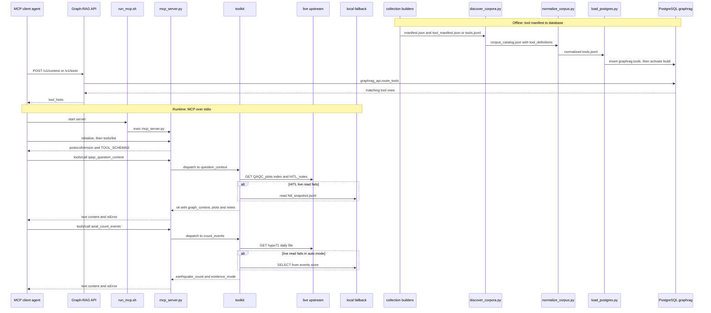

# Flow: agent tool call

flow: agent-tool-call · as of 1047fc8

Basis: the code at 1047fc8, with the chapters as the map. Project memory was checked read-only with `okf search` and `okf validate`: `knowledge/` holds 0 concepts, so no recorded decisions or constraints apply to this flow. The live endpoints, the corpus (`data/`), the runtime store (`runtime_data/`) and the database were not reachable in this checkout, so no hop was run end to end. Each hop was confirmed by reading the code at the cited line.

## Summary

An agent calls one of two stdio Model Context Protocol (MCP) servers: `agentic_qaqc` or `axial_earthquakes`. A shell launcher starts each server, which reads JSON-RPC messages from standard input and dispatches every `tools/call` to a toolkit. The toolkit reads a public upstream live: the quality assurance and quality control (QA/QC) dashboard of the Regional Cabled Array (RCA), or the Axial earthquake catalog of the University of Washington (UW). When the live read fails, it falls back to a local copy: a human-in-the-loop (HITL) snapshot or a stale index cache for QA/QC, and the `events.sqlite` store for Axial. Separately, each collection's tool manifest (`tool_manifest.json` or `tools.jsonl`) is found by `discover_corpora.py`, normalized into `tools.jsonl`, loaded into `graphrag.tools`, and served by the Graph-RAG application programming interface (API) as `POST /v1/tools` and as `tool_hints` in `POST /v1/context`. The MCP servers never query that database, so the agent is the only runtime link between the two halves. Three findings matter most: the API copy of each tool is frozen at the last build; full-text routing appears to require every word of the question to match (inferred from PostgreSQL's documented query syntax, hop 18); and the QA/QC plot index held in memory never expires, which also affects the map gateway.

## Sequence

## Hops

Each hop names its component, its code location, the data it passes, and what can fail there. Hops 1 to 5 are shared by both MCP servers. Hops 6 to 10 are the QA/QC path, hops 11 to 13 the Axial path, hops 14 to 19 the offline manifest path into the database, and hops 20 to 22 the API responses and their consumers.

### Runtime: launch and protocol (both servers)

**1. Launch.** `src/agentic_qaqc/run_mcp.sh:4-13`; `src/axial_earthquakes/run_mcp.sh:3-6`.
- Data: no arguments. Each launcher sets defaults for its environment variables (QA/QC `:7-10`; Axial `:5`) and replaces itself with `mcp_server.py` (`exec`, `:13` and `:6`).
- Fails: a missing interpreter ends the process at `exec`, so the client sees the server exit (inferred). No tracked file starts these servers (open question 1).

**2. Toolkit from the environment.** QA/QC: `src/agentic_qaqc/mcp_server.py:29-34` builds `QAQCToolkit` (`qaqc_agent_tools.py:43-59`). Axial: `src/axial_earthquakes/mcp_server.py:24-28` builds `AxialToolkit` (`axial_agent_tools.py:234-249`).
- Data: environment strings become constructor arguments. The base URL loses its trailing slash (`qaqc_agent_tools.py:52`; `axial_agent_tools.py:243`).
- Fails: an unset `AXIAL_DB_PATH` falls back to a path inside the repository (`axial_agent_tools.py:244-245`). If that file is missing, `count_events` returns `no_evidence` (`:339-340`).

**3. stdio JSON-RPC loop.** QA/QC: `src/agentic_qaqc/mcp_server.py:35-55`. Axial: `src/axial_earthquakes/mcp_server.py:29-47`.
- Data in: one JSON object per stdin line, with `jsonrpc`, `id`, `method` and `params`. Data out: one JSON object per stdout line (`send`, QA/QC `:13-15`; Axial `:9-11`).
- Routing: `initialize` answers protocol version `2025-06-18` and a server name (QA/QC `:40-41`; Axial `:33-34`). `tools/list` returns `TOOL_SCHEMAS` (`:42-43`; `:35-36`). `tools/call` dispatches (`:44-47`; `:37-39`). `notifications/*` is ignored (`:48-49`; `:40-41`). Any other method gets error -32601 (`:50-52`; `:42-44`). An exception is answered with `id: null` and error -32603 (`:54-55`; `:46-47`).
- Fails: requests are handled one at a time, so one slow upstream read blocks every other call ([agentic-qaqc](../chapters/agentic-qaqc.md) gotcha 7). A blank or non-JSON line gets an error with `id: null`. A client that sends `ping` gets -32601 (inferred: not tested).

**4. Dispatch.** QA/QC: `src/agentic_qaqc/qaqc_agent_tools.py:408-428`. Axial: `src/axial_earthquakes/axial_agent_tools.py:667-688`.
- Data: the tool name and its `arguments` object, passed as keyword arguments to one toolkit method (QA/QC mapping `:409-420`; Axial `:668-682`, call `:686`).
- Unknown names return `unknown_tool` (QA/QC `:421-422`; Axial `:683-684`).
- Fails: QA/QC turns any exception into `{"ok": false, "error": {"type": <exception class>, "message": ...}}` (`:427-428`), so a bad argument name appears as `TypeError`. Axial maps only `TypeError` to `invalid_arguments` (`:687-688`). Any other bug escapes to the JSON-RPC layer with `id: null` (`mcp_server.py:46-47`).

**5. Result envelope.** QA/QC: `src/agentic_qaqc/mcp_server.py:18-25`. Axial: `src/axial_earthquakes/mcp_server.py:14-20`.
- Data out: `content[0]` is `{"type": "text", "text": <the toolkit dict as JSON>}`. An `_mcp_image` value adds a second image block. `isError` is `not ok`. The toolkit shape is `{"ok": true, ...}` or `{"ok": false, "error": {"type", "message", ...}}` (`qaqc_agent_tools.py:38-39`; `axial_agent_tools.py:76-77`).
- Fails: `isError` reads only the top-level `ok`. A fallback answer therefore reports `isError: false`. Axial's count is `ok: true` with `evidence_mode` set (`axial_agent_tools.py:342-350`). QA/QC's `question_context` stays `ok: true` when a nested block fails (`qaqc_agent_tools.py:298`).

### Runtime: QA/QC question (`agentic_qaqc`)

**6. Question routing.** `src/agentic_qaqc/qaqc_agent_tools.py:283-310`.
- Data in: `question`, a string. The toolkit extracts a reference designator (`REFDES_RE`, `:34`) and a site (`SITE_RE`, `:35`) by regular expression. It maps keywords to span, overlay, data range and variable (`:289-293`). It then calls `instrument_context` (`:294`, only when `instrument_root` is set), `search_plots` (`:295`) and `list_hitl_notes` (`:297`).
- Data out: `{ok, question, resolved_filters, graph_context, live_plot_evidence, human_in_the_loop_notes, interpretation_guidance}` (`:298-310`).
- Fails: there is no try block here. If `search_plots` raises (hop 7), the whole question fails through dispatch, and the HITL notes and instrument context are never returned. Keyword tests are substring tests: `"ph" in q` matches inside "graph" ([agentic-qaqc](../chapters/agentic-qaqc.md) gotcha 1). A `CE` reference is matched by the regular expression and then dropped by the RS-only search (gotcha 10).

**7. Plot index.** `src/agentic_qaqc/qaqc_agent_tools.py:69-87`. The fetch is `:76`, through `_request_json` (`:66-67`) and `_request` (`:61-64`).
- Order of sources: the in-memory copy (`:70-71`); the file cache at `QAQC_INDEX_CACHE`, if it is younger than 900 s (`:72-74`; default at `:50`); then an HTTP GET of `{base}/QAQC_plots/index.json` with User-Agent `RCN-Agent-QAQC/1.0` and a 30 s timeout (`:49`, `:62`). A successful list is validated (`:77-78`) and written to the cache (`:79-81`). On failure the stale cache is returned with no flag (`:83-86`). With no cache, the error is raised (`:87`).
- Data: a JSON list of strings, each a path such as `RS01SLBS/RS01SLBS-MJ01A-12-VEL3DB101_velocity_east_month_flag_local.png` (`src/agentic_qaqc/test_qaqc_agent_tools.py:20-24`).
- Fails: the in-memory copy never expires. A running server keeps the list it first loaded until `qaqc_health` forces a refresh (`:315`) or the process restarts. Nothing in the gateway or the bundle builder calls `health()` (`git grep` finds no caller under `src/atlas_map_gateway`, `src/atlas_map_data` or `src/atlas_worker`). The map gateway builds one `QAQCToolkit` at startup (`src/atlas_map_gateway/main.py:41`; `toolkits.py:32`) and calls `search_plots` from it (`routes_data.py:110`), so the same staleness applies there. The stale-cache path is silent ([agentic-qaqc](../chapters/agentic-qaqc.md) gotcha 5). No test references `get_index`, `force_refresh` or the in-memory copy (`test_qaqc_agent_tools.py`).

**8. Plot search.** `src/agentic_qaqc/qaqc_agent_tools.py:126-157`; file-name parser `:90-113`.
- Data in: optional `reference_designator`, `site`, `variable`, `time_span`, `overlay` and `data_range` filters, and a `limit` clamped to 1 to 200 (`:126`).
- Data out: `{ok, filters, total_matches, returned, plots: [{path, url, site, reference_designator, variable, depth_or_profile, time_span, overlay, data_range, format, match_score}], catalog_source}` (`:157`). Only paths starting with `RS` are kept unless `include_non_rca` is set (`:137`). Each filter is a case-insensitive substring test, scored 3 for an exact match and 1 otherwise (`:145-152`).
- Fails: `time_span="7"` matches nothing and still returns `ok: true` ([agentic-qaqc](../chapters/agentic-qaqc.md) gotcha 2). A plot file's existence is not a QA pass (`src/agentic_qaqc/README.md:13`).

**9. HITL notes.** `src/agentic_qaqc/qaqc_agent_tools.py:223-259`.
- Live read (`:224-234`): GET `HITL_notes/index.json` (`:228`), then each listed CSV (`:230`). Column 0 is the reference designator and the rest of the row is the note (`:233`).
- Fallback (`:235-240`): if the live read raises and `QAQC_HITL_SNAPSHOT` exists, the JSONL rows are read and `evidence_mode` becomes `snapshot_fallback`. Without the snapshot file the result is `hitl_unavailable` (`:237-238`).
- Data out: `{ok, query, raw_matching_rows, total_matches, returned, notes[], evidence_mode, live_error, index_source}` (`:259`). Each note carries `reference_designator`, `note`, `source_file`, `source_url`, and merged `source_files` and `source_urls` lists (`:249-258`). Snapshot rows come from `src/agentic_qaqc/snapshot_hitl.py:38` and carry `retrieved_at` and `source_is_untrusted_data: true`.
- Fails: nothing is cached, so each call refetches the index and every CSV ([agentic-qaqc](../chapters/agentic-qaqc.md) gotcha 6). Live rows carry no untrusted-data flag (`:233`), so only snapshot rows say their text is data ([agentic-qaqc](../chapters/agentic-qaqc.md) gotcha 8). With the dashboard down and no snapshot file, the HITL part returns `ok: false`.

**10. Instrument context.** `src/agentic_qaqc/qaqc_agent_tools.py:261-281`. Producer: `src/instrument_inventory/build_instrument_inventory.py:611`.
- Data in: `QAQC_INSTRUMENT_ROOT/instruments.jsonl` (`:264`). Query tokens of three or more characters are counted in each record's JSON text. A `canonical_id` found in the query adds 20 (`:267-276`).
- Data out: up to `limit` records with `instrument_id, canonical_id, name, instrument_type, location, projects, record_status, deployment_state, source_urls` and `match_score` (`:279-281`).
- Fails: an unset root gives `instrument_graph_not_configured` inside `graph_context` (`:262-263`). A blank or malformed line raises in `json.loads` (`:270`), which fails the whole question (hop 6). The same file is the Graph-RAG `instruments` collection (`src/graphrag_runtime/discover_corpora.py:33`). The MCP server reads the live file, while the database holds the build-time copy.

### Runtime: Axial count (`axial_earthquakes`)

**11. Count request.** `src/axial_earthquakes/axial_agent_tools.py:302-322`; `resolve_utc_day` `:88-97`.
- Data in: `day` (default `"yesterday"`, `:304`), optional magnitude and depth bounds, `source` (`auto`, `live` or `snapshot`, `:309`, checked at `:320-321`) and `force_refresh`.
- `resolve_utc_day` maps `today`, `yesterday` or an ISO date to a UTC `date` (`:92-97`). A bad value returns `invalid_date` (`:314-315`).
- Fails: "yesterday" is a UTC day, not the caller's local day ([axial](../chapters/axial.md) gotcha 5).

**12. Live daily file.** `src/axial_earthquakes/axial_agent_tools.py:251-273`; parser `:100-146`.
- Data: GET `{base}/hypo71/hypo71_YYYYMMDD.dat` (`_daily_url`, `:265-266`). `_fetch` keeps the body in a file under `AXIAL_CACHE_DIR`, keyed by the URL (`:253-254`), and reuses it for 300 s unless `force_refresh` is set (`:255`; TTL `:240`). The request sends User-Agent `RCN-Agent-Axial/1.0` with a 45 s timeout (`:258-259`; `:239`).
- `parse_hypo71` returns one dict per valid row. Its fields are `record_key` (24 hex characters of the SHA-256 of the raw line, `:120`), `event_id` (`:121`), `origin_time_utc` (`:122`), `event_date_utc` from the file name (`:126`), `latitude` and `longitude` (`:127-128`), `depth_km` (`:129`), `magnitude_mw` (`:130`), `weighted_readings` (`:131`), and the remaining catalog fields. `_live_day` keeps rows whose `event_date_utc` equals the requested day (`:272`).
- Fails: rows with fewer than 18 fields, or a non-integer `weighted_readings`, are dropped with no count of the drops (`:105-106`, `:131`, `:144-145`), so a count can be low with no signal. There is no stale-cache fallback at this layer. An expired cache is refetched, and a failed refetch raises (`:255`, `:259`).

**13. Count result and snapshot fallback.** `src/axial_earthquakes/axial_agent_tools.py:322-355`; store `:275-280`; filter `:341`, `_filter` `:358-368`.
- Live first, unless `source="snapshot"` (`:322`, `:331-333`). If the live read fails, `source="live"` returns `axial_unavailable` (`:326-327`). Otherwise `live_error` is recorded and the mode becomes `snapshot_fallback` (`:328-330`).
- At `:334` the code reads the snapshot if the mode is `snapshot`, or if the fallback mode found no live events. The query is `SELECT * FROM events WHERE event_date_utc=?` on `events.sqlite` (`:336-338`). A store error returns `no_evidence` (`:339-340`). The store is built by `src/axial_earthquakes/build_axial_corpus.py:107-137` and lives under `runtime_data/`, which is absent here.
- Data out: `{ok: true, day_utc, timezone: "UTC", earthquake_count, unfiltered_count, filters, is_partial_day, evidence_mode, source_url, retrieved_at_utc, live_error?}` (`:342-355`).
- Fails: in auto mode, a live outage on a day with no stored rows returns `ok: true`, `earthquake_count: 0` and `evidence_mode: "snapshot_fallback"`. This is [axial](../chapters/axial.md) gotcha 1, confirmed at `:334` and `:342-350`. A zero from the store can also be stale, because the store is a build-time copy.

### Offline: manifest to database

**14. Producers: each collection writes its tool manifest.** The table lists every tracked producer. Discovery finds these files by name, or by a `live_tool_manifest` key in the collection's `manifest.json`.

| Collection (discover ID) | File in its folder | Written by | Named by `live_tool_manifest` | Shape |
|---|---|---|---|---|
| `qaqc` | `tool_manifest.json` | `src/agentic_qaqc/build_agentic_graph.py:105-110` | yes, `:123` | `{server, environment, tools}`, 10 tools |
| `axial_earthquakes` | `tool_manifest.json` | `src/axial_earthquakes/build_axial_corpus.py:197`, and `build_visual_archive.py:70` | no; its `manifest.json` has no such key and records `live_tool_count` instead (`build_axial_corpus.py:194`) | `{tools}`, 13 tools |
| `axial_monitoring` | `tools.jsonl` | `src/axial_monitoring_website/build_axial_monitoring_graph.py:168` | yes, `:173` | one row per tool |
| `nereus` | `tool_manifest.json` | `src/nereus_pipeline/build_nereus_corpus.py:110` | yes, `:112` | `{server, access, environment, tools}` |
| `coszo_hub` | `tools.jsonl` | `src/coszo_hub_tools/build_coszo_hub_graph.py:216-225`, `:322` | no | rows with `id` `tool:<name>`, `summary`, `input_schema`, `runtime` |
| `pi_portal` | `tools.jsonl` | `src/coszo_hub_tools/build_pi_portal_graph.py:661` | no; listed under `graph_node_inputs` (`:691`) | one row per tool |
| `ooi_das_geometry` | `tools.jsonl` | `src/ooi_das_geometry/build_ooi_das_geometry.py:218-223` | yes, `:227` | rows with `runtime` and a user-invocation flag |
| `literature` | `tool_manifest.json` | `src/literature_fulltext/build_tool_manifest.py:11-48`, run by hand (`src/literature_fulltext/README.md:77-78`) | no | `{schema_version, server, routing, access, environment, tools}` |

- Data: `TOOL_SCHEMAS` entries, each `{name, description, inputSchema}` (QA/QC `qaqc_agent_tools.py:394-405`; Axial `axial_agent_tools.py:650-664`). The `server` and `environment` blocks, including the launch command, live only in the JSON file. Normalization never reads them (hop 16).
- Fails: the file is a snapshot of the code at build time. A schema change does not reach the database until the producer runs again. The `literature` file is refreshed only by hand.

**15. Discovery.** `src/graphrag_runtime/discover_corpora.py`.
- `build_catalog` finds every `data/**/manifest.json` (`:279-280`). `_build_collection` (`:183-255`) sets the collection ID from `COLLECTION_NAMES` (`:23-42`), for example `QAQC/graphrag` to `qaqc`, `AxialEarthquakes/graphrag` to `axial_earthquakes`, and `AxialMonitoring` to `axial_monitoring`.
- Tool definitions (`:214-216`): the names come from the `live_tool_manifest` key, plus any file named `tool_manifest.json` or `tools.jsonl` directly in the collection folder (`iterdir`, `:215`). Each becomes a descriptor with role `tool_definition` (`:223`) through `_descriptor` (`:129-141`). That descriptor records the path, role, byte size, SHA-256, and a record count of null for `.json` files. The collection record stores the list as `tool_definitions` (`:249`).
- The tool files also enter the build fingerprint (`:258-271`, input list `:266`) and the totals (`tool_definition_files`, `:298`).
- Second effect: `tools.jsonl` is in `KNOWN_NODE_FILES` (`:64`), and `:198-200` adds every root `*.jsonl` in that set to `graph_node_inputs`. So any root `tools.jsonl` is also a graph node, whether or not the manifest names it. This follows from the code (inferred intent). The PI portal lists it on purpose (`build_pi_portal_graph.py:691`), and the normalizer comment on PI-portal tool endpoints supports that reading (`normalize_corpus.py:119-120`).
- Fails: a declared tool file that does not exist raises `CatalogError` (`:130-131`), and the catalog build stops. A tool file in a subfolder is never found (`:215`). A collection with no `manifest.json` is ignored (`:279`).

**16. Normalization.** `src/graphrag_runtime/normalize_corpus.py`.
- Integrity: each catalogued file's byte size and SHA-256 are re-checked (`:217-229`). Tool files get role `tool` (`:212-216`; the migration allows `tool` at `001_initial.sql:50`).
- Tool rows (`:303-318`): a `.jsonl` file is read row by row. A `.json` file takes `loaded["tools"]` (`:306-308`), which drops `server` and `environment`. The name is `name`, else `id`, else `tool_id` (`:310`). The description is `description` or `summary` (`:315`). The input schema is `inputSchema` or `input_schema` (`:316`). `runtime`, `manifest_path` and the full row as `metadata` are kept (`:317`). Rows are keyed by (collection, name) (`:313`), so a repeated name overwrites silently. The output is `tools.jsonl`, sorted (`:354`).
- Node path for `tools.jsonl`: `primary_id` (`:245`, `:116-121`) uses `tool_id` or `name`. COSZO Hub uses `id` instead (`:116-117`), so its node is `tool:<name>` while its tool row is `<name>`. Each row becomes a node with kind `tools` (`:246`, `:257-262`). Tool names become neighbours only where an edge names them (inferred from the node path; not run).
- Fails: a nameless `.json` row becomes the string `"None"` (`:310-312`), so the `if not name` guard never fires. This was read from the code and not run. A nameless `tools.jsonl` row raises earlier, in the node path, because `primary_id` has no ID to use (`:130-133`). The normalizer's own assertions do not count tools (`:357-365`). The load step does (hop 17).

**17. Load.** `src/graphrag_runtime/load_postgres.py`; schema `src/graphrag_runtime/migrations/001_initial.sql`.
- The loader refuses an unvalidated or mismatched build (`load_postgres.py:38-43`). It runs one transaction under an advisory lock (`:46-50`). Each `tools.jsonl` row is inserted into `graphrag.tools` with `ON CONFLICT DO NOTHING` (`:129-133`). The count is checked against the manifest (`:160`). The validation flag is set after the count checks (`:190`), and activation runs only with `--activate` (`:191-192`).
- Table (`001_initial.sql:163-181`): `name` must be non-empty (`:167`). `search_tsv` indexes the name with underscores replaced, under the `simple` configuration at weight A, and the description under `english` at weight B (`:173-176`). The unique key is `(build_id, collection_id, name)` (`:177`), and a foreign key ties it to `collections` (`:178`).
- `activate_build` (`:214-235`) refuses a build whose `validation_passed` is not true (`:224-230`).
- Fails: a count mismatch raises (`:169-170`), and the connection context manager rolls the whole load back. Duplicate names cannot reach this step, because normalization already keeps one row per name.

**18. Routing query.** `src/graphrag_runtime/migrations/001_initial.sql:347-359`.
- `graphrag_api.route_tools(query_text, result_limit)` is `SECURITY DEFINER` (`:349`) with a 3 s statement timeout (`:351`). It matches `websearch_to_tsquery('english', ...)` against `search_tsv` (`:354-356`), limits the query to the first 1,000 characters (`:354`), restricts to the active build (`:355`), orders by `ts_rank_cd` score then name (`:354`, `:357`), and clamps the limit to 1 to 20 (`:358`). Only `graphrag_api_role` may execute it (`src/graphrag_runtime/migrations/002_local_api_role.sql:20`; grants `:17-20`).
- Fails: `websearch_to_tsquery` joins unquoted words with AND, as `plainto_tsquery` does (PostgreSQL behaviour, inferred from its documentation). So every content word of the question must appear in a tool's name or description. A full question therefore returns few or no hints. Confirm on a loaded build. Tool names are indexed under `simple` and queries under `english` (stemmed), so a plural in a name may not match a singular in the query (inferred). Routing has no vector fallback.

**19. Repository.** `src/graphrag_runtime/app/repository.py:133-142`.
- Runs `SELECT * FROM graphrag_api.route_tools(%s,%s)` (`:135`) inside `_cursor` (`:52-59`). That sets the statement timeout for the transaction from `GRAPHRAG_STATEMENT_TIMEOUT_MS` (`:57-58`).
- Drops `runtime` (`:138`), moves `input_schema.required` into `required_arguments` (`:139-140`), and returns `collection_id, name, description, score, required_arguments, input_schema` (`:142`). `manifest_path` and `metadata` are not selected (`:135`).
- Fails: a non-object `input_schema` breaks `schema.get` (`:140`), which becomes a 503 (`main.py:94-96`) (inferred).

### Online: API responses and consumers

**20. `POST /v1/tools`.** `src/graphrag_runtime/app/main.py:90-96`.
- Auth: the dependency `authorize` (`:91`, `:49-52`) compares the SHA-256 of the `X-API-Key` header with the digests in `GRAPHRAG_API_KEY_SHA256`, in constant time. A missing or wrong key gets 401 (`:52`).
- Data in: `ToolsRequest` `{query: 2 to 1,000 characters, limit: default 5, 1 to 20}` (`src/graphrag_runtime/app/models.py:37-39`). Extra fields are refused with 422 (`models.py:8-9`).
- Data out: `ToolsResponse {query, tool_hints: ToolHint[]}` (`models.py:113-115`), where `ToolHint` is `{collection_id, name, description, score, required_arguments, input_schema}` (`models.py:71-77`).
- Fails: any exception returns 503 (`main.py:94-96`). No tracked caller uses this route (open question 3). Only the test calls it (`src/graphrag_runtime/tests/test_api.py:71`).

**21. `POST /v1/context`.** `src/graphrag_runtime/app/main.py:98-122`.
- Steps: auth (`:99`); weight check (`:100-101`); query embedding, `checked_embedding` (`:103`; `app/embeddings.py:39-43`, FastEmbed `query_embed` at `:32`, 384 dimensions); `repo.search` (`:104-106`); graph seeds from `hit.metadata.node_local_id`, at most 20 (`:107-114`); neighbours (`:115-117`); tool hints (`:118`).
- `tool_hints = repo.route_tools(body.query, limit=body.tool_limit) if body.tool_limit else []`. The route runs on the raw question, not on the embedding. The default `tool_limit` is 3, with a range of 0 to 10 (`models.py:23`). Setting it to 0 turns routing off.
- Data out: `ContextResponse {query, hits, neighbors, tool_hints}` (`main.py:119`; `models.py:85-87`). `graph_hops` defaults to 1 (`models.py:21`) and `neighbors_per_seed` to 8 (`models.py:22`).
- Fails: the whole body is one try block (`main.py:102-122`). A routing failure therefore returns 503 for the request, even though search succeeded (`:120-122`). The first query in each worker loads the FastEmbed model (`app/embeddings.py:22-31`). If the model is missing and offline mode is set, the load raises, and the handler returns 503 (inferred).

**22. Consumers of `tool_hints`.**
- The Ask Atlas Worker (`src/atlas_worker/src/index.js`) answers daily-count questions itself first (`:412-413`, `liveAxialCount` at `:365-393`). Otherwise it POSTs `/v1/context` with `tool_limit: 3` and the `x-api-key` header (`:417-420`), then forwards `context.tool_hints` (`:430`, `:440`, `:452`, `:462`). For count questions it builds its own `axial_count_events` hint (`:390-391`). The Ask Atlas flow ([ask-atlas](ask-atlas.md)) covers the rest of this path.
- The map reads that hint to label a count (`src/atlas_map/src/evidence/resolve.js:188-192`). If no hint named `axial_count_events` is present, `countOf` returns null (`:189-190`).
- The evidence page calls `/v1/context` with `tool_limit: 3` (`src/graphrag_runtime/app/static/atlas.js:41`) and renders the hints (`:34-35`).
- Fails: when routing returns nothing, `tool_hints` is empty and `countOf` returns null, so the map shows no count label (`resolve.js:189-190`). The Worker's own count path does not depend on routing, because it answers before `/v1/context` is called (`index.js:412-413`).

## Configuration and secrets

| Name | Read at | Purpose | Default or required |
|---|---|---|---|
| `QAQC_DASHBOARD_URL` | `src/agentic_qaqc/mcp_server.py:30` | Dashboard base URL | Optional; `https://ec2.qaqc.ooi-rca.net` (`qaqc_agent_tools.py:31`) |
| `QAQC_INDEX_CACHE` | `mcp_server.py:31`; `run_mcp.sh:9` | Plot-index cache file | Optional; `${TMPDIR:-/tmp}/rcn-agent-qaqc-index.json` |
| `QAQC_INSTRUMENT_ROOT` | `mcp_server.py:32`; `run_mcp.sh:7` | Folder that holds `instruments.jsonl` | Optional; `<repo>/data/Instruments`. Unset gives `instrument_graph_not_configured` (`qaqc_agent_tools.py:262-263`) |
| `QAQC_HITL_SNAPSHOT` | `mcp_server.py:33`; `run_mcp.sh:8` | HITL fallback in JSONL | Optional; `<repo>/data/QAQC/graphrag/hitl_snapshot.jsonl` |
| `QAQC_PYTHON` | `run_mcp.sh:10` | Interpreter for the server | Optional; `python3` |
| `QAQC_AGENT_ALLOW_PIPELINE` | `qaqc_agent_tools.py:334`, `:366` | Enables plot execution; not on this path | Unset means disabled; listed in `.env.example:17` |
| `AXIAL_BASE_URL` | `src/axial_earthquakes/mcp_server.py:25` | UW catalog base URL | Optional; `http://axial.ocean.washington.edu` (`axial_agent_tools.py:27`) |
| `AXIAL_DB_PATH` | `mcp_server.py:26`; `run_mcp.sh:5` | SQLite snapshot store | Optional; `<repo>/runtime_data/AxialEarthquakes/graphrag/events.sqlite` |
| `AXIAL_CACHE_DIR` | `mcp_server.py:27` | Folder for cached HTTP responses | Optional; `<temp dir>/rcn-agent-axial-cache` (`axial_agent_tools.py:246`) |
| `DATABASE_URL` | `src/graphrag_runtime/app/config.py:25-27`; `compose.yaml:21` | API connection string for `graphrag_api_role` | Required by the API; built from `GRAPHRAG_API_DATABASE_PASSWORD` in `.env` |
| `GRAPHRAG_API_DATABASE_PASSWORD` | `compose.yaml:8`, `:21`; `002_local_api_role.sql:3-5` | Password of the API role | Required by Compose; set in `.env` |
| `GRAPHRAG_API_KEY_SHA256` | `app/config.py:19-24`; `compose.yaml:22` | Comma-separated SHA-256 digests of accepted client keys | Required; set in `.env` (`.env.example:19`) |
| `GRAPHRAG_API_KEY` | `.env.example:18` | The raw key a client sends as `X-API-Key`; the API never reads it | Client side only |
| `GRAPHRAG_STATEMENT_TIMEOUT_MS` | `app/config.py:28`; `compose.yaml:25`; `repository.py:57-58` | Statement timeout set per transaction | Default 4000; clamped to 250 to 15000 |
| `GRAPHRAG_POOL_MIN`, `GRAPHRAG_POOL_MAX` | `app/config.py:29-30` | Connection pool size per worker | 1 and 10 |
| `GRAPHRAG_EMBEDDING_MODEL` | `app/config.py:32` | Query embedding model and the `hybrid_search` filter | `BAAI/bge-small-en-v1.5` |
| `GRAPHRAG_MODEL_CACHE`, `GRAPHRAG_EMBEDDING_OFFLINE` | `app/embeddings.py:28-29`; `Dockerfile:10` | Model cache folder and offline switch | Unset in code; the image sets `/models` and `true` |
| `ATLAS_API_KEY`, `ATLAS_API_ORIGIN` | `src/atlas_worker/src/index.js:414`, `:417`, `:420`; set with `wrangler secret put` (`src/atlas_worker/README.md:19-20`) | The Worker's key and tunnel origin for `/v1/context` | Required for the Worker's context path |
| `GEMINI_API_KEY`, `GRAPHRAG_ANSWER_MODEL` | `app/config.py:33-34` | Only `/v1/answer`; not on this flow | Not used here |

Secrets: the MCP servers read no secrets. `git grep` finds no database or key use under `src/agentic_qaqc/` or `src/axial_earthquakes/`. Their upstream calls are unauthenticated GETs (`qaqc_agent_tools.py:61-64`; `axial_agent_tools.py:258`). Not on this path: the optional plot pipeline needs Prefect and AWS configuration (`qaqc_agent_tools.py:339`), and it is gated by `QAQC_AGENT_ALLOW_PIPELINE`.

## Open questions

1. **How does an agent start these servers?** No tracked client configuration names them: no `.mcp.json` or agent settings are tracked. The QA/QC manifest's `server.command` (`build_agentic_graph.py:106`) is the only launch record. Answer: the agent host's configuration. See [agentic-qaqc](../chapters/agentic-qaqc.md) open question 1.
2. **Which tool metadata does the agent act on?** The API copy is fixed at the last build. `tools/list` comes from the running process. They can disagree after a code change. Answer: after each build, compare `graphrag.tools` rows with `TOOL_SCHEMAS`. The [ask-atlas](ask-atlas.md) flow asks the same question about `axial_count_events` (its open question 1).
3. **Who calls `POST /v1/tools`?** No tracked code does (`main.py:90`; only `src/graphrag_runtime/tests/test_api.py:71`). Answer: the team's agent setup.
4. **Is a root `tools.jsonl` meant to be a graph node in every collection?** The code makes it one (`discover_corpora.py:64`, `:198-200`). Only the PI portal lists it on purpose (`build_pi_portal_graph.py:691`). Answer: run `discover_corpora.py` on the release, check `graph_node_inputs` for `axial_monitoring`, `coszo_hub` and `ooi_das_geometry`, and check whether tool names appear as neighbours in `/v1/context`.
5. **Do full-question queries return tool hints at all?** `websearch_to_tsquery` joins the words with AND (`001_initial.sql:354-356`). Answer: on a loaded build, compare `SELECT * FROM graphrag_api.route_tools('<a full question>', 5)` with a single word such as `qaqc`. Not run: no database here.
6. **Should the QA/QC plot index expire inside a running process?** Today it does not, in the MCP server or in the map gateway. Answer: a decision for the owners. A test that changes the source list between two `search_plots` calls would pin the current behaviour.
7. **Should an Axial auto-mode outage on a day with no stored rows be an error, not a zero?** Today it is `ok: true` with count 0 (hop 13). Answer: the Axial owner. See [axial](../chapters/axial.md) gotcha 1.
8. **Is the literature tool manifest current?** It is written by hand (`src/literature_fulltext/README.md:77-78`), so a schema change leaves the database copy stale until someone reruns it. Answer: compare `data/Literature/tool_manifest.json` with `TOOL_SCHEMAS` at the next release.
9. **Is the QA/QC HITL snapshot meant to reach the database?** `hitl_snapshot.jsonl` sits in the graph folder. Discovery therefore registers it as a structured input (`discover_corpora.py:208-212`), and its rows load as `structured_records`. Answer: the QA/QC owner. See [agentic-qaqc](../chapters/agentic-qaqc.md).
10. **Which statement timeout applies inside `route_tools`?** The repository sets 4 s per transaction (`repository.py:57-58`), and the function sets 3 s (`001_initial.sql:351`). Answer: [graphrag-runtime](../chapters/graphrag-runtime.md) open question 11.

## Glossary

| Term | Meaning |
|---|---|
| MCP | Model Context Protocol, a JSON-RPC tool interface that agents use to call servers. |
| JSON-RPC | JSON request and response messages. Here, one object per line. |
| stdio | Standard input and output, the MCP transport used here. |
| Tool manifest | `tool_manifest.json` or `tools.jsonl`, the file that lists a collection's live tools. |
| Tool definition | Discovery's role name for a tool manifest (`discover_corpora.py:223`). |
| Tool hint | One row returned by `route_tools`: name, description, input schema and score. |
| HITL | Human-in-the-loop: status notes that people write and publish as CSV. |
| Snapshot | A dated local copy that is used when the live source fails. |
| RCA | Regional Cabled Array, the cabled seafloor array that the QA/QC dashboard covers. |
| OOI | Ocean Observatories Initiative, which operates RCA. |
| Refdes | Reference designator, OOI's instrument ID, for example `RS01SLBS-MJ01A-12-VEL3DB101`. |
| RS | The reference-designator prefix for RCA instruments (`qaqc_agent_tools.py:137`). |
| QA/QC | Quality assurance and quality control. |
| UW | University of Washington, which publishes the Axial catalog. |
| UTC | Coordinated Universal Time. Axial days are UTC. |
| HYPO71 | The hypocenter-location program whose daily file the Axial tools parse. |
| SHA-256 | A hash, used for fingerprints, row keys and API key digests. |
| FTS | Full-text search: PostgreSQL `tsvector` with `websearch_to_tsquery`. |
| Graph-RAG | Retrieval-augmented generation over a graph of chunks, entities and edges. |
| TTL | Time to live: how long a cache file counts as fresh. |
| JSONL | JSON Lines: one JSON object per line. |
| SECURITY DEFINER | A SQL function that runs with its owner's privileges (`001_initial.sql:349`). |
