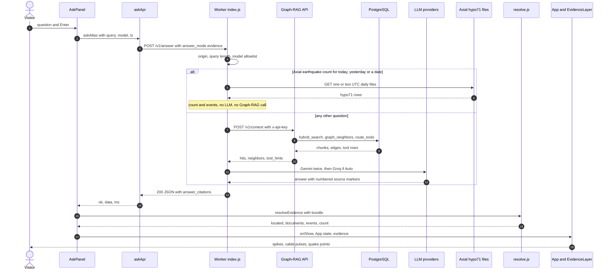

# Ask Atlas flow: question to evidence on the map

flow: ask-atlas · as of 1047fc8 · checked by reading the code and `git grep`; nothing was run

Related chapters: [ask-atlas](../chapters/ask-atlas.md) (the component map), [graphrag-runtime](../chapters/graphrag-runtime.md), [axial](../chapters/axial.md), [corpus-instruments-ops](../chapters/corpus-instruments-ops.md), [corpus-docs-web](../chapters/corpus-docs-web.md), [atlas-map-scene](../chapters/atlas-map-scene.md), [atlas-map-panels](../chapters/atlas-map-panels.md), [atlas-map-data](../chapters/atlas-map-data.md), [atlas-map-gateway](../chapters/atlas-map-gateway.md).

## Summary

A visitor types a question into the Ask Atlas sidebar of the 3D map. `askApi.js` posts it to the RCA Atlas Cloudflare Worker's `POST /v1/answer` (`src/atlas_map/src/ask/askApi.js:5,23-24`; `src/atlas_worker/src/index.js:403`). A Cloudflare Worker is a JavaScript function that runs at Cloudflare's edge. A question about how many Axial Seamount earthquakes there were today, yesterday or on a date is answered from the University of Washington's daily catalog files, with no large language model (LLM) (`index.js:412-413`, `:365-393`). Any other question goes to the Graph-RAG API's `POST /v1/context`. Graph-RAG is retrieval-augmented generation over a knowledge graph, and here the API returns matching text chunks, graph neighbors and tool hints (`index.js:417-420`; `src/graphrag_runtime/app/main.py:98-122`). The Worker ranks and numbers those sources, asks an LLM to cite them as `[n]`, and returns the answer with its source list (`index.js:299-363`; `src/atlas_worker/src/helpers.js:117-130`). The map turns each number into a sensor, site, fibre-optic cable for distributed acoustic sensing (DAS), or further-reading document (`src/atlas_map/src/evidence/resolve.js:195-211`). `EvidenceLayer.js` draws them as spikes, cable pulses and quake points (`src/atlas_map/src/scene/EvidenceLayer.js:123-136`). The standalone page in `src/atlas_ui/` calls the same endpoint but shows its own source list instead of the map. The fragile points are the LLM chain (Gemini gets two tries, Groq only under Auto, OpenAI only in local development), the context call (one try, and any error becomes a 503), and the browser's resolver, which runs outside its error handling and can leave a question pending.

## Sequence

## Hops

### 1. Question is queued (browser)

- Component: `src/atlas_map/src/ask/AskPanel.jsx`.
- Where: `AskPanel.jsx:74-81` (`ask`), `:135-138` (form submit and Enter key), `:65-73` (`run`), `:80` (run call).
- Data: the trimmed draft, at least 2 characters (`:76`). It becomes an entry `{id, q, model, status: "pending"}` (`:78`). `model` defaults to `"auto"` (`:51`).
- Fails: a new question is dropped silently while any entry is pending (`:52`, `:76`), and the Ask button is disabled (`:144`). Retry does not check `busy` (`:82`). If Retry starts while another question is pending, the older request is aborted (`:66`), its `run` returns without updating the entry (`:69`), and the composer stays locked until reload. This is inferred from the code. The one Retry test (`src/atlas_map/src/ask/AskPanel.test.jsx:147-158`) has only one question in flight.

### 2. Client request (browser)

- Component: `askAtlas` in `src/atlas_map/src/ask/askApi.js`.
- Where: `askApi.js:5` (URL), `:18-19` (default `tz`), `:23-24` (request), `:25-36` (result mapping).
- Data out: `POST` with `Content-Type: application/json` and body `{query: string, answer_mode: "evidence", model: string, tz: IANA zone}`. An IANA zone is a time zone name such as `America/Los_Angeles`, from the browser's `Intl` API (`askApi.js:18`).
- Data in, on success: `{ok: true, data, ms}` (`:36`), where `data` is the Worker's JSON.
- Fails: a network error gives "could not be reached" (`:25-27`). Non-JSON gives "did not respond (HTTP n)" (`:30`). A non-2xx status gives the Worker's `error` string, capitalised, with the status (`:31-34`). A body with no `answer` gives "returned no answer" (`:35`). There is no timeout (`:23`): only the caller's abort signal can end the request.

### 3. Development proxy, or direct (browser build)

- Where: `askApi.js:5` makes `ASK_URL` `/api/ask` in development and the Worker URL in production. The Worker URL is `ATLAS_WORKER` in `src/atlas_map/src/api/gateway.js:2`. In development, `src/atlas_map/vite.config.js:9-10` rewrites `/api/ask` to `/v1/answer` and sets `Origin: https://coszo.org`. `vite.config.js:7` takes the target from `VITE_ATLAS_ASK`.
- Data: the same body. The proxy adds the Origin header the Worker requires.
- Fails: a production page served from another origin is refused at hop 4. `VITE_ATLAS_ASK` lets a local `wrangler dev` stand in (`src/atlas_map/README.md:23-25`).

### 4. Worker gate

- Component: the default export's `fetch` in `src/atlas_worker/src/index.js`.
- Where: `index.js:12-22` (CORS headers), `:400` (OPTIONS preflight, 204), `:401-402` (`/health` and `/v1/live/*`), `:403` (only `POST /v1/answer` is accepted), `:404` (origin check), `:405-406` (body and query), `:407` (`answer_mode`), `:408-409` (model allowlist), `:410` (query length 2 to 1,000).
- Data in: `{query, answer_mode, model, tz}`. A `model` outside the Worker's list becomes `"auto"` (`:408-409`). The Worker's list is the map's seven choices (`askApi.js:8-11`) plus three more OpenAI names (`index.js:237-242`). `tz` is cut to 64 characters (`:412`).
- Fails: `403 origin not allowed` unless the Origin header equals `ALLOWED_ORIGIN`, which defaults to `https://coszo.org` (`index.js:13`, `:36`; `src/atlas_worker/wrangler.toml:8`). The origin check is a browser control, not authentication: any client can send the header (inferred from the code; the Worker README also asks for a Cloudflare rate-limit rule, `src/atlas_worker/README.md:25-26`). `400 invalid query` for a missing, short or long query (`index.js:410`). An unreadable body becomes an empty query (`:31-33`, `:406`).

### 5. Axial count branch (Worker)

- Where: `index.js:412-413` (called before any Graph-RAG check), `:365-393` (`liveAxialCount`), `src/atlas_worker/src/helpers.js:85-105` (`axialDayWindow`), `:108-113` (`eventsInWindow`), `:53-64` (`parseHypo71Events`), `index.js:10` (the catalog origin).
- Matching: the question must contain "axial", "earthquake", "how many", "count" or "number of", and also "today", "yesterday" or a `YYYY-MM-DD` date (`helpers.js:87-94`). Anything else returns `null` and goes on to hop 6 (`index.js:413`).
- Data in: the day window `{day, tz, today, start, end, stamps, label, zoneName}` (`helpers.js:104`). "Today" and "yesterday" mean the asker's calendar day in their zone (`helpers.js:88-93`). The Worker fetches `http://axial.ocean.washington.edu/hypo71/hypo71_YYYYMMDD.dat` for each UTC day the window spans, one or two files, each with a 20-second timeout (`index.js:368`, `:370-371`). Each row must have at least 18 columns and the file's own date stamp (`helpers.js:48-50`). Times become ISO UTC strings, and longitude is made negative (`:53-62`). At most 5,000 rows are kept per file (`:4`, `:56`).
- Data out: `{query, answer, answer_model: "axial_count_events (live catalog)", answer_citations: [the catalog files], hits: [], neighbors: [], events: [{time, lat, lon, depth_km, mag}], tool_hints: [{name: "axial_count_events", input_schema: {day, tz, label, today}}]}` (`index.js:383-392`).
- Fails: this branch makes no LLM call and no Graph-RAG call, and it reads no secret. A 404 for the first file, or any other non-2xx, throws, and the whole request returns 503 (`index.js:372-373`, `:464-467`). There is no fallback to Graph-RAG. A 404 on a later file counts as zero rows (`:372`). A day with no file yet, such as today in UTC just after midnight, fails at the first file. The catalog is fetched over plain HTTP (`index.js:10`), which is inferred to be a trust risk; see open question 4.

### 6. Worker calls Graph-RAG

- Where: `index.js:414-416` (both secrets must be set), `:417-420` (the call), `:223-235` (`postJson`, 55-second timeout at `:231`, `upstream <status>` error at `:233`).
- Data out: `POST {ATLAS_API_ORIGIN}/v1/context` with header `x-api-key` (from `ATLAS_API_KEY`) and body `{query, limit: 24 or 10, graph_hops: 2, neighbors_per_seed: 16 or 8, tool_limit: 3}` (`index.js:417-420`). The larger numbers apply to instrument-inventory questions (`:92-96`). The base values are `MAX_HITS` 10 and `MAX_GRAPH_HOPS` 2 (`:8-9`).
- Fails: a non-2xx from Graph-RAG throws `upstream <status>`, which becomes 503 (`index.js:233`, `:464-467`). There is one attempt and no retry (`:417`). A missing secret returns 503 `service is not configured` (`:415`).

### 7. Graph-RAG context (graphrag-runtime)

- Component: `context` in `src/graphrag_runtime/app/main.py` (`:98-122`). See [graphrag-runtime](../chapters/graphrag-runtime.md).
- Steps:
  - `authorize` hashes the presented key with SHA-256 and compares it with the stored digests (`main.py:49-52`; `src/graphrag_runtime/app/config.py:20`). A missing or unknown key gets 401.
  - The request is validated by Pydantic models, which refuse unknown fields (`src/graphrag_runtime/app/models.py:8-9`, `:20-23`). Out-of-range values get 422.
  - The query is embedded locally with `BAAI/bge-small-en-v1.5`, a 384-dimension text model run through FastEmbed (`src/graphrag_runtime/app/embeddings.py:13-36`; `src/graphrag_runtime/EMBEDDINGS.md:7-8`). A vector that is not 384 long raises (`embeddings.py:39-43`).
  - `repository.search` calls SQL `graphrag_api.hybrid_search` (`src/graphrag_runtime/app/repository.py:78-105`; `src/graphrag_runtime/migrations/001_initial.sql:237-306`). It fuses vector and full-text ranks with reciprocal rank fusion, 1/(60+rank) (`001_initial.sql:280-281`). Each hit carries one citation: source id, title and URL (`repository.py:97-101`).
  - Seeds are the hits' `node_local_id` values, at most 20 (`main.py:107-114`). `repo.neighbors` walks the graph up to `graph_hops` (`repository.py:107-131`; `001_initial.sql:308-345`).
  - `repo.route_tools` full-text matches the query against the tool catalog (`main.py:118`; `repository.py:133-142`; `001_initial.sql:347-359`).
- Data out: `ContextResponse {query, hits: SearchHit[], neighbors: Neighbor[], tool_hints: ToolHint[]}` (`models.py:85-87`). A `SearchHit` has `chunk_id`, `collection_id`, `collection_label`, `title`, `text`, `score`, `lexical_score`, `vector_score`, `citations` (`source_id`, `title`, `url`) and `metadata` (`node_local_id`, `locator`) (`models.py:48-58`; `repository.py:97-102`).
- Fails: any exception becomes 503 `context temporarily unavailable`, and the traceback is logged (`main.py:120-122`). The statement timeout is 4 seconds (`config.py:28`; `repository.py:57-58`), and the SQL functions set their own 5-second and 3-second limits (`001_initial.sql:252`, `:351`). The first query loads the embedding model, which may download it (`embeddings.py:24-31`; `index.js:228-230`). An empty or inactive corpus returns no hits rather than an error (`001_initial.sql:256`). The Worker then fails with "no retrieved evidence" (`index.js:306`), which is a 503. If the query-time embedding model is not the one the index was built with, vector hits silently disappear and only full-text hits remain (`001_initial.sql:264`; `repository.py:84-85`; inferred; confirm with the deployed `GRAPHRAG_EMBEDDING_MODEL` and the built `model_id`).

### 8. Worker ranks and numbers the evidence

- Where: `index.js:186-196` (`selectedEvidenceHits`), `:98-110` (`prioritizedHits`), `:125-131` (named product), `:64-84` (`citations`), `:299-305` (`sourceNumbers`), `helpers.js:32-44` (`evidencePackage`), `helpers.js:5` (18,000-character cap).
- Scoring: `prioritizedHits` adds points for question terms in the title (12 each) and in the text (2 each), for RCA-scope words (10), and for primary collections such as `instruments`, `websites`, `arcada` and `coszo` (4) (`index.js:98-110`).
- Data in: `context.hits` (up to 10, or 24 for inventory questions). Data out: `evidenceHits` is the top 6, or 16 for inventory questions (`index.js:188`). It narrows to hits that name a product when the question names one (`:189-194`). `sourceList` is `[{id, title, url}]`, deduplicated by id and URL (`:64-84`). A source's number is its 1-based position (`:304`). `evidence` is text with a header per hit, such as `title | sources: [n]` (`helpers.js:37-38`).
- Fails: an empty evidence package throws (`index.js:305-306`), which becomes 503. A DAS route's title is rewritten to a short name (`index.js:70-73`).

### 9. Route: fixed answer or LLM

- Where: `index.js:421-442` (direct download answer, no LLM, for multidas, optodas or das24 when that route is among the sources; `model: "RCA Atlas graph route"` at `:438`), `:426-432` (multi-span download), `:443-454` (quick mode, graph only), `:307-312` (for a download question naming any product the earlier branch did not answer, if some source has a URL; `model: "RCA Atlas evidence routing"`), `:455` (LLM path).
- Data: fixed answer text (`index.js:152-173`) plus `answer_links` (`:175-184`).
- Fails: quick mode needs `answer_mode: "quick"`, which no client here sends (`index.js:407`; the map sends `"evidence"`, `askApi.js:24`). A download question naming a product without a direct route falls to the generic routing text (`index.js:307-312`). The map's sidebar does not read `answer_links`. Only `src/atlas_ui/src/main.jsx:130` does.

### 10. LLM call and fallbacks

- Where: prompt `helpers.js:117-130`; answer mode `index.js:112-123`; Gemini `index.js:317-342`; Groq `:255-266`; OpenAI `:281-297`; Auto fallbacks `:346-361`; OpenRouter `:248-253` and `:268-279`.
- Data out, Gemini: `{contents, generationConfig: {temperature: 0.15, maxOutputTokens: 400 or 4096, thinkingConfig.thinkingBudget: 128 or 1024}}` (`index.js:320-327`), sent to the model's `generateContent` endpoint. The key is a query parameter (`:319`).
- Data in: `{answer: cleanAnswer(text), model}` (`:337`, `:265`, `:296`). `model` is the Gemini id, `Groq GPT-OSS 120B` (`index.js:244`), or `OpenAI <id>`.
- The rules:
  - Gemini, the default for Auto: the model is `ANSWER_MODEL`, which defaults to `gemini-2.5-flash` (`index.js:317-318`; `src/atlas_worker/wrangler.toml:9`). There are two tries with a 750 ms pause (`index.js:331-342`).
  - Auto only, then Groq (default `openai/gpt-oss-120b`) if `GROQ_API_KEY` is set (`index.js:346-352`, `:244`).
  - Auto only, then the OpenAI model in `AUTO_FALLBACK_OPENAI_MODEL`, if that variable and `OPENAI_API_KEY` are both set (`index.js:355-361`). The comment says it is for local development (`index.js:353-354`; `src/atlas_map/README.md:26-29`; commit `0fcd16d`). The code does not stop a deployed Worker from having the variable (inferred).
  - A named Gemini model gets two tries and no fallback. A named Groq or OpenAI model gets one call and no fallback (`index.js:315-318`, `:334`).
- Fails: `GEMINI_API_KEY` is not checked (`index.js:319`), so an unset key sends the request with `key=undefined`, which fails upstream (inferred; confirm with logs showing `upstream 400` or `403`). A named model without its key throws "not configured" (`index.js:256`, `:282`), then 503. Every failure reaches the browser as the same generic 503 (`index.js:362`, `:464-467`). OpenRouter's functions have no caller in the current code (`index.js:248`, `:268`). Git history shows commits `c159b31`, `b5ce705` and `14868d7` touching them.

### 11. Worker response

- Where: `index.js:456-463` (success), `:24-29` (`response`, with `cache-control: no-store`), `:464-467` (catch).
- Data out: `{query, answer, answer_model, answer_citations: [{id, title, url}], answer_links, hits: [publicHit], neighbors, tool_hints}` (`index.js:456-463`). `publicHit` keeps `chunk_id`, `collection_id`, `collection_label`, `title`, `score`, `citations`, `metadata` and an `excerpt` of about 280 characters (`src/atlas_worker/src/helpers.js:15-26`, `:3`, `:8-13`).
- Fails: any throw after the gate becomes a generic 503 (`index.js:464-467`). The browser then shows "Answer temporarily unavailable (HTTP 503)" (`askApi.js:33`). The Worker logs only the message (`index.js:465`). Its upstream fetches use their own timeouts (`:231`, `:371`) and never use the browser's abort signal (grep finds no `request.signal`). So an aborted browser request does not stop the upstream work (inferred).

### 12. Client validates and resolves

- Where: `AskPanel.jsx:69-72` (call, resolve, show), `askApi.js:29-36` (checks), `src/atlas_map/src/evidence/resolve.js:195-211` (`resolveEvidence`), `:199-208` (per citation), `:147-178` (`locate`, five steps), `:180-186` (`events`), `:188-193` (`countOf`).
- Per citation, `n = index + 1` (`resolve.js:199-200`). The hits behind it are those citing the same id and URL (`:58-62`).
- `locate` tries these in order, and stops at the first match:
  1. An instrument id such as `INSTRUMENT-<hash>` or `ARCADA-INSTRUMENT-<hash>` (`:149-153`).
  2. A reference designator, canonical id or EarthScope station id in the title, metadata, excerpt or URL (`:157-159`, `:65-81`).
  3. A DAS route, by URL or title (`:160-162`, `:83-96`).
  4. A URL that is a sensor's own page (`:163-167`).
  5. A site name in a title or excerpt, earliest mention first (`:168-176`).
- No match makes the citation further reading (`:207`). The ids in steps 1 and 2 come from the PI portal graph builder (`src/coszo_hub_tools/build_pi_portal_graph.py:47-56`; see [coszo-hub-sources](../chapters/coszo-hub-sources.md)) and the ARCADA builder (`src/arcada_pipeline/build_arcada_graph.py:205`; see [corpus-docs-web](../chapters/corpus-docs-web.md)).
- Data out: `{located: [{n, kind: sensor|site|cable, id, lon, lat, depth, family, color, code, label, site, siteId, refdes, title, excerpt, quote, sourceUrl}], documents: [{n, title, url, excerpt, quote}], events: [{n, time, lat, lon, depth_km, mag}] or null, count: {day, tz, today, n} or null}` (`resolve.js:195-211`). `count` comes from a tool hint named `axial_count_events` (`:189`).
- Fails: `resolveEvidence` runs outside the `try` at `AskPanel.jsx:69`, and `run` has no catch (`:80`). An exception here leaves the entry pending and the composer locked (inferred; no test makes the resolver throw). `countOf` treats any `axial_count_events` hint as a count (`resolve.js:189-193`). The Worker passes Graph-RAG tool hints through (`index.js:452`, `:462`). If the deployed tool catalog holds that tool, a question the Worker does not route can show "This answer has the day's count but not its hypocentres" (`AskPanel.jsx:241`). This is inferred; see open question 1. The spec lists `sensor.location` among site matches (`docs/superpowers/specs/2026-09-24-ask-atlas-evidence-design.md:124`), but `resolve.js:168-176` matches only site names.

### 13. Sidebar renders the answer

- Where: `AskPanel.jsx:152-153` (`parseAnswer`), `:163-176` (superscript buttons), `:184-196` (table rows), `:219-241` (evidence table, or the note), `:242-254` (further reading), `:36-43` (stats line), `:212` (error with Retry). `src/atlas_map/src/ask/answerText.js:4-5` (citation pattern), `:8-14` (ranges), `:27-28` (unknown numbers stay plain text).
- Data in: the answer text, and `known`, the set of numbers in `byN` (`AskPanel.jsx:152-153`).
- Stats line: `N on the map · N documents · secs · model label`, or for a count, `N earthquakes so far · day zone · secs · model` (`AskPanel.jsx:38-42`). The label comes from `LABELS` in `askApi.js:13-15`.
- Fails: a `[n]` the evidence does not contain shows as plain text (`answerText.js:27-28`). A range of 50 or more, or a reversed range, collapses to its first number (`:11`). The sidebar does not check that the sentence's claim matches its source. The prompt asks only for the `[n]` marker (`helpers.js:128`), so that check is not in this flow.

### 14. Map shows the evidence and handles selection

- Hand-off: `AskPanel.jsx:72` calls `onShow`, which `App.jsx:236` turns into `setAsk({evidence, activeN: null, hoverN: null})`. `App.jsx:127` sets `onMap = chatOpen ? ask.evidence : null`, so evidence shows only while the sidebar is open. The effect at `App.jsx:139-156` acts on `onMap`.
- Drawing: `App.jsx:142` calls `EvidenceLayer.show` (`src/atlas_map/src/scene/EvidenceLayer.js:123-136`).
  - Located items are grouped by position to four decimals (`src/atlas_map/src/scene/evidenceMath.js:41-51`). Each group becomes a spike (`EvidenceLayer.js:142-159`, beam shader at `:19-43`).
  - Each DAS cable route becomes a glowing line with a moving pulse (`EvidenceLayer.js:171-191`, `:298-326`).
  - Quake events become points sized by magnitude (`evidenceMath.js:23`; `EvidenceLayer.js:193-210`, `:328-339`).
  - `App.jsx:143` passes the cited site ids to the overlay, which fades the other site rings (`src/atlas_map/src/overlay/OverlayLayer.js:70`, `:94`).
  - `App.jsx:144-149` switches on the see-through terrain for quake events, if `scene.subsurface` exists.
  - `App.jsx:150-155` frames the located items (`evidenceMath.js:54-59`).
- Interaction: hover and click on a spike or its parts call `onHover` and `onSelect` (`EvidenceLayer.js:162-169`; `App.jsx:105-106`). Table rows and citation superscripts in the sidebar do the same (`AskPanel.jsx:163-196`). `askActions.select` sets `activeN`, flies to the item and opens its sensor or site panel (`App.jsx:163-175`; see [atlas-map-panels](../chapters/atlas-map-panels.md)). Arrow keys step through the evidence (`AskPanel.jsx:100-115`).
- Each frame: `sc.onFrame` calls `EvidenceLayer.update` (`App.jsx:109`; `EvidenceLayer.js:219-296`).
- Fails: nothing shows while the sidebar is closed (`App.jsx:127`, by design). Quake depth uses the bundle's datum, defaulting to 1,500 m (`evidenceMath.js:20`). The subsurface file is optional (`src/atlas_map/README.md:17-19`), so without it the see-through view does not switch on (`App.jsx:144`; inferred). The map needs its built data bundle first (`src/atlas_map/src/data/bundle.js:1`, `:34-44`). That bundle is gitignored (`.gitignore:51`) and is not in this repo.

## Where src/atlas_ui joins

The standalone page (`src/atlas_ui/src/main.jsx`) joins at hop 2. It posts `{query, model, answer_mode: "evidence"}` to the same Worker URL (`main.jsx:7`, `:101-104`). It does not call the Vite proxy. It sends no `tz`, so "today" means the UTC day there (`main.jsx:104`; `index.js:412`). It does not call `resolveEvidence`, so it skips hops 12 to 14. It strips `[n]` markers (`main.jsx:10`), lists `answer_citations` as sources (`:131`), reads `answer_links` (`:130`), and draws its own 2-D graph from `hits` and `neighbors` (`:23-63`, `:132`). To pass hop 4 it must be served from `https://coszo.org` (`index.js:404`). Where it is hosted is not in this repo (open question 5).

## Not on this path

- Graph-RAG `POST /v1/answer` (`src/graphrag_runtime/app/main.py:124-156`) runs Gemini inside the API (`src/graphrag_runtime/app/answering.py:32-69`). The Worker never calls it. The gateway's `POST /chat` does (`src/atlas_map_gateway/main.py:15-19`; `src/atlas_map_gateway/routes_data.py:196`), but no file under `src/atlas_map` calls `/chat`.
- The Worker's `GET /v1/live/*` proxy (`index.js:41-62`, `:402`) serves the map's live panels, not Ask Atlas. It has no Origin check, unlike `/v1/answer` (`:402` against `:404`).

## Configuration and secrets

Names and locations only. No values are recorded here.

### Cloudflare Worker

| Name | Read at | Set in | Purpose | Required or default |
|---|---|---|---|---|
| `GEMINI_API_KEY` (secret) | `index.js:319` | `wrangler secret put` (`wrangler.toml:15`; `src/atlas_worker/README.md:18`); `.dev.vars` for local runs (`src/atlas_map/README.md:26`) | Gemini key, sent in the request URL | Needed for the default path. Not checked in code (hop 10). |
| `GROQ_API_KEY` (secret) | `index.js:256`, `:346` | `wrangler.toml:16` | Groq, for named Groq models and Auto's second try | Optional. Named Groq models return 503 without it. |
| `OPENAI_API_KEY` (secret) | `index.js:282`, `:355` | `wrangler.toml:18`; `.dev.vars` | OpenAI, for named gpt models and Auto's last resort | Optional. Named gpt models return 503 without it. |
| `AUTO_FALLBACK_OPENAI_MODEL` | `index.js:355-357` | `.dev.vars` by convention (`index.js:353-354`; `src/atlas_map/README.md:27-29`) | OpenAI model that Auto uses after the free routes fail | Optional. Not in `wrangler.toml`. |
| `ATLAS_API_KEY` (secret) | `index.js:414`, `:420` | `wrangler.toml:19`; `src/atlas_worker/README.md:19` | Client key for Graph-RAG, sent as `x-api-key` | Needed for hop 6. Must be the raw client key whose SHA-256 digest is in `GRAPHRAG_API_KEY_SHA256` (`src/graphrag_runtime/README.md:25-34`). |
| `ATLAS_API_ORIGIN` (secret) | `index.js:414`, `:417` | `wrangler.toml:20`; `src/atlas_worker/README.md:20`, `:23-24` | HTTPS tunnel URL to the Graph-RAG API. A trailing slash is removed. | Needed for hop 6. |
| `ALLOWED_ORIGIN` (var) | `index.js:13`, `:36` | `wrangler.toml:8` | The one browser origin allowed to POST | Defaults to `https://coszo.org` (`index.js:13`). |
| `ANSWER_MODEL` (var) | `index.js:318` | `wrangler.toml:9` | Gemini model for Auto | Defaults to `gemini-2.5-flash` (`index.js:318`). |
| `OPENROUTER_FREE_MODEL`, `OPENROUTER_API_KEY` | `index.js:268`, `:269`, `:275` (no caller) | `wrangler.toml:12`, `:17` (comments) | None. The code that reads them is never called. | Unused. |
| `TURNSTILE_SECRET` | not read | `wrangler.toml:22` (comment) | Planned bot check | Unused. |
| `ATLAS_MAP_GATEWAY_ORIGIN` | `index.js:42`, `:48` | not in `wrangler.toml` or the Worker README | Live-data proxy only | Not used by Ask Atlas. |

Also needed, but not in this repo: a Cloudflare rate-limit rule for `POST /v1/answer` (`src/atlas_worker/README.md:25-26`), and the tunnel that carries `ATLAS_API_ORIGIN`.

### Graph-RAG API (container)

| Name | Read at | Set in | Purpose | Required or default |
|---|---|---|---|---|
| `GRAPHRAG_API_KEY_SHA256` | `src/graphrag_runtime/app/config.py:20-24`; `main.py:49-52` | `compose.yaml:22`; root `.env` (`src/graphrag_runtime/README.md:25-34`) | SHA-256 digests of the client keys the API accepts | Required. Startup fails without it (`config.py:21-22`). |
| `DATABASE_URL` | `config.py:25-27` | `compose.yaml:21` (role `graphrag_api_role`; password from `GRAPHRAG_API_DATABASE_PASSWORD`, `compose.yaml:8`) | PostgreSQL connection for the API's role | Required (`config.py:26-27`). |
| `GRAPHRAG_EMBEDDING_MODEL` | `config.py:32` | not set in `compose.yaml` | Query embedding model. It must match the index build (hop 7). | Defaults to `BAAI/bge-small-en-v1.5`. |
| `GRAPHRAG_STATEMENT_TIMEOUT_MS` | `config.py:28` | `compose.yaml:25` | Statement timeout, clamped to 250 to 15,000 ms | Defaults to 4000. |
| `GRAPHRAG_POOL_MIN`, `GRAPHRAG_POOL_MAX` | `config.py:29-30` | not set | Connection pool size | Default 1 and 10. |
| `GRAPHRAG_MODEL_CACHE`, `GRAPHRAG_EMBEDDING_OFFLINE` | `embeddings.py:28-29` | not set | FastEmbed model cache location; offline mode | Optional. |
| `GEMINI_API_KEY`, `GRAPHRAG_ANSWER_MODEL` | `config.py:33-34`; `main.py:126-127` | `compose.yaml:23-24` | Only the API's own `/v1/answer`. Not on the Worker path. | Optional for `/v1/context`. |
| `GRAPHRAG_API_PORT` | `compose.yaml:26` | `.env` | Port bound to 127.0.0.1. The Worker README says the tunnel terminates at this loopback-only API (`src/atlas_worker/README.md:23-24`). | Defaults to 8000. |

The raw client key goes in the operator's `.env` as `GRAPHRAG_API_KEY`. Its digest goes in `GRAPHRAG_API_KEY_SHA256` (`src/graphrag_runtime/README.md:25-34`). The Worker holds the raw key as `ATLAS_API_KEY`.

### Browser build and development

- `ATLAS_WORKER` (`src/atlas_map/src/api/gateway.js:2`) is the public Worker URL, not a secret. `src/atlas_ui/src/main.jsx:7` has its own copy.
- `VITE_ATLAS_ASK` (`src/atlas_map/vite.config.js:7`) is for development only. It points `/api/ask` at a local `wrangler dev` (`src/atlas_map/README.md:23-25`).
- The `localStorage` key `atlas.chat.open` (`AskPanel.jsx:9-10`, `:57`) stores whether the sidebar is open. It is a per-viewer convenience only.
- Axial catalog host: `index.js:10`. No key is used.

## Open questions

1. Is `axial_count_events` in the deployed Graph-RAG tool catalog? Inferred path: `src/axial_earthquakes/axial_agent_tools.py:650-652` defines it, `build_axial_corpus.py:16` imports that list and `:197` writes it to `tool_manifest.json`, `src/graphrag_runtime/discover_corpora.py:27-28` and `:215` pick that file up, `normalize_corpus.py:308-316` reads it, and `load_postgres.py:129-131` inserts it. If it is there, hop 12 applies. Answer: ask the deployed `/v1/context` about something the Worker does not route, such as "What are the Axial earthquakes?", and read `tool_hints`. Or read `graphrag.tools` in the deployed database. The runtime data is absent here (see [repo-ops-data](../chapters/repo-ops-data.md)).
2. Is `GEMINI_API_KEY` set on the deployed Worker? Answer: `npx wrangler secret list` shows names only. Worker logs for `upstream 400` or `upstream 403` after a Gemini call would confirm a missing or invalid key.
3. Should OpenRouter support come back or go? Answer: a maintainer decision. The code is at `index.js:248-279`, and `wrangler.toml:10-12` and `:17` still name it.
4. Is the plain-HTTP catalog origin intended? Answer: check whether `axial.ocean.washington.edu` serves HTTPS, and whether the Worker should fetch from it (`index.js:10`).
5. Where is `src/atlas_ui` hosted, and from which origin? It works only from `https://coszo.org` (`index.js:404`). Answer: its deployment configuration, which is not in this repo.
6. Are the Cloudflare rate-limit rule (`src/atlas_worker/README.md:25-26`) and the optional Turnstile check (`wrangler.toml:21-22`, not read by any code) in place? Answer: the Cloudflare dashboard, and the maintainers for Turnstile.
7. Does the deployed API's `GRAPHRAG_EMBEDDING_MODEL` match the model the index was built with? Answer: compare the deployed environment with `model_id` in `graphrag.embeddings` (`001_initial.sql:264`), or send a test query and check for vector hits.
8. Should Graph-RAG `/v1/answer` and the gateway's `/chat` stay, now that only the Worker calls the LLM? Answer: the owners of [graphrag-runtime](../chapters/graphrag-runtime.md) and [atlas-map-gateway](../chapters/atlas-map-gateway.md).
9. Should an empty evidence set give an answer instead of a 503 (`index.js:305-306`, `:464-467`)? Answer: a product decision. The Worker's log line (`index.js:465`) shows how often it happens.
10. Should `resolveEvidence` errors be caught and shown with Retry (`AskPanel.jsx:69-70`)? Answer: a unit test with a malformed response. None exists today.
11. Was the spec's `sensor.location` site rule dropped on purpose (`docs/superpowers/specs/2026-09-24-ask-atlas-evidence-design.md:124`; `resolve.js:168-176`)? Answer: the person named in the spec's status line as approving it (`spec:3`).

Verified by reading the files at 1047fc8 and with `git grep`. Nothing was run: no Worker, no Graph-RAG API and no browser. Points marked inferred are the ones to confirm first.
