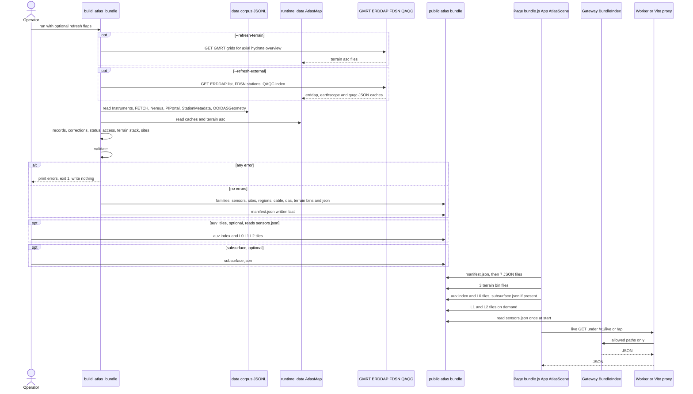

# Flow: atlas bundle

flow: atlas-bundle · runs through: [atlas-map-data](../chapters/atlas-map-data.md), [atlas-map-scene](../chapters/atlas-map-scene.md), [atlas-map-gateway](../chapters/atlas-map-gateway.md) · as of 1047fc8

The atlas bundle is a folder of static files that an operator builds offline and that two readers then consume: the map page and the live gateway. `python -m atlas_map_data.build_atlas_bundle`, optionally with `--refresh-terrain` and `--refresh-external`, reads the private corpus under `data/` (JSON Lines files, one object per line, for instruments, FETCH (an acoustic transponder network at Axial), Nereus (the public status service of the Regional Cabled Array, RCA), the PI (principal investigator) portal, station metadata and DAS (distributed acoustic sensing) geometry), the cached GMRT (Global Multi-Resolution Topography) terrain grids and external lists under `runtime_data/AtlasMap/`, and two tracked inputs, `corrections.json` and `cable/rca_cable.geojson`. It turns the rows into sensor records, applies reviewed corrections, resolves status and data routes, clusters sensors into sites, and runs a validation gate. Only when the gate returns no errors does it write the JSON files, the terrain binaries and, last, `manifest.json` into `src/atlas_map/public/atlas/`. Two optional builders add the committed 1 m Axial summit tiles (`auv/`, from an AUV, autonomous underwater vehicle, survey) and the git-ignored `subsurface.json`. At startup the page fetches the manifest, then seven JSON files and three terrain grids, builds the three.js (a WebGL 3D library) scene, and loads the summit base tiles and the subsurface if they exist. The gateway reads only `sensors.json`, once, at process start, to build the allowlist that decides which reference designator (the OOI instrument id), ERDDAP (a public data-server API) dataset, seismic station and PI endpoint it serves. No step needs a secret. The corpus and runtime caches are absent from this checkout (`data/` holds only README, CORPUS_METHOD.md and cleanup_validation.json), so this flow was traced from code and was not run.

## Sequence

## Hops

### Build (offline, run by the operator)

1. **CLI entry and flags.** `main`, `src/atlas_map_data/build_atlas_bundle.py:90-115`; flags at `:92-94`.
   - Data: argv. `--out` defaults to `paths.BUNDLE`, which is `src/atlas_map/public/atlas` (`src/atlas_map_data/paths.py:8`, `build_atlas_bundle.py:92`). The build reads no environment variables: `git grep` for `environ` and `getenv` under `src/atlas_map_data` finds none.
   - Fails: a missing `.venv` or `PYTHONPATH=src` stops the import (`src/atlas_map_data/README.md:5-7`). `main` handles only validation errors (`build_atlas_bundle.py:111-113`), so an exception from any later hop prints a traceback, not the "build failed" line.

2. **Terrain refresh, optional.** `build_atlas_bundle.py:96-99` calls `terrain.fetch_gmrt` (`src/atlas_map_data/terrain.py:105-113`).
   - Data out: `runtime_data/AtlasMap/terrain/{axial,hydrate,overview}.asc`, ESRI ASCII (a plain-text raster format), with the response bytes written unchecked (`terrain.py:110-112`). Requests go to `GMRT_URL` (GMRT is Global Multi-Resolution Topography, the seafloor grid service) with a 300 s timeout (`terrain.py:12`, `:107-111`; grid extents at `:15-19`).
   - Fails: a timeout or network error propagates, with no retry. An HTML error body is saved as the `.asc` and fails later, at hop 6 (`terrain.py:57-62`).

3. **External caches refresh, optional.** `build_atlas_bundle.py:100-105`.
   - `access.refresh_erddap` (`src/atlas_map_data/access.py:70-78`) lists `ooi-rs*` dataset ids from ERDDAP (a public data-server API) and writes `erddap_datasets.json`, shaped `{retrievedAt, source, datasetIds}` (`access.py:76-77`).
   - `access.refresh_earthscope` (`access.py:81-97`) reads the EarthScope FDSN (the International Federation of Digital Seismograph Networks web-service standard) station list for network OO (`access.py:83`) and writes `earthscope_channels.json`, shaped `{retrievedAt, source, network, stations: {code: {lat, lon, channels}}}` (`access.py:95-96`).
   - `QAQCToolkit().get_index()` (`src/agentic_qaqc/qaqc_agent_tools.py:69-87`, imported through `sys.path` at `build_atlas_bundle.py:103-104`) returns a list of QA/QC (quality assurance and quality control) plot paths. `access.refresh_qaqc` (`access.py:120-126`) writes `qaqc_refdes.json`, shaped `{retrievedAt, source, refdes}` (`access.py:123-125`). The QA/QC index comes from [agentic-qaqc](../chapters/agentic-qaqc.md).
   - Fails: network errors propagate. A zero-row ERDDAP or station list is written with no error (`access.py:74-78`, `:94-97`), and the count is only printed (`build_atlas_bundle.py:101-102`). On any QA/QC error, `get_index` returns the cache file at any age (`qaqc_agent_tools.py:83-86`), and `refresh_qaqc` stamps it with a new `retrievedAt` (`access.py:123-125`), so a stale index looks fresh.

4. **Corpus reads and sensor records.** `build()`, `build_atlas_bundle.py:42-46`; `src/atlas_map_data/sensors.py:24-83`; `src/atlas_map_data/corpus.py:7-9`.
   - Data in: `data/Instruments/instruments.jsonl`, required (`build_atlas_bundle.py:43`); `data/FETCH/instruments.jsonl`, optional (`:45`). Both are produced by [corpus-instruments-ops](../chapters/corpus-instruments-ops.md). Each row becomes a record (`sensors.py:24-51`) with `id`, `instrumentId`, `name`, `type`, `family`, `lat`, `lon`, `depth`, `depthRange`, `waterDepth`, `siteCode`, `node`, `refdes`, `location`, `projects`, `coszoRole`, `manufacturer`, `model`, `sources`, `arcadaId` and `corrections`. `depthRange` is `[5, 200]` for SF (shallow profiler) nodes, `[200, 200]` for PC (a 200 m platform) and `[250, depth - 150]` for DP (deep profiler) (`sensors.py:13-21`). FETCH rows get a fixed status of UNKNOWN and fixed repository routes (`sensors.py:54-55`, `:58-83`).
   - Fails: a missing required file raises FileNotFoundError, since there is no existence check (`build_atlas_bundle.py:43`). An unknown instrument type raises `UnknownInstrumentType` and aborts the build (`src/atlas_map_data/families.py:28-38`, via `sensors.py:34`). A malformed JSONL line raises (`corpus.py:9`).

5. **Corrections, status and data routes.** `build_atlas_bundle.py:47-59`.
   - Corrections: `sensors.apply_corrections` (`sensors.py:86-102`) applies `src/atlas_map_data/corrections.json` (`build_atlas_bundle.py:47`). Each entry is `{match: {field: [values]}, set: {field: value}, reason}`. A correction that matches no sensor raises ValueError (`sensors.py:98-99`).
   - Status: `status.load_status_index` (`src/atlas_map_data/status.py:13-24`) reads the Nereus snapshot (Nereus is the RCA status service) from `data/Nereus/graphrag/entities.jsonl` and `instrument_crosswalk.jsonl` (`build_atlas_bundle.py:49-50`), matched on an exact reference designator. Otherwise a planned role from COSZO (the second sensor network) becomes PLANNED (`status.py:31-32`), and everything else becomes UNKNOWN (`status.py:33`). `STATUS_GROUP` (`status.py:5-10`) sets `statusGroup` (`build_atlas_bundle.py:57`).
   - Data routes: `access.load_external` (`access.py:54-67`) reads the three caches. A missing cache is a warning, not an error (`access.py:61`, `:66`). PI endpoints come from `data/PIPortal/endpoints.jsonl` (`build_atlas_bundle.py:37`, `:52`), from [coszo-hub-sources](../chapters/coszo-hub-sources.md). Vertical channels come from `data/StationMetadata/channels.jsonl` (`build_atlas_bundle.py:26`, `:53`), from [repo-ops-data](../chapters/repo-ops-data.md). `access.build_access` (`access.py:129-174`) keeps only routes whose host is in `ALLOWED_HOSTS` (`access.py:24-29`, `:168`) and falls back to documentation links when none remain (`access.py:169-173`). Each route is `{kind, label, url, how, ...}`, with kind one of `erddap`, `qaqc`, `ooi_explorer`, `earthscope`, `pi_portal` or `documentation` (`access.py:136-173`), plus `repository` for FETCH rows (`sensors.py:78-82`).
   - Fails: a disallowed host is dropped with no error (`access.py:168`). A missing Nereus, PIPortal or StationMetadata file raises, because those reads have no existence check (`build_atlas_bundle.py:49-50`, `:52-53`), unlike the cache files. `status.load_status_index` requires `operational_status` (`status.py:21`), so a Nereus schema change would raise KeyError (inferred).

6. **Terrain stack and sites.** `build_atlas_bundle.py:61-65`; `src/atlas_map_data/terrain.py:57-70`, `:88-102`; `src/atlas_map_data/sites.py:77-143`.
   - Data: three grids are read from `runtime_data/AtlasMap/terrain/*.asc` (`build_atlas_bundle.py:61`). Values are whole metres, stored as Int16 (16-bit signed integers), with nodata set to -3000 (`terrain.py:14`, `:57-70`). `Stack` answers elevation from the finest covering grid and otherwise returns -2500 (`terrain.py:88-102`). Located and unlocated records are split (`build_atlas_bundle.py:63-64`). `build_sites` clusters sensors within 150 m, transitively (`sites.py:12`, `:80-90`), and names each site after the location with the most weight, where seafloor sensors weigh 100 and water-column sensors 1 (`sites.py:98-101`). Each site is `{id, name, label, region, lat, lon, seafloor, sensorIds, parts, column, unlocatedIds}` (`sites.py:119-125`), where `column` is a list of `{kind, a, b}` depth bands (`sites.py:103-109`, `:123`). Unlocated sensors attach by site code, then location, or become unplaced (`sites.py:129-142`).
   - Fails: a missing `.asc` raises FileNotFoundError (`build_atlas_bundle.py:61`, `terrain.py:58`), so the first build needs `--refresh-terrain`. A longitude outside -180 to 0 raises in `region_for` (`sites.py:28-32`, `:116`) and aborts the build.

7. **Validation gate.** `build_atlas_bundle.py:66`; `src/atlas_map_data/validate.py:6`, `:14-44`.
   - Data: `validate(records, sites, unplaced, len(records), stack)` returns error strings. The checks are: a sensor not listed by any site or as unplaced (`validate.py:21-24`); an unknown site reference (`:25-26`); no family (`:27-28`); a status with no group (`:29-30`); a half-set position (`:31-32`); a position outside every grid (`:33-35`); and a listed depth more than 250 m from the GMRT seafloor, unless the sensor has a correction (`:37-43`).
   - The counts check (`validate.py:18-19`) cannot fail. `build` passes `len(records)` as the total (`build_atlas_bundle.py:66`), so the two sides are always equal. The atlas-map-data chapter says the spec expects a reconcile against inventory rows.
   - Fails (behavior): any string means nothing is written, the errors are printed, and the exit code is 1 (`build_atlas_bundle.py:68`, `:109-113`). The previous bundle stays on disk unchanged.

8. **Write the bundle.** `build_atlas_bundle.py:68-86`; `_write` at `:19-21`; `terrain.write_bin` at `src/atlas_map_data/terrain.py:73-77`.
   - Order and shape: `families.json` `{families}` (`:69`); `sensors.json` `{sensors, unplaced}`, where `unplaced` is a list of ids (`:70`); `sites.json` `{sites}` (`:71`); `regions.json` `{overview, regions}` (`:72`); `cable.json` `{lines, nodes, hidden}`, built by `cable.load_cable` from `cable/rca_cable.geojson` (GeoJSON, a JSON format for map geometry) (`:73-74`, `src/atlas_map_data/cable.py:19-46`); `das.json` `{layers, summary}`, built by `das.build` from `data/OOIDASGeometry/channel_locations.jsonl` and `multidas_unmasked_coverage.jsonl` (`:75`, `src/atlas_map_data/das.py:61`, `:74-92`); `terrain/<name>.bin`, little-endian Int16 rows starting at the north edge (`:76-78`, `terrain.py:73-77`); `terrain/terrain.json` `{credit, grids}` (`:79`); and `manifest.json`, written last (`:85-86`), shaped `{builtAt, total, located, unlocated, unplaced, sites, corpusSnapshot, warnings, errors}` (`:80-84`).
   - Fails: `_write` is not atomic (`:19-21`). A crash part-way leaves new files beside the previous manifest, because the manifest is written last and not removed first (from the code; not run). Missing inputs to `das.build` or `cable.load_cable` raise.

9. **AUV summit tiles, optional.** `src/atlas_map_data/auv_tiles.py:102-114` (`main`); `build` at `:37-99`.
   - Run by hand after the main build, from an MBARI (Monterey Bay Aquarium Research Institute) 1 m `.grd` survey grid passed as `--source` (`auv_tiles.py:105`). The output directory defaults to `<bundle>/auv` (`:106`). Sensor positions come from `--sensors`, which defaults to `<bundle>/sensors.json` (`:107`), using every sensor that has a latitude (`:109-110`).
   - Data out: `auv/index.json` (`:98`), holding `source, credit, west, north, cellDeg, tileCells, zOffset, zScale, nx, ny, levels` (`:54-55`, `:95-96`). Tiles at `auv/L{level}/{ty}_{tx}.bin.gz` (`:93`) are gzipped little-endian Int16 arrays of 257 by 257 values. The values are decimetres from an offset of -1000 m, delta-encoded along each row (`:17`, `:22-28`). The levels L0, L1 and L2 are 16 m, 4 m and 1 m tiers. The 16 m and 4 m tiers cover the survey, and the 1 m tier only covers areas within 1.2 km of a sensor (`:38`, `:65-66`).
   - Requires h5py and numpy, both imported at module top (`:13-14`). Fails: a missing `sensors.json` raises (`:107-109`). Values outside about -4,200 m to +2,200 m are clipped silently (`:23`, with the offsets at `:17`). The cell size comes from the longitude step and is applied to both axes (`:42-44`). The output is tracked in git (`.gitignore:51-52`), so a rerun changes committed files, and the 1 m coverage stays fixed at the sensor positions of that run (`:65-66`).

10. **Subsurface layers, optional.** `src/atlas_map_data/subsurface.py:158-177`.
    - Run by hand with `--source` pointing at an `axial_visuals` clone (`subsurface.py:3-4`, `:169`). It writes `subsurface.json` into the bundle directory (`:162`, `:170`). The content is `{credit, datumM, rim, earthquakes, surfaces}`, with `datumM` 1500 (`:30`, `:159-160`). It needs numpy and scipy at module top (`:22-25`) and reads files such as `axial_calderaRim.m` (`:153`).
    - Fails: there is no schema check. The file is git-ignored (`.gitignore:51`), so it exists only where it was built. The page skips it silently when it is absent (`src/atlas_map/src/scene/SubsurfaceLayer.js:61-67`).

### Page startup (in the browser)

11. **Manifest and seven JSON files.** `App` calls `loadBundle` (`src/atlas_map/src/App.jsx:24`); `src/atlas_map/src/data/bundle.js:34-44`.
    - Data in: each URL is `BASE_URL` + `atlas/` + name (`bundle.js:6`). The manifest is fetched first (`:35`), then `families`, `sensors`, `sites`, `regions`, `cable`, `das` and `terrain/terrain` in parallel (`:36-37`). The result is `{manifest, families, familyByKey, sensors, sensorById, unplaced, sites, siteById, regions, overview, cable, das, terrainMeta}` (`:38-43`).
    - Fails: a 404, or HTML served with status 200 by Vite's single-page-app fallback, counts as missing (`bundle.js:17-31`). A missing manifest shows `BundleMissingError` with `BUILD_COMMAND` (`bundle.js:8-13`, `:18-19`; `App.jsx:26-30`). `BUILD_COMMAND` omits the refresh flags (`bundle.js:1`). `Promise.all` rejects on the first failure (`bundle.js:36-37`). Nothing checks the shapes, so a malformed file fails later (inferred).

12. **Terrain grids.** `App.jsx:86`; `src/atlas_map/src/scene/grid.js:45-61`.
    - Data in: one `terrain/<name>.bin` for each grid listed in `terrain.json` (`bundle.js:42`, `grid.js:47-48`). The loader rejects HTML (`grid.js:55`) and any byte count other than `ncols × nrows × 2` (`grid.js:56-57`). Data out: `makeGrid` returns `{meta, heights: Int16Array, H, sample, box}` (`grid.js:4-17`).
    - Fails: "The atlas terrain is incomplete ... Rebuild it with" (`grid.js:49`, `:52`, `:55`, `:57`), delivered to `setError` through `App.jsx:122`.

13. **Scene construction and the ready step.** `App.jsx:88-93`; `src/atlas_map/src/scene/AtlasScene.js:16-48`, `:75-86`.
    - `new AtlasScene(canvas, bundle, grids)` starts `elevAt` as the three grids stacked (`AtlasScene.js:21`, `grid.js:19-22`). In `ready` (`AtlasScene.js:33-48`): `loadSubsurface()` starts its fetch (`:34`, `SubsurfaceLayer.js:61-67`). `AuvLod.create` loads `auv/index.json` and then every L0 (16 m) tile (`AtlasScene.js:36`, `AuvLod.js:23-36`, `:116-119`). Terrain meshes for overview, axial and hydrate follow (`AtlasScene.js:38-40`, `:75-86`). The subsurface layer is built if its data loaded (`:41-46`), and `elevAt` is then replaced (`:47`).
    - `App` waits for `ready` and only then adds the cable, the DAS layers and the moorings (`App.jsx:89-93`; `AtlasScene.js:88`, `:113`, `:138`). Their inputs are `bundle.cable.lines[].coords`, `bundle.das.layers[]` and `bundle.sites[].column`.
    - Fails: `AuvLod.create` returns null when the index is missing, any L0 tile fails, or the browser lacks `DecompressionStream` (`AuvLod.js:17-18`, `:27`, `:29-33`). The GMRT grid then covers the summit. Because `ready` gates the cable and moorings (`App.jsx:89`), slow L0 tiles delay them (from the code; not measured). A missing `axial`, `hydrate` or `overview` grid throws a TypeError (inferred; `AtlasScene.js:21`, `:38-40`). A WebGL failure (`AtlasScene.js:22`) or a rejected `ready` reaches `onError` (`App.jsx:122`).

14. **Summit tiles on demand, optional.** `src/atlas_map/src/scene/AuvLod.js:8`, `:12-21`, `:142-165`.
    - `update` runs at most every 200 ms (`AuvLod.js:142-144`). It loads up to six L1 and L2 tiles at a time (`:152`), and shows a 1 m tile only after its 4 m parent (`:155`, `:161-165`). `fetchTile` gunzips with `DecompressionStream` and checks the byte count (`:12-21`). A failed tile waits 30 s before it is tried again (`:8`).
    - Fails: a failed L1 or L2 tile logs a warning (`:156`), and the coarser level stays on screen.

### Gateway (a separate process)

15. **Gateway start.** `src/atlas_map_gateway/main.py:39-54`; `config.py:37-44`; `toolkits.py:20-36`.
    - uvicorn imports `app`, which builds on first access (`main.py:50-54`). `load_settings` merges the repo `.env` (`config.py:38`, default `REPO/.env`) with the process environment, and the environment wins. `ATLAS_BUNDLE_DIR` sets the bundle folder, which defaults to `src/atlas_map/public/atlas` (`config.py:43`). `toolkits.make` creates the EarthScope temp root (`toolkits.py:28`) and sets environment defaults (`toolkits.py:22-29`).
    - Fails: nothing at this step beyond hop 16.

16. **Bundle index.** `main.py:44`; `src/atlas_map_gateway/bundle_index.py:17-34`.
    - Data in: the `sensors` list of `sensors.json` and nothing else (`bundle_index.py:20`). From each record, the index keeps `refdes` in a set (`:21-22`); each `erddap` route's `datasetId`, keyed by refdes (`:23-25`); each `earthscope` route's channel, keyed by `network.station` (`:26-29`), where a seismometer channel replaces an HDH hydrophone channel (`:27-28`); and each `pi_portal` route's `instrumentKey` and `endpointId`, mapped to its `url` (`:30-33`). The shapes match `access.py:136`, `:152-154` and `:165-167`. The `unplaced` list and `sites.json` are not read.
    - Fails: a missing or malformed file raises at import, and nothing catches it (`bundle_index.py:20`, `main.py:44`). The temp root made at `toolkits.py:28` is then never removed, because the shutdown hook is registered only by `create_app` (`main.py:43-47`, `app.py:41-48`), which never runs (from the evaluation order; not run). The index is built once, with one call site (`main.py:44`), so a rebuilt bundle needs a gateway restart (inferred from the code).

17. **Per-request allowlist.** `src/atlas_map_gateway/app.py:60-63`; `routes_data.py:71`, `:82`, `:105`, `:119-128`, `:150-152`; `errors.py:12-25`.
    - An unknown refdes gets a 404 before any upstream call (`app.py:62-63`). ERDDAP ids come from the bundle (`routes_data.py:71`, `:82`). Plots check the refdes (`:105`). An unknown PI instrument or endpoint gets a 404, and several endpoints without a chosen one get a 422 (`:119-128`). An unknown station gets a 404 (`:150-152`). Errors have the body `{"error": {"source", "message"}}` (`errors.py:24-25`), and an `UpstreamError` defaults to status 502 (`errors.py:13`).
    - The bundle's PI endpoint ids are corpus ids, not the toolkit's ids, so the gateway matches on URL (`routes_data.py:45-50`, `:126`). A URL the toolkit does not know raises an upstream error (502). The bundle and the PI toolkit must agree on every URL.

### Live calls (page to gateway)

18. **Browser to gateway.** `src/atlas_map/src/api/gateway.js:1-21`; `src/atlas_worker/src/index.js:39-62`, `:402`; `src/atlas_map/vite.config.js:8-12`. The panels that call this client are in [atlas-map-panels](../chapters/atlas-map-panels.md); the Worker is described in [ask-atlas](../chapters/ask-atlas.md).
    - Production: `${ATLAS_WORKER}/v1/live` (`gateway.js:2`, `:5`). The Worker allowlists paths (`index.js:39`, `:46`, which returns 404 otherwise), returns 503 when `ATLAS_MAP_GATEWAY_ORIGIN` is unset (`:42`), forwards to the gateway (`:48`), and returns 503 when the upstream call throws (`:59-60`).
    - Development: `/api` is proxied by Vite to `http://127.0.0.1:8787`, with the `/api` prefix removed (`vite.config.js:11`).
    - Client mapping: 404 becomes notfound, 422 bad, 502 upstream, 503 busy and 504 timeout (`gateway.js:1`). A network failure, or an error body with no JSON `error`, becomes unreachable (`gateway.js:12-19`).
    - Fails: what Vite returns when the gateway is down in development is not in this repo (see open questions).

## Config and secrets

No step in the build or the page needs a secret. The gateway reads the Graph-RAG key by name at startup, and the Worker holds its own copy as a Wrangler secret (`src/atlas_worker/README.md:19`). Values are not recorded here.

| Name | Read at | Purpose | Default or required |
|---|---|---|---|
| `--out` | `build_atlas_bundle.py:92` | Bundle folder | `src/atlas_map/public/atlas` |
| `--refresh-terrain` | `build_atlas_bundle.py:93`, `:96-99` | Downloads the GMRT grids into `runtime_data/AtlasMap/terrain/` | Off. Needed on the first build (`src/atlas_map_data/README.md:6`). |
| `--refresh-external` | `build_atlas_bundle.py:94`, `:100-105` | Refreshes the ERDDAP, EarthScope and QA/QC caches | Off. Needed on the first build. |
| `--source` | `auv_tiles.py:105`; `subsurface.py:169` | MBARI `.grd` file; `axial_visuals` clone | Required for those two builders |
| `--sensors` | `auv_tiles.py:107` | Sensor positions for the 1 m tiles | `<bundle>/sensors.json` |
| `DATA`, `RUNTIME`, `BUNDLE` | `paths.py:6-8` | `data/`, `runtime_data/AtlasMap/`, the bundle | Computed from the file location |
| Corpus under `data/` | `build_atlas_bundle.py:37`, `:43-53` | Private inputs, restored from release assets (`.gitignore:21-22`) | Required. Absent in this checkout. |
| Hosts GMRT, ERDDAP, FDSN, QA/QC | `terrain.py:12`; `access.py:14`, `:15`, `:21`; `qaqc_agent_tools.py:31` | Unauthenticated GET requests | Hard-coded, no keys |
| `ALLOWED_HOSTS` | `access.py:24-29` | Hosts that data routes may use | Constant |
| `TOLERANCE_M` | `validate.py:6` | Depth check tolerance, 250 m | Constant |
| `SITE_RADIUS_KM` | `sites.py:12` | Site clustering radius, 0.15 km | Constant |
| `NODATA_FILL`, `Stack.FALLBACK` | `terrain.py:14`, `:89` | Nodata value -3000; off-grid elevation -2500 m | Constant |
| `DATUM_M` | `subsurface.py:30` | Subsurface datum, 1500 m | Constant |
| `Z_OFFSET`, `Z_SCALE` | `auv_tiles.py:17` | Tile encoding: -1000 m offset, 10 per metre | Constant |
| FETCH repository URLs | `sensors.py:54-55` | Pinned to one commit | Constant |
| `ATLAS_BUNDLE_DIR` | `config.py:43` | Gateway's bundle folder | Optional. Default `src/atlas_map/public/atlas`. |
| Repo `.env` | `config.py:24-38` | Lower-precedence gateway settings | Optional |
| `ATLAS_API_KEY`, `GRAPHRAG_API_KEY` | `config.py:42`; used only by `make_chat` (`main.py:18`) | Graph-RAG key for `/chat`. Secret. | Not used by this flow. Set in the environment or the repo `.env` (`src/atlas_map_gateway/README.md:8`). |
| `PI_PORTAL_TIMEOUT_SECONDS`, `EARTHSCOPE_TIMEOUT_SECONDS`, `PI_PORTAL_MAX_RETRIES`, `EARTHSCOPE_RUNTIME_ROOT` | `toolkits.py:22-29` (set in `os.environ`) | Toolkit timeouts and the temp root | Set at startup, not operator configuration |
| `ATLAS_MAP_GATEWAY_ORIGIN` | `src/atlas_worker/src/index.js:42`, `:48` | Gateway origin for the Worker's `/v1/live` proxy | Required for live data. Local value in `src/atlas_worker/.dev.vars` (`src/atlas_map/README.md:26-27`). Production value not in the repo. |
| `BASE_URL` | `bundle.js:6` (Vite) | Static path prefix | From `base: "./"` (`vite.config.js:17`) |
| `PROD` | `gateway.js:5` (Vite) | Chooses the Worker or the `/api` proxy | Set by Vite |
| Port 8787 | `vite.config.js:11` | Dev proxy target | Matches the gateway README's `--port 8787` (`src/atlas_map_gateway/README.md:6`) |

## Open questions

1. **How does the bundle reach production?** Nothing tracked runs the build or deploys `dist/`, and there is no `.github` folder in the tree (`git ls-files .github` is empty). `vite.config.js:15-17` says the atlas is served below `/rca-atlas/map2/`. Answer: the deployer's runbook or the Pages settings.
2. **Which bundle does the production gateway read?** `ATLAS_BUNDLE_DIR` and the gateway's deployment are not in the repo (see [atlas-map-gateway](../chapters/atlas-map-gateway.md)). Answer: the deployment configuration, plus a check that its `sensors.json` came from the same build as the page's.
3. **Should the gateway reload `sensors.json`?** The code loads it once (`main.py:44`), so a rebuild needs a restart. Answer: the author's intent, or a test of a rebuild followed by a request.
4. **Should `--refresh-external` fail rather than warn?** A zero-row list and a stale QA/QC fallback both pass silently (`access.py:74-78`; `qaqc_agent_tools.py:83-86`). Answer: the team's choice of behavior.
5. **Should the counts check reconcile against the inventory?** `validate.py:18-19` compares the record count with itself, because `build_atlas_bundle.py:66` passes `len(records)`. The spec asks for a reconcile against the inventory (`docs/superpowers/specs/2026-09-23-atlas-map-design.md:150`). Answer: the author of commit 71104cd, which added validation, or a fix that passes the inventory row counts into `build`.
6. **Should the writes go to a staging folder and then be renamed?** `_write` is not atomic (`build_atlas_bundle.py:19-21`, `:68-86`). Answer: the team's decision.
7. **Do the committed 1 m tiles still match the reviewed sensor positions?** They were cut around the sensor positions of one run (`auv_tiles.py:65-66`, `:107-110`), and a correction can move a sensor (`sensors.py:95-102`). Answer: a rerun with the MBARI grid, which is not in the repo (`.gitignore:49-50`).
8. **Which `axial_visuals` commit produced `subsurface.json`?** The package README clones the repo without a pinned commit (`src/atlas_map_data/README.md:30`), and the builder does not clone anything (`src/atlas_map_data/subsurface.py:3-4`). Answer: the operator's record of the clone used for the last build.
9. **What does the Vite dev proxy return when the gateway is down?** `gateway.js:19` reads a body with no `error` field as unreachable, but Vite's error response is not in the repo (`vite.config.js:11`). Answer: stop the gateway, run `npm run dev`, and load the page.

## Glossary

| Term | Meaning |
|---|---|
| Atlas bundle | The folder `src/atlas_map/public/atlas/` that the builder writes (`paths.py:8`). |
| AUV | Autonomous underwater vehicle. The MBARI 1 m summit survey was made by one (`auv_tiles.py:16`). |
| DAS | Distributed acoustic sensing, a fibre-optic cable read as a line of sensors (`das.py:1-7`). |
| DP, SF, PC | Deep profiler, shallow profiler and 200 m platform, the OOI node prefixes that set depth ranges (`sensors.py:9-21`). |
| ERDDAP | Environmental Research Division's Data Access Program, the public OOI data server (`access.py:14`). |
| ESRI ASCII | A plain-text raster format for grids (`terrain.py:57-70`). |
| FDSN | International Federation of Digital Seismograph Networks, the standard behind EarthScope's station service (`access.py:21`). |
| FETCH | An acoustic transponder network at the Axial summit, one of the sensor sources (`sensors.py:58-83`). |
| GMRT | Global Multi-Resolution Topography, the seafloor grid service (`terrain.py:12-13`). |
| Int16 | A 16-bit signed integer, the stored format for terrain and tiles (`terrain.py:64-68`). |
| LOD | Level of detail: coarse tiles everywhere, finer tiles near the camera (`AuvLod.js:23`). |
| MBARI | Monterey Bay Aquarium Research Institute, which surveyed the Axial summit at 1 m (`auv_tiles.py:16`). |
| Nereus | The public GraphQL service behind RCA instrument status. The build reads an offline snapshot from `data/Nereus/graphrag/` (`src/nereus_pipeline/README.md:3`, `:7`; `build_atlas_bundle.py:49-50`). |
| OOI | Ocean Observatories Initiative, which runs RCA. |
| PI portal | The principal investigators' data portal, whose folders the gateway lists (`access.py:41`). |
| Primary node (PN) | A seafloor hub on the cable (`cable.py:12`). |
| QA/QC | Quality assurance and quality control: the RCA plot index (`qaqc_agent_tools.py:31`). |
| RCA | Regional Cabled Array, the OOI seafloor cable network off Oregon. |
| Refdes | OOI reference designator, the instrument id such as `RS03AXPS-PC03A-4A-CTDPFA303` (`sensors.py:25-27`). |
| Site | Sensors within 150 m of each other, transitively (`sites.py:12`, `:80-90`). |
| Stack | The terrain grids, finest first, that answer elevation queries (`terrain.py:88-102`). |
| Subsurface | The earthquakes, magma-chamber top and caldera-wall faults under Axial (`subsurface.py:1-13`). |
| Worker | The Cloudflare Worker in `src/atlas_worker/` that serves production and proxies `/v1/live` (`src/atlas_worker/src/index.js:39-62`). |
