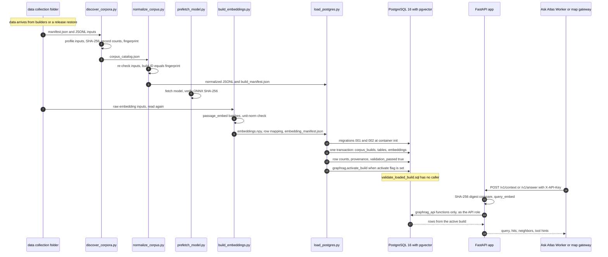

# Flow: corpus-to-index

flow: corpus-to-index · from one collection in `data/` to the API's answers · as of 1047fc8

Citations are relative to `src/graphrag_runtime/` unless they begin with another top-level directory. Root-level files are written as `root <file>`.

Graph-RAG (retrieval-augmented generation over a graph) is the runtime that turns the collection folders in `data/` into one searchable PostgreSQL database. Four offline steps run in order. Discover writes a catalog of every input with its hash and record count. Normalize turns the inputs into logical nodes, text chunks, links and edges. Embed turns each chunk into a 384-dimension vector with the BGE model (`BAAI/bge-small-en-v1.5`). Load writes everything in one transaction, then flips a single active-build pointer. Four SQL functions read only the active build, and a FastAPI service exposes them behind an API key. Normalize re-checks every input's hash and record count, the loader checks its row counts against the build manifest, and the build ID is the full catalog fingerprint. Three gaps weaken the gate. The loader never compares the embeddings' catalog fingerprint or model pins with the build (`load_postgres.py:137-154`). Activation does not require embeddings (`load_postgres.py:135`, `:191-192`). No executed path runs `validate_loaded_build.sql` (`git grep` finds no caller). Everything here comes from reading HEAD `1047fc8`. Nothing was run, and `data/` holds no `manifest.json` in this checkout (`find data -name manifest.json` finds 0), so the trace rests on code and the method documents.

## Sequence

## Hops

### 1. A collection arrives in `data/`

- **Component:** a collection builder writes `data/<collection>/`, or `scripts/bootstrap_machine.sh` restores a release. The builder chapters are [corpus-docs-web](../chapters/corpus-docs-web.md), [corpus-instruments-ops](../chapters/corpus-instruments-ops.md), [literature-corpus](../chapters/literature-corpus.md), [axial](../chapters/axial.md), [coszo-hub-core](../chapters/coszo-hub-core.md), [coszo-hub-sources](../chapters/coszo-hub-sources.md) and [agentic-qaqc](../chapters/agentic-qaqc.md). The restore path is in [repo-ops-data](../chapters/repo-ops-data.md).
- **Where:** all of `data/` is untracked except three files (root `.gitignore:23-26`). The FETCH builder (FETCH is the Axial Seamount cabled acoustic transponder network) writes to `data/FETCH` (`src/fetch_transponders/build_fetch_corpus.py:23`) and writes `manifest.json` at `:190-191`. The restore downloads each archive, checks its size and SHA-256, then extracts it (`scripts/bootstrap_machine.sh:62-79`). The release packs `data/`, `source_material/` and `runtime_data/` (`scripts/build_transfer_release.sh:32-37`).
- **Data:** a folder holding `manifest.json`, one JSON object, and JSONL files, one JSON object per line. The FETCH manifest declares `embedding_input` = `chunks.jsonl`, `instrument_node_input` = `instruments.jsonl`, `other_node_inputs` = `entities.jsonl` and `sources.jsonl`, `graph_edge_input` = `relationships.jsonl`, plus `validation_status`, `counts` and `limitations` (`src/fetch_transponders/build_fetch_corpus.py:190`). Eleven builder scripts write `embedding_input` = `chunks.jsonl` (`git grep -n embedding_input`).
- **Can fail:** nothing in this checkout can be run, because no collection folder exists here. A restore stops on a size or digest mismatch (`scripts/bootstrap_machine.sh:70-72`). The root quickstart goes straight from restore to the loader (root `README.md:15-22`), so it depends on the release carrying the normalized and embedding folders (see open question 5).

### 2. Catalog: `discover_corpora.py`

- **Component:** `discover_corpora.py`, step 1 of [graphrag-runtime](../chapters/graphrag-runtime.md).
- **Where:** `main()` at `src/graphrag_runtime/discover_corpora.py:341-353`. `build_catalog` at `:274-329` globs `data/**/manifest.json` at `:279`. Each manifest goes through `_build_collection` at `:183-255`. Embedding keys are read at `:188-193` (`embedding_input` or `embedding_inputs`, or `chunks.jsonl` if present). Node keys are read at `:195-201`, with the known node file names at `:47-65`. Edge keys are read at `:203-206` (`graph_edge_input`, `graph_edge_inputs` or `edge_input`). Auxiliary and structured files are sorted at `:208-212`. Tools come from `live_tool_manifest`, `tool_manifest.json` or `tools.jsonl` at `:214-216`. Each input is profiled at `:129-141` (byte size, SHA-256, records, text records) and JSONL is parsed at `:84-107`. The collection-name table is at `:23-42`, and the fingerprint at `:258-271`. The catalog is written through a temporary file at `:332-338`, to `runtime_data/GraphRAG/corpus_catalog.json` by default (`:346`).
- **Data in:** each `manifest.json` and every input file it names.
- **Data out:** the catalog, `runtime_data/GraphRAG/corpus_catalog.json`. Shape: `catalog_schema_version` ("1.0"), `generated_at_utc`, `data_root`, `load_strategy`, `totals` (`collections`, `embedding_chunks`, `graph_node_records`, `graph_edge_records`, `structured_records` and file counts, `:286-300`), `build_fingerprint_sha256` (64 hex characters), `collections[]` and `validation` (`:302-328`). Each collection has `collection_id`, `name`, `scope`, `manifest` (a descriptor with `path`, `role`, `byte_size`, `sha256`, `records`, `text_records`, `id_fields`), the input lists `embedding_inputs[]`, `graph_node_inputs[]`, `graph_edge_inputs[]`, `structured_inputs[]`, `auxiliary_inputs[]`, `tool_definitions[]`, and `runtime_references[]` (`:235-255`). The fingerprint is a SHA-256 over each collection's ID, manifest hash and input hashes, with no timestamps (`:258-271`).
- **Can fail:** `CatalogError` is raised for a missing `data/` (`:277-278`), a declared input that does not exist (`:130-131`), invalid JSONL (`:94-95`), a row that is not an object (`:96-97`), an embedding row with no text (`:105-106`), no embedding input (`:192-193`), and duplicate collection IDs (`:283-284`). Gaps: a manifest that is not valid JSON raises a plain decode error (`:184`). A non-JSONL embedding input is not profiled (`:132-134`), so discover accepts it, and the failure moves to hop 4. A folder missing from `COLLECTION_NAMES` gets a slug ID (`:177-180`). The check "runtime indexes are kept outside data" is listed but nothing enforces it (`:326`). `tools.jsonl` is both a node file (`:64`, `:198-200`) and a tool definition (`:215`, `:223`) when a manifest names it, as the Axial monitoring manifest does (`src/axial_monitoring_website/build_axial_monitoring_graph.py:173`). That looks intended, since tool names can be relationship endpoints (`src/graphrag_runtime/normalize_corpus.py:118-121`) (inferred).

### 3. Normalize: `normalize_corpus.py`

- **Component:** `normalize_corpus.py`, step 2 of [graphrag-runtime](../chapters/graphrag-runtime.md).
- **Where:** `normalize()` at `src/graphrag_runtime/normalize_corpus.py:173-377`, CLI at `:380-390` with defaults at `:386-387`. Each input is re-checked for byte size, SHA-256 and records at `:217-237`. The build ID is the fingerprint (`:176-179`, with the reason in the comment at `:177-178`). Output goes to a staging folder at `:180-183`. Physical rows are kept, and logical nodes are keyed by `(collection_id, local_id)` at `:243-262`. Identifiers are at `:263-264`. Chunks come only from embedding inputs at `:265-275`. Chunk links are set by `LINK_FIELDS` (`:51-59`) at `:276-281`. Edges are at `:282-292`, structured rows at `:293-302`, and tools at `:303-318`. Endpoint checks are at `:326-332`, count and assertion checks at `:356-367`, and the manifest at `:368-373`. The swap is at `:374-376`.
- **Data in:** the catalog, plus the input files it names, read from disk again.
- **Data out:** eleven JSONL files and `build_manifest.json` (`:334-373`). Key row shapes: `chunks.jsonl` has `chunk_id`, `node_local_id`, `title`, `section_heading`, `body`, `source_url`, `locator`, `text_sha256`, `metadata` (`:270-275`). `nodes.jsonl` has `local_id`, `display_name`, `summary`, `source_url`, `representative_payload`, `record_kinds[]` (`:257-262`, `:322-324`). `chunk_links.jsonl` has `link_type` (one of DOCUMENT, PARENT, PAGE, SOURCE, ENTITY) and `target_local_id` (`:344-347`). `edge_facts.jsonl` has `source_local_id`, `predicate`, `target_local_id` (`:349-352`). `build_manifest.json` has `build_id`, `catalog_fingerprint_sha256`, `created_at_utc`, `counts`, `assertions`, `passed` (`:368-372`).
- **Can fail:** `ValueError` for a byte, hash or record mismatch (`:222-237`), a path that escapes the root or is missing (`:83`, `:85`), a missing primary ID (`:133`), an incomplete edge (`:143`), blank embedding text (`:267-268`), unresolved edge endpoints or chunk links (`:329`, `:332`), or a count that differs from the catalog totals (`:360`, `:367`). The swap is not atomic: the old folder is removed (`:374-375`) before the rename (`:376`), so a crash between them leaves no `normalized/` folder (confirmed by reading). Gap: only `.jsonl` inputs are parsed (`:243`, `:282`). A non-JSONL embedding input adds zero chunks, which matches its expected count of zero (`:360`), so the check passes and the failure appears in hop 4.

### 4. Embed: `build_embeddings.py`, with `prefetch_model.py`

- **Component:** `prefetch_model.py` (run once, needs the network) and `build_embeddings.py` (offline, resumable), steps 3 and prefetch in [graphrag-runtime](../chapters/graphrag-runtime.md). FastEmbed is the ONNX runtime that runs the model. ONNX is the open model format.
- **Where:** the pins are at `src/graphrag_runtime/build_embeddings.py:20-27`: model name, source repository, revision, file name, ONNX SHA-256, 384 dimensions, 512 tokens and FastEmbed 0.7.3. Prefetch clears `HF_HUB_OFFLINE` (`prefetch_model.py:28`), downloads through FastEmbed (`:40`), and requires exactly one `model_optimized.onnx` with the pinned hash (`:41-45`). The build reads only embedding inputs (`build_embeddings.py:106`), reads them from the raw folder (`:110`, `:118`), checks each input's hash (`:113-116`), requires non-empty text (`:128-130`), takes the record ID from `ID_FIELDS` (`:29-36`, `:131`), rejects duplicate keys (`:136-137`) and checks counts and totals (`:141-147`). The offline model sets `HF_HUB_OFFLINE` (`:193`), checks the FastEmbed version (`:198-200`), verifies the cached model hash (`:201`, `:221-226`), and loads with `local_files_only=True` (`:202-207`). Batches run through `passage_embed` (`:315-317`), each checked for shape, finite values and unit length (`:318-324`), then written, flushed and checkpointed (`:325-333`). Resume checks the saved state at `:253-274`. Vectors are reused only when collection, record ID and text hash all match (`:160-189`, `:281`). Finalize writes the mapping, marks the checkpoint complete and writes the manifest (`:335-355`).
- **Data in:** the catalog, then the raw embedding JSONL files again. Each row needs a non-empty `text` and one of `chunk_id`, `id`, `entity_id`, `instrument_id`, `document_id` or `source_id` (`:29-36`, `:128-131`). It does not read `normalized/`.
- **Data out:** `embeddings.npy`, a float32 matrix of shape N by 384 with unit-length rows (`:274`, `:277`). `embedding_rows.jsonl`, one row per chunk with `row_index`, `collection_id`, `source_path`, `source_line`, `chunk_id`, `record_id`, `text_sha256` (`:56-65`). `embedding_progress.json`, the checkpoint with `status` of building or complete. `embedding_manifest.json`, the progress fields plus `model_id`, `model_artifact_sha256`, `matrix_file`, `matrix_sha256`, `mapping_file`, `dtype`, `distance_metric` ("cosine"), `pgvector_type` ("vector(384)") and `fastembed_version` (`:342-355`).
- **Can fail:** `BuildError` for a changed input (`:116`), a missing input (`:112`), invalid JSONL (`:125`), blank text (`:130`), a missing ID (`:133`), a duplicate key (`:137`), a count or total mismatch (`:143`, `:147`), a resume state that changed (`:263-268`), a missing model (`:218`, which says to run `prefetch_model.py` first), a model hash mismatch (`:225`), a FastEmbed version mismatch (`:200`), or a bad batch (`:319`, `:321`, `:324`). The CLI exits with status 2 (`:383-385`). `prefetch_model.py` fails on a missing FastEmbed or a version mismatch (`:31-37`) or when the hash matches zero or several files (`:43-45`). Gaps: the image downloads the model again with no hash check (`src/graphrag_runtime/Dockerfile:7`). A non-JSONL embedding input fails here with a decode error (`:122-125`), not earlier.

### 5. Schema: migrations at database start

- **Component:** PostgreSQL 16 with pgvector, started by Compose, with its init scripts (`src/graphrag_runtime/compose.yaml`).
- **Where:** the image is `pgvector/pgvector:pg16`, with no pgvector version pinned (`compose.yaml:3`). Both migrations are mounted into the init folder (`:9-12`). The owner is `graphrag_owner` (`:5-6`).
- `migrations/001_initial.sql` runs as one transaction (`:1`, `:367`). It creates the extension and schemas (`:3-5`) and revokes CREATE on `public` from everyone (`:8-9`). Tables start at `:11`. `corpus_builds` is at `:11-18` and `active_corpus` is a singleton at `:20-23`. `embeddings` is `vector(384)` with an HNSW index (`:183-196`). The four `graphrag_api` functions are at `:198-359`, public access is revoked at `:361-365`, and the grants are left commented out at `:369-374`.
- `migrations/002_local_api_role.sql` creates `graphrag_api_role` from an environment password (`:3-10`), sets `NOSUPERUSER` and `CONNECTION LIMIT 20` (`:12-13`), grants CONNECT and EXECUTE on the four functions only (`:14-20`), makes sessions read-only by default and sets a 5-second statement timeout and a 10-second idle timeout (`:22-24`), and sets the search path (`:25`).
- **Data in:** the SQL files. **Data out:** no rows, only schema and grants.
- **Can fail:** init runs only on an empty volume (`compose.yaml:9-12`; official image behaviour, inferred). `001` is not re-runnable, since its `CREATE TABLE` statements have no `IF NOT EXISTS` (`001_initial.sql:11`, `:20`; from the SQL). If the API password is unset, `002` quits silently (`002_local_api_role.sql:8-9`), which Compose's required variable prevents (`compose.yaml:8`). The owner is the image's bootstrap user, which is probably a superuser (inferred; see [graphrag-runtime](../chapters/graphrag-runtime.md) open question 6).

### 6. Load: `load_postgres.py`

- **Component:** `load_postgres.py`, step 4 of [graphrag-runtime](../chapters/graphrag-runtime.md), run by the `loader` service with the activate flag (`compose.yaml:29-37`).
- **Where:** `load_build(dsn, normalized, *, activate, embeddings)` at `src/graphrag_runtime/load_postgres.py:30`. It checks that the build passed and that the build ID equals the fingerprint (`:38-43`). It opens one connection and one transaction (`:46`), sets a 10-minute statement timeout (`:49`) and takes the advisory lock `hashtext('graphrag_build_loader')` (`:50`). It inserts `corpus_builds` with `validation_passed` false (`:51-56`) and refuses a fingerprint collision (`:57-63`). Tables load with `ON CONFLICT DO NOTHING` (`:65-133`). Embeddings load at `:135-154`. Counts are checked for nine tables (`:156-170`), then the embedding count, text hashes and model metadata (`:171-189`). The loader then sets `validation_passed` true (`:190`) and, with the flag, calls activation (`:191-192`). The CLI is at `:196-208`.
- **Data in:** `normalized/build_manifest.json` and its 11 JSONL files, plus, when given, `embeddings/embedding_manifest.json`, the matrix and the row mapping (`:137-139`). The DSN comes from `--dsn`. The loader's `DATABASE_URL` in Compose is not read by the code (`compose.yaml:33`; no environment read in `load_postgres.py`).
- **Data out:** rows in the `graphrag` tables, whose shapes are in `001_initial.sql:11-196`, one `corpus_builds` row, and a dict of table counts (`:193`).
- **Can fail:** `ValueError` for an unvalidated build (`:40`), a build ID that is not the fingerprint (`:43`), a collision (`:63`), an embedding shape that is not 384 wide (`:141`), duplicate embedding keys (`:144`), a mapping count that differs from the chunk count (`:145-148`), a table count mismatch (`:170`), an embedding count mismatch (`:181-184`) or a provenance mismatch (`:186-189`). A `KeyError` escapes if an embedding's chunk has no match (`:153`), as the [graphrag-runtime](../chapters/graphrag-runtime.md) gotchas note. An exception inside the `with` block should roll back the whole load (psycopg 3 behaviour, not checked here). These are not checked:
  - (a) The embedding manifest's `catalog_fingerprint_sha256` is never compared with the build's. `load_postgres.py:137-154` reads the manifest, and `grep` finds no reference to it.
  - (b) The model revision and ID are checked only against the same manifest (`:152`, `:175-178`), never against the pins at `build_embeddings.py:20-27`. The model hash is not checked at all.
  - (c) Embeddings are optional (`:135`), and activation does not require them (`:191-192`).
  - (d) `node_identifiers`, `chunk_links` and `source_file_roles` are not counted (`:157-161`).
  - (e) `ON CONFLICT DO NOTHING` on embeddings (`:152`) keeps the stored vectors on re-load.
  - Secret placement: the owner DSN is built from `POSTGRES_PASSWORD` into the loader's command (`compose.yaml:34`), so the secret appears in the container's command (inferred from Compose behaviour; open question 10).

### 7. Activate: `graphrag.activate_build`

- **Component:** the SQL function `graphrag.activate_build`, called only from `load_postgres.py:192`.
- **Where:** `src/graphrag_runtime/migrations/001_initial.sql:214-235`. It takes the advisory lock `hashtext('graphrag_active_build')` (`:223`), checks `validation_passed` with a row lock (`:224-230`), and upserts the singleton row in `active_corpus` (`:231-233`). Public execute is revoked (`:364`), and the API role is not granted it (`migrations/002_local_api_role.sql:17-20`).
- **Data in:** a `build_id`. **Data out:** one row in `graphrag.active_corpus` (`singleton`, `build_id`, `:20-23`). Every search reads this row through its joins.
- **Can fail:** an exception if the build is missing or not validated (`:228-230`). The loader sets `validation_passed` in the same transaction before calling this (`load_postgres.py:190-192`), so the function's check depends on the loader's own checks, not on an independent gate. Old builds stay in place because no code deletes them (`grep` finds no build deletion), so a rollback is probably a call with an older build ID (inferred; not run). Activation without embeddings is allowed (hop 6, item c). Then `runtime_health` reports not ready (`001_initial.sql:211`), so `/health` returns 503 (`src/graphrag_runtime/app/main.py:62-63`), while search still returns lexical-only hits (`001_initial.sql:264` filters vectors by model, `:273-274` does not) (inferred from the SQL; not run).

### 8. Validate: `validate_loaded_build.sql` (no caller)

- **Component:** `validate_loaded_build.sql` in `src/graphrag_runtime/`, a 42-line SQL script ([graphrag-runtime](../chapters/graphrag-runtime.md) open question 7).
- **Where:** it reads the active build (`:6-7`). It holds hard-coded expected counts: 13 collections (`:10`), 21,938 nodes (`:12`), 23,404 node records (`:14`), 6,565 chunks (`:16`) and FTS rows (`:17-18`), 30,242 edge records (`:20`), 29,538 edge facts (`:22`), 76,984 structured records (`:24`), and 6,565 fresh embeddings (`:29`). It also checks that the API role has no base-table SELECT (`:30-34`).
- **Data:** nothing is written. It raises on a mismatch.
- **Can fail, or rather, does not run.** `git grep validate_loaded_build` finds no reference anywhere in the repository, and the production checklist does not name it (`src/graphrag_runtime/README.md:101-104`). The script can only check the active build, so it runs after activation at best. The method says the switch follows checks of full-text rows, embedding dimensions and text hashes (`src/DATA_CORPUS_METHOD.md:143-147`). The loader checks dimensions and hashes (`load_postgres.py:141`, `:174`), but no executed path checks full-text rows. Only this script does (`:17-18`). Its counts assume the 13-collection set, while discover maps 16 names (`discover_corpora.py:23-42`) and its test expects 15 (`test_discover_corpora.py:22`).

### 9. Read path: API functions over the active build

- **Component:** `app/main.py` (routes), `app/repository.py` (`PostgresRepository`), and four SQL functions in schema `graphrag_api` ([graphrag-runtime](../chapters/graphrag-runtime.md)).
- **Where:**
  - Startup: `app/factory.py:3` builds the app at import. `Settings.from_env()` requires `GRAPHRAG_API_KEY_SHA256` and `DATABASE_URL` (`app/config.py:18-27`). The pool opens and sets the search path for the vector type (`app/repository.py:20-50`, `:33-44`).
  - Auth: each `/v1/*` route takes the `X-API-Key` header, hashes it with SHA-256, and compares it in constant time with each accepted digest (`app/main.py:49-52`).
  - Query embedding: `checked_embedding` (`app/main.py:71`, `:103`, `:131`) calls `BGE384Provider.embed_query` (`app/embeddings.py:22-36`), which uses FastEmbed `query_embed` (`:32`), then checks 384 dimensions (`:39-43`).
  - Every database call runs in a transaction with a transaction-local `statement_timeout` (`app/repository.py:52-59`, `:57-58`).
  - `runtime_health()` (`001_initial.sql:198-212`, 2 s at `:202`) backs `/health` (`app/main.py:59-64`; `app/repository.py:64-71`).
  - `hybrid_search` (`001_initial.sql:237-306`, 5 s at `:252`) backs `/v1/search` (`app/main.py:66-80`) and is also used inside `/v1/context` and `/v1/answer`. The vector side filters on `model_id` (`:264`), and the lexical side does not (`:273-274`). Each side keeps the top n × 4 (`:267`, `:276`). Results are fused with reciprocal-rank fusion (RRF, k = 60) at `:280-281`. The limit is clamped to 1-50 (`:258`), collections to 20 (`:265`, `:274`), and the query to 1,000 characters (`:270`, `:273`).
  - `graph_neighbors` (`001_initial.sql:308-345`, 5 s at `:319`, depth at most 3 at `:337`, nodes at most 250 at `:344`) backs `/v1/neighbors` (`app/main.py:82-88`), and runs once per seed in `/v1/context` and `/v1/answer` (`app/repository.py:107-131`, at most 20 seeds at `:110`; `app/main.py:107-117`, `:135-143`).
  - `route_tools` (`001_initial.sql:347-359`, 3 s at `:351`) backs `/v1/tools` (`app/main.py:90-96`).
  - `/v1/context` (`app/main.py:98-122`) and `/v1/answer` (`:124-156`). The answer path sends the first 8 hits (2,400 characters each, 18,000 in total) and up to 30 relationships to Gemini (`app/answering.py:19-29`), with a 45-second timeout (`:33`). The key is sent in the request URL (`:50`).
- **Data in:** JSON request models (`app/models.py:12-39`, `:90-91`). Unknown fields are rejected (`:8-9`). For example, `query` is 2 to 1,000 characters and `limit` is 1 to 50 (`:13-14`).
- **Data out:** `SearchHit` with `chunk_id`, `collection_id`, `collection_label`, `title`, `text`, `score`, `lexical_score`, `vector_score`, `citations[]`, `metadata` (`node_local_id`, `locator`) (`app/models.py:48-58`). `Neighbor` with `collection_id`, `local_id`, `name`, `depth`, `direction`, `predicate`, `source_url` (`:61-68`). `ToolHint` with `collection_id`, `name`, `description`, `score`, `required_arguments[]`, `input_schema` (`:71-77`). `/v1/answer` adds `answer`, `answer_model`, token counts and `answer_citations[]` (`:100-106`).
- **Can fail:** 401 with no matching key (`app/main.py:52`). 422 when both weights are zero (`:68-69`, `:100-101`, `:128-129`). 503 on any repository or embedding error (`:78-80`, `:86-88`, `:94-96`, `:120-122`, `:154-156`), and `/health` returns 503 when the build is not ready (`:62-63`). With no active build, every search joins `active_corpus` (`001_initial.sql:255-256`, `:272`, `:321-324`, `:355`), so the search routes return HTTP 200 with empty lists while `/health` returns 503 (from the SQL; not run). `/v1/answer` calls Gemini even with zero hits (`app/main.py:145-146`). The connection budget is full: two Gunicorn workers, each allowing 10 connections (`src/graphrag_runtime/Dockerfile:13`; `app/config.py:13`), against a role limit of 20 (`migrations/002_local_api_role.sql:13`). The chapter says a higher pool maximum without a higher role limit yields 503s (inferred). Statement timeouts overlap: the repository sets 4 s per transaction (`app/repository.py:57-58`), the role default is 5 s (`002_local_api_role.sql:23`), and the functions set their own (`001_initial.sql:202`, `:252`, `:319`, `:351`). Which one applies is open question 11 in [graphrag-runtime](../chapters/graphrag-runtime.md). Corpus text reaches Gemini without the untrusted-data flag, which is stored but not carried (`app/answering.py:24`; `normalize_corpus.py:252`; `001_initial.sql:75`). That is a prompt-injection surface (inferred).

### 10. Consumers

- **Ask Atlas Worker:** calls Graph-RAG `/v1/context` at `src/atlas_worker/src/index.js:417`, sends the key from `ATLAS_API_KEY` (`:420`), and returns 503 when the key or the origin is unset (`:414-415`). The Worker also serves its own `POST /v1/answer` to the browser (`:403`), so the same path name refers to two different services. See [ask-atlas](../chapters/ask-atlas.md).
- **Map chat gateway:** posts to Graph-RAG `/v1/answer` at `src/atlas_map_gateway/main.py:18`, with the key from `ATLAS_API_KEY`, falling back to `GRAPHRAG_API_KEY` (`src/atlas_map_gateway/config.py:41-42`). It maps timeouts to 504 (`src/atlas_map_gateway/main.py:20-21`). See [atlas-map-gateway](../chapters/atlas-map-gateway.md).
- **Evidence page:** `src/graphrag_runtime/app/static/atlas.js:41` calls `/v1/context`. The key stays in memory (`atlas.js:3`). See [graphrag-runtime](../chapters/graphrag-runtime.md).
- **Eval pilot:** reads `runtime_data/GraphRAG/normalized/chunks.jsonl` directly, bypassing the database (`src/microsoft_graphrag_layer/README.md:15`). See [eval-experiments](../chapters/eval-experiments.md).

## Config and secrets

Names only. Values are never recorded here.

| Name | Read at | Purpose | Default or required |
|---|---|---|---|
| `POSTGRES_PASSWORD` | `compose.yaml:7`, `:34` | Owner password for the `db` container and the loader's DSN | Required by Compose; set in `.env` (root `.env.example:21`) |
| `GRAPHRAG_API_DATABASE_PASSWORD` | `compose.yaml:8`, `:21`; `migrations/002_local_api_role.sql:3-10` | Password of `graphrag_api_role` | Required by Compose; set in `.env` (root `.env.example:22`) |
| `GRAPHRAG_API_KEY_SHA256` | `src/graphrag_runtime/app/config.py:19-24`; `compose.yaml:22` | Comma-separated SHA-256 digests of accepted client keys; the server never holds the key | Required, at least one; set in `.env` (root `.env.example:19`) |
| `DATABASE_URL` | `app/config.py:25-27`; `compose.yaml:21` (`:33` is unused by the loader) | API connection string for `graphrag_api_role` | Required for the API; set by Compose |
| `GRAPHRAG_STATEMENT_TIMEOUT_MS` | `app/config.py:28`; `compose.yaml:25` | Per-transaction timeout in the repository | `4000` in Compose; clamped to 250-15000 |
| `GRAPHRAG_POOL_MIN`, `GRAPHRAG_POOL_MAX` | `app/config.py:29-30` | Connection pool size per Gunicorn worker | `1` and `10`; clamped to 1-20 and 1-50 |
| `GRAPHRAG_EMBEDDING_MODEL` | `app/config.py:32`; `app/repository.py:84` | Query model name, and the vector filter in `hybrid_search` | `BAAI/bge-small-en-v1.5` |
| `GRAPHRAG_MODEL_CACHE` | `app/embeddings.py:28`; `Dockerfile:10` | FastEmbed cache folder for the API | Image sets `/models` |
| `GRAPHRAG_EMBEDDING_OFFLINE` | `app/embeddings.py:29`; `Dockerfile:10` | Local files only when set to `1`, `true` or `yes` | Image sets `true`; unset lets FastEmbed download |
| `GEMINI_API_KEY` | `app/config.py:33`; `compose.yaml:23` | Enables `/v1/answer`; read only by the API container (`src/graphrag_runtime/README.md:20-21`) | Optional; unset gives 503 (`app/main.py:126-127`) |
| `GRAPHRAG_ANSWER_MODEL` | `app/config.py:34`; `compose.yaml:24` | Gemini model name | `gemini-2.5-flash` |
| `GRAPHRAG_API_PORT` | `compose.yaml:26` | Loopback port published for the API | `8000` |
| `HF_HUB_OFFLINE` | set by `build_embeddings.py:193`; cleared by `prefetch_model.py:28` | Hugging Face offline switch | Build sets it; prefetch clears it |
| `OWNER_DATABASE_URL` | `src/graphrag_runtime/README.md:60` (shell placeholder only) | DSN passed to `load_postgres.py --dsn` | Operator supplied; the code does not read it |
| `GRAPHRAG_API_KEY` | Client side (root `.env.example:18`; `src/graphrag_runtime/README.md:33`) | Raw client key, hashed into `GRAPHRAG_API_KEY_SHA256` | The API never reads it |
| `ATLAS_API_KEY`, `ATLAS_API_ORIGIN` | `src/atlas_worker/src/index.js:414`, `:417`, `:420`; `src/atlas_worker/README.md:19-20` | Worker's key and Graph-RAG origin | Set with `wrangler secret put` |
| `ATLAS_API_URL`, `ATLAS_API_KEY` | `src/atlas_map_gateway/config.py:41-42` | Gateway's Graph-RAG URL and key (the key falls back to `GRAPHRAG_API_KEY`) | URL defaults to `127.0.0.1` with the port |

Not secrets, but pins that the flow depends on: `src/graphrag_runtime/build_embeddings.py:20-27`. Not traced: the collection builders may need their own credentials, for example `OOI_USERNAME` and `OOI_TOKEN` (root `.env.example:11-12`).

## Glossary

| Term | Meaning |
|---|---|
| Graph-RAG | Retrieval-augmented generation over a graph: text chunks linked to entities and sources, with typed edges between entities. |
| RCA | Regional Cabled Array, the seafloor observatory off Oregon (`src/graphrag_runtime/app/static/index.html:11`). |
| COSZO | Cascadia Offshore Subduction Zone Observatory, the other sensor network in the corpus (`src/coszo_pdf_pipeline/build_coszo_pdf_graph.py:43`). |
| FETCH | Axial Seamount cabled acoustic transponder network (`src/fetch_transponders/build_fetch_corpus.py:190`). |
| Collection | One folder under `data/` with a `manifest.json` and JSONL files. |
| Manifest | The collection's `manifest.json`, which names its inputs by key. |
| JSONL | JSON Lines: one JSON object per line. |
| Chunk | One retrieval passage with text, a full-text column and an embedding. |
| Logical node | One entity per `(collection_id, local_id)` (`normalize_corpus.py:254`). |
| Edge fact | A unique collection, source, predicate and target row used for graph walks (`normalize_corpus.py:292`). |
| Build ID | The full SHA-256 catalog fingerprint, used as the build's identity (`normalize_corpus.py:179`). |
| Active build | The one build that queries read, named in `graphrag.active_corpus` (`001_initial.sql:20-23`). |
| BGE | BAAI's bge-small-en-v1.5 English embedding model. |
| FastEmbed | Python library that runs ONNX embedding models (`build_embeddings.py:195`). |
| ONNX | Open model file format. |
| pgvector | PostgreSQL extension that stores and ranks vectors (`001_initial.sql:3`). |
| HNSW | Approximate nearest-neighbour index type in pgvector (`001_initial.sql:195-196`). |
| RRF | Reciprocal-rank fusion, which merges two ranked lists with 1 / (k + rank) (`001_initial.sql:280-281`). |
| DSN | Data source name: the connection string passed to `--dsn` (`load_postgres.py:198`). |
| Advisory lock | An application-level PostgreSQL lock, used to serialise loads and activation (`load_postgres.py:50`, `001_initial.sql:223`). |
| SECURITY DEFINER | A function that runs with its owner's rights, not the caller's (`001_initial.sql:198-200`). |

## Open questions

1. **Has the load ever run on PostgreSQL?** `runtime_data/GraphRAG/deployment_status.json:22-25` records the load as `not_run` as of 2026-09-20 (`:3`). Answer: run the loader on a host with the release and compare its printed counts with `normalized_build` in that file.
2. **Should activation require embeddings?** `load_postgres.py:135` makes them optional, and `:191-192` activates regardless. `activate_build` checks only `validation_passed` (`001_initial.sql:228-230`). Answer: load with `--activate` and no `--embeddings`, then check `/health` (expect 503) and `/v1/search` (expect lexical-only hits).
3. **Should the loader check that the embeddings belong to this catalog and model?** It never compares `embedding_manifest.json` with the build (`load_postgres.py:137-154`), and the provenance check compares the manifest with itself (`:175-178`). Answer: load a matrix built from a different catalog with the same chunk text, and see whether it is accepted.
4. **Is `validate_loaded_build.sql` a gate, and when does it run?** No file refers to it. It reads the active build (`:6-7`), so it can only run after activation. Its counts are the 13-collection set. The method's full-text check exists only there (`:17-18`; `src/DATA_CORPUS_METHOD.md:143-147`). Answer: the release owner decides (see [graphrag-runtime](../chapters/graphrag-runtime.md) open question 7). If it is a gate, it must run before `activate_build`.
5. **Does the release's runtime archive contain `runtime_data/GraphRAG/normalized` and `embeddings`?** The root quickstart goes straight to the loader (root `README.md:15-22`). `scripts/build_transfer_release.sh:37` archives all of `runtime_data`, and root `.gitignore:31-34` keeps these folders out of Git. Answer: list the `rca-runtime-data` archive of the latest release (`tar -tf`).
6. **Should an empty active build be an error?** With no active build, search returns HTTP 200 with empty lists, and `/v1/answer` still calls Gemini (`app/main.py:145-146`). Answer: call each route on a database with no active build and record the responses.
7. **Should a re-load replace stored vectors?** `load_postgres.py:152` uses `ON CONFLICT DO NOTHING`, so a regenerated matrix under the same fingerprint does not replace stored vectors. Answer: decide the rule, then test a re-load with a changed `embeddings.npy` and compare the stored vectors.
8. **Do query and passage embeddings agree?** The API uses `query_embed` (`app/embeddings.py:32`), and the builder uses `passage_embed` (`build_embeddings.py:317`). Answer: embed one string both ways and compare, as [graphrag-runtime](../chapters/graphrag-runtime.md) open question 5 asks.
9. **Which collection set is current?** The code maps 16 names (`discover_corpora.py:23-42`), the test expects 15 (`test_discover_corpora.py:22`), the SQL gate and deployment status say 13 (`validate_loaded_build.sql:10`; `runtime_data/GraphRAG/deployment_status.json:7`). Answer: run discover on the current release and compare `totals.collections`.
10. **Is the owner password visible in the loader container?** The owner DSN, built from `POSTGRES_PASSWORD`, is in the loader's command (`compose.yaml:34`). Answer: after `docker compose --profile load create loader`, inspect the container's command. Do not record the value.
11. **Which pgvector version runs?** The image tag is not pinned (`compose.yaml:3`), and the search function sets `hnsw.iterative_scan` (`001_initial.sql:253`), which needs a recent pgvector (general knowledge, not checked here). Answer: `SELECT extversion FROM pg_extension WHERE extname = 'vector'` in the `db` container.
