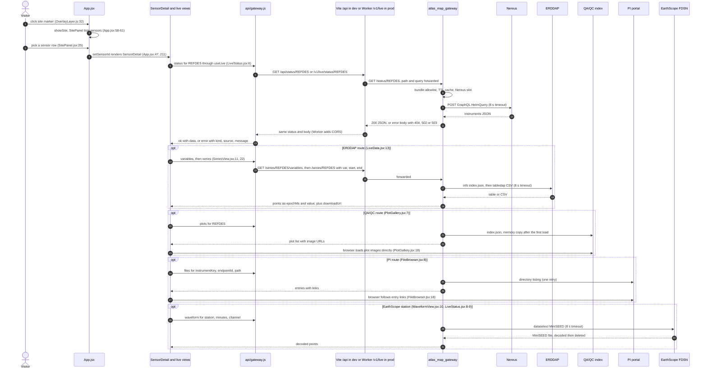

# Live panel flow: selecting a sensor to its live readings

flow: live-panel · as of 1047fc8 · paths are relative to the repo root · checked by reading the code with `git grep`; the app and its tests were not run

Related chapters: [atlas-map-scene](../chapters/atlas-map-scene.md), [atlas-map-panels](../chapters/atlas-map-panels.md), [atlas-map-data](../chapters/atlas-map-data.md), [atlas-map-gateway](../chapters/atlas-map-gateway.md), [ask-atlas](../chapters/ask-atlas.md) (the Worker), [corpus-instruments-ops](../chapters/corpus-instruments-ops.md) (Nereus), [agentic-qaqc](../chapters/agentic-qaqc.md) (QA/QC plots), [coszo-hub-sources](../chapters/coszo-hub-sources.md) (PI portal and EarthScope).

## Summary

The live panel shows current readings for one sensor on the RCA Atlas 3D map. A visitor clicks a site marker, picks a sensor in the site panel, and `SensorDetail` renders a status line plus whichever live views the sensor's bundle record allows: an ERDDAP series (ERDDAP is OOI's public data server), an EarthScope waveform (EarthScope's FDSN seismic service, whose MiniSEED files are binary waveforms), QA/QC plot images, or PI portal file listings. Every request goes through `api()` in `src/atlas_map/src/api/gateway.js`. In development that reaches Vite's `/api` proxy, and in production the Cloudflare Worker's `/v1/live` route. The Worker forwards only allowlisted GET paths to the FastAPI gateway on 127.0.0.1:8787. The gateway accepts only identifiers that appear in the bundle's `sensors.json`, applies TTL (time-to-live) caches and per-source concurrency slots, calls Nereus (instrument status), ERDDAP, the QA/QC index, the PI portal and EarthScope, and returns JSON or a `{error:{source,message}}` body. The client turns each error into a kind (`notfound`, `bad`, `upstream`, `busy`, `timeout` or `unreachable`). No secret is read on this path. The main problems are that the Worker's own errors do not match that error shape (the panel shows "undefined" where the source and message belong), the waveform health route appears to answer 500 on bad input (inferred), and the QA/QC index appears to load once per gateway process and never refresh (F5).

## Sequence

## Hops

### 1. A site marker click opens the site panel

- **Component.** `OverlayLayer` (the DOM markers over the 3D scene) and `App`. See [atlas-map-scene](../chapters/atlas-map-scene.md).
- **Code.** `src/atlas_map/src/overlay/OverlayLayer.js:23` builds one marker per `bundle.sites`; `:32` calls `onSiteClick`. `src/atlas_map/src/App.jsx:97` wires that to `openSite` (`App.jsx:61`), which calls `showSite` (`App.jsx:58-60`). `showSite` clears any open sensor and sets the site. `src/atlas_map/src/data/bundle.js:34-43` loads `sites.json` and `sensors.json`.
- **Data.** A site object from `sites.json` with `id`, `label`, `lon`, `lat`, `sensorIds` and `unlocatedIds` (read at `src/atlas_map/src/panels/SitePanel.jsx:8`, `:33` and `App.jsx:61`).
- **Fails.** No network call here. A missing bundle throws `BundleMissingError` at load (`src/atlas_map/src/data/bundle.js:8-13`, `:18-19`).

### 2. A sensor is picked in the panel

- **Component.** `SitePanel`, `DepthSection` and `App` state.
- **Code.** `src/atlas_map/src/panels/SitePanel.jsx:25` (sensor rows) and `:37` (rows for sensors with no recorded location) call `onSensor(id)`. `src/atlas_map/src/panels/DepthSection.jsx:35` does the same for depth pins. `src/atlas_map/src/App.jsx:240` passes `setSensorId` as `onSensor`; the state is at `App.jsx:47`. `App.jsx:210` reads `bundle.sensorById[sensorId]`. Other entry points: the header search (`App.jsx:223`, `openSensor`, which also flies to the site), the unplaced list (`src/atlas_map/src/panels/UnplacedPanel.jsx:23`), and the browser test hook (`App.jsx:114-115`). The 3D scene has no sensor pick. The only 3D click handler is the Ask Atlas evidence layer (`src/atlas_map/src/scene/EvidenceLayer.js:167`).
- **Data.** A sensor id string. The sensor record is an entry of `sensors.json`.
- **Fails.** An id missing from `bundle.sensorById` renders nothing (`App.jsx:210-211`).

### 3. SensorDetail decides which live sections to show

- **Component.** `SensorDetail`. See [atlas-map-panels](../chapters/atlas-map-panels.md).
- **Code.** `src/atlas_map/src/panels/SensorDetail.jsx:10` marks a sensor as live when it has a route of kind `erddap`, `earthscope`, `qaqc` or `pi_portal`. `:18` always renders `LiveStatus`. `:19` renders `LiveData` when the sensor is live, and `:20` shows a "No live feed" note otherwise.
- **Data.** Route objects from the bundle's `access[]`, built by `src/atlas_map_data/access.py:136-167`. Per kind: `datasetId` (erddap), `refdes` (qaqc), `network`, `station` and `channel` (earthscope), and `instrumentKey` and `endpointId` (pi_portal), each with `url` and `how`. The sensor's status fields are `status`, `statusSource` and `statusAsOf` (`src/atlas_map_data/status.py:30-33`).
- **Fails.** A sensor with no live route gets the static note (`SensorDetail.jsx:20`).

### 4. LiveData chooses the views

- **Component.** `LiveData`.
- **Code.** `src/atlas_map/src/panels/live/LiveData.jsx:13`: an ERDDAP route gives `SeriesView`; otherwise an EarthScope route gives `WaveformView`; otherwise a QA/QC route gives `PlotGallery`. `:14` and `:21-29` add a collapsed `LazyPlots` section, which loads the plots only on first open, when both ERDDAP and QA/QC routes exist. `:15` renders one `FileBrowser` per PI route.
- **Data.** The sensor's `access` routes from hop 3.
- **Fails.** No failure handling of its own. Each view handles its own errors.

### 5. Each view fetches through useLive

- **Component.** `useLive` and the five views. See [atlas-map-panels](../chapters/atlas-map-panels.md).
- **Code.** `src/atlas_map/src/panels/live/LiveStatus.jsx:6` (status), `:8-9` (EarthScope waveform health). `SeriesView.jsx:11` (variables) and `:22` (series). `PlotGallery.jsx:7` (plots). `WaveformView.jsx:10` (waveform). `FileBrowser.jsx:8` (files). `src/atlas_map/src/panels/live/useLive.js:9-28` keeps `{key, state, data, error}`, drops a response that arrives after its key has changed (`:18`), aborts the request on change (`:23`), and bumps a nonce for `retry` (`:25`).
- **Data.** A key such as `status:<refdes>`, and the fetcher's result from hop 6.
- **Fails.** A late response for an old key is dropped (`useLive.js:18`). Retry is manual (`src/atlas_map/src/panels/live/Failure.jsx:6`, `LiveStatus.jsx:15`, `:28`, `:33`).

### 6. The client wrapper builds the URL and maps errors

- **Component.** `api()` and the route wrappers in `src/atlas_map/src/api/gateway.js`. See [atlas-map-panels](../chapters/atlas-map-panels.md) and [atlas-map-scene](../chapters/atlas-map-scene.md).
- **Code.** `gateway.js:2` sets `ATLAS_WORKER`. `:5` picks `${ATLAS_WORKER}/v1/live` when Vite's `import.meta.env.PROD` is true, and `/api` otherwise. `:7-21` is `api()`. `:10` calls `fetch` with the caller's abort signal and no timeout of its own. `:12-15` turn a thrown fetch into `unreachable`. `:17-19` turn a body that is not JSON, or has no `error` field, into `unreachable`. `:18` is success. `:20` is an error: the status goes through the map at `:1` (404 to `notfound`, 422 to `bad`, 502 to `upstream`, 503 to `busy`, 504 to `timeout`, anything else to `upstream`). `:23` builds the query string and drops empty values. `:24-30` are the route wrappers: `GET /status/REFDES`, `GET /series/REFDES/variables`, `GET /series/REFDES` with `var`, `start` and `end`, `GET /plots/REFDES`, `GET /waveform/NET.STA` with `minutes` and `channel`, `GET /waveform/NET.STA/health` with `channel`, and `GET /files/KEY` with `endpoint` and `path`.
- **Data.** Out: `{ok:true, data}`, or `{ok:false, kind, source, message}`. The JSON shapes are in hops 11 to 15.
- **Fails.** An `error` that is a string gives `source` and `message` of `undefined` (`gateway.js:20`; see F1). Statuses outside the map become `upstream`. With no client timeout, the request waits for the proxy or the Worker (30 s in production, hop 7).

### 7. Transport: Vite proxy in development, Worker in production

- **Component.** Vite's dev proxy, and the Worker in `src/atlas_worker/`. See [ask-atlas](../chapters/ask-atlas.md) for the Worker as a whole.
- **Code, development.** `src/atlas_map/vite.config.js:11` proxies `/api` to `http://127.0.0.1:8787` and strips the `/api` prefix. `:20-22` set the dev server to 127.0.0.1:5175 with that proxy.
- **Code, production.** `src/atlas_worker/src/index.js:402` sends `GET /v1/live/*` to `proxyLiveData` (`:41-62`). `:42` returns 503 `{error:"live data service is not configured"}` if `ATLAS_MAP_GATEWAY_ORIGIN` is unset. `:43` strips `/v1/live`. `:39` is the path allowlist regex and `:46` returns 404 `{error:"not found"}` for paths outside it. `:48` fetches the origin with the path and query unchanged. `:49` aborts after 30 s. `:51-58` stream back the status, body and `content-type`, with CORS headers from `:12-22` (`:54`). `:56` defaults `cache-control` to `no-store`. `:59-60` turn any fetch failure into a 503 `{error:{source:"Atlas live data", message}}`. No Origin check applies here: `:404` checks only `POST /v1/answer`.
- **Data.** The path and query are forwarded as the client built them (`index.js:43`, `:48`). The body is the gateway's JSON.
- **Fails.** Unset origin and paths off the allowlist return string-error bodies (F1). A gateway that is down, or slower than 30 s, returns the 503 envelope, which the client shows as `busy` (hop 16). In development, the proxy's response when the gateway is down is not in the repo (open question 2).

### 8. Gateway start-up

- **Component.** `atlas_map_gateway`: FastAPI app, run by uvicorn. See [atlas-map-gateway](../chapters/atlas-map-gateway.md).
- **Code.** `src/atlas_map_gateway/main.py:50-54` builds the app on first access, which is how uvicorn imports `atlas_map_gateway.main:app`. `:39-47` is `build()`: settings from `config.py:37-44` (repo `.env` first, then the environment, `config.py:38`); toolkits from `toolkits.py:20-36` (timeout defaults `:22-25`, temp root `:28-29`, toolkit objects `:31-34`); the bundle index from `bundle_index.py:17-34`, which reads `sensors.json` at `:20`; an ERDDAP client with an 8 s httpx timeout at `main.py:45`. `src/atlas_map_gateway/app.py:41-82` is `create_app`: error handlers (`app.py:51`), one `TTLCache` and one `HostLimiter(4, 8 s)` (`app.py:52-53`, `config.py:16`, `:21`), and the routes (`app.py:56-81`, `routes_data.py:68`).
- **Data.** `Settings` (`config.py:11-21`) and the `BundleIndex` sets of refdes, ERDDAP datasets, EarthScope stations, PI keys and PI endpoints (`bundle_index.py:10-16`).
- **Fails.** A missing `sensors.json` stops the app at start (`bundle_index.py:20`). A missing pymseed breaks only waveform decoding, which then returns 500 (`seismic.py:11-14`).

### 9. Validation and the bundle allowlist

- **Component.** FastAPI parameter checks, the error handlers, and the `BundleIndex` allowlist.
- **Code.** `src/atlas_map_gateway/errors.py:33-36` turns FastAPI validation errors into a 422 envelope with source `atlas`. Allowlist: refdes at `app.py:62-63` and `routes_data.py:105-106`; ERDDAP dataset at `routes_data.py:71-73` and `:82-84`; PI instrument and endpoint at `routes_data.py:119-125`; EarthScope station at `routes_data.py:150-152`. Limits: variable name `routes_data.py:18` and `:85-86`; time range `:87-91` (31 days, `config.py:18`); station format `routes_data.py:146`; minutes 1 to 60 at `routes_data.py:153-154` (`config.py:19`); channel `[A-Z0-9]{3}` at `routes_data.py:53` and `:155-156`.
- **Data.** In: the query and path parameters from hop 6. Out: nothing on success. Rejections come back as error envelopes.
- **Fails.** 422 or 404 before any upstream call. `/waveform/{station}/health` runs these checks through `waveform()`, but mishandles their errors (F2).

### 10. TTL cache and per-source slots

- **Component.** `TTLCache` and `HostLimiter` in `src/atlas_map_gateway/cache.py`.
- **Code.** `cache.py:18-30` is `get_or_set`. It stores only results that return (`:23`), so errors are never cached, and prunes expired entries on write (`:26-28`). `cache.py:38-46` is `HostLimiter.slot`: it waits up to `upstream_timeout` (8 s) for one of four slots per source (`config.py:16`, `:21`, `app.py:53`), then raises `Busy` (`cache.py:41-42`), which becomes 503 `"<source> is busy; try again shortly"` (`errors.py:38-40`). TTLs: status 120 s (`app.py:19`); variables 3600 s, series 300 s, plots 1800 s, waveform 300 s and files 300 s (`routes_data.py:19`). Slot names: `Nereus` (`app.py:66`), `ERDDAP` (`routes_data.py:76`, `:94`), `QA/QC` (`:109`), `PI portal` (`:131`) and `EarthScope` (`:163`). Cache keys look like `status:<refdes>`, `series:<dataset>:<var>:<start>:<end>` and `files:<key>:<endpoint>:<path>`.
- **Data.** Cached values are the response dicts. A `None` result is cached as well: Nereus does not track the sensor, so the 404 is cached for 120 s (`app.py:71-72`, `:78-79`).
- **Fails.** No single flight: concurrent misses all go upstream (`cache.py:18-23`). No size cap, and expiry is pruned only on write (`cache.py:26-28`). Both the cache and the slots live in one process (`app.py:52-53`).

### 11. Nereus: instrument status (`/status/REFDES`)

- **Component.** The status route in `app.py`, the Nereus toolkit in `src/nereus_pipeline/`, and the Hasura GraphQL endpoint. See [corpus-instruments-ops](../chapters/corpus-instruments-ops.md).
- **Code.** `src/atlas_map_gateway/app.py:60-79` is the route. `app.py:67` calls `call_toolkit("Nereus", …)` (`src/atlas_map_gateway/app_support.py:16-29`). `src/nereus_pipeline/nereus_agent_tools.py:156-162` is `instrument_status`; the exact-match filter is in the gateway at `app.py:70`. `nereus_agent_tools.py:132-154` is `inventory`, which keeps Regional Cabled Array instruments only (`nereus_agent_tools.py:136-140`). `nereus_agent_tools.py:93-124` is `execute`: it POSTs the allowlisted `src/nereus_pipeline/queries/HelmQuery.graphql` (read at `nereus_agent_tools.py:80-84`) to `https://nereus.ooirsn.uw.edu/hasura/v1/graphql` (`nereus_agent_tools.py:23`, `:73`, `:102-109`), and keeps a 60 s disk cache (`nereus_agent_tools.py:75`, `:98-101`, `:114-115`).
- **Data.** In: `data.instruments[]` with `designator`, `operationalStatusCode`, and `latestDataStatusConnection.status` with `code`, `checkedAt` and `delay` (`HelmQuery.graphql:12-35`). Out: `{refdes, status, data:{code, checkedAt, delay} or null, evidenceMode, source:"Nereus", sourceUrl}` (`app.py:73-76`). `evidenceMode` is `live` or `live_cache` from the toolkit, mapped to `live`, and `snapshot_fallback` mapped to `snapshot` (`app.py:21`).
- **Fails.** Any exception inside `execute` becomes `{ok:false}` (`nereus_agent_tools.py:117-124`), so a timeout reaches the client as 502 with the raw error text, not 504 (F3). A payload with no `instruments` list gives 502 (`app.py:68-69`). A designator missing from the list gives 404 "does not track" (`app.py:70-72`, `:79`). The snapshot fallback is never used through the gateway (F4).

### 12. ERDDAP: readings (`/series/REFDES/variables`, `/series/REFDES`)

- **Component.** `ErddapClient` in `src/atlas_map_gateway/erddap.py`, called from `routes_data.py`. ERDDAP is OOI's public tabular data server.
- **Code.** `routes_data.py:69-78` (variables) and `:80-101` (series). The dataset id comes only from the bundle (`bundle_index.py:24-25`). `erddap.py:14` is the base URL `https://erddap.dataexplorer.oceanobservatories.org/erddap`. `:26-32` map transport failures, `:34-49` build the variable list, `:51-53` build the CSV URL, and `:55-77` parse the CSV. `:71-72` skip NaN rows and `:75` converts times to epoch milliseconds. `thinning.py:6-20` keeps each bucket's min and max, capped at 2,000 points (`config.py:20`).
- **Data.** Variables: `{variables:[{name, units, longName}], coverage:{start, end}}` (`erddap.py:46-49`). Series: `{refdes, var, units, points:[[epochMs, value]], rawCount, downloadUrl, message}` (`routes_data.py:97-100`).
- **Fails.** A timeout gives 504 (`erddap.py:29-30`). Other transport errors and non-200 responses give 502 (`erddap.py:31-32`, `:37`, `:60`). A CSV header that does not match gives 502 (`erddap.py:62-63`). A 404 with "no matching results" gives an empty series (`erddap.py:57-58`).

### 13. QA/QC plots (`/plots/REFDES`)

- **Component.** `QAQCToolkit.search_plots` in `src/agentic_qaqc/qaqc_agent_tools.py`, called from `routes_data.py`. See [agentic-qaqc](../chapters/agentic-qaqc.md).
- **Code.** `src/atlas_map_gateway/routes_data.py:103-115` is the route: `call_toolkit("QA/QC", …)` at `:110`, exact refdes match at `:114`, field renames at `:111-113`. `src/agentic_qaqc/qaqc_agent_tools.py:115-157` is `search_plots`; it reads the index at `:136`, builds each plot URL at `:142`, and returns at `:157`. `:69-88` is `get_index`: the memory copy at `:70-71`, the disk copy at `:72-74` (the file is `:54`), the HTTP fetch at `:75-81`, and the stale fallback at `:83-86`. The index is `https://ec2.qaqc.ooi-rca.net/QAQC_plots/index.json` (`:31-32`, `:53`). Filename parsing for the fields the route uses is at `:102-112`.
- **Data.** Out: `{refdes, plots:[{variable, timeSpan, overlay, dataRange, depth, url}]}` (`routes_data.py:111-114`). Each `url` points at `https://ec2.qaqc.ooi-rca.net` (`qaqc_agent_tools.py:142`).
- **Fails.** Index unreachable with no disk copy: an exception, which becomes 502, or 504 on a timeout (`app_support.py:21-24`). Index unreachable with a disk copy: old data with no flag (`qaqc_agent_tools.py:83-86`, `:157`; F5). The index is read once per process (F5). A plot record missing a field raises `KeyError` outside `call_toolkit`, which would be 500 (`routes_data.py:111-113`; inferred from code).

### 14. PI portal listings (`/files/KEY`)

- **Component.** `PIPortalToolkit.browse` in `src/coszo_hub_tools/pi_portal_agent_tools.py`, called from `routes_data.py`. See [coszo-hub-sources](../chapters/coszo-hub-sources.md). PI is principal investigator: the RCA PI portal is a public directory of instrument data at `piweb.ooirsn.uw.edu`.
- **Code.** `src/atlas_map_gateway/routes_data.py:117-142` is the route. It maps the bundle's endpoint id to the toolkit's id by URL (`:121-126`, `:45-50`) and calls `browse` with limit 5,000 (`:132`). `pi_portal_agent_tools.py:508-530` is `browse`; `:336-349` resolves the endpoint; `:350-371` resolves the path, decoding up to three times and rejecting `..`, absolute and empty segments; `:411-423` is `_http`, which retries once (`toolkits.py:25`); `pi_portal_agent_tools.py:383-410` is `_http_once` (`urlopen` at `:393`, URL errors wrapped at `:408-409`); `:314-322` is `_approved_url`, which allows only `piweb.ooirsn.uw.edu` (`:33`); `:467-472` builds the entries. `routes_data.py:58-65` sorts newest first, `:139` keeps 200, and `:134-141` sets the truncation message.
- **Data.** In: the `path` query value and the endpoint id from the bundle (`bundle_index.py:30-33`). Out: `{instrumentKey, endpointLabel, path, sourceUrl, entries:[{name, kind, path, url, date}], truncated, message}` (`routes_data.py:137-141`; entry shape `:58-61`).
- **Fails.** Unknown instrument or endpoint: 404 (`routes_data.py:119-125`). Several endpoints and none given: 422 (`:127-128`). A bad path: 422 (`pi_portal_agent_tools.py:360-371`, mapped by `app_support.py:19-20`). A missing directory: 502 "PI portal directory was not found" (`pi_portal_agent_tools.py:514`). An HTTP 5xx: 502 after the retry. A listing over 10 MiB (`pi_portal_agent_tools.py:306`, used at `:512`): 502 after the retry. A read timeout: 504. A connect timeout: 502 (F3). More than 5,000 upstream entries: `message` set (`routes_data.py:134-141`).

### 15. EarthScope waveforms (`/waveform/NET.STA`, `/waveform/NET.STA/health`)

- **Component.** `EarthScopeFDSNToolkit` in `src/coszo_hub_tools/earthscope_fdsn_agent_tools.py`, the decoder in `src/atlas_map_gateway/seismic.py`, and the route in `routes_data.py`. See [coszo-hub-sources](../chapters/coszo-hub-sources.md). FDSN is the international seismic web-service standard.
- **Code.** `src/atlas_map_gateway/routes_data.py:144-181` is the route: checks at `:146-157`, a window that ends two minutes ago at `:158-160`, the slot and the no-data branch at `:163-170`, decode and cleanup at `:171-175`, thinning and output at `:176-180`. `earthscope_fdsn_agent_tools.py:185-198` is `plan_waveform`, which caps requests at 24 h (`:188`) and sets `nodata=404` (`:194`). `:283-301` is `download_waveform`: a 404 becomes `no_data` (`:287-288`), and a 200 is saved under the request directory (`:296`) and returned as `{ok, file, source_url, …}` (`:301`). `:131-155` is `_http`, where a URL error becomes `EarthScopeError` (`:154-155`). `:84-90` allows only `service.earthscope.org`, `*.earthscope.org` and `service.iris.edu`, over https. The service is `https://service.earthscope.org/fdsnws/dataselect/1/query` (`:27`, `:29`). `:248-251` and `:260-277` are the request directory and the file write. `src/atlas_map_gateway/seismic.py:7-24` decodes the MiniSEED file, and `:27-37` deletes the request folder only if it sits under `<root>/requests/`.
- **Data.** Out: `{station, channel, rate, points:[[epochMs, counts]], rawCount, sourceUrl, message}` (`routes_data.py:178-180`). The health route returns `{station, channel, recording, checkedAt, message}` (`routes_data.py:191-194`).
- **Fails.** Bad station, minutes or channel: 422 (`routes_data.py:146-156`). Unknown station: 404 (`:150-152`). No data: an empty result with "No recording in this window." (`:166-169`), matched by the text "no waveform data" (`:167`). A URL error: `EarthScopeError`, which becomes 502 (`earthscope_fdsn_agent_tools.py:154-155`). Missing pymseed: 500 (`seismic.py:11-14`). The health route's error path: F2.

### 16. The panel renders the response

- **Component.** `LiveStatus`, `Failure`, and the view components. See [atlas-map-panels](../chapters/atlas-map-panels.md).
- **Code.** `src/atlas_map/src/panels/live/LiveStatus.jsx:17-33`: a snapshot line when there is no refdes or no request yet (`:17`); "checked live" or "from Nereus snapshot" from `evidenceMode` (`:22-23`); "Live data unavailable" with the bundle's snapshot date when the request is unreachable (`:26-28`); "not tracked live by Nereus" for a Nereus 404 (`:30-31`); otherwise "source failed: message" with Retry (`:33`). `src/atlas_map/src/panels/live/Failure.jsx:2-8` renders errors for the other views (its unreachable text is at `:5`). Views: the series chart and CSV link (`SeriesView.jsx:57-58`), the plot images (`PlotGallery.jsx:18`), the file list with its truncation note (`FileBrowser.jsx:15-20`), and the waveform chart (`WaveformView.jsx:18-21`).
- **Browser requests that skip the gateway.** Plot images load from `ec2.qaqc.ooi-rca.net` (`PlotGallery.jsx:18`). PI file links open on `piweb.ooirsn.uw.edu` (`FileBrowser.jsx:18`). The ERDDAP CSV download link goes straight to ERDDAP (`SeriesView.jsx:58`, from `downloadUrl` at `routes_data.py:99`).
- **Fails.** "Live data unavailable" appears only when the browser cannot reach the Worker at all. A gateway outage reaches the panel as `busy`, with the Worker's message (`src/atlas_worker/src/index.js:59-60`).

## Findings

Each finding is confirmed in the code. Items marked "inferred" were not run.

- **F1. The Worker's own errors do not match the client's error shape.** `src/atlas_worker/src/index.js:42` and `:46` return `{error:"<string>"}`. `src/atlas_map/src/api/gateway.js:19-20` reads `data.error.source` and `data.error.message`, which are both `undefined` for a string. `Failure.jsx:5` and `LiveStatus.jsx:31` then render "undefined: undefined", and `LiveStatus.jsx:33` renders "undefined failed: undefined". The trigger is an unset `ATLAS_MAP_GATEWAY_ORIGIN` (503) or a path off the allowlist (404). Nothing tests it: `src/atlas_map/src/api/gateway.test.js:10-16` and `src/atlas_map/e2e/mocks.js:30` use only the envelope, and no test calls `/v1/live`. The [atlas-map-panels](../chapters/atlas-map-panels.md) error table (its line 227) does not cover this case.
- **F2. `/waveform/{station}/health` returns 500 on bad input.** `src/atlas_map_gateway/routes_data.py:191` calls `waveform()`, which returns `JSONResponse` objects on its early exits (`:147-148`, `:152`, `:156`). `:192` then reads `data["station"]`, which raises `TypeError`. The catch-all turns that into 500 `internal error` (`errors.py:42-46`). The expected answers are 422 or 404. The panel never sends these values, so this is reachable only by direct requests (inferred; confirm by requesting `/waveform/XX.YYY/health` on a running gateway). `src/atlas_map_gateway/tests/test_waveform.py:57-62` covers success only.
- **F3. Timeouts are not consistently 504.** For Nereus, `nereus_agent_tools.py:117-124` turns a timeout into `{ok:false}`, so the client gets 502 with the raw error text, for example "timed out" (`app_support.py:25-28`). For the PI portal and EarthScope, `pi_portal_agent_tools.py:408-409` and `earthscope_fdsn_agent_tools.py:154-155` wrap connect timeouts as `PIPortalError` and `EarthScopeError`, which `_is_timeout` (`app_support.py:10-13`) does not recognise, so they are 502. A read timeout is raised raw and becomes 504 (inferred).
- **F4. The gateway never receives a Nereus snapshot.** `src/atlas_map_gateway/toolkits.py:31` builds `NereusToolkit(timeout=t)` without `snapshot_dir`, and `nereus_agent_tools.py:76` then leaves it None, so `:119-123` never runs. Only `src/nereus_pipeline/mcp_server.py:16` reads `NEREUS_SNAPSHOT_DIR`. The "from Nereus snapshot" text (`LiveStatus.jsx:23`) and `app.py:21` suggest the snapshot path is live. [atlas-map-gateway](../chapters/atlas-map-gateway.md) lists `snapshot` as a status value without this caveat. (Inferred from configuration; confirm.)
- **F5. The QA/QC plot index never refreshes within a gateway process.** `src/agentic_qaqc/qaqc_agent_tools.py:70-71` returns `_index_memory` whenever it is set. Only `force_refresh=True` skips it, and only the health check uses that (`:315`). The gateway's single `QAQCToolkit` (`toolkits.py:32`) calls `search_plots` without it (`routes_data.py:110`; `qaqc_agent_tools.py:136`). The disk TTL (`:50`, 900 s) applies only before the memory copy is set (`:72`). New plots would appear only after a restart (inferred; not run). A QA/QC outage serves the disk copy with no flag (`:83-86`, `:157`).

## Config and secrets

| Name | Read at | Purpose | Required or default |
|---|---|---|---|
| `import.meta.env.PROD` (set by Vite at build) | `src/atlas_map/src/api/gateway.js:5` | Chooses the Worker `/v1/live` (built site) or `/api` (dev server) | Build-time |
| `ATLAS_WORKER` (constant) | `gateway.js:2` | Public Worker URL, not a secret | Fixed in code |
| `ATLAS_BUNDLE_DIR` | `src/atlas_map_gateway/config.py:43` | Folder holding `sensors.json`, the gateway's allowlist | Default `src/atlas_map/public/atlas`. Build the bundle first (`src/atlas_map/README.md:5-6`) |
| `ATLAS_API_URL`, `ATLAS_API_KEY`, `GRAPHRAG_API_PORT`, `GRAPHRAG_API_KEY` | `config.py:39-42` | Graph-RAG chat only (`main.py:18`) | Not used by the live routes |
| `PI_PORTAL_TIMEOUT_SECONDS`, `EARTHSCOPE_TIMEOUT_SECONDS`, `PI_PORTAL_MAX_RETRIES` | `toolkits.py:22-25`, set only if absent | Toolkit timeouts (8 s) and one retry | Gateway defaults |
| `EARTHSCOPE_RUNTIME_ROOT` | Set at `toolkits.py:29`, read at `earthscope_fdsn_agent_tools.py:77` | Temp root for MiniSEED files, removed at shutdown (`main.py:47`) | Always set by the gateway |
| `PI_PORTAL_MAX_INDEX_BYTES`, `PI_PORTAL_RETRY_BACKOFF_SECONDS` | `pi_portal_agent_tools.py:306`, `:310` | Listing size cap (10 MiB) and retry backoff (0.5 s) | Toolkit defaults; the gateway does not set them |
| `EARTHSCOPE_MAX_REQUEST_HOURS`, `EARTHSCOPE_MAX_DOWNLOAD_BYTES` | `earthscope_fdsn_agent_tools.py:78-79` | 24-hour and 512 MiB limits | Toolkit defaults |
| `ATLAS_MAP_GATEWAY_ORIGIN` | `src/atlas_worker/src/index.js:42`, `:48` | Origin of the gateway for the Worker's `/v1/live` proxy | Required in production. It is absent from `src/atlas_worker/wrangler.toml:7-22` and from the Worker README, and documented only for local `.dev.vars` (`src/atlas_map/README.md:26-27`) |
| `ALLOWED_ORIGIN` | `src/atlas_worker/src/index.js:13`; `wrangler.toml:8` | CORS origin | Defaults to `https://coszo.org` in code |
| Fixed limits | `config.py:16-21` | 8 s per upstream call, 60 s chat, 31 days, 60 minutes, 2,000 points, 4 per source | Not read from the environment |

**Secrets:** none on the live path. The Worker secrets listed in `src/atlas_worker/wrangler.toml:14-22` serve Ask Atlas, and the live route reads only `ATLAS_MAP_GATEWAY_ORIGIN`. The gateway's `ATLAS_API_KEY` (`config.py:42`) is read only by `/chat` (`main.py:18`). Every upstream is public and unauthenticated: ERDDAP (`erddap.py:1`), the PI portal (`pi_portal_agent_tools.py:4`), EarthScope (`earthscope_fdsn_agent_tools.py:160`), Nereus (`nereus_agent_tools.py:102-107`, no credentials sent) and the QA/QC index (`qaqc_agent_tools.py:61-63`, no credentials sent).

**Runtime files:** the Nereus disk cache (`nereus_agent_tools.py:75`) and the QA/QC index file (`qaqc_agent_tools.py:54`) both sit in the system temp folder. EarthScope MiniSEED files go to a per-start temp root (`toolkits.py:28`), and each request folder is deleted after decoding (`routes_data.py:173-175`).

## Not on this path

The gateway's `POST /chat` route (`routes_data.py:196-202`) is not part of the live panel. No live panel calls it. The Ask Atlas path is covered in [ask-atlas](../chapters/ask-atlas.md).

## Open questions

1. **Which host runs the gateway behind `ATLAS_MAP_GATEWAY_ORIGIN`, and is the value a secret?** The repo does not say (`src/atlas_worker/src/index.js:42`, `src/atlas_worker/wrangler.toml:7-22`, `src/atlas_worker/README.md:14-21`). The Worker deployers are named in `docs/superpowers/specs/2026-09-24-ask-atlas-evidence-design.md:152`.
2. **What does the Vite dev proxy return when the gateway is down?** `gateway.js:17-19` treats any non-JSON body as "not running". Vite's error response is not in the repo (`src/atlas_map/vite.config.js:11`). Answer: stop the gateway, run `npm run dev`, and load the site.
3. **Is it intended that Nereus snapshots never reach the gateway (F4)?** The decision is at `src/atlas_map_gateway/toolkits.py:31`. Answer from the gateway's owner.
4. **Should the QA/QC index refresh, and on what schedule (F5)?** `qaqc_agent_tools.py:50` sets a 900 s TTL, but the memory copy ignores it. Answer from the toolkit's owner.
5. **Which status should a timeout produce, 502 or 504 (F3)?** Answer from the gateway's owner. The change would touch `app_support.py:10-28` and the Nereus wrapper at `nereus_agent_tools.py:117-124`.
6. **Should `/v1/live` check the Origin or rate-limit requests?** It has no Origin check (`src/atlas_worker/src/index.js:402`), and the Worker README asks for a rate limit only on `POST /v1/answer` (`src/atlas_worker/README.md:25-26`). Answer from the Worker's owner.
7. **Is `npm run preview` meant to reach the Worker?** `package.json` builds with `vite build` and previews the output (`src/atlas_map/package.json:8-9`). In that output `import.meta.env.PROD` is true, so the preview proxy at `src/atlas_map/vite.config.js:24` is not used for live data (inferred from Vite's `PROD` behaviour). Answer from the site's owner.
8. **Do all bundle refdes match the Worker's pattern `[A-Z0-9-]+` (`index.js:39`)?** The bundle builder does not check refdes format (there is no such regex in `src/atlas_map_data/`), and the corpus is absent from this checkout. Answer by checking `sensors.json` after a build.
9. **Is the match on "no waveform data" (`routes_data.py:167`) an intended contract with the toolkit (`earthscope_fdsn_agent_tools.py:288`)?** A shared constant would remove the coupling. Answer from the toolkit's owner.
10. **Can a PI listing exceed 10 MiB?** Answer by checking the largest folder against `pi_portal_agent_tools.py:306`.
