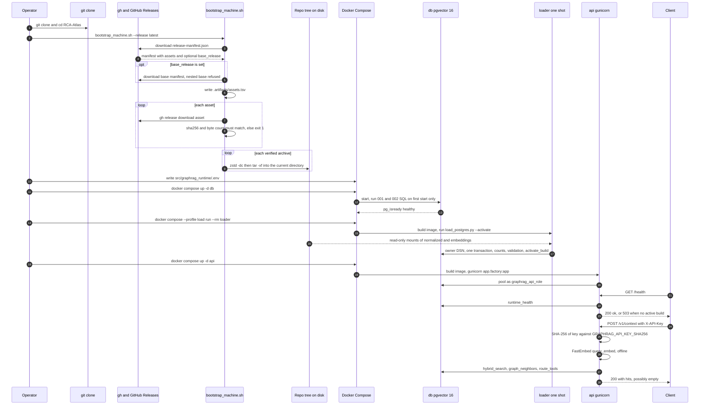

# restore-and-run: a fresh clone to an authenticated Graph-RAG answer

flow: restore-and-run · as of 1047fc8 · read from the code and from Docker's documentation, not run. The release assets are not on this host, and `docker compose` is not installed here (`docker compose version` returns "unknown command"). The tracked status note says the PostgreSQL load was `not_run` on 2026-09-20 (`runtime_data/GraphRAG/deployment_status.json:22-25`), so no end-to-end run is on record.

## Summary

A new machine goes from a fresh clone to an authenticated answer from the Graph-RAG API in four stages. `scripts/bootstrap_machine.sh` downloads the manifest of the private GitHub Release, fetches each archive, checks its size and SHA-256 (a hash that proves the file is intact) against the manifest, and extracts it into the current directory. That leaves the normalized build and its vectors under `runtime_data/GraphRAG/` ([repo-ops-data](../chapters/repo-ops-data.md)). Docker Compose in `src/graphrag_runtime/` then starts PostgreSQL 16 with the pgvector extension (`db`), runs a one-shot `loader` that checks the build, loads it in one transaction and activates it, and starts `api`. `api` is a Gunicorn and FastAPI service that reads only through four SQL functions, as a restricted role ([graphrag-runtime](../chapters/graphrag-runtime.md)). Every server-side secret comes from `src/graphrag_runtime/.env`, which Compose reads for substitution and does not hand to containers as a file. The GitHub login and the client key live outside it. The API stores only the SHA-256 digest of the client key, so `POST /v1/context` with an `X-API-Key` header returns the hits, graph neighbors and tool hints from the active build. Three points need attention. The README copies `.env` to the repository root, where Compose does not look by default. A database with no active build answers `/v1/context` with 200 and empty hits, so a status-only check passes on an empty database. Nothing in the repository runs the validation SQL.

## Sequence

## Hops

### 1. Fresh clone

- **Component:** git, and the RCA-Atlas repository.
- **Where:** `README.md:16-17`.
- **Data passed:** the source tree, `.env.example` and the tracked control files. The corpus is not in Git. It is held as private release assets (`README.md:6-9`), so `git ls-files runtime_data` lists only `deployment_status.json` and `README.md`.
- **Can fail:** no Git access. Cloning does not grant access to the release, which needs a GitHub login that can read it (hop 2).

### 2. Restore release assets (`scripts/bootstrap_machine.sh`)

- **Component:** `scripts/bootstrap_machine.sh`, run from the repository root (`README.md:18`). The default release is `latest` (`bootstrap_machine.sh:4`).
- **Where:** arguments `:8-15`; required tools `:17-19`; repository `:5`, `:21-25`; manifest `:27-32`; base release `:34-49`; `assets.tsv` `:51-60`; download and check `:62-74`; extraction `:76-79`; closing message `:81`.
- **Data passed:**
  - `release-manifest.json`, written by `scripts/build_transfer_release.sh:55-61`. It holds `schema_version`, `created_at_utc`, `catalog_fingerprint_sha256` (base release only), `assets` (a list of `{name, bytes, sha256}`) and `restore_root`. An overlay manifest also has `base_release`, a release tag (`scripts/build_runtime_overlay_release.sh:35`).
  - `.artifacts/assets.tsv`: one tab-separated line per asset, base release first. The columns are the tag or `latest`, the file name, the SHA-256 and the byte count (`bootstrap_machine.sh:51-60`).
  - Three base archives, each named with the first 12 characters of the catalog fingerprint (`build_transfer_release.sh:12-13`, `:22`). `rca-corpus-data` holds `data/`. `rca-source-material` holds `source_material/` plus three `src/` snapshot paths (`:33-36`). `rca-runtime-data` holds `runtime_data/` minus the excluded paths (`:24-28`, `:37`). This flow uses only `runtime_data/GraphRAG/normalized/` and `runtime_data/GraphRAG/embeddings/`, which Compose mounts (`src/graphrag_runtime/compose.yaml:36-37`). The collections behind them come from the collection chapters: [corpus-docs-web](../chapters/corpus-docs-web.md), [corpus-instruments-ops](../chapters/corpus-instruments-ops.md), [literature-corpus](../chapters/literature-corpus.md), [axial](../chapters/axial.md) and [coszo-hub-core](../chapters/coszo-hub-core.md).
  - The overlay `rca-literature-fulltext-YYYYMMDD` holds the literature full-text cache (`scripts/build_runtime_overlay_release.sh:21`). It is restored when the manifest names it, and this flow does not use it ([literature-fulltext](../chapters/literature-fulltext.md)).
  - Archives exclude `.env` and `.env.*` (`build_transfer_release.sh:25`), so no `.env` comes back with the restore. The script never reads or creates `.env`.
  - Extraction target: the current directory (`bootstrap_machine.sh:6`, `:78`).
- **Can fail:**
  - `gh`, `zstd` or `python3` is missing: exit 1 (`:17-19`). Docker and `sha256sum` are not checked, although the script calls `sha256sum` at `:68`. The README lists Docker but not python3 or sha256sum (`README.md:13`).
  - `gh` is not logged in, or its login cannot read the repository's releases: `gh release download` fails, and `set -eu` (`:2`) stops the run (`:29`, `:31`, `:42`, `:64-66`). The script reads no token itself. The operator needs `gh auth login`, or a token in the environment that `gh` reads.
  - A nested base release is refused (`:48`).
  - An integrity mismatch exits 1 (`:70-72`). (inferred) On a Mac without `sha256sum`, `:68` fails and the script then reports "Integrity check failed" for the wrong reason. This host resolves `sha256sum` to `/sbin/sha256sum` (checked with `command -v`), so it cannot show that failure. Stock macOS ships `shasum` (here at `/usr/bin/shasum`). That is general knowledge, not checked on a clean Mac.
  - `--release latest` is resolved again for each asset (`:28-32`, `:63-67`). A release published during the restore fails the hash check ([repo-ops-data](../chapters/repo-ops-data.md) Gotcha 4).
  - Extraction replaces files at the same paths without a check (`:78`), and it runs in whatever directory the operator is in (`:6`, `:78`) ([repo-ops-data](../chapters/repo-ops-data.md) Gotchas 1-2).
  - The pipeline `zstd -dc ... | tar -xf -` (`:78`) runs without `pipefail`, because `:2` sets only `-eu`. A zstd failure can therefore be hidden behind tar's exit status (inferred from POSIX shell pipeline rules).
- The closing message points to `src/graphrag_runtime/README.md` (`bootstrap_machine.sh:81`). That README has the `.env` problem in hop 3.

### 3. Compose environment file (`.env`)

- **Component:** Docker Compose, which reads `.env` from its project directory. The operator creates the file.
- **Where:** the instructions are in `src/graphrag_runtime/README.md:25-34`, and the copy command is at `:32`. The variable names are in `.env.example:1-22`. The required values are checked at `src/graphrag_runtime/compose.yaml:7-8`, `:21-22` and `:33-34`.
- **Where the file must live:** `src/graphrag_runtime/.env`. Docker's documentation puts `.env` in the project directory, next to `compose.yaml`. The project directory is set by `--project-directory`, or otherwise by the directory of the first Compose file, which here is `src/graphrag_runtime/` (Docker's variable-interpolation page and CLI reference, read 2026-10-09; not run). The README's `cp ../../.env.example ../../.env` (`src/graphrag_runtime/README.md:32`) writes to the repository root, which a default run does not read. `docker compose --env-file ../../.env` would point Compose at that file, but the README does not say so.
- **Data passed:** `NAME=value` lines. Compose substitutes `${NAME:?message}` and `${NAME:-default}` into `compose.yaml`. Both forms treat an empty value as unset. So `:?` stops the run on the empty values that `.env.example` ships, and `:-` falls back to its default (Docker's documentation).
- **What receives the values:** Compose substitutes values only where `compose.yaml` names them. No service uses `env_file:` (none appears under `src/graphrag_runtime/`), so a container sees a variable only through its own `environment:` block. The table in Config and secrets lists each service's variables. `src/graphrag_runtime/.dockerignore:4` keeps `.env` out of the image build.
- **Other reader:** the atlas gateway reads the root `.env` on its own (`src/atlas_map_gateway/config.py:38`; [atlas-map-gateway](../chapters/atlas-map-gateway.md)). It is not part of Compose.
- **Can fail:**
  - `.env.example` copied unchanged: `POSTGRES_PASSWORD`, `GRAPHRAG_API_DATABASE_PASSWORD` and `GRAPHRAG_API_KEY_SHA256` stay empty, so Compose stops with the messages in `compose.yaml:7-8` and `:22`.
  - `.env` at the repository root, as the README instructs: a default run from `src/graphrag_runtime/` reports the same missing-variable messages. The README's check, `docker compose config --quiet` (`src/graphrag_runtime/README.md:98`), would fail there.
  - An empty `GRAPHRAG_API_PORT` or `GEMINI_API_KEY` is harmless. Their defaults apply (`compose.yaml:23`, `:26`).
  - Passwords are written unencoded into connection strings (`compose.yaml:21`, `:33-34`). A password with URL-reserved characters such as `@`, `:` or `/` breaks the connection (inferred; not tested).

### 4. Database start and init SQL (`db`)

- **Component:** PostgreSQL 16 with pgvector, from the image `pgvector/pgvector:pg16` (`src/graphrag_runtime/compose.yaml:2-3`).
- **Where:** service `compose.yaml:2-17`; named volume `pgdata` at `:10` and `:40-41`; init files at `:11-12`; healthcheck at `:13-17`. The SQL is in `src/graphrag_runtime/migrations/001_initial.sql` and `002_local_api_role.sql`.
- **Data passed:** Compose sets `POSTGRES_DB=graphrag` and `POSTGRES_USER=graphrag_owner` (`compose.yaml:5-6`), `POSTGRES_PASSWORD` (`:7`) and `GRAPHRAG_API_DATABASE_PASSWORD` (`:8`). The two SQL files are mounted read-only into the image's init directory (`:11-12`).
  - `001_initial.sql` is one transaction (`:1`, `:367`). It creates the `vector` extension (`:3`), the `graphrag` and `graphrag_api` schemas (`:4-5`), the tables (`:11-196`), the functions `runtime_health`, `activate_build`, `hybrid_search`, `graph_neighbors` and `route_tools` (`:198-359`), and then revokes public access (`:361-365`).
  - `002_local_api_role.sql` creates `graphrag_api_role`, with the password read from the environment (`:3-7`). It sets `CONNECTION LIMIT 20` (`:12-13`). It grants `CONNECT`, schema `USAGE`, and `EXECUTE` on the four API functions only (`:14-20`). It makes API transactions read-only and sets a 5 s statement timeout (`:22-23`).
- **Can fail:**
  - A missing password stops Compose before the container starts (`compose.yaml:7-8`).
  - If `GRAPHRAG_API_DATABASE_PASSWORD` is empty or absent inside the container, `002` quits without an error (`002_local_api_role.sql:8-9`). The API role is never created, and the API fails when it connects.
  - The init scripts run only when `pgdata` is created for the first time (`compose.yaml:9-12`; the official image's behavior, inferred). A password changed in `.env` later does not change the existing role, so `loader` and `api` fail to authenticate (inferred).
  - A SQL error in `001` leaves the healthcheck failing (`compose.yaml:13-17`). `api` waits for `db` to be healthy (`:27-28`), so it does not start (inferred from Compose's `service_healthy` condition).
  - No port is published for `db`, since it has no `ports:` key (`compose.yaml:2-17`). Host tools cannot reach PostgreSQL. That conflicts with the README's manual load path (`src/graphrag_runtime/README.md:60-61`), as open question 3 explains.
  - The healthcheck runs `pg_isready`, PostgreSQL's readiness probe, as the owner role (`compose.yaml:14`).

### 5. Loader (`loader`, profile `load`)

- **Component:** the `loader` service. It is built from the same `Dockerfile` and runs `load_postgres.py` as the `api` user (`compose.yaml:29-31`, `:34`; `Dockerfile:11`).
- **Where:** service `compose.yaml:29-39`; command `:34`; mounts `:35-37`; `load_postgres.py:30-193` (`main` at `:196-204`).
- **Data passed:**
  - Read-only mounts: `../../runtime_data/GraphRAG/normalized` at `/corpus/normalized`, and `../../runtime_data/GraphRAG/embeddings` at `/corpus/embeddings` (`compose.yaml:36-37`). From `src/graphrag_runtime/`, `../../` is the repository root. Both directories come from `rca-runtime-data` (hop 2).
  - Normalized directory, written by `normalize_corpus.py:335-373`. It holds eleven JSONL files and `build_manifest.json`. The manifest holds `schema_version`, `build_id`, `catalog_fingerprint_sha256`, `created_at_utc`, `counts`, `assertions` and `passed` (`:368-372`). Every JSONL row carries `build_id`. Each field the loader reads (`load_postgres.py:65-133`) is written by the normalizer; I checked the names against `normalize_corpus.py:200-355`. The loader does not read `corpus_catalog.json`.
  - Embedding directory, written by `build_embeddings.py:342-355`. It holds `embeddings.npy`, a float32 matrix with one 384-value row per record (`:274-277`). It holds `embedding_rows.jsonl`, one object per row with `row_index`, `collection_id`, `chunk_id` and `text_sha256` (`:56-65`). It holds `embedding_manifest.json`, with `model_id` = `BAAI/bge-small-en-v1.5` (`:344`), `model_revision`, `model_artifact_sha256`, `normalized`, `matrix_file` and `mapping_file` (`:345-348`).
  - The DSN is in the command line: `postgresql://graphrag_owner:<POSTGRES_PASSWORD>@db:5432/graphrag` (`compose.yaml:34`). `DATABASE_URL` (`:33`) is never read, because `load_postgres.py` reads no environment variable.
- **What the loader does** (all in `load_postgres.py`):
  - It checks that `passed` is true and that `build_id` equals `catalog_fingerprint_sha256` (`:38-43`). Both values come from the same manifest, so this compares the file with itself. The normalizer sets both from one fingerprint (`normalize_corpus.py:176-179`, `:369`).
  - It runs one psycopg transaction (`:46`), with a 10-minute statement timeout (`:49`) and an advisory lock (`:50`).
  - It inserts the `corpus_builds` row with `validation_passed=false` (`:51-56`). Table inserts use `ON CONFLICT DO NOTHING` (`:65-133`).
  - With `--embeddings`, it checks the matrix shape and that the mapping has `counts.chunks` rows (`:137-148`), then inserts the vectors (`:149-154`).
  - It compares nine table counts with the manifest (`:156-170`). It compares the embedding count and each text hash with its chunk (`:171-189`).
  - It sets `validation_passed=true` (`:190`), calls `graphrag.activate_build` (`:191-192`), and commits when the `with` block exits (`:46`).
- **Can fail:**
  - A count, hash or shape mismatch raises `ValueError` and rolls back the whole load (`:141`, `:147`, `:169-170`, `:181-189`). The rollback comes from psycopg 3's context manager (inferred; not run).
  - Missing manifests: an absent `build_manifest.json` or `embedding_manifest.json` raises before any write (`:38`, `:137`). A missing host directory may be created empty by Docker for a short-form bind mount, and the load then fails on the missing file (inferred).
  - `--embeddings` is optional on the command line (`:200`). The vector insert and its checks run only when it is given (`:135`, `:171`). But `validation_passed=true` (`:190`) and activation (`:191-192`) run either way. A manual load without embeddings therefore activates a build that `/health` reports as not ready (`001_initial.sql:198-212`). Compose passes `--embeddings` (`compose.yaml:34`).
  - Nothing compares the `catalog_fingerprint_sha256` in `embedding_manifest.json` with the build. The per-chunk text-hash check (`load_postgres.py:171-189`) is the only cross-check (open question 7).
  - `db` must be healthy (`compose.yaml:38-39`). A password changed after the first start fails authentication (hop 4).
  - The image build needs network access for pip packages (`Dockerfile:5-6`) and for the model download (`:7`), and that download has no hash check.
  - Rootless Docker hosts need `compose.rootless.yaml`, which sets host networking for the build (`src/graphrag_runtime/compose.rootless.yaml:4-12`; `src/graphrag_runtime/README.md:81-88`).

### 6. Activation and readiness

- **Component:** the PostgreSQL functions in `graphrag` and `graphrag_api` (`001_initial.sql`).
- **Where:** `activate_build` at `:214-235`; the `active_corpus` pointer at `:20-23`; `runtime_health` at `:198-212`.
- **Data:** `graphrag.active_corpus` is a one-row pointer to a `build_id` (`:20-23`). `runtime_health()` returns `ready`, `build_id`, `chunk_count` and `embedding_count` for the active build (`:198-212`). `ready` is true only when the build has chunks and every chunk has one embedding (`:211`). With no active build, the function returns no rows (`:204`).
- **Can fail:** `activate_build` raises when the build is missing or not validated (`:228-230`). The pointer swap runs under an advisory lock (`:223`, `:231-233`). `runtime_health` runs with a 2 s timeout (`:202`).

### 7. API start (`api`)

- **Component:** the `api` service, from the same image as the loader. It runs Gunicorn with two Uvicorn workers (`Dockerfile:13`).
- **Where:** service `compose.yaml:18-28`; app construction at import, `app/factory.py:1-3` calling `app/main.py:24-33`; settings `app/config.py:19-34`.
- **Data passed (from `compose.yaml`):**
  - `DATABASE_URL`, which is `postgresql://graphrag_api_role:<GRAPHRAG_API_DATABASE_PASSWORD>@db:5432/graphrag` (`:21`).
  - `GRAPHRAG_API_KEY_SHA256` (`:22`): comma-separated SHA-256 digests of accepted client keys. The code lowercases them and requires 64 hex characters (`app/config.py:20-24`).
  - `GEMINI_API_KEY` (`:23`, optional), `GRAPHRAG_ANSWER_MODEL` (`:24`, default `gemini-2.5-flash`), and `GRAPHRAG_STATEMENT_TIMEOUT_MS: "4000"` (`:25`). The timeout is a literal, so a `.env` value for it is ignored (inferred).
  - The port `127.0.0.1:${GRAPHRAG_API_PORT:-8000}:8000` (`:26`), so the API listens on loopback only.
  - From the image: `GRAPHRAG_MODEL_CACHE=/models` and `GRAPHRAG_EMBEDDING_OFFLINE=true` (`Dockerfile:10`). The model is baked in at build time (`:7`). Compose mounts no FastEmbed cache from `runtime_data/`, only the normalized and embedding directories (`compose.yaml:36-37`).
- **Starts when:** `db` is healthy (`compose.yaml:27-28`). It does not wait for `loader`, since there is no `depends_on` for `loader` in `:18-28`. So `api` can start with no active build.
- **Can fail:**
  - A missing `GRAPHRAG_API_KEY_SHA256` or `DATABASE_URL` raises at import (`app/config.py:21-27`), because `app/factory.py:3` builds the app when the module loads. The Gunicorn worker then fails to boot (inferred).
  - A digest that is not 64 hex characters raises (`app/config.py:23-24`).
  - The pool is opened when the repository is constructed (`app/repository.py:49-50`). The server starts even when the database is down (inferred from psycopg_pool's non-blocking open). `/health` then returns 503 (`app/main.py:62-63`).
  - Connection budget: two workers, each with a pool maximum of 10, make 20 connections. That equals the role's `CONNECTION LIMIT 20` (`Dockerfile:13`; `app/config.py:13`, `:30`; `002_local_api_role.sql:12-13`). Raising the pool maximum without raising the role limit causes 503s (inferred).
  - Port 8000 is bound to loopback. Any other host needs a proxy.

### 8. Health probe (no key)

- **Component:** `GET /health` (`app/main.py:59-64`), `PostgresRepository.health` (`app/repository.py:64-71`), and `runtime_health()` (`001_initial.sql:198-212`).
- **Data:** no request body. The response is `{"status": "ok"}` with 200, or 503 with `service unavailable` (`app/main.py:60-63`). It returns no connection string, version or exception text (`:61`).
- **Can fail:** no active build, an incomplete embedding set, or an unreachable database each return 503 (`001_initial.sql:204-211`; `app/repository.py:67-71`). A 200 shows that the build is active and fully embedded. It does not show that answers are relevant.

### 9. Authenticated request (`POST /v1/context`)

- **Component:** the `context` route (`app/main.py:98-122`), the `authorize` dependency (`:49-52`), and the request model `ContextRequest` (`app/models.py:12-23`).
- **Data passed:**
  - A header `X-API-Key: <client key>`. FastAPI maps the `x_api_key` parameter to this header by default (inferred from FastAPI's `Header` behavior). The browser page sends the same header (`src/graphrag_runtime/app/static/atlas.js:41`).
  - A JSON body that forbids unknown fields (`app/models.py:8-9`). The smallest valid body is `{"query": "..."}`, with `query` between 2 and 1,000 characters (`:13`). Defaults: `limit` 10, `lexical_weight` 0.45, `vector_weight` 0.55, `collection_ids` [], `graph_hops` 1, `neighbors_per_seed` 8 and `tool_limit` 3 (`:14-23`).
  - A `ContextResponse` with `query`, `hits[]`, `neighbors[]` and `tool_hints[]` (`app/models.py:80-87`). Each hit has `chunk_id`, `collection_id`, `collection_label`, `title`, `text`, `score`, `lexical_score`, `vector_score`, `citations[]` and `metadata` (`:48-58`; `app/repository.py:89-103`).
- **Steps:**
  1. `authorize` hashes the header value with SHA-256 and compares it, in constant time, with each configured digest (`app/main.py:50-51`). A missing or wrong key gives 401 (`:52`).
  2. `BGE384Provider` embeds the query. FastEmbed loads `BAAI/bge-small-en-v1.5` lazily from `/models`, offline (`app/embeddings.py:28-31`). It calls `query_embed` (`:32`) and checks for 384 dimensions (`:34-35`).
  3. `repository.search` calls `graphrag_api.hybrid_search` with the query, the vector, the limit, the collection filter, the model name and the two weights (`app/repository.py:82-86`). The SQL ranks chunks by pgvector cosine distance and by full-text rank, then fuses the two lists with reciprocal-rank fusion (RRF, with k = 60) (`001_initial.sql:237-306`, `:277-283`).
  4. Graph expansion: up to 20 seeds, one per hit's `(collection_id, node_local_id)` (`app/main.py:107-114`). Each seed goes to `graph_neighbors` (`app/repository.py:107-131`; `001_initial.sql:308-345`).
  5. Tool hints: `route_tools` runs when `tool_limit` is above 0 (`app/main.py:118`; `001_initial.sql:347-359`). It returns metadata and never runs a tool (`app/repository.py:133-142`).
- **Optional answer path:** `POST /v1/answer` returns 503 when `GEMINI_API_KEY` is empty (`app/main.py:126-127`). The key check runs first, because the `Depends` dependency runs before the handler, so a bad key still gets 401.
- **Can fail:**
  - 401 for a missing or wrong key (`app/main.py:50-52`).
  - 422 when both weights are 0 (`app/main.py:100-101`), when the body has an unknown field (`app/models.py:8-9`), or when `query` is too short.
  - 503 when any step raises, such as a database outage or a statement timeout (`app/main.py:120-122`; statement limits at `001_initial.sql:252`, `:319`, `:351`). The error is logged on the server.
  - **200 with empty lists when no build is active.** `hybrid_search` joins the single active-build row (`001_initial.sql:255-258`, `:263`, `:272`). With no row, both candidate lists are empty, and the fused result is empty (`:282`). `/v1/context` does not check readiness (`app/main.py:98-122`). `route_tools` joins the same row (`001_initial.sql:355`). So an empty database returns 200 and no evidence. This is read from the SQL, not run.
  - The vector side returns nothing when the API's model name differs from the stored `model_id` (`001_initial.sql:264`). Lexical hits still come back (`:273-274`) ([graphrag-runtime](../chapters/graphrag-runtime.md) Gotchas).
  - The API's query embedding has to come from the same model as the builder's. The builder pins the name, revision and SHA-256 (`build_embeddings.py:20-26`, `:221-226`). The API uses whatever model the image downloads, with no hash check (`Dockerfile:7`; `app/embeddings.py:28-35`). A different model would rank results silently (inferred; open question 8).
  - The browser page's own probe calls `/v1/context` with `limit: 1`, `graph_hops: 0` and `tool_limit: 0` (`src/graphrag_runtime/app/static/atlas.js:58`). It also returns 200 with empty hits on an empty database, so a status check alone does not show that a build answers.
- **Callers in this repository:** the Ask Atlas Worker sends the same header with its `ATLAS_API_KEY` (`src/atlas_worker/src/index.js:420`; [ask-atlas](../chapters/ask-atlas.md)). The map gateway calls `/v1/answer` with its configured key (`src/atlas_map_gateway/main.py:18`; [atlas-map-gateway](../chapters/atlas-map-gateway.md)).

## Config and secrets

### Which service reads which `.env` value

| Reader | Variables taken from `.env` | Code |
|---|---|---|
| `db` | `POSTGRES_PASSWORD`, `GRAPHRAG_API_DATABASE_PASSWORD` | `src/graphrag_runtime/compose.yaml:7-8` |
| `loader` | `POSTGRES_PASSWORD` (in the DSN) | `compose.yaml:34` |
| `api` | `GRAPHRAG_API_DATABASE_PASSWORD`, `GRAPHRAG_API_KEY_SHA256`, `GEMINI_API_KEY`, `GRAPHRAG_ANSWER_MODEL`, `GRAPHRAG_API_PORT` | `compose.yaml:21-26` |
| atlas gateway, outside Compose | the whole root `.env` | `src/atlas_map_gateway/config.py:38`, `:42` |
| operator's shell (client) | `GRAPHRAG_API_KEY`, exported by the operator | `src/graphrag_runtime/README.md:26-27`, `:33`. No code under `src/graphrag_runtime/app/` reads it. |

### Secrets by step

| Step | Needs | Where it comes from |
|---|---|---|
| 2, restore | a GitHub login that can read the release | `gh`'s own login (`README.md:13`). `GITHUB_REPOSITORY` is optional (`scripts/bootstrap_machine.sh:5`). |
| 4, `db` | `POSTGRES_PASSWORD`, `GRAPHRAG_API_DATABASE_PASSWORD` | `.env` (`compose.yaml:7-8`) |
| 5, `loader` | `POSTGRES_PASSWORD` | `.env` (`compose.yaml:34`) |
| 7, `api` | `GRAPHRAG_API_DATABASE_PASSWORD`, `GRAPHRAG_API_KEY_SHA256`; optionally `GEMINI_API_KEY` | `.env` (`compose.yaml:21-23`) |
| 9, request | the raw client key, sent as `X-API-Key` | exported in the operator's shell. Compose does not export it, and the digest command reads it as a shell variable (`src/graphrag_runtime/README.md:33`). |

### Other settings the flow reads

- `GRAPHRAG_API_PORT`: host port, default 8000 (`compose.yaml:26`).
- `GRAPHRAG_ANSWER_MODEL`: default `gemini-2.5-flash` (`compose.yaml:24`; `app/config.py:34`).
- `DATABASE_URL` is set inside Compose, not in `.env` (`compose.yaml:21`, `:33`). The loader's copy at `:33` is dead configuration, because `load_postgres.py` reads no environment variable.
- `GRAPHRAG_STATEMENT_TIMEOUT_MS` is a literal `"4000"` (`compose.yaml:25`), so a `.env` value is ignored (inferred). The application reads the variable (`app/config.py:28`).
- `GRAPHRAG_MODEL_CACHE` and `GRAPHRAG_EMBEDDING_OFFLINE` are set in the image (`Dockerfile:10`).
- Migration `002_local_api_role.sql` is for local development only (`002_local_api_role.sql:1-2`; `src/graphrag_runtime/README.md:47-49`).

### Handling notes

- The API stores digests only (`app/config.py:20`; `src/graphrag_runtime/README.md:26-28`). If the raw key is lost, a new key is generated and its digest replaces the old one in `.env`.
- Passwords reach the containers through `environment:` and the loader's command line (`compose.yaml:21`, `:33-34`). Anyone who can run `docker inspect` on those containers can read them (inferred).
- Commit history: the first committed `compose.yaml` (`833c343`) is the same file that `c9267e0` contains. It has two password-named lines. HEAD has five, all `${...}` references (`compose.yaml:7-8`, `:21`, `:33-34`). The graphrag-runtime chapter says the old lines held literal development values ([graphrag-runtime](../chapters/graphrag-runtime.md), Gotchas). I counted the lines and did not print them. Rotate those values if they were ever used outside local development.

## Open questions

1. **Does the README's `.env` location work?** The README copies the file to the root (`src/graphrag_runtime/README.md:32`). Docker's documentation puts it in `src/graphrag_runtime/` (hop 3). *Answer:* on a host with the Compose v2 plugin, create `src/graphrag_runtime/.env` (or pass `--env-file ../../.env`), run `docker compose config --quiet` from `src/graphrag_runtime/` (`src/graphrag_runtime/README.md:98`), and then fix the README. [repo-ops-data](../chapters/repo-ops-data.md) raises the same point (its open question 2).
2. **Does a stock Mac have `sha256sum`?** `scripts/bootstrap_machine.sh:68` and `src/graphrag_runtime/README.md:33` both call it. The prerequisites in `README.md:13` do not list it. *Answer:* run `command -v sha256sum` on a clean Mac, or run the restore there. Adding it to the checks at `bootstrap_machine.sh:17-19` would move the failure to the start.
3. **Is the host-side manual load meant to work?** `src/graphrag_runtime/README.md:60-61` runs `load_postgres.py` on the host with `$OWNER_DATABASE_URL`, but `db` publishes no port (`compose.yaml:2-17`). The README also says PostgreSQL is not exposed on the host (`src/graphrag_runtime/README.md:78-79`). Both cannot be true. *Answer:* decide whether manual loads run inside the Compose network, as the `loader` service does, or whether `db` gets a loopback port. Then correct the README.
4. **Should activation require vectors?** Without `--embeddings`, `load_postgres.py` still sets `validation_passed` and activates the build (`:135`, `:171`, `:190-192`). The result is a build that `/health` reports as not ready (`001_initial.sql:198-212`). *Answer:* load a build without `--embeddings` into a scratch database, call `/health` and `/v1/context`, then decide whether the loader should refuse.
5. **Should an empty database answer 200?** `/v1/context` returns 200 with empty lists when no build is active (`app/main.py:98-122`; `001_initial.sql:255-258`). `/health` returns 503 for the same state (`app/main.py:62-63`). *Answer:* decide whether the context route should check `runtime_health().ready` and return 503. Until then, the smoke test should require non-empty `hits` for a query whose answer is known from the release.
6. **Who runs the validation gate?** `validate_loaded_build.sql` checks counts, embedding provenance and the API role's privileges (`:9-34`). No tracked file refers to it (`git grep validate_loaded_build` finds nothing). Its counts are for the 13-collection set (`:9-24`), while the tests expect 15 ([graphrag-runtime](../chapters/graphrag-runtime.md) open question 1). *Answer:* name the owner ([repo-ops-data](../chapters/repo-ops-data.md) open question 7) and set the counts for the release being restored. A run inside the container needs no file mount: `docker compose exec -T db psql -U graphrag_owner -d graphrag < validate_loaded_build.sql` (inferred; not run).
7. **Do the restored parts belong to one build?** The three archives share one fingerprint in their names (`build_transfer_release.sh:12-13`), but bootstrap checks each file's size and hash only (`bootstrap_machine.sh:62-74`). The loader compares `build_manifest.json` with itself (`load_postgres.py:41-43`; `normalize_corpus.py:176-179`, `:369`). It never reads `catalog_fingerprint_sha256` from `embedding_manifest.json` (`load_postgres.py:135-189`). *Answer:* after the restore, compare the fingerprint in `build_manifest.json`, `embedding_manifest.json` and `runtime_data/GraphRAG/corpus_catalog.json`. Then decide whether the loader should compare them.
8. **Does the API embed queries with the builder's model?** The builder pins the model (`build_embeddings.py:20-26`). The image downloads it without a pin (`Dockerfile:7`). The API calls `query_embed` where the builder calls `passage_embed` (`app/embeddings.py:32`; `build_embeddings.py:317`). *Answer:* hash the cached ONNX file in the built image and compare it with the pinned SHA-256 (`build_embeddings.py:24`). Then settle the `query_embed` question in [graphrag-runtime](../chapters/graphrag-runtime.md) (its open question 5).
9. **What happens after a password change?** The init scripts run once per volume (`compose.yaml:9-12`). *Answer:* on a scratch volume, change `GRAPHRAG_API_DATABASE_PASSWORD`, run `docker compose up -d api`, and observe the failure. Then decide on a documented `ALTER ROLE` step. The role file says production provisions the role through a secret manager (`002_local_api_role.sql:1-2`).
10. **Are URL-unsafe passwords supported?** `compose.yaml:21` and `:33-34` place the passwords into URLs without encoding. *Answer:* test one password containing `@` or `/` before the first run. Until then, generate passwords from URL-safe characters only (inferred).
11. **Should the restore pin a tag?** `--release latest` is resolved for each asset (`bootstrap_machine.sh:28-32`, `:63-67`). *Answer:* a maintainers' release policy. Pinning a tag removes the race ([repo-ops-data](../chapters/repo-ops-data.md) Gotcha 4).
12. **Is `graphrag_owner` a superuser?** It is the image's bootstrap user (`compose.yaml:5-6`), and it runs the migrations and the loader (`:11-12`, `:34`). *Answer:* run `\du` in the `db` container. If the role is a superuser, the owner password is a superuser password ([graphrag-runtime](../chapters/graphrag-runtime.md) open question 6).
