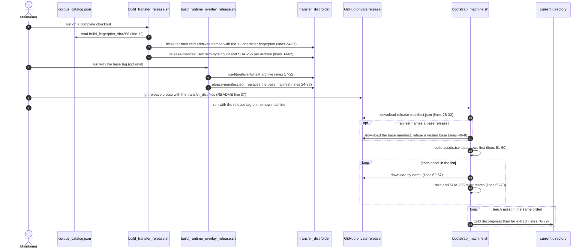

# Flow: transfer release

flow: transfer-release · runs through: [repo-ops-data](../chapters/repo-ops-data.md), [graphrag-runtime](../chapters/graphrag-runtime.md), [literature-fulltext](../chapters/literature-fulltext.md), [literature-corpus](../chapters/literature-corpus.md), [corpus-docs-web](../chapters/corpus-docs-web.md) · as of 1047fc8

The transfer release moves the versioned corpus from the machine that builds it to a machine that needs it, through private GitHub Release assets. On a complete checkout, `scripts/build_transfer_release.sh` packs `data/`, `source_material/`, `runtime_data/` and three gitignored provenance folders into three tar archives, each compressed with zstd (Zstandard). The archive names carry the first 12 characters of the catalog fingerprint (a SHA-256 digest, a 256-bit hash, that `discover_corpora.py` computes over the corpus inputs), and the script writes `release-manifest.json` with each archive's byte count and SHA-256 (build:32-62). An optional overlay, `scripts/build_runtime_overlay_release.sh`, packs only the Literature full-text cache and records the base tag it extends (overlay:17-38). The maintainer publishes the files with a hand-typed `gh release create` (README:37-39), and the README calls the assets private (README:6-7). On another machine, `scripts/bootstrap_machine.sh --release <tag>` fetches the manifest, follows `base_release` once, downloads every asset, checks each one's size and SHA-256 against the manifest, and only then extracts the base archives before the overlay into the current directory (bootstrap:27-79). Those checks show that each download matches the manifest published beside it, not that the release is authentic. Three hazards matter most: a missing build input does not fail the build, both release builders write the same manifest path by default, and the restore writes wherever it is run.

## Sequence

## Hops

### 1. Catalog fingerprint (input to the base build)

- **Component:** `discover_corpora.py` writes the catalog; `build_transfer_release.sh` reads one field from it. Owner: [graphrag-runtime](../chapters/graphrag-runtime.md).
- **Where:** `src/graphrag_runtime/discover_corpora.py:258-271` (`_fingerprint`, a SHA-256 over canonical JSON of collection IDs, manifest hashes, and input roles, paths and hashes), `:315` (field written), `:346` (default path); `scripts/build_transfer_release.sh:6`, `:10`, `:12-13`.
- **Data:** `runtime_data/GraphRAG/corpus_catalog.json`, a JSON object. The build reads `build_fingerprint_sha256`, a 64-character lowercase hex string, and keeps its first 12 characters (`:13`). The file is gitignored (`.gitignore:31-35`), so it exists only where discovery ran, and it comes back in the restore as part of `runtime_data/` (hop 10).
- **Can fail:** a missing file exits at line 10. A catalog without the key stops at line 12 with a Python KeyError (reproduced, exit 1). The build never reruns discovery (no call to `discover_corpora` under `scripts/`), so the archive names reflect whatever catalog is on disk, not necessarily the data it packs (inferred from line 12). Such a mismatch would surface only at hop 11.

### 2. Base archives

- **Component:** `make_archive` in `build_transfer_release.sh`. Owner: [repo-ops-data](../chapters/repo-ops-data.md).
- **Where:** output folder `:5`, `:14`; `COPYFILE_DISABLE=1` and `cd` to the project root `:16-17`; function `:19-30` with tar excludes `:24-28` and the zstd stage `:29`; calls `:32`, `:33-36`, `:37`.
- **Data:** three archives in the output folder. `rca-corpus-data-<fp12>.tar.zst` holds `data`. `rca-source-material-<fp12>.tar.zst` holds `source_material`, `src/literature_pipeline/provenance`, `src/literature_pipeline/archive` and `src/arcada_pipeline/source_snapshot`. `rca-runtime-data-<fp12>.tar.zst` holds `runtime_data` without the full-text cache (`:26`), FreeLLMAPI data (`:27`) and `__pycache__` folders (`:28`). Shape: a tar stream compressed at zstd level 10 (`-10`) on all threads (`-T0`), overwriting any archive of the same name (`-f`).
- **Can fail:**
  - A missing input does not fail the build. `tar` reports "Cannot stat", but the pipeline's exit status is zstd's, so `make_archive` returns 0 (`:24-29`). Reproduced with a copy of the function and one missing directory: exit 0, and the archive lacked that path.
  - The three source-material paths are gitignored (`.gitignore:37-40`). `prepare_runtime.py` moves items into the first two with `shutil.move` (`src/literature_pipeline/code/prepare_runtime.py:53-55`, `:62-66`; see [literature-corpus](../chapters/literature-corpus.md)). No tracked code writes `src/arcada_pipeline/source_snapshot` (`git grep source_snapshot`); the [corpus-docs-web](../chapters/corpus-docs-web.md) chapter treats it as an upstream copy.
  - The excludes are narrower than the README says (`README.md:42-43`). `.venv` and `venv` are not excluded, and neither are `*.pem` and `*.key`, which `.gitignore:46-47` keeps out of Git. Only `.env` and `.env.*` are excluded among credential files (`:25`). Whether any such file sits in the three trees cannot be checked here, because those trees are absent from this checkout.
  - A relative output folder is created in the caller's directory (`:14`, before the `cd` at `:17`), but the archives are written under the project root (`:22`, `:29`). See [repo-ops-data](../chapters/repo-ops-data.md) gotcha 7.

### 3. Base manifest

- **Component:** inline Python in `build_transfer_release.sh`.
- **Where:** `:39-64`; glob `:49`; per-archive entry `:54`; object `:55-61`; write `:62`.
- **Data:** `release-manifest.json`, two-space-indented JSON: `schema_version` ("1.0"), `created_at_utc` (ISO-8601 UTC), `catalog_fingerprint_sha256` (the full 64-hex value, `:58`), `assets` (a list of `{name, bytes (integer), sha256 (64 hex)}`, `:54`) and `restore_root` (".", `:60`).
- **Can fail:** the glob matches every `rca-*.tar.zst` in the output folder, not only this build's (`:49`). Reproduced: a stale `rca-corpus-data-ffffffffffff` archive was listed beside the three current ones. `restore_root` is written and never read anywhere in the repo. `catalog_fingerprint_sha256` is written here and never compared during restore (hop 11).

### 4. Overlay archive (optional)

- **Component:** `build_runtime_overlay_release.sh`. Owner: [literature-fulltext](../chapters/literature-fulltext.md) for the content.
- **Where:** usage `:7`; output folder `:9`; cache folder `:10`; existence check `:14`; archive name `:17`; excludes `:20-21`; zstd stage `:22`.
- **Data:** one archive, `rca-literature-fulltext-YYYYMMDD.tar.zst` (UTC date), holding `runtime_data/Literature/full_text_cache`. Unlike the base archives, it is not keyed by fingerprint. The cache holds one folder per work, with `metadata.json`, `chunks.jsonl` and the stored document (`src/literature_fulltext/literature_fulltext_tools.py:316`, `:676`).
- **Can fail:** `BASE_RELEASE` is required (`:7`), and the cache folder must exist (`:14`). The script never reads the base manifest, the catalog or GitHub, so nothing checks that the base tag exists or matches the cache (inferred; the tag is only copied into the manifest at `:24`). A rebuild on the same day overwrites the archive (`zstd -f`, `:22`). The excludes cover `.env` and `.env.*` only (`:21`).

### 5. Overlay manifest (replaces the base manifest)

- **Component:** inline Python in `build_runtime_overlay_release.sh`.
- **Where:** arguments `:24`; object `:33-37`; write `:38`.
- **Data:** `schema_version` ("1.1-overlay", `:34`), `created_at_utc`, `base_release` (the tag as typed, `:35`), `assets` with exactly one entry (`:35`) and `restore_root` (".", `:36`). It carries no catalog fingerprint.
- **Can fail:** `:38` writes `$output_dir/release-manifest.json`, the same path the base builder writes (`build_transfer_release.sh:62`) when both use the default folder. Reproduced: after an overlay build the manifest listed only the overlay archive, and the three base entries were gone. Rerunning the base snippet then pulled the overlay archive into the base list as well (`:49`). A base release published after an overlay build carries the overlay's manifest, and restoring that tag fails (hop 8).

### 6. Publish (manual)

- **Component:** the maintainer's `gh release create`. No script runs it.
- **Where:** `README.md:35-40`. `git grep` finds the command only in the README.
- **Data:** a tag typed by hand (`corpus-YYYYMMDD`, `README.md:37`), a title and notes, and every file matching `transfer_dist/*` as an asset.
- **Can fail:** the glob uploads whatever is in the folder, including stale archives and, after an overlay build, the overlay manifest and any base archives (repo-ops-data gotchas 5 and 6). The overlay upload is not in the README; `README.md:27-28` mentions supplemental releases only in passing. Nothing in the repo sets or reads release visibility.

### 7. Restore entry: arguments, tools and repository

- **Component:** `bootstrap_machine.sh`.
- **Where:** defaults `:4-6`; flags `:8-15` (an unknown flag exits 2 at `:13`); tool checks `:17-19`; repository `:21-25`.
- **Data:** `release` (a tag, or `latest`), `repo` (`OWNER/REPO`) and `download_dir` (default `.artifacts`).
- **Can fail:** a missing `gh`, `zstd` or `python3` stops here (`:17-19`). The README lists Git, GitHub CLI, Docker and zstd, but not `python3` (`README.md:13`). The origin parse handles `git@github.com:` and `https://github.com/` remotes only (`:23`); an `ssh://git@github.com/...` origin produced `ssh://git@github.com/coszo-hub/RCA-Atlas` (reproduced). The script never changes directory (no `cd` in the file), so `.artifacts/` and the restore both land wherever it is run (`:6`, `:27`, `:76-79`).

### 8. Manifest fetch and base lookup

- **Component:** `bootstrap_machine.sh`.
- **Where:** fetch `:28-32` (`latest` drops the tag, `:29`); read `base_release` `:34-38`; base manifest `:40-42`; nested-base refusal `:43-48`.
- **Data:** the release manifest from hop 3 or hop 5. Only `base_release` and `assets` are read.
- **Can fail:** `latest` means the latest release in the project (`gh release download --help`, checked locally), so whichever release is newest decides what is restored. A base published after an overlay makes `latest` skip the overlay (inferred). Passing the base tag alone restores no cache, and the closing message does not say so (`:34-41`, `:81`). If the base's own manifest names another base, the run stops at `:48` with "Nested base_release is not supported" (reproduced, exit 1, including the overwrite case from hop 5).

### 9. Asset list and integrity check

- **Component:** `bootstrap_machine.sh`.
- **Where:** `assets.tsv` `:51-60` (base rows first, `:57-59`); verification `:62-74`: download `:63-67`, SHA-256 `:68`, byte count `:69`, comparison and exit `:70-72`, report `:73`.
- **Data:** `.artifacts/assets.tsv`, four tab-separated columns per row: release tag or `latest` (`:56`), file name, SHA-256 and byte count. `.artifacts/` is gitignored (`.gitignore:18`) and nothing cleans it up.
- **Can fail:** `sha256sum` (`:68`) is not in the README's prerequisites (`README.md:13`). On a PATH without it, every asset is reported as "Integrity check failed" and the run exits 1 (reproduced; see [repo-ops-data](../chapters/repo-ops-data.md) open question 10). `latest` is resolved again for each asset (`:63-66`), so a release published mid-run changes the source; the hash check then fails, which is safe but confusing (repo-ops-data gotcha 4). The digest comes from the same release as the archive, so a match shows consistency, not authenticity. Nothing in the flow is signed (inferred).

### 10. Restore, base first

- **Component:** `bootstrap_machine.sh`.
- **Where:** the restore loop `:76-79`, which starts only after the verification loop `:62-74` has finished; extraction at `:78`.
- **Data:** each archive in `assets.tsv` order is streamed with `zstd -dc FILE | tar -xf -` (`:78`). The entries are relative paths, because both builders change to the project root first (`build_transfer_release.sh:17`, `build_runtime_overlay_release.sh:19`), so they land under the current directory.
- **Can fail:** no script sets `pipefail` (`git grep`), so a zstd decode error is reported only when tar also fails (inferred). `tar -xf` overwrites files with the same path, and nothing removes files that an archive no longer contains (inferred from tar's defaults; there is no cleanup code). Reproduced: with the overlay corrupted, the run verified the base archives, failed on the overlay, and extracted nothing.

### 11. Hand-off to the Graph-RAG runtime

- **Component:** [graphrag-runtime](../chapters/graphrag-runtime.md).
- **Where:** closing message `bootstrap_machine.sh:81`; setup steps `src/graphrag_runtime/README.md:25-29`; catalog reads `normalize_corpus.py:176` and `:386`; per-input size and SHA-256 checks `normalize_corpus.py:220-228`; `build_embeddings.py:250`; the loader reads its own `build_manifest.json` `load_postgres.py:38-42`.
- **Data:** the restored `runtime_data/GraphRAG/corpus_catalog.json`. The normalizer checks each catalogued input's byte size and SHA-256 against the catalog's `byte_size` and `sha256` fields (`normalize_corpus.py:222-228`).
- **Can fail:** the release manifest's `catalog_fingerprint_sha256` (`build_transfer_release.sh:58`) is never compared after restore. The loader compares its own `build_manifest.json` with the catalog fingerprint (`load_postgres.py:42`), not the release manifest. A mismatch between the data and the catalog surfaces here, at normalization time, not at restore.

## Config and secrets

| Name | Read at | Purpose | Default or required |
| --- | --- | --- | --- |
| `runtime_data/GraphRAG/corpus_catalog.json` | `build_transfer_release.sh:6`, `:10`, `:12` | Source of the fingerprint used in archive names | Required; produced by `discover_corpora.py` (default path at `:346`); gitignored (`.gitignore:31-35`) |
| output folder (first argument) | `build_transfer_release.sh:5` | Where the three archives and the manifest go | `transfer_dist` (gitignored, `.gitignore:17`) |
| `BASE_RELEASE` (first argument) | `build_runtime_overlay_release.sh:7` | Base tag written into the overlay manifest | Required |
| output folder (second argument) | `build_runtime_overlay_release.sh:9` | Where the overlay archive and manifest go | `transfer_dist` |
| `--release` | `bootstrap_machine.sh:4`, `:10` | Tag to restore | `latest` (README:18 uses it) |
| `--repo` | `bootstrap_machine.sh:11` | `OWNER/REPO` for `gh` | Optional; else `GITHUB_REPOSITORY` (`:5`), else the origin remote (`:21-25`) |
| `GITHUB_REPOSITORY` | `bootstrap_machine.sh:5` | Default repository | Optional environment variable |
| `--download-dir` | `bootstrap_machine.sh:6`, `:12` | Downloads and `assets.tsv` | `.artifacts` (gitignored, `.gitignore:18`) |
| `COPYFILE_DISABLE` | `build_transfer_release.sh:16`; `build_runtime_overlay_release.sh:18` | Set by the scripts; keeps macOS tar from adding `._` metadata files (general knowledge) | Set to 1 by the script |

Tools: `gh`, `zstd` and `python3` are checked by `bootstrap_machine.sh:17-19`; the builders check `zstd` and `python3` at `build_transfer_release.sh:8-9` and `build_runtime_overlay_release.sh:12-13`. The flow also calls `tar`, `sha256sum`, `wc`, `tr`, `awk` and `sed`, and `git` only when no repository is given (`bootstrap_machine.sh:22`). `pixi.toml:6-7` declares none of them; it lists only `okf-agent-memory`. The README asks for Git, GitHub CLI, Docker and zstd (`README.md:13`) and does not list `python3` or `sha256sum`.

Secrets: the flow reads no secret values. GitHub access comes from the `gh` login that the README asks for (`README.md:13`). `gh` stores that login outside the repository, and the scripts never read it. A private release needs read access to download and write access to create (inferred). The archives exclude `.env` and `.env.*` (`build_transfer_release.sh:25`, `build_runtime_overlay_release.sh:21`), so a restore does not bring back credentials. The keys the Graph-RAG runtime needs after restore are named in `.env.example:18-22` (`GRAPHRAG_API_KEY`, `GRAPHRAG_API_KEY_SHA256`, `POSTGRES_PASSWORD`, `GRAPHRAG_API_DATABASE_PASSWORD`) and copied by hand (`src/graphrag_runtime/README.md:25-29`); this flow does not read them.

## Checked by running

These checks ran in a scratch folder outside the repository, with no network access and no writes to the repository:

- A copy of `make_archive`, with the same tar and zstd flags and one missing directory: exit 0 and a partial archive.
- The manifest code, extracted from lines 40-63 of the base builder and lines 25-39 of the overlay builder and run with `python3 -I`: the stale archive was listed, the overlay replaced the base manifest, and rerunning the base snippet pulled in the overlay archive.
- The real `bootstrap_machine.sh`, run from an empty directory against a fake `gh` that copies files from a scratch release folder: base before overlay, every asset verified before any extraction, files placed in the current directory. A corrupted overlay stopped the run with nothing extracted. A base whose own manifest names another base stopped with "Nested base_release is not supported". A PATH without `sha256sum` failed every asset.
- A catalog without `build_fingerprint_sha256` stopped with a KeyError (exit 1). A base runtime archive built with the full-text-cache exclude contained no such path.

Not run: the real build (the data trees are absent from this checkout, and the build writes to `transfer_dist/`), any `gh release create`, and any real `gh` download.

## Open questions

1. **Where is the overlay's upload procedure written down?** The README documents only `transfer_dist/*` (`README.md:37`), and the overlay is described only in its script header (`build_runtime_overlay_release.sh:4-5`). Answer: the maintainers, or the command used for the last supplemental release.
2. **Should restore compare the two fingerprints?** Nothing compares the release manifest's `catalog_fingerprint_sha256` (`build_transfer_release.sh:58`) with the restored catalog's `build_fingerprint_sha256`. Answer: the maintainers' intent. Comparing the two values after a restore would show whether they agree today.
3. **Do the archives carry secrets or virtual environments?** `README.md:42-43` says they do not. The excludes cover `.env` files only (`build_transfer_release.sh:24-28`, `build_runtime_overlay_release.sh:20-21`). Answer: list each built archive (`zstd -dc FILE | tar -tf -`) and search for `*.pem`, `*.key` and `venv/` paths.
4. **Should the build refresh the catalog?** The build reads the fingerprint and never reruns discovery (`build_transfer_release.sh:12`). Answer: the maintainers' release rule. Rerunning `discover_corpora.py` into a scratch path and comparing the fingerprint with the file on disk would show whether they match.
5. **Does any published release match `deployment_status.json`?** `runtime_data/GraphRAG/deployment_status.json:4` records a fingerprint beginning `9a31ca84`, prepared on 2026-09-20. No code reads the file; `.gitignore:35` is its only reference. Answer: compare with `catalog_fingerprint_sha256` in each published manifest (`gh release list` shows the tags).
6. **Should restore honor `restore_root` and change directory?** Both builders write `restore_root` (`build_transfer_release.sh:60`, `build_runtime_overlay_release.sh:36`), and nothing reads it. The builders change to the project root (`build_transfer_release.sh:17`, `build_runtime_overlay_release.sh:19`); the restore does not. Answer: the maintainers. [repo-ops-data](../chapters/repo-ops-data.md) gotcha 1 flags the same behavior.
7. **Should restore clear the target first?** tar overwrites same-path files, and nothing removes the rest (`bootstrap_machine.sh:76-79`). Answer: the maintainers. A restore over a populated checkout, compared before and after, would show what changes.
8. **Is the repository private?** `README.md:6-7` says so, but no code sets or reads visibility. Answer: `gh repo view coszo-hub/RCA-Atlas --json visibility`. Not run here, because it contacts GitHub.
9. **Are any assets near GitHub's per-file size limit?** Each manifest records `bytes` (`build_transfer_release.sh:54`). Answer: compare the largest value with GitHub's current per-file limit, which is not in this repository.
10. **Does a fresh Mac have `sha256sum`?** Restore calls it at `bootstrap_machine.sh:68`, and the README does not list it. Answer: `command -v sha256sum` on a clean Mac, or [repo-ops-data](../chapters/repo-ops-data.md) open question 10.

## Glossary

| Term | Meaning |
| --- | --- |
| Catalog | `corpus_catalog.json`, the index of every collection input with its byte size, SHA-256 and record count (`src/graphrag_runtime/discover_corpora.py`). |
| Fingerprint | The SHA-256 over the collection IDs, manifest hashes, and input roles, paths and hashes (`discover_corpora.py:258-271`). Release file names use its first 12 characters. |
| Base release | The release built by `build_transfer_release.sh`: three archives and a manifest. |
| Overlay | A supplemental release with only the full-text cache; its manifest names its base tag. |
| Full-text cache | Per-work folders of fetched full text used by the literature tools ([literature-fulltext](../chapters/literature-fulltext.md)). |
| Provenance and archive folders | Raw API responses and source snapshots kept beside the literature collection, outside the runtime folder ([literature-corpus](../chapters/literature-corpus.md)). |
| SHA-256 | A 256-bit digest of a file; equal digests mean equal bytes. |
| tar, zstd | tar packs files into one stream; zstd (Zstandard) compresses it. |
| gh | The GitHub command-line client, used here to create and download release assets. |
| Manifest | `release-manifest.json`: the asset list with sizes and digests, plus the base tag for an overlay. |
| assets.tsv | The restore's download list: release tag, file name, SHA-256 and byte count, one row per asset. |
| Graph-RAG | Retrieval over corpus chunks combined with a graph built from them; the runtime is in [graphrag-runtime](../chapters/graphrag-runtime.md). |
